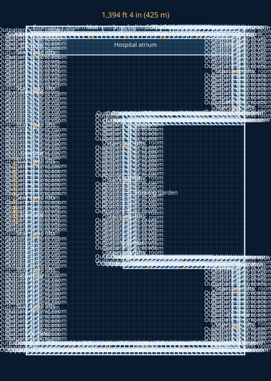
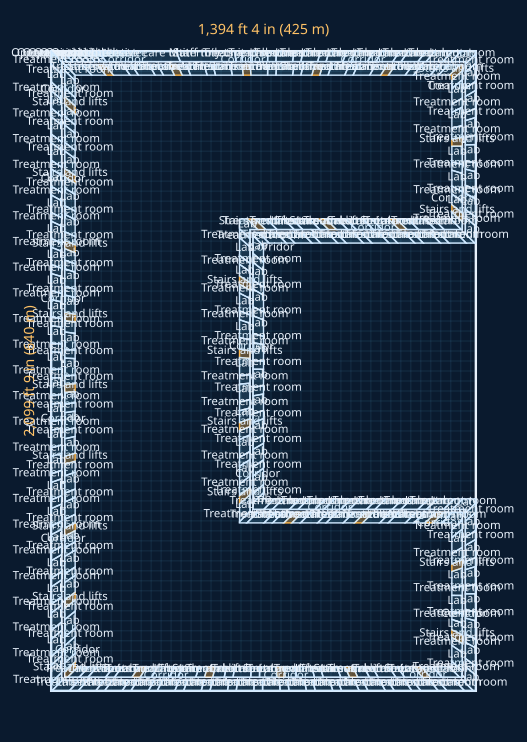
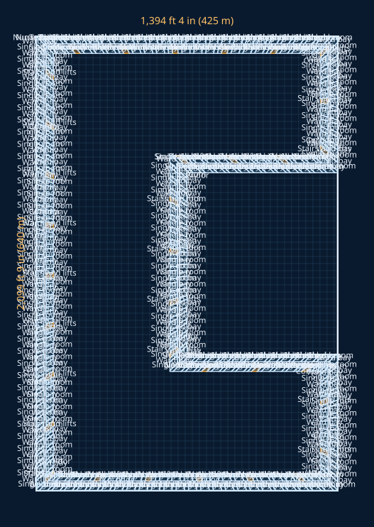

# P3-08 Quarter Hospital: plan

Footprint 1,394 ft 4 in (425 m) × 2,099 ft 9 in (640 m) · structural grid 32 ft 10 in (10 m)

## Levels

| Level | Floor above deck | Height | Floor area |
|---|---|---|---|
| Level 1 · Ground floor | 0 ft (0 mm) | 18 ft 1 in (5,500 mm) | 654,134 sq ft (60,771 m²) |
| Level 2 · Clinical floor 1 | 18 ft 1 in (5,500 mm) | 14 ft 9 in (4,500 mm) | 525,090 sq ft (48,782 m²) |
| Level 3 · Clinical floor 2 | 32 ft 10 in (10 m) | 14 ft 9 in (4,500 mm) | 525,090 sq ft (48,782 m²) |
| Level 4 · Ward floor 1 | 47 ft 7 in (14 m) | 13 ft 1 in (4,000 mm) | 525,090 sq ft (48,782 m²) |
| Level 5 · Ward floor 2 | 60 ft 8 in (18 m) | 13 ft 1 in (4,000 mm) | 525,090 sq ft (48,782 m²) |
| Level 6 · Ward floor 3 | 73 ft 10 in (22 m) | 13 ft 1 in (4,000 mm) | 525,090 sq ft (48,782 m²) |
| Level 7 · Ward floor 4 | 86 ft 11 in (26 m) | 13 ft 1 in (4,000 mm) | 525,090 sq ft (48,782 m²) |

## Elements

| ID | Designation | Type | Name | Level(s) | Size / length | Area | Status |
|---|---|---|---|---|---|---|---|
| E001 | D5F6P3B9A1L1R1 | room | Hospital atrium | L1 | 1,236 ft 11 in (377 m) × 104 ft 4 in (32 m) | 129,044 sq ft (11,989 m²) | proposed |
| E002 | D5F6P3B9A1L1R2 | zone | Healing garden | L1 | 1,236 ft 11 in (377 m) × 1,837 ft 11 in (560 m) | 1,577,940 sq ft (146,595 m²) | proposed |
| E003 | D5F6P3B9A1L1R3 | zone | Corridor | L1 | 400 ft 7 in (122 m) × 9 ft 10 in (3,000 mm) | 3,875 sq ft (360 m²) | proposed |
| E004 | D5F6P3B9A1L1R4 | zone | Corridor | L1 | 396 ft 8 in (121 m) × 9 ft 10 in (3,000 mm) | 3,875 sq ft (360 m²) | proposed |
| E005 | D5F6P3B9A1L1R5 | zone | Corridor | L1 | 398 ft 7 in (122 m) × 9 ft 10 in (3,000 mm) | 3,875 sq ft (360 m²) | proposed |
| E006 | D5F6P3B9A1L1R6 | zone | Corridor | L1 | 143 ft 4 in (44 m) × 264 ft 5 in (81 m) | 3,875 sq ft (360 m²) | proposed |
| E007 | D5F6P3B9A1L1R7 | zone | Corridor | L1 | 111 ft 7 in (34 m) × 297 ft 3 in (91 m) | 3,875 sq ft (360 m²) | proposed |
| E008 | D5F6P3B9A1L1R8 | zone | Corridor | L1 | 403 ft 7 in (123 m) × 9 ft 10 in (3,000 mm) | 3,875 sq ft (360 m²) | proposed |
| E009 | D5F6P3B9A1L1R9 | zone | Corridor | L1 | 211 ft 7 in (64 m) × 199 ft 10 in (61 m) | 3,875 sq ft (360 m²) | proposed |
| E010 | D5F6P3B9A1L1R10 | zone | Corridor | L1 | 9 ft 10 in (3,000 mm) × 398 ft (121 m) | 3,875 sq ft (360 m²) | proposed |
| E011 | D5F6P3B9A1L1R11 | zone | Corridor | L1 | 70 ft 6 in (22 m) × 339 ft 3 in (103 m) | 3,875 sq ft (360 m²) | proposed |
| E012 | D5F6P3B9A1L1R12 | zone | Corridor | L1 | 403 ft 7 in (123 m) × 9 ft 10 in (3,000 mm) | 3,875 sq ft (360 m²) | proposed |
| E013 | D5F6P3B9A1L1R13 | zone | Corridor | L1 | 252 ft 7 in (77 m) × 158 ft 2 in (48 m) | 3,875 sq ft (360 m²) | proposed |
| E014 | D5F6P3B9A1L1R14 | zone | Corridor | L1 | 9 ft 10 in (3,000 mm) × 400 ft 11 in (122 m) | 3,875 sq ft (360 m²) | proposed |
| E015 | D5F6P3B9A1L1R15 | zone | Corridor | L1 | 394 ft (120 m) × 16 ft 5 in (5,000 mm) | 3,875 sq ft (360 m²) | proposed |
| E016 | D5F6P3B9A1L1R16 | zone | Corridor | L1 | 396 ft 8 in (121 m) × 9 ft 10 in (3,000 mm) | 3,875 sq ft (360 m²) | proposed |
| E017 | D5F6P3B9A1L1R17 | zone | Corridor | L1 | 398 ft 7 in (122 m) × 9 ft 10 in (3,000 mm) | 3,875 sq ft (360 m²) | proposed |
| E018 | D5F6P3B9A1L1R18 | zone | Corridor | L1 | 149 ft 11 in (46 m) × 261 ft 2 in (80 m) | 3,875 sq ft (360 m²) | proposed |
| E019 | D5F6P3B9A1L1R19 | zone | Corridor | L1 | 9 ft 10 in (3,000 mm) × 398 ft 11 in (122 m) | 3,875 sq ft (360 m²) | proposed |
| E020 | D5F6P3B9A1L1R20 | zone | Corridor | L1 | 9 ft 10 in (3,000 mm) × 395 ft 4 in (120 m) | 3,875 sq ft (360 m²) | proposed |
| E021 | D5F6P3B9A1L1R21 | zone | Corridor | L1 | 9 ft 10 in (3,000 mm) × 395 ft 8 in (121 m) | 3,875 sq ft (360 m²) | proposed |
| E022 | D5F6P3B9A1L1R22 | zone | Corridor | L1 | 9 ft 10 in (3,000 mm) × 399 ft 7 in (122 m) | 3,875 sq ft (360 m²) | proposed |
| E023 | D5F6P3B9A1L1R23 | zone | Corridor | L1 | 9 ft 10 in (3,000 mm) × 202 ft 5 in (62 m) | 1,905 sq ft (177 m²) | proposed |
| E024 | D5F6P3B9A1L1R24, D5F6P3B9A1L2R1, D5F6P3B9A1L3R1, D5F6P3B9A1L4R1, D5F6P3B9A1L5R1, D5F6P3B9A1L6R1, D5F6P3B9A1L7R1 | core | Stairs and lifts | L1, L2, L3, L4, L5, L6, L7 | 54 ft 6 in (17 m) × 34 ft 5 in (10 m) | 904 sq ft (84 m²) | proposed |
| E025 | D5F6P3B9A1L1R25, D5F6P3B9A1L2R2, D5F6P3B9A1L3R2, D5F6P3B9A1L4R2, D5F6P3B9A1L5R2, D5F6P3B9A1L6R2, D5F6P3B9A1L7R2 | core | Stairs and lifts | L1, L2, L3, L4, L5, L6, L7 | 41 ft 8 in (13 m) × 34 ft 5 in (10 m) | 904 sq ft (84 m²) | proposed |
| E026 | D5F6P3B9A1L1R26, D5F6P3B9A1L2R3, D5F6P3B9A1L3R3, D5F6P3B9A1L4R3, D5F6P3B9A1L5R3, D5F6P3B9A1L6R3, D5F6P3B9A1L7R3 | core | Stairs and lifts | L1, L2, L3, L4, L5, L6, L7 | 29 ft 2 in (8,900 mm) × 34 ft 5 in (10 m) | 899 sq ft (83 m²) | proposed |
| E027 | D5F6P3B9A1L1R27, D5F6P3B9A1L2R4, D5F6P3B9A1L3R4, D5F6P3B9A1L4R4, D5F6P3B9A1L5R4, D5F6P3B9A1L6R4, D5F6P3B9A1L7R4 | core | Stairs and lifts | L1, L2, L3, L4, L5, L6, L7 | 35 ft 9 in (11 m) × 34 ft 5 in (10 m) | 904 sq ft (84 m²) | proposed |
| E028 | D5F6P3B9A1L1R28, D5F6P3B9A1L2R5, D5F6P3B9A1L3R5, D5F6P3B9A1L4R5, D5F6P3B9A1L5R5, D5F6P3B9A1L6R5, D5F6P3B9A1L7R5 | core | Stairs and lifts | L1, L2, L3, L4, L5, L6, L7 | 48 ft 3 in (15 m) × 34 ft 5 in (10 m) | 904 sq ft (84 m²) | proposed |
| E029 | D5F6P3B9A1L1R29, D5F6P3B9A1L2R6, D5F6P3B9A1L3R6, D5F6P3B9A1L4R6, D5F6P3B9A1L5R6, D5F6P3B9A1L6R6, D5F6P3B9A1L7R6 | core | Stairs and lifts | L1, L2, L3, L4, L5, L6, L7 | 42 ft 4 in (13 m) × 51 ft 6 in (16 m) | 904 sq ft (84 m²) | proposed |
| E030 | D5F6P3B9A1L1R30, D5F6P3B9A1L2R7, D5F6P3B9A1L3R7, D5F6P3B9A1L4R7, D5F6P3B9A1L5R7, D5F6P3B9A1L6R7, D5F6P3B9A1L7R7 | core | Stairs and lifts | L1, L2, L3, L4, L5, L6, L7 | 34 ft 5 in (10 m) × 28 ft 7 in (8,700 mm) | 910 sq ft (85 m²) | proposed |
| E031 | D5F6P3B9A1L1R31, D5F6P3B9A1L2R8, D5F6P3B9A1L3R8, D5F6P3B9A1L4R8, D5F6P3B9A1L5R8, D5F6P3B9A1L6R8, D5F6P3B9A1L7R8 | core | Stairs and lifts | L1, L2, L3, L4, L5, L6, L7 | 34 ft 5 in (10 m) × 55 ft 5 in (17 m) | 899 sq ft (83 m²) | proposed |
| E032 | D5F6P3B9A1L1R32, D5F6P3B9A1L2R9, D5F6P3B9A1L3R9, D5F6P3B9A1L4R9, D5F6P3B9A1L5R9, D5F6P3B9A1L6R9, D5F6P3B9A1L7R9 | core | Stairs and lifts | L1, L2, L3, L4, L5, L6, L7 | 60 ft 8 in (18 m) × 34 ft 5 in (10 m) | 904 sq ft (84 m²) | proposed |
| E033 | D5F6P3B9A1L1R33, D5F6P3B9A1L2R10, D5F6P3B9A1L3R10, D5F6P3B9A1L4R10, D5F6P3B9A1L5R10, D5F6P3B9A1L6R10, D5F6P3B9A1L7R10 | core | Stairs and lifts | L1, L2, L3, L4, L5, L6, L7 | 60 ft 8 in (18 m) × 34 ft 5 in (10 m) | 904 sq ft (84 m²) | proposed |
| E034 | D5F6P3B9A1L1R34, D5F6P3B9A1L2R11, D5F6P3B9A1L3R11, D5F6P3B9A1L4R11, D5F6P3B9A1L5R11, D5F6P3B9A1L6R11, D5F6P3B9A1L7R11 | core | Stairs and lifts | L1, L2, L3, L4, L5, L6, L7 | 60 ft 8 in (18 m) × 34 ft 5 in (10 m) | 904 sq ft (84 m²) | proposed |
| E035 | D5F6P3B9A1L1R35, D5F6P3B9A1L2R12, D5F6P3B9A1L3R12, D5F6P3B9A1L4R12, D5F6P3B9A1L5R12, D5F6P3B9A1L6R12, D5F6P3B9A1L7R12 | core | Stairs and lifts | L1, L2, L3, L4, L5, L6, L7 | 34 ft 5 in (10 m) × 46 ft 11 in (14 m) | 904 sq ft (84 m²) | proposed |
| E036 | D5F6P3B9A1L1R36, D5F6P3B9A1L2R13, D5F6P3B9A1L3R13, D5F6P3B9A1L4R13, D5F6P3B9A1L5R13, D5F6P3B9A1L6R13, D5F6P3B9A1L7R13 | core | Stairs and lifts | L1, L2, L3, L4, L5, L6, L7 | 34 ft 5 in (10 m) × 30 ft 2 in (9,200 mm) | 904 sq ft (84 m²) | proposed |
| E037 | D5F6P3B9A1L1R37, D5F6P3B9A1L2R14, D5F6P3B9A1L3R14, D5F6P3B9A1L4R14, D5F6P3B9A1L5R14, D5F6P3B9A1L6R14, D5F6P3B9A1L7R14 | core | Stairs and lifts | L1, L2, L3, L4, L5, L6, L7 | 34 ft 5 in (10 m) × 38 ft 9 in (12 m) | 899 sq ft (83 m²) | proposed |
| E038 | D5F6P3B9A1L1R38, D5F6P3B9A1L2R15, D5F6P3B9A1L3R15, D5F6P3B9A1L4R15, D5F6P3B9A1L5R15, D5F6P3B9A1L6R15, D5F6P3B9A1L7R15 | core | Stairs and lifts | L1, L2, L3, L4, L5, L6, L7 | 34 ft 5 in (10 m) × 55 ft 5 in (17 m) | 904 sq ft (84 m²) | proposed |
| E039 | D5F6P3B9A1L1R39, D5F6P3B9A1L2R16, D5F6P3B9A1L3R16, D5F6P3B9A1L4R16, D5F6P3B9A1L5R16, D5F6P3B9A1L6R16, D5F6P3B9A1L7R16 | core | Stairs and lifts | L1, L2, L3, L4, L5, L6, L7 | 60 ft 8 in (18 m) × 34 ft 5 in (10 m) | 904 sq ft (84 m²) | proposed |
| E040 | D5F6P3B9A1L1R40, D5F6P3B9A1L2R17, D5F6P3B9A1L3R17, D5F6P3B9A1L4R17, D5F6P3B9A1L5R17, D5F6P3B9A1L6R17, D5F6P3B9A1L7R17 | core | Stairs and lifts | L1, L2, L3, L4, L5, L6, L7 | 60 ft 8 in (18 m) × 34 ft 5 in (10 m) | 904 sq ft (84 m²) | proposed |
| E041 | D5F6P3B9A1L1R41, D5F6P3B9A1L2R18, D5F6P3B9A1L3R18, D5F6P3B9A1L4R18, D5F6P3B9A1L5R18, D5F6P3B9A1L6R18, D5F6P3B9A1L7R18 | core | Stairs and lifts | L1, L2, L3, L4, L5, L6, L7 | 60 ft 8 in (18 m) × 34 ft 5 in (10 m) | 904 sq ft (84 m²) | proposed |
| E042 | D5F6P3B9A1L1R42, D5F6P3B9A1L2R19, D5F6P3B9A1L3R19, D5F6P3B9A1L4R19, D5F6P3B9A1L5R19, D5F6P3B9A1L6R19, D5F6P3B9A1L7R19 | core | Stairs and lifts | L1, L2, L3, L4, L5, L6, L7 | 34 ft 5 in (10 m) × 39 ft 4 in (12 m) | 904 sq ft (84 m²) | proposed |
| E043 | D5F6P3B9A1L1R43, D5F6P3B9A1L2R20, D5F6P3B9A1L3R20, D5F6P3B9A1L4R20, D5F6P3B9A1L5R20, D5F6P3B9A1L6R20, D5F6P3B9A1L7R20 | core | Stairs and lifts | L1, L2, L3, L4, L5, L6, L7 | 34 ft 5 in (10 m) × 44 ft 11 in (14 m) | 910 sq ft (85 m²) | proposed |
| E044 | D5F6P3B9A1L1R44, D5F6P3B9A1L2R21, D5F6P3B9A1L3R21, D5F6P3B9A1L4R21, D5F6P3B9A1L5R21, D5F6P3B9A1L6R21, D5F6P3B9A1L7R21 | core | Stairs and lifts | L1, L2, L3, L4, L5, L6, L7 | 54 ft 6 in (17 m) × 34 ft 5 in (10 m) | 904 sq ft (84 m²) | proposed |
| E045 | D5F6P3B9A1L1R45, D5F6P3B9A1L2R22, D5F6P3B9A1L3R22, D5F6P3B9A1L4R22, D5F6P3B9A1L5R22, D5F6P3B9A1L6R22, D5F6P3B9A1L7R22 | core | Stairs and lifts | L1, L2, L3, L4, L5, L6, L7 | 41 ft 8 in (13 m) × 34 ft 5 in (10 m) | 899 sq ft (83 m²) | proposed |
| E046 | D5F6P3B9A1L1R46, D5F6P3B9A1L2R23, D5F6P3B9A1L3R23, D5F6P3B9A1L4R23, D5F6P3B9A1L5R23, D5F6P3B9A1L6R23, D5F6P3B9A1L7R23 | core | Stairs and lifts | L1, L2, L3, L4, L5, L6, L7 | 29 ft 6 in (9,000 mm) × 34 ft 5 in (10 m) | 904 sq ft (84 m²) | proposed |
| E047 | D5F6P3B9A1L1R47, D5F6P3B9A1L2R24, D5F6P3B9A1L3R24, D5F6P3B9A1L4R24, D5F6P3B9A1L5R24, D5F6P3B9A1L6R24, D5F6P3B9A1L7R24 | core | Stairs and lifts | L1, L2, L3, L4, L5, L6, L7 | 35 ft 9 in (11 m) × 34 ft 5 in (10 m) | 904 sq ft (84 m²) | proposed |
| E048 | D5F6P3B9A1L1R48, D5F6P3B9A1L2R25, D5F6P3B9A1L3R25, D5F6P3B9A1L4R25, D5F6P3B9A1L5R25, D5F6P3B9A1L6R25, D5F6P3B9A1L7R25 | core | Stairs and lifts | L1, L2, L3, L4, L5, L6, L7 | 48 ft 3 in (15 m) × 34 ft 5 in (10 m) | 904 sq ft (84 m²) | proposed |
| E049 | D5F6P3B9A1L1R49, D5F6P3B9A1L2R26, D5F6P3B9A1L3R26, D5F6P3B9A1L4R26, D5F6P3B9A1L5R26, D5F6P3B9A1L6R26, D5F6P3B9A1L7R26 | core | Stairs and lifts | L1, L2, L3, L4, L5, L6, L7 | 43 ft 4 in (13 m) × 51 ft 6 in (16 m) | 904 sq ft (84 m²) | proposed |
| E050 | D5F6P3B9A1L1R50, D5F6P3B9A1L2R27, D5F6P3B9A1L3R27, D5F6P3B9A1L4R27, D5F6P3B9A1L5R27, D5F6P3B9A1L6R27, D5F6P3B9A1L7R27 | core | Stairs and lifts | L1, L2, L3, L4, L5, L6, L7 | 34 ft 5 in (10 m) × 52 ft 6 in (16 m) | 904 sq ft (84 m²) | proposed |
| E051 | D5F6P3B9A1L1R51, D5F6P3B9A1L2R28, D5F6P3B9A1L3R28, D5F6P3B9A1L4R28, D5F6P3B9A1L5R28, D5F6P3B9A1L6R28, D5F6P3B9A1L7R28 | core | Stairs and lifts | L1, L2, L3, L4, L5, L6, L7 | 34 ft 5 in (10 m) × 44 ft 7 in (14 m) | 910 sq ft (85 m²) | proposed |
| E052 | D5F6P3B9A1L1R52, D5F6P3B9A1L2R29, D5F6P3B9A1L3R29, D5F6P3B9A1L4R29, D5F6P3B9A1L5R29, D5F6P3B9A1L6R29, D5F6P3B9A1L7R29 | core | Stairs and lifts | L1, L2, L3, L4, L5, L6, L7 | 34 ft 5 in (10 m) × 36 ft 5 in (11 m) | 904 sq ft (84 m²) | proposed |
| E053 | D5F6P3B9A1L1R53, D5F6P3B9A1L2R30, D5F6P3B9A1L3R30, D5F6P3B9A1L4R30, D5F6P3B9A1L5R30, D5F6P3B9A1L6R30, D5F6P3B9A1L7R30 | core | Stairs and lifts | L1, L2, L3, L4, L5, L6, L7 | 34 ft 5 in (10 m) × 28 ft 3 in (8,600 mm) | 904 sq ft (84 m²) | proposed |
| E054 | D5F6P3B9A1L1R54, D5F6P3B9A1L2R31, D5F6P3B9A1L3R31, D5F6P3B9A1L4R31, D5F6P3B9A1L5R31, D5F6P3B9A1L6R31, D5F6P3B9A1L7R31 | core | Stairs and lifts | L1, L2, L3, L4, L5, L6, L7 | 34 ft 5 in (10 m) × 32 ft 6 in (9,900 mm) | 910 sq ft (85 m²) | proposed |
| E055 | D5F6P3B9A1L1R55, D5F6P3B9A1L2R32, D5F6P3B9A1L3R32, D5F6P3B9A1L4R32, D5F6P3B9A1L5R32, D5F6P3B9A1L6R32, D5F6P3B9A1L7R32 | core | Stairs and lifts | L1, L2, L3, L4, L5, L6, L7 | 34 ft 5 in (10 m) × 40 ft 4 in (12 m) | 904 sq ft (84 m²) | proposed |
| E056 | D5F6P3B9A1L1R56, D5F6P3B9A1L2R33, D5F6P3B9A1L3R33, D5F6P3B9A1L4R33, D5F6P3B9A1L5R33, D5F6P3B9A1L6R33, D5F6P3B9A1L7R33 | core | Stairs and lifts | L1, L2, L3, L4, L5, L6, L7 | 34 ft 5 in (10 m) × 48 ft 7 in (15 m) | 904 sq ft (84 m²) | proposed |
| E057 | D5F6P3B9A1L1R57, D5F6P3B9A1L2R34, D5F6P3B9A1L3R34, D5F6P3B9A1L4R34, D5F6P3B9A1L5R34, D5F6P3B9A1L6R34, D5F6P3B9A1L7R34 | core | Stairs and lifts | L1, L2, L3, L4, L5, L6, L7 | 34 ft 5 in (10 m) × 56 ft 9 in (17 m) | 910 sq ft (85 m²) | proposed |
| E058 | D5F6P3B9A1L1R58 | room | Emergency department | L1 | 491 ft 2 in (150 m) × 34 ft 5 in (10 m) | 16,145 sq ft (1,500 m²) | proposed |
| E059 | D5F6P3B9A1L1R59 | room | Main entrance hall | L1 | 132 ft 7 in (40 m) × 34 ft 5 in (10 m) | 4,306 sq ft (400 m²) | proposed |
| E060 | D5F6P3B9A1L1R60 | room | Imaging department | L1 | 256 ft 7 in (78 m) × 34 ft 5 in (10 m) | 8,612 sq ft (800 m²) | proposed |
| E061 | D5F6P3B9A1L1R61 | room | Pharmacy | L1 | 72 ft 6 in (22 m) × 34 ft 5 in (10 m) | 2,153 sq ft (200 m²) | proposed |
| E062 | D5F6P3B9A1L1R62 | room | Toilets | L1 | 30 ft 6 in (9,300 mm) × 34 ft 5 in (10 m) | 644 sq ft (60 m²) | proposed |
| E063 | D5F6P3B9A1L1R63 | room | Outpatient clinic room | L1 | 41 ft (12 m) × 34 ft 5 in (10 m) | 966 sq ft (90 m²) | proposed |
| E064 | D5F6P3B9A1L1R64 | room | Outpatient clinic room | L1 | 42 ft 8 in (13 m) × 34 ft 5 in (10 m) | 972 sq ft (90 m²) | proposed |
| E065 | D5F6P3B9A1L1R65 | room | Outpatient clinic room | L1 | 44 ft (13 m) × 34 ft 5 in (10 m) | 966 sq ft (90 m²) | proposed |
| E066 | D5F6P3B9A1L1R66 | room | Outpatient clinic room | L1 | 45 ft 7 in (14 m) × 34 ft 5 in (10 m) | 972 sq ft (90 m²) | proposed |
| E067 | D5F6P3B9A1L1R67 | room | Outpatient clinic room | L1 | 46 ft 11 in (14 m) × 34 ft 5 in (10 m) | 966 sq ft (90 m²) | proposed |
| E068 | D5F6P3B9A1L1R68 | room | Outpatient clinic room | L1 | 48 ft 7 in (15 m) × 34 ft 5 in (10 m) | 972 sq ft (90 m²) | proposed |
| E069 | D5F6P3B9A1L1R69 | room | Outpatient clinic room | L1 | 49 ft 10 in (15 m) × 34 ft 5 in (10 m) | 966 sq ft (90 m²) | proposed |
| E070 | D5F6P3B9A1L1R70 | room | Outpatient clinic room | L1 | 51 ft 6 in (16 m) × 34 ft 5 in (10 m) | 972 sq ft (90 m²) | proposed |
| E071 | D5F6P3B9A1L1R71 | room | Outpatient clinic room | L1 | 52 ft 6 in (16 m) × 34 ft 5 in (10 m) | 966 sq ft (90 m²) | proposed |
| E072 | D5F6P3B9A1L1R72 | room | Outpatient clinic room | L1 | 53 ft 10 in (16 m) × 34 ft 5 in (10 m) | 966 sq ft (90 m²) | proposed |
| E073 | D5F6P3B9A1L1R73 | room | Outpatient clinic room | L1 | 55 ft 5 in (17 m) × 34 ft 5 in (10 m) | 972 sq ft (90 m²) | proposed |
| E074 | D5F6P3B9A1L1R74 | room | Outpatient clinic room | L1 | 56 ft 9 in (17 m) × 34 ft 5 in (10 m) | 966 sq ft (90 m²) | proposed |
| E075 | D5F6P3B9A1L1R75 | room | Outpatient clinic room | L1 | 58 ft 5 in (18 m) × 34 ft 5 in (10 m) | 972 sq ft (90 m²) | proposed |
| E076 | D5F6P3B9A1L1R76 | room | Outpatient clinic room | L1 | 59 ft 9 in (18 m) × 34 ft 5 in (10 m) | 966 sq ft (90 m²) | proposed |
| E077 | D5F6P3B9A1L1R77 | room | Outpatient clinic room | L1 | 61 ft 4 in (19 m) × 34 ft 5 in (10 m) | 972 sq ft (90 m²) | proposed |
| E078 | D5F6P3B9A1L1R78 | room | Outpatient clinic room | L1 | 47 ft 3 in (14 m) × 48 ft 7 in (15 m) | 966 sq ft (90 m²) | proposed |
| E079 | D5F6P3B9A1L1R79 | room | Outpatient clinic room | L1 | 34 ft 5 in (10 m) × 59 ft 5 in (18 m) | 972 sq ft (90 m²) | proposed |
| E080 | D5F6P3B9A1L1R80 | room | Outpatient clinic room | L1 | 34 ft 5 in (10 m) × 55 ft 9 in (17 m) | 961 sq ft (89 m²) | proposed |
| E081 | D5F6P3B9A1L1R81 | room | Outpatient clinic room | L1 | 34 ft 5 in (10 m) × 52 ft 10 in (16 m) | 972 sq ft (90 m²) | proposed |
| E082 | D5F6P3B9A1L1R82 | room | Outpatient clinic room | L1 | 34 ft 5 in (10 m) × 49 ft 6 in (15 m) | 972 sq ft (90 m²) | proposed |
| E083 | D5F6P3B9A1L1R83 | room | Outpatient clinic room | L1 | 34 ft 5 in (10 m) × 46 ft 3 in (14 m) | 966 sq ft (90 m²) | proposed |
| E084 | D5F6P3B9A1L1R84 | room | Outpatient clinic room | L1 | 34 ft 5 in (10 m) × 43 ft (13 m) | 966 sq ft (90 m²) | proposed |
| E085 | D5F6P3B9A1L1R85 | room | Outpatient clinic room | L1 | 34 ft 5 in (10 m) × 39 ft 8 in (12 m) | 972 sq ft (90 m²) | proposed |
| E086 | D5F6P3B9A1L1R86 | room | Outpatient clinic room | L1 | 34 ft 5 in (10 m) × 36 ft 5 in (11 m) | 966 sq ft (90 m²) | proposed |
| E087 | D5F6P3B9A1L1R87 | room | Outpatient clinic room | L1 | 34 ft 5 in (10 m) × 33 ft 6 in (10 m) | 972 sq ft (90 m²) | proposed |
| E088 | D5F6P3B9A1L1R88 | room | Outpatient clinic room | L1 | 34 ft 5 in (10 m) × 29 ft 10 in (9,100 mm) | 966 sq ft (90 m²) | proposed |
| E089 | D5F6P3B9A1L1R89 | room | Outpatient clinic room | L1 | 34 ft 5 in (10 m) × 29 ft 10 in (9,100 mm) | 972 sq ft (90 m²) | proposed |
| E090 | D5F6P3B9A1L1R90 | room | Outpatient clinic room | L1 | 34 ft 5 in (10 m) × 32 ft 10 in (10 m) | 966 sq ft (90 m²) | proposed |
| E091 | D5F6P3B9A1L1R91 | room | Outpatient clinic room | L1 | 34 ft 5 in (10 m) × 36 ft 1 in (11 m) | 972 sq ft (90 m²) | proposed |
| E092 | D5F6P3B9A1L1R92 | room | Outpatient clinic room | L1 | 34 ft 5 in (10 m) × 39 ft 4 in (12 m) | 966 sq ft (90 m²) | proposed |
| E093 | D5F6P3B9A1L1R93 | room | Outpatient clinic room | L1 | 34 ft 5 in (10 m) × 42 ft 8 in (13 m) | 966 sq ft (90 m²) | proposed |
| E094 | D5F6P3B9A1L1R94 | room | Outpatient clinic room | L1 | 34 ft 5 in (10 m) × 45 ft 11 in (14 m) | 972 sq ft (90 m²) | proposed |
| E095 | D5F6P3B9A1L1R95 | room | Outpatient clinic room | L1 | 34 ft 5 in (10 m) × 49 ft 3 in (15 m) | 972 sq ft (90 m²) | proposed |
| E096 | D5F6P3B9A1L1R96 | room | Outpatient clinic room | L1 | 34 ft 5 in (10 m) × 52 ft 2 in (16 m) | 961 sq ft (89 m²) | proposed |
| E097 | D5F6P3B9A1L1R97 | room | Outpatient clinic room | L1 | 34 ft 5 in (10 m) × 55 ft 9 in (17 m) | 972 sq ft (90 m²) | proposed |
| E098 | D5F6P3B9A1L1R98 | room | Outpatient clinic room | L1 | 34 ft 5 in (10 m) × 59 ft 1 in (18 m) | 972 sq ft (90 m²) | proposed |
| E099 | D5F6P3B9A1L1R99 | room | Outpatient clinic room | L1 | 44 ft 3 in (14 m) × 51 ft 6 in (16 m) | 961 sq ft (89 m²) | proposed |
| E100 | D5F6P3B9A1L1R100 | room | Outpatient clinic room | L1 | 62 ft 8 in (19 m) × 34 ft 5 in (10 m) | 972 sq ft (90 m²) | proposed |
| E101 | D5F6P3B9A1L1R101 | room | Outpatient clinic room | L1 | 62 ft 8 in (19 m) × 34 ft 5 in (10 m) | 972 sq ft (90 m²) | proposed |
| E102 | D5F6P3B9A1L1R102 | room | Outpatient clinic room | L1 | 62 ft 8 in (19 m) × 34 ft 5 in (10 m) | 972 sq ft (90 m²) | proposed |
| E103 | D5F6P3B9A1L1R103 | room | Outpatient clinic room | L1 | 62 ft 4 in (19 m) × 34 ft 5 in (10 m) | 961 sq ft (89 m²) | proposed |
| E104 | D5F6P3B9A1L1R104 | room | Outpatient clinic room | L1 | 62 ft 8 in (19 m) × 34 ft 5 in (10 m) | 972 sq ft (90 m²) | proposed |
| E105 | D5F6P3B9A1L1R105 | room | Outpatient clinic room | L1 | 62 ft 8 in (19 m) × 34 ft 5 in (10 m) | 972 sq ft (90 m²) | proposed |
| E106 | D5F6P3B9A1L1R106 | room | Outpatient clinic room | L1 | 62 ft 4 in (19 m) × 34 ft 5 in (10 m) | 961 sq ft (89 m²) | proposed |
| E107 | D5F6P3B9A1L1R107 | room | Outpatient clinic room | L1 | 62 ft 8 in (19 m) × 34 ft 5 in (10 m) | 972 sq ft (90 m²) | proposed |
| E108 | D5F6P3B9A1L1R108 | room | Outpatient clinic room | L1 | 62 ft 8 in (19 m) × 34 ft 5 in (10 m) | 972 sq ft (90 m²) | proposed |
| E109 | D5F6P3B9A1L1R109 | room | Outpatient clinic room | L1 | 62 ft 8 in (19 m) × 34 ft 5 in (10 m) | 972 sq ft (90 m²) | proposed |
| E110 | D5F6P3B9A1L1R110 | room | Outpatient clinic room | L1 | 62 ft 4 in (19 m) × 34 ft 5 in (10 m) | 961 sq ft (89 m²) | proposed |
| E111 | D5F6P3B9A1L1R111 | room | Outpatient clinic room | L1 | 62 ft 8 in (19 m) × 34 ft 5 in (10 m) | 972 sq ft (90 m²) | proposed |
| E112 | D5F6P3B9A1L1R112 | room | Outpatient clinic room | L1 | 62 ft 8 in (19 m) × 34 ft 5 in (10 m) | 972 sq ft (90 m²) | proposed |
| E113 | D5F6P3B9A1L1R113 | room | Outpatient clinic room | L1 | 62 ft 4 in (19 m) × 34 ft 5 in (10 m) | 961 sq ft (89 m²) | proposed |
| E114 | D5F6P3B9A1L1R114 | room | Outpatient clinic room | L1 | 62 ft 8 in (19 m) × 34 ft 5 in (10 m) | 972 sq ft (90 m²) | proposed |
| E115 | D5F6P3B9A1L1R115 | room | Outpatient clinic room | L1 | 62 ft 8 in (19 m) × 34 ft 5 in (10 m) | 972 sq ft (90 m²) | proposed |
| E116 | D5F6P3B9A1L1R116 | room | Outpatient clinic room | L1 | 62 ft 8 in (19 m) × 34 ft 5 in (10 m) | 972 sq ft (90 m²) | proposed |
| E117 | D5F6P3B9A1L1R117 | room | Outpatient clinic room | L1 | 62 ft 4 in (19 m) × 34 ft 5 in (10 m) | 961 sq ft (89 m²) | proposed |
| E118 | D5F6P3B9A1L1R118 | room | Outpatient clinic room | L1 | 62 ft 8 in (19 m) × 34 ft 5 in (10 m) | 972 sq ft (90 m²) | proposed |
| E119 | D5F6P3B9A1L1R119 | room | Outpatient clinic room | L1 | 62 ft 8 in (19 m) × 34 ft 5 in (10 m) | 972 sq ft (90 m²) | proposed |
| E120 | D5F6P3B9A1L1R120 | room | Outpatient clinic room | L1 | 62 ft 4 in (19 m) × 34 ft 5 in (10 m) | 961 sq ft (89 m²) | proposed |
| E121 | D5F6P3B9A1L1R121 | room | Outpatient clinic room | L1 | 62 ft 8 in (19 m) × 34 ft 5 in (10 m) | 972 sq ft (90 m²) | proposed |
| E122 | D5F6P3B9A1L1R122 | room | Outpatient clinic room | L1 | 62 ft 8 in (19 m) × 34 ft 5 in (10 m) | 972 sq ft (90 m²) | proposed |
| E123 | D5F6P3B9A1L1R123 | room | Outpatient clinic room | L1 | 62 ft 8 in (19 m) × 34 ft 5 in (10 m) | 972 sq ft (90 m²) | proposed |
| E124 | D5F6P3B9A1L1R124 | room | Outpatient clinic room | L1 | 46 ft 7 in (14 m) × 49 ft 6 in (15 m) | 961 sq ft (89 m²) | proposed |
| E125 | D5F6P3B9A1L1R125 | room | Outpatient clinic room | L1 | 34 ft 5 in (10 m) × 60 ft 4 in (18 m) | 972 sq ft (90 m²) | proposed |
| E126 | D5F6P3B9A1L1R126 | room | Outpatient clinic room | L1 | 34 ft 5 in (10 m) × 58 ft 1 in (18 m) | 966 sq ft (90 m²) | proposed |
| E127 | D5F6P3B9A1L1R127 | room | Outpatient clinic room | L1 | 34 ft 5 in (10 m) × 55 ft 9 in (17 m) | 972 sq ft (90 m²) | proposed |
| E128 | D5F6P3B9A1L1R128 | room | Outpatient clinic room | L1 | 34 ft 5 in (10 m) × 53 ft 6 in (16 m) | 972 sq ft (90 m²) | proposed |
| E129 | D5F6P3B9A1L1R129 | room | Outpatient clinic room | L1 | 34 ft 5 in (10 m) × 51 ft 2 in (16 m) | 966 sq ft (90 m²) | proposed |
| E130 | D5F6P3B9A1L1R130 | room | Outpatient clinic room | L1 | 34 ft 5 in (10 m) × 48 ft 11 in (15 m) | 966 sq ft (90 m²) | proposed |
| E131 | D5F6P3B9A1L1R131 | room | Outpatient clinic room | L1 | 34 ft 5 in (10 m) × 46 ft 11 in (14 m) | 972 sq ft (90 m²) | proposed |
| E132 | D5F6P3B9A1L1R132 | room | Outpatient clinic room | L1 | 34 ft 5 in (10 m) × 44 ft 7 in (14 m) | 966 sq ft (90 m²) | proposed |
| E133 | D5F6P3B9A1L1R133 | room | Outpatient clinic room | L1 | 34 ft 5 in (10 m) × 42 ft 4 in (13 m) | 966 sq ft (90 m²) | proposed |
| E134 | D5F6P3B9A1L1R134 | room | Outpatient clinic room | L1 | 34 ft 5 in (10 m) × 40 ft 4 in (12 m) | 972 sq ft (90 m²) | proposed |
| E135 | D5F6P3B9A1L1R135 | room | Outpatient clinic room | L1 | 34 ft 5 in (10 m) × 38 ft 1 in (12 m) | 966 sq ft (90 m²) | proposed |
| E136 | D5F6P3B9A1L1R136 | room | Outpatient clinic room | L1 | 34 ft 5 in (10 m) × 35 ft 9 in (11 m) | 966 sq ft (90 m²) | proposed |
| E137 | D5F6P3B9A1L1R137 | room | Outpatient clinic room | L1 | 34 ft 5 in (10 m) × 33 ft 10 in (10 m) | 972 sq ft (90 m²) | proposed |
| E138 | D5F6P3B9A1L1R138 | room | Outpatient clinic room | L1 | 34 ft 5 in (10 m) × 31 ft 6 in (9,600 mm) | 972 sq ft (90 m²) | proposed |
| E139 | D5F6P3B9A1L1R139 | room | Outpatient clinic room | L1 | 34 ft 5 in (10 m) × 29 ft 2 in (8,900 mm) | 966 sq ft (90 m²) | proposed |
| E140 | D5F6P3B9A1L1R140 | room | Outpatient clinic room | L1 | 34 ft 5 in (10 m) × 29 ft 6 in (9,000 mm) | 972 sq ft (90 m²) | proposed |
| E141 | D5F6P3B9A1L1R141 | room | Outpatient clinic room | L1 | 34 ft 5 in (10 m) × 31 ft 6 in (9,600 mm) | 966 sq ft (90 m²) | proposed |
| E142 | D5F6P3B9A1L1R142 | room | Outpatient clinic room | L1 | 34 ft 5 in (10 m) × 33 ft 10 in (10 m) | 966 sq ft (90 m²) | proposed |
| E143 | D5F6P3B9A1L1R143 | room | Outpatient clinic room | L1 | 34 ft 5 in (10 m) × 36 ft 1 in (11 m) | 972 sq ft (90 m²) | proposed |
| E144 | D5F6P3B9A1L1R144 | room | Outpatient clinic room | L1 | 34 ft 5 in (10 m) × 38 ft 1 in (12 m) | 966 sq ft (90 m²) | proposed |
| E145 | D5F6P3B9A1L1R145 | room | Outpatient clinic room | L1 | 34 ft 5 in (10 m) × 40 ft 4 in (12 m) | 972 sq ft (90 m²) | proposed |
| E146 | D5F6P3B9A1L1R146 | room | Outpatient clinic room | L1 | 34 ft 5 in (10 m) × 42 ft 4 in (13 m) | 966 sq ft (90 m²) | proposed |
| E147 | D5F6P3B9A1L1R147 | room | Outpatient clinic room | L1 | 34 ft 5 in (10 m) × 44 ft 7 in (14 m) | 966 sq ft (90 m²) | proposed |
| E148 | D5F6P3B9A1L1R148 | room | Outpatient clinic room | L1 | 34 ft 5 in (10 m) × 46 ft 11 in (14 m) | 972 sq ft (90 m²) | proposed |
| E149 | D5F6P3B9A1L1R149 | room | Outpatient clinic room | L1 | 34 ft 5 in (10 m) × 49 ft 3 in (15 m) | 972 sq ft (90 m²) | proposed |
| E150 | D5F6P3B9A1L1R150 | room | Outpatient clinic room | L1 | 34 ft 5 in (10 m) × 51 ft 6 in (16 m) | 966 sq ft (90 m²) | proposed |
| E151 | D5F6P3B9A1L1R151 | room | Outpatient clinic room | L1 | 34 ft 5 in (10 m) × 53 ft 10 in (16 m) | 972 sq ft (90 m²) | proposed |
| E152 | D5F6P3B9A1L1R152 | room | Outpatient clinic room | L1 | 34 ft 5 in (10 m) × 55 ft 9 in (17 m) | 966 sq ft (90 m²) | proposed |
| E153 | D5F6P3B9A1L1R153 | room | Outpatient clinic room | L1 | 34 ft 5 in (10 m) × 58 ft 1 in (18 m) | 966 sq ft (90 m²) | proposed |
| E154 | D5F6P3B9A1L1R154 | room | Outpatient clinic room | L1 | 34 ft 5 in (10 m) × 60 ft 4 in (18 m) | 972 sq ft (90 m²) | proposed |
| E155 | D5F6P3B9A1L1R155 | room | Outpatient clinic room | L1 | 47 ft 7 in (14 m) × 48 ft 7 in (15 m) | 961 sq ft (89 m²) | proposed |
| E156 | D5F6P3B9A1L1R156 | room | Outpatient clinic room | L1 | 62 ft 8 in (19 m) × 34 ft 5 in (10 m) | 972 sq ft (90 m²) | proposed |
| E157 | D5F6P3B9A1L1R157 | room | Outpatient clinic room | L1 | 62 ft 8 in (19 m) × 34 ft 5 in (10 m) | 972 sq ft (90 m²) | proposed |
| E158 | D5F6P3B9A1L1R158 | room | Outpatient clinic room | L1 | 62 ft 8 in (19 m) × 34 ft 5 in (10 m) | 972 sq ft (90 m²) | proposed |
| E159 | D5F6P3B9A1L1R159 | room | Outpatient clinic room | L1 | 62 ft 4 in (19 m) × 34 ft 5 in (10 m) | 961 sq ft (89 m²) | proposed |
| E160 | D5F6P3B9A1L1R160 | room | Outpatient clinic room | L1 | 62 ft 8 in (19 m) × 34 ft 5 in (10 m) | 972 sq ft (90 m²) | proposed |
| E161 | D5F6P3B9A1L1R161 | room | Outpatient clinic room | L1 | 62 ft 8 in (19 m) × 34 ft 5 in (10 m) | 972 sq ft (90 m²) | proposed |
| E162 | D5F6P3B9A1L1R162 | room | Outpatient clinic room | L1 | 62 ft 4 in (19 m) × 34 ft 5 in (10 m) | 961 sq ft (89 m²) | proposed |
| E163 | D5F6P3B9A1L1R163 | room | Outpatient clinic room | L1 | 62 ft 8 in (19 m) × 34 ft 5 in (10 m) | 972 sq ft (90 m²) | proposed |
| E164 | D5F6P3B9A1L1R164 | room | Outpatient clinic room | L1 | 62 ft 8 in (19 m) × 34 ft 5 in (10 m) | 972 sq ft (90 m²) | proposed |
| E165 | D5F6P3B9A1L1R165 | room | Outpatient clinic room | L1 | 62 ft 8 in (19 m) × 34 ft 5 in (10 m) | 972 sq ft (90 m²) | proposed |
| E166 | D5F6P3B9A1L1R166 | room | Outpatient clinic room | L1 | 62 ft 4 in (19 m) × 34 ft 5 in (10 m) | 961 sq ft (89 m²) | proposed |
| E167 | D5F6P3B9A1L1R167 | room | Outpatient clinic room | L1 | 62 ft 8 in (19 m) × 34 ft 5 in (10 m) | 972 sq ft (90 m²) | proposed |
| E168 | D5F6P3B9A1L1R168 | room | Outpatient clinic room | L1 | 62 ft 8 in (19 m) × 34 ft 5 in (10 m) | 972 sq ft (90 m²) | proposed |
| E169 | D5F6P3B9A1L1R169 | room | Outpatient clinic room | L1 | 62 ft 4 in (19 m) × 34 ft 5 in (10 m) | 961 sq ft (89 m²) | proposed |
| E170 | D5F6P3B9A1L1R170 | room | Outpatient clinic room | L1 | 62 ft 8 in (19 m) × 34 ft 5 in (10 m) | 972 sq ft (90 m²) | proposed |
| E171 | D5F6P3B9A1L1R171 | room | Outpatient clinic room | L1 | 62 ft 8 in (19 m) × 34 ft 5 in (10 m) | 972 sq ft (90 m²) | proposed |
| E172 | D5F6P3B9A1L1R172 | room | Outpatient clinic room | L1 | 62 ft 8 in (19 m) × 34 ft 5 in (10 m) | 972 sq ft (90 m²) | proposed |
| E173 | D5F6P3B9A1L1R173 | room | Outpatient clinic room | L1 | 62 ft 4 in (19 m) × 34 ft 5 in (10 m) | 961 sq ft (89 m²) | proposed |
| E174 | D5F6P3B9A1L1R174 | room | Outpatient clinic room | L1 | 62 ft 8 in (19 m) × 34 ft 5 in (10 m) | 972 sq ft (90 m²) | proposed |
| E175 | D5F6P3B9A1L1R175 | room | Outpatient clinic room | L1 | 62 ft 8 in (19 m) × 34 ft 5 in (10 m) | 972 sq ft (90 m²) | proposed |
| E176 | D5F6P3B9A1L1R176 | room | Outpatient clinic room | L1 | 62 ft 4 in (19 m) × 34 ft 5 in (10 m) | 961 sq ft (89 m²) | proposed |
| E177 | D5F6P3B9A1L1R177 | room | Outpatient clinic room | L1 | 62 ft 8 in (19 m) × 34 ft 5 in (10 m) | 972 sq ft (90 m²) | proposed |
| E178 | D5F6P3B9A1L1R178 | room | Outpatient clinic room | L1 | 62 ft 8 in (19 m) × 34 ft 5 in (10 m) | 972 sq ft (90 m²) | proposed |
| E179 | D5F6P3B9A1L1R179 | room | Outpatient clinic room | L1 | 62 ft 8 in (19 m) × 34 ft 5 in (10 m) | 972 sq ft (90 m²) | proposed |
| E180 | D5F6P3B9A1L1R180 | room | Outpatient clinic room | L1 | 43 ft 4 in (13 m) × 52 ft 6 in (16 m) | 966 sq ft (90 m²) | proposed |
| E181 | D5F6P3B9A1L1R181 | room | Outpatient clinic room | L1 | 34 ft 5 in (10 m) × 58 ft 9 in (18 m) | 966 sq ft (90 m²) | proposed |
| E182 | D5F6P3B9A1L1R182 | room | Outpatient clinic room | L1 | 34 ft 5 in (10 m) × 55 ft 5 in (17 m) | 966 sq ft (90 m²) | proposed |
| E183 | D5F6P3B9A1L1R183 | room | Outpatient clinic room | L1 | 34 ft 5 in (10 m) × 52 ft 2 in (16 m) | 972 sq ft (90 m²) | proposed |
| E184 | D5F6P3B9A1L1R184 | room | Outpatient clinic room | L1 | 34 ft 5 in (10 m) × 48 ft 11 in (15 m) | 966 sq ft (90 m²) | proposed |
| E185 | D5F6P3B9A1L1R185 | room | Outpatient clinic room | L1 | 34 ft 5 in (10 m) × 45 ft 11 in (14 m) | 972 sq ft (90 m²) | proposed |
| E186 | D5F6P3B9A1L1R186 | room | Outpatient clinic room | L1 | 34 ft 5 in (10 m) × 42 ft 4 in (13 m) | 966 sq ft (90 m²) | proposed |
| E187 | D5F6P3B9A1L1R187 | room | Outpatient clinic room | L1 | 34 ft 5 in (10 m) × 39 ft 1 in (12 m) | 966 sq ft (90 m²) | proposed |
| E188 | D5F6P3B9A1L1R188 | room | Outpatient clinic room | L1 | 34 ft 5 in (10 m) × 36 ft 1 in (11 m) | 972 sq ft (90 m²) | proposed |
| E189 | D5F6P3B9A1L1R189 | room | Outpatient clinic room | L1 | 34 ft 5 in (10 m) × 32 ft 10 in (10 m) | 972 sq ft (90 m²) | proposed |
| E190 | D5F6P3B9A1L1R190 | room | Outpatient clinic room | L1 | 34 ft 5 in (10 m) × 29 ft 6 in (9,000 mm) | 966 sq ft (90 m²) | proposed |
| E191 | D5F6P3B9A1L1R191 | room | Outpatient clinic room | L1 | 34 ft 5 in (10 m) × 29 ft 10 in (9,100 mm) | 966 sq ft (90 m²) | proposed |
| E192 | D5F6P3B9A1L1R192 | room | Outpatient clinic room | L1 | 34 ft 5 in (10 m) × 33 ft 6 in (10 m) | 972 sq ft (90 m²) | proposed |
| E193 | D5F6P3B9A1L1R193 | room | Outpatient clinic room | L1 | 34 ft 5 in (10 m) × 36 ft 5 in (11 m) | 966 sq ft (90 m²) | proposed |
| E194 | D5F6P3B9A1L1R194 | room | Outpatient clinic room | L1 | 34 ft 5 in (10 m) × 39 ft 8 in (12 m) | 972 sq ft (90 m²) | proposed |
| E195 | D5F6P3B9A1L1R195 | room | Outpatient clinic room | L1 | 34 ft 5 in (10 m) × 43 ft (13 m) | 966 sq ft (90 m²) | proposed |
| E196 | D5F6P3B9A1L1R196 | room | Outpatient clinic room | L1 | 34 ft 5 in (10 m) × 46 ft 3 in (14 m) | 966 sq ft (90 m²) | proposed |
| E197 | D5F6P3B9A1L1R197 | room | Outpatient clinic room | L1 | 34 ft 5 in (10 m) × 49 ft 6 in (15 m) | 972 sq ft (90 m²) | proposed |
| E198 | D5F6P3B9A1L1R198 | room | Outpatient clinic room | L1 | 34 ft 5 in (10 m) × 52 ft 10 in (16 m) | 972 sq ft (90 m²) | proposed |
| E199 | D5F6P3B9A1L1R199 | room | Outpatient clinic room | L1 | 34 ft 5 in (10 m) × 55 ft 9 in (17 m) | 961 sq ft (89 m²) | proposed |
| E200 | D5F6P3B9A1L1R200 | room | Outpatient clinic room | L1 | 34 ft 5 in (10 m) × 59 ft 5 in (18 m) | 972 sq ft (90 m²) | proposed |
| E201 | D5F6P3B9A1L1R201 | room | Outpatient clinic room | L1 | 48 ft 3 in (15 m) × 47 ft 7 in (14 m) | 966 sq ft (90 m²) | proposed |
| E202 | D5F6P3B9A1L1R202 | room | Outpatient clinic room | L1 | 61 ft 4 in (19 m) × 34 ft 5 in (10 m) | 972 sq ft (90 m²) | proposed |
| E203 | D5F6P3B9A1L1R203 | room | Outpatient clinic room | L1 | 59 ft 9 in (18 m) × 34 ft 5 in (10 m) | 966 sq ft (90 m²) | proposed |
| E204 | D5F6P3B9A1L1R204 | room | Outpatient clinic room | L1 | 58 ft 5 in (18 m) × 34 ft 5 in (10 m) | 972 sq ft (90 m²) | proposed |
| E205 | D5F6P3B9A1L1R205 | room | Outpatient clinic room | L1 | 56 ft 9 in (17 m) × 34 ft 5 in (10 m) | 966 sq ft (90 m²) | proposed |
| E206 | D5F6P3B9A1L1R206 | room | Outpatient clinic room | L1 | 55 ft 5 in (17 m) × 34 ft 5 in (10 m) | 972 sq ft (90 m²) | proposed |
| E207 | D5F6P3B9A1L1R207 | room | Outpatient clinic room | L1 | 53 ft 10 in (16 m) × 34 ft 5 in (10 m) | 966 sq ft (90 m²) | proposed |
| E208 | D5F6P3B9A1L1R208 | room | Outpatient clinic room | L1 | 52 ft 6 in (16 m) × 34 ft 5 in (10 m) | 972 sq ft (90 m²) | proposed |
| E209 | D5F6P3B9A1L1R209 | room | Outpatient clinic room | L1 | 51 ft 2 in (16 m) × 34 ft 5 in (10 m) | 972 sq ft (90 m²) | proposed |
| E210 | D5F6P3B9A1L1R210 | room | Outpatient clinic room | L1 | 49 ft 6 in (15 m) × 34 ft 5 in (10 m) | 961 sq ft (89 m²) | proposed |
| E211 | D5F6P3B9A1L1R211 | room | Outpatient clinic room | L1 | 48 ft 7 in (15 m) × 34 ft 5 in (10 m) | 972 sq ft (90 m²) | proposed |
| E212 | D5F6P3B9A1L1R212 | room | Outpatient clinic room | L1 | 46 ft 11 in (14 m) × 34 ft 5 in (10 m) | 966 sq ft (90 m²) | proposed |
| E213 | D5F6P3B9A1L1R213 | room | Outpatient clinic room | L1 | 45 ft 7 in (14 m) × 34 ft 5 in (10 m) | 972 sq ft (90 m²) | proposed |
| E214 | D5F6P3B9A1L1R214 | room | Outpatient clinic room | L1 | 44 ft (13 m) × 34 ft 5 in (10 m) | 966 sq ft (90 m²) | proposed |
| E215 | D5F6P3B9A1L1R215 | room | Outpatient clinic room | L1 | 42 ft 8 in (13 m) × 34 ft 5 in (10 m) | 972 sq ft (90 m²) | proposed |
| E216 | D5F6P3B9A1L1R216 | room | Outpatient clinic room | L1 | 41 ft (12 m) × 34 ft 5 in (10 m) | 966 sq ft (90 m²) | proposed |
| E217 | D5F6P3B9A1L1R217 | room | Outpatient clinic room | L1 | 39 ft 8 in (12 m) × 34 ft 5 in (10 m) | 972 sq ft (90 m²) | proposed |
| E218 | D5F6P3B9A1L1R218 | room | Outpatient clinic room | L1 | 38 ft 1 in (12 m) × 34 ft 5 in (10 m) | 961 sq ft (89 m²) | proposed |
| E219 | D5F6P3B9A1L1R219 | room | Outpatient clinic room | L1 | 37 ft 1 in (11 m) × 34 ft 5 in (10 m) | 972 sq ft (90 m²) | proposed |
| E220 | D5F6P3B9A1L1R220 | room | Outpatient clinic room | L1 | 35 ft 9 in (11 m) × 34 ft 5 in (10 m) | 972 sq ft (90 m²) | proposed |
| E221 | D5F6P3B9A1L1R221 | room | Outpatient clinic room | L1 | 34 ft 1 in (10 m) × 34 ft 5 in (10 m) | 966 sq ft (90 m²) | proposed |
| E222 | D5F6P3B9A1L1R222 | room | Outpatient clinic room | L1 | 32 ft 10 in (10 m) × 34 ft 5 in (10 m) | 972 sq ft (90 m²) | proposed |
| E223 | D5F6P3B9A1L1R223 | room | Outpatient clinic room | L1 | 31 ft 2 in (9,500 mm) × 34 ft 5 in (10 m) | 966 sq ft (90 m²) | proposed |
| E224 | D5F6P3B9A1L1R224 | room | Outpatient clinic room | L1 | 29 ft 10 in (9,100 mm) × 34 ft 5 in (10 m) | 972 sq ft (90 m²) | proposed |
| E225 | D5F6P3B9A1L1R225 | room | Outpatient clinic room | L1 | 28 ft 10 in (8,800 mm) × 34 ft 5 in (10 m) | 966 sq ft (90 m²) | proposed |
| E226 | D5F6P3B9A1L1R226 | room | Outpatient clinic room | L1 | 29 ft 6 in (9,000 mm) × 34 ft 5 in (10 m) | 972 sq ft (90 m²) | proposed |
| E227 | D5F6P3B9A1L1R227 | room | Outpatient clinic room | L1 | 30 ft 6 in (9,300 mm) × 34 ft 5 in (10 m) | 961 sq ft (89 m²) | proposed |
| E228 | D5F6P3B9A1L1R228 | room | Outpatient clinic room | L1 | 32 ft 2 in (9,800 mm) × 34 ft 5 in (10 m) | 972 sq ft (90 m²) | proposed |
| E229 | D5F6P3B9A1L1R229 | room | Outpatient clinic room | L1 | 33 ft 6 in (10 m) × 34 ft 5 in (10 m) | 966 sq ft (90 m²) | proposed |
| E230 | D5F6P3B9A1L1R230 | room | Outpatient clinic room | L1 | 35 ft 1 in (11 m) × 34 ft 5 in (10 m) | 972 sq ft (90 m²) | proposed |
| E231 | D5F6P3B9A1L1R231 | room | Outpatient clinic room | L1 | 36 ft 5 in (11 m) × 34 ft 5 in (10 m) | 972 sq ft (90 m²) | proposed |
| E232 | D5F6P3B9A1L1R232 | room | Outpatient clinic room | L1 | 37 ft 9 in (12 m) × 34 ft 5 in (10 m) | 966 sq ft (90 m²) | proposed |
| E233 | D5F6P3B9A1L1R233 | room | Outpatient clinic room | L1 | 39 ft 4 in (12 m) × 34 ft 5 in (10 m) | 972 sq ft (90 m²) | proposed |
| E234 | D5F6P3B9A1L1R234 | room | Outpatient clinic room | L1 | 40 ft 8 in (12 m) × 34 ft 5 in (10 m) | 966 sq ft (90 m²) | proposed |
| E235 | D5F6P3B9A1L1R235 | room | Outpatient clinic room | L1 | 42 ft 4 in (13 m) × 34 ft 5 in (10 m) | 972 sq ft (90 m²) | proposed |
| E236 | D5F6P3B9A1L1R236 | room | Outpatient clinic room | L1 | 43 ft 4 in (13 m) × 34 ft 5 in (10 m) | 961 sq ft (89 m²) | proposed |
| E237 | D5F6P3B9A1L1R237 | room | Outpatient clinic room | L1 | 44 ft 11 in (14 m) × 34 ft 5 in (10 m) | 972 sq ft (90 m²) | proposed |
| E238 | D5F6P3B9A1L1R238 | room | Outpatient clinic room | L1 | 46 ft 3 in (14 m) × 34 ft 5 in (10 m) | 966 sq ft (90 m²) | proposed |
| E239 | D5F6P3B9A1L1R239 | room | Outpatient clinic room | L1 | 47 ft 11 in (15 m) × 34 ft 5 in (10 m) | 972 sq ft (90 m²) | proposed |
| E240 | D5F6P3B9A1L1R240 | room | Outpatient clinic room | L1 | 49 ft 3 in (15 m) × 34 ft 5 in (10 m) | 966 sq ft (90 m²) | proposed |
| E241 | D5F6P3B9A1L1R241 | room | Outpatient clinic room | L1 | 50 ft 10 in (16 m) × 34 ft 5 in (10 m) | 972 sq ft (90 m²) | proposed |
| E242 | D5F6P3B9A1L1R242 | room | Outpatient clinic room | L1 | 52 ft 2 in (16 m) × 34 ft 5 in (10 m) | 966 sq ft (90 m²) | proposed |
| E243 | D5F6P3B9A1L1R243 | room | Outpatient clinic room | L1 | 53 ft 10 in (16 m) × 34 ft 5 in (10 m) | 972 sq ft (90 m²) | proposed |
| E244 | D5F6P3B9A1L1R244 | room | Outpatient clinic room | L1 | 55 ft 1 in (17 m) × 34 ft 5 in (10 m) | 972 sq ft (90 m²) | proposed |
| E245 | D5F6P3B9A1L1R245 | room | Outpatient clinic room | L1 | 56 ft 1 in (17 m) × 34 ft 5 in (10 m) | 961 sq ft (89 m²) | proposed |
| E246 | D5F6P3B9A1L1R246 | room | Outpatient clinic room | L1 | 57 ft 9 in (18 m) × 34 ft 5 in (10 m) | 972 sq ft (90 m²) | proposed |
| E247 | D5F6P3B9A1L1R247 | room | Outpatient clinic room | L1 | 59 ft 1 in (18 m) × 34 ft 5 in (10 m) | 966 sq ft (90 m²) | proposed |
| E248 | D5F6P3B9A1L1R248 | room | Outpatient clinic room | L1 | 60 ft 8 in (18 m) × 34 ft 5 in (10 m) | 972 sq ft (90 m²) | proposed |
| E249 | D5F6P3B9A1L1R249 | room | Outpatient clinic room | L1 | 57 ft 9 in (18 m) × 38 ft 5 in (12 m) | 966 sq ft (90 m²) | proposed |
| E250 | D5F6P3B9A1L1R250 | room | Outpatient clinic room | L1 | 34 ft 5 in (10 m) × 62 ft (19 m) | 972 sq ft (90 m²) | proposed |
| E251 | D5F6P3B9A1L1R251 | room | Outpatient clinic room | L1 | 34 ft 5 in (10 m) × 61 ft (19 m) | 966 sq ft (90 m²) | proposed |
| E252 | D5F6P3B9A1L1R252 | room | Outpatient clinic room | L1 | 34 ft 5 in (10 m) × 60 ft (18 m) | 966 sq ft (90 m²) | proposed |
| E253 | D5F6P3B9A1L1R253 | room | Outpatient clinic room | L1 | 34 ft 5 in (10 m) × 59 ft 5 in (18 m) | 972 sq ft (90 m²) | proposed |
| E254 | D5F6P3B9A1L1R254 | room | Outpatient clinic room | L1 | 34 ft 5 in (10 m) × 58 ft 5 in (18 m) | 972 sq ft (90 m²) | proposed |
| E255 | D5F6P3B9A1L1R255 | room | Outpatient clinic room | L1 | 34 ft 5 in (10 m) × 57 ft 1 in (17 m) | 966 sq ft (90 m²) | proposed |
| E256 | D5F6P3B9A1L1R256 | room | Outpatient clinic room | L1 | 34 ft 5 in (10 m) × 56 ft 1 in (17 m) | 966 sq ft (90 m²) | proposed |
| E257 | D5F6P3B9A1L1R257 | room | Outpatient clinic room | L1 | 34 ft 5 in (10 m) × 55 ft 5 in (17 m) | 972 sq ft (90 m²) | proposed |
| E258 | D5F6P3B9A1L1R258 | room | Outpatient clinic room | L1 | 34 ft 5 in (10 m) × 54 ft 6 in (17 m) | 966 sq ft (90 m²) | proposed |
| E259 | D5F6P3B9A1L1R259 | room | Outpatient clinic room | L1 | 34 ft 5 in (10 m) × 53 ft 6 in (16 m) | 966 sq ft (90 m²) | proposed |
| E260 | D5F6P3B9A1L1R260 | room | Outpatient clinic room | L1 | 34 ft 5 in (10 m) × 52 ft 10 in (16 m) | 972 sq ft (90 m²) | proposed |
| E261 | D5F6P3B9A1L1R261 | room | Outpatient clinic room | L1 | 34 ft 5 in (10 m) × 51 ft 10 in (16 m) | 972 sq ft (90 m²) | proposed |
| E262 | D5F6P3B9A1L1R262 | room | Outpatient clinic room | L1 | 34 ft 5 in (10 m) × 50 ft 6 in (15 m) | 966 sq ft (90 m²) | proposed |
| E263 | D5F6P3B9A1L1R263 | room | Outpatient clinic room | L1 | 34 ft 5 in (10 m) × 49 ft 6 in (15 m) | 966 sq ft (90 m²) | proposed |
| E264 | D5F6P3B9A1L1R264 | room | Outpatient clinic room | L1 | 34 ft 5 in (10 m) × 48 ft 11 in (15 m) | 972 sq ft (90 m²) | proposed |
| E265 | D5F6P3B9A1L1R265 | room | Outpatient clinic room | L1 | 34 ft 5 in (10 m) × 47 ft 11 in (15 m) | 966 sq ft (90 m²) | proposed |
| E266 | D5F6P3B9A1L1R266 | room | Outpatient clinic room | L1 | 34 ft 5 in (10 m) × 46 ft 11 in (14 m) | 966 sq ft (90 m²) | proposed |
| E267 | D5F6P3B9A1L1R267 | room | Outpatient clinic room | L1 | 34 ft 5 in (10 m) × 46 ft 3 in (14 m) | 972 sq ft (90 m²) | proposed |
| E268 | D5F6P3B9A1L1R268 | room | Outpatient clinic room | L1 | 34 ft 5 in (10 m) × 45 ft 3 in (14 m) | 972 sq ft (90 m²) | proposed |
| E269 | D5F6P3B9A1L1R269 | room | Outpatient clinic room | L1 | 34 ft 5 in (10 m) × 44 ft (13 m) | 966 sq ft (90 m²) | proposed |
| E270 | D5F6P3B9A1L1R270 | room | Outpatient clinic room | L1 | 34 ft 5 in (10 m) × 43 ft (13 m) | 966 sq ft (90 m²) | proposed |
| E271 | D5F6P3B9A1L1R271 | room | Outpatient clinic room | L1 | 34 ft 5 in (10 m) × 42 ft 4 in (13 m) | 972 sq ft (90 m²) | proposed |
| E272 | D5F6P3B9A1L1R272 | room | Outpatient clinic room | L1 | 34 ft 5 in (10 m) × 41 ft 4 in (13 m) | 966 sq ft (90 m²) | proposed |
| E273 | D5F6P3B9A1L1R273 | room | Outpatient clinic room | L1 | 34 ft 5 in (10 m) × 40 ft 4 in (12 m) | 966 sq ft (90 m²) | proposed |
| E274 | D5F6P3B9A1L1R274 | room | Outpatient clinic room | L1 | 34 ft 5 in (10 m) × 39 ft 8 in (12 m) | 972 sq ft (90 m²) | proposed |
| E275 | D5F6P3B9A1L1R275 | room | Outpatient clinic room | L1 | 34 ft 5 in (10 m) × 38 ft 9 in (12 m) | 972 sq ft (90 m²) | proposed |
| E276 | D5F6P3B9A1L1R276 | room | Outpatient clinic room | L1 | 34 ft 5 in (10 m) × 37 ft 5 in (11 m) | 966 sq ft (90 m²) | proposed |
| E277 | D5F6P3B9A1L1R277 | room | Outpatient clinic room | L1 | 34 ft 5 in (10 m) × 36 ft 5 in (11 m) | 966 sq ft (90 m²) | proposed |
| E278 | D5F6P3B9A1L1R278 | room | Outpatient clinic room | L1 | 34 ft 5 in (10 m) × 35 ft 9 in (11 m) | 972 sq ft (90 m²) | proposed |
| E279 | D5F6P3B9A1L1R279 | room | Outpatient clinic room | L1 | 34 ft 5 in (10 m) × 34 ft 9 in (11 m) | 966 sq ft (90 m²) | proposed |
| E280 | D5F6P3B9A1L1R280 | room | Outpatient clinic room | L1 | 34 ft 5 in (10 m) × 33 ft 10 in (10 m) | 966 sq ft (90 m²) | proposed |
| E281 | D5F6P3B9A1L1R281 | room | Outpatient clinic room | L1 | 34 ft 5 in (10 m) × 33 ft 2 in (10 m) | 972 sq ft (90 m²) | proposed |
| E282 | D5F6P3B9A1L1R282 | room | Outpatient clinic room | L1 | 34 ft 5 in (10 m) × 32 ft 2 in (9,800 mm) | 972 sq ft (90 m²) | proposed |
| E283 | D5F6P3B9A1L1R283 | room | Outpatient clinic room | L1 | 34 ft 5 in (10 m) × 30 ft 10 in (9,400 mm) | 966 sq ft (90 m²) | proposed |
| E284 | D5F6P3B9A1L1R284 | room | Outpatient clinic room | L1 | 34 ft 5 in (10 m) × 29 ft 10 in (9,100 mm) | 966 sq ft (90 m²) | proposed |
| E285 | D5F6P3B9A1L1R285 | room | Outpatient clinic room | L1 | 34 ft 5 in (10 m) × 29 ft 2 in (8,900 mm) | 972 sq ft (90 m²) | proposed |
| E286 | D5F6P3B9A1L1R286 | room | Outpatient clinic room | L1 | 34 ft 5 in (10 m) × 28 ft 7 in (8,700 mm) | 966 sq ft (90 m²) | proposed |
| E287 | D5F6P3B9A1L1R287 | room | Outpatient clinic room | L1 | 34 ft 5 in (10 m) × 28 ft 10 in (8,800 mm) | 966 sq ft (90 m²) | proposed |
| E288 | D5F6P3B9A1L1R288 | room | Outpatient clinic room | L1 | 34 ft 5 in (10 m) × 29 ft 10 in (9,100 mm) | 972 sq ft (90 m²) | proposed |
| E289 | D5F6P3B9A1L1R289 | room | Outpatient clinic room | L1 | 34 ft 5 in (10 m) × 30 ft 10 in (9,400 mm) | 972 sq ft (90 m²) | proposed |
| E290 | D5F6P3B9A1L1R290 | room | Outpatient clinic room | L1 | 34 ft 5 in (10 m) × 31 ft 10 in (9,700 mm) | 966 sq ft (90 m²) | proposed |
| E291 | D5F6P3B9A1L1R291 | room | Outpatient clinic room | L1 | 34 ft 5 in (10 m) × 32 ft 10 in (10 m) | 966 sq ft (90 m²) | proposed |
| E292 | D5F6P3B9A1L1R292 | room | Outpatient clinic room | L1 | 34 ft 5 in (10 m) × 33 ft 10 in (10 m) | 972 sq ft (90 m²) | proposed |
| E293 | D5F6P3B9A1L1R293 | room | Outpatient clinic room | L1 | 34 ft 5 in (10 m) × 34 ft 5 in (10 m) | 966 sq ft (90 m²) | proposed |
| E294 | D5F6P3B9A1L1R294 | room | Outpatient clinic room | L1 | 34 ft 5 in (10 m) × 35 ft 5 in (11 m) | 966 sq ft (90 m²) | proposed |
| E295 | D5F6P3B9A1L1R295 | room | Outpatient clinic room | L1 | 34 ft 5 in (10 m) × 36 ft 5 in (11 m) | 966 sq ft (90 m²) | proposed |
| E296 | D5F6P3B9A1L1R296 | room | Outpatient clinic room | L1 | 34 ft 5 in (10 m) × 37 ft 9 in (12 m) | 978 sq ft (91 m²) | proposed |
| E297 | D5F6P3B9A1L1R297 | room | Outpatient clinic room | L1 | 34 ft 5 in (10 m) × 38 ft 5 in (12 m) | 966 sq ft (90 m²) | proposed |
| E298 | D5F6P3B9A1L1R298 | room | Outpatient clinic room | L1 | 34 ft 5 in (10 m) × 39 ft 4 in (12 m) | 966 sq ft (90 m²) | proposed |
| E299 | D5F6P3B9A1L1R299 | room | Outpatient clinic room | L1 | 34 ft 5 in (10 m) × 40 ft 4 in (12 m) | 972 sq ft (90 m²) | proposed |
| E300 | D5F6P3B9A1L1R300 | room | Outpatient clinic room | L1 | 34 ft 5 in (10 m) × 41 ft (12 m) | 966 sq ft (90 m²) | proposed |
| E301 | D5F6P3B9A1L1R301 | room | Outpatient clinic room | L1 | 34 ft 5 in (10 m) × 42 ft (13 m) | 966 sq ft (90 m²) | proposed |
| E302 | D5F6P3B9A1L1R302 | room | Outpatient clinic room | L1 | 34 ft 5 in (10 m) × 43 ft (13 m) | 966 sq ft (90 m²) | proposed |
| E303 | D5F6P3B9A1L1R303 | room | Outpatient clinic room | L1 | 34 ft 5 in (10 m) × 44 ft 3 in (14 m) | 978 sq ft (91 m²) | proposed |
| E304 | D5F6P3B9A1L1R304 | room | Outpatient clinic room | L1 | 34 ft 5 in (10 m) × 44 ft 11 in (14 m) | 966 sq ft (90 m²) | proposed |
| E305 | D5F6P3B9A1L1R305 | room | Outpatient clinic room | L1 | 34 ft 5 in (10 m) × 45 ft 11 in (14 m) | 966 sq ft (90 m²) | proposed |
| E306 | D5F6P3B9A1L1R306 | room | Outpatient clinic room | L1 | 34 ft 5 in (10 m) × 46 ft 11 in (14 m) | 972 sq ft (90 m²) | proposed |
| E307 | D5F6P3B9A1L1R307 | room | Outpatient clinic room | L1 | 34 ft 5 in (10 m) × 47 ft 7 in (14 m) | 966 sq ft (90 m²) | proposed |
| E308 | D5F6P3B9A1L1R308 | room | Outpatient clinic room | L1 | 34 ft 5 in (10 m) × 48 ft 7 in (15 m) | 966 sq ft (90 m²) | proposed |
| E309 | D5F6P3B9A1L1R309 | room | Outpatient clinic room | L1 | 34 ft 5 in (10 m) × 49 ft 6 in (15 m) | 966 sq ft (90 m²) | proposed |
| E310 | D5F6P3B9A1L1R310 | room | Outpatient clinic room | L1 | 34 ft 5 in (10 m) × 50 ft 10 in (16 m) | 978 sq ft (91 m²) | proposed |
| E311 | D5F6P3B9A1L1R311 | room | Outpatient clinic room | L1 | 34 ft 5 in (10 m) × 51 ft 6 in (16 m) | 966 sq ft (90 m²) | proposed |
| E312 | D5F6P3B9A1L1R312 | room | Outpatient clinic room | L1 | 34 ft 5 in (10 m) × 52 ft 6 in (16 m) | 966 sq ft (90 m²) | proposed |
| E313 | D5F6P3B9A1L1R313 | room | Outpatient clinic room | L1 | 34 ft 5 in (10 m) × 53 ft 6 in (16 m) | 972 sq ft (90 m²) | proposed |
| E314 | D5F6P3B9A1L1R314 | room | Outpatient clinic room | L1 | 34 ft 5 in (10 m) × 54 ft 2 in (16 m) | 966 sq ft (90 m²) | proposed |
| E315 | D5F6P3B9A1L1R315 | room | Outpatient clinic room | L1 | 34 ft 5 in (10 m) × 55 ft 1 in (17 m) | 966 sq ft (90 m²) | proposed |
| E316 | D5F6P3B9A1L1R316 | room | Outpatient clinic room | L1 | 34 ft 5 in (10 m) × 56 ft 1 in (17 m) | 966 sq ft (90 m²) | proposed |
| E317 | D5F6P3B9A1L1R317 | room | Outpatient clinic room | L1 | 34 ft 5 in (10 m) × 57 ft 5 in (18 m) | 978 sq ft (91 m²) | proposed |
| E318 | D5F6P3B9A1L1R318 | room | Outpatient clinic room | L1 | 34 ft 5 in (10 m) × 58 ft 1 in (18 m) | 966 sq ft (90 m²) | proposed |
| E319 | D5F6P3B9A1L1R319 | room | Outpatient clinic room | L1 | 34 ft 5 in (10 m) × 59 ft 1 in (18 m) | 966 sq ft (90 m²) | proposed |
| E320 | D5F6P3B9A1L1R320 | room | Outpatient clinic room | L1 | 34 ft 5 in (10 m) × 60 ft (18 m) | 972 sq ft (90 m²) | proposed |
| E321 | D5F6P3B9A1L1R321 | room | Outpatient clinic room | L1 | 34 ft 5 in (10 m) × 60 ft 8 in (18 m) | 966 sq ft (90 m²) | proposed |
| E322 | D5F6P3B9A1L1R322 | room | Outpatient clinic room | L1 | 34 ft 5 in (10 m) × 70 ft 3 in (21 m) | 1,255 sq ft (117 m²) | proposed |
| E323 | D5F6P3B9A1L1R323 | room | Outpatient clinic room | L1 | 61 ft 8 in (19 m) × 34 ft 5 in (10 m) | 966 sq ft (90 m²) | proposed |
| E324 | D5F6P3B9A1L1R324 | room | Outpatient clinic room | L1 | 60 ft 4 in (18 m) × 34 ft 5 in (10 m) | 972 sq ft (90 m²) | proposed |
| E325 | D5F6P3B9A1L1R325 | room | Outpatient clinic room | L1 | 58 ft 9 in (18 m) × 34 ft 5 in (10 m) | 966 sq ft (90 m²) | proposed |
| E326 | D5F6P3B9A1L1R326 | room | Outpatient clinic room | L1 | 47 ft 11 in (15 m) × 34 ft 5 in (10 m) | 639 sq ft (59 m²) | proposed |
| E327 | D5F6P3B9A1L1R327 | room | Outpatient clinic room | L1 | 54 ft 9 in (17 m) × 34 ft 5 in (10 m) | 966 sq ft (90 m²) | proposed |
| E328 | D5F6P3B9A1L1R328 | room | Outpatient clinic room | L1 | 53 ft 6 in (16 m) × 34 ft 5 in (10 m) | 972 sq ft (90 m²) | proposed |
| E329 | D5F6P3B9A1L1R329 | room | Outpatient clinic room | L1 | 51 ft 10 in (16 m) × 34 ft 5 in (10 m) | 966 sq ft (90 m²) | proposed |
| E330 | D5F6P3B9A1L1R330 | room | Outpatient clinic room | L1 | 50 ft 6 in (15 m) × 34 ft 5 in (10 m) | 972 sq ft (90 m²) | proposed |
| E331 | D5F6P3B9A1L1R331 | room | Outpatient clinic room | L1 | 48 ft 11 in (15 m) × 34 ft 5 in (10 m) | 972 sq ft (90 m²) | proposed |
| E332 | D5F6P3B9A1L1R332 | room | Outpatient clinic room | L1 | 46 ft 11 in (14 m) × 34 ft 5 in (10 m) | 966 sq ft (90 m²) | proposed |
| E333 | D5F6P3B9A1L1R333 | room | Outpatient clinic room | L1 | 54 ft 2 in (16 m) × 34 ft 5 in (10 m) | 1,277 sq ft (119 m²) | proposed |
| E334 | D5F6P3B9A1L1R334 | room | Outpatient clinic room | L1 | 42 ft 4 in (13 m) × 34 ft 5 in (10 m) | 972 sq ft (90 m²) | proposed |
| E335 | D5F6P3B9A1L1R335 | room | Outpatient clinic room | L1 | 40 ft 8 in (12 m) × 34 ft 5 in (10 m) | 966 sq ft (90 m²) | proposed |
| E336 | D5F6P3B9A1L1R336 | room | Outpatient clinic room | L1 | 39 ft 1 in (12 m) × 34 ft 5 in (10 m) | 966 sq ft (90 m²) | proposed |
| E337 | D5F6P3B9A1L1R337 | room | Outpatient clinic room | L1 | 37 ft 9 in (12 m) × 34 ft 5 in (10 m) | 972 sq ft (90 m²) | proposed |
| E338 | D5F6P3B9A1L1R338 | room | Outpatient clinic room | L1 | 36 ft 1 in (11 m) × 34 ft 5 in (10 m) | 966 sq ft (90 m²) | proposed |
| E339 | D5F6P3B9A1L1R339 | room | Outpatient clinic room | L1 | 34 ft 9 in (11 m) × 34 ft 5 in (10 m) | 972 sq ft (90 m²) | proposed |
| E340 | D5F6P3B9A1L1R340 | room | Outpatient clinic room | L1 | 42 ft (13 m) × 34 ft 5 in (10 m) | 1,277 sq ft (119 m²) | proposed |
| E341 | D5F6P3B9A1L1R341 | room | Outpatient clinic room | L1 | 29 ft 10 in (9,100 mm) × 34 ft 5 in (10 m) | 972 sq ft (90 m²) | proposed |
| E342 | D5F6P3B9A1L1R342 | room | Outpatient clinic room | L1 | 28 ft 10 in (8,800 mm) × 34 ft 5 in (10 m) | 966 sq ft (90 m²) | proposed |
| E343 | D5F6P3B9A1L1R343 | room | Outpatient clinic room | L1 | 29 ft 6 in (9,000 mm) × 34 ft 5 in (10 m) | 972 sq ft (90 m²) | proposed |
| E344 | D5F6P3B9A1L1R344 | room | Outpatient clinic room | L1 | 31 ft 2 in (9,500 mm) × 34 ft 5 in (10 m) | 972 sq ft (90 m²) | proposed |
| E345 | D5F6P3B9A1L1R345 | room | Outpatient clinic room | L1 | 32 ft 10 in (10 m) × 34 ft 5 in (10 m) | 966 sq ft (90 m²) | proposed |
| E346 | D5F6P3B9A1L1R346 | room | Outpatient clinic room | L1 | 34 ft 5 in (10 m) × 34 ft 5 in (10 m) | 972 sq ft (90 m²) | proposed |
| E347 | D5F6P3B9A1L1R347 | room | Outpatient clinic room | L1 | 44 ft 11 in (14 m) × 34 ft 5 in (10 m) | 1,277 sq ft (119 m²) | proposed |
| E348 | D5F6P3B9A1L1R348 | room | Outpatient clinic room | L1 | 39 ft 1 in (12 m) × 34 ft 5 in (10 m) | 966 sq ft (90 m²) | proposed |
| E349 | D5F6P3B9A1L1R349 | room | Outpatient clinic room | L1 | 40 ft 8 in (12 m) × 34 ft 5 in (10 m) | 966 sq ft (90 m²) | proposed |
| E350 | D5F6P3B9A1L1R350 | room | Outpatient clinic room | L1 | 42 ft 4 in (13 m) × 34 ft 5 in (10 m) | 972 sq ft (90 m²) | proposed |
| E351 | D5F6P3B9A1L1R351 | room | Outpatient clinic room | L1 | 43 ft 8 in (13 m) × 34 ft 5 in (10 m) | 966 sq ft (90 m²) | proposed |
| E352 | D5F6P3B9A1L1R352 | room | Outpatient clinic room | L1 | 45 ft 3 in (14 m) × 34 ft 5 in (10 m) | 972 sq ft (90 m²) | proposed |
| E353 | D5F6P3B9A1L1R353 | room | Outpatient clinic room | L1 | 46 ft 7 in (14 m) × 34 ft 5 in (10 m) | 966 sq ft (90 m²) | proposed |
| E354 | D5F6P3B9A1L1R354 | room | Outpatient clinic room | L1 | 57 ft 5 in (18 m) × 34 ft 5 in (10 m) | 1,277 sq ft (119 m²) | proposed |
| E355 | D5F6P3B9A1L1R355 | room | Outpatient clinic room | L1 | 51 ft 6 in (16 m) × 34 ft 5 in (10 m) | 966 sq ft (90 m²) | proposed |
| E356 | D5F6P3B9A1L1R356 | room | Outpatient clinic room | L1 | 53 ft 2 in (16 m) × 34 ft 5 in (10 m) | 972 sq ft (90 m²) | proposed |
| E357 | D5F6P3B9A1L1R357 | room | Outpatient clinic room | L1 | 54 ft 9 in (17 m) × 34 ft 5 in (10 m) | 972 sq ft (90 m²) | proposed |
| E358 | D5F6P3B9A1L1R358 | room | Outpatient clinic room | L1 | 56 ft 5 in (17 m) × 34 ft 5 in (10 m) | 966 sq ft (90 m²) | proposed |
| E359 | D5F6P3B9A1L1R359 | room | Outpatient clinic room | L1 | 58 ft 1 in (18 m) × 34 ft 5 in (10 m) | 972 sq ft (90 m²) | proposed |
| E360 | D5F6P3B9A1L1R360 | room | Outpatient clinic room | L1 | 59 ft 5 in (18 m) × 34 ft 5 in (10 m) | 966 sq ft (90 m²) | proposed |
| E361 | D5F6P3B9A1L1R361 | room | Outpatient clinic room | L1 | 70 ft 3 in (21 m) × 34 ft 5 in (10 m) | 1,277 sq ft (119 m²) | proposed |
| E362 | D5F6P3B9A1L1R362 | room | Outpatient clinic room | L1 | 34 ft 5 in (10 m) × 58 ft 5 in (18 m) | 972 sq ft (90 m²) | proposed |
| E363 | D5F6P3B9A1L1R363 | room | Outpatient clinic room | L1 | 34 ft 5 in (10 m) × 54 ft 2 in (16 m) | 961 sq ft (89 m²) | proposed |
| E364 | D5F6P3B9A1L1R364 | room | Outpatient clinic room | L1 | 34 ft 5 in (10 m) × 50 ft 6 in (15 m) | 972 sq ft (90 m²) | proposed |
| E365 | D5F6P3B9A1L1R365 | room | Outpatient clinic room | L1 | 34 ft 5 in (10 m) × 46 ft 7 in (14 m) | 966 sq ft (90 m²) | proposed |
| E366 | D5F6P3B9A1L1R366 | room | Outpatient clinic room | L1 | 34 ft 5 in (10 m) × 43 ft (13 m) | 972 sq ft (90 m²) | proposed |
| E367 | D5F6P3B9A1L1R367 | room | Outpatient clinic room | L1 | 34 ft 5 in (10 m) × 39 ft 1 in (12 m) | 966 sq ft (90 m²) | proposed |
| E368 | D5F6P3B9A1L1R368 | room | Outpatient clinic room | L1 | 34 ft 5 in (10 m) × 43 ft 8 in (13 m) | 1,277 sq ft (119 m²) | proposed |
| E369 | D5F6P3B9A1L1R369 | room | Outpatient clinic room | L1 | 34 ft 5 in (10 m) × 29 ft 10 in (9,100 mm) | 966 sq ft (90 m²) | proposed |
| E370 | D5F6P3B9A1L1R370 | room | Outpatient clinic room | L1 | 34 ft 5 in (10 m) × 33 ft 6 in (10 m) | 972 sq ft (90 m²) | proposed |
| E371 | D5F6P3B9A1L1R371 | room | Outpatient clinic room | L1 | 34 ft 5 in (10 m) × 37 ft 1 in (11 m) | 966 sq ft (90 m²) | proposed |
| E372 | D5F6P3B9A1L1R372 | room | Outpatient clinic room | L1 | 34 ft 5 in (10 m) × 41 ft (12 m) | 972 sq ft (90 m²) | proposed |
| E373 | D5F6P3B9A1L1R373 | room | Outpatient clinic room | L1 | 34 ft 5 in (10 m) × 44 ft 7 in (14 m) | 961 sq ft (89 m²) | proposed |
| E374 | D5F6P3B9A1L1R374 | room | Outpatient clinic room | L1 | 34 ft 5 in (10 m) × 48 ft 11 in (15 m) | 972 sq ft (90 m²) | proposed |
| E375 | D5F6P3B9A1L1R375 | room | Outpatient clinic room | L1 | 34 ft 5 in (10 m) × 62 ft 4 in (19 m) | 1,283 sq ft (119 m²) | proposed |
| E376 | D5F6P3B9A1L1R376 | room | Outpatient clinic room | L1 | 38 ft 1 in (12 m) × 57 ft 5 in (18 m) | 972 sq ft (90 m²) | proposed |
| E377 | D5F6P3B9A1L1R377 | room | Outpatient clinic room | L1 | 62 ft 8 in (19 m) × 34 ft 5 in (10 m) | 972 sq ft (90 m²) | proposed |
| E378 | D5F6P3B9A1L1R378 | room | Outpatient clinic room | L1 | 62 ft 4 in (19 m) × 34 ft 5 in (10 m) | 961 sq ft (89 m²) | proposed |
| E379 | D5F6P3B9A1L1R379 | room | Outpatient clinic room | L1 | 62 ft 8 in (19 m) × 34 ft 5 in (10 m) | 972 sq ft (90 m²) | proposed |
| E380 | D5F6P3B9A1L1R380 | room | Outpatient clinic room | L1 | 62 ft 8 in (19 m) × 34 ft 5 in (10 m) | 972 sq ft (90 m²) | proposed |
| E381 | D5F6P3B9A1L1R381 | room | Outpatient clinic room | L1 | 62 ft 4 in (19 m) × 34 ft 5 in (10 m) | 961 sq ft (89 m²) | proposed |
| E382 | D5F6P3B9A1L1R382 | room | Outpatient clinic room | L1 | 71 ft 10 in (22 m) × 34 ft 5 in (10 m) | 1,288 sq ft (120 m²) | proposed |
| E383 | D5F6P3B9A1L1R383 | room | Outpatient clinic room | L1 | 62 ft 4 in (19 m) × 34 ft 5 in (10 m) | 961 sq ft (89 m²) | proposed |
| E384 | D5F6P3B9A1L1R384 | room | Outpatient clinic room | L1 | 62 ft 8 in (19 m) × 34 ft 5 in (10 m) | 972 sq ft (90 m²) | proposed |
| E385 | D5F6P3B9A1L1R385 | room | Outpatient clinic room | L1 | 62 ft 8 in (19 m) × 34 ft 5 in (10 m) | 972 sq ft (90 m²) | proposed |
| E386 | D5F6P3B9A1L1R386 | room | Outpatient clinic room | L1 | 62 ft 4 in (19 m) × 34 ft 5 in (10 m) | 961 sq ft (89 m²) | proposed |
| E387 | D5F6P3B9A1L1R387 | room | Outpatient clinic room | L1 | 62 ft 8 in (19 m) × 34 ft 5 in (10 m) | 972 sq ft (90 m²) | proposed |
| E388 | D5F6P3B9A1L1R388 | room | Outpatient clinic room | L1 | 62 ft 8 in (19 m) × 34 ft 5 in (10 m) | 972 sq ft (90 m²) | proposed |
| E389 | D5F6P3B9A1L1R389 | room | Outpatient clinic room | L1 | 71 ft 6 in (22 m) × 34 ft 5 in (10 m) | 1,277 sq ft (119 m²) | proposed |
| E390 | D5F6P3B9A1L1R390 | room | Outpatient clinic room | L1 | 62 ft 8 in (19 m) × 34 ft 5 in (10 m) | 972 sq ft (90 m²) | proposed |
| E391 | D5F6P3B9A1L1R391 | room | Outpatient clinic room | L1 | 62 ft 4 in (19 m) × 34 ft 5 in (10 m) | 961 sq ft (89 m²) | proposed |
| E392 | D5F6P3B9A1L1R392 | room | Outpatient clinic room | L1 | 62 ft 8 in (19 m) × 34 ft 5 in (10 m) | 972 sq ft (90 m²) | proposed |
| E393 | D5F6P3B9A1L1R393 | room | Outpatient clinic room | L1 | 62 ft 8 in (19 m) × 34 ft 5 in (10 m) | 972 sq ft (90 m²) | proposed |
| E394 | D5F6P3B9A1L1R394 | room | Outpatient clinic room | L1 | 62 ft 4 in (19 m) × 34 ft 5 in (10 m) | 961 sq ft (89 m²) | proposed |
| E395 | D5F6P3B9A1L1R395 | room | Outpatient clinic room | L1 | 62 ft 8 in (19 m) × 34 ft 5 in (10 m) | 972 sq ft (90 m²) | proposed |
| E396 | D5F6P3B9A1L1R396 | room | Outpatient clinic room | L1 | 71 ft 6 in (22 m) × 34 ft 5 in (10 m) | 1,277 sq ft (119 m²) | proposed |
| E397 | D5F6P3B9A1L1R397 | room | Outpatient clinic room | L1 | 60 ft (18 m) × 37 ft 1 in (11 m) | 972 sq ft (90 m²) | proposed |
| E398 | D5F6P3B9A1L1R398 | room | Outpatient clinic room | L1 | 34 ft 5 in (10 m) × 61 ft 4 in (19 m) | 966 sq ft (90 m²) | proposed |
| E399 | D5F6P3B9A1L1R399 | room | Outpatient clinic room | L1 | 34 ft 5 in (10 m) × 59 ft 5 in (18 m) | 972 sq ft (90 m²) | proposed |
| E400 | D5F6P3B9A1L1R400 | room | Outpatient clinic room | L1 | 34 ft 5 in (10 m) × 57 ft 5 in (18 m) | 972 sq ft (90 m²) | proposed |
| E401 | D5F6P3B9A1L1R401 | room | Outpatient clinic room | L1 | 34 ft 5 in (10 m) × 55 ft 1 in (17 m) | 961 sq ft (89 m²) | proposed |
| E402 | D5F6P3B9A1L1R402 | room | Outpatient clinic room | L1 | 34 ft 5 in (10 m) × 53 ft 6 in (16 m) | 972 sq ft (90 m²) | proposed |
| E403 | D5F6P3B9A1L1R403 | room | Outpatient clinic room | L1 | 34 ft 5 in (10 m) × 60 ft (18 m) | 1,277 sq ft (119 m²) | proposed |
| E404 | D5F6P3B9A1L1R404 | room | Outpatient clinic room | L1 | 34 ft 5 in (10 m) × 46 ft 11 in (14 m) | 972 sq ft (90 m²) | proposed |
| E405 | D5F6P3B9A1L1R405 | room | Outpatient clinic room | L1 | 34 ft 5 in (10 m) × 44 ft 7 in (14 m) | 966 sq ft (90 m²) | proposed |
| E406 | D5F6P3B9A1L1R406 | room | Outpatient clinic room | L1 | 34 ft 5 in (10 m) × 42 ft 8 in (13 m) | 966 sq ft (90 m²) | proposed |
| E407 | D5F6P3B9A1L1R407 | room | Outpatient clinic room | L1 | 34 ft 5 in (10 m) × 41 ft (12 m) | 972 sq ft (90 m²) | proposed |
| E408 | D5F6P3B9A1L1R408 | room | Outpatient clinic room | L1 | 34 ft 5 in (10 m) × 38 ft 9 in (12 m) | 966 sq ft (90 m²) | proposed |
| E409 | D5F6P3B9A1L1R409 | room | Outpatient clinic room | L1 | 34 ft 5 in (10 m) × 36 ft 9 in (11 m) | 972 sq ft (90 m²) | proposed |
| E410 | D5F6P3B9A1L1R410 | room | Outpatient clinic room | L1 | 34 ft 5 in (10 m) × 43 ft 4 in (13 m) | 1,277 sq ft (119 m²) | proposed |
| E411 | D5F6P3B9A1L1R411 | room | Outpatient clinic room | L1 | 34 ft 5 in (10 m) × 30 ft 2 in (9,200 mm) | 972 sq ft (90 m²) | proposed |
| E412 | D5F6P3B9A1L1R412 | room | Outpatient clinic room | L1 | 34 ft 5 in (10 m) × 28 ft 10 in (8,800 mm) | 961 sq ft (89 m²) | proposed |
| E413 | D5F6P3B9A1L1R413 | room | Outpatient clinic room | L1 | 34 ft 5 in (10 m) × 30 ft 2 in (9,200 mm) | 972 sq ft (90 m²) | proposed |
| E414 | D5F6P3B9A1L1R414 | room | Outpatient clinic room | L1 | 34 ft 5 in (10 m) × 32 ft 2 in (9,800 mm) | 972 sq ft (90 m²) | proposed |
| E415 | D5F6P3B9A1L1R415 | room | Outpatient clinic room | L1 | 34 ft 5 in (10 m) × 34 ft 1 in (10 m) | 966 sq ft (90 m²) | proposed |
| E416 | D5F6P3B9A1L1R416 | room | Outpatient clinic room | L1 | 34 ft 5 in (10 m) × 36 ft 1 in (11 m) | 966 sq ft (90 m²) | proposed |
| E417 | D5F6P3B9A1L1R417 | room | Outpatient clinic room | L1 | 34 ft 5 in (10 m) × 47 ft 7 in (14 m) | 1,283 sq ft (119 m²) | proposed |
| E418 | D5F6P3B9A1L1R418 | room | Outpatient clinic room | L1 | 34 ft 5 in (10 m) × 42 ft 8 in (13 m) | 972 sq ft (90 m²) | proposed |
| E419 | D5F6P3B9A1L1R419 | room | Outpatient clinic room | L1 | 34 ft 5 in (10 m) × 44 ft 7 in (14 m) | 966 sq ft (90 m²) | proposed |
| E420 | D5F6P3B9A1L1R420 | room | Outpatient clinic room | L1 | 34 ft 5 in (10 m) × 46 ft 11 in (14 m) | 972 sq ft (90 m²) | proposed |
| E421 | D5F6P3B9A1L1R421 | room | Outpatient clinic room | L1 | 34 ft 5 in (10 m) × 48 ft 11 in (15 m) | 972 sq ft (90 m²) | proposed |
| E422 | D5F6P3B9A1L1R422 | room | Outpatient clinic room | L1 | 34 ft 5 in (10 m) × 50 ft 6 in (15 m) | 961 sq ft (89 m²) | proposed |
| E423 | D5F6P3B9A1L1R423 | room | Outpatient clinic room | L1 | 34 ft 5 in (10 m) × 52 ft 10 in (16 m) | 972 sq ft (90 m²) | proposed |
| E424 | D5F6P3B9A1L1R424 | room | Outpatient clinic room | L1 | 34 ft 5 in (10 m) × 64 ft (20 m) | 1,277 sq ft (119 m²) | proposed |
| E425 | D5F6P3B9A1L1R425 | room | Outpatient clinic room | L1 | 34 ft 5 in (10 m) × 59 ft 5 in (18 m) | 972 sq ft (90 m²) | proposed |
| E426 | D5F6P3B9A1L1R426 | room | Outpatient clinic room | L1 | 34 ft 5 in (10 m) × 61 ft 4 in (19 m) | 966 sq ft (90 m²) | proposed |
| E427 | D5F6P3B9A1L1R427 | room | Outpatient clinic room | L1 | 58 ft 9 in (18 m) × 38 ft 5 in (12 m) | 972 sq ft (90 m²) | proposed |
| E428 | D5F6P3B9A1L1R428 | room | Outpatient clinic room | L1 | 62 ft 4 in (19 m) × 34 ft 5 in (10 m) | 961 sq ft (89 m²) | proposed |
| E429 | D5F6P3B9A1L1R429 | room | Outpatient clinic room | L1 | 62 ft 8 in (19 m) × 34 ft 5 in (10 m) | 972 sq ft (90 m²) | proposed |
| E430 | D5F6P3B9A1L1R430 | room | Outpatient clinic room | L1 | 62 ft 8 in (19 m) × 34 ft 5 in (10 m) | 972 sq ft (90 m²) | proposed |
| E431 | D5F6P3B9A1L1R431 | room | Outpatient clinic room | L1 | 71 ft 6 in (22 m) × 34 ft 5 in (10 m) | 1,277 sq ft (119 m²) | proposed |
| E432 | D5F6P3B9A1L1R432 | room | Outpatient clinic room | L1 | 62 ft 8 in (19 m) × 34 ft 5 in (10 m) | 972 sq ft (90 m²) | proposed |
| E433 | D5F6P3B9A1L1R433 | room | Outpatient clinic room | L1 | 62 ft 4 in (19 m) × 34 ft 5 in (10 m) | 961 sq ft (89 m²) | proposed |
| E434 | D5F6P3B9A1L1R434 | room | Outpatient clinic room | L1 | 62 ft 8 in (19 m) × 34 ft 5 in (10 m) | 972 sq ft (90 m²) | proposed |
| E435 | D5F6P3B9A1L1R435 | room | Outpatient clinic room | L1 | 62 ft 8 in (19 m) × 34 ft 5 in (10 m) | 972 sq ft (90 m²) | proposed |
| E436 | D5F6P3B9A1L1R436 | room | Outpatient clinic room | L1 | 62 ft 8 in (19 m) × 34 ft 5 in (10 m) | 972 sq ft (90 m²) | proposed |
| E437 | D5F6P3B9A1L1R437 | room | Outpatient clinic room | L1 | 62 ft 4 in (19 m) × 34 ft 5 in (10 m) | 961 sq ft (89 m²) | proposed |
| E438 | D5F6P3B9A1L1R438 | room | Outpatient clinic room | L1 | 71 ft 6 in (22 m) × 34 ft 5 in (10 m) | 1,277 sq ft (119 m²) | proposed |
| E439 | D5F6P3B9A1L1R439 | room | Outpatient clinic room | L1 | 62 ft 8 in (19 m) × 34 ft 5 in (10 m) | 972 sq ft (90 m²) | proposed |
| E440 | D5F6P3B9A1L1R440 | room | Outpatient clinic room | L1 | 62 ft 8 in (19 m) × 34 ft 5 in (10 m) | 972 sq ft (90 m²) | proposed |
| E441 | D5F6P3B9A1L1R441 | room | Outpatient clinic room | L1 | 62 ft 4 in (19 m) × 34 ft 5 in (10 m) | 961 sq ft (89 m²) | proposed |
| E442 | D5F6P3B9A1L1R442 | room | Outpatient clinic room | L1 | 62 ft 8 in (19 m) × 34 ft 5 in (10 m) | 972 sq ft (90 m²) | proposed |
| E443 | D5F6P3B9A1L1R443 | room | Outpatient clinic room | L1 | 62 ft 8 in (19 m) × 34 ft 5 in (10 m) | 972 sq ft (90 m²) | proposed |
| E444 | D5F6P3B9A1L1R444 | room | Outpatient clinic room | L1 | 62 ft 8 in (19 m) × 34 ft 5 in (10 m) | 972 sq ft (90 m²) | proposed |
| E445 | D5F6P3B9A1L1R445 | room | Outpatient clinic room | L1 | 71 ft 6 in (22 m) × 34 ft 5 in (10 m) | 1,277 sq ft (119 m²) | proposed |
| E446 | D5F6P3B9A1L1R446 | room | Outpatient clinic room | L1 | 62 ft 4 in (19 m) × 34 ft 5 in (10 m) | 961 sq ft (89 m²) | proposed |
| E447 | D5F6P3B9A1L1R447 | room | Outpatient clinic room | L1 | 62 ft 8 in (19 m) × 34 ft 5 in (10 m) | 972 sq ft (90 m²) | proposed |
| E448 | D5F6P3B9A1L1R448 | room | Outpatient clinic room | L1 | 39 ft 4 in (12 m) × 56 ft 1 in (17 m) | 972 sq ft (90 m²) | proposed |
| E449 | D5F6P3B9A1L1R449 | room | Outpatient clinic room | L1 | 34 ft 5 in (10 m) × 57 ft 5 in (18 m) | 966 sq ft (90 m²) | proposed |
| E450 | D5F6P3B9A1L1R450 | room | Outpatient clinic room | L1 | 34 ft 5 in (10 m) × 53 ft 10 in (16 m) | 972 sq ft (90 m²) | proposed |
| E451 | D5F6P3B9A1L1R451 | room | Outpatient clinic room | L1 | 34 ft 5 in (10 m) × 49 ft 10 in (15 m) | 966 sq ft (90 m²) | proposed |
| E452 | D5F6P3B9A1L1R452 | room | Outpatient clinic room | L1 | 34 ft 5 in (10 m) × 54 ft 6 in (17 m) | 1,277 sq ft (119 m²) | proposed |
| E453 | D5F6P3B9A1L1R453 | room | Outpatient clinic room | L1 | 34 ft 5 in (10 m) × 37 ft 9 in (12 m) | 972 sq ft (90 m²) | proposed |
| E454 | D5F6P3B9A1L1R454 | room | Outpatient clinic room | L1 | 34 ft 5 in (10 m) × 33 ft 6 in (10 m) | 966 sq ft (90 m²) | proposed |
| E455 | D5F6P3B9A1L1R455 | room | Outpatient clinic room | L1 | 34 ft 5 in (10 m) × 29 ft 10 in (9,100 mm) | 966 sq ft (90 m²) | proposed |
| E456 | D5F6P3B9A1L1R456 | room | Outpatient clinic room | L1 | 34 ft 5 in (10 m) × 30 ft 6 in (9,300 mm) | 972 sq ft (90 m²) | proposed |
| E457 | D5F6P3B9A1L1R457 | room | Outpatient clinic room | L1 | 34 ft 5 in (10 m) × 34 ft 1 in (10 m) | 966 sq ft (90 m²) | proposed |
| E458 | D5F6P3B9A1L1R458 | room | Outpatient clinic room | L1 | 34 ft 5 in (10 m) × 38 ft 1 in (12 m) | 972 sq ft (90 m²) | proposed |
| E459 | D5F6P3B9A1L1R459 | room | Outpatient clinic room | L1 | 34 ft 5 in (10 m) × 51 ft 2 in (16 m) | 1,271 sq ft (118 m²) | proposed |
| E460 | D5F6P3B9A1L1R460 | room | Outpatient clinic room | L1 | 34 ft 5 in (10 m) × 50 ft 2 in (15 m) | 966 sq ft (90 m²) | proposed |
| E461 | D5F6P3B9A1L1R461 | room | Outpatient clinic room | L1 | 34 ft 5 in (10 m) × 54 ft 2 in (16 m) | 972 sq ft (90 m²) | proposed |
| E462 | D5F6P3B9A1L1R462 | room | Outpatient clinic room | L1 | 34 ft 5 in (10 m) × 57 ft 9 in (18 m) | 966 sq ft (90 m²) | proposed |
| E463 | D5F6P3B9A1L1R463 | room | Outpatient clinic room | L1 | 43 ft (13 m) × 52 ft 6 in (16 m) | 972 sq ft (90 m²) | proposed |
| E464 | D5F6P3B9A1L1R464 | room | Outpatient clinic room | L1 | 61 ft 4 in (19 m) × 34 ft 5 in (10 m) | 966 sq ft (90 m²) | proposed |
| E465 | D5F6P3B9A1L1R465 | room | Outpatient clinic room | L1 | 59 ft 9 in (18 m) × 34 ft 5 in (10 m) | 966 sq ft (90 m²) | proposed |
| E466 | D5F6P3B9A1L1R466 | room | Outpatient clinic room | L1 | 66 ft 11 in (20 m) × 34 ft 5 in (10 m) | 1,277 sq ft (119 m²) | proposed |
| E467 | D5F6P3B9A1L1R467 | room | Outpatient clinic room | L1 | 55 ft 1 in (17 m) × 34 ft 5 in (10 m) | 972 sq ft (90 m²) | proposed |
| E468 | D5F6P3B9A1L1R468 | room | Outpatient clinic room | L1 | 53 ft 6 in (16 m) × 34 ft 5 in (10 m) | 966 sq ft (90 m²) | proposed |
| E469 | D5F6P3B9A1L1R469 | room | Outpatient clinic room | L1 | 51 ft 10 in (16 m) × 34 ft 5 in (10 m) | 966 sq ft (90 m²) | proposed |
| E470 | D5F6P3B9A1L1R470 | room | Outpatient clinic room | L1 | 50 ft 6 in (15 m) × 34 ft 5 in (10 m) | 972 sq ft (90 m²) | proposed |
| E471 | D5F6P3B9A1L1R471 | room | Outpatient clinic room | L1 | 48 ft 11 in (15 m) × 34 ft 5 in (10 m) | 972 sq ft (90 m²) | proposed |
| E472 | D5F6P3B9A1L1R472 | room | Outpatient clinic room | L1 | 46 ft 11 in (14 m) × 34 ft 5 in (10 m) | 966 sq ft (90 m²) | proposed |
| E473 | D5F6P3B9A1L1R473 | room | Outpatient clinic room | L1 | 54 ft 6 in (17 m) × 34 ft 5 in (10 m) | 1,283 sq ft (119 m²) | proposed |
| E474 | D5F6P3B9A1L1R474 | room | Outpatient clinic room | L1 | 42 ft 4 in (13 m) × 34 ft 5 in (10 m) | 972 sq ft (90 m²) | proposed |
| E475 | D5F6P3B9A1L1R475 | room | Outpatient clinic room | L1 | 40 ft 8 in (12 m) × 34 ft 5 in (10 m) | 966 sq ft (90 m²) | proposed |
| E476 | D5F6P3B9A1L1R476 | room | Outpatient clinic room | L1 | 39 ft 4 in (12 m) × 34 ft 5 in (10 m) | 972 sq ft (90 m²) | proposed |
| E477 | D5F6P3B9A1L1R477 | room | Outpatient clinic room | L1 | 37 ft 9 in (12 m) × 34 ft 5 in (10 m) | 966 sq ft (90 m²) | proposed |
| E478 | D5F6P3B9A1L1R478 | room | Outpatient clinic room | L1 | 36 ft 1 in (11 m) × 34 ft 5 in (10 m) | 966 sq ft (90 m²) | proposed |
| E479 | D5F6P3B9A1L1R479 | room | Outpatient clinic room | L1 | 34 ft 9 in (11 m) × 34 ft 5 in (10 m) | 972 sq ft (90 m²) | proposed |
| E480 | D5F6P3B9A1L1R480 | room | Outpatient clinic room | L1 | 42 ft (13 m) × 34 ft 5 in (10 m) | 1,277 sq ft (119 m²) | proposed |
| E481 | D5F6P3B9A1L1R481 | room | Outpatient clinic room | L1 | 29 ft 10 in (9,100 mm) × 34 ft 5 in (10 m) | 966 sq ft (90 m²) | proposed |
| E482 | D5F6P3B9A1L1R482 | room | Outpatient clinic room | L1 | 28 ft 10 in (8,800 mm) × 34 ft 5 in (10 m) | 966 sq ft (90 m²) | proposed |
| E483 | D5F6P3B9A1L1R483 | room | Outpatient clinic room | L1 | 29 ft 6 in (9,000 mm) × 34 ft 5 in (10 m) | 972 sq ft (90 m²) | proposed |
| E484 | D5F6P3B9A1L1R484 | room | Outpatient clinic room | L1 | 31 ft 2 in (9,500 mm) × 34 ft 5 in (10 m) | 972 sq ft (90 m²) | proposed |
| E485 | D5F6P3B9A1L1R485 | room | Outpatient clinic room | L1 | 32 ft 10 in (10 m) × 34 ft 5 in (10 m) | 966 sq ft (90 m²) | proposed |
| E486 | D5F6P3B9A1L1R486 | room | Outpatient clinic room | L1 | 34 ft 5 in (10 m) × 34 ft 5 in (10 m) | 972 sq ft (90 m²) | proposed |
| E487 | D5F6P3B9A1L1R487 | room | Outpatient clinic room | L1 | 44 ft 11 in (14 m) × 34 ft 5 in (10 m) | 1,277 sq ft (119 m²) | proposed |
| E488 | D5F6P3B9A1L1R488 | room | Outpatient clinic room | L1 | 39 ft 1 in (12 m) × 34 ft 5 in (10 m) | 966 sq ft (90 m²) | proposed |
| E489 | D5F6P3B9A1L1R489 | room | Outpatient clinic room | L1 | 40 ft 8 in (12 m) × 34 ft 5 in (10 m) | 966 sq ft (90 m²) | proposed |
| E490 | D5F6P3B9A1L1R490 | room | Outpatient clinic room | L1 | 42 ft 4 in (13 m) × 34 ft 5 in (10 m) | 972 sq ft (90 m²) | proposed |
| E491 | D5F6P3B9A1L1R491 | room | Outpatient clinic room | L1 | 43 ft 8 in (13 m) × 34 ft 5 in (10 m) | 966 sq ft (90 m²) | proposed |
| E492 | D5F6P3B9A1L1R492 | room | Outpatient clinic room | L1 | 45 ft 3 in (14 m) × 34 ft 5 in (10 m) | 972 sq ft (90 m²) | proposed |
| E493 | D5F6P3B9A1L1R493 | room | Outpatient clinic room | L1 | 46 ft 7 in (14 m) × 34 ft 5 in (10 m) | 966 sq ft (90 m²) | proposed |
| E494 | D5F6P3B9A1L1R494 | room | Outpatient clinic room | L1 | 57 ft 5 in (18 m) × 34 ft 5 in (10 m) | 1,277 sq ft (119 m²) | proposed |
| E495 | D5F6P3B9A1L1R495 | room | Outpatient clinic room | L1 | 51 ft 6 in (16 m) × 34 ft 5 in (10 m) | 966 sq ft (90 m²) | proposed |
| E496 | D5F6P3B9A1L1R496 | room | Outpatient clinic room | L1 | 53 ft 2 in (16 m) × 34 ft 5 in (10 m) | 972 sq ft (90 m²) | proposed |
| E497 | D5F6P3B9A1L1R497 | room | Outpatient clinic room | L1 | 54 ft 9 in (17 m) × 34 ft 5 in (10 m) | 972 sq ft (90 m²) | proposed |
| E498 | D5F6P3B9A1L1R498 | room | Outpatient clinic room | L1 | 56 ft 5 in (17 m) × 34 ft 5 in (10 m) | 966 sq ft (90 m²) | proposed |
| E499 | D5F6P3B9A1L1R499 | room | Outpatient clinic room | L1 | 58 ft 1 in (18 m) × 34 ft 5 in (10 m) | 972 sq ft (90 m²) | proposed |
| E500 | D5F6P3B9A1L1R500 | room | Outpatient clinic room | L1 | 59 ft 5 in (18 m) × 34 ft 5 in (10 m) | 966 sq ft (90 m²) | proposed |
| E501 | D5F6P3B9A1L1R501 | room | Outpatient clinic room | L1 | 70 ft 3 in (21 m) × 34 ft 5 in (10 m) | 1,277 sq ft (119 m²) | proposed |
| E502 | D5F6P3B9A1L1R502 | room | Outpatient clinic room | L1 | 34 ft 5 in (10 m) × 61 ft 8 in (19 m) | 972 sq ft (90 m²) | proposed |
| E503 | D5F6P3B9A1L1R503 | room | Outpatient clinic room | L1 | 34 ft 5 in (10 m) × 60 ft 4 in (18 m) | 966 sq ft (90 m²) | proposed |
| E504 | D5F6P3B9A1L1R504 | room | Outpatient clinic room | L1 | 34 ft 5 in (10 m) × 59 ft 5 in (18 m) | 966 sq ft (90 m²) | proposed |
| E505 | D5F6P3B9A1L1R505 | room | Outpatient clinic room | L1 | 34 ft 5 in (10 m) × 58 ft 5 in (18 m) | 966 sq ft (90 m²) | proposed |
| E506 | D5F6P3B9A1L1R506 | room | Outpatient clinic room | L1 | 34 ft 5 in (10 m) × 57 ft 9 in (18 m) | 972 sq ft (90 m²) | proposed |
| E507 | D5F6P3B9A1L1R507 | room | Outpatient clinic room | L1 | 34 ft 5 in (10 m) × 56 ft 9 in (17 m) | 972 sq ft (90 m²) | proposed |
| E508 | D5F6P3B9A1L1R508 | room | Outpatient clinic room | L1 | 34 ft 5 in (10 m) × 64 ft 4 in (20 m) | 1,277 sq ft (119 m²) | proposed |
| E509 | D5F6P3B9A1L1R509 | room | Outpatient clinic room | L1 | 34 ft 5 in (10 m) × 53 ft 6 in (16 m) | 966 sq ft (90 m²) | proposed |
| E510 | D5F6P3B9A1L1R510 | room | Outpatient clinic room | L1 | 34 ft 5 in (10 m) × 52 ft 6 in (16 m) | 972 sq ft (90 m²) | proposed |
| E511 | D5F6P3B9A1L1R511 | room | Outpatient clinic room | L1 | 34 ft 5 in (10 m) × 51 ft 2 in (16 m) | 966 sq ft (90 m²) | proposed |
| E512 | D5F6P3B9A1L1R512 | room | Outpatient clinic room | L1 | 34 ft 5 in (10 m) × 50 ft 2 in (15 m) | 966 sq ft (90 m²) | proposed |
| E513 | D5F6P3B9A1L1R513 | room | Outpatient clinic room | L1 | 34 ft 5 in (10 m) × 49 ft 6 in (15 m) | 972 sq ft (90 m²) | proposed |
| E514 | D5F6P3B9A1L1R514 | room | Outpatient clinic room | L1 | 34 ft 5 in (10 m) × 48 ft 7 in (15 m) | 966 sq ft (90 m²) | proposed |
| E515 | D5F6P3B9A1L1R515 | room | Outpatient clinic room | L1 | 34 ft 5 in (10 m) × 56 ft 5 in (17 m) | 1,277 sq ft (119 m²) | proposed |
| E516 | D5F6P3B9A1L1R516 | room | Outpatient clinic room | L1 | 34 ft 5 in (10 m) × 45 ft 3 in (14 m) | 966 sq ft (90 m²) | proposed |
| E517 | D5F6P3B9A1L1R517 | room | Outpatient clinic room | L1 | 34 ft 5 in (10 m) × 44 ft 3 in (14 m) | 966 sq ft (90 m²) | proposed |
| E518 | D5F6P3B9A1L1R518 | room | Outpatient clinic room | L1 | 34 ft 5 in (10 m) × 43 ft 4 in (13 m) | 966 sq ft (90 m²) | proposed |
| E519 | D5F6P3B9A1L1R519 | room | Outpatient clinic room | L1 | 34 ft 5 in (10 m) × 42 ft 8 in (13 m) | 978 sq ft (91 m²) | proposed |
| E520 | D5F6P3B9A1L1R520 | room | Outpatient clinic room | L1 | 34 ft 5 in (10 m) × 41 ft 4 in (13 m) | 966 sq ft (90 m²) | proposed |
| E521 | D5F6P3B9A1L1R521 | room | Outpatient clinic room | L1 | 34 ft 5 in (10 m) × 40 ft 4 in (12 m) | 966 sq ft (90 m²) | proposed |
| E522 | D5F6P3B9A1L1R522 | room | Outpatient clinic room | L1 | 34 ft 5 in (10 m) × 48 ft 3 in (15 m) | 1,277 sq ft (119 m²) | proposed |
| E523 | D5F6P3B9A1L1R523 | room | Outpatient clinic room | L1 | 34 ft 5 in (10 m) × 37 ft 5 in (11 m) | 972 sq ft (90 m²) | proposed |
| E524 | D5F6P3B9A1L1R524 | room | Outpatient clinic room | L1 | 34 ft 5 in (10 m) × 36 ft 1 in (11 m) | 966 sq ft (90 m²) | proposed |
| E525 | D5F6P3B9A1L1R525 | room | Outpatient clinic room | L1 | 34 ft 5 in (10 m) × 35 ft 1 in (11 m) | 966 sq ft (90 m²) | proposed |
| E526 | D5F6P3B9A1L1R526 | room | Outpatient clinic room | L1 | 34 ft 5 in (10 m) × 34 ft 5 in (10 m) | 972 sq ft (90 m²) | proposed |
| E527 | D5F6P3B9A1L1R527 | room | Outpatient clinic room | L1 | 34 ft 5 in (10 m) × 33 ft 6 in (10 m) | 966 sq ft (90 m²) | proposed |
| E528 | D5F6P3B9A1L1R528 | room | Outpatient clinic room | L1 | 34 ft 5 in (10 m) × 32 ft 6 in (9,900 mm) | 972 sq ft (90 m²) | proposed |
| E529 | D5F6P3B9A1L1R529 | room | Outpatient clinic room | L1 | 34 ft 5 in (10 m) × 40 ft (12 m) | 1,277 sq ft (119 m²) | proposed |
| E530 | D5F6P3B9A1L1R530 | room | Outpatient clinic room | L1 | 34 ft 5 in (10 m) × 29 ft 2 in (8,900 mm) | 966 sq ft (90 m²) | proposed |
| E531 | D5F6P3B9A1L1R531 | room | Outpatient clinic room | L1 | 34 ft 5 in (10 m) × 28 ft 10 in (8,800 mm) | 972 sq ft (90 m²) | proposed |
| E532 | D5F6P3B9A1L1R532 | room | Outpatient clinic room | L1 | 34 ft 5 in (10 m) × 29 ft 2 in (8,900 mm) | 966 sq ft (90 m²) | proposed |
| E533 | D5F6P3B9A1L1R533 | room | Outpatient clinic room | L1 | 34 ft 5 in (10 m) × 30 ft 2 in (9,200 mm) | 972 sq ft (90 m²) | proposed |
| E534 | D5F6P3B9A1L1R534 | room | Outpatient clinic room | L1 | 34 ft 5 in (10 m) × 30 ft 10 in (9,400 mm) | 966 sq ft (90 m²) | proposed |
| E535 | D5F6P3B9A1L1R535 | room | Outpatient clinic room | L1 | 34 ft 5 in (10 m) × 31 ft 10 in (9,700 mm) | 966 sq ft (90 m²) | proposed |
| E536 | D5F6P3B9A1L1R536 | room | Outpatient clinic room | L1 | 34 ft 5 in (10 m) × 42 ft (13 m) | 1,277 sq ft (119 m²) | proposed |
| E537 | D5F6P3B9A1L1R537 | room | Outpatient clinic room | L1 | 34 ft 5 in (10 m) × 35 ft 1 in (11 m) | 966 sq ft (90 m²) | proposed |
| E538 | D5F6P3B9A1L1R538 | room | Outpatient clinic room | L1 | 34 ft 5 in (10 m) × 36 ft 1 in (11 m) | 966 sq ft (90 m²) | proposed |
| E539 | D5F6P3B9A1L1R539 | room | Outpatient clinic room | L1 | 34 ft 5 in (10 m) × 37 ft 1 in (11 m) | 966 sq ft (90 m²) | proposed |
| E540 | D5F6P3B9A1L1R540 | room | Outpatient clinic room | L1 | 34 ft 5 in (10 m) × 38 ft 5 in (12 m) | 978 sq ft (91 m²) | proposed |
| E541 | D5F6P3B9A1L1R541 | room | Outpatient clinic room | L1 | 34 ft 5 in (10 m) × 39 ft 1 in (12 m) | 966 sq ft (90 m²) | proposed |
| E542 | D5F6P3B9A1L1R542 | room | Outpatient clinic room | L1 | 34 ft 5 in (10 m) × 40 ft (12 m) | 966 sq ft (90 m²) | proposed |
| E543 | D5F6P3B9A1L1R543 | room | Outpatient clinic room | L1 | 34 ft 5 in (10 m) × 50 ft 2 in (15 m) | 1,277 sq ft (119 m²) | proposed |
| E544 | D5F6P3B9A1L1R544 | room | Outpatient clinic room | L1 | 34 ft 5 in (10 m) × 43 ft 4 in (13 m) | 972 sq ft (90 m²) | proposed |
| E545 | D5F6P3B9A1L1R545 | room | Outpatient clinic room | L1 | 34 ft 5 in (10 m) × 44 ft 3 in (14 m) | 966 sq ft (90 m²) | proposed |
| E546 | D5F6P3B9A1L1R546 | room | Outpatient clinic room | L1 | 34 ft 5 in (10 m) × 45 ft 3 in (14 m) | 966 sq ft (90 m²) | proposed |
| E547 | D5F6P3B9A1L1R547 | room | Outpatient clinic room | L1 | 34 ft 5 in (10 m) × 46 ft 3 in (14 m) | 972 sq ft (90 m²) | proposed |
| E548 | D5F6P3B9A1L1R548 | room | Outpatient clinic room | L1 | 34 ft 5 in (10 m) × 47 ft 3 in (14 m) | 972 sq ft (90 m²) | proposed |
| E549 | D5F6P3B9A1L1R549 | room | Outpatient clinic room | L1 | 34 ft 5 in (10 m) × 48 ft 3 in (15 m) | 966 sq ft (90 m²) | proposed |
| E550 | D5F6P3B9A1L1R550 | room | Outpatient clinic room | L1 | 34 ft 5 in (10 m) × 58 ft 5 in (18 m) | 1,277 sq ft (119 m²) | proposed |
| E551 | D5F6P3B9A1L1R551 | room | Outpatient clinic room | L1 | 34 ft 5 in (10 m) × 51 ft 2 in (16 m) | 966 sq ft (90 m²) | proposed |
| E552 | D5F6P3B9A1L1R552 | room | Outpatient clinic room | L1 | 34 ft 5 in (10 m) × 52 ft 6 in (16 m) | 972 sq ft (90 m²) | proposed |
| E553 | D5F6P3B9A1L1R553 | room | Outpatient clinic room | L1 | 34 ft 5 in (10 m) × 53 ft 6 in (16 m) | 966 sq ft (90 m²) | proposed |
| E554 | D5F6P3B9A1L1R554 | room | Outpatient clinic room | L1 | 34 ft 5 in (10 m) × 54 ft 6 in (17 m) | 972 sq ft (90 m²) | proposed |
| E555 | D5F6P3B9A1L1R555 | room | Outpatient clinic room | L1 | 34 ft 5 in (10 m) × 55 ft 1 in (17 m) | 966 sq ft (90 m²) | proposed |
| E556 | D5F6P3B9A1L1R556 | room | Outpatient clinic room | L1 | 34 ft 5 in (10 m) × 56 ft 1 in (17 m) | 966 sq ft (90 m²) | proposed |
| E557 | D5F6P3B9A1L1R557 | room | Outpatient clinic room | L1 | 34 ft 5 in (10 m) × 66 ft 3 in (20 m) | 1,277 sq ft (119 m²) | proposed |
| E558 | D5F6P3B9A1L1R558 | room | Outpatient clinic room | L1 | 34 ft 5 in (10 m) × 59 ft 5 in (18 m) | 966 sq ft (90 m²) | proposed |
| E559 | D5F6P3B9A1L1R559 | room | Outpatient clinic room | L1 | 34 ft 5 in (10 m) × 60 ft 4 in (18 m) | 966 sq ft (90 m²) | proposed |
| E560 | D5F6P3B9A1L1R560 | room | Outpatient clinic room | L1 | 34 ft 5 in (10 m) × 61 ft 4 in (19 m) | 966 sq ft (90 m²) | proposed |
| E561 | D5F6P3B9A1L1R561 | room | Outpatient clinic room | L1 | 34 ft 5 in (10 m) × 52 ft 10 in (16 m) | 644 sq ft (60 m²) | proposed |
| E562 | D5F6P3B9A1L2R35, D5F6P3B9A1L3R35 | zone | Corridor | L2, L3 | 400 ft 7 in (122 m) × 9 ft 10 in (3,000 mm) | 3,875 sq ft (360 m²) | proposed |
| E563 | D5F6P3B9A1L2R36, D5F6P3B9A1L3R36 | zone | Corridor | L2, L3 | 396 ft 8 in (121 m) × 9 ft 10 in (3,000 mm) | 3,875 sq ft (360 m²) | proposed |
| E564 | D5F6P3B9A1L2R37, D5F6P3B9A1L3R37 | zone | Corridor | L2, L3 | 398 ft 7 in (122 m) × 9 ft 10 in (3,000 mm) | 3,875 sq ft (360 m²) | proposed |
| E565 | D5F6P3B9A1L2R38, D5F6P3B9A1L3R38 | zone | Corridor | L2, L3 | 143 ft 4 in (44 m) × 264 ft 5 in (81 m) | 3,875 sq ft (360 m²) | proposed |
| E566 | D5F6P3B9A1L2R39, D5F6P3B9A1L3R39 | zone | Corridor | L2, L3 | 111 ft 7 in (34 m) × 297 ft 3 in (91 m) | 3,875 sq ft (360 m²) | proposed |
| E567 | D5F6P3B9A1L2R40, D5F6P3B9A1L3R40 | zone | Corridor | L2, L3 | 403 ft 7 in (123 m) × 9 ft 10 in (3,000 mm) | 3,875 sq ft (360 m²) | proposed |
| E568 | D5F6P3B9A1L2R41, D5F6P3B9A1L3R41 | zone | Corridor | L2, L3 | 211 ft 7 in (64 m) × 199 ft 10 in (61 m) | 3,875 sq ft (360 m²) | proposed |
| E569 | D5F6P3B9A1L2R42, D5F6P3B9A1L3R42 | zone | Corridor | L2, L3 | 9 ft 10 in (3,000 mm) × 398 ft (121 m) | 3,875 sq ft (360 m²) | proposed |
| E570 | D5F6P3B9A1L2R43, D5F6P3B9A1L3R43 | zone | Corridor | L2, L3 | 70 ft 6 in (22 m) × 339 ft 3 in (103 m) | 3,875 sq ft (360 m²) | proposed |
| E571 | D5F6P3B9A1L2R44, D5F6P3B9A1L3R44 | zone | Corridor | L2, L3 | 403 ft 7 in (123 m) × 9 ft 10 in (3,000 mm) | 3,875 sq ft (360 m²) | proposed |
| E572 | D5F6P3B9A1L2R45, D5F6P3B9A1L3R45 | zone | Corridor | L2, L3 | 252 ft 7 in (77 m) × 158 ft 2 in (48 m) | 3,875 sq ft (360 m²) | proposed |
| E573 | D5F6P3B9A1L2R46, D5F6P3B9A1L3R46 | zone | Corridor | L2, L3 | 9 ft 10 in (3,000 mm) × 400 ft 11 in (122 m) | 3,875 sq ft (360 m²) | proposed |
| E574 | D5F6P3B9A1L2R47, D5F6P3B9A1L3R47 | zone | Corridor | L2, L3 | 394 ft (120 m) × 16 ft 5 in (5,000 mm) | 3,875 sq ft (360 m²) | proposed |
| E575 | D5F6P3B9A1L2R48, D5F6P3B9A1L3R48 | zone | Corridor | L2, L3 | 396 ft 8 in (121 m) × 9 ft 10 in (3,000 mm) | 3,875 sq ft (360 m²) | proposed |
| E576 | D5F6P3B9A1L2R49, D5F6P3B9A1L3R49 | zone | Corridor | L2, L3 | 398 ft 7 in (122 m) × 9 ft 10 in (3,000 mm) | 3,875 sq ft (360 m²) | proposed |
| E577 | D5F6P3B9A1L2R50, D5F6P3B9A1L3R50 | zone | Corridor | L2, L3 | 149 ft 11 in (46 m) × 261 ft 2 in (80 m) | 3,875 sq ft (360 m²) | proposed |
| E578 | D5F6P3B9A1L2R51, D5F6P3B9A1L3R51 | zone | Corridor | L2, L3 | 9 ft 10 in (3,000 mm) × 398 ft 11 in (122 m) | 3,875 sq ft (360 m²) | proposed |
| E579 | D5F6P3B9A1L2R52, D5F6P3B9A1L3R52 | zone | Corridor | L2, L3 | 9 ft 10 in (3,000 mm) × 395 ft 4 in (120 m) | 3,875 sq ft (360 m²) | proposed |
| E580 | D5F6P3B9A1L2R53, D5F6P3B9A1L3R53 | zone | Corridor | L2, L3 | 9 ft 10 in (3,000 mm) × 395 ft 8 in (121 m) | 3,875 sq ft (360 m²) | proposed |
| E581 | D5F6P3B9A1L2R54, D5F6P3B9A1L3R54 | zone | Corridor | L2, L3 | 9 ft 10 in (3,000 mm) × 399 ft 7 in (122 m) | 3,875 sq ft (360 m²) | proposed |
| E582 | D5F6P3B9A1L2R55, D5F6P3B9A1L3R55 | zone | Corridor | L2, L3 | 9 ft 10 in (3,000 mm) × 202 ft 5 in (62 m) | 1,905 sq ft (177 m²) | proposed |
| E583 | D5F6P3B9A1L2R56, D5F6P3B9A1L3R56 | room | Operating theatre | L2, L3 | 52 ft 10 in (16 m) × 34 ft 5 in (10 m) | 650 sq ft (60 m²) | proposed |
| E584 | D5F6P3B9A1L2R57, D5F6P3B9A1L3R57 | room | Operating theatre | L2, L3 | 51 ft 6 in (16 m) × 34 ft 5 in (10 m) | 639 sq ft (59 m²) | proposed |
| E585 | D5F6P3B9A1L2R58, D5F6P3B9A1L3R58 | room | Operating theatre | L2, L3 | 50 ft 10 in (16 m) × 34 ft 5 in (10 m) | 650 sq ft (60 m²) | proposed |
| E586 | D5F6P3B9A1L2R59, D5F6P3B9A1L3R59 | room | Operating theatre | L2, L3 | 49 ft 10 in (15 m) × 34 ft 5 in (10 m) | 644 sq ft (60 m²) | proposed |
| E587 | D5F6P3B9A1L2R60, D5F6P3B9A1L3R60 | room | Operating theatre | L2, L3 | 48 ft 11 in (15 m) × 34 ft 5 in (10 m) | 644 sq ft (60 m²) | proposed |
| E588 | D5F6P3B9A1L2R61, D5F6P3B9A1L3R61 | room | Operating theatre | L2, L3 | 47 ft 11 in (15 m) × 34 ft 5 in (10 m) | 650 sq ft (60 m²) | proposed |
| E589 | D5F6P3B9A1L2R62, D5F6P3B9A1L3R62 | room | Operating theatre | L2, L3 | 46 ft 11 in (14 m) × 34 ft 5 in (10 m) | 644 sq ft (60 m²) | proposed |
| E590 | D5F6P3B9A1L2R63, D5F6P3B9A1L3R63 | room | Operating theatre | L2, L3 | 46 ft 3 in (14 m) × 34 ft 5 in (10 m) | 650 sq ft (60 m²) | proposed |
| E591 | D5F6P3B9A1L2R64, D5F6P3B9A1L3R64 | room | Intensive care unit | L2, L3 | 270 ft 4 in (82 m) × 34 ft 5 in (10 m) | 8,607 sq ft (800 m²) | proposed |
| E592 | D5F6P3B9A1L2R65, D5F6P3B9A1L3R65 | room | Maternity unit | L2, L3 | 196 ft 10 in (60 m) × 34 ft 5 in (10 m) | 6,459 sq ft (600 m²) | proposed |
| E593 | D5F6P3B9A1L2R66, D5F6P3B9A1L3R66 | room | Staff toilets and showers | L2, L3 | 25 ft 11 in (7,900 mm) × 34 ft 5 in (10 m) | 752 sq ft (70 m²) | proposed |
| E594 | D5F6P3B9A1L2R67, D5F6P3B9A1L3R67 | room | Treatment room | L2, L3 | 31 ft 2 in (9,500 mm) × 34 ft 5 in (10 m) | 972 sq ft (90 m²) | proposed |
| E595 | D5F6P3B9A1L2R68, D5F6P3B9A1L3R68 | room | Lab | L2, L3 | 57 ft 9 in (18 m) × 34 ft 5 in (10 m) | 1,938 sq ft (180 m²) | proposed |
| E596 | D5F6P3B9A1L2R69, D5F6P3B9A1L3R69 | room | Treatment room | L2, L3 | 29 ft 6 in (9,000 mm) × 34 ft 5 in (10 m) | 966 sq ft (90 m²) | proposed |
| E597 | D5F6P3B9A1L2R70, D5F6P3B9A1L3R70 | room | Lab | L2, L3 | 60 ft (18 m) × 34 ft 5 in (10 m) | 1,938 sq ft (180 m²) | proposed |
| E598 | D5F6P3B9A1L2R71, D5F6P3B9A1L3R71 | room | Treatment room | L2, L3 | 33 ft 10 in (10 m) × 34 ft 5 in (10 m) | 966 sq ft (90 m²) | proposed |
| E599 | D5F6P3B9A1L2R72, D5F6P3B9A1L3R72 | room | Lab | L2, L3 | 64 ft (20 m) × 34 ft 5 in (10 m) | 1,938 sq ft (180 m²) | proposed |
| E600 | D5F6P3B9A1L2R73, D5F6P3B9A1L3R73 | room | Treatment room | L2, L3 | 38 ft 1 in (12 m) × 34 ft 5 in (10 m) | 972 sq ft (90 m²) | proposed |
| E601 | D5F6P3B9A1L2R74, D5F6P3B9A1L3R74 | room | Lab | L2, L3 | 68 ft 3 in (21 m) × 34 ft 5 in (10 m) | 1,938 sq ft (180 m²) | proposed |
| E602 | D5F6P3B9A1L2R75, D5F6P3B9A1L3R75 | room | Treatment room | L2, L3 | 42 ft 4 in (13 m) × 34 ft 5 in (10 m) | 966 sq ft (90 m²) | proposed |
| E603 | D5F6P3B9A1L2R76, D5F6P3B9A1L3R76 | room | Lab | L2, L3 | 72 ft 6 in (22 m) × 34 ft 5 in (10 m) | 1,933 sq ft (180 m²) | proposed |
| E604 | D5F6P3B9A1L2R77, D5F6P3B9A1L3R77 | room | Treatment room | L2, L3 | 46 ft 7 in (14 m) × 34 ft 5 in (10 m) | 972 sq ft (90 m²) | proposed |
| E605 | D5F6P3B9A1L2R78, D5F6P3B9A1L3R78 | room | Lab | L2, L3 | 76 ft 9 in (23 m) × 34 ft 5 in (10 m) | 1,938 sq ft (180 m²) | proposed |
| E606 | D5F6P3B9A1L2R79, D5F6P3B9A1L3R79 | room | Treatment room | L2, L3 | 50 ft 10 in (16 m) × 34 ft 5 in (10 m) | 966 sq ft (90 m²) | proposed |
| E607 | D5F6P3B9A1L2R80, D5F6P3B9A1L3R80 | room | Lab | L2, L3 | 81 ft 4 in (25 m) × 34 ft 5 in (10 m) | 1,944 sq ft (181 m²) | proposed |
| E608 | D5F6P3B9A1L2R81, D5F6P3B9A1L3R81 | room | Treatment room | L2, L3 | 55 ft 1 in (17 m) × 34 ft 5 in (10 m) | 966 sq ft (90 m²) | proposed |
| E609 | D5F6P3B9A1L2R82, D5F6P3B9A1L3R82 | room | Lab | L2, L3 | 85 ft 4 in (26 m) × 34 ft 5 in (10 m) | 1,933 sq ft (180 m²) | proposed |
| E610 | D5F6P3B9A1L2R83, D5F6P3B9A1L3R83 | room | Treatment room | L2, L3 | 59 ft 5 in (18 m) × 34 ft 5 in (10 m) | 972 sq ft (90 m²) | proposed |
| E611 | D5F6P3B9A1L2R84, D5F6P3B9A1L3R84 | room | Lab | L2, L3 | 80 ft 9 in (25 m) × 42 ft 8 in (13 m) | 1,938 sq ft (180 m²) | proposed |
| E612 | D5F6P3B9A1L2R85, D5F6P3B9A1L3R85 | room | Treatment room | L2, L3 | 34 ft 5 in (10 m) × 60 ft (18 m) | 972 sq ft (90 m²) | proposed |
| E613 | D5F6P3B9A1L2R86, D5F6P3B9A1L3R86 | room | Lab | L2, L3 | 34 ft 5 in (10 m) × 83 ft (25 m) | 1,933 sq ft (180 m²) | proposed |
| E614 | D5F6P3B9A1L2R87, D5F6P3B9A1L3R87 | room | Treatment room | L2, L3 | 34 ft 5 in (10 m) × 50 ft 2 in (15 m) | 972 sq ft (90 m²) | proposed |
| E615 | D5F6P3B9A1L2R88, D5F6P3B9A1L3R88 | room | Lab | L2, L3 | 34 ft 5 in (10 m) × 73 ft 2 in (22 m) | 1,933 sq ft (180 m²) | proposed |
| E616 | D5F6P3B9A1L2R89, D5F6P3B9A1L3R89 | room | Treatment room | L2, L3 | 34 ft 5 in (10 m) × 40 ft 4 in (12 m) | 972 sq ft (90 m²) | proposed |
| E617 | D5F6P3B9A1L2R90, D5F6P3B9A1L3R90 | room | Lab | L2, L3 | 34 ft 5 in (10 m) × 63 ft 8 in (19 m) | 1,938 sq ft (180 m²) | proposed |
| E618 | D5F6P3B9A1L2R91, D5F6P3B9A1L3R91 | room | Treatment room | L2, L3 | 34 ft 5 in (10 m) × 30 ft 6 in (9,300 mm) | 966 sq ft (90 m²) | proposed |
| E619 | D5F6P3B9A1L2R92, D5F6P3B9A1L3R92 | room | Lab | L2, L3 | 34 ft 5 in (10 m) × 59 ft 5 in (18 m) | 1,938 sq ft (180 m²) | proposed |
| E620 | D5F6P3B9A1L2R93, D5F6P3B9A1L3R93 | room | Treatment room | L2, L3 | 34 ft 5 in (10 m) × 35 ft 5 in (11 m) | 972 sq ft (90 m²) | proposed |
| E621 | D5F6P3B9A1L2R94, D5F6P3B9A1L3R94 | room | Lab | L2, L3 | 34 ft 5 in (10 m) × 68 ft 3 in (21 m) | 1,933 sq ft (180 m²) | proposed |
| E622 | D5F6P3B9A1L2R95, D5F6P3B9A1L3R95 | room | Treatment room | L2, L3 | 34 ft 5 in (10 m) × 45 ft 3 in (14 m) | 972 sq ft (90 m²) | proposed |
| E623 | D5F6P3B9A1L2R96, D5F6P3B9A1L3R96 | room | Lab | L2, L3 | 34 ft 5 in (10 m) × 78 ft 1 in (24 m) | 1,938 sq ft (180 m²) | proposed |
| E624 | D5F6P3B9A1L2R97, D5F6P3B9A1L3R97 | room | Treatment room | L2, L3 | 34 ft 5 in (10 m) × 54 ft 9 in (17 m) | 966 sq ft (90 m²) | proposed |
| E625 | D5F6P3B9A1L2R98, D5F6P3B9A1L3R98 | room | Lab | L2, L3 | 38 ft 1 in (12 m) × 84 ft (26 m) | 1,933 sq ft (180 m²) | proposed |
| E626 | D5F6P3B9A1L2R99, D5F6P3B9A1L3R99 | room | Treatment room | L2, L3 | 62 ft 8 in (19 m) × 34 ft 5 in (10 m) | 972 sq ft (90 m²) | proposed |
| E627 | D5F6P3B9A1L2R100, D5F6P3B9A1L3R100 | room | Lab | L2, L3 | 90 ft 11 in (28 m) × 34 ft 5 in (10 m) | 1,944 sq ft (181 m²) | proposed |
| E628 | D5F6P3B9A1L2R101, D5F6P3B9A1L3R101 | room | Treatment room | L2, L3 | 62 ft 4 in (19 m) × 34 ft 5 in (10 m) | 961 sq ft (89 m²) | proposed |
| E629 | D5F6P3B9A1L2R102, D5F6P3B9A1L3R102 | room | Lab | L2, L3 | 90 ft 11 in (28 m) × 34 ft 5 in (10 m) | 1,944 sq ft (181 m²) | proposed |
| E630 | D5F6P3B9A1L2R103, D5F6P3B9A1L3R103 | room | Treatment room | L2, L3 | 62 ft 4 in (19 m) × 34 ft 5 in (10 m) | 961 sq ft (89 m²) | proposed |
| E631 | D5F6P3B9A1L2R104, D5F6P3B9A1L3R104 | room | Lab | L2, L3 | 90 ft 11 in (28 m) × 34 ft 5 in (10 m) | 1,944 sq ft (181 m²) | proposed |
| E632 | D5F6P3B9A1L2R105, D5F6P3B9A1L3R105 | room | Treatment room | L2, L3 | 62 ft 8 in (19 m) × 34 ft 5 in (10 m) | 972 sq ft (90 m²) | proposed |
| E633 | D5F6P3B9A1L2R106, D5F6P3B9A1L3R106 | room | Lab | L2, L3 | 90 ft 7 in (28 m) × 34 ft 5 in (10 m) | 1,933 sq ft (180 m²) | proposed |
| E634 | D5F6P3B9A1L2R107, D5F6P3B9A1L3R107 | room | Treatment room | L2, L3 | 62 ft 8 in (19 m) × 34 ft 5 in (10 m) | 972 sq ft (90 m²) | proposed |
| E635 | D5F6P3B9A1L2R108, D5F6P3B9A1L3R108 | room | Lab | L2, L3 | 90 ft 7 in (28 m) × 34 ft 5 in (10 m) | 1,933 sq ft (180 m²) | proposed |
| E636 | D5F6P3B9A1L2R109, D5F6P3B9A1L3R109 | room | Treatment room | L2, L3 | 62 ft 8 in (19 m) × 34 ft 5 in (10 m) | 972 sq ft (90 m²) | proposed |
| E637 | D5F6P3B9A1L2R110, D5F6P3B9A1L3R110 | room | Lab | L2, L3 | 90 ft 7 in (28 m) × 34 ft 5 in (10 m) | 1,933 sq ft (180 m²) | proposed |
| E638 | D5F6P3B9A1L2R111, D5F6P3B9A1L3R111 | room | Treatment room | L2, L3 | 62 ft 8 in (19 m) × 34 ft 5 in (10 m) | 972 sq ft (90 m²) | proposed |
| E639 | D5F6P3B9A1L2R112, D5F6P3B9A1L3R112 | room | Lab | L2, L3 | 90 ft 7 in (28 m) × 34 ft 5 in (10 m) | 1,933 sq ft (180 m²) | proposed |
| E640 | D5F6P3B9A1L2R113, D5F6P3B9A1L3R113 | room | Treatment room | L2, L3 | 62 ft 8 in (19 m) × 34 ft 5 in (10 m) | 972 sq ft (90 m²) | proposed |
| E641 | D5F6P3B9A1L2R114, D5F6P3B9A1L3R114 | room | Lab | L2, L3 | 90 ft 11 in (28 m) × 34 ft 5 in (10 m) | 1,944 sq ft (181 m²) | proposed |
| E642 | D5F6P3B9A1L2R115, D5F6P3B9A1L3R115 | room | Treatment room | L2, L3 | 52 ft 10 in (16 m) × 43 ft 8 in (13 m) | 961 sq ft (89 m²) | proposed |
| E643 | D5F6P3B9A1L2R116, D5F6P3B9A1L3R116 | room | Lab | L2, L3 | 34 ft 5 in (10 m) × 87 ft 11 in (27 m) | 1,944 sq ft (181 m²) | proposed |
| E644 | D5F6P3B9A1L2R117, D5F6P3B9A1L3R117 | room | Treatment room | L2, L3 | 34 ft 5 in (10 m) × 56 ft 1 in (17 m) | 966 sq ft (90 m²) | proposed |
| E645 | D5F6P3B9A1L2R118, D5F6P3B9A1L3R118 | room | Lab | L2, L3 | 34 ft 5 in (10 m) × 81 ft (25 m) | 1,938 sq ft (180 m²) | proposed |
| E646 | D5F6P3B9A1L2R119, D5F6P3B9A1L3R119 | room | Treatment room | L2, L3 | 34 ft 5 in (10 m) × 49 ft 6 in (15 m) | 966 sq ft (90 m²) | proposed |
| E647 | D5F6P3B9A1L2R120, D5F6P3B9A1L3R120 | room | Lab | L2, L3 | 34 ft 5 in (10 m) × 74 ft 6 in (23 m) | 1,938 sq ft (180 m²) | proposed |
| E648 | D5F6P3B9A1L2R121, D5F6P3B9A1L3R121 | room | Treatment room | L2, L3 | 34 ft 5 in (10 m) × 43 ft (13 m) | 966 sq ft (90 m²) | proposed |
| E649 | D5F6P3B9A1L2R122, D5F6P3B9A1L3R122 | room | Lab | L2, L3 | 34 ft 5 in (10 m) × 67 ft 11 in (21 m) | 1,938 sq ft (180 m²) | proposed |
| E650 | D5F6P3B9A1L2R123, D5F6P3B9A1L3R123 | room | Treatment room | L2, L3 | 34 ft 5 in (10 m) × 36 ft 5 in (11 m) | 972 sq ft (90 m²) | proposed |
| E651 | D5F6P3B9A1L2R124, D5F6P3B9A1L3R124 | room | Lab | L2, L3 | 34 ft 5 in (10 m) × 61 ft (19 m) | 1,938 sq ft (180 m²) | proposed |
| E652 | D5F6P3B9A1L2R125, D5F6P3B9A1L3R125 | room | Treatment room | L2, L3 | 34 ft 5 in (10 m) × 29 ft 6 in (9,000 mm) | 966 sq ft (90 m²) | proposed |
| E653 | D5F6P3B9A1L2R126, D5F6P3B9A1L3R126 | room | Lab | L2, L3 | 34 ft 5 in (10 m) × 58 ft 5 in (18 m) | 1,938 sq ft (180 m²) | proposed |
| E654 | D5F6P3B9A1L2R127, D5F6P3B9A1L3R127 | room | Treatment room | L2, L3 | 34 ft 5 in (10 m) × 33 ft 2 in (10 m) | 966 sq ft (90 m²) | proposed |
| E655 | D5F6P3B9A1L2R128, D5F6P3B9A1L3R128 | room | Lab | L2, L3 | 34 ft 5 in (10 m) × 64 ft 8 in (20 m) | 1,938 sq ft (180 m²) | proposed |
| E656 | D5F6P3B9A1L2R129, D5F6P3B9A1L3R129 | room | Treatment room | L2, L3 | 34 ft 5 in (10 m) × 39 ft 8 in (12 m) | 966 sq ft (90 m²) | proposed |
| E657 | D5F6P3B9A1L2R130, D5F6P3B9A1L3R130 | room | Lab | L2, L3 | 34 ft 5 in (10 m) × 71 ft 6 in (22 m) | 1,944 sq ft (181 m²) | proposed |
| E658 | D5F6P3B9A1L2R131, D5F6P3B9A1L3R131 | room | Treatment room | L2, L3 | 34 ft 5 in (10 m) × 46 ft 7 in (14 m) | 966 sq ft (90 m²) | proposed |
| E659 | D5F6P3B9A1L2R132, D5F6P3B9A1L3R132 | room | Lab | L2, L3 | 34 ft 5 in (10 m) × 78 ft 1 in (24 m) | 1,938 sq ft (180 m²) | proposed |
| E660 | D5F6P3B9A1L2R133, D5F6P3B9A1L3R133 | room | Treatment room | L2, L3 | 34 ft 5 in (10 m) × 53 ft 2 in (16 m) | 966 sq ft (90 m²) | proposed |
| E661 | D5F6P3B9A1L2R134, D5F6P3B9A1L3R134 | room | Lab | L2, L3 | 34 ft 5 in (10 m) × 84 ft 8 in (26 m) | 1,938 sq ft (180 m²) | proposed |
| E662 | D5F6P3B9A1L2R135, D5F6P3B9A1L3R135 | room | Treatment room | L2, L3 | 34 ft 5 in (10 m) × 59 ft 9 in (18 m) | 966 sq ft (90 m²) | proposed |
| E663 | D5F6P3B9A1L2R136, D5F6P3B9A1L3R136 | room | Lab | L2, L3 | 69 ft 7 in (21 m) × 54 ft 9 in (17 m) | 1,938 sq ft (180 m²) | proposed |
| E664 | D5F6P3B9A1L2R137, D5F6P3B9A1L3R137 | room | Treatment room | L2, L3 | 62 ft 8 in (19 m) × 34 ft 5 in (10 m) | 972 sq ft (90 m²) | proposed |
| E665 | D5F6P3B9A1L2R138, D5F6P3B9A1L3R138 | room | Lab | L2, L3 | 90 ft 7 in (28 m) × 34 ft 5 in (10 m) | 1,933 sq ft (180 m²) | proposed |
| E666 | D5F6P3B9A1L2R139, D5F6P3B9A1L3R139 | room | Treatment room | L2, L3 | 62 ft 8 in (19 m) × 34 ft 5 in (10 m) | 972 sq ft (90 m²) | proposed |
| E667 | D5F6P3B9A1L2R140, D5F6P3B9A1L3R140 | room | Lab | L2, L3 | 90 ft 7 in (28 m) × 34 ft 5 in (10 m) | 1,933 sq ft (180 m²) | proposed |
| E668 | D5F6P3B9A1L2R141, D5F6P3B9A1L3R141 | room | Treatment room | L2, L3 | 62 ft 8 in (19 m) × 34 ft 5 in (10 m) | 972 sq ft (90 m²) | proposed |
| E669 | D5F6P3B9A1L2R142, D5F6P3B9A1L3R142 | room | Lab | L2, L3 | 90 ft 11 in (28 m) × 34 ft 5 in (10 m) | 1,944 sq ft (181 m²) | proposed |
| E670 | D5F6P3B9A1L2R143, D5F6P3B9A1L3R143 | room | Treatment room | L2, L3 | 62 ft 4 in (19 m) × 34 ft 5 in (10 m) | 961 sq ft (89 m²) | proposed |
| E671 | D5F6P3B9A1L2R144, D5F6P3B9A1L3R144 | room | Lab | L2, L3 | 90 ft 11 in (28 m) × 34 ft 5 in (10 m) | 1,944 sq ft (181 m²) | proposed |
| E672 | D5F6P3B9A1L2R145, D5F6P3B9A1L3R145 | room | Treatment room | L2, L3 | 62 ft 4 in (19 m) × 34 ft 5 in (10 m) | 961 sq ft (89 m²) | proposed |
| E673 | D5F6P3B9A1L2R146, D5F6P3B9A1L3R146 | room | Lab | L2, L3 | 90 ft 11 in (28 m) × 34 ft 5 in (10 m) | 1,944 sq ft (181 m²) | proposed |
| E674 | D5F6P3B9A1L2R147, D5F6P3B9A1L3R147 | room | Treatment room | L2, L3 | 62 ft 8 in (19 m) × 34 ft 5 in (10 m) | 972 sq ft (90 m²) | proposed |
| E675 | D5F6P3B9A1L2R148, D5F6P3B9A1L3R148 | room | Lab | L2, L3 | 90 ft 7 in (28 m) × 34 ft 5 in (10 m) | 1,933 sq ft (180 m²) | proposed |
| E676 | D5F6P3B9A1L2R149, D5F6P3B9A1L3R149 | room | Treatment room | L2, L3 | 62 ft 8 in (19 m) × 34 ft 5 in (10 m) | 972 sq ft (90 m²) | proposed |
| E677 | D5F6P3B9A1L2R150, D5F6P3B9A1L3R150 | room | Lab | L2, L3 | 90 ft 7 in (28 m) × 34 ft 5 in (10 m) | 1,933 sq ft (180 m²) | proposed |
| E678 | D5F6P3B9A1L2R151, D5F6P3B9A1L3R151 | room | Treatment room | L2, L3 | 62 ft 8 in (19 m) × 34 ft 5 in (10 m) | 972 sq ft (90 m²) | proposed |
| E679 | D5F6P3B9A1L2R152, D5F6P3B9A1L3R152 | room | Lab | L2, L3 | 77 ft 9 in (24 m) × 46 ft 7 in (14 m) | 1,938 sq ft (180 m²) | proposed |
| E680 | D5F6P3B9A1L2R153, D5F6P3B9A1L3R153 | room | Treatment room | L2, L3 | 34 ft 5 in (10 m) × 59 ft 5 in (18 m) | 966 sq ft (90 m²) | proposed |
| E681 | D5F6P3B9A1L2R154, D5F6P3B9A1L3R154 | room | Lab | L2, L3 | 34 ft 5 in (10 m) × 82 ft 8 in (25 m) | 1,938 sq ft (180 m²) | proposed |
| E682 | D5F6P3B9A1L2R155, D5F6P3B9A1L3R155 | room | Treatment room | L2, L3 | 34 ft 5 in (10 m) × 49 ft 6 in (15 m) | 966 sq ft (90 m²) | proposed |
| E683 | D5F6P3B9A1L2R156, D5F6P3B9A1L3R156 | room | Lab | L2, L3 | 34 ft 5 in (10 m) × 73 ft 2 in (22 m) | 1,944 sq ft (181 m²) | proposed |
| E684 | D5F6P3B9A1L2R157, D5F6P3B9A1L3R157 | room | Treatment room | L2, L3 | 34 ft 5 in (10 m) × 39 ft 8 in (12 m) | 961 sq ft (89 m²) | proposed |
| E685 | D5F6P3B9A1L2R158, D5F6P3B9A1L3R158 | room | Lab | L2, L3 | 34 ft 5 in (10 m) × 63 ft 4 in (19 m) | 1,944 sq ft (181 m²) | proposed |
| E686 | D5F6P3B9A1L2R159, D5F6P3B9A1L3R159 | room | Treatment room | L2, L3 | 34 ft 5 in (10 m) × 30 ft 2 in (9,200 mm) | 966 sq ft (90 m²) | proposed |
| E687 | D5F6P3B9A1L2R160, D5F6P3B9A1L3R160 | room | Lab | L2, L3 | 34 ft 5 in (10 m) × 59 ft 9 in (18 m) | 1,938 sq ft (180 m²) | proposed |
| E688 | D5F6P3B9A1L2R161, D5F6P3B9A1L3R161 | room | Treatment room | L2, L3 | 34 ft 5 in (10 m) × 35 ft 9 in (11 m) | 966 sq ft (90 m²) | proposed |
| E689 | D5F6P3B9A1L2R162, D5F6P3B9A1L3R162 | room | Lab | L2, L3 | 34 ft 5 in (10 m) × 68 ft 11 in (21 m) | 1,938 sq ft (180 m²) | proposed |
| E690 | D5F6P3B9A1L2R163, D5F6P3B9A1L3R163 | room | Treatment room | L2, L3 | 34 ft 5 in (10 m) × 45 ft 7 in (14 m) | 966 sq ft (90 m²) | proposed |
| E691 | D5F6P3B9A1L2R164, D5F6P3B9A1L3R164 | room | Lab | L2, L3 | 34 ft 5 in (10 m) × 78 ft 9 in (24 m) | 1,944 sq ft (181 m²) | proposed |
| E692 | D5F6P3B9A1L2R165, D5F6P3B9A1L3R165 | room | Treatment room | L2, L3 | 34 ft 5 in (10 m) × 55 ft 1 in (17 m) | 961 sq ft (89 m²) | proposed |
| E693 | D5F6P3B9A1L2R166, D5F6P3B9A1L3R166 | room | Lab | L2, L3 | 42 ft 4 in (13 m) × 80 ft 1 in (24 m) | 1,944 sq ft (181 m²) | proposed |
| E694 | D5F6P3B9A1L2R167, D5F6P3B9A1L3R167 | room | Treatment room | L2, L3 | 61 ft 4 in (19 m) × 34 ft 5 in (10 m) | 966 sq ft (90 m²) | proposed |
| E695 | D5F6P3B9A1L2R168, D5F6P3B9A1L3R168 | room | Lab | L2, L3 | 87 ft 3 in (27 m) × 34 ft 5 in (10 m) | 1,938 sq ft (180 m²) | proposed |
| E696 | D5F6P3B9A1L2R169, D5F6P3B9A1L3R169 | room | Treatment room | L2, L3 | 57 ft 1 in (17 m) × 34 ft 5 in (10 m) | 966 sq ft (90 m²) | proposed |
| E697 | D5F6P3B9A1L2R170, D5F6P3B9A1L3R170 | room | Lab | L2, L3 | 83 ft 4 in (25 m) × 34 ft 5 in (10 m) | 1,938 sq ft (180 m²) | proposed |
| E698 | D5F6P3B9A1L2R171, D5F6P3B9A1L3R171 | room | Treatment room | L2, L3 | 52 ft 10 in (16 m) × 34 ft 5 in (10 m) | 966 sq ft (90 m²) | proposed |
| E699 | D5F6P3B9A1L2R172, D5F6P3B9A1L3R172 | room | Lab | L2, L3 | 79 ft 1 in (24 m) × 34 ft 5 in (10 m) | 1,944 sq ft (181 m²) | proposed |
| E700 | D5F6P3B9A1L2R173, D5F6P3B9A1L3R173 | room | Treatment room | L2, L3 | 48 ft 7 in (15 m) × 34 ft 5 in (10 m) | 966 sq ft (90 m²) | proposed |
| E701 | D5F6P3B9A1L2R174, D5F6P3B9A1L3R174 | room | Lab | L2, L3 | 74 ft 6 in (23 m) × 34 ft 5 in (10 m) | 1,938 sq ft (180 m²) | proposed |
| E702 | D5F6P3B9A1L2R175, D5F6P3B9A1L3R175 | room | Treatment room | L2, L3 | 44 ft 3 in (14 m) × 34 ft 5 in (10 m) | 966 sq ft (90 m²) | proposed |
| E703 | D5F6P3B9A1L2R176, D5F6P3B9A1L3R176 | room | Lab | L2, L3 | 70 ft 6 in (22 m) × 34 ft 5 in (10 m) | 1,938 sq ft (180 m²) | proposed |
| E704 | D5F6P3B9A1L2R177, D5F6P3B9A1L3R177 | room | Treatment room | L2, L3 | 40 ft (12 m) × 34 ft 5 in (10 m) | 966 sq ft (90 m²) | proposed |
| E705 | D5F6P3B9A1L2R178, D5F6P3B9A1L3R178 | room | Lab | L2, L3 | 65 ft 11 in (20 m) × 34 ft 5 in (10 m) | 1,938 sq ft (180 m²) | proposed |
| E706 | D5F6P3B9A1L2R179, D5F6P3B9A1L3R179 | room | Treatment room | L2, L3 | 35 ft 9 in (11 m) × 34 ft 5 in (10 m) | 972 sq ft (90 m²) | proposed |
| E707 | D5F6P3B9A1L2R180, D5F6P3B9A1L3R180 | room | Lab | L2, L3 | 61 ft 8 in (19 m) × 34 ft 5 in (10 m) | 1,933 sq ft (180 m²) | proposed |
| E708 | D5F6P3B9A1L2R181, D5F6P3B9A1L3R181 | room | Treatment room | L2, L3 | 31 ft 10 in (9,700 mm) × 34 ft 5 in (10 m) | 972 sq ft (90 m²) | proposed |
| E709 | D5F6P3B9A1L2R182, D5F6P3B9A1L3R182 | room | Lab | L2, L3 | 57 ft 9 in (18 m) × 34 ft 5 in (10 m) | 1,938 sq ft (180 m²) | proposed |
| E710 | D5F6P3B9A1L2R183, D5F6P3B9A1L3R183 | room | Treatment room | L2, L3 | 28 ft 10 in (8,800 mm) × 34 ft 5 in (10 m) | 966 sq ft (90 m²) | proposed |
| E711 | D5F6P3B9A1L2R184, D5F6P3B9A1L3R184 | room | Lab | L2, L3 | 59 ft 5 in (18 m) × 34 ft 5 in (10 m) | 1,938 sq ft (180 m²) | proposed |
| E712 | D5F6P3B9A1L2R185, D5F6P3B9A1L3R185 | room | Treatment room | L2, L3 | 33 ft 6 in (10 m) × 34 ft 5 in (10 m) | 972 sq ft (90 m²) | proposed |
| E713 | D5F6P3B9A1L2R186, D5F6P3B9A1L3R186 | room | Lab | L2, L3 | 63 ft 4 in (19 m) × 34 ft 5 in (10 m) | 1,933 sq ft (180 m²) | proposed |
| E714 | D5F6P3B9A1L2R187, D5F6P3B9A1L3R187 | room | Treatment room | L2, L3 | 37 ft 5 in (11 m) × 34 ft 5 in (10 m) | 972 sq ft (90 m²) | proposed |
| E715 | D5F6P3B9A1L2R188, D5F6P3B9A1L3R188 | room | Lab | L2, L3 | 67 ft 7 in (21 m) × 34 ft 5 in (10 m) | 1,938 sq ft (180 m²) | proposed |
| E716 | D5F6P3B9A1L2R189, D5F6P3B9A1L3R189 | room | Treatment room | L2, L3 | 41 ft 8 in (13 m) × 34 ft 5 in (10 m) | 966 sq ft (90 m²) | proposed |
| E717 | D5F6P3B9A1L2R190, D5F6P3B9A1L3R190 | room | Lab | L2, L3 | 72 ft 2 in (22 m) × 34 ft 5 in (10 m) | 1,938 sq ft (180 m²) | proposed |
| E718 | D5F6P3B9A1L2R191, D5F6P3B9A1L3R191 | room | Treatment room | L2, L3 | 46 ft 3 in (14 m) × 34 ft 5 in (10 m) | 972 sq ft (90 m²) | proposed |
| E719 | D5F6P3B9A1L2R192, D5F6P3B9A1L3R192 | room | Lab | L2, L3 | 76 ft 1 in (23 m) × 34 ft 5 in (10 m) | 1,933 sq ft (180 m²) | proposed |
| E720 | D5F6P3B9A1L2R193, D5F6P3B9A1L3R193 | room | Treatment room | L2, L3 | 50 ft 2 in (15 m) × 34 ft 5 in (10 m) | 966 sq ft (90 m²) | proposed |
| E721 | D5F6P3B9A1L2R194, D5F6P3B9A1L3R194 | room | Lab | L2, L3 | 80 ft 9 in (25 m) × 34 ft 5 in (10 m) | 1,938 sq ft (180 m²) | proposed |
| E722 | D5F6P3B9A1L2R195, D5F6P3B9A1L3R195 | room | Treatment room | L2, L3 | 54 ft 9 in (17 m) × 34 ft 5 in (10 m) | 972 sq ft (90 m²) | proposed |
| E723 | D5F6P3B9A1L2R196, D5F6P3B9A1L3R196 | room | Lab | L2, L3 | 85 ft (26 m) × 34 ft 5 in (10 m) | 1,938 sq ft (180 m²) | proposed |
| E724 | D5F6P3B9A1L2R197, D5F6P3B9A1L3R197 | room | Treatment room | L2, L3 | 59 ft 1 in (18 m) × 34 ft 5 in (10 m) | 972 sq ft (90 m²) | proposed |
| E725 | D5F6P3B9A1L2R198, D5F6P3B9A1L3R198 | room | Lab | L2, L3 | 88 ft 11 in (27 m) × 34 ft 5 in (10 m) | 1,933 sq ft (180 m²) | proposed |
| E726 | D5F6P3B9A1L2R199, D5F6P3B9A1L3R199 | room | Treatment room | L2, L3 | 36 ft 5 in (11 m) × 60 ft (18 m) | 972 sq ft (90 m²) | proposed |
| E727 | D5F6P3B9A1L2R200, D5F6P3B9A1L3R200 | room | Lab | L2, L3 | 34 ft 5 in (10 m) × 88 ft 11 in (27 m) | 1,938 sq ft (180 m²) | proposed |
| E728 | D5F6P3B9A1L2R201, D5F6P3B9A1L3R201 | room | Treatment room | L2, L3 | 34 ft 5 in (10 m) × 59 ft 5 in (18 m) | 966 sq ft (90 m²) | proposed |
| E729 | D5F6P3B9A1L2R202, D5F6P3B9A1L3R202 | room | Lab | L2, L3 | 34 ft 5 in (10 m) × 85 ft 11 in (26 m) | 1,933 sq ft (180 m²) | proposed |
| E730 | D5F6P3B9A1L2R203, D5F6P3B9A1L3R203 | room | Treatment room | L2, L3 | 34 ft 5 in (10 m) × 56 ft 9 in (17 m) | 972 sq ft (90 m²) | proposed |
| E731 | D5F6P3B9A1L2R204, D5F6P3B9A1L3R204 | room | Lab | L2, L3 | 34 ft 5 in (10 m) × 83 ft 4 in (25 m) | 1,938 sq ft (180 m²) | proposed |
| E732 | D5F6P3B9A1L2R205, D5F6P3B9A1L3R205 | room | Treatment room | L2, L3 | 34 ft 5 in (10 m) × 53 ft 10 in (16 m) | 972 sq ft (90 m²) | proposed |
| E733 | D5F6P3B9A1L2R206, D5F6P3B9A1L3R206 | room | Lab | L2, L3 | 34 ft 5 in (10 m) × 80 ft 5 in (24 m) | 1,933 sq ft (180 m²) | proposed |
| E734 | D5F6P3B9A1L2R207, D5F6P3B9A1L3R207 | room | Treatment room | L2, L3 | 34 ft 5 in (10 m) × 50 ft 10 in (16 m) | 966 sq ft (90 m²) | proposed |
| E735 | D5F6P3B9A1L2R208, D5F6P3B9A1L3R208 | room | Lab | L2, L3 | 34 ft 5 in (10 m) × 77 ft 9 in (24 m) | 1,944 sq ft (181 m²) | proposed |
| E736 | D5F6P3B9A1L2R209, D5F6P3B9A1L3R209 | room | Treatment room | L2, L3 | 34 ft 5 in (10 m) × 47 ft 11 in (15 m) | 966 sq ft (90 m²) | proposed |
| E737 | D5F6P3B9A1L2R210, D5F6P3B9A1L3R210 | room | Lab | L2, L3 | 34 ft 5 in (10 m) × 74 ft 10 in (23 m) | 1,938 sq ft (180 m²) | proposed |
| E738 | D5F6P3B9A1L2R211, D5F6P3B9A1L3R211 | room | Treatment room | L2, L3 | 34 ft 5 in (10 m) × 45 ft 3 in (14 m) | 966 sq ft (90 m²) | proposed |
| E739 | D5F6P3B9A1L2R212, D5F6P3B9A1L3R212 | room | Lab | L2, L3 | 34 ft 5 in (10 m) × 72 ft 2 in (22 m) | 1,938 sq ft (180 m²) | proposed |
| E740 | D5F6P3B9A1L2R213, D5F6P3B9A1L3R213 | room | Treatment room | L2, L3 | 34 ft 5 in (10 m) × 42 ft 8 in (13 m) | 972 sq ft (90 m²) | proposed |
| E741 | D5F6P3B9A1L2R214, D5F6P3B9A1L3R214 | room | Lab | L2, L3 | 34 ft 5 in (10 m) × 69 ft 3 in (21 m) | 1,938 sq ft (180 m²) | proposed |
| E742 | D5F6P3B9A1L2R215, D5F6P3B9A1L3R215 | room | Treatment room | L2, L3 | 34 ft 5 in (10 m) × 39 ft 8 in (12 m) | 966 sq ft (90 m²) | proposed |
| E743 | D5F6P3B9A1L2R216, D5F6P3B9A1L3R216 | room | Lab | L2, L3 | 34 ft 5 in (10 m) × 66 ft 3 in (20 m) | 1,933 sq ft (180 m²) | proposed |
| E744 | D5F6P3B9A1L2R217, D5F6P3B9A1L3R217 | room | Treatment room | L2, L3 | 34 ft 5 in (10 m) × 37 ft 1 in (11 m) | 972 sq ft (90 m²) | proposed |
| E745 | D5F6P3B9A1L2R218, D5F6P3B9A1L3R218 | room | Lab | L2, L3 | 34 ft 5 in (10 m) × 63 ft 8 in (19 m) | 1,938 sq ft (180 m²) | proposed |
| E746 | D5F6P3B9A1L2R219, D5F6P3B9A1L3R219 | room | Treatment room | L2, L3 | 34 ft 5 in (10 m) × 34 ft 1 in (10 m) | 972 sq ft (90 m²) | proposed |
| E747 | D5F6P3B9A1L2R220, D5F6P3B9A1L3R220 | room | Lab | L2, L3 | 34 ft 5 in (10 m) × 60 ft 8 in (18 m) | 1,933 sq ft (180 m²) | proposed |
| E748 | D5F6P3B9A1L2R221, D5F6P3B9A1L3R221 | room | Treatment room | L2, L3 | 34 ft 5 in (10 m) × 31 ft 2 in (9,500 mm) | 966 sq ft (90 m²) | proposed |
| E749 | D5F6P3B9A1L2R222, D5F6P3B9A1L3R222 | room | Lab | L2, L3 | 34 ft 5 in (10 m) × 58 ft 1 in (18 m) | 1,944 sq ft (181 m²) | proposed |
| E750 | D5F6P3B9A1L2R223, D5F6P3B9A1L3R223 | room | Treatment room | L2, L3 | 34 ft 5 in (10 m) × 28 ft 7 in (8,700 mm) | 966 sq ft (90 m²) | proposed |
| E751 | D5F6P3B9A1L2R224, D5F6P3B9A1L3R224 | room | Lab | L2, L3 | 34 ft 5 in (10 m) × 57 ft 5 in (18 m) | 1,938 sq ft (180 m²) | proposed |
| E752 | D5F6P3B9A1L2R225, D5F6P3B9A1L3R225 | room | Treatment room | L2, L3 | 34 ft 5 in (10 m) × 30 ft 6 in (9,300 mm) | 966 sq ft (90 m²) | proposed |
| E753 | D5F6P3B9A1L2R226, D5F6P3B9A1L3R226 | room | Lab | L2, L3 | 34 ft 5 in (10 m) × 60 ft 4 in (18 m) | 1,944 sq ft (181 m²) | proposed |
| E754 | D5F6P3B9A1L2R227, D5F6P3B9A1L3R227 | room | Treatment room | L2, L3 | 34 ft 5 in (10 m) × 33 ft 6 in (10 m) | 966 sq ft (90 m²) | proposed |
| E755 | D5F6P3B9A1L2R228, D5F6P3B9A1L3R228 | room | Lab | L2, L3 | 34 ft 5 in (10 m) × 63 ft (19 m) | 1,933 sq ft (180 m²) | proposed |
| E756 | D5F6P3B9A1L2R229, D5F6P3B9A1L3R229 | room | Treatment room | L2, L3 | 34 ft 5 in (10 m) × 36 ft 5 in (11 m) | 972 sq ft (90 m²) | proposed |
| E757 | D5F6P3B9A1L2R230, D5F6P3B9A1L3R230 | room | Lab | L2, L3 | 34 ft 5 in (10 m) × 65 ft 7 in (20 m) | 1,933 sq ft (180 m²) | proposed |
| E758 | D5F6P3B9A1L2R231, D5F6P3B9A1L3R231 | room | Treatment room | L2, L3 | 34 ft 5 in (10 m) × 39 ft 4 in (12 m) | 978 sq ft (91 m²) | proposed |
| E759 | D5F6P3B9A1L2R232, D5F6P3B9A1L3R232 | room | Lab | L2, L3 | 34 ft 5 in (10 m) × 68 ft 7 in (21 m) | 1,933 sq ft (180 m²) | proposed |
| E760 | D5F6P3B9A1L2R233, D5F6P3B9A1L3R233 | room | Treatment room | L2, L3 | 34 ft 5 in (10 m) × 42 ft (13 m) | 966 sq ft (90 m²) | proposed |
| E761 | D5F6P3B9A1L2R234, D5F6P3B9A1L3R234 | room | Lab | L2, L3 | 34 ft 5 in (10 m) × 71 ft 6 in (22 m) | 1,938 sq ft (180 m²) | proposed |
| E762 | D5F6P3B9A1L2R235, D5F6P3B9A1L3R235 | room | Treatment room | L2, L3 | 34 ft 5 in (10 m) × 44 ft 7 in (14 m) | 966 sq ft (90 m²) | proposed |
| E763 | D5F6P3B9A1L2R236, D5F6P3B9A1L3R236 | room | Lab | L2, L3 | 34 ft 5 in (10 m) × 74 ft 6 in (23 m) | 1,944 sq ft (181 m²) | proposed |
| E764 | D5F6P3B9A1L2R237, D5F6P3B9A1L3R237 | room | Treatment room | L2, L3 | 34 ft 5 in (10 m) × 47 ft 7 in (14 m) | 966 sq ft (90 m²) | proposed |
| E765 | D5F6P3B9A1L2R238, D5F6P3B9A1L3R238 | room | Lab | L2, L3 | 34 ft 5 in (10 m) × 77 ft 1 in (24 m) | 1,938 sq ft (180 m²) | proposed |
| E766 | D5F6P3B9A1L2R239, D5F6P3B9A1L3R239 | room | Treatment room | L2, L3 | 34 ft 5 in (10 m) × 50 ft 2 in (15 m) | 966 sq ft (90 m²) | proposed |
| E767 | D5F6P3B9A1L2R240, D5F6P3B9A1L3R240 | room | Lab | L2, L3 | 34 ft 5 in (10 m) × 80 ft 1 in (24 m) | 1,944 sq ft (181 m²) | proposed |
| E768 | D5F6P3B9A1L2R241, D5F6P3B9A1L3R241 | room | Treatment room | L2, L3 | 34 ft 5 in (10 m) × 53 ft 2 in (16 m) | 966 sq ft (90 m²) | proposed |
| E769 | D5F6P3B9A1L2R242, D5F6P3B9A1L3R242 | room | Lab | L2, L3 | 34 ft 5 in (10 m) × 82 ft 8 in (25 m) | 1,933 sq ft (180 m²) | proposed |
| E770 | D5F6P3B9A1L2R243, D5F6P3B9A1L3R243 | room | Treatment room | L2, L3 | 34 ft 5 in (10 m) × 56 ft 1 in (17 m) | 972 sq ft (90 m²) | proposed |
| E771 | D5F6P3B9A1L2R244, D5F6P3B9A1L3R244 | room | Lab | L2, L3 | 34 ft 5 in (10 m) × 85 ft 4 in (26 m) | 1,933 sq ft (180 m²) | proposed |
| E772 | D5F6P3B9A1L2R245, D5F6P3B9A1L3R245 | room | Treatment room | L2, L3 | 34 ft 5 in (10 m) × 59 ft 1 in (18 m) | 978 sq ft (91 m²) | proposed |
| E773 | D5F6P3B9A1L2R246, D5F6P3B9A1L3R246 | room | Lab | L2, L3 | 34 ft 5 in (10 m) × 88 ft 3 in (27 m) | 1,933 sq ft (180 m²) | proposed |
| E774 | D5F6P3B9A1L2R247, D5F6P3B9A1L3R247 | room | Treatment room | L2, L3 | 34 ft 5 in (10 m) × 76 ft 5 in (23 m) | 1,469 sq ft (136 m²) | proposed |
| E775 | D5F6P3B9A1L2R248, D5F6P3B9A1L3R248 | room | Lab | L2, L3 | 89 ft 3 in (27 m) × 34 ft 5 in (10 m) | 1,938 sq ft (180 m²) | proposed |
| E776 | D5F6P3B9A1L2R249, D5F6P3B9A1L3R249 | room | Treatment room | L2, L3 | 76 ft 9 in (23 m) × 34 ft 5 in (10 m) | 1,605 sq ft (149 m²) | proposed |
| E777 | D5F6P3B9A1L2R250, D5F6P3B9A1L3R250 | room | Lab | L2, L3 | 82 ft 4 in (25 m) × 34 ft 5 in (10 m) | 1,938 sq ft (180 m²) | proposed |
| E778 | D5F6P3B9A1L2R251, D5F6P3B9A1L3R251 | room | Treatment room | L2, L3 | 51 ft 10 in (16 m) × 34 ft 5 in (10 m) | 966 sq ft (90 m²) | proposed |
| E779 | D5F6P3B9A1L2R252, D5F6P3B9A1L3R252 | room | Lab | L2, L3 | 77 ft 9 in (24 m) × 34 ft 5 in (10 m) | 1,944 sq ft (181 m²) | proposed |
| E780 | D5F6P3B9A1L2R253, D5F6P3B9A1L3R253 | room | Treatment room | L2, L3 | 46 ft 11 in (14 m) × 34 ft 5 in (10 m) | 966 sq ft (90 m²) | proposed |
| E781 | D5F6P3B9A1L2R254, D5F6P3B9A1L3R254 | room | Lab | L2, L3 | 54 ft 2 in (16 m) × 34 ft 5 in (10 m) | 1,277 sq ft (119 m²) | proposed |
| E782 | D5F6P3B9A1L2R255, D5F6P3B9A1L3R255 | room | Treatment room | L2, L3 | 42 ft 4 in (13 m) × 34 ft 5 in (10 m) | 972 sq ft (90 m²) | proposed |
| E783 | D5F6P3B9A1L2R256, D5F6P3B9A1L3R256 | room | Lab | L2, L3 | 67 ft 11 in (21 m) × 34 ft 5 in (10 m) | 1,933 sq ft (180 m²) | proposed |
| E784 | D5F6P3B9A1L2R257, D5F6P3B9A1L3R257 | room | Treatment room | L2, L3 | 37 ft 9 in (12 m) × 34 ft 5 in (10 m) | 972 sq ft (90 m²) | proposed |
| E785 | D5F6P3B9A1L2R258, D5F6P3B9A1L3R258 | room | Lab | L2, L3 | 63 ft 8 in (19 m) × 34 ft 5 in (10 m) | 1,938 sq ft (180 m²) | proposed |
| E786 | D5F6P3B9A1L2R259, D5F6P3B9A1L3R259 | room | Treatment room | L2, L3 | 42 ft (13 m) × 34 ft 5 in (10 m) | 1,277 sq ft (119 m²) | proposed |
| E787 | D5F6P3B9A1L2R260, D5F6P3B9A1L3R260 | room | Lab | L2, L3 | 57 ft 9 in (18 m) × 34 ft 5 in (10 m) | 1,938 sq ft (180 m²) | proposed |
| E788 | D5F6P3B9A1L2R261, D5F6P3B9A1L3R261 | room | Treatment room | L2, L3 | 29 ft 6 in (9,000 mm) × 34 ft 5 in (10 m) | 972 sq ft (90 m²) | proposed |
| E789 | D5F6P3B9A1L2R262, D5F6P3B9A1L3R262 | room | Lab | L2, L3 | 60 ft (18 m) × 34 ft 5 in (10 m) | 1,938 sq ft (180 m²) | proposed |
| E790 | D5F6P3B9A1L2R263, D5F6P3B9A1L3R263 | room | Treatment room | L2, L3 | 34 ft 5 in (10 m) × 34 ft 5 in (10 m) | 972 sq ft (90 m²) | proposed |
| E791 | D5F6P3B9A1L2R264, D5F6P3B9A1L3R264 | room | Lab | L2, L3 | 44 ft 11 in (14 m) × 34 ft 5 in (10 m) | 1,277 sq ft (119 m²) | proposed |
| E792 | D5F6P3B9A1L2R265, D5F6P3B9A1L3R265 | room | Treatment room | L2, L3 | 39 ft 1 in (12 m) × 34 ft 5 in (10 m) | 966 sq ft (90 m²) | proposed |
| E793 | D5F6P3B9A1L2R266, D5F6P3B9A1L3R266 | room | Lab | L2, L3 | 69 ft 7 in (21 m) × 34 ft 5 in (10 m) | 1,938 sq ft (180 m²) | proposed |
| E794 | D5F6P3B9A1L2R267, D5F6P3B9A1L3R267 | room | Treatment room | L2, L3 | 43 ft 8 in (13 m) × 34 ft 5 in (10 m) | 966 sq ft (90 m²) | proposed |
| E795 | D5F6P3B9A1L2R268, D5F6P3B9A1L3R268 | room | Lab | L2, L3 | 74 ft 2 in (23 m) × 34 ft 5 in (10 m) | 1,938 sq ft (180 m²) | proposed |
| E796 | D5F6P3B9A1L2R269, D5F6P3B9A1L3R269 | room | Treatment room | L2, L3 | 57 ft 5 in (18 m) × 34 ft 5 in (10 m) | 1,277 sq ft (119 m²) | proposed |
| E797 | D5F6P3B9A1L2R270, D5F6P3B9A1L3R270 | room | Lab | L2, L3 | 80 ft 5 in (24 m) × 34 ft 5 in (10 m) | 1,938 sq ft (180 m²) | proposed |
| E798 | D5F6P3B9A1L2R271, D5F6P3B9A1L3R271 | room | Treatment room | L2, L3 | 54 ft 9 in (17 m) × 34 ft 5 in (10 m) | 972 sq ft (90 m²) | proposed |
| E799 | D5F6P3B9A1L2R272, D5F6P3B9A1L3R272 | room | Lab | L2, L3 | 85 ft 4 in (26 m) × 34 ft 5 in (10 m) | 1,938 sq ft (180 m²) | proposed |
| E800 | D5F6P3B9A1L2R273, D5F6P3B9A1L3R273 | room | Treatment room | L2, L3 | 59 ft 5 in (18 m) × 34 ft 5 in (10 m) | 966 sq ft (90 m²) | proposed |
| E801 | D5F6P3B9A1L2R274, D5F6P3B9A1L3R274 | room | Lab | L2, L3 | 70 ft 3 in (21 m) × 34 ft 5 in (10 m) | 1,277 sq ft (119 m²) | proposed |
| E802 | D5F6P3B9A1L2R275, D5F6P3B9A1L3R275 | room | Treatment room | L2, L3 | 34 ft 5 in (10 m) × 58 ft 5 in (18 m) | 972 sq ft (90 m²) | proposed |
| E803 | D5F6P3B9A1L2R276, D5F6P3B9A1L3R276 | room | Lab | L2, L3 | 34 ft 5 in (10 m) × 80 ft 5 in (24 m) | 1,933 sq ft (180 m²) | proposed |
| E804 | D5F6P3B9A1L2R277, D5F6P3B9A1L3R277 | room | Treatment room | L2, L3 | 34 ft 5 in (10 m) × 46 ft 7 in (14 m) | 966 sq ft (90 m²) | proposed |
| E805 | D5F6P3B9A1L2R278, D5F6P3B9A1L3R278 | room | Lab | L2, L3 | 34 ft 5 in (10 m) × 69 ft 3 in (21 m) | 1,938 sq ft (180 m²) | proposed |
| E806 | D5F6P3B9A1L2R279, D5F6P3B9A1L3R279 | room | Treatment room | L2, L3 | 34 ft 5 in (10 m) × 43 ft 8 in (13 m) | 1,277 sq ft (119 m²) | proposed |
| E807 | D5F6P3B9A1L2R280, D5F6P3B9A1L3R280 | room | Lab | L2, L3 | 34 ft 5 in (10 m) × 60 ft (18 m) | 1,938 sq ft (180 m²) | proposed |
| E808 | D5F6P3B9A1L2R281, D5F6P3B9A1L3R281 | room | Treatment room | L2, L3 | 34 ft 5 in (10 m) × 37 ft 1 in (11 m) | 966 sq ft (90 m²) | proposed |
| E809 | D5F6P3B9A1L2R282, D5F6P3B9A1L3R282 | room | Lab | L2, L3 | 34 ft 5 in (10 m) × 70 ft 10 in (22 m) | 1,933 sq ft (180 m²) | proposed |
| E810 | D5F6P3B9A1L2R283, D5F6P3B9A1L3R283 | room | Treatment room | L2, L3 | 34 ft 5 in (10 m) × 48 ft 11 in (15 m) | 972 sq ft (90 m²) | proposed |
| E811 | D5F6P3B9A1L2R284, D5F6P3B9A1L3R284 | room | Lab | L2, L3 | 34 ft 5 in (10 m) × 62 ft 4 in (19 m) | 1,283 sq ft (119 m²) | proposed |
| E812 | D5F6P3B9A1L2R285, D5F6P3B9A1L3R285 | room | Treatment room | L2, L3 | 38 ft 1 in (12 m) × 57 ft 5 in (18 m) | 972 sq ft (90 m²) | proposed |
| E813 | D5F6P3B9A1L2R286, D5F6P3B9A1L3R286 | room | Lab | L2, L3 | 90 ft 7 in (28 m) × 34 ft 5 in (10 m) | 1,933 sq ft (180 m²) | proposed |
| E814 | D5F6P3B9A1L2R287, D5F6P3B9A1L3R287 | room | Treatment room | L2, L3 | 62 ft 8 in (19 m) × 34 ft 5 in (10 m) | 972 sq ft (90 m²) | proposed |
| E815 | D5F6P3B9A1L2R288, D5F6P3B9A1L3R288 | room | Lab | L2, L3 | 90 ft 7 in (28 m) × 34 ft 5 in (10 m) | 1,933 sq ft (180 m²) | proposed |
| E816 | D5F6P3B9A1L2R289, D5F6P3B9A1L3R289 | room | Treatment room | L2, L3 | 71 ft 10 in (22 m) × 34 ft 5 in (10 m) | 1,288 sq ft (120 m²) | proposed |
| E817 | D5F6P3B9A1L2R290, D5F6P3B9A1L3R290 | room | Lab | L2, L3 | 90 ft 7 in (28 m) × 34 ft 5 in (10 m) | 1,933 sq ft (180 m²) | proposed |
| E818 | D5F6P3B9A1L2R291, D5F6P3B9A1L3R291 | room | Treatment room | L2, L3 | 62 ft 8 in (19 m) × 34 ft 5 in (10 m) | 972 sq ft (90 m²) | proposed |
| E819 | D5F6P3B9A1L2R292, D5F6P3B9A1L3R292 | room | Lab | L2, L3 | 90 ft 7 in (28 m) × 34 ft 5 in (10 m) | 1,933 sq ft (180 m²) | proposed |
| E820 | D5F6P3B9A1L2R293, D5F6P3B9A1L3R293 | room | Treatment room | L2, L3 | 62 ft 8 in (19 m) × 34 ft 5 in (10 m) | 972 sq ft (90 m²) | proposed |
| E821 | D5F6P3B9A1L2R294, D5F6P3B9A1L3R294 | room | Lab | L2, L3 | 71 ft 6 in (22 m) × 34 ft 5 in (10 m) | 1,277 sq ft (119 m²) | proposed |
| E822 | D5F6P3B9A1L2R295, D5F6P3B9A1L3R295 | room | Treatment room | L2, L3 | 62 ft 8 in (19 m) × 34 ft 5 in (10 m) | 972 sq ft (90 m²) | proposed |
| E823 | D5F6P3B9A1L2R296, D5F6P3B9A1L3R296 | room | Lab | L2, L3 | 90 ft 7 in (28 m) × 34 ft 5 in (10 m) | 1,933 sq ft (180 m²) | proposed |
| E824 | D5F6P3B9A1L2R297, D5F6P3B9A1L3R297 | room | Treatment room | L2, L3 | 62 ft 8 in (19 m) × 34 ft 5 in (10 m) | 972 sq ft (90 m²) | proposed |
| E825 | D5F6P3B9A1L2R298, D5F6P3B9A1L3R298 | room | Lab | L2, L3 | 90 ft 7 in (28 m) × 34 ft 5 in (10 m) | 1,933 sq ft (180 m²) | proposed |
| E826 | D5F6P3B9A1L2R299, D5F6P3B9A1L3R299 | room | Treatment room | L2, L3 | 71 ft 6 in (22 m) × 34 ft 5 in (10 m) | 1,277 sq ft (119 m²) | proposed |
| E827 | D5F6P3B9A1L2R300, D5F6P3B9A1L3R300 | room | Lab | L2, L3 | 60 ft (18 m) × 64 ft (20 m) | 1,938 sq ft (180 m²) | proposed |
| E828 | D5F6P3B9A1L2R301, D5F6P3B9A1L3R301 | room | Treatment room | L2, L3 | 34 ft 5 in (10 m) × 59 ft 5 in (18 m) | 972 sq ft (90 m²) | proposed |
| E829 | D5F6P3B9A1L2R302, D5F6P3B9A1L3R302 | room | Lab | L2, L3 | 34 ft 5 in (10 m) × 84 ft 4 in (26 m) | 1,933 sq ft (180 m²) | proposed |
| E830 | D5F6P3B9A1L2R303, D5F6P3B9A1L3R303 | room | Treatment room | L2, L3 | 34 ft 5 in (10 m) × 53 ft 6 in (16 m) | 972 sq ft (90 m²) | proposed |
| E831 | D5F6P3B9A1L2R304, D5F6P3B9A1L3R304 | room | Lab | L2, L3 | 34 ft 5 in (10 m) × 60 ft (18 m) | 1,277 sq ft (119 m²) | proposed |
| E832 | D5F6P3B9A1L2R305, D5F6P3B9A1L3R305 | room | Treatment room | L2, L3 | 34 ft 5 in (10 m) × 46 ft 11 in (14 m) | 972 sq ft (90 m²) | proposed |
| E833 | D5F6P3B9A1L2R306, D5F6P3B9A1L3R306 | room | Lab | L2, L3 | 34 ft 5 in (10 m) × 71 ft 10 in (22 m) | 1,933 sq ft (180 m²) | proposed |
| E834 | D5F6P3B9A1L2R307, D5F6P3B9A1L3R307 | room | Treatment room | L2, L3 | 34 ft 5 in (10 m) × 41 ft (12 m) | 972 sq ft (90 m²) | proposed |
| E835 | D5F6P3B9A1L2R308, D5F6P3B9A1L3R308 | room | Lab | L2, L3 | 34 ft 5 in (10 m) × 65 ft 11 in (20 m) | 1,938 sq ft (180 m²) | proposed |
| E836 | D5F6P3B9A1L2R309, D5F6P3B9A1L3R309 | room | Treatment room | L2, L3 | 34 ft 5 in (10 m) × 43 ft 4 in (13 m) | 1,277 sq ft (119 m²) | proposed |
| E837 | D5F6P3B9A1L2R310, D5F6P3B9A1L3R310 | room | Lab | L2, L3 | 34 ft 5 in (10 m) × 58 ft 1 in (18 m) | 1,933 sq ft (180 m²) | proposed |
| E838 | D5F6P3B9A1L2R311, D5F6P3B9A1L3R311 | room | Treatment room | L2, L3 | 34 ft 5 in (10 m) × 30 ft 2 in (9,200 mm) | 972 sq ft (90 m²) | proposed |
| E839 | D5F6P3B9A1L2R312, D5F6P3B9A1L3R312 | room | Lab | L2, L3 | 34 ft 5 in (10 m) × 61 ft 4 in (19 m) | 1,938 sq ft (180 m²) | proposed |
| E840 | D5F6P3B9A1L2R313, D5F6P3B9A1L3R313 | room | Treatment room | L2, L3 | 34 ft 5 in (10 m) × 36 ft 1 in (11 m) | 966 sq ft (90 m²) | proposed |
| E841 | D5F6P3B9A1L2R314, D5F6P3B9A1L3R314 | room | Lab | L2, L3 | 34 ft 5 in (10 m) × 47 ft 7 in (14 m) | 1,283 sq ft (119 m²) | proposed |
| E842 | D5F6P3B9A1L2R315, D5F6P3B9A1L3R315 | room | Treatment room | L2, L3 | 34 ft 5 in (10 m) × 42 ft 8 in (13 m) | 972 sq ft (90 m²) | proposed |
| E843 | D5F6P3B9A1L2R316, D5F6P3B9A1L3R316 | room | Lab | L2, L3 | 34 ft 5 in (10 m) × 73 ft 10 in (22 m) | 1,938 sq ft (180 m²) | proposed |
| E844 | D5F6P3B9A1L2R317, D5F6P3B9A1L3R317 | room | Treatment room | L2, L3 | 34 ft 5 in (10 m) × 48 ft 11 in (15 m) | 972 sq ft (90 m²) | proposed |
| E845 | D5F6P3B9A1L2R318, D5F6P3B9A1L3R318 | room | Lab | L2, L3 | 34 ft 5 in (10 m) × 79 ft 9 in (24 m) | 1,933 sq ft (180 m²) | proposed |
| E846 | D5F6P3B9A1L2R319, D5F6P3B9A1L3R319 | room | Treatment room | L2, L3 | 34 ft 5 in (10 m) × 64 ft (20 m) | 1,277 sq ft (119 m²) | proposed |
| E847 | D5F6P3B9A1L2R320, D5F6P3B9A1L3R320 | room | Lab | L2, L3 | 34 ft 5 in (10 m) × 88 ft 7 in (27 m) | 1,938 sq ft (180 m²) | proposed |
| E848 | D5F6P3B9A1L2R321, D5F6P3B9A1L3R321 | room | Treatment room | L2, L3 | 58 ft 9 in (18 m) × 38 ft 5 in (12 m) | 972 sq ft (90 m²) | proposed |
| E849 | D5F6P3B9A1L2R322, D5F6P3B9A1L3R322 | room | Lab | L2, L3 | 90 ft 7 in (28 m) × 34 ft 5 in (10 m) | 1,933 sq ft (180 m²) | proposed |
| E850 | D5F6P3B9A1L2R323, D5F6P3B9A1L3R323 | room | Treatment room | L2, L3 | 62 ft 8 in (19 m) × 34 ft 5 in (10 m) | 972 sq ft (90 m²) | proposed |
| E851 | D5F6P3B9A1L2R324, D5F6P3B9A1L3R324 | room | Lab | L2, L3 | 71 ft 6 in (22 m) × 34 ft 5 in (10 m) | 1,277 sq ft (119 m²) | proposed |
| E852 | D5F6P3B9A1L2R325, D5F6P3B9A1L3R325 | room | Treatment room | L2, L3 | 62 ft 8 in (19 m) × 34 ft 5 in (10 m) | 972 sq ft (90 m²) | proposed |
| E853 | D5F6P3B9A1L2R326, D5F6P3B9A1L3R326 | room | Lab | L2, L3 | 90 ft 7 in (28 m) × 34 ft 5 in (10 m) | 1,933 sq ft (180 m²) | proposed |
| E854 | D5F6P3B9A1L2R327, D5F6P3B9A1L3R327 | room | Treatment room | L2, L3 | 62 ft 8 in (19 m) × 34 ft 5 in (10 m) | 972 sq ft (90 m²) | proposed |
| E855 | D5F6P3B9A1L2R328, D5F6P3B9A1L3R328 | room | Lab | L2, L3 | 90 ft 7 in (28 m) × 34 ft 5 in (10 m) | 1,933 sq ft (180 m²) | proposed |
| E856 | D5F6P3B9A1L2R329, D5F6P3B9A1L3R329 | room | Treatment room | L2, L3 | 71 ft 6 in (22 m) × 34 ft 5 in (10 m) | 1,277 sq ft (119 m²) | proposed |
| E857 | D5F6P3B9A1L2R330, D5F6P3B9A1L3R330 | room | Lab | L2, L3 | 90 ft 11 in (28 m) × 34 ft 5 in (10 m) | 1,944 sq ft (181 m²) | proposed |
| E858 | D5F6P3B9A1L2R331, D5F6P3B9A1L3R331 | room | Treatment room | L2, L3 | 62 ft 4 in (19 m) × 34 ft 5 in (10 m) | 961 sq ft (89 m²) | proposed |
| E859 | D5F6P3B9A1L2R332, D5F6P3B9A1L3R332 | room | Lab | L2, L3 | 90 ft 11 in (28 m) × 34 ft 5 in (10 m) | 1,944 sq ft (181 m²) | proposed |
| E860 | D5F6P3B9A1L2R333, D5F6P3B9A1L3R333 | room | Treatment room | L2, L3 | 62 ft 8 in (19 m) × 34 ft 5 in (10 m) | 972 sq ft (90 m²) | proposed |
| E861 | D5F6P3B9A1L2R334, D5F6P3B9A1L3R334 | room | Lab | L2, L3 | 71 ft 6 in (22 m) × 34 ft 5 in (10 m) | 1,277 sq ft (119 m²) | proposed |
| E862 | D5F6P3B9A1L2R335, D5F6P3B9A1L3R335 | room | Treatment room | L2, L3 | 62 ft 4 in (19 m) × 34 ft 5 in (10 m) | 961 sq ft (89 m²) | proposed |
| E863 | D5F6P3B9A1L2R336, D5F6P3B9A1L3R336 | room | Lab | L2, L3 | 67 ft 7 in (21 m) × 56 ft 1 in (17 m) | 1,944 sq ft (181 m²) | proposed |
| E864 | D5F6P3B9A1L2R337, D5F6P3B9A1L3R337 | room | Treatment room | L2, L3 | 34 ft 5 in (10 m) × 57 ft 5 in (18 m) | 966 sq ft (90 m²) | proposed |
| E865 | D5F6P3B9A1L2R338, D5F6P3B9A1L3R338 | room | Lab | L2, L3 | 34 ft 5 in (10 m) × 80 ft 1 in (24 m) | 1,938 sq ft (180 m²) | proposed |
| E866 | D5F6P3B9A1L2R339, D5F6P3B9A1L3R339 | room | Treatment room | L2, L3 | 34 ft 5 in (10 m) × 54 ft 6 in (17 m) | 1,277 sq ft (119 m²) | proposed |
| E867 | D5F6P3B9A1L2R340, D5F6P3B9A1L3R340 | room | Lab | L2, L3 | 34 ft 5 in (10 m) × 63 ft 8 in (19 m) | 1,938 sq ft (180 m²) | proposed |
| E868 | D5F6P3B9A1L2R341, D5F6P3B9A1L3R341 | room | Treatment room | L2, L3 | 34 ft 5 in (10 m) × 29 ft 10 in (9,100 mm) | 966 sq ft (90 m²) | proposed |
| E869 | D5F6P3B9A1L2R342, D5F6P3B9A1L3R342 | room | Lab | L2, L3 | 34 ft 5 in (10 m) × 60 ft 4 in (18 m) | 1,938 sq ft (180 m²) | proposed |
| E870 | D5F6P3B9A1L2R343, D5F6P3B9A1L3R343 | room | Treatment room | L2, L3 | 34 ft 5 in (10 m) × 38 ft 1 in (12 m) | 972 sq ft (90 m²) | proposed |
| E871 | D5F6P3B9A1L2R344, D5F6P3B9A1L3R344 | room | Lab | L2, L3 | 34 ft 5 in (10 m) × 51 ft 2 in (16 m) | 1,271 sq ft (118 m²) | proposed |
| E872 | D5F6P3B9A1L2R345, D5F6P3B9A1L3R345 | room | Treatment room | L2, L3 | 34 ft 5 in (10 m) × 50 ft 2 in (15 m) | 966 sq ft (90 m²) | proposed |
| E873 | D5F6P3B9A1L2R346, D5F6P3B9A1L3R346 | room | Lab | L2, L3 | 34 ft 5 in (10 m) × 84 ft (26 m) | 1,938 sq ft (180 m²) | proposed |
| E874 | D5F6P3B9A1L2R347, D5F6P3B9A1L3R347 | room | Treatment room | L2, L3 | 43 ft (13 m) × 52 ft 6 in (16 m) | 972 sq ft (90 m²) | proposed |
| E875 | D5F6P3B9A1L2R348, D5F6P3B9A1L3R348 | room | Lab | L2, L3 | 88 ft 7 in (27 m) × 34 ft 5 in (10 m) | 1,933 sq ft (180 m²) | proposed |
| E876 | D5F6P3B9A1L2R349, D5F6P3B9A1L3R349 | room | Treatment room | L2, L3 | 66 ft 11 in (20 m) × 34 ft 5 in (10 m) | 1,277 sq ft (119 m²) | proposed |
| E877 | D5F6P3B9A1L2R350, D5F6P3B9A1L3R350 | room | Lab | L2, L3 | 82 ft 4 in (25 m) × 34 ft 5 in (10 m) | 1,938 sq ft (180 m²) | proposed |
| E878 | D5F6P3B9A1L2R351, D5F6P3B9A1L3R351 | room | Treatment room | L2, L3 | 51 ft 10 in (16 m) × 34 ft 5 in (10 m) | 966 sq ft (90 m²) | proposed |
| E879 | D5F6P3B9A1L2R352, D5F6P3B9A1L3R352 | room | Lab | L2, L3 | 77 ft 9 in (24 m) × 34 ft 5 in (10 m) | 1,944 sq ft (181 m²) | proposed |
| E880 | D5F6P3B9A1L2R353, D5F6P3B9A1L3R353 | room | Treatment room | L2, L3 | 46 ft 11 in (14 m) × 34 ft 5 in (10 m) | 966 sq ft (90 m²) | proposed |
| E881 | D5F6P3B9A1L2R354, D5F6P3B9A1L3R354 | room | Lab | L2, L3 | 54 ft 6 in (17 m) × 34 ft 5 in (10 m) | 1,283 sq ft (119 m²) | proposed |
| E882 | D5F6P3B9A1L2R355, D5F6P3B9A1L3R355 | room | Treatment room | L2, L3 | 42 ft 4 in (13 m) × 34 ft 5 in (10 m) | 972 sq ft (90 m²) | proposed |
| E883 | D5F6P3B9A1L2R356, D5F6P3B9A1L3R356 | room | Lab | L2, L3 | 68 ft 3 in (21 m) × 34 ft 5 in (10 m) | 1,938 sq ft (180 m²) | proposed |
| E884 | D5F6P3B9A1L2R357, D5F6P3B9A1L3R357 | room | Treatment room | L2, L3 | 37 ft 9 in (12 m) × 34 ft 5 in (10 m) | 966 sq ft (90 m²) | proposed |
| E885 | D5F6P3B9A1L2R358, D5F6P3B9A1L3R358 | room | Lab | L2, L3 | 63 ft 8 in (19 m) × 34 ft 5 in (10 m) | 1,938 sq ft (180 m²) | proposed |
| E886 | D5F6P3B9A1L2R359, D5F6P3B9A1L3R359 | room | Treatment room | L2, L3 | 42 ft (13 m) × 34 ft 5 in (10 m) | 1,277 sq ft (119 m²) | proposed |
| E887 | D5F6P3B9A1L2R360, D5F6P3B9A1L3R360 | room | Lab | L2, L3 | 57 ft 9 in (18 m) × 34 ft 5 in (10 m) | 1,933 sq ft (180 m²) | proposed |
| E888 | D5F6P3B9A1L2R361, D5F6P3B9A1L3R361 | room | Treatment room | L2, L3 | 29 ft 6 in (9,000 mm) × 34 ft 5 in (10 m) | 972 sq ft (90 m²) | proposed |
| E889 | D5F6P3B9A1L2R362, D5F6P3B9A1L3R362 | room | Lab | L2, L3 | 60 ft (18 m) × 34 ft 5 in (10 m) | 1,938 sq ft (180 m²) | proposed |
| E890 | D5F6P3B9A1L2R363, D5F6P3B9A1L3R363 | room | Treatment room | L2, L3 | 34 ft 5 in (10 m) × 34 ft 5 in (10 m) | 972 sq ft (90 m²) | proposed |
| E891 | D5F6P3B9A1L2R364, D5F6P3B9A1L3R364 | room | Lab | L2, L3 | 44 ft 11 in (14 m) × 34 ft 5 in (10 m) | 1,277 sq ft (119 m²) | proposed |
| E892 | D5F6P3B9A1L2R365, D5F6P3B9A1L3R365 | room | Treatment room | L2, L3 | 39 ft 1 in (12 m) × 34 ft 5 in (10 m) | 966 sq ft (90 m²) | proposed |
| E893 | D5F6P3B9A1L2R366, D5F6P3B9A1L3R366 | room | Lab | L2, L3 | 69 ft 7 in (21 m) × 34 ft 5 in (10 m) | 1,938 sq ft (180 m²) | proposed |
| E894 | D5F6P3B9A1L2R367, D5F6P3B9A1L3R367 | room | Treatment room | L2, L3 | 43 ft 8 in (13 m) × 34 ft 5 in (10 m) | 966 sq ft (90 m²) | proposed |
| E895 | D5F6P3B9A1L2R368, D5F6P3B9A1L3R368 | room | Lab | L2, L3 | 74 ft 2 in (23 m) × 34 ft 5 in (10 m) | 1,938 sq ft (180 m²) | proposed |
| E896 | D5F6P3B9A1L2R369, D5F6P3B9A1L3R369 | room | Treatment room | L2, L3 | 57 ft 5 in (18 m) × 34 ft 5 in (10 m) | 1,277 sq ft (119 m²) | proposed |
| E897 | D5F6P3B9A1L2R370, D5F6P3B9A1L3R370 | room | Lab | L2, L3 | 80 ft 5 in (24 m) × 34 ft 5 in (10 m) | 1,938 sq ft (180 m²) | proposed |
| E898 | D5F6P3B9A1L2R371, D5F6P3B9A1L3R371 | room | Treatment room | L2, L3 | 54 ft 9 in (17 m) × 34 ft 5 in (10 m) | 972 sq ft (90 m²) | proposed |
| E899 | D5F6P3B9A1L2R372, D5F6P3B9A1L3R372 | room | Lab | L2, L3 | 85 ft 4 in (26 m) × 34 ft 5 in (10 m) | 1,938 sq ft (180 m²) | proposed |
| E900 | D5F6P3B9A1L2R373, D5F6P3B9A1L3R373 | room | Treatment room | L2, L3 | 59 ft 5 in (18 m) × 34 ft 5 in (10 m) | 966 sq ft (90 m²) | proposed |
| E901 | D5F6P3B9A1L2R374, D5F6P3B9A1L3R374 | room | Lab | L2, L3 | 70 ft 3 in (21 m) × 34 ft 5 in (10 m) | 1,277 sq ft (119 m²) | proposed |
| E902 | D5F6P3B9A1L2R375, D5F6P3B9A1L3R375 | room | Treatment room | L2, L3 | 34 ft 5 in (10 m) × 61 ft 8 in (19 m) | 972 sq ft (90 m²) | proposed |
| E903 | D5F6P3B9A1L2R376, D5F6P3B9A1L3R376 | room | Lab | L2, L3 | 34 ft 5 in (10 m) × 87 ft 11 in (27 m) | 1,933 sq ft (180 m²) | proposed |
| E904 | D5F6P3B9A1L2R377, D5F6P3B9A1L3R377 | room | Treatment room | L2, L3 | 34 ft 5 in (10 m) × 58 ft 5 in (18 m) | 966 sq ft (90 m²) | proposed |
| E905 | D5F6P3B9A1L2R378, D5F6P3B9A1L3R378 | room | Lab | L2, L3 | 34 ft 5 in (10 m) × 85 ft 4 in (26 m) | 1,944 sq ft (181 m²) | proposed |
| E906 | D5F6P3B9A1L2R379, D5F6P3B9A1L3R379 | room | Treatment room | L2, L3 | 34 ft 5 in (10 m) × 64 ft 4 in (20 m) | 1,277 sq ft (119 m²) | proposed |
| E907 | D5F6P3B9A1L2R380, D5F6P3B9A1L3R380 | room | Lab | L2, L3 | 34 ft 5 in (10 m) × 81 ft (25 m) | 1,938 sq ft (180 m²) | proposed |
| E908 | D5F6P3B9A1L2R381, D5F6P3B9A1L3R381 | room | Treatment room | L2, L3 | 34 ft 5 in (10 m) × 51 ft 2 in (16 m) | 966 sq ft (90 m²) | proposed |
| E909 | D5F6P3B9A1L2R382, D5F6P3B9A1L3R382 | room | Lab | L2, L3 | 34 ft 5 in (10 m) × 78 ft 1 in (24 m) | 1,938 sq ft (180 m²) | proposed |
| E910 | D5F6P3B9A1L2R383, D5F6P3B9A1L3R383 | room | Treatment room | L2, L3 | 34 ft 5 in (10 m) × 48 ft 7 in (15 m) | 966 sq ft (90 m²) | proposed |
| E911 | D5F6P3B9A1L2R384, D5F6P3B9A1L3R384 | room | Lab | L2, L3 | 34 ft 5 in (10 m) × 56 ft 5 in (17 m) | 1,277 sq ft (119 m²) | proposed |
| E912 | D5F6P3B9A1L2R385, D5F6P3B9A1L3R385 | room | Treatment room | L2, L3 | 34 ft 5 in (10 m) × 45 ft 3 in (14 m) | 966 sq ft (90 m²) | proposed |
| E913 | D5F6P3B9A1L2R386, D5F6P3B9A1L3R386 | room | Lab | L2, L3 | 34 ft 5 in (10 m) × 71 ft 10 in (22 m) | 1,933 sq ft (180 m²) | proposed |
| E914 | D5F6P3B9A1L2R387, D5F6P3B9A1L3R387 | room | Treatment room | L2, L3 | 34 ft 5 in (10 m) × 42 ft 8 in (13 m) | 978 sq ft (91 m²) | proposed |
| E915 | D5F6P3B9A1L2R388, D5F6P3B9A1L3R388 | room | Lab | L2, L3 | 34 ft 5 in (10 m) × 68 ft 11 in (21 m) | 1,933 sq ft (180 m²) | proposed |
| E916 | D5F6P3B9A1L2R389, D5F6P3B9A1L3R389 | room | Treatment room | L2, L3 | 34 ft 5 in (10 m) × 48 ft 3 in (15 m) | 1,277 sq ft (119 m²) | proposed |
| E917 | D5F6P3B9A1L2R390, D5F6P3B9A1L3R390 | room | Lab | L2, L3 | 34 ft 5 in (10 m) × 65 ft (20 m) | 1,938 sq ft (180 m²) | proposed |
| E918 | D5F6P3B9A1L2R391, D5F6P3B9A1L3R391 | room | Treatment room | L2, L3 | 34 ft 5 in (10 m) × 35 ft 1 in (11 m) | 966 sq ft (90 m²) | proposed |
| E919 | D5F6P3B9A1L2R392, D5F6P3B9A1L3R392 | room | Lab | L2, L3 | 34 ft 5 in (10 m) × 62 ft (19 m) | 1,938 sq ft (180 m²) | proposed |
| E920 | D5F6P3B9A1L2R393, D5F6P3B9A1L3R393 | room | Treatment room | L2, L3 | 34 ft 5 in (10 m) × 32 ft 6 in (9,900 mm) | 972 sq ft (90 m²) | proposed |
| E921 | D5F6P3B9A1L2R394, D5F6P3B9A1L3R394 | room | Lab | L2, L3 | 34 ft 5 in (10 m) × 40 ft (12 m) | 1,277 sq ft (119 m²) | proposed |
| E922 | D5F6P3B9A1L2R395, D5F6P3B9A1L3R395 | room | Treatment room | L2, L3 | 34 ft 5 in (10 m) × 29 ft 2 in (8,900 mm) | 966 sq ft (90 m²) | proposed |
| E923 | D5F6P3B9A1L2R396, D5F6P3B9A1L3R396 | room | Lab | L2, L3 | 34 ft 5 in (10 m) × 57 ft 5 in (18 m) | 1,938 sq ft (180 m²) | proposed |
| E924 | D5F6P3B9A1L2R397, D5F6P3B9A1L3R397 | room | Treatment room | L2, L3 | 34 ft 5 in (10 m) × 30 ft 2 in (9,200 mm) | 972 sq ft (90 m²) | proposed |
| E925 | D5F6P3B9A1L2R398, D5F6P3B9A1L3R398 | room | Lab | L2, L3 | 34 ft 5 in (10 m) × 59 ft 5 in (18 m) | 1,933 sq ft (180 m²) | proposed |
| E926 | D5F6P3B9A1L2R399, D5F6P3B9A1L3R399 | room | Treatment room | L2, L3 | 34 ft 5 in (10 m) × 42 ft (13 m) | 1,277 sq ft (119 m²) | proposed |
| E927 | D5F6P3B9A1L2R400, D5F6P3B9A1L3R400 | room | Lab | L2, L3 | 34 ft 5 in (10 m) × 63 ft 8 in (19 m) | 1,933 sq ft (180 m²) | proposed |
| E928 | D5F6P3B9A1L2R401, D5F6P3B9A1L3R401 | room | Treatment room | L2, L3 | 34 ft 5 in (10 m) × 37 ft 1 in (11 m) | 966 sq ft (90 m²) | proposed |
| E929 | D5F6P3B9A1L2R402, D5F6P3B9A1L3R402 | room | Lab | L2, L3 | 34 ft 5 in (10 m) × 66 ft 11 in (20 m) | 1,944 sq ft (181 m²) | proposed |
| E930 | D5F6P3B9A1L2R403, D5F6P3B9A1L3R403 | room | Treatment room | L2, L3 | 34 ft 5 in (10 m) × 40 ft (12 m) | 966 sq ft (90 m²) | proposed |
| E931 | D5F6P3B9A1L2R404, D5F6P3B9A1L3R404 | room | Lab | L2, L3 | 34 ft 5 in (10 m) × 50 ft 2 in (15 m) | 1,277 sq ft (119 m²) | proposed |
| E932 | D5F6P3B9A1L2R405, D5F6P3B9A1L3R405 | room | Treatment room | L2, L3 | 34 ft 5 in (10 m) × 43 ft 4 in (13 m) | 972 sq ft (90 m²) | proposed |
| E933 | D5F6P3B9A1L2R406, D5F6P3B9A1L3R406 | room | Lab | L2, L3 | 34 ft 5 in (10 m) × 72 ft 10 in (22 m) | 1,933 sq ft (180 m²) | proposed |
| E934 | D5F6P3B9A1L2R407, D5F6P3B9A1L3R407 | room | Treatment room | L2, L3 | 34 ft 5 in (10 m) × 46 ft 3 in (14 m) | 972 sq ft (90 m²) | proposed |
| E935 | D5F6P3B9A1L2R408, D5F6P3B9A1L3R408 | room | Lab | L2, L3 | 34 ft 5 in (10 m) × 75 ft 9 in (23 m) | 1,938 sq ft (180 m²) | proposed |
| E936 | D5F6P3B9A1L2R409, D5F6P3B9A1L3R409 | room | Treatment room | L2, L3 | 34 ft 5 in (10 m) × 58 ft 5 in (18 m) | 1,277 sq ft (119 m²) | proposed |
| E937 | D5F6P3B9A1L2R410, D5F6P3B9A1L3R410 | room | Lab | L2, L3 | 34 ft 5 in (10 m) × 80 ft 1 in (24 m) | 1,938 sq ft (180 m²) | proposed |
| E938 | D5F6P3B9A1L2R411, D5F6P3B9A1L3R411 | room | Treatment room | L2, L3 | 34 ft 5 in (10 m) × 53 ft 6 in (16 m) | 966 sq ft (90 m²) | proposed |
| E939 | D5F6P3B9A1L2R412, D5F6P3B9A1L3R412 | room | Lab | L2, L3 | 34 ft 5 in (10 m) × 83 ft (25 m) | 1,938 sq ft (180 m²) | proposed |
| E940 | D5F6P3B9A1L2R413, D5F6P3B9A1L3R413 | room | Treatment room | L2, L3 | 34 ft 5 in (10 m) × 56 ft 1 in (17 m) | 966 sq ft (90 m²) | proposed |
| E941 | D5F6P3B9A1L2R414, D5F6P3B9A1L3R414 | room | Lab | L2, L3 | 34 ft 5 in (10 m) × 66 ft 3 in (20 m) | 1,277 sq ft (119 m²) | proposed |
| E942 | D5F6P3B9A1L2R415, D5F6P3B9A1L3R415 | room | Treatment room | L2, L3 | 34 ft 5 in (10 m) × 59 ft 5 in (18 m) | 966 sq ft (90 m²) | proposed |
| E943 | D5F6P3B9A1L2R416, D5F6P3B9A1L3R416 | room | Lab | L2, L3 | 34 ft 5 in (10 m) × 88 ft 11 in (27 m) | 1,933 sq ft (180 m²) | proposed |
| E944 | D5F6P3B9A1L2R417, D5F6P3B9A1L3R417 | room | Treatment room | L2, L3 | 34 ft 5 in (10 m) × 52 ft 10 in (16 m) | 644 sq ft (60 m²) | proposed |
| E945 | D5F6P3B9A1L4R35, D5F6P3B9A1L5R35, D5F6P3B9A1L6R35, D5F6P3B9A1L7R35 | zone | Corridor | L4, L5, L6, L7 | 400 ft 7 in (122 m) × 9 ft 10 in (3,000 mm) | 3,875 sq ft (360 m²) | proposed |
| E946 | D5F6P3B9A1L4R36, D5F6P3B9A1L5R36, D5F6P3B9A1L6R36, D5F6P3B9A1L7R36 | zone | Corridor | L4, L5, L6, L7 | 396 ft 8 in (121 m) × 9 ft 10 in (3,000 mm) | 3,875 sq ft (360 m²) | proposed |
| E947 | D5F6P3B9A1L4R37, D5F6P3B9A1L5R37, D5F6P3B9A1L6R37, D5F6P3B9A1L7R37 | zone | Corridor | L4, L5, L6, L7 | 398 ft 7 in (122 m) × 9 ft 10 in (3,000 mm) | 3,875 sq ft (360 m²) | proposed |
| E948 | D5F6P3B9A1L4R38, D5F6P3B9A1L5R38, D5F6P3B9A1L6R38, D5F6P3B9A1L7R38 | zone | Corridor | L4, L5, L6, L7 | 143 ft 4 in (44 m) × 264 ft 5 in (81 m) | 3,875 sq ft (360 m²) | proposed |
| E949 | D5F6P3B9A1L4R39, D5F6P3B9A1L5R39, D5F6P3B9A1L6R39, D5F6P3B9A1L7R39 | zone | Corridor | L4, L5, L6, L7 | 111 ft 7 in (34 m) × 297 ft 3 in (91 m) | 3,875 sq ft (360 m²) | proposed |
| E950 | D5F6P3B9A1L4R40, D5F6P3B9A1L5R40, D5F6P3B9A1L6R40, D5F6P3B9A1L7R40 | zone | Corridor | L4, L5, L6, L7 | 403 ft 7 in (123 m) × 9 ft 10 in (3,000 mm) | 3,875 sq ft (360 m²) | proposed |
| E951 | D5F6P3B9A1L4R41, D5F6P3B9A1L5R41, D5F6P3B9A1L6R41, D5F6P3B9A1L7R41 | zone | Corridor | L4, L5, L6, L7 | 211 ft 7 in (64 m) × 199 ft 10 in (61 m) | 3,875 sq ft (360 m²) | proposed |
| E952 | D5F6P3B9A1L4R42, D5F6P3B9A1L5R42, D5F6P3B9A1L6R42, D5F6P3B9A1L7R42 | zone | Corridor | L4, L5, L6, L7 | 9 ft 10 in (3,000 mm) × 398 ft (121 m) | 3,875 sq ft (360 m²) | proposed |
| E953 | D5F6P3B9A1L4R43, D5F6P3B9A1L5R43, D5F6P3B9A1L6R43, D5F6P3B9A1L7R43 | zone | Corridor | L4, L5, L6, L7 | 70 ft 6 in (22 m) × 339 ft 3 in (103 m) | 3,875 sq ft (360 m²) | proposed |
| E954 | D5F6P3B9A1L4R44, D5F6P3B9A1L5R44, D5F6P3B9A1L6R44, D5F6P3B9A1L7R44 | zone | Corridor | L4, L5, L6, L7 | 403 ft 7 in (123 m) × 9 ft 10 in (3,000 mm) | 3,875 sq ft (360 m²) | proposed |
| E955 | D5F6P3B9A1L4R45, D5F6P3B9A1L5R45, D5F6P3B9A1L6R45, D5F6P3B9A1L7R45 | zone | Corridor | L4, L5, L6, L7 | 252 ft 7 in (77 m) × 158 ft 2 in (48 m) | 3,875 sq ft (360 m²) | proposed |
| E956 | D5F6P3B9A1L4R46, D5F6P3B9A1L5R46, D5F6P3B9A1L6R46, D5F6P3B9A1L7R46 | zone | Corridor | L4, L5, L6, L7 | 9 ft 10 in (3,000 mm) × 400 ft 11 in (122 m) | 3,875 sq ft (360 m²) | proposed |
| E957 | D5F6P3B9A1L4R47, D5F6P3B9A1L5R47, D5F6P3B9A1L6R47, D5F6P3B9A1L7R47 | zone | Corridor | L4, L5, L6, L7 | 394 ft (120 m) × 16 ft 5 in (5,000 mm) | 3,875 sq ft (360 m²) | proposed |
| E958 | D5F6P3B9A1L4R48, D5F6P3B9A1L5R48, D5F6P3B9A1L6R48, D5F6P3B9A1L7R48 | zone | Corridor | L4, L5, L6, L7 | 396 ft 8 in (121 m) × 9 ft 10 in (3,000 mm) | 3,875 sq ft (360 m²) | proposed |
| E959 | D5F6P3B9A1L4R49, D5F6P3B9A1L5R49, D5F6P3B9A1L6R49, D5F6P3B9A1L7R49 | zone | Corridor | L4, L5, L6, L7 | 398 ft 7 in (122 m) × 9 ft 10 in (3,000 mm) | 3,875 sq ft (360 m²) | proposed |
| E960 | D5F6P3B9A1L4R50, D5F6P3B9A1L5R50, D5F6P3B9A1L6R50, D5F6P3B9A1L7R50 | zone | Corridor | L4, L5, L6, L7 | 149 ft 11 in (46 m) × 261 ft 2 in (80 m) | 3,875 sq ft (360 m²) | proposed |
| E961 | D5F6P3B9A1L4R51, D5F6P3B9A1L5R51, D5F6P3B9A1L6R51, D5F6P3B9A1L7R51 | zone | Corridor | L4, L5, L6, L7 | 9 ft 10 in (3,000 mm) × 398 ft 11 in (122 m) | 3,875 sq ft (360 m²) | proposed |
| E962 | D5F6P3B9A1L4R52, D5F6P3B9A1L5R52, D5F6P3B9A1L6R52, D5F6P3B9A1L7R52 | zone | Corridor | L4, L5, L6, L7 | 9 ft 10 in (3,000 mm) × 395 ft 4 in (120 m) | 3,875 sq ft (360 m²) | proposed |
| E963 | D5F6P3B9A1L4R53, D5F6P3B9A1L5R53, D5F6P3B9A1L6R53, D5F6P3B9A1L7R53 | zone | Corridor | L4, L5, L6, L7 | 9 ft 10 in (3,000 mm) × 395 ft 8 in (121 m) | 3,875 sq ft (360 m²) | proposed |
| E964 | D5F6P3B9A1L4R54, D5F6P3B9A1L5R54, D5F6P3B9A1L6R54, D5F6P3B9A1L7R54 | zone | Corridor | L4, L5, L6, L7 | 9 ft 10 in (3,000 mm) × 399 ft 7 in (122 m) | 3,875 sq ft (360 m²) | proposed |
| E965 | D5F6P3B9A1L4R55, D5F6P3B9A1L5R55, D5F6P3B9A1L6R55, D5F6P3B9A1L7R55 | zone | Corridor | L4, L5, L6, L7 | 9 ft 10 in (3,000 mm) × 202 ft 5 in (62 m) | 1,905 sq ft (177 m²) | proposed |
| E966 | D5F6P3B9A1L4R56, D5F6P3B9A1L5R56, D5F6P3B9A1L6R56, D5F6P3B9A1L7R56 | room | Nurses' station | L4, L5, L6, L7 | 46 ft 7 in (14 m) × 34 ft 5 in (10 m) | 429 sq ft (40 m²) | proposed |
| E967 | D5F6P3B9A1L4R57, D5F6P3B9A1L5R57, D5F6P3B9A1L6R57, D5F6P3B9A1L7R57 | room | Nurses' station | L4, L5, L6, L7 | 45 ft 11 in (14 m) × 34 ft 5 in (10 m) | 429 sq ft (40 m²) | proposed |
| E968 | D5F6P3B9A1L4R58, D5F6P3B9A1L5R58, D5F6P3B9A1L6R58, D5F6P3B9A1L7R58 | room | Tea point | L4, L5, L6, L7 | 44 ft 11 in (14 m) × 34 ft 5 in (10 m) | 418 sq ft (39 m²) | proposed |
| E969 | D5F6P3B9A1L4R59, D5F6P3B9A1L5R59, D5F6P3B9A1L6R59, D5F6P3B9A1L7R59 | room | Toilets | L4, L5, L6, L7 | 50 ft 10 in (16 m) × 34 ft 5 in (10 m) | 644 sq ft (60 m²) | proposed |
| E970 | D5F6P3B9A1L4R60, D5F6P3B9A1L5R60, D5F6P3B9A1L6R60, D5F6P3B9A1L7R60 | room | Ward bay | L4, L5, L6, L7 | 68 ft 3 in (21 m) × 34 ft 5 in (10 m) | 1,294 sq ft (120 m²) | proposed |
| E971 | D5F6P3B9A1L4R61, D5F6P3B9A1L5R61, D5F6P3B9A1L6R61, D5F6P3B9A1L7R61 | room | Single room | L4, L5, L6, L7 | 47 ft 11 in (15 m) × 34 ft 5 in (10 m) | 644 sq ft (60 m²) | proposed |
| E972 | D5F6P3B9A1L4R62, D5F6P3B9A1L5R62, D5F6P3B9A1L6R62, D5F6P3B9A1L7R62 | room | Ward bay | L4, L5, L6, L7 | 65 ft 3 in (20 m) × 34 ft 5 in (10 m) | 1,288 sq ft (120 m²) | proposed |
| E973 | D5F6P3B9A1L4R63, D5F6P3B9A1L5R63, D5F6P3B9A1L6R63, D5F6P3B9A1L7R63 | room | Single room | L4, L5, L6, L7 | 45 ft 3 in (14 m) × 34 ft 5 in (10 m) | 650 sq ft (60 m²) | proposed |
| E974 | D5F6P3B9A1L4R64, D5F6P3B9A1L5R64, D5F6P3B9A1L6R64, D5F6P3B9A1L7R64 | room | Ward bay | L4, L5, L6, L7 | 62 ft 4 in (19 m) × 34 ft 5 in (10 m) | 1,288 sq ft (120 m²) | proposed |
| E975 | D5F6P3B9A1L4R65, D5F6P3B9A1L5R65, D5F6P3B9A1L6R65, D5F6P3B9A1L7R65 | room | Single room | L4, L5, L6, L7 | 42 ft 4 in (13 m) × 34 ft 5 in (10 m) | 650 sq ft (60 m²) | proposed |
| E976 | D5F6P3B9A1L4R66, D5F6P3B9A1L5R66, D5F6P3B9A1L6R66, D5F6P3B9A1L7R66 | room | Ward bay | L4, L5, L6, L7 | 59 ft 5 in (18 m) × 34 ft 5 in (10 m) | 1,288 sq ft (120 m²) | proposed |
| E977 | D5F6P3B9A1L4R67, D5F6P3B9A1L5R67, D5F6P3B9A1L6R67, D5F6P3B9A1L7R67 | room | Single room | L4, L5, L6, L7 | 39 ft 4 in (12 m) × 34 ft 5 in (10 m) | 644 sq ft (60 m²) | proposed |
| E978 | D5F6P3B9A1L4R68, D5F6P3B9A1L5R68, D5F6P3B9A1L6R68, D5F6P3B9A1L7R68 | room | Ward bay | L4, L5, L6, L7 | 57 ft 1 in (17 m) × 34 ft 5 in (10 m) | 1,300 sq ft (121 m²) | proposed |
| E979 | D5F6P3B9A1L4R69, D5F6P3B9A1L5R69, D5F6P3B9A1L6R69, D5F6P3B9A1L7R69 | room | Single room | L4, L5, L6, L7 | 36 ft 5 in (11 m) × 34 ft 5 in (10 m) | 639 sq ft (59 m²) | proposed |
| E980 | D5F6P3B9A1L4R70, D5F6P3B9A1L5R70, D5F6P3B9A1L6R70, D5F6P3B9A1L7R70 | room | Ward bay | L4, L5, L6, L7 | 54 ft 2 in (16 m) × 34 ft 5 in (10 m) | 1,294 sq ft (120 m²) | proposed |
| E981 | D5F6P3B9A1L4R71, D5F6P3B9A1L5R71, D5F6P3B9A1L6R71, D5F6P3B9A1L7R71 | room | Single room | L4, L5, L6, L7 | 33 ft 10 in (10 m) × 34 ft 5 in (10 m) | 644 sq ft (60 m²) | proposed |
| E982 | D5F6P3B9A1L4R72, D5F6P3B9A1L5R72, D5F6P3B9A1L6R72, D5F6P3B9A1L7R72 | room | Ward bay | L4, L5, L6, L7 | 51 ft 2 in (16 m) × 34 ft 5 in (10 m) | 1,294 sq ft (120 m²) | proposed |
| E983 | D5F6P3B9A1L4R73, D5F6P3B9A1L5R73, D5F6P3B9A1L6R73, D5F6P3B9A1L7R73 | room | Single room | L4, L5, L6, L7 | 30 ft 10 in (9,400 mm) × 34 ft 5 in (10 m) | 644 sq ft (60 m²) | proposed |
| E984 | D5F6P3B9A1L4R74, D5F6P3B9A1L5R74, D5F6P3B9A1L6R74, D5F6P3B9A1L7R74 | room | Ward bay | L4, L5, L6, L7 | 48 ft 3 in (15 m) × 34 ft 5 in (10 m) | 1,294 sq ft (120 m²) | proposed |
| E985 | D5F6P3B9A1L4R75, D5F6P3B9A1L5R75, D5F6P3B9A1L6R75, D5F6P3B9A1L7R75 | room | Single room | L4, L5, L6, L7 | 27 ft 11 in (8,500 mm) × 34 ft 5 in (10 m) | 644 sq ft (60 m²) | proposed |
| E986 | D5F6P3B9A1L4R76, D5F6P3B9A1L5R76, D5F6P3B9A1L6R76, D5F6P3B9A1L7R76 | room | Ward bay | L4, L5, L6, L7 | 45 ft 3 in (14 m) × 34 ft 5 in (10 m) | 1,294 sq ft (120 m²) | proposed |
| E987 | D5F6P3B9A1L4R77, D5F6P3B9A1L5R77, D5F6P3B9A1L6R77, D5F6P3B9A1L7R77 | room | Single room | L4, L5, L6, L7 | 25 ft 3 in (7,700 mm) × 34 ft 5 in (10 m) | 644 sq ft (60 m²) | proposed |
| E988 | D5F6P3B9A1L4R78, D5F6P3B9A1L5R78, D5F6P3B9A1L6R78, D5F6P3B9A1L7R78 | room | Ward bay | L4, L5, L6, L7 | 42 ft 8 in (13 m) × 34 ft 5 in (10 m) | 1,294 sq ft (120 m²) | proposed |
| E989 | D5F6P3B9A1L4R79, D5F6P3B9A1L5R79, D5F6P3B9A1L6R79, D5F6P3B9A1L7R79 | room | Single room | L4, L5, L6, L7 | 22 ft 4 in (6,800 mm) × 34 ft 5 in (10 m) | 644 sq ft (60 m²) | proposed |
| E990 | D5F6P3B9A1L4R80, D5F6P3B9A1L5R80, D5F6P3B9A1L6R80, D5F6P3B9A1L7R80 | room | Ward bay | L4, L5, L6, L7 | 39 ft 8 in (12 m) × 34 ft 5 in (10 m) | 1,288 sq ft (120 m²) | proposed |
| E991 | D5F6P3B9A1L4R81, D5F6P3B9A1L5R81, D5F6P3B9A1L6R81, D5F6P3B9A1L7R81 | room | Single room | L4, L5, L6, L7 | 19 ft 8 in (6,000 mm) × 34 ft 5 in (10 m) | 650 sq ft (60 m²) | proposed |
| E992 | D5F6P3B9A1L4R82, D5F6P3B9A1L5R82, D5F6P3B9A1L6R82, D5F6P3B9A1L7R82 | room | Ward bay | L4, L5, L6, L7 | 38 ft 5 in (12 m) × 34 ft 5 in (10 m) | 1,288 sq ft (120 m²) | proposed |
| E993 | D5F6P3B9A1L4R83, D5F6P3B9A1L5R83, D5F6P3B9A1L6R83, D5F6P3B9A1L7R83 | room | Single room | L4, L5, L6, L7 | 21 ft (6,400 mm) × 34 ft 5 in (10 m) | 650 sq ft (60 m²) | proposed |
| E994 | D5F6P3B9A1L4R84, D5F6P3B9A1L5R84, D5F6P3B9A1L6R84, D5F6P3B9A1L7R84 | room | Ward bay | L4, L5, L6, L7 | 41 ft (12 m) × 34 ft 5 in (10 m) | 1,288 sq ft (120 m²) | proposed |
| E995 | D5F6P3B9A1L4R85, D5F6P3B9A1L5R85, D5F6P3B9A1L6R85, D5F6P3B9A1L7R85 | room | Single room | L4, L5, L6, L7 | 23 ft 7 in (7,200 mm) × 34 ft 5 in (10 m) | 644 sq ft (60 m²) | proposed |
| E996 | D5F6P3B9A1L4R86, D5F6P3B9A1L5R86, D5F6P3B9A1L6R86, D5F6P3B9A1L7R86 | room | Ward bay | L4, L5, L6, L7 | 44 ft (13 m) × 34 ft 5 in (10 m) | 1,294 sq ft (120 m²) | proposed |
| E997 | D5F6P3B9A1L4R87, D5F6P3B9A1L5R87, D5F6P3B9A1L6R87, D5F6P3B9A1L7R87 | room | Single room | L4, L5, L6, L7 | 26 ft 7 in (8,100 mm) × 34 ft 5 in (10 m) | 644 sq ft (60 m²) | proposed |
| E998 | D5F6P3B9A1L4R88, D5F6P3B9A1L5R88, D5F6P3B9A1L6R88, D5F6P3B9A1L7R88 | room | Ward bay | L4, L5, L6, L7 | 46 ft 7 in (14 m) × 34 ft 5 in (10 m) | 1,288 sq ft (120 m²) | proposed |
| E999 | D5F6P3B9A1L4R89, D5F6P3B9A1L5R89, D5F6P3B9A1L6R89, D5F6P3B9A1L7R89 | room | Single room | L4, L5, L6, L7 | 29 ft 6 in (9,000 mm) × 34 ft 5 in (10 m) | 650 sq ft (60 m²) | proposed |
| E1000 | D5F6P3B9A1L4R90, D5F6P3B9A1L5R90, D5F6P3B9A1L6R90, D5F6P3B9A1L7R90 | room | Ward bay | L4, L5, L6, L7 | 49 ft 6 in (15 m) × 34 ft 5 in (10 m) | 1,288 sq ft (120 m²) | proposed |
| E1001 | D5F6P3B9A1L4R91, D5F6P3B9A1L5R91, D5F6P3B9A1L6R91, D5F6P3B9A1L7R91 | room | Single room | L4, L5, L6, L7 | 32 ft 6 in (9,900 mm) × 34 ft 5 in (10 m) | 650 sq ft (60 m²) | proposed |
| E1002 | D5F6P3B9A1L4R92, D5F6P3B9A1L5R92, D5F6P3B9A1L6R92, D5F6P3B9A1L7R92 | room | Ward bay | L4, L5, L6, L7 | 52 ft 6 in (16 m) × 34 ft 5 in (10 m) | 1,294 sq ft (120 m²) | proposed |
| E1003 | D5F6P3B9A1L4R93, D5F6P3B9A1L5R93, D5F6P3B9A1L6R93, D5F6P3B9A1L7R93 | room | Single room | L4, L5, L6, L7 | 35 ft 1 in (11 m) × 34 ft 5 in (10 m) | 644 sq ft (60 m²) | proposed |
| E1004 | D5F6P3B9A1L4R94, D5F6P3B9A1L5R94, D5F6P3B9A1L6R94, D5F6P3B9A1L7R94 | room | Ward bay | L4, L5, L6, L7 | 55 ft 5 in (17 m) × 34 ft 5 in (10 m) | 1,294 sq ft (120 m²) | proposed |
| E1005 | D5F6P3B9A1L4R95, D5F6P3B9A1L5R95, D5F6P3B9A1L6R95, D5F6P3B9A1L7R95 | room | Single room | L4, L5, L6, L7 | 37 ft 9 in (12 m) × 34 ft 5 in (10 m) | 639 sq ft (59 m²) | proposed |
| E1006 | D5F6P3B9A1L4R96, D5F6P3B9A1L5R96, D5F6P3B9A1L6R96, D5F6P3B9A1L7R96 | room | Ward bay | L4, L5, L6, L7 | 58 ft 1 in (18 m) × 34 ft 5 in (10 m) | 1,294 sq ft (120 m²) | proposed |
| E1007 | D5F6P3B9A1L4R97, D5F6P3B9A1L5R97, D5F6P3B9A1L6R97, D5F6P3B9A1L7R97 | room | Single room | L4, L5, L6, L7 | 40 ft 8 in (12 m) × 34 ft 5 in (10 m) | 644 sq ft (60 m²) | proposed |
| E1008 | D5F6P3B9A1L4R98, D5F6P3B9A1L5R98, D5F6P3B9A1L6R98, D5F6P3B9A1L7R98 | room | Ward bay | L4, L5, L6, L7 | 61 ft (19 m) × 34 ft 5 in (10 m) | 1,294 sq ft (120 m²) | proposed |
| E1009 | D5F6P3B9A1L4R99, D5F6P3B9A1L5R99, D5F6P3B9A1L6R99, D5F6P3B9A1L7R99 | room | Single room | L4, L5, L6, L7 | 43 ft 8 in (13 m) × 34 ft 5 in (10 m) | 644 sq ft (60 m²) | proposed |
| E1010 | D5F6P3B9A1L4R100, D5F6P3B9A1L5R100, D5F6P3B9A1L6R100, D5F6P3B9A1L7R100 | room | Ward bay | L4, L5, L6, L7 | 64 ft (20 m) × 34 ft 5 in (10 m) | 1,294 sq ft (120 m²) | proposed |
| E1011 | D5F6P3B9A1L4R101, D5F6P3B9A1L5R101, D5F6P3B9A1L6R101, D5F6P3B9A1L7R101 | room | Single room | L4, L5, L6, L7 | 46 ft 7 in (14 m) × 34 ft 5 in (10 m) | 650 sq ft (60 m²) | proposed |
| E1012 | D5F6P3B9A1L4R102, D5F6P3B9A1L5R102, D5F6P3B9A1L6R102, D5F6P3B9A1L7R102 | room | Ward bay | L4, L5, L6, L7 | 66 ft 7 in (20 m) × 34 ft 5 in (10 m) | 1,288 sq ft (120 m²) | proposed |
| E1013 | D5F6P3B9A1L4R103, D5F6P3B9A1L5R103, D5F6P3B9A1L6R103, D5F6P3B9A1L7R103 | room | Single room | L4, L5, L6, L7 | 49 ft 3 in (15 m) × 34 ft 5 in (10 m) | 644 sq ft (60 m²) | proposed |
| E1014 | D5F6P3B9A1L4R104, D5F6P3B9A1L5R104, D5F6P3B9A1L6R104, D5F6P3B9A1L7R104 | room | Ward bay | L4, L5, L6, L7 | 69 ft 7 in (21 m) × 34 ft 5 in (10 m) | 1,294 sq ft (120 m²) | proposed |
| E1015 | D5F6P3B9A1L4R105, D5F6P3B9A1L5R105, D5F6P3B9A1L6R105, D5F6P3B9A1L7R105 | room | Single room | L4, L5, L6, L7 | 52 ft 2 in (16 m) × 34 ft 5 in (10 m) | 644 sq ft (60 m²) | proposed |
| E1016 | D5F6P3B9A1L4R106, D5F6P3B9A1L5R106, D5F6P3B9A1L6R106, D5F6P3B9A1L7R106 | room | Ward bay | L4, L5, L6, L7 | 44 ft 7 in (14 m) × 59 ft 9 in (18 m) | 1,288 sq ft (120 m²) | proposed |
| E1017 | D5F6P3B9A1L4R107, D5F6P3B9A1L5R107, D5F6P3B9A1L6R107, D5F6P3B9A1L7R107 | room | Single room | L4, L5, L6, L7 | 34 ft 5 in (10 m) × 48 ft 11 in (15 m) | 644 sq ft (60 m²) | proposed |
| E1018 | D5F6P3B9A1L4R108, D5F6P3B9A1L5R108, D5F6P3B9A1L6R108, D5F6P3B9A1L7R108 | room | Ward bay | L4, L5, L6, L7 | 34 ft 5 in (10 m) × 64 ft 8 in (20 m) | 1,294 sq ft (120 m²) | proposed |
| E1019 | D5F6P3B9A1L4R109, D5F6P3B9A1L5R109, D5F6P3B9A1L6R109, D5F6P3B9A1L7R109 | room | Single room | L4, L5, L6, L7 | 34 ft 5 in (10 m) × 42 ft 8 in (13 m) | 650 sq ft (60 m²) | proposed |
| E1020 | D5F6P3B9A1L4R110, D5F6P3B9A1L5R110, D5F6P3B9A1L6R110, D5F6P3B9A1L7R110 | room | Ward bay | L4, L5, L6, L7 | 34 ft 5 in (10 m) × 57 ft 9 in (18 m) | 1,288 sq ft (120 m²) | proposed |
| E1021 | D5F6P3B9A1L4R111, D5F6P3B9A1L5R111, D5F6P3B9A1L6R111, D5F6P3B9A1L7R111 | room | Single room | L4, L5, L6, L7 | 34 ft 5 in (10 m) × 35 ft 9 in (11 m) | 644 sq ft (60 m²) | proposed |
| E1022 | D5F6P3B9A1L4R112, D5F6P3B9A1L5R112, D5F6P3B9A1L6R112, D5F6P3B9A1L7R112 | room | Ward bay | L4, L5, L6, L7 | 34 ft 5 in (10 m) × 51 ft 6 in (16 m) | 1,294 sq ft (120 m²) | proposed |
| E1023 | D5F6P3B9A1L4R113, D5F6P3B9A1L5R113, D5F6P3B9A1L6R113, D5F6P3B9A1L7R113 | room | Single room | L4, L5, L6, L7 | 34 ft 5 in (10 m) × 29 ft 6 in (9,000 mm) | 644 sq ft (60 m²) | proposed |
| E1024 | D5F6P3B9A1L4R114, D5F6P3B9A1L5R114, D5F6P3B9A1L6R114, D5F6P3B9A1L7R114 | room | Ward bay | L4, L5, L6, L7 | 34 ft 5 in (10 m) × 45 ft 3 in (14 m) | 1,294 sq ft (120 m²) | proposed |
| E1025 | D5F6P3B9A1L4R115, D5F6P3B9A1L5R115, D5F6P3B9A1L6R115, D5F6P3B9A1L7R115 | room | Single room | L4, L5, L6, L7 | 34 ft 5 in (10 m) × 23 ft (7,000 mm) | 644 sq ft (60 m²) | proposed |
| E1026 | D5F6P3B9A1L4R116, D5F6P3B9A1L5R116, D5F6P3B9A1L6R116, D5F6P3B9A1L7R116 | room | Ward bay | L4, L5, L6, L7 | 34 ft 5 in (10 m) × 39 ft 8 in (12 m) | 1,294 sq ft (120 m²) | proposed |
| E1027 | D5F6P3B9A1L4R117, D5F6P3B9A1L5R117, D5F6P3B9A1L6R117, D5F6P3B9A1L7R117 | room | Single room | L4, L5, L6, L7 | 34 ft 5 in (10 m) × 21 ft (6,400 mm) | 644 sq ft (60 m²) | proposed |
| E1028 | D5F6P3B9A1L4R118, D5F6P3B9A1L5R118, D5F6P3B9A1L6R118, D5F6P3B9A1L7R118 | room | Ward bay | L4, L5, L6, L7 | 34 ft 5 in (10 m) × 43 ft (13 m) | 1,294 sq ft (120 m²) | proposed |
| E1029 | D5F6P3B9A1L4R119, D5F6P3B9A1L5R119, D5F6P3B9A1L6R119, D5F6P3B9A1L7R119 | room | Single room | L4, L5, L6, L7 | 34 ft 5 in (10 m) × 27 ft 7 in (8,400 mm) | 644 sq ft (60 m²) | proposed |
| E1030 | D5F6P3B9A1L4R120, D5F6P3B9A1L5R120, D5F6P3B9A1L6R120, D5F6P3B9A1L7R120 | room | Ward bay | L4, L5, L6, L7 | 34 ft 5 in (10 m) × 49 ft 6 in (15 m) | 1,288 sq ft (120 m²) | proposed |
| E1031 | D5F6P3B9A1L4R121, D5F6P3B9A1L5R121, D5F6P3B9A1L6R121, D5F6P3B9A1L7R121 | room | Single room | L4, L5, L6, L7 | 34 ft 5 in (10 m) × 34 ft 1 in (10 m) | 650 sq ft (60 m²) | proposed |
| E1032 | D5F6P3B9A1L4R122, D5F6P3B9A1L5R122, D5F6P3B9A1L6R122, D5F6P3B9A1L7R122 | room | Ward bay | L4, L5, L6, L7 | 34 ft 5 in (10 m) × 56 ft 1 in (17 m) | 1,294 sq ft (120 m²) | proposed |
| E1033 | D5F6P3B9A1L4R123, D5F6P3B9A1L5R123, D5F6P3B9A1L6R123, D5F6P3B9A1L7R123 | room | Single room | L4, L5, L6, L7 | 34 ft 5 in (10 m) × 40 ft 4 in (12 m) | 639 sq ft (59 m²) | proposed |
| E1034 | D5F6P3B9A1L4R124, D5F6P3B9A1L5R124, D5F6P3B9A1L6R124, D5F6P3B9A1L7R124 | room | Ward bay | L4, L5, L6, L7 | 34 ft 5 in (10 m) × 62 ft 8 in (19 m) | 1,294 sq ft (120 m²) | proposed |
| E1035 | D5F6P3B9A1L4R125, D5F6P3B9A1L5R125, D5F6P3B9A1L6R125, D5F6P3B9A1L7R125 | room | Single room | L4, L5, L6, L7 | 34 ft 5 in (10 m) × 47 ft 3 in (14 m) | 650 sq ft (60 m²) | proposed |
| E1036 | D5F6P3B9A1L4R126, D5F6P3B9A1L5R126, D5F6P3B9A1L6R126, D5F6P3B9A1L7R126 | room | Ward bay | L4, L5, L6, L7 | 34 ft 5 in (10 m) × 68 ft 11 in (21 m) | 1,288 sq ft (120 m²) | proposed |
| E1037 | D5F6P3B9A1L4R127, D5F6P3B9A1L5R127, D5F6P3B9A1L6R127, D5F6P3B9A1L7R127 | room | Single room | L4, L5, L6, L7 | 47 ft 3 in (14 m) × 40 ft (12 m) | 650 sq ft (60 m²) | proposed |
| E1038 | D5F6P3B9A1L4R128, D5F6P3B9A1L5R128, D5F6P3B9A1L6R128, D5F6P3B9A1L7R128 | room | Ward bay | L4, L5, L6, L7 | 71 ft 10 in (22 m) × 34 ft 5 in (10 m) | 1,288 sq ft (120 m²) | proposed |
| E1039 | D5F6P3B9A1L4R129, D5F6P3B9A1L5R129, D5F6P3B9A1L6R129, D5F6P3B9A1L7R129 | room | Single room | L4, L5, L6, L7 | 53 ft 2 in (16 m) × 34 ft 5 in (10 m) | 644 sq ft (60 m²) | proposed |
| E1040 | D5F6P3B9A1L4R130, D5F6P3B9A1L5R130, D5F6P3B9A1L6R130, D5F6P3B9A1L7R130 | room | Ward bay | L4, L5, L6, L7 | 71 ft 10 in (22 m) × 34 ft 5 in (10 m) | 1,288 sq ft (120 m²) | proposed |
| E1041 | D5F6P3B9A1L4R131, D5F6P3B9A1L5R131, D5F6P3B9A1L6R131, D5F6P3B9A1L7R131 | room | Single room | L4, L5, L6, L7 | 53 ft 6 in (16 m) × 34 ft 5 in (10 m) | 656 sq ft (61 m²) | proposed |
| E1042 | D5F6P3B9A1L4R132, D5F6P3B9A1L5R132, D5F6P3B9A1L6R132, D5F6P3B9A1L7R132 | room | Ward bay | L4, L5, L6, L7 | 71 ft 10 in (22 m) × 34 ft 5 in (10 m) | 1,288 sq ft (120 m²) | proposed |
| E1043 | D5F6P3B9A1L4R133, D5F6P3B9A1L5R133, D5F6P3B9A1L6R133, D5F6P3B9A1L7R133 | room | Single room | L4, L5, L6, L7 | 53 ft 2 in (16 m) × 34 ft 5 in (10 m) | 644 sq ft (60 m²) | proposed |
| E1044 | D5F6P3B9A1L4R134, D5F6P3B9A1L5R134, D5F6P3B9A1L6R134, D5F6P3B9A1L7R134 | room | Ward bay | L4, L5, L6, L7 | 71 ft 10 in (22 m) × 34 ft 5 in (10 m) | 1,288 sq ft (120 m²) | proposed |
| E1045 | D5F6P3B9A1L4R135, D5F6P3B9A1L5R135, D5F6P3B9A1L6R135, D5F6P3B9A1L7R135 | room | Single room | L4, L5, L6, L7 | 53 ft 2 in (16 m) × 34 ft 5 in (10 m) | 644 sq ft (60 m²) | proposed |
| E1046 | D5F6P3B9A1L4R136, D5F6P3B9A1L5R136, D5F6P3B9A1L6R136, D5F6P3B9A1L7R136 | room | Ward bay | L4, L5, L6, L7 | 72 ft 2 in (22 m) × 34 ft 5 in (10 m) | 1,300 sq ft (121 m²) | proposed |
| E1047 | D5F6P3B9A1L4R137, D5F6P3B9A1L5R137, D5F6P3B9A1L6R137, D5F6P3B9A1L7R137 | room | Single room | L4, L5, L6, L7 | 53 ft 2 in (16 m) × 34 ft 5 in (10 m) | 644 sq ft (60 m²) | proposed |
| E1048 | D5F6P3B9A1L4R138, D5F6P3B9A1L5R138, D5F6P3B9A1L6R138, D5F6P3B9A1L7R138 | room | Ward bay | L4, L5, L6, L7 | 71 ft 10 in (22 m) × 34 ft 5 in (10 m) | 1,288 sq ft (120 m²) | proposed |
| E1049 | D5F6P3B9A1L4R139, D5F6P3B9A1L5R139, D5F6P3B9A1L6R139, D5F6P3B9A1L7R139 | room | Single room | L4, L5, L6, L7 | 53 ft 2 in (16 m) × 34 ft 5 in (10 m) | 644 sq ft (60 m²) | proposed |
| E1050 | D5F6P3B9A1L4R140, D5F6P3B9A1L5R140, D5F6P3B9A1L6R140, D5F6P3B9A1L7R140 | room | Ward bay | L4, L5, L6, L7 | 72 ft 2 in (22 m) × 34 ft 5 in (10 m) | 1,300 sq ft (121 m²) | proposed |
| E1051 | D5F6P3B9A1L4R141, D5F6P3B9A1L5R141, D5F6P3B9A1L6R141, D5F6P3B9A1L7R141 | room | Single room | L4, L5, L6, L7 | 53 ft 2 in (16 m) × 34 ft 5 in (10 m) | 644 sq ft (60 m²) | proposed |
| E1052 | D5F6P3B9A1L4R142, D5F6P3B9A1L5R142, D5F6P3B9A1L6R142, D5F6P3B9A1L7R142 | room | Ward bay | L4, L5, L6, L7 | 71 ft 10 in (22 m) × 34 ft 5 in (10 m) | 1,288 sq ft (120 m²) | proposed |
| E1053 | D5F6P3B9A1L4R143, D5F6P3B9A1L5R143, D5F6P3B9A1L6R143, D5F6P3B9A1L7R143 | room | Single room | L4, L5, L6, L7 | 53 ft 2 in (16 m) × 34 ft 5 in (10 m) | 644 sq ft (60 m²) | proposed |
| E1054 | D5F6P3B9A1L4R144, D5F6P3B9A1L5R144, D5F6P3B9A1L6R144, D5F6P3B9A1L7R144 | room | Ward bay | L4, L5, L6, L7 | 71 ft 10 in (22 m) × 34 ft 5 in (10 m) | 1,288 sq ft (120 m²) | proposed |
| E1055 | D5F6P3B9A1L4R145, D5F6P3B9A1L5R145, D5F6P3B9A1L6R145, D5F6P3B9A1L7R145 | room | Single room | L4, L5, L6, L7 | 53 ft 6 in (16 m) × 34 ft 5 in (10 m) | 656 sq ft (61 m²) | proposed |
| E1056 | D5F6P3B9A1L4R146, D5F6P3B9A1L5R146, D5F6P3B9A1L6R146, D5F6P3B9A1L7R146 | room | Ward bay | L4, L5, L6, L7 | 71 ft 10 in (22 m) × 34 ft 5 in (10 m) | 1,288 sq ft (120 m²) | proposed |
| E1057 | D5F6P3B9A1L4R147, D5F6P3B9A1L5R147, D5F6P3B9A1L6R147, D5F6P3B9A1L7R147 | room | Single room | L4, L5, L6, L7 | 53 ft 2 in (16 m) × 34 ft 5 in (10 m) | 644 sq ft (60 m²) | proposed |
| E1058 | D5F6P3B9A1L4R148, D5F6P3B9A1L5R148, D5F6P3B9A1L6R148, D5F6P3B9A1L7R148 | room | Ward bay | L4, L5, L6, L7 | 71 ft 10 in (22 m) × 34 ft 5 in (10 m) | 1,288 sq ft (120 m²) | proposed |
| E1059 | D5F6P3B9A1L4R149, D5F6P3B9A1L5R149, D5F6P3B9A1L6R149, D5F6P3B9A1L7R149 | room | Single room | L4, L5, L6, L7 | 53 ft 2 in (16 m) × 34 ft 5 in (10 m) | 644 sq ft (60 m²) | proposed |
| E1060 | D5F6P3B9A1L4R150, D5F6P3B9A1L5R150, D5F6P3B9A1L6R150, D5F6P3B9A1L7R150 | room | Ward bay | L4, L5, L6, L7 | 72 ft 2 in (22 m) × 34 ft 5 in (10 m) | 1,300 sq ft (121 m²) | proposed |
| E1061 | D5F6P3B9A1L4R151, D5F6P3B9A1L5R151, D5F6P3B9A1L6R151, D5F6P3B9A1L7R151 | room | Single room | L4, L5, L6, L7 | 53 ft 2 in (16 m) × 34 ft 5 in (10 m) | 644 sq ft (60 m²) | proposed |
| E1062 | D5F6P3B9A1L4R152, D5F6P3B9A1L5R152, D5F6P3B9A1L6R152, D5F6P3B9A1L7R152 | room | Ward bay | L4, L5, L6, L7 | 44 ft (13 m) × 61 ft 4 in (19 m) | 1,288 sq ft (120 m²) | proposed |
| E1063 | D5F6P3B9A1L4R153, D5F6P3B9A1L5R153, D5F6P3B9A1L6R153, D5F6P3B9A1L7R153 | room | Single room | L4, L5, L6, L7 | 34 ft 5 in (10 m) × 50 ft 6 in (15 m) | 650 sq ft (60 m²) | proposed |
| E1064 | D5F6P3B9A1L4R154, D5F6P3B9A1L5R154, D5F6P3B9A1L6R154, D5F6P3B9A1L7R154 | room | Ward bay | L4, L5, L6, L7 | 34 ft 5 in (10 m) × 66 ft 7 in (20 m) | 1,288 sq ft (120 m²) | proposed |
| E1065 | D5F6P3B9A1L4R155, D5F6P3B9A1L5R155, D5F6P3B9A1L6R155, D5F6P3B9A1L7R155 | room | Single room | L4, L5, L6, L7 | 34 ft 5 in (10 m) × 45 ft 7 in (14 m) | 644 sq ft (60 m²) | proposed |
| E1066 | D5F6P3B9A1L4R156, D5F6P3B9A1L5R156, D5F6P3B9A1L6R156, D5F6P3B9A1L7R156 | room | Ward bay | L4, L5, L6, L7 | 34 ft 5 in (10 m) × 62 ft 4 in (19 m) | 1,294 sq ft (120 m²) | proposed |
| E1067 | D5F6P3B9A1L4R157, D5F6P3B9A1L5R157, D5F6P3B9A1L6R157, D5F6P3B9A1L7R157 | room | Single room | L4, L5, L6, L7 | 34 ft 5 in (10 m) × 41 ft 4 in (13 m) | 644 sq ft (60 m²) | proposed |
| E1068 | D5F6P3B9A1L4R158, D5F6P3B9A1L5R158, D5F6P3B9A1L6R158, D5F6P3B9A1L7R158 | room | Ward bay | L4, L5, L6, L7 | 34 ft 5 in (10 m) × 58 ft 1 in (18 m) | 1,294 sq ft (120 m²) | proposed |
| E1069 | D5F6P3B9A1L4R159, D5F6P3B9A1L5R159, D5F6P3B9A1L6R159, D5F6P3B9A1L7R159 | room | Single room | L4, L5, L6, L7 | 34 ft 5 in (10 m) × 37 ft 1 in (11 m) | 644 sq ft (60 m²) | proposed |
| E1070 | D5F6P3B9A1L4R160, D5F6P3B9A1L5R160, D5F6P3B9A1L6R160, D5F6P3B9A1L7R160 | room | Ward bay | L4, L5, L6, L7 | 34 ft 5 in (10 m) × 53 ft 6 in (16 m) | 1,288 sq ft (120 m²) | proposed |
| E1071 | D5F6P3B9A1L4R161, D5F6P3B9A1L5R161, D5F6P3B9A1L6R161, D5F6P3B9A1L7R161 | room | Single room | L4, L5, L6, L7 | 34 ft 5 in (10 m) × 32 ft 6 in (9,900 mm) | 650 sq ft (60 m²) | proposed |
| E1072 | D5F6P3B9A1L4R162, D5F6P3B9A1L5R162, D5F6P3B9A1L6R162, D5F6P3B9A1L7R162 | room | Ward bay | L4, L5, L6, L7 | 34 ft 5 in (10 m) × 48 ft 11 in (15 m) | 1,288 sq ft (120 m²) | proposed |
| E1073 | D5F6P3B9A1L4R163, D5F6P3B9A1L5R163, D5F6P3B9A1L6R163, D5F6P3B9A1L7R163 | room | Single room | L4, L5, L6, L7 | 34 ft 5 in (10 m) × 28 ft 3 in (8,600 mm) | 650 sq ft (60 m²) | proposed |
| E1074 | D5F6P3B9A1L4R164, D5F6P3B9A1L5R164, D5F6P3B9A1L6R164, D5F6P3B9A1L7R164 | room | Ward bay | L4, L5, L6, L7 | 34 ft 5 in (10 m) × 44 ft 7 in (14 m) | 1,294 sq ft (120 m²) | proposed |
| E1075 | D5F6P3B9A1L4R165, D5F6P3B9A1L5R165, D5F6P3B9A1L6R165, D5F6P3B9A1L7R165 | room | Single room | L4, L5, L6, L7 | 34 ft 5 in (10 m) × 23 ft 7 in (7,200 mm) | 644 sq ft (60 m²) | proposed |
| E1076 | D5F6P3B9A1L4R166, D5F6P3B9A1L5R166, D5F6P3B9A1L6R166, D5F6P3B9A1L7R166 | room | Ward bay | L4, L5, L6, L7 | 34 ft 5 in (10 m) × 40 ft (12 m) | 1,288 sq ft (120 m²) | proposed |
| E1077 | D5F6P3B9A1L4R167, D5F6P3B9A1L5R167, D5F6P3B9A1L6R167, D5F6P3B9A1L7R167 | room | Single room | L4, L5, L6, L7 | 34 ft 5 in (10 m) × 19 ft 4 in (5,900 mm) | 644 sq ft (60 m²) | proposed |
| E1078 | D5F6P3B9A1L4R168, D5F6P3B9A1L5R168, D5F6P3B9A1L6R168, D5F6P3B9A1L7R168 | room | Ward bay | L4, L5, L6, L7 | 34 ft 5 in (10 m) × 39 ft 4 in (12 m) | 1,294 sq ft (120 m²) | proposed |
| E1079 | D5F6P3B9A1L4R169, D5F6P3B9A1L5R169, D5F6P3B9A1L6R169, D5F6P3B9A1L7R169 | room | Single room | L4, L5, L6, L7 | 34 ft 5 in (10 m) × 22 ft 8 in (6,900 mm) | 644 sq ft (60 m²) | proposed |
| E1080 | D5F6P3B9A1L4R170, D5F6P3B9A1L5R170, D5F6P3B9A1L6R170, D5F6P3B9A1L7R170 | room | Ward bay | L4, L5, L6, L7 | 34 ft 5 in (10 m) × 43 ft 8 in (13 m) | 1,294 sq ft (120 m²) | proposed |
| E1081 | D5F6P3B9A1L4R171, D5F6P3B9A1L5R171, D5F6P3B9A1L6R171, D5F6P3B9A1L7R171 | room | Single room | L4, L5, L6, L7 | 34 ft 5 in (10 m) × 26 ft 11 in (8,200 mm) | 644 sq ft (60 m²) | proposed |
| E1082 | D5F6P3B9A1L4R172, D5F6P3B9A1L5R172, D5F6P3B9A1L6R172, D5F6P3B9A1L7R172 | room | Ward bay | L4, L5, L6, L7 | 34 ft 5 in (10 m) × 47 ft 11 in (15 m) | 1,288 sq ft (120 m²) | proposed |
| E1083 | D5F6P3B9A1L4R173, D5F6P3B9A1L5R173, D5F6P3B9A1L6R173, D5F6P3B9A1L7R173 | room | Single room | L4, L5, L6, L7 | 34 ft 5 in (10 m) × 31 ft 10 in (9,700 mm) | 650 sq ft (60 m²) | proposed |
| E1084 | D5F6P3B9A1L4R174, D5F6P3B9A1L5R174, D5F6P3B9A1L6R174, D5F6P3B9A1L7R174 | room | Ward bay | L4, L5, L6, L7 | 34 ft 5 in (10 m) × 52 ft 6 in (16 m) | 1,288 sq ft (120 m²) | proposed |
| E1085 | D5F6P3B9A1L4R175, D5F6P3B9A1L5R175, D5F6P3B9A1L6R175, D5F6P3B9A1L7R175 | room | Single room | L4, L5, L6, L7 | 34 ft 5 in (10 m) × 36 ft 1 in (11 m) | 650 sq ft (60 m²) | proposed |
| E1086 | D5F6P3B9A1L4R176, D5F6P3B9A1L5R176, D5F6P3B9A1L6R176, D5F6P3B9A1L7R176 | room | Ward bay | L4, L5, L6, L7 | 34 ft 5 in (10 m) × 57 ft 1 in (17 m) | 1,294 sq ft (120 m²) | proposed |
| E1087 | D5F6P3B9A1L4R177, D5F6P3B9A1L5R177, D5F6P3B9A1L6R177, D5F6P3B9A1L7R177 | room | Single room | L4, L5, L6, L7 | 34 ft 5 in (10 m) × 40 ft 4 in (12 m) | 644 sq ft (60 m²) | proposed |
| E1088 | D5F6P3B9A1L4R178, D5F6P3B9A1L5R178, D5F6P3B9A1L6R178, D5F6P3B9A1L7R178 | room | Ward bay | L4, L5, L6, L7 | 34 ft 5 in (10 m) × 61 ft 4 in (19 m) | 1,288 sq ft (120 m²) | proposed |
| E1089 | D5F6P3B9A1L4R179, D5F6P3B9A1L5R179, D5F6P3B9A1L6R179, D5F6P3B9A1L7R179 | room | Single room | L4, L5, L6, L7 | 34 ft 5 in (10 m) × 44 ft 11 in (14 m) | 644 sq ft (60 m²) | proposed |
| E1090 | D5F6P3B9A1L4R180, D5F6P3B9A1L5R180, D5F6P3B9A1L6R180, D5F6P3B9A1L7R180 | room | Ward bay | L4, L5, L6, L7 | 34 ft 5 in (10 m) × 65 ft 11 in (20 m) | 1,294 sq ft (120 m²) | proposed |
| E1091 | D5F6P3B9A1L4R181, D5F6P3B9A1L5R181, D5F6P3B9A1L6R181, D5F6P3B9A1L7R181 | room | Single room | L4, L5, L6, L7 | 34 ft 5 in (10 m) × 49 ft 3 in (15 m) | 644 sq ft (60 m²) | proposed |
| E1092 | D5F6P3B9A1L4R182, D5F6P3B9A1L5R182, D5F6P3B9A1L6R182, D5F6P3B9A1L7R182 | room | Ward bay | L4, L5, L6, L7 | 34 ft 5 in (10 m) × 70 ft 3 in (21 m) | 1,294 sq ft (120 m²) | proposed |
| E1093 | D5F6P3B9A1L4R183, D5F6P3B9A1L5R183, D5F6P3B9A1L6R183, D5F6P3B9A1L7R183 | room | Single room | L4, L5, L6, L7 | 50 ft 6 in (15 m) × 37 ft 1 in (11 m) | 650 sq ft (60 m²) | proposed |
| E1094 | D5F6P3B9A1L4R184, D5F6P3B9A1L5R184, D5F6P3B9A1L6R184, D5F6P3B9A1L7R184 | room | Ward bay | L4, L5, L6, L7 | 71 ft 10 in (22 m) × 34 ft 5 in (10 m) | 1,288 sq ft (120 m²) | proposed |
| E1095 | D5F6P3B9A1L4R185, D5F6P3B9A1L5R185, D5F6P3B9A1L6R185, D5F6P3B9A1L7R185 | room | Single room | L4, L5, L6, L7 | 53 ft 2 in (16 m) × 34 ft 5 in (10 m) | 644 sq ft (60 m²) | proposed |
| E1096 | D5F6P3B9A1L4R186, D5F6P3B9A1L5R186, D5F6P3B9A1L6R186, D5F6P3B9A1L7R186 | room | Ward bay | L4, L5, L6, L7 | 71 ft 10 in (22 m) × 34 ft 5 in (10 m) | 1,288 sq ft (120 m²) | proposed |
| E1097 | D5F6P3B9A1L4R187, D5F6P3B9A1L5R187, D5F6P3B9A1L6R187, D5F6P3B9A1L7R187 | room | Single room | L4, L5, L6, L7 | 53 ft 6 in (16 m) × 34 ft 5 in (10 m) | 656 sq ft (61 m²) | proposed |
| E1098 | D5F6P3B9A1L4R188, D5F6P3B9A1L5R188, D5F6P3B9A1L6R188, D5F6P3B9A1L7R188 | room | Ward bay | L4, L5, L6, L7 | 71 ft 10 in (22 m) × 34 ft 5 in (10 m) | 1,288 sq ft (120 m²) | proposed |
| E1099 | D5F6P3B9A1L4R189, D5F6P3B9A1L5R189, D5F6P3B9A1L6R189, D5F6P3B9A1L7R189 | room | Single room | L4, L5, L6, L7 | 53 ft 2 in (16 m) × 34 ft 5 in (10 m) | 644 sq ft (60 m²) | proposed |
| E1100 | D5F6P3B9A1L4R190, D5F6P3B9A1L5R190, D5F6P3B9A1L6R190, D5F6P3B9A1L7R190 | room | Ward bay | L4, L5, L6, L7 | 71 ft 10 in (22 m) × 34 ft 5 in (10 m) | 1,288 sq ft (120 m²) | proposed |
| E1101 | D5F6P3B9A1L4R191, D5F6P3B9A1L5R191, D5F6P3B9A1L6R191, D5F6P3B9A1L7R191 | room | Single room | L4, L5, L6, L7 | 53 ft 2 in (16 m) × 34 ft 5 in (10 m) | 644 sq ft (60 m²) | proposed |
| E1102 | D5F6P3B9A1L4R192, D5F6P3B9A1L5R192, D5F6P3B9A1L6R192, D5F6P3B9A1L7R192 | room | Ward bay | L4, L5, L6, L7 | 72 ft 2 in (22 m) × 34 ft 5 in (10 m) | 1,300 sq ft (121 m²) | proposed |
| E1103 | D5F6P3B9A1L4R193, D5F6P3B9A1L5R193, D5F6P3B9A1L6R193, D5F6P3B9A1L7R193 | room | Single room | L4, L5, L6, L7 | 53 ft 2 in (16 m) × 34 ft 5 in (10 m) | 644 sq ft (60 m²) | proposed |
| E1104 | D5F6P3B9A1L4R194, D5F6P3B9A1L5R194, D5F6P3B9A1L6R194, D5F6P3B9A1L7R194 | room | Ward bay | L4, L5, L6, L7 | 71 ft 10 in (22 m) × 34 ft 5 in (10 m) | 1,288 sq ft (120 m²) | proposed |
| E1105 | D5F6P3B9A1L4R195, D5F6P3B9A1L5R195, D5F6P3B9A1L6R195, D5F6P3B9A1L7R195 | room | Single room | L4, L5, L6, L7 | 53 ft 2 in (16 m) × 34 ft 5 in (10 m) | 644 sq ft (60 m²) | proposed |
| E1106 | D5F6P3B9A1L4R196, D5F6P3B9A1L5R196, D5F6P3B9A1L6R196, D5F6P3B9A1L7R196 | room | Ward bay | L4, L5, L6, L7 | 72 ft 2 in (22 m) × 34 ft 5 in (10 m) | 1,300 sq ft (121 m²) | proposed |
| E1107 | D5F6P3B9A1L4R197, D5F6P3B9A1L5R197, D5F6P3B9A1L6R197, D5F6P3B9A1L7R197 | room | Single room | L4, L5, L6, L7 | 53 ft 2 in (16 m) × 34 ft 5 in (10 m) | 644 sq ft (60 m²) | proposed |
| E1108 | D5F6P3B9A1L4R198, D5F6P3B9A1L5R198, D5F6P3B9A1L6R198, D5F6P3B9A1L7R198 | room | Ward bay | L4, L5, L6, L7 | 71 ft 10 in (22 m) × 34 ft 5 in (10 m) | 1,288 sq ft (120 m²) | proposed |
| E1109 | D5F6P3B9A1L4R199, D5F6P3B9A1L5R199, D5F6P3B9A1L6R199, D5F6P3B9A1L7R199 | room | Single room | L4, L5, L6, L7 | 53 ft 2 in (16 m) × 34 ft 5 in (10 m) | 644 sq ft (60 m²) | proposed |
| E1110 | D5F6P3B9A1L4R200, D5F6P3B9A1L5R200, D5F6P3B9A1L6R200, D5F6P3B9A1L7R200 | room | Ward bay | L4, L5, L6, L7 | 71 ft 10 in (22 m) × 34 ft 5 in (10 m) | 1,288 sq ft (120 m²) | proposed |
| E1111 | D5F6P3B9A1L4R201, D5F6P3B9A1L5R201, D5F6P3B9A1L6R201, D5F6P3B9A1L7R201 | room | Single room | L4, L5, L6, L7 | 53 ft 6 in (16 m) × 34 ft 5 in (10 m) | 656 sq ft (61 m²) | proposed |
| E1112 | D5F6P3B9A1L4R202, D5F6P3B9A1L5R202, D5F6P3B9A1L6R202, D5F6P3B9A1L7R202 | room | Ward bay | L4, L5, L6, L7 | 71 ft 10 in (22 m) × 34 ft 5 in (10 m) | 1,288 sq ft (120 m²) | proposed |
| E1113 | D5F6P3B9A1L4R203, D5F6P3B9A1L5R203, D5F6P3B9A1L6R203, D5F6P3B9A1L7R203 | room | Single room | L4, L5, L6, L7 | 53 ft 2 in (16 m) × 34 ft 5 in (10 m) | 644 sq ft (60 m²) | proposed |
| E1114 | D5F6P3B9A1L4R204, D5F6P3B9A1L5R204, D5F6P3B9A1L6R204, D5F6P3B9A1L7R204 | room | Ward bay | L4, L5, L6, L7 | 71 ft 10 in (22 m) × 34 ft 5 in (10 m) | 1,288 sq ft (120 m²) | proposed |
| E1115 | D5F6P3B9A1L4R205, D5F6P3B9A1L5R205, D5F6P3B9A1L6R205, D5F6P3B9A1L7R205 | room | Single room | L4, L5, L6, L7 | 53 ft 2 in (16 m) × 34 ft 5 in (10 m) | 644 sq ft (60 m²) | proposed |
| E1116 | D5F6P3B9A1L4R206, D5F6P3B9A1L5R206, D5F6P3B9A1L6R206, D5F6P3B9A1L7R206 | room | Ward bay | L4, L5, L6, L7 | 72 ft 2 in (22 m) × 34 ft 5 in (10 m) | 1,300 sq ft (121 m²) | proposed |
| E1117 | D5F6P3B9A1L4R207, D5F6P3B9A1L5R207, D5F6P3B9A1L6R207, D5F6P3B9A1L7R207 | room | Single room | L4, L5, L6, L7 | 53 ft 2 in (16 m) × 34 ft 5 in (10 m) | 644 sq ft (60 m²) | proposed |
| E1118 | D5F6P3B9A1L4R208, D5F6P3B9A1L5R208, D5F6P3B9A1L6R208, D5F6P3B9A1L7R208 | room | Ward bay | L4, L5, L6, L7 | 40 ft 8 in (12 m) × 64 ft (20 m) | 1,294 sq ft (120 m²) | proposed |
| E1119 | D5F6P3B9A1L4R209, D5F6P3B9A1L5R209, D5F6P3B9A1L6R209, D5F6P3B9A1L7R209 | room | Single room | L4, L5, L6, L7 | 34 ft 5 in (10 m) × 48 ft 3 in (15 m) | 639 sq ft (59 m²) | proposed |
| E1120 | D5F6P3B9A1L4R210, D5F6P3B9A1L5R210, D5F6P3B9A1L6R210, D5F6P3B9A1L7R210 | room | Ward bay | L4, L5, L6, L7 | 34 ft 5 in (10 m) × 64 ft (20 m) | 1,294 sq ft (120 m²) | proposed |
| E1121 | D5F6P3B9A1L4R211, D5F6P3B9A1L5R211, D5F6P3B9A1L6R211, D5F6P3B9A1L7R211 | room | Single room | L4, L5, L6, L7 | 34 ft 5 in (10 m) × 42 ft (13 m) | 644 sq ft (60 m²) | proposed |
| E1122 | D5F6P3B9A1L4R212, D5F6P3B9A1L5R212, D5F6P3B9A1L6R212, D5F6P3B9A1L7R212 | room | Ward bay | L4, L5, L6, L7 | 34 ft 5 in (10 m) × 57 ft 9 in (18 m) | 1,294 sq ft (120 m²) | proposed |
| E1123 | D5F6P3B9A1L4R213, D5F6P3B9A1L5R213, D5F6P3B9A1L6R213, D5F6P3B9A1L7R213 | room | Single room | L4, L5, L6, L7 | 34 ft 5 in (10 m) × 35 ft 5 in (11 m) | 644 sq ft (60 m²) | proposed |
| E1124 | D5F6P3B9A1L4R214, D5F6P3B9A1L5R214, D5F6P3B9A1L6R214, D5F6P3B9A1L7R214 | room | Ward bay | L4, L5, L6, L7 | 34 ft 5 in (10 m) × 50 ft 10 in (16 m) | 1,294 sq ft (120 m²) | proposed |
| E1125 | D5F6P3B9A1L4R215, D5F6P3B9A1L5R215, D5F6P3B9A1L6R215, D5F6P3B9A1L7R215 | room | Single room | L4, L5, L6, L7 | 34 ft 5 in (10 m) × 28 ft 10 in (8,800 mm) | 644 sq ft (60 m²) | proposed |
| E1126 | D5F6P3B9A1L4R216, D5F6P3B9A1L5R216, D5F6P3B9A1L6R216, D5F6P3B9A1L7R216 | room | Ward bay | L4, L5, L6, L7 | 34 ft 5 in (10 m) × 44 ft 7 in (14 m) | 1,294 sq ft (120 m²) | proposed |
| E1127 | D5F6P3B9A1L4R217, D5F6P3B9A1L5R217, D5F6P3B9A1L6R217, D5F6P3B9A1L7R217 | room | Single room | L4, L5, L6, L7 | 34 ft 5 in (10 m) × 22 ft 4 in (6,800 mm) | 639 sq ft (59 m²) | proposed |
| E1128 | D5F6P3B9A1L4R218, D5F6P3B9A1L5R218, D5F6P3B9A1L6R218, D5F6P3B9A1L7R218 | room | Ward bay | L4, L5, L6, L7 | 34 ft 5 in (10 m) × 39 ft 8 in (12 m) | 1,294 sq ft (120 m²) | proposed |
| E1129 | D5F6P3B9A1L4R219, D5F6P3B9A1L5R219, D5F6P3B9A1L6R219, D5F6P3B9A1L7R219 | room | Single room | L4, L5, L6, L7 | 34 ft 5 in (10 m) × 21 ft 8 in (6,600 mm) | 650 sq ft (60 m²) | proposed |
| E1130 | D5F6P3B9A1L4R220, D5F6P3B9A1L5R220, D5F6P3B9A1L6R220, D5F6P3B9A1L7R220 | room | Ward bay | L4, L5, L6, L7 | 34 ft 5 in (10 m) × 43 ft 8 in (13 m) | 1,294 sq ft (120 m²) | proposed |
| E1131 | D5F6P3B9A1L4R221, D5F6P3B9A1L5R221, D5F6P3B9A1L6R221, D5F6P3B9A1L7R221 | room | Single room | L4, L5, L6, L7 | 34 ft 5 in (10 m) × 27 ft 11 in (8,500 mm) | 639 sq ft (59 m²) | proposed |
| E1132 | D5F6P3B9A1L4R222, D5F6P3B9A1L5R222, D5F6P3B9A1L6R222, D5F6P3B9A1L7R222 | room | Ward bay | L4, L5, L6, L7 | 34 ft 5 in (10 m) × 50 ft 2 in (15 m) | 1,294 sq ft (120 m²) | proposed |
| E1133 | D5F6P3B9A1L4R223, D5F6P3B9A1L5R223, D5F6P3B9A1L6R223, D5F6P3B9A1L7R223 | room | Single room | L4, L5, L6, L7 | 34 ft 5 in (10 m) × 34 ft 5 in (10 m) | 644 sq ft (60 m²) | proposed |
| E1134 | D5F6P3B9A1L4R224, D5F6P3B9A1L5R224, D5F6P3B9A1L6R224, D5F6P3B9A1L7R224 | room | Ward bay | L4, L5, L6, L7 | 34 ft 5 in (10 m) × 56 ft 5 in (17 m) | 1,294 sq ft (120 m²) | proposed |
| E1135 | D5F6P3B9A1L4R225, D5F6P3B9A1L5R225, D5F6P3B9A1L6R225, D5F6P3B9A1L7R225 | room | Single room | L4, L5, L6, L7 | 34 ft 5 in (10 m) × 41 ft (12 m) | 650 sq ft (60 m²) | proposed |
| E1136 | D5F6P3B9A1L4R226, D5F6P3B9A1L5R226, D5F6P3B9A1L6R226, D5F6P3B9A1L7R226 | room | Ward bay | L4, L5, L6, L7 | 34 ft 5 in (10 m) × 63 ft (19 m) | 1,288 sq ft (120 m²) | proposed |
| E1137 | D5F6P3B9A1L4R227, D5F6P3B9A1L5R227, D5F6P3B9A1L6R227, D5F6P3B9A1L7R227 | room | Single room | L4, L5, L6, L7 | 34 ft 5 in (10 m) × 47 ft 7 in (14 m) | 644 sq ft (60 m²) | proposed |
| E1138 | D5F6P3B9A1L4R228, D5F6P3B9A1L5R228, D5F6P3B9A1L6R228, D5F6P3B9A1L7R228 | room | Ward bay | L4, L5, L6, L7 | 34 ft 5 in (10 m) × 69 ft 7 in (21 m) | 1,294 sq ft (120 m²) | proposed |
| E1139 | D5F6P3B9A1L4R229, D5F6P3B9A1L5R229, D5F6P3B9A1L6R229, D5F6P3B9A1L7R229 | room | Single room | L4, L5, L6, L7 | 50 ft 10 in (16 m) × 36 ft 1 in (11 m) | 644 sq ft (60 m²) | proposed |
| E1140 | D5F6P3B9A1L4R230, D5F6P3B9A1L5R230, D5F6P3B9A1L6R230, D5F6P3B9A1L7R230 | room | Ward bay | L4, L5, L6, L7 | 70 ft 3 in (21 m) × 34 ft 5 in (10 m) | 1,294 sq ft (120 m²) | proposed |
| E1141 | D5F6P3B9A1L4R231, D5F6P3B9A1L5R231, D5F6P3B9A1L6R231, D5F6P3B9A1L7R231 | room | Single room | L4, L5, L6, L7 | 49 ft 10 in (15 m) × 34 ft 5 in (10 m) | 644 sq ft (60 m²) | proposed |
| E1142 | D5F6P3B9A1L4R232, D5F6P3B9A1L5R232, D5F6P3B9A1L6R232, D5F6P3B9A1L7R232 | room | Ward bay | L4, L5, L6, L7 | 67 ft 3 in (20 m) × 34 ft 5 in (10 m) | 1,294 sq ft (120 m²) | proposed |
| E1143 | D5F6P3B9A1L4R233, D5F6P3B9A1L5R233, D5F6P3B9A1L6R233, D5F6P3B9A1L7R233 | room | Single room | L4, L5, L6, L7 | 46 ft 11 in (14 m) × 34 ft 5 in (10 m) | 639 sq ft (59 m²) | proposed |
| E1144 | D5F6P3B9A1L4R234, D5F6P3B9A1L5R234, D5F6P3B9A1L6R234, D5F6P3B9A1L7R234 | room | Ward bay | L4, L5, L6, L7 | 64 ft 8 in (20 m) × 34 ft 5 in (10 m) | 1,300 sq ft (121 m²) | proposed |
| E1145 | D5F6P3B9A1L4R235, D5F6P3B9A1L5R235, D5F6P3B9A1L6R235, D5F6P3B9A1L7R235 | room | Single room | L4, L5, L6, L7 | 44 ft (13 m) × 34 ft 5 in (10 m) | 639 sq ft (59 m²) | proposed |
| E1146 | D5F6P3B9A1L4R236, D5F6P3B9A1L5R236, D5F6P3B9A1L6R236, D5F6P3B9A1L7R236 | room | Ward bay | L4, L5, L6, L7 | 61 ft 8 in (19 m) × 34 ft 5 in (10 m) | 1,294 sq ft (120 m²) | proposed |
| E1147 | D5F6P3B9A1L4R237, D5F6P3B9A1L5R237, D5F6P3B9A1L6R237, D5F6P3B9A1L7R237 | room | Single room | L4, L5, L6, L7 | 41 ft 8 in (13 m) × 34 ft 5 in (10 m) | 650 sq ft (60 m²) | proposed |
| E1148 | D5F6P3B9A1L4R238, D5F6P3B9A1L5R238, D5F6P3B9A1L6R238, D5F6P3B9A1L7R238 | room | Ward bay | L4, L5, L6, L7 | 58 ft 9 in (18 m) × 34 ft 5 in (10 m) | 1,288 sq ft (120 m²) | proposed |
| E1149 | D5F6P3B9A1L4R239, D5F6P3B9A1L5R239, D5F6P3B9A1L6R239, D5F6P3B9A1L7R239 | room | Single room | L4, L5, L6, L7 | 38 ft 9 in (12 m) × 34 ft 5 in (10 m) | 650 sq ft (60 m²) | proposed |
| E1150 | D5F6P3B9A1L4R240, D5F6P3B9A1L5R240, D5F6P3B9A1L6R240, D5F6P3B9A1L7R240 | room | Ward bay | L4, L5, L6, L7 | 55 ft 9 in (17 m) × 34 ft 5 in (10 m) | 1,288 sq ft (120 m²) | proposed |
| E1151 | D5F6P3B9A1L4R241, D5F6P3B9A1L5R241, D5F6P3B9A1L6R241, D5F6P3B9A1L7R241 | room | Single room | L4, L5, L6, L7 | 35 ft 9 in (11 m) × 34 ft 5 in (10 m) | 644 sq ft (60 m²) | proposed |
| E1152 | D5F6P3B9A1L4R242, D5F6P3B9A1L5R242, D5F6P3B9A1L6R242, D5F6P3B9A1L7R242 | room | Ward bay | L4, L5, L6, L7 | 53 ft 2 in (16 m) × 34 ft 5 in (10 m) | 1,294 sq ft (120 m²) | proposed |
| E1153 | D5F6P3B9A1L4R243, D5F6P3B9A1L5R243, D5F6P3B9A1L6R243, D5F6P3B9A1L7R243 | room | Single room | L4, L5, L6, L7 | 32 ft 10 in (10 m) × 34 ft 5 in (10 m) | 644 sq ft (60 m²) | proposed |
| E1154 | D5F6P3B9A1L4R244, D5F6P3B9A1L5R244, D5F6P3B9A1L6R244, D5F6P3B9A1L7R244 | room | Ward bay | L4, L5, L6, L7 | 50 ft 2 in (15 m) × 34 ft 5 in (10 m) | 1,288 sq ft (120 m²) | proposed |
| E1155 | D5F6P3B9A1L4R245, D5F6P3B9A1L5R245, D5F6P3B9A1L6R245, D5F6P3B9A1L7R245 | room | Single room | L4, L5, L6, L7 | 30 ft 2 in (9,200 mm) × 34 ft 5 in (10 m) | 650 sq ft (60 m²) | proposed |
| E1156 | D5F6P3B9A1L4R246, D5F6P3B9A1L5R246, D5F6P3B9A1L6R246, D5F6P3B9A1L7R246 | room | Ward bay | L4, L5, L6, L7 | 47 ft 3 in (14 m) × 34 ft 5 in (10 m) | 1,288 sq ft (120 m²) | proposed |
| E1157 | D5F6P3B9A1L4R247, D5F6P3B9A1L5R247, D5F6P3B9A1L6R247, D5F6P3B9A1L7R247 | room | Single room | L4, L5, L6, L7 | 27 ft 3 in (8,300 mm) × 34 ft 5 in (10 m) | 650 sq ft (60 m²) | proposed |
| E1158 | D5F6P3B9A1L4R248, D5F6P3B9A1L5R248, D5F6P3B9A1L6R248, D5F6P3B9A1L7R248 | room | Ward bay | L4, L5, L6, L7 | 44 ft 3 in (14 m) × 34 ft 5 in (10 m) | 1,288 sq ft (120 m²) | proposed |
| E1159 | D5F6P3B9A1L4R249, D5F6P3B9A1L5R249, D5F6P3B9A1L6R249, D5F6P3B9A1L7R249 | room | Single room | L4, L5, L6, L7 | 24 ft 3 in (7,400 mm) × 34 ft 5 in (10 m) | 650 sq ft (60 m²) | proposed |
| E1160 | D5F6P3B9A1L4R250, D5F6P3B9A1L5R250, D5F6P3B9A1L6R250, D5F6P3B9A1L7R250 | room | Ward bay | L4, L5, L6, L7 | 41 ft 4 in (13 m) × 34 ft 5 in (10 m) | 1,288 sq ft (120 m²) | proposed |
| E1161 | D5F6P3B9A1L4R251, D5F6P3B9A1L5R251, D5F6P3B9A1L6R251, D5F6P3B9A1L7R251 | room | Single room | L4, L5, L6, L7 | 21 ft 4 in (6,500 mm) × 34 ft 5 in (10 m) | 644 sq ft (60 m²) | proposed |
| E1162 | D5F6P3B9A1L4R252, D5F6P3B9A1L5R252, D5F6P3B9A1L6R252, D5F6P3B9A1L7R252 | room | Ward bay | L4, L5, L6, L7 | 39 ft 1 in (12 m) × 34 ft 5 in (10 m) | 1,294 sq ft (120 m²) | proposed |
| E1163 | D5F6P3B9A1L4R253, D5F6P3B9A1L5R253, D5F6P3B9A1L6R253, D5F6P3B9A1L7R253 | room | Single room | L4, L5, L6, L7 | 19 ft 4 in (5,900 mm) × 34 ft 5 in (10 m) | 644 sq ft (60 m²) | proposed |
| E1164 | D5F6P3B9A1L4R254, D5F6P3B9A1L5R254, D5F6P3B9A1L6R254, D5F6P3B9A1L7R254 | room | Ward bay | L4, L5, L6, L7 | 39 ft 1 in (12 m) × 34 ft 5 in (10 m) | 1,294 sq ft (120 m²) | proposed |
| E1165 | D5F6P3B9A1L4R255, D5F6P3B9A1L5R255, D5F6P3B9A1L6R255, D5F6P3B9A1L7R255 | room | Single room | L4, L5, L6, L7 | 21 ft 8 in (6,600 mm) × 34 ft 5 in (10 m) | 644 sq ft (60 m²) | proposed |
| E1166 | D5F6P3B9A1L4R256, D5F6P3B9A1L5R256, D5F6P3B9A1L6R256, D5F6P3B9A1L7R256 | room | Ward bay | L4, L5, L6, L7 | 42 ft (13 m) × 34 ft 5 in (10 m) | 1,294 sq ft (120 m²) | proposed |
| E1167 | D5F6P3B9A1L4R257, D5F6P3B9A1L5R257, D5F6P3B9A1L6R257, D5F6P3B9A1L7R257 | room | Single room | L4, L5, L6, L7 | 24 ft 7 in (7,500 mm) × 34 ft 5 in (10 m) | 644 sq ft (60 m²) | proposed |
| E1168 | D5F6P3B9A1L4R258, D5F6P3B9A1L5R258, D5F6P3B9A1L6R258, D5F6P3B9A1L7R258 | room | Ward bay | L4, L5, L6, L7 | 44 ft 11 in (14 m) × 34 ft 5 in (10 m) | 1,294 sq ft (120 m²) | proposed |
| E1169 | D5F6P3B9A1L4R259, D5F6P3B9A1L5R259, D5F6P3B9A1L6R259, D5F6P3B9A1L7R259 | room | Single room | L4, L5, L6, L7 | 27 ft 3 in (8,300 mm) × 34 ft 5 in (10 m) | 639 sq ft (59 m²) | proposed |
| E1170 | D5F6P3B9A1L4R260, D5F6P3B9A1L5R260, D5F6P3B9A1L6R260, D5F6P3B9A1L7R260 | room | Ward bay | L4, L5, L6, L7 | 47 ft 11 in (15 m) × 34 ft 5 in (10 m) | 1,300 sq ft (121 m²) | proposed |
| E1171 | D5F6P3B9A1L4R261, D5F6P3B9A1L5R261, D5F6P3B9A1L6R261, D5F6P3B9A1L7R261 | room | Single room | L4, L5, L6, L7 | 30 ft 2 in (9,200 mm) × 34 ft 5 in (10 m) | 644 sq ft (60 m²) | proposed |
| E1172 | D5F6P3B9A1L4R262, D5F6P3B9A1L5R262, D5F6P3B9A1L6R262, D5F6P3B9A1L7R262 | room | Ward bay | L4, L5, L6, L7 | 50 ft 2 in (15 m) × 34 ft 5 in (10 m) | 1,288 sq ft (120 m²) | proposed |
| E1173 | D5F6P3B9A1L4R263, D5F6P3B9A1L5R263, D5F6P3B9A1L6R263, D5F6P3B9A1L7R263 | room | Single room | L4, L5, L6, L7 | 33 ft 2 in (10 m) × 34 ft 5 in (10 m) | 650 sq ft (60 m²) | proposed |
| E1174 | D5F6P3B9A1L4R264, D5F6P3B9A1L5R264, D5F6P3B9A1L6R264, D5F6P3B9A1L7R264 | room | Ward bay | L4, L5, L6, L7 | 53 ft 2 in (16 m) × 34 ft 5 in (10 m) | 1,288 sq ft (120 m²) | proposed |
| E1175 | D5F6P3B9A1L4R265, D5F6P3B9A1L5R265, D5F6P3B9A1L6R265, D5F6P3B9A1L7R265 | room | Single room | L4, L5, L6, L7 | 36 ft 1 in (11 m) × 34 ft 5 in (10 m) | 650 sq ft (60 m²) | proposed |
| E1176 | D5F6P3B9A1L4R266, D5F6P3B9A1L5R266, D5F6P3B9A1L6R266, D5F6P3B9A1L7R266 | room | Ward bay | L4, L5, L6, L7 | 56 ft 1 in (17 m) × 34 ft 5 in (10 m) | 1,288 sq ft (120 m²) | proposed |
| E1177 | D5F6P3B9A1L4R267, D5F6P3B9A1L5R267, D5F6P3B9A1L6R267, D5F6P3B9A1L7R267 | room | Single room | L4, L5, L6, L7 | 38 ft 9 in (12 m) × 34 ft 5 in (10 m) | 644 sq ft (60 m²) | proposed |
| E1178 | D5F6P3B9A1L4R268, D5F6P3B9A1L5R268, D5F6P3B9A1L6R268, D5F6P3B9A1L7R268 | room | Ward bay | L4, L5, L6, L7 | 59 ft 1 in (18 m) × 34 ft 5 in (10 m) | 1,294 sq ft (120 m²) | proposed |
| E1179 | D5F6P3B9A1L4R269, D5F6P3B9A1L5R269, D5F6P3B9A1L6R269, D5F6P3B9A1L7R269 | room | Single room | L4, L5, L6, L7 | 41 ft 8 in (13 m) × 34 ft 5 in (10 m) | 644 sq ft (60 m²) | proposed |
| E1180 | D5F6P3B9A1L4R270, D5F6P3B9A1L5R270, D5F6P3B9A1L6R270, D5F6P3B9A1L7R270 | room | Ward bay | L4, L5, L6, L7 | 61 ft 8 in (19 m) × 34 ft 5 in (10 m) | 1,288 sq ft (120 m²) | proposed |
| E1181 | D5F6P3B9A1L4R271, D5F6P3B9A1L5R271, D5F6P3B9A1L6R271, D5F6P3B9A1L7R271 | room | Single room | L4, L5, L6, L7 | 44 ft 7 in (14 m) × 34 ft 5 in (10 m) | 650 sq ft (60 m²) | proposed |
| E1182 | D5F6P3B9A1L4R272, D5F6P3B9A1L5R272, D5F6P3B9A1L6R272, D5F6P3B9A1L7R272 | room | Ward bay | L4, L5, L6, L7 | 64 ft 8 in (20 m) × 34 ft 5 in (10 m) | 1,288 sq ft (120 m²) | proposed |
| E1183 | D5F6P3B9A1L4R273, D5F6P3B9A1L5R273, D5F6P3B9A1L6R273, D5F6P3B9A1L7R273 | room | Single room | L4, L5, L6, L7 | 47 ft 7 in (14 m) × 34 ft 5 in (10 m) | 650 sq ft (60 m²) | proposed |
| E1184 | D5F6P3B9A1L4R274, D5F6P3B9A1L5R274, D5F6P3B9A1L6R274, D5F6P3B9A1L7R274 | room | Ward bay | L4, L5, L6, L7 | 67 ft 7 in (21 m) × 34 ft 5 in (10 m) | 1,288 sq ft (120 m²) | proposed |
| E1185 | D5F6P3B9A1L4R275, D5F6P3B9A1L5R275, D5F6P3B9A1L6R275, D5F6P3B9A1L7R275 | room | Single room | L4, L5, L6, L7 | 50 ft 6 in (15 m) × 34 ft 5 in (10 m) | 650 sq ft (60 m²) | proposed |
| E1186 | D5F6P3B9A1L4R276, D5F6P3B9A1L5R276, D5F6P3B9A1L6R276, D5F6P3B9A1L7R276 | room | Ward bay | L4, L5, L6, L7 | 70 ft 6 in (22 m) × 34 ft 5 in (10 m) | 1,294 sq ft (120 m²) | proposed |
| E1187 | D5F6P3B9A1L4R277, D5F6P3B9A1L5R277, D5F6P3B9A1L6R277, D5F6P3B9A1L7R277 | room | Single room | L4, L5, L6, L7 | 45 ft 11 in (14 m) × 41 ft (12 m) | 639 sq ft (59 m²) | proposed |
| E1188 | D5F6P3B9A1L4R278, D5F6P3B9A1L5R278, D5F6P3B9A1L6R278, D5F6P3B9A1L7R278 | room | Ward bay | L4, L5, L6, L7 | 34 ft 5 in (10 m) × 71 ft 2 in (22 m) | 1,294 sq ft (120 m²) | proposed |
| E1189 | D5F6P3B9A1L4R279, D5F6P3B9A1L5R279, D5F6P3B9A1L6R279, D5F6P3B9A1L7R279 | room | Single room | L4, L5, L6, L7 | 34 ft 5 in (10 m) × 51 ft 6 in (16 m) | 644 sq ft (60 m²) | proposed |
| E1190 | D5F6P3B9A1L4R280, D5F6P3B9A1L5R280, D5F6P3B9A1L6R280, D5F6P3B9A1L7R280 | room | Ward bay | L4, L5, L6, L7 | 34 ft 5 in (10 m) × 69 ft 3 in (21 m) | 1,294 sq ft (120 m²) | proposed |
| E1191 | D5F6P3B9A1L4R281, D5F6P3B9A1L5R281, D5F6P3B9A1L6R281, D5F6P3B9A1L7R281 | room | Single room | L4, L5, L6, L7 | 34 ft 5 in (10 m) × 49 ft 6 in (15 m) | 650 sq ft (60 m²) | proposed |
| E1192 | D5F6P3B9A1L4R282, D5F6P3B9A1L5R282, D5F6P3B9A1L6R282, D5F6P3B9A1L7R282 | room | Ward bay | L4, L5, L6, L7 | 34 ft 5 in (10 m) × 67 ft 3 in (20 m) | 1,288 sq ft (120 m²) | proposed |
| E1193 | D5F6P3B9A1L4R283, D5F6P3B9A1L5R283, D5F6P3B9A1L6R283, D5F6P3B9A1L7R283 | room | Single room | L4, L5, L6, L7 | 34 ft 5 in (10 m) × 47 ft 7 in (14 m) | 644 sq ft (60 m²) | proposed |
| E1194 | D5F6P3B9A1L4R284, D5F6P3B9A1L5R284, D5F6P3B9A1L6R284, D5F6P3B9A1L7R284 | room | Ward bay | L4, L5, L6, L7 | 34 ft 5 in (10 m) × 65 ft 7 in (20 m) | 1,294 sq ft (120 m²) | proposed |
| E1195 | D5F6P3B9A1L4R285, D5F6P3B9A1L5R285, D5F6P3B9A1L6R285, D5F6P3B9A1L7R285 | room | Single room | L4, L5, L6, L7 | 34 ft 5 in (10 m) × 45 ft 11 in (14 m) | 644 sq ft (60 m²) | proposed |
| E1196 | D5F6P3B9A1L4R286, D5F6P3B9A1L5R286, D5F6P3B9A1L6R286, D5F6P3B9A1L7R286 | room | Ward bay | L4, L5, L6, L7 | 34 ft 5 in (10 m) × 63 ft 8 in (19 m) | 1,288 sq ft (120 m²) | proposed |
| E1197 | D5F6P3B9A1L4R287, D5F6P3B9A1L5R287, D5F6P3B9A1L6R287, D5F6P3B9A1L7R287 | room | Single room | L4, L5, L6, L7 | 34 ft 5 in (10 m) × 44 ft (13 m) | 650 sq ft (60 m²) | proposed |
| E1198 | D5F6P3B9A1L4R288, D5F6P3B9A1L5R288, D5F6P3B9A1L6R288, D5F6P3B9A1L7R288 | room | Ward bay | L4, L5, L6, L7 | 34 ft 5 in (10 m) × 61 ft 8 in (19 m) | 1,294 sq ft (120 m²) | proposed |
| E1199 | D5F6P3B9A1L4R289, D5F6P3B9A1L5R289, D5F6P3B9A1L6R289, D5F6P3B9A1L7R289 | room | Single room | L4, L5, L6, L7 | 34 ft 5 in (10 m) × 42 ft (13 m) | 644 sq ft (60 m²) | proposed |
| E1200 | D5F6P3B9A1L4R290, D5F6P3B9A1L5R290, D5F6P3B9A1L6R290, D5F6P3B9A1L7R290 | room | Ward bay | L4, L5, L6, L7 | 34 ft 5 in (10 m) × 59 ft 9 in (18 m) | 1,288 sq ft (120 m²) | proposed |
| E1201 | D5F6P3B9A1L4R291, D5F6P3B9A1L5R291, D5F6P3B9A1L6R291, D5F6P3B9A1L7R291 | room | Single room | L4, L5, L6, L7 | 34 ft 5 in (10 m) × 40 ft (12 m) | 644 sq ft (60 m²) | proposed |
| E1202 | D5F6P3B9A1L4R292, D5F6P3B9A1L5R292, D5F6P3B9A1L6R292, D5F6P3B9A1L7R292 | room | Ward bay | L4, L5, L6, L7 | 34 ft 5 in (10 m) × 58 ft 1 in (18 m) | 1,294 sq ft (120 m²) | proposed |
| E1203 | D5F6P3B9A1L4R293, D5F6P3B9A1L5R293, D5F6P3B9A1L6R293, D5F6P3B9A1L7R293 | room | Single room | L4, L5, L6, L7 | 34 ft 5 in (10 m) × 38 ft 5 in (12 m) | 644 sq ft (60 m²) | proposed |
| E1204 | D5F6P3B9A1L4R294, D5F6P3B9A1L5R294, D5F6P3B9A1L6R294, D5F6P3B9A1L7R294 | room | Ward bay | L4, L5, L6, L7 | 34 ft 5 in (10 m) × 56 ft 1 in (17 m) | 1,294 sq ft (120 m²) | proposed |
| E1205 | D5F6P3B9A1L4R295, D5F6P3B9A1L5R295, D5F6P3B9A1L6R295, D5F6P3B9A1L7R295 | room | Single room | L4, L5, L6, L7 | 34 ft 5 in (10 m) × 36 ft 5 in (11 m) | 650 sq ft (60 m²) | proposed |
| E1206 | D5F6P3B9A1L4R296, D5F6P3B9A1L5R296, D5F6P3B9A1L6R296, D5F6P3B9A1L7R296 | room | Ward bay | L4, L5, L6, L7 | 34 ft 5 in (10 m) × 54 ft 2 in (16 m) | 1,288 sq ft (120 m²) | proposed |
| E1207 | D5F6P3B9A1L4R297, D5F6P3B9A1L5R297, D5F6P3B9A1L6R297, D5F6P3B9A1L7R297 | room | Single room | L4, L5, L6, L7 | 34 ft 5 in (10 m) × 34 ft 5 in (10 m) | 644 sq ft (60 m²) | proposed |
| E1208 | D5F6P3B9A1L4R298, D5F6P3B9A1L5R298, D5F6P3B9A1L6R298, D5F6P3B9A1L7R298 | room | Ward bay | L4, L5, L6, L7 | 34 ft 5 in (10 m) × 52 ft 6 in (16 m) | 1,294 sq ft (120 m²) | proposed |
| E1209 | D5F6P3B9A1L4R299, D5F6P3B9A1L5R299, D5F6P3B9A1L6R299, D5F6P3B9A1L7R299 | room | Single room | L4, L5, L6, L7 | 34 ft 5 in (10 m) × 32 ft 10 in (10 m) | 644 sq ft (60 m²) | proposed |
| E1210 | D5F6P3B9A1L4R300, D5F6P3B9A1L5R300, D5F6P3B9A1L6R300, D5F6P3B9A1L7R300 | room | Ward bay | L4, L5, L6, L7 | 34 ft 5 in (10 m) × 50 ft 6 in (15 m) | 1,294 sq ft (120 m²) | proposed |
| E1211 | D5F6P3B9A1L4R301, D5F6P3B9A1L5R301, D5F6P3B9A1L6R301, D5F6P3B9A1L7R301 | room | Single room | L4, L5, L6, L7 | 34 ft 5 in (10 m) × 30 ft 6 in (9,300 mm) | 644 sq ft (60 m²) | proposed |
| E1212 | D5F6P3B9A1L4R302, D5F6P3B9A1L5R302, D5F6P3B9A1L6R302, D5F6P3B9A1L7R302 | room | Ward bay | L4, L5, L6, L7 | 34 ft 5 in (10 m) × 48 ft 7 in (15 m) | 1,294 sq ft (120 m²) | proposed |
| E1213 | D5F6P3B9A1L4R303, D5F6P3B9A1L5R303, D5F6P3B9A1L6R303, D5F6P3B9A1L7R303 | room | Single room | L4, L5, L6, L7 | 34 ft 5 in (10 m) × 28 ft 10 in (8,800 mm) | 644 sq ft (60 m²) | proposed |
| E1214 | D5F6P3B9A1L4R304, D5F6P3B9A1L5R304, D5F6P3B9A1L6R304, D5F6P3B9A1L7R304 | room | Ward bay | L4, L5, L6, L7 | 34 ft 5 in (10 m) × 46 ft 7 in (14 m) | 1,288 sq ft (120 m²) | proposed |
| E1215 | D5F6P3B9A1L4R305, D5F6P3B9A1L5R305, D5F6P3B9A1L6R305, D5F6P3B9A1L7R305 | room | Single room | L4, L5, L6, L7 | 34 ft 5 in (10 m) × 26 ft 11 in (8,200 mm) | 644 sq ft (60 m²) | proposed |
| E1216 | D5F6P3B9A1L4R306, D5F6P3B9A1L5R306, D5F6P3B9A1L6R306, D5F6P3B9A1L7R306 | room | Ward bay | L4, L5, L6, L7 | 34 ft 5 in (10 m) × 44 ft 11 in (14 m) | 1,294 sq ft (120 m²) | proposed |
| E1217 | D5F6P3B9A1L4R307, D5F6P3B9A1L5R307, D5F6P3B9A1L6R307, D5F6P3B9A1L7R307 | room | Single room | L4, L5, L6, L7 | 34 ft 5 in (10 m) × 25 ft 3 in (7,700 mm) | 644 sq ft (60 m²) | proposed |
| E1218 | D5F6P3B9A1L4R308, D5F6P3B9A1L5R308, D5F6P3B9A1L6R308, D5F6P3B9A1L7R308 | room | Ward bay | L4, L5, L6, L7 | 34 ft 5 in (10 m) × 43 ft (13 m) | 1,294 sq ft (120 m²) | proposed |
| E1219 | D5F6P3B9A1L4R309, D5F6P3B9A1L5R309, D5F6P3B9A1L6R309, D5F6P3B9A1L7R309 | room | Single room | L4, L5, L6, L7 | 34 ft 5 in (10 m) × 23 ft 4 in (7,100 mm) | 650 sq ft (60 m²) | proposed |
| E1220 | D5F6P3B9A1L4R310, D5F6P3B9A1L5R310, D5F6P3B9A1L6R310, D5F6P3B9A1L7R310 | room | Ward bay | L4, L5, L6, L7 | 34 ft 5 in (10 m) × 41 ft (12 m) | 1,288 sq ft (120 m²) | proposed |
| E1221 | D5F6P3B9A1L4R311, D5F6P3B9A1L5R311, D5F6P3B9A1L6R311, D5F6P3B9A1L7R311 | room | Single room | L4, L5, L6, L7 | 34 ft 5 in (10 m) × 21 ft 4 in (6,500 mm) | 644 sq ft (60 m²) | proposed |
| E1222 | D5F6P3B9A1L4R312, D5F6P3B9A1L5R312, D5F6P3B9A1L6R312, D5F6P3B9A1L7R312 | room | Ward bay | L4, L5, L6, L7 | 34 ft 5 in (10 m) × 39 ft 4 in (12 m) | 1,294 sq ft (120 m²) | proposed |
| E1223 | D5F6P3B9A1L4R313, D5F6P3B9A1L5R313, D5F6P3B9A1L6R313, D5F6P3B9A1L7R313 | room | Single room | L4, L5, L6, L7 | 34 ft 5 in (10 m) × 19 ft 8 in (6,000 mm) | 644 sq ft (60 m²) | proposed |
| E1224 | D5F6P3B9A1L4R314, D5F6P3B9A1L5R314, D5F6P3B9A1L6R314, D5F6P3B9A1L7R314 | room | Ward bay | L4, L5, L6, L7 | 34 ft 5 in (10 m) × 38 ft 5 in (12 m) | 1,294 sq ft (120 m²) | proposed |
| E1225 | D5F6P3B9A1L4R315, D5F6P3B9A1L5R315, D5F6P3B9A1L6R315, D5F6P3B9A1L7R315 | room | Single room | L4, L5, L6, L7 | 34 ft 5 in (10 m) × 20 ft (6,100 mm) | 644 sq ft (60 m²) | proposed |
| E1226 | D5F6P3B9A1L4R316, D5F6P3B9A1L5R316, D5F6P3B9A1L6R316, D5F6P3B9A1L7R316 | room | Ward bay | L4, L5, L6, L7 | 34 ft 5 in (10 m) × 39 ft 8 in (12 m) | 1,294 sq ft (120 m²) | proposed |
| E1227 | D5F6P3B9A1L4R317, D5F6P3B9A1L5R317, D5F6P3B9A1L6R317, D5F6P3B9A1L7R317 | room | Single room | L4, L5, L6, L7 | 34 ft 5 in (10 m) × 21 ft 8 in (6,600 mm) | 644 sq ft (60 m²) | proposed |
| E1228 | D5F6P3B9A1L4R318, D5F6P3B9A1L5R318, D5F6P3B9A1L6R318, D5F6P3B9A1L7R318 | room | Ward bay | L4, L5, L6, L7 | 34 ft 5 in (10 m) × 41 ft 4 in (13 m) | 1,288 sq ft (120 m²) | proposed |
| E1229 | D5F6P3B9A1L4R319, D5F6P3B9A1L5R319, D5F6P3B9A1L6R319, D5F6P3B9A1L7R319 | room | Single room | L4, L5, L6, L7 | 34 ft 5 in (10 m) × 23 ft 7 in (7,200 mm) | 644 sq ft (60 m²) | proposed |
| E1230 | D5F6P3B9A1L4R320, D5F6P3B9A1L5R320, D5F6P3B9A1L6R320, D5F6P3B9A1L7R320 | room | Ward bay | L4, L5, L6, L7 | 34 ft 5 in (10 m) × 43 ft 4 in (13 m) | 1,294 sq ft (120 m²) | proposed |
| E1231 | D5F6P3B9A1L4R321, D5F6P3B9A1L5R321, D5F6P3B9A1L6R321, D5F6P3B9A1L7R321 | room | Single room | L4, L5, L6, L7 | 34 ft 5 in (10 m) × 25 ft 3 in (7,700 mm) | 644 sq ft (60 m²) | proposed |
| E1232 | D5F6P3B9A1L4R322, D5F6P3B9A1L5R322, D5F6P3B9A1L6R322, D5F6P3B9A1L7R322 | room | Ward bay | L4, L5, L6, L7 | 34 ft 5 in (10 m) × 45 ft 3 in (14 m) | 1,294 sq ft (120 m²) | proposed |
| E1233 | D5F6P3B9A1L4R323, D5F6P3B9A1L5R323, D5F6P3B9A1L6R323, D5F6P3B9A1L7R323 | room | Single room | L4, L5, L6, L7 | 34 ft 5 in (10 m) × 27 ft 7 in (8,400 mm) | 650 sq ft (60 m²) | proposed |
| E1234 | D5F6P3B9A1L4R324, D5F6P3B9A1L5R324, D5F6P3B9A1L6R324, D5F6P3B9A1L7R324 | room | Ward bay | L4, L5, L6, L7 | 34 ft 5 in (10 m) × 46 ft 11 in (14 m) | 1,288 sq ft (120 m²) | proposed |
| E1235 | D5F6P3B9A1L4R325, D5F6P3B9A1L5R325, D5F6P3B9A1L6R325, D5F6P3B9A1L7R325 | room | Single room | L4, L5, L6, L7 | 34 ft 5 in (10 m) × 29 ft 2 in (8,900 mm) | 644 sq ft (60 m²) | proposed |
| E1236 | D5F6P3B9A1L4R326, D5F6P3B9A1L5R326, D5F6P3B9A1L6R326, D5F6P3B9A1L7R326 | room | Ward bay | L4, L5, L6, L7 | 34 ft 5 in (10 m) × 48 ft 11 in (15 m) | 1,288 sq ft (120 m²) | proposed |
| E1237 | D5F6P3B9A1L4R327, D5F6P3B9A1L5R327, D5F6P3B9A1L6R327, D5F6P3B9A1L7R327 | room | Single room | L4, L5, L6, L7 | 34 ft 5 in (10 m) × 31 ft 2 in (9,500 mm) | 650 sq ft (60 m²) | proposed |
| E1238 | D5F6P3B9A1L4R328, D5F6P3B9A1L5R328, D5F6P3B9A1L6R328, D5F6P3B9A1L7R328 | room | Ward bay | L4, L5, L6, L7 | 34 ft 5 in (10 m) × 50 ft 10 in (16 m) | 1,294 sq ft (120 m²) | proposed |
| E1239 | D5F6P3B9A1L4R329, D5F6P3B9A1L5R329, D5F6P3B9A1L6R329, D5F6P3B9A1L7R329 | room | Single room | L4, L5, L6, L7 | 34 ft 5 in (10 m) × 33 ft 2 in (10 m) | 644 sq ft (60 m²) | proposed |
| E1240 | D5F6P3B9A1L4R330, D5F6P3B9A1L5R330, D5F6P3B9A1L6R330, D5F6P3B9A1L7R330 | room | Ward bay | L4, L5, L6, L7 | 34 ft 5 in (10 m) × 52 ft 10 in (16 m) | 1,294 sq ft (120 m²) | proposed |
| E1241 | D5F6P3B9A1L4R331, D5F6P3B9A1L5R331, D5F6P3B9A1L6R331, D5F6P3B9A1L7R331 | room | Single room | L4, L5, L6, L7 | 34 ft 5 in (10 m) × 34 ft 9 in (11 m) | 644 sq ft (60 m²) | proposed |
| E1242 | D5F6P3B9A1L4R332, D5F6P3B9A1L5R332, D5F6P3B9A1L6R332, D5F6P3B9A1L7R332 | room | Ward bay | L4, L5, L6, L7 | 34 ft 5 in (10 m) × 54 ft 6 in (17 m) | 1,288 sq ft (120 m²) | proposed |
| E1243 | D5F6P3B9A1L4R333, D5F6P3B9A1L5R333, D5F6P3B9A1L6R333, D5F6P3B9A1L7R333 | room | Single room | L4, L5, L6, L7 | 34 ft 5 in (10 m) × 36 ft 9 in (11 m) | 644 sq ft (60 m²) | proposed |
| E1244 | D5F6P3B9A1L4R334, D5F6P3B9A1L5R334, D5F6P3B9A1L6R334, D5F6P3B9A1L7R334 | room | Ward bay | L4, L5, L6, L7 | 34 ft 5 in (10 m) × 56 ft 5 in (17 m) | 1,294 sq ft (120 m²) | proposed |
| E1245 | D5F6P3B9A1L4R335, D5F6P3B9A1L5R335, D5F6P3B9A1L6R335, D5F6P3B9A1L7R335 | room | Single room | L4, L5, L6, L7 | 34 ft 5 in (10 m) × 38 ft 5 in (12 m) | 644 sq ft (60 m²) | proposed |
| E1246 | D5F6P3B9A1L4R336, D5F6P3B9A1L5R336, D5F6P3B9A1L6R336, D5F6P3B9A1L7R336 | room | Ward bay | L4, L5, L6, L7 | 34 ft 5 in (10 m) × 58 ft 5 in (18 m) | 1,294 sq ft (120 m²) | proposed |
| E1247 | D5F6P3B9A1L4R337, D5F6P3B9A1L5R337, D5F6P3B9A1L6R337, D5F6P3B9A1L7R337 | room | Single room | L4, L5, L6, L7 | 34 ft 5 in (10 m) × 40 ft 8 in (12 m) | 650 sq ft (60 m²) | proposed |
| E1248 | D5F6P3B9A1L4R338, D5F6P3B9A1L5R338, D5F6P3B9A1L6R338, D5F6P3B9A1L7R338 | room | Ward bay | L4, L5, L6, L7 | 34 ft 5 in (10 m) × 60 ft (18 m) | 1,288 sq ft (120 m²) | proposed |
| E1249 | D5F6P3B9A1L4R339, D5F6P3B9A1L5R339, D5F6P3B9A1L6R339, D5F6P3B9A1L7R339 | room | Single room | L4, L5, L6, L7 | 34 ft 5 in (10 m) × 42 ft 4 in (13 m) | 644 sq ft (60 m²) | proposed |
| E1250 | D5F6P3B9A1L4R340, D5F6P3B9A1L5R340, D5F6P3B9A1L6R340, D5F6P3B9A1L7R340 | room | Ward bay | L4, L5, L6, L7 | 34 ft 5 in (10 m) × 62 ft (19 m) | 1,288 sq ft (120 m²) | proposed |
| E1251 | D5F6P3B9A1L4R341, D5F6P3B9A1L5R341, D5F6P3B9A1L6R341, D5F6P3B9A1L7R341 | room | Single room | L4, L5, L6, L7 | 34 ft 5 in (10 m) × 44 ft 3 in (14 m) | 650 sq ft (60 m²) | proposed |
| E1252 | D5F6P3B9A1L4R342, D5F6P3B9A1L5R342, D5F6P3B9A1L6R342, D5F6P3B9A1L7R342 | room | Ward bay | L4, L5, L6, L7 | 34 ft 5 in (10 m) × 64 ft (20 m) | 1,294 sq ft (120 m²) | proposed |
| E1253 | D5F6P3B9A1L4R343, D5F6P3B9A1L5R343, D5F6P3B9A1L6R343, D5F6P3B9A1L7R343 | room | Single room | L4, L5, L6, L7 | 34 ft 5 in (10 m) × 46 ft 3 in (14 m) | 644 sq ft (60 m²) | proposed |
| E1254 | D5F6P3B9A1L4R344, D5F6P3B9A1L5R344, D5F6P3B9A1L6R344, D5F6P3B9A1L7R344 | room | Ward bay | L4, L5, L6, L7 | 34 ft 5 in (10 m) × 65 ft 11 in (20 m) | 1,294 sq ft (120 m²) | proposed |
| E1255 | D5F6P3B9A1L4R345, D5F6P3B9A1L5R345, D5F6P3B9A1L6R345, D5F6P3B9A1L7R345 | room | Single room | L4, L5, L6, L7 | 34 ft 5 in (10 m) × 47 ft 11 in (15 m) | 644 sq ft (60 m²) | proposed |
| E1256 | D5F6P3B9A1L4R346, D5F6P3B9A1L5R346, D5F6P3B9A1L6R346, D5F6P3B9A1L7R346 | room | Ward bay | L4, L5, L6, L7 | 34 ft 5 in (10 m) × 67 ft 7 in (21 m) | 1,288 sq ft (120 m²) | proposed |
| E1257 | D5F6P3B9A1L4R347, D5F6P3B9A1L5R347, D5F6P3B9A1L6R347, D5F6P3B9A1L7R347 | room | Single room | L4, L5, L6, L7 | 34 ft 5 in (10 m) × 49 ft 10 in (15 m) | 644 sq ft (60 m²) | proposed |
| E1258 | D5F6P3B9A1L4R348, D5F6P3B9A1L5R348, D5F6P3B9A1L6R348, D5F6P3B9A1L7R348 | room | Ward bay | L4, L5, L6, L7 | 34 ft 5 in (10 m) × 69 ft 7 in (21 m) | 1,294 sq ft (120 m²) | proposed |
| E1259 | D5F6P3B9A1L4R349, D5F6P3B9A1L5R349, D5F6P3B9A1L6R349, D5F6P3B9A1L7R349 | room | Single room | L4, L5, L6, L7 | 34 ft 5 in (10 m) × 51 ft 10 in (16 m) | 650 sq ft (60 m²) | proposed |
| E1260 | D5F6P3B9A1L4R350, D5F6P3B9A1L5R350, D5F6P3B9A1L6R350, D5F6P3B9A1L7R350 | room | Ward bay | L4, L5, L6, L7 | 34 ft 5 in (10 m) × 67 ft 7 in (21 m) | 1,158 sq ft (108 m²) | proposed |
| E1261 | D5F6P3B9A1L4R351, D5F6P3B9A1L5R351, D5F6P3B9A1L6R351, D5F6P3B9A1L7R351 | room | Single room | L4, L5, L6, L7 | 52 ft 10 in (16 m) × 34 ft 5 in (10 m) | 650 sq ft (60 m²) | proposed |
| E1262 | D5F6P3B9A1L4R352, D5F6P3B9A1L5R352, D5F6P3B9A1L6R352, D5F6P3B9A1L7R352 | room | Ward bay | L4, L5, L6, L7 | 69 ft 11 in (21 m) × 34 ft 5 in (10 m) | 1,288 sq ft (120 m²) | proposed |
| E1263 | D5F6P3B9A1L4R353, D5F6P3B9A1L5R353, D5F6P3B9A1L6R353, D5F6P3B9A1L7R353 | room | Single room | L4, L5, L6, L7 | 49 ft 6 in (15 m) × 34 ft 5 in (10 m) | 644 sq ft (60 m²) | proposed |
| E1264 | D5F6P3B9A1L4R354, D5F6P3B9A1L5R354, D5F6P3B9A1L6R354, D5F6P3B9A1L7R354 | room | Ward bay | L4, L5, L6, L7 | 57 ft 5 in (18 m) × 34 ft 5 in (10 m) | 961 sq ft (89 m²) | proposed |
| E1265 | D5F6P3B9A1L4R355, D5F6P3B9A1L5R355, D5F6P3B9A1L6R355, D5F6P3B9A1L7R355 | room | Single room | L4, L5, L6, L7 | 45 ft 11 in (14 m) × 34 ft 5 in (10 m) | 650 sq ft (60 m²) | proposed |
| E1266 | D5F6P3B9A1L4R356, D5F6P3B9A1L5R356, D5F6P3B9A1L6R356, D5F6P3B9A1L7R356 | room | Ward bay | L4, L5, L6, L7 | 63 ft (19 m) × 34 ft 5 in (10 m) | 1,288 sq ft (120 m²) | proposed |
| E1267 | D5F6P3B9A1L4R357, D5F6P3B9A1L5R357, D5F6P3B9A1L6R357, D5F6P3B9A1L7R357 | room | Single room | L4, L5, L6, L7 | 42 ft 8 in (13 m) × 34 ft 5 in (10 m) | 644 sq ft (60 m²) | proposed |
| E1268 | D5F6P3B9A1L4R358, D5F6P3B9A1L5R358, D5F6P3B9A1L6R358, D5F6P3B9A1L7R358 | room | Ward bay | L4, L5, L6, L7 | 60 ft (18 m) × 34 ft 5 in (10 m) | 1,294 sq ft (120 m²) | proposed |
| E1269 | D5F6P3B9A1L4R359, D5F6P3B9A1L5R359, D5F6P3B9A1L6R359, D5F6P3B9A1L7R359 | room | Single room | L4, L5, L6, L7 | 39 ft 8 in (12 m) × 34 ft 5 in (10 m) | 644 sq ft (60 m²) | proposed |
| E1270 | D5F6P3B9A1L4R360, D5F6P3B9A1L5R360, D5F6P3B9A1L6R360, D5F6P3B9A1L7R360 | room | Ward bay | L4, L5, L6, L7 | 56 ft 9 in (17 m) × 34 ft 5 in (10 m) | 1,294 sq ft (120 m²) | proposed |
| E1271 | D5F6P3B9A1L4R361, D5F6P3B9A1L5R361, D5F6P3B9A1L6R361, D5F6P3B9A1L7R361 | room | Single room | L4, L5, L6, L7 | 36 ft 5 in (11 m) × 34 ft 5 in (10 m) | 644 sq ft (60 m²) | proposed |
| E1272 | D5F6P3B9A1L4R362, D5F6P3B9A1L5R362, D5F6P3B9A1L6R362, D5F6P3B9A1L7R362 | room | Ward bay | L4, L5, L6, L7 | 35 ft 1 in (11 m) × 34 ft 5 in (10 m) | 633 sq ft (59 m²) | proposed |
| E1273 | D5F6P3B9A1L4R363, D5F6P3B9A1L5R363, D5F6P3B9A1L6R363, D5F6P3B9A1L7R363 | room | Single room | L4, L5, L6, L7 | 33 ft 2 in (10 m) × 34 ft 5 in (10 m) | 650 sq ft (60 m²) | proposed |
| E1274 | D5F6P3B9A1L4R364, D5F6P3B9A1L5R364, D5F6P3B9A1L6R364, D5F6P3B9A1L7R364 | room | Ward bay | L4, L5, L6, L7 | 50 ft 2 in (15 m) × 34 ft 5 in (10 m) | 1,288 sq ft (120 m²) | proposed |
| E1275 | D5F6P3B9A1L4R365, D5F6P3B9A1L5R365, D5F6P3B9A1L6R365, D5F6P3B9A1L7R365 | room | Single room | L4, L5, L6, L7 | 30 ft 2 in (9,200 mm) × 34 ft 5 in (10 m) | 650 sq ft (60 m²) | proposed |
| E1276 | D5F6P3B9A1L4R366, D5F6P3B9A1L5R366, D5F6P3B9A1L6R366, D5F6P3B9A1L7R366 | room | Ward bay | L4, L5, L6, L7 | 47 ft 3 in (14 m) × 34 ft 5 in (10 m) | 1,288 sq ft (120 m²) | proposed |
| E1277 | D5F6P3B9A1L4R367, D5F6P3B9A1L5R367, D5F6P3B9A1L6R367, D5F6P3B9A1L7R367 | room | Single room | L4, L5, L6, L7 | 26 ft 11 in (8,200 mm) × 34 ft 5 in (10 m) | 644 sq ft (60 m²) | proposed |
| E1278 | D5F6P3B9A1L4R368, D5F6P3B9A1L5R368, D5F6P3B9A1L6R368, D5F6P3B9A1L7R368 | room | Ward bay | L4, L5, L6, L7 | 44 ft 3 in (14 m) × 34 ft 5 in (10 m) | 1,294 sq ft (120 m²) | proposed |
| E1279 | D5F6P3B9A1L4R369, D5F6P3B9A1L5R369, D5F6P3B9A1L6R369, D5F6P3B9A1L7R369 | room | Single room | L4, L5, L6, L7 | 23 ft 11 in (7,300 mm) × 34 ft 5 in (10 m) | 644 sq ft (60 m²) | proposed |
| E1280 | D5F6P3B9A1L4R370, D5F6P3B9A1L5R370, D5F6P3B9A1L6R370, D5F6P3B9A1L7R370 | room | Ward bay | L4, L5, L6, L7 | 22 ft 8 in (6,900 mm) × 34 ft 5 in (10 m) | 633 sq ft (59 m²) | proposed |
| E1281 | D5F6P3B9A1L4R371, D5F6P3B9A1L5R371, D5F6P3B9A1L6R371, D5F6P3B9A1L7R371 | room | Single room | L4, L5, L6, L7 | 20 ft 8 in (6,300 mm) × 34 ft 5 in (10 m) | 650 sq ft (60 m²) | proposed |
| E1282 | D5F6P3B9A1L4R372, D5F6P3B9A1L5R372, D5F6P3B9A1L6R372, D5F6P3B9A1L7R372 | room | Ward bay | L4, L5, L6, L7 | 38 ft 5 in (12 m) × 34 ft 5 in (10 m) | 1,288 sq ft (120 m²) | proposed |
| E1283 | D5F6P3B9A1L4R373, D5F6P3B9A1L5R373, D5F6P3B9A1L6R373, D5F6P3B9A1L7R373 | room | Single room | L4, L5, L6, L7 | 20 ft (6,100 mm) × 34 ft 5 in (10 m) | 650 sq ft (60 m²) | proposed |
| E1284 | D5F6P3B9A1L4R374, D5F6P3B9A1L5R374, D5F6P3B9A1L6R374, D5F6P3B9A1L7R374 | room | Ward bay | L4, L5, L6, L7 | 40 ft 4 in (12 m) × 34 ft 5 in (10 m) | 1,294 sq ft (120 m²) | proposed |
| E1285 | D5F6P3B9A1L4R375, D5F6P3B9A1L5R375, D5F6P3B9A1L6R375, D5F6P3B9A1L7R375 | room | Single room | L4, L5, L6, L7 | 23 ft (7,000 mm) × 34 ft 5 in (10 m) | 644 sq ft (60 m²) | proposed |
| E1286 | D5F6P3B9A1L4R376, D5F6P3B9A1L5R376, D5F6P3B9A1L6R376, D5F6P3B9A1L7R376 | room | Ward bay | L4, L5, L6, L7 | 43 ft 4 in (13 m) × 34 ft 5 in (10 m) | 1,294 sq ft (120 m²) | proposed |
| E1287 | D5F6P3B9A1L4R377, D5F6P3B9A1L5R377, D5F6P3B9A1L6R377, D5F6P3B9A1L7R377 | room | Single room | L4, L5, L6, L7 | 25 ft 11 in (7,900 mm) × 34 ft 5 in (10 m) | 639 sq ft (59 m²) | proposed |
| E1288 | D5F6P3B9A1L4R378, D5F6P3B9A1L5R378, D5F6P3B9A1L6R378, D5F6P3B9A1L7R378 | room | Ward bay | L4, L5, L6, L7 | 26 ft 11 in (8,200 mm) × 34 ft 5 in (10 m) | 639 sq ft (59 m²) | proposed |
| E1289 | D5F6P3B9A1L4R379, D5F6P3B9A1L5R379, D5F6P3B9A1L6R379, D5F6P3B9A1L7R379 | room | Single room | L4, L5, L6, L7 | 29 ft 6 in (9,000 mm) × 34 ft 5 in (10 m) | 644 sq ft (60 m²) | proposed |
| E1290 | D5F6P3B9A1L4R380, D5F6P3B9A1L5R380, D5F6P3B9A1L6R380, D5F6P3B9A1L7R380 | room | Ward bay | L4, L5, L6, L7 | 49 ft 10 in (15 m) × 34 ft 5 in (10 m) | 1,288 sq ft (120 m²) | proposed |
| E1291 | D5F6P3B9A1L4R381, D5F6P3B9A1L5R381, D5F6P3B9A1L6R381, D5F6P3B9A1L7R381 | room | Single room | L4, L5, L6, L7 | 32 ft 10 in (10 m) × 34 ft 5 in (10 m) | 650 sq ft (60 m²) | proposed |
| E1292 | D5F6P3B9A1L4R382, D5F6P3B9A1L5R382, D5F6P3B9A1L6R382, D5F6P3B9A1L7R382 | room | Ward bay | L4, L5, L6, L7 | 52 ft 10 in (16 m) × 34 ft 5 in (10 m) | 1,288 sq ft (120 m²) | proposed |
| E1293 | D5F6P3B9A1L4R383, D5F6P3B9A1L5R383, D5F6P3B9A1L6R383, D5F6P3B9A1L7R383 | room | Single room | L4, L5, L6, L7 | 35 ft 9 in (11 m) × 34 ft 5 in (10 m) | 650 sq ft (60 m²) | proposed |
| E1294 | D5F6P3B9A1L4R384, D5F6P3B9A1L5R384, D5F6P3B9A1L6R384, D5F6P3B9A1L7R384 | room | Ward bay | L4, L5, L6, L7 | 55 ft 9 in (17 m) × 34 ft 5 in (10 m) | 1,288 sq ft (120 m²) | proposed |
| E1295 | D5F6P3B9A1L4R385, D5F6P3B9A1L5R385, D5F6P3B9A1L6R385, D5F6P3B9A1L7R385 | room | Single room | L4, L5, L6, L7 | 38 ft 9 in (12 m) × 34 ft 5 in (10 m) | 650 sq ft (60 m²) | proposed |
| E1296 | D5F6P3B9A1L4R386, D5F6P3B9A1L5R386, D5F6P3B9A1L6R386, D5F6P3B9A1L7R386 | room | Ward bay | L4, L5, L6, L7 | 39 ft 1 in (12 m) × 34 ft 5 in (10 m) | 627 sq ft (58 m²) | proposed |
| E1297 | D5F6P3B9A1L4R387, D5F6P3B9A1L5R387, D5F6P3B9A1L6R387, D5F6P3B9A1L7R387 | room | Single room | L4, L5, L6, L7 | 42 ft (13 m) × 34 ft 5 in (10 m) | 644 sq ft (60 m²) | proposed |
| E1298 | D5F6P3B9A1L4R388, D5F6P3B9A1L5R388, D5F6P3B9A1L6R388, D5F6P3B9A1L7R388 | room | Ward bay | L4, L5, L6, L7 | 62 ft 4 in (19 m) × 34 ft 5 in (10 m) | 1,294 sq ft (120 m²) | proposed |
| E1299 | D5F6P3B9A1L4R389, D5F6P3B9A1L5R389, D5F6P3B9A1L6R389, D5F6P3B9A1L7R389 | room | Single room | L4, L5, L6, L7 | 44 ft 11 in (14 m) × 34 ft 5 in (10 m) | 644 sq ft (60 m²) | proposed |
| E1300 | D5F6P3B9A1L4R390, D5F6P3B9A1L5R390, D5F6P3B9A1L6R390, D5F6P3B9A1L7R390 | room | Ward bay | L4, L5, L6, L7 | 65 ft 7 in (20 m) × 34 ft 5 in (10 m) | 1,294 sq ft (120 m²) | proposed |
| E1301 | D5F6P3B9A1L4R391, D5F6P3B9A1L5R391, D5F6P3B9A1L6R391, D5F6P3B9A1L7R391 | room | Single room | L4, L5, L6, L7 | 48 ft 3 in (15 m) × 34 ft 5 in (10 m) | 644 sq ft (60 m²) | proposed |
| E1302 | D5F6P3B9A1L4R392, D5F6P3B9A1L5R392, D5F6P3B9A1L6R392, D5F6P3B9A1L7R392 | room | Ward bay | L4, L5, L6, L7 | 68 ft 7 in (21 m) × 34 ft 5 in (10 m) | 1,294 sq ft (120 m²) | proposed |
| E1303 | D5F6P3B9A1L4R393, D5F6P3B9A1L5R393, D5F6P3B9A1L6R393, D5F6P3B9A1L7R393 | room | Single room | L4, L5, L6, L7 | 51 ft 2 in (16 m) × 34 ft 5 in (10 m) | 644 sq ft (60 m²) | proposed |
| E1304 | D5F6P3B9A1L4R394, D5F6P3B9A1L5R394, D5F6P3B9A1L6R394, D5F6P3B9A1L7R394 | room | Ward bay | L4, L5, L6, L7 | 51 ft 10 in (16 m) × 34 ft 5 in (10 m) | 633 sq ft (59 m²) | proposed |
| E1305 | D5F6P3B9A1L4R395, D5F6P3B9A1L5R395, D5F6P3B9A1L6R395, D5F6P3B9A1L7R395 | room | Single room | L4, L5, L6, L7 | 34 ft 5 in (10 m) × 49 ft 6 in (15 m) | 644 sq ft (60 m²) | proposed |
| E1306 | D5F6P3B9A1L4R396, D5F6P3B9A1L5R396, D5F6P3B9A1L6R396, D5F6P3B9A1L7R396 | room | Ward bay | L4, L5, L6, L7 | 34 ft 5 in (10 m) × 64 ft 4 in (20 m) | 1,288 sq ft (120 m²) | proposed |
| E1307 | D5F6P3B9A1L4R397, D5F6P3B9A1L5R397, D5F6P3B9A1L6R397, D5F6P3B9A1L7R397 | room | Single room | L4, L5, L6, L7 | 34 ft 5 in (10 m) × 42 ft (13 m) | 650 sq ft (60 m²) | proposed |
| E1308 | D5F6P3B9A1L4R398, D5F6P3B9A1L5R398, D5F6P3B9A1L6R398, D5F6P3B9A1L7R398 | room | Ward bay | L4, L5, L6, L7 | 34 ft 5 in (10 m) × 56 ft 9 in (17 m) | 1,288 sq ft (120 m²) | proposed |
| E1309 | D5F6P3B9A1L4R399, D5F6P3B9A1L5R399, D5F6P3B9A1L6R399, D5F6P3B9A1L7R399 | room | Single room | L4, L5, L6, L7 | 34 ft 5 in (10 m) × 34 ft 1 in (10 m) | 644 sq ft (60 m²) | proposed |
| E1310 | D5F6P3B9A1L4R400, D5F6P3B9A1L5R400, D5F6P3B9A1L6R400, D5F6P3B9A1L7R400 | room | Ward bay | L4, L5, L6, L7 | 34 ft 5 in (10 m) × 49 ft 3 in (15 m) | 1,294 sq ft (120 m²) | proposed |
| E1311 | D5F6P3B9A1L4R401, D5F6P3B9A1L5R401, D5F6P3B9A1L6R401, D5F6P3B9A1L7R401 | room | Single room | L4, L5, L6, L7 | 34 ft 5 in (10 m) × 26 ft 7 in (8,100 mm) | 644 sq ft (60 m²) | proposed |
| E1312 | D5F6P3B9A1L4R402, D5F6P3B9A1L5R402, D5F6P3B9A1L6R402, D5F6P3B9A1L7R402 | room | Ward bay | L4, L5, L6, L7 | 34 ft 5 in (10 m) × 23 ft 7 in (7,200 mm) | 633 sq ft (59 m²) | proposed |
| E1313 | D5F6P3B9A1L4R403, D5F6P3B9A1L5R403, D5F6P3B9A1L6R403, D5F6P3B9A1L7R403 | room | Single room | L4, L5, L6, L7 | 34 ft 5 in (10 m) × 20 ft (6,100 mm) | 644 sq ft (60 m²) | proposed |
| E1314 | D5F6P3B9A1L4R404, D5F6P3B9A1L5R404, D5F6P3B9A1L6R404, D5F6P3B9A1L7R404 | room | Ward bay | L4, L5, L6, L7 | 34 ft 5 in (10 m) × 42 ft 4 in (13 m) | 1,294 sq ft (120 m²) | proposed |
| E1315 | D5F6P3B9A1L4R405, D5F6P3B9A1L5R405, D5F6P3B9A1L6R405, D5F6P3B9A1L7R405 | room | Single room | L4, L5, L6, L7 | 34 ft 5 in (10 m) × 27 ft 3 in (8,300 mm) | 644 sq ft (60 m²) | proposed |
| E1316 | D5F6P3B9A1L4R406, D5F6P3B9A1L5R406, D5F6P3B9A1L6R406, D5F6P3B9A1L7R406 | room | Ward bay | L4, L5, L6, L7 | 34 ft 5 in (10 m) × 49 ft 10 in (15 m) | 1,294 sq ft (120 m²) | proposed |
| E1317 | D5F6P3B9A1L4R407, D5F6P3B9A1L5R407, D5F6P3B9A1L6R407, D5F6P3B9A1L7R407 | room | Single room | L4, L5, L6, L7 | 34 ft 5 in (10 m) × 34 ft 9 in (11 m) | 644 sq ft (60 m²) | proposed |
| E1318 | D5F6P3B9A1L4R408, D5F6P3B9A1L5R408, D5F6P3B9A1L6R408, D5F6P3B9A1L7R408 | room | Ward bay | L4, L5, L6, L7 | 34 ft 5 in (10 m) × 57 ft 5 in (18 m) | 1,288 sq ft (120 m²) | proposed |
| E1319 | D5F6P3B9A1L4R409, D5F6P3B9A1L5R409, D5F6P3B9A1L6R409, D5F6P3B9A1L7R409 | room | Single room | L4, L5, L6, L7 | 34 ft 5 in (10 m) × 42 ft 8 in (13 m) | 650 sq ft (60 m²) | proposed |
| E1320 | D5F6P3B9A1L4R410, D5F6P3B9A1L5R410, D5F6P3B9A1L6R410, D5F6P3B9A1L7R410 | room | Ward bay | L4, L5, L6, L7 | 34 ft 5 in (10 m) × 44 ft 7 in (14 m) | 633 sq ft (59 m²) | proposed |
| E1321 | D5F6P3B9A1L4R411, D5F6P3B9A1L5R411, D5F6P3B9A1L6R411, D5F6P3B9A1L7R411 | room | Single room | L4, L5, L6, L7 | 34 ft 5 in (10 m) × 51 ft 2 in (16 m) | 644 sq ft (60 m²) | proposed |
| E1322 | D5F6P3B9A1L4R412, D5F6P3B9A1L5R412, D5F6P3B9A1L6R412, D5F6P3B9A1L7R412 | room | Ward bay | L4, L5, L6, L7 | 66 ft 3 in (20 m) × 40 ft (12 m) | 1,300 sq ft (121 m²) | proposed |
| E1323 | D5F6P3B9A1L4R413, D5F6P3B9A1L5R413, D5F6P3B9A1L6R413, D5F6P3B9A1L7R413 | room | Single room | L4, L5, L6, L7 | 53 ft 2 in (16 m) × 34 ft 5 in (10 m) | 644 sq ft (60 m²) | proposed |
| E1324 | D5F6P3B9A1L4R414, D5F6P3B9A1L5R414, D5F6P3B9A1L6R414, D5F6P3B9A1L7R414 | room | Ward bay | L4, L5, L6, L7 | 71 ft 10 in (22 m) × 34 ft 5 in (10 m) | 1,288 sq ft (120 m²) | proposed |
| E1325 | D5F6P3B9A1L4R415, D5F6P3B9A1L5R415, D5F6P3B9A1L6R415, D5F6P3B9A1L7R415 | room | Single room | L4, L5, L6, L7 | 53 ft 2 in (16 m) × 34 ft 5 in (10 m) | 644 sq ft (60 m²) | proposed |
| E1326 | D5F6P3B9A1L4R416, D5F6P3B9A1L5R416, D5F6P3B9A1L6R416, D5F6P3B9A1L7R416 | room | Ward bay | L4, L5, L6, L7 | 71 ft 10 in (22 m) × 34 ft 5 in (10 m) | 1,288 sq ft (120 m²) | proposed |
| E1327 | D5F6P3B9A1L4R417, D5F6P3B9A1L5R417, D5F6P3B9A1L6R417, D5F6P3B9A1L7R417 | room | Single room | L4, L5, L6, L7 | 53 ft 6 in (16 m) × 34 ft 5 in (10 m) | 656 sq ft (61 m²) | proposed |
| E1328 | D5F6P3B9A1L4R418, D5F6P3B9A1L5R418, D5F6P3B9A1L6R418, D5F6P3B9A1L7R418 | room | Ward bay | L4, L5, L6, L7 | 52 ft 10 in (16 m) × 34 ft 5 in (10 m) | 633 sq ft (59 m²) | proposed |
| E1329 | D5F6P3B9A1L4R419, D5F6P3B9A1L5R419, D5F6P3B9A1L6R419, D5F6P3B9A1L7R419 | room | Single room | L4, L5, L6, L7 | 53 ft 2 in (16 m) × 34 ft 5 in (10 m) | 644 sq ft (60 m²) | proposed |
| E1330 | D5F6P3B9A1L4R420, D5F6P3B9A1L5R420, D5F6P3B9A1L6R420, D5F6P3B9A1L7R420 | room | Ward bay | L4, L5, L6, L7 | 71 ft 10 in (22 m) × 34 ft 5 in (10 m) | 1,288 sq ft (120 m²) | proposed |
| E1331 | D5F6P3B9A1L4R421, D5F6P3B9A1L5R421, D5F6P3B9A1L6R421, D5F6P3B9A1L7R421 | room | Single room | L4, L5, L6, L7 | 53 ft 2 in (16 m) × 34 ft 5 in (10 m) | 644 sq ft (60 m²) | proposed |
| E1332 | D5F6P3B9A1L4R422, D5F6P3B9A1L5R422, D5F6P3B9A1L6R422, D5F6P3B9A1L7R422 | room | Ward bay | L4, L5, L6, L7 | 71 ft 10 in (22 m) × 34 ft 5 in (10 m) | 1,288 sq ft (120 m²) | proposed |
| E1333 | D5F6P3B9A1L4R423, D5F6P3B9A1L5R423, D5F6P3B9A1L6R423, D5F6P3B9A1L7R423 | room | Single room | L4, L5, L6, L7 | 53 ft 6 in (16 m) × 34 ft 5 in (10 m) | 656 sq ft (61 m²) | proposed |
| E1334 | D5F6P3B9A1L4R424, D5F6P3B9A1L5R424, D5F6P3B9A1L6R424, D5F6P3B9A1L7R424 | room | Ward bay | L4, L5, L6, L7 | 71 ft 10 in (22 m) × 34 ft 5 in (10 m) | 1,288 sq ft (120 m²) | proposed |
| E1335 | D5F6P3B9A1L4R425, D5F6P3B9A1L5R425, D5F6P3B9A1L6R425, D5F6P3B9A1L7R425 | room | Single room | L4, L5, L6, L7 | 53 ft 2 in (16 m) × 34 ft 5 in (10 m) | 644 sq ft (60 m²) | proposed |
| E1336 | D5F6P3B9A1L4R426, D5F6P3B9A1L5R426, D5F6P3B9A1L6R426, D5F6P3B9A1L7R426 | room | Ward bay | L4, L5, L6, L7 | 52 ft 10 in (16 m) × 34 ft 5 in (10 m) | 633 sq ft (59 m²) | proposed |
| E1337 | D5F6P3B9A1L4R427, D5F6P3B9A1L5R427, D5F6P3B9A1L6R427, D5F6P3B9A1L7R427 | room | Single room | L4, L5, L6, L7 | 53 ft 2 in (16 m) × 34 ft 5 in (10 m) | 644 sq ft (60 m²) | proposed |
| E1338 | D5F6P3B9A1L4R428, D5F6P3B9A1L5R428, D5F6P3B9A1L6R428, D5F6P3B9A1L7R428 | room | Ward bay | L4, L5, L6, L7 | 71 ft 10 in (22 m) × 34 ft 5 in (10 m) | 1,288 sq ft (120 m²) | proposed |
| E1339 | D5F6P3B9A1L4R429, D5F6P3B9A1L5R429, D5F6P3B9A1L6R429, D5F6P3B9A1L7R429 | room | Single room | L4, L5, L6, L7 | 53 ft 2 in (16 m) × 34 ft 5 in (10 m) | 644 sq ft (60 m²) | proposed |
| E1340 | D5F6P3B9A1L4R430, D5F6P3B9A1L5R430, D5F6P3B9A1L6R430, D5F6P3B9A1L7R430 | room | Ward bay | L4, L5, L6, L7 | 72 ft 2 in (22 m) × 34 ft 5 in (10 m) | 1,300 sq ft (121 m²) | proposed |
| E1341 | D5F6P3B9A1L4R431, D5F6P3B9A1L5R431, D5F6P3B9A1L6R431, D5F6P3B9A1L7R431 | room | Single room | L4, L5, L6, L7 | 53 ft 2 in (16 m) × 34 ft 5 in (10 m) | 644 sq ft (60 m²) | proposed |
| E1342 | D5F6P3B9A1L4R432, D5F6P3B9A1L5R432, D5F6P3B9A1L6R432, D5F6P3B9A1L7R432 | room | Ward bay | L4, L5, L6, L7 | 71 ft 10 in (22 m) × 34 ft 5 in (10 m) | 1,288 sq ft (120 m²) | proposed |
| E1343 | D5F6P3B9A1L4R433, D5F6P3B9A1L5R433, D5F6P3B9A1L6R433, D5F6P3B9A1L7R433 | room | Single room | L4, L5, L6, L7 | 53 ft 2 in (16 m) × 34 ft 5 in (10 m) | 644 sq ft (60 m²) | proposed |
| E1344 | D5F6P3B9A1L4R434, D5F6P3B9A1L5R434, D5F6P3B9A1L6R434, D5F6P3B9A1L7R434 | room | Ward bay | L4, L5, L6, L7 | 52 ft 10 in (16 m) × 34 ft 5 in (10 m) | 633 sq ft (59 m²) | proposed |
| E1345 | D5F6P3B9A1L4R435, D5F6P3B9A1L5R435, D5F6P3B9A1L6R435, D5F6P3B9A1L7R435 | room | Single room | L4, L5, L6, L7 | 53 ft 2 in (16 m) × 34 ft 5 in (10 m) | 644 sq ft (60 m²) | proposed |
| E1346 | D5F6P3B9A1L4R436, D5F6P3B9A1L5R436, D5F6P3B9A1L6R436, D5F6P3B9A1L7R436 | room | Ward bay | L4, L5, L6, L7 | 41 ft 4 in (13 m) × 64 ft (20 m) | 1,294 sq ft (120 m²) | proposed |
| E1347 | D5F6P3B9A1L4R437, D5F6P3B9A1L5R437, D5F6P3B9A1L6R437, D5F6P3B9A1L7R437 | room | Single room | L4, L5, L6, L7 | 34 ft 5 in (10 m) × 50 ft 2 in (15 m) | 644 sq ft (60 m²) | proposed |
| E1348 | D5F6P3B9A1L4R438, D5F6P3B9A1L5R438, D5F6P3B9A1L6R438, D5F6P3B9A1L7R438 | room | Ward bay | L4, L5, L6, L7 | 34 ft 5 in (10 m) × 67 ft 3 in (20 m) | 1,300 sq ft (121 m²) | proposed |
| E1349 | D5F6P3B9A1L4R439, D5F6P3B9A1L5R439, D5F6P3B9A1L6R439, D5F6P3B9A1L7R439 | room | Single room | L4, L5, L6, L7 | 34 ft 5 in (10 m) × 46 ft 3 in (14 m) | 644 sq ft (60 m²) | proposed |
| E1350 | D5F6P3B9A1L4R440, D5F6P3B9A1L5R440, D5F6P3B9A1L6R440, D5F6P3B9A1L7R440 | room | Ward bay | L4, L5, L6, L7 | 34 ft 5 in (10 m) × 63 ft (19 m) | 1,288 sq ft (120 m²) | proposed |
| E1351 | D5F6P3B9A1L4R441, D5F6P3B9A1L5R441, D5F6P3B9A1L6R441, D5F6P3B9A1L7R441 | room | Single room | L4, L5, L6, L7 | 34 ft 5 in (10 m) × 42 ft 4 in (13 m) | 644 sq ft (60 m²) | proposed |
| E1352 | D5F6P3B9A1L4R442, D5F6P3B9A1L5R442, D5F6P3B9A1L6R442, D5F6P3B9A1L7R442 | room | Ward bay | L4, L5, L6, L7 | 34 ft 5 in (10 m) × 40 ft 8 in (12 m) | 633 sq ft (59 m²) | proposed |
| E1353 | D5F6P3B9A1L4R443, D5F6P3B9A1L5R443, D5F6P3B9A1L6R443, D5F6P3B9A1L7R443 | room | Single room | L4, L5, L6, L7 | 34 ft 5 in (10 m) × 37 ft 9 in (12 m) | 644 sq ft (60 m²) | proposed |
| E1354 | D5F6P3B9A1L4R444, D5F6P3B9A1L5R444, D5F6P3B9A1L6R444, D5F6P3B9A1L7R444 | room | Ward bay | L4, L5, L6, L7 | 34 ft 5 in (10 m) × 54 ft 6 in (17 m) | 1,294 sq ft (120 m²) | proposed |
| E1355 | D5F6P3B9A1L4R445, D5F6P3B9A1L5R445, D5F6P3B9A1L6R445, D5F6P3B9A1L7R445 | room | Single room | L4, L5, L6, L7 | 34 ft 5 in (10 m) × 33 ft 6 in (10 m) | 644 sq ft (60 m²) | proposed |
| E1356 | D5F6P3B9A1L4R446, D5F6P3B9A1L5R446, D5F6P3B9A1L6R446, D5F6P3B9A1L7R446 | room | Ward bay | L4, L5, L6, L7 | 34 ft 5 in (10 m) × 50 ft 6 in (15 m) | 1,294 sq ft (120 m²) | proposed |
| E1357 | D5F6P3B9A1L4R447, D5F6P3B9A1L5R447, D5F6P3B9A1L6R447, D5F6P3B9A1L7R447 | room | Single room | L4, L5, L6, L7 | 34 ft 5 in (10 m) × 29 ft 10 in (9,100 mm) | 644 sq ft (60 m²) | proposed |
| E1358 | D5F6P3B9A1L4R448, D5F6P3B9A1L5R448, D5F6P3B9A1L6R448, D5F6P3B9A1L7R448 | room | Ward bay | L4, L5, L6, L7 | 34 ft 5 in (10 m) × 46 ft 7 in (14 m) | 1,294 sq ft (120 m²) | proposed |
| E1359 | D5F6P3B9A1L4R449, D5F6P3B9A1L5R449, D5F6P3B9A1L6R449, D5F6P3B9A1L7R449 | room | Single room | L4, L5, L6, L7 | 34 ft 5 in (10 m) × 25 ft 7 in (7,800 mm) | 644 sq ft (60 m²) | proposed |
| E1360 | D5F6P3B9A1L4R450, D5F6P3B9A1L5R450, D5F6P3B9A1L6R450, D5F6P3B9A1L7R450 | room | Ward bay | L4, L5, L6, L7 | 34 ft 5 in (10 m) × 23 ft 11 in (7,300 mm) | 633 sq ft (59 m²) | proposed |
| E1361 | D5F6P3B9A1L4R451, D5F6P3B9A1L5R451, D5F6P3B9A1L6R451, D5F6P3B9A1L7R451 | room | Single room | L4, L5, L6, L7 | 34 ft 5 in (10 m) × 21 ft (6,400 mm) | 644 sq ft (60 m²) | proposed |
| E1362 | D5F6P3B9A1L4R452, D5F6P3B9A1L5R452, D5F6P3B9A1L6R452, D5F6P3B9A1L7R452 | room | Ward bay | L4, L5, L6, L7 | 34 ft 5 in (10 m) × 38 ft 9 in (12 m) | 1,288 sq ft (120 m²) | proposed |
| E1363 | D5F6P3B9A1L4R453, D5F6P3B9A1L5R453, D5F6P3B9A1L6R453, D5F6P3B9A1L7R453 | room | Single room | L4, L5, L6, L7 | 34 ft 5 in (10 m) × 20 ft 4 in (6,200 mm) | 644 sq ft (60 m²) | proposed |
| E1364 | D5F6P3B9A1L4R454, D5F6P3B9A1L5R454, D5F6P3B9A1L6R454, D5F6P3B9A1L7R454 | room | Ward bay | L4, L5, L6, L7 | 34 ft 5 in (10 m) × 41 ft 4 in (13 m) | 1,300 sq ft (121 m²) | proposed |
| E1365 | D5F6P3B9A1L4R455, D5F6P3B9A1L5R455, D5F6P3B9A1L6R455, D5F6P3B9A1L7R455 | room | Single room | L4, L5, L6, L7 | 34 ft 5 in (10 m) × 24 ft 3 in (7,400 mm) | 644 sq ft (60 m²) | proposed |
| E1366 | D5F6P3B9A1L4R456, D5F6P3B9A1L5R456, D5F6P3B9A1L6R456, D5F6P3B9A1L7R456 | room | Ward bay | L4, L5, L6, L7 | 34 ft 5 in (10 m) × 44 ft 11 in (14 m) | 1,288 sq ft (120 m²) | proposed |
| E1367 | D5F6P3B9A1L4R457, D5F6P3B9A1L5R457, D5F6P3B9A1L6R457, D5F6P3B9A1L7R457 | room | Single room | L4, L5, L6, L7 | 34 ft 5 in (10 m) × 28 ft 7 in (8,700 mm) | 650 sq ft (60 m²) | proposed |
| E1368 | D5F6P3B9A1L4R458, D5F6P3B9A1L5R458, D5F6P3B9A1L6R458, D5F6P3B9A1L7R458 | room | Ward bay | L4, L5, L6, L7 | 34 ft 5 in (10 m) × 29 ft 6 in (9,000 mm) | 633 sq ft (59 m²) | proposed |
| E1369 | D5F6P3B9A1L4R459, D5F6P3B9A1L5R459, D5F6P3B9A1L6R459, D5F6P3B9A1L7R459 | room | Single room | L4, L5, L6, L7 | 34 ft 5 in (10 m) × 33 ft 2 in (10 m) | 650 sq ft (60 m²) | proposed |
| E1370 | D5F6P3B9A1L4R460, D5F6P3B9A1L5R460, D5F6P3B9A1L6R460, D5F6P3B9A1L7R460 | room | Ward bay | L4, L5, L6, L7 | 34 ft 5 in (10 m) × 53 ft 10 in (16 m) | 1,288 sq ft (120 m²) | proposed |
| E1371 | D5F6P3B9A1L4R461, D5F6P3B9A1L5R461, D5F6P3B9A1L6R461, D5F6P3B9A1L7R461 | room | Single room | L4, L5, L6, L7 | 34 ft 5 in (10 m) × 37 ft 1 in (11 m) | 650 sq ft (60 m²) | proposed |
| E1372 | D5F6P3B9A1L4R462, D5F6P3B9A1L5R462, D5F6P3B9A1L6R462, D5F6P3B9A1L7R462 | room | Ward bay | L4, L5, L6, L7 | 34 ft 5 in (10 m) × 57 ft 9 in (18 m) | 1,294 sq ft (120 m²) | proposed |
| E1373 | D5F6P3B9A1L4R463, D5F6P3B9A1L5R463, D5F6P3B9A1L6R463, D5F6P3B9A1L7R463 | room | Single room | L4, L5, L6, L7 | 34 ft 5 in (10 m) × 41 ft (12 m) | 644 sq ft (60 m²) | proposed |
| E1374 | D5F6P3B9A1L4R464, D5F6P3B9A1L5R464, D5F6P3B9A1L6R464, D5F6P3B9A1L7R464 | room | Ward bay | L4, L5, L6, L7 | 34 ft 5 in (10 m) × 61 ft 8 in (19 m) | 1,288 sq ft (120 m²) | proposed |
| E1375 | D5F6P3B9A1L4R465, D5F6P3B9A1L5R465, D5F6P3B9A1L6R465, D5F6P3B9A1L7R465 | room | Single room | L4, L5, L6, L7 | 34 ft 5 in (10 m) × 44 ft 11 in (14 m) | 644 sq ft (60 m²) | proposed |
| E1376 | D5F6P3B9A1L4R466, D5F6P3B9A1L5R466, D5F6P3B9A1L6R466, D5F6P3B9A1L7R466 | room | Ward bay | L4, L5, L6, L7 | 34 ft 5 in (10 m) × 45 ft 11 in (14 m) | 633 sq ft (59 m²) | proposed |
| E1377 | D5F6P3B9A1L4R467, D5F6P3B9A1L5R467, D5F6P3B9A1L6R467, D5F6P3B9A1L7R467 | room | Single room | L4, L5, L6, L7 | 34 ft 5 in (10 m) × 49 ft 6 in (15 m) | 644 sq ft (60 m²) | proposed |
| E1378 | D5F6P3B9A1L4R468, D5F6P3B9A1L5R468, D5F6P3B9A1L6R468, D5F6P3B9A1L7R468 | room | Ward bay | L4, L5, L6, L7 | 34 ft 5 in (10 m) × 70 ft 6 in (22 m) | 1,294 sq ft (120 m²) | proposed |
| E1379 | D5F6P3B9A1L4R469, D5F6P3B9A1L5R469, D5F6P3B9A1L6R469, D5F6P3B9A1L7R469 | room | Single room | L4, L5, L6, L7 | 49 ft 3 in (15 m) × 38 ft 5 in (12 m) | 644 sq ft (60 m²) | proposed |
| E1380 | D5F6P3B9A1L4R470, D5F6P3B9A1L5R470, D5F6P3B9A1L6R470, D5F6P3B9A1L7R470 | room | Ward bay | L4, L5, L6, L7 | 71 ft 10 in (22 m) × 34 ft 5 in (10 m) | 1,288 sq ft (120 m²) | proposed |
| E1381 | D5F6P3B9A1L4R471, D5F6P3B9A1L5R471, D5F6P3B9A1L6R471, D5F6P3B9A1L7R471 | room | Single room | L4, L5, L6, L7 | 53 ft 6 in (16 m) × 34 ft 5 in (10 m) | 656 sq ft (61 m²) | proposed |
| E1382 | D5F6P3B9A1L4R472, D5F6P3B9A1L5R472, D5F6P3B9A1L6R472, D5F6P3B9A1L7R472 | room | Ward bay | L4, L5, L6, L7 | 71 ft 10 in (22 m) × 34 ft 5 in (10 m) | 1,288 sq ft (120 m²) | proposed |
| E1383 | D5F6P3B9A1L4R473, D5F6P3B9A1L5R473, D5F6P3B9A1L6R473, D5F6P3B9A1L7R473 | room | Single room | L4, L5, L6, L7 | 53 ft 2 in (16 m) × 34 ft 5 in (10 m) | 644 sq ft (60 m²) | proposed |
| E1384 | D5F6P3B9A1L4R474, D5F6P3B9A1L5R474, D5F6P3B9A1L6R474, D5F6P3B9A1L7R474 | room | Ward bay | L4, L5, L6, L7 | 52 ft 10 in (16 m) × 34 ft 5 in (10 m) | 633 sq ft (59 m²) | proposed |
| E1385 | D5F6P3B9A1L4R475, D5F6P3B9A1L5R475, D5F6P3B9A1L6R475, D5F6P3B9A1L7R475 | room | Single room | L4, L5, L6, L7 | 53 ft 2 in (16 m) × 34 ft 5 in (10 m) | 644 sq ft (60 m²) | proposed |
| E1386 | D5F6P3B9A1L4R476, D5F6P3B9A1L5R476, D5F6P3B9A1L6R476, D5F6P3B9A1L7R476 | room | Ward bay | L4, L5, L6, L7 | 71 ft 10 in (22 m) × 34 ft 5 in (10 m) | 1,288 sq ft (120 m²) | proposed |
| E1387 | D5F6P3B9A1L4R477, D5F6P3B9A1L5R477, D5F6P3B9A1L6R477, D5F6P3B9A1L7R477 | room | Single room | L4, L5, L6, L7 | 53 ft 6 in (16 m) × 34 ft 5 in (10 m) | 656 sq ft (61 m²) | proposed |
| E1388 | D5F6P3B9A1L4R478, D5F6P3B9A1L5R478, D5F6P3B9A1L6R478, D5F6P3B9A1L7R478 | room | Ward bay | L4, L5, L6, L7 | 71 ft 10 in (22 m) × 34 ft 5 in (10 m) | 1,288 sq ft (120 m²) | proposed |
| E1389 | D5F6P3B9A1L4R479, D5F6P3B9A1L5R479, D5F6P3B9A1L6R479, D5F6P3B9A1L7R479 | room | Single room | L4, L5, L6, L7 | 53 ft 2 in (16 m) × 34 ft 5 in (10 m) | 644 sq ft (60 m²) | proposed |
| E1390 | D5F6P3B9A1L4R480, D5F6P3B9A1L5R480, D5F6P3B9A1L6R480, D5F6P3B9A1L7R480 | room | Ward bay | L4, L5, L6, L7 | 71 ft 10 in (22 m) × 34 ft 5 in (10 m) | 1,288 sq ft (120 m²) | proposed |
| E1391 | D5F6P3B9A1L4R481, D5F6P3B9A1L5R481, D5F6P3B9A1L6R481, D5F6P3B9A1L7R481 | room | Single room | L4, L5, L6, L7 | 53 ft 2 in (16 m) × 34 ft 5 in (10 m) | 644 sq ft (60 m²) | proposed |
| E1392 | D5F6P3B9A1L4R482, D5F6P3B9A1L5R482, D5F6P3B9A1L6R482, D5F6P3B9A1L7R482 | room | Ward bay | L4, L5, L6, L7 | 52 ft 10 in (16 m) × 34 ft 5 in (10 m) | 633 sq ft (59 m²) | proposed |
| E1393 | D5F6P3B9A1L4R483, D5F6P3B9A1L5R483, D5F6P3B9A1L6R483, D5F6P3B9A1L7R483 | room | Single room | L4, L5, L6, L7 | 53 ft 2 in (16 m) × 34 ft 5 in (10 m) | 644 sq ft (60 m²) | proposed |
| E1394 | D5F6P3B9A1L4R484, D5F6P3B9A1L5R484, D5F6P3B9A1L6R484, D5F6P3B9A1L7R484 | room | Ward bay | L4, L5, L6, L7 | 72 ft 2 in (22 m) × 34 ft 5 in (10 m) | 1,300 sq ft (121 m²) | proposed |
| E1395 | D5F6P3B9A1L4R485, D5F6P3B9A1L5R485, D5F6P3B9A1L6R485, D5F6P3B9A1L7R485 | room | Single room | L4, L5, L6, L7 | 53 ft 2 in (16 m) × 34 ft 5 in (10 m) | 644 sq ft (60 m²) | proposed |
| E1396 | D5F6P3B9A1L4R486, D5F6P3B9A1L5R486, D5F6P3B9A1L6R486, D5F6P3B9A1L7R486 | room | Ward bay | L4, L5, L6, L7 | 71 ft 10 in (22 m) × 34 ft 5 in (10 m) | 1,288 sq ft (120 m²) | proposed |
| E1397 | D5F6P3B9A1L4R487, D5F6P3B9A1L5R487, D5F6P3B9A1L6R487, D5F6P3B9A1L7R487 | room | Single room | L4, L5, L6, L7 | 53 ft 2 in (16 m) × 34 ft 5 in (10 m) | 644 sq ft (60 m²) | proposed |
| E1398 | D5F6P3B9A1L4R488, D5F6P3B9A1L5R488, D5F6P3B9A1L6R488, D5F6P3B9A1L7R488 | room | Ward bay | L4, L5, L6, L7 | 72 ft 2 in (22 m) × 34 ft 5 in (10 m) | 1,300 sq ft (121 m²) | proposed |
| E1399 | D5F6P3B9A1L4R489, D5F6P3B9A1L5R489, D5F6P3B9A1L6R489, D5F6P3B9A1L7R489 | room | Single room | L4, L5, L6, L7 | 53 ft 2 in (16 m) × 34 ft 5 in (10 m) | 644 sq ft (60 m²) | proposed |
| E1400 | D5F6P3B9A1L4R490, D5F6P3B9A1L5R490, D5F6P3B9A1L6R490, D5F6P3B9A1L7R490 | room | Ward bay | L4, L5, L6, L7 | 52 ft 10 in (16 m) × 34 ft 5 in (10 m) | 633 sq ft (59 m²) | proposed |
| E1401 | D5F6P3B9A1L4R491, D5F6P3B9A1L5R491, D5F6P3B9A1L6R491, D5F6P3B9A1L7R491 | room | Single room | L4, L5, L6, L7 | 53 ft 2 in (16 m) × 34 ft 5 in (10 m) | 644 sq ft (60 m²) | proposed |
| E1402 | D5F6P3B9A1L4R492, D5F6P3B9A1L5R492, D5F6P3B9A1L6R492, D5F6P3B9A1L7R492 | room | Ward bay | L4, L5, L6, L7 | 71 ft 10 in (22 m) × 34 ft 5 in (10 m) | 1,288 sq ft (120 m²) | proposed |
| E1403 | D5F6P3B9A1L4R493, D5F6P3B9A1L5R493, D5F6P3B9A1L6R493, D5F6P3B9A1L7R493 | room | Single room | L4, L5, L6, L7 | 39 ft 4 in (12 m) × 47 ft 3 in (14 m) | 644 sq ft (60 m²) | proposed |
| E1404 | D5F6P3B9A1L4R494, D5F6P3B9A1L5R494, D5F6P3B9A1L6R494, D5F6P3B9A1L7R494 | room | Ward bay | L4, L5, L6, L7 | 34 ft 5 in (10 m) × 67 ft 7 in (21 m) | 1,294 sq ft (120 m²) | proposed |
| E1405 | D5F6P3B9A1L4R495, D5F6P3B9A1L5R495, D5F6P3B9A1L6R495, D5F6P3B9A1L7R495 | room | Single room | L4, L5, L6, L7 | 34 ft 5 in (10 m) × 44 ft 11 in (14 m) | 644 sq ft (60 m²) | proposed |
| E1406 | D5F6P3B9A1L4R496, D5F6P3B9A1L5R496, D5F6P3B9A1L6R496, D5F6P3B9A1L7R496 | room | Ward bay | L4, L5, L6, L7 | 34 ft 5 in (10 m) × 60 ft (18 m) | 1,294 sq ft (120 m²) | proposed |
| E1407 | D5F6P3B9A1L4R497, D5F6P3B9A1L5R497, D5F6P3B9A1L6R497, D5F6P3B9A1L7R497 | room | Single room | L4, L5, L6, L7 | 34 ft 5 in (10 m) × 37 ft 5 in (11 m) | 644 sq ft (60 m²) | proposed |
| E1408 | D5F6P3B9A1L4R498, D5F6P3B9A1L5R498, D5F6P3B9A1L6R498, D5F6P3B9A1L7R498 | room | Ward bay | L4, L5, L6, L7 | 34 ft 5 in (10 m) × 34 ft 5 in (10 m) | 633 sq ft (59 m²) | proposed |
| E1409 | D5F6P3B9A1L4R499, D5F6P3B9A1L5R499, D5F6P3B9A1L6R499, D5F6P3B9A1L7R499 | room | Single room | L4, L5, L6, L7 | 34 ft 5 in (10 m) × 28 ft 10 in (8,800 mm) | 644 sq ft (60 m²) | proposed |
| E1410 | D5F6P3B9A1L4R500, D5F6P3B9A1L5R500, D5F6P3B9A1L6R500, D5F6P3B9A1L7R500 | room | Ward bay | L4, L5, L6, L7 | 34 ft 5 in (10 m) × 43 ft 8 in (13 m) | 1,294 sq ft (120 m²) | proposed |
| E1411 | D5F6P3B9A1L4R501, D5F6P3B9A1L5R501, D5F6P3B9A1L6R501, D5F6P3B9A1L7R501 | room | Single room | L4, L5, L6, L7 | 34 ft 5 in (10 m) × 21 ft (6,400 mm) | 650 sq ft (60 m²) | proposed |
| E1412 | D5F6P3B9A1L4R502, D5F6P3B9A1L5R502, D5F6P3B9A1L6R502, D5F6P3B9A1L7R502 | room | Ward bay | L4, L5, L6, L7 | 34 ft 5 in (10 m) × 40 ft (12 m) | 1,288 sq ft (120 m²) | proposed |
| E1413 | D5F6P3B9A1L4R503, D5F6P3B9A1L5R503, D5F6P3B9A1L6R503, D5F6P3B9A1L7R503 | room | Single room | L4, L5, L6, L7 | 34 ft 5 in (10 m) × 24 ft 3 in (7,400 mm) | 644 sq ft (60 m²) | proposed |
| E1414 | D5F6P3B9A1L4R504, D5F6P3B9A1L5R504, D5F6P3B9A1L6R504, D5F6P3B9A1L7R504 | room | Ward bay | L4, L5, L6, L7 | 34 ft 5 in (10 m) × 46 ft 11 in (14 m) | 1,294 sq ft (120 m²) | proposed |
| E1415 | D5F6P3B9A1L4R505, D5F6P3B9A1L5R505, D5F6P3B9A1L6R505, D5F6P3B9A1L7R505 | room | Single room | L4, L5, L6, L7 | 34 ft 5 in (10 m) × 31 ft 10 in (9,700 mm) | 644 sq ft (60 m²) | proposed |
| E1416 | D5F6P3B9A1L4R506, D5F6P3B9A1L5R506, D5F6P3B9A1L6R506, D5F6P3B9A1L7R506 | room | Ward bay | L4, L5, L6, L7 | 34 ft 5 in (10 m) × 33 ft 10 in (10 m) | 627 sq ft (58 m²) | proposed |
| E1417 | D5F6P3B9A1L4R507, D5F6P3B9A1L5R507, D5F6P3B9A1L6R507, D5F6P3B9A1L7R507 | room | Single room | L4, L5, L6, L7 | 34 ft 5 in (10 m) × 40 ft 4 in (12 m) | 644 sq ft (60 m²) | proposed |
| E1418 | D5F6P3B9A1L4R508, D5F6P3B9A1L5R508, D5F6P3B9A1L6R508, D5F6P3B9A1L7R508 | room | Ward bay | L4, L5, L6, L7 | 34 ft 5 in (10 m) × 63 ft (19 m) | 1,294 sq ft (120 m²) | proposed |
| E1419 | D5F6P3B9A1L4R509, D5F6P3B9A1L5R509, D5F6P3B9A1L6R509, D5F6P3B9A1L7R509 | room | Single room | L4, L5, L6, L7 | 34 ft 5 in (10 m) × 47 ft 11 in (15 m) | 644 sq ft (60 m²) | proposed |
| E1420 | D5F6P3B9A1L4R510, D5F6P3B9A1L5R510, D5F6P3B9A1L6R510, D5F6P3B9A1L7R510 | room | Ward bay | L4, L5, L6, L7 | 43 ft (13 m) × 61 ft 4 in (19 m) | 1,294 sq ft (120 m²) | proposed |
| E1421 | D5F6P3B9A1L4R511, D5F6P3B9A1L5R511, D5F6P3B9A1L6R511, D5F6P3B9A1L7R511 | room | Single room | L4, L5, L6, L7 | 52 ft 2 in (16 m) × 34 ft 5 in (10 m) | 644 sq ft (60 m²) | proposed |
| E1422 | D5F6P3B9A1L4R512, D5F6P3B9A1L5R512, D5F6P3B9A1L6R512, D5F6P3B9A1L7R512 | room | Ward bay | L4, L5, L6, L7 | 69 ft 3 in (21 m) × 34 ft 5 in (10 m) | 1,288 sq ft (120 m²) | proposed |
| E1423 | D5F6P3B9A1L4R513, D5F6P3B9A1L5R513, D5F6P3B9A1L6R513, D5F6P3B9A1L7R513 | room | Single room | L4, L5, L6, L7 | 49 ft 3 in (15 m) × 34 ft 5 in (10 m) | 650 sq ft (60 m²) | proposed |
| E1424 | D5F6P3B9A1L4R514, D5F6P3B9A1L5R514, D5F6P3B9A1L6R514, D5F6P3B9A1L7R514 | room | Ward bay | L4, L5, L6, L7 | 47 ft 7 in (14 m) × 34 ft 5 in (10 m) | 627 sq ft (58 m²) | proposed |
| E1425 | D5F6P3B9A1L4R515, D5F6P3B9A1L5R515, D5F6P3B9A1L6R515, D5F6P3B9A1L7R515 | room | Single room | L4, L5, L6, L7 | 45 ft 11 in (14 m) × 34 ft 5 in (10 m) | 650 sq ft (60 m²) | proposed |
| E1426 | D5F6P3B9A1L4R516, D5F6P3B9A1L5R516, D5F6P3B9A1L6R516, D5F6P3B9A1L7R516 | room | Ward bay | L4, L5, L6, L7 | 63 ft (19 m) × 34 ft 5 in (10 m) | 1,288 sq ft (120 m²) | proposed |
| E1427 | D5F6P3B9A1L4R517, D5F6P3B9A1L5R517, D5F6P3B9A1L6R517, D5F6P3B9A1L7R517 | room | Single room | L4, L5, L6, L7 | 43 ft (13 m) × 34 ft 5 in (10 m) | 650 sq ft (60 m²) | proposed |
| E1428 | D5F6P3B9A1L4R518, D5F6P3B9A1L5R518, D5F6P3B9A1L6R518, D5F6P3B9A1L7R518 | room | Ward bay | L4, L5, L6, L7 | 60 ft (18 m) × 34 ft 5 in (10 m) | 1,288 sq ft (120 m²) | proposed |
| E1429 | D5F6P3B9A1L4R519, D5F6P3B9A1L5R519, D5F6P3B9A1L6R519, D5F6P3B9A1L7R519 | room | Single room | L4, L5, L6, L7 | 39 ft 8 in (12 m) × 34 ft 5 in (10 m) | 644 sq ft (60 m²) | proposed |
| E1430 | D5F6P3B9A1L4R520, D5F6P3B9A1L5R520, D5F6P3B9A1L6R520, D5F6P3B9A1L7R520 | room | Ward bay | L4, L5, L6, L7 | 56 ft 9 in (17 m) × 34 ft 5 in (10 m) | 1,294 sq ft (120 m²) | proposed |
| E1431 | D5F6P3B9A1L4R521, D5F6P3B9A1L5R521, D5F6P3B9A1L6R521, D5F6P3B9A1L7R521 | room | Single room | L4, L5, L6, L7 | 36 ft 5 in (11 m) × 34 ft 5 in (10 m) | 644 sq ft (60 m²) | proposed |
| E1432 | D5F6P3B9A1L4R522, D5F6P3B9A1L5R522, D5F6P3B9A1L6R522, D5F6P3B9A1L7R522 | room | Ward bay | L4, L5, L6, L7 | 35 ft 5 in (11 m) × 34 ft 5 in (10 m) | 639 sq ft (59 m²) | proposed |
| E1433 | D5F6P3B9A1L4R523, D5F6P3B9A1L5R523, D5F6P3B9A1L6R523, D5F6P3B9A1L7R523 | room | Single room | L4, L5, L6, L7 | 33 ft 2 in (10 m) × 34 ft 5 in (10 m) | 650 sq ft (60 m²) | proposed |
| E1434 | D5F6P3B9A1L4R524, D5F6P3B9A1L5R524, D5F6P3B9A1L6R524, D5F6P3B9A1L7R524 | room | Ward bay | L4, L5, L6, L7 | 50 ft 2 in (15 m) × 34 ft 5 in (10 m) | 1,288 sq ft (120 m²) | proposed |
| E1435 | D5F6P3B9A1L4R525, D5F6P3B9A1L5R525, D5F6P3B9A1L6R525, D5F6P3B9A1L7R525 | room | Single room | L4, L5, L6, L7 | 30 ft 2 in (9,200 mm) × 34 ft 5 in (10 m) | 650 sq ft (60 m²) | proposed |
| E1436 | D5F6P3B9A1L4R526, D5F6P3B9A1L5R526, D5F6P3B9A1L6R526, D5F6P3B9A1L7R526 | room | Ward bay | L4, L5, L6, L7 | 47 ft 3 in (14 m) × 34 ft 5 in (10 m) | 1,288 sq ft (120 m²) | proposed |
| E1437 | D5F6P3B9A1L4R527, D5F6P3B9A1L5R527, D5F6P3B9A1L6R527, D5F6P3B9A1L7R527 | room | Single room | L4, L5, L6, L7 | 26 ft 11 in (8,200 mm) × 34 ft 5 in (10 m) | 644 sq ft (60 m²) | proposed |
| E1438 | D5F6P3B9A1L4R528, D5F6P3B9A1L5R528, D5F6P3B9A1L6R528, D5F6P3B9A1L7R528 | room | Ward bay | L4, L5, L6, L7 | 44 ft 3 in (14 m) × 34 ft 5 in (10 m) | 1,294 sq ft (120 m²) | proposed |
| E1439 | D5F6P3B9A1L4R529, D5F6P3B9A1L5R529, D5F6P3B9A1L6R529, D5F6P3B9A1L7R529 | room | Single room | L4, L5, L6, L7 | 23 ft 11 in (7,300 mm) × 34 ft 5 in (10 m) | 644 sq ft (60 m²) | proposed |
| E1440 | D5F6P3B9A1L4R530, D5F6P3B9A1L5R530, D5F6P3B9A1L6R530, D5F6P3B9A1L7R530 | room | Ward bay | L4, L5, L6, L7 | 22 ft 8 in (6,900 mm) × 34 ft 5 in (10 m) | 633 sq ft (59 m²) | proposed |
| E1441 | D5F6P3B9A1L4R531, D5F6P3B9A1L5R531, D5F6P3B9A1L6R531, D5F6P3B9A1L7R531 | room | Single room | L4, L5, L6, L7 | 20 ft 8 in (6,300 mm) × 34 ft 5 in (10 m) | 644 sq ft (60 m²) | proposed |
| E1442 | D5F6P3B9A1L4R532, D5F6P3B9A1L5R532, D5F6P3B9A1L6R532, D5F6P3B9A1L7R532 | room | Ward bay | L4, L5, L6, L7 | 38 ft 5 in (12 m) × 34 ft 5 in (10 m) | 1,288 sq ft (120 m²) | proposed |
| E1443 | D5F6P3B9A1L4R533, D5F6P3B9A1L5R533, D5F6P3B9A1L6R533, D5F6P3B9A1L7R533 | room | Single room | L4, L5, L6, L7 | 20 ft (6,100 mm) × 34 ft 5 in (10 m) | 650 sq ft (60 m²) | proposed |
| E1444 | D5F6P3B9A1L4R534, D5F6P3B9A1L5R534, D5F6P3B9A1L6R534, D5F6P3B9A1L7R534 | room | Ward bay | L4, L5, L6, L7 | 40 ft 4 in (12 m) × 34 ft 5 in (10 m) | 1,294 sq ft (120 m²) | proposed |
| E1445 | D5F6P3B9A1L4R535, D5F6P3B9A1L5R535, D5F6P3B9A1L6R535, D5F6P3B9A1L7R535 | room | Single room | L4, L5, L6, L7 | 23 ft (7,000 mm) × 34 ft 5 in (10 m) | 644 sq ft (60 m²) | proposed |
| E1446 | D5F6P3B9A1L4R536, D5F6P3B9A1L5R536, D5F6P3B9A1L6R536, D5F6P3B9A1L7R536 | room | Ward bay | L4, L5, L6, L7 | 43 ft 4 in (13 m) × 34 ft 5 in (10 m) | 1,294 sq ft (120 m²) | proposed |
| E1447 | D5F6P3B9A1L4R537, D5F6P3B9A1L5R537, D5F6P3B9A1L6R537, D5F6P3B9A1L7R537 | room | Single room | L4, L5, L6, L7 | 25 ft 11 in (7,900 mm) × 34 ft 5 in (10 m) | 639 sq ft (59 m²) | proposed |
| E1448 | D5F6P3B9A1L4R538, D5F6P3B9A1L5R538, D5F6P3B9A1L6R538, D5F6P3B9A1L7R538 | room | Ward bay | L4, L5, L6, L7 | 26 ft 11 in (8,200 mm) × 34 ft 5 in (10 m) | 639 sq ft (59 m²) | proposed |
| E1449 | D5F6P3B9A1L4R539, D5F6P3B9A1L5R539, D5F6P3B9A1L6R539, D5F6P3B9A1L7R539 | room | Single room | L4, L5, L6, L7 | 29 ft 6 in (9,000 mm) × 34 ft 5 in (10 m) | 644 sq ft (60 m²) | proposed |
| E1450 | D5F6P3B9A1L4R540, D5F6P3B9A1L5R540, D5F6P3B9A1L6R540, D5F6P3B9A1L7R540 | room | Ward bay | L4, L5, L6, L7 | 49 ft 10 in (15 m) × 34 ft 5 in (10 m) | 1,288 sq ft (120 m²) | proposed |
| E1451 | D5F6P3B9A1L4R541, D5F6P3B9A1L5R541, D5F6P3B9A1L6R541, D5F6P3B9A1L7R541 | room | Single room | L4, L5, L6, L7 | 32 ft 10 in (10 m) × 34 ft 5 in (10 m) | 650 sq ft (60 m²) | proposed |
| E1452 | D5F6P3B9A1L4R542, D5F6P3B9A1L5R542, D5F6P3B9A1L6R542, D5F6P3B9A1L7R542 | room | Ward bay | L4, L5, L6, L7 | 52 ft 10 in (16 m) × 34 ft 5 in (10 m) | 1,288 sq ft (120 m²) | proposed |
| E1453 | D5F6P3B9A1L4R543, D5F6P3B9A1L5R543, D5F6P3B9A1L6R543, D5F6P3B9A1L7R543 | room | Single room | L4, L5, L6, L7 | 35 ft 9 in (11 m) × 34 ft 5 in (10 m) | 650 sq ft (60 m²) | proposed |
| E1454 | D5F6P3B9A1L4R544, D5F6P3B9A1L5R544, D5F6P3B9A1L6R544, D5F6P3B9A1L7R544 | room | Ward bay | L4, L5, L6, L7 | 55 ft 9 in (17 m) × 34 ft 5 in (10 m) | 1,288 sq ft (120 m²) | proposed |
| E1455 | D5F6P3B9A1L4R545, D5F6P3B9A1L5R545, D5F6P3B9A1L6R545, D5F6P3B9A1L7R545 | room | Single room | L4, L5, L6, L7 | 38 ft 9 in (12 m) × 34 ft 5 in (10 m) | 650 sq ft (60 m²) | proposed |
| E1456 | D5F6P3B9A1L4R546, D5F6P3B9A1L5R546, D5F6P3B9A1L6R546, D5F6P3B9A1L7R546 | room | Ward bay | L4, L5, L6, L7 | 39 ft 1 in (12 m) × 34 ft 5 in (10 m) | 627 sq ft (58 m²) | proposed |
| E1457 | D5F6P3B9A1L4R547, D5F6P3B9A1L5R547, D5F6P3B9A1L6R547, D5F6P3B9A1L7R547 | room | Single room | L4, L5, L6, L7 | 42 ft (13 m) × 34 ft 5 in (10 m) | 644 sq ft (60 m²) | proposed |
| E1458 | D5F6P3B9A1L4R548, D5F6P3B9A1L5R548, D5F6P3B9A1L6R548, D5F6P3B9A1L7R548 | room | Ward bay | L4, L5, L6, L7 | 62 ft 4 in (19 m) × 34 ft 5 in (10 m) | 1,294 sq ft (120 m²) | proposed |
| E1459 | D5F6P3B9A1L4R549, D5F6P3B9A1L5R549, D5F6P3B9A1L6R549, D5F6P3B9A1L7R549 | room | Single room | L4, L5, L6, L7 | 44 ft 11 in (14 m) × 34 ft 5 in (10 m) | 644 sq ft (60 m²) | proposed |
| E1460 | D5F6P3B9A1L4R550, D5F6P3B9A1L5R550, D5F6P3B9A1L6R550, D5F6P3B9A1L7R550 | room | Ward bay | L4, L5, L6, L7 | 65 ft 7 in (20 m) × 34 ft 5 in (10 m) | 1,294 sq ft (120 m²) | proposed |
| E1461 | D5F6P3B9A1L4R551, D5F6P3B9A1L5R551, D5F6P3B9A1L6R551, D5F6P3B9A1L7R551 | room | Single room | L4, L5, L6, L7 | 48 ft 3 in (15 m) × 34 ft 5 in (10 m) | 644 sq ft (60 m²) | proposed |
| E1462 | D5F6P3B9A1L4R552, D5F6P3B9A1L5R552, D5F6P3B9A1L6R552, D5F6P3B9A1L7R552 | room | Ward bay | L4, L5, L6, L7 | 68 ft 7 in (21 m) × 34 ft 5 in (10 m) | 1,294 sq ft (120 m²) | proposed |
| E1463 | D5F6P3B9A1L4R553, D5F6P3B9A1L5R553, D5F6P3B9A1L6R553, D5F6P3B9A1L7R553 | room | Single room | L4, L5, L6, L7 | 51 ft 2 in (16 m) × 34 ft 5 in (10 m) | 644 sq ft (60 m²) | proposed |
| E1464 | D5F6P3B9A1L4R554, D5F6P3B9A1L5R554, D5F6P3B9A1L6R554, D5F6P3B9A1L7R554 | room | Ward bay | L4, L5, L6, L7 | 51 ft 10 in (16 m) × 34 ft 5 in (10 m) | 633 sq ft (59 m²) | proposed |
| E1465 | D5F6P3B9A1L4R555, D5F6P3B9A1L5R555, D5F6P3B9A1L6R555, D5F6P3B9A1L7R555 | room | Single room | L4, L5, L6, L7 | 34 ft 5 in (10 m) × 52 ft 6 in (16 m) | 650 sq ft (60 m²) | proposed |
| E1466 | D5F6P3B9A1L4R556, D5F6P3B9A1L5R556, D5F6P3B9A1L6R556, D5F6P3B9A1L7R556 | room | Ward bay | L4, L5, L6, L7 | 34 ft 5 in (10 m) × 69 ft 11 in (21 m) | 1,288 sq ft (120 m²) | proposed |
| E1467 | D5F6P3B9A1L4R557, D5F6P3B9A1L5R557, D5F6P3B9A1L6R557, D5F6P3B9A1L7R557 | room | Single room | L4, L5, L6, L7 | 34 ft 5 in (10 m) × 50 ft 2 in (15 m) | 644 sq ft (60 m²) | proposed |
| E1468 | D5F6P3B9A1L4R558, D5F6P3B9A1L5R558, D5F6P3B9A1L6R558, D5F6P3B9A1L7R558 | room | Ward bay | L4, L5, L6, L7 | 34 ft 5 in (10 m) × 67 ft 11 in (21 m) | 1,288 sq ft (120 m²) | proposed |
| E1469 | D5F6P3B9A1L4R559, D5F6P3B9A1L5R559, D5F6P3B9A1L6R559, D5F6P3B9A1L7R559 | room | Single room | L4, L5, L6, L7 | 34 ft 5 in (10 m) × 48 ft 7 in (15 m) | 650 sq ft (60 m²) | proposed |
| E1470 | D5F6P3B9A1L4R560, D5F6P3B9A1L5R560, D5F6P3B9A1L6R560, D5F6P3B9A1L7R560 | room | Ward bay | L4, L5, L6, L7 | 34 ft 5 in (10 m) × 66 ft 3 in (20 m) | 1,294 sq ft (120 m²) | proposed |
| E1471 | D5F6P3B9A1L4R561, D5F6P3B9A1L5R561, D5F6P3B9A1L6R561, D5F6P3B9A1L7R561 | room | Single room | L4, L5, L6, L7 | 34 ft 5 in (10 m) × 46 ft 3 in (14 m) | 644 sq ft (60 m²) | proposed |
| E1472 | D5F6P3B9A1L4R562, D5F6P3B9A1L5R562, D5F6P3B9A1L6R562, D5F6P3B9A1L7R562 | room | Ward bay | L4, L5, L6, L7 | 34 ft 5 in (10 m) × 45 ft 3 in (14 m) | 633 sq ft (59 m²) | proposed |
| E1473 | D5F6P3B9A1L4R563, D5F6P3B9A1L5R563, D5F6P3B9A1L6R563, D5F6P3B9A1L7R563 | room | Single room | L4, L5, L6, L7 | 34 ft 5 in (10 m) × 44 ft 3 in (14 m) | 644 sq ft (60 m²) | proposed |
| E1474 | D5F6P3B9A1L4R564, D5F6P3B9A1L5R564, D5F6P3B9A1L6R564, D5F6P3B9A1L7R564 | room | Ward bay | L4, L5, L6, L7 | 34 ft 5 in (10 m) × 62 ft (19 m) | 1,294 sq ft (120 m²) | proposed |
| E1475 | D5F6P3B9A1L4R565, D5F6P3B9A1L5R565, D5F6P3B9A1L6R565, D5F6P3B9A1L7R565 | room | Single room | L4, L5, L6, L7 | 34 ft 5 in (10 m) × 42 ft (13 m) | 644 sq ft (60 m²) | proposed |
| E1476 | D5F6P3B9A1L4R566, D5F6P3B9A1L5R566, D5F6P3B9A1L6R566, D5F6P3B9A1L7R566 | room | Ward bay | L4, L5, L6, L7 | 34 ft 5 in (10 m) × 59 ft 9 in (18 m) | 1,288 sq ft (120 m²) | proposed |
| E1477 | D5F6P3B9A1L4R567, D5F6P3B9A1L5R567, D5F6P3B9A1L6R567, D5F6P3B9A1L7R567 | room | Single room | L4, L5, L6, L7 | 34 ft 5 in (10 m) × 40 ft 4 in (12 m) | 650 sq ft (60 m²) | proposed |
| E1478 | D5F6P3B9A1L4R568, D5F6P3B9A1L5R568, D5F6P3B9A1L6R568, D5F6P3B9A1L7R568 | room | Ward bay | L4, L5, L6, L7 | 34 ft 5 in (10 m) × 58 ft 1 in (18 m) | 1,288 sq ft (120 m²) | proposed |
| E1479 | D5F6P3B9A1L4R569, D5F6P3B9A1L5R569, D5F6P3B9A1L6R569, D5F6P3B9A1L7R569 | room | Single room | L4, L5, L6, L7 | 34 ft 5 in (10 m) × 38 ft 5 in (12 m) | 644 sq ft (60 m²) | proposed |
| E1480 | D5F6P3B9A1L4R570, D5F6P3B9A1L5R570, D5F6P3B9A1L6R570, D5F6P3B9A1L7R570 | room | Ward bay | L4, L5, L6, L7 | 34 ft 5 in (10 m) × 37 ft 5 in (11 m) | 633 sq ft (59 m²) | proposed |
| E1481 | D5F6P3B9A1L4R571, D5F6P3B9A1L5R571, D5F6P3B9A1L6R571, D5F6P3B9A1L7R571 | room | Single room | L4, L5, L6, L7 | 34 ft 5 in (10 m) × 36 ft 1 in (11 m) | 644 sq ft (60 m²) | proposed |
| E1482 | D5F6P3B9A1L4R572, D5F6P3B9A1L5R572, D5F6P3B9A1L6R572, D5F6P3B9A1L7R572 | room | Ward bay | L4, L5, L6, L7 | 34 ft 5 in (10 m) × 53 ft 10 in (16 m) | 1,288 sq ft (120 m²) | proposed |
| E1483 | D5F6P3B9A1L4R573, D5F6P3B9A1L5R573, D5F6P3B9A1L6R573, D5F6P3B9A1L7R573 | room | Single room | L4, L5, L6, L7 | 34 ft 5 in (10 m) × 34 ft 1 in (10 m) | 644 sq ft (60 m²) | proposed |
| E1484 | D5F6P3B9A1L4R574, D5F6P3B9A1L5R574, D5F6P3B9A1L6R574, D5F6P3B9A1L7R574 | room | Ward bay | L4, L5, L6, L7 | 34 ft 5 in (10 m) × 52 ft 2 in (16 m) | 1,300 sq ft (121 m²) | proposed |
| E1485 | D5F6P3B9A1L4R575, D5F6P3B9A1L5R575, D5F6P3B9A1L6R575, D5F6P3B9A1L7R575 | room | Single room | L4, L5, L6, L7 | 34 ft 5 in (10 m) × 32 ft 2 in (9,800 mm) | 644 sq ft (60 m²) | proposed |
| E1486 | D5F6P3B9A1L4R576, D5F6P3B9A1L5R576, D5F6P3B9A1L6R576, D5F6P3B9A1L7R576 | room | Ward bay | L4, L5, L6, L7 | 34 ft 5 in (10 m) × 49 ft 10 in (15 m) | 1,288 sq ft (120 m²) | proposed |
| E1487 | D5F6P3B9A1L4R577, D5F6P3B9A1L5R577, D5F6P3B9A1L6R577, D5F6P3B9A1L7R577 | room | Single room | L4, L5, L6, L7 | 34 ft 5 in (10 m) × 30 ft 2 in (9,200 mm) | 644 sq ft (60 m²) | proposed |
| E1488 | D5F6P3B9A1L4R578, D5F6P3B9A1L5R578, D5F6P3B9A1L6R578, D5F6P3B9A1L7R578 | room | Ward bay | L4, L5, L6, L7 | 34 ft 5 in (10 m) × 29 ft 2 in (8,900 mm) | 633 sq ft (59 m²) | proposed |
| E1489 | D5F6P3B9A1L4R579, D5F6P3B9A1L5R579, D5F6P3B9A1L6R579, D5F6P3B9A1L7R579 | room | Single room | L4, L5, L6, L7 | 34 ft 5 in (10 m) × 28 ft 3 in (8,600 mm) | 650 sq ft (60 m²) | proposed |
| E1490 | D5F6P3B9A1L4R580, D5F6P3B9A1L5R580, D5F6P3B9A1L6R580, D5F6P3B9A1L7R580 | room | Ward bay | L4, L5, L6, L7 | 34 ft 5 in (10 m) × 45 ft 7 in (14 m) | 1,288 sq ft (120 m²) | proposed |
| E1491 | D5F6P3B9A1L4R581, D5F6P3B9A1L5R581, D5F6P3B9A1L6R581, D5F6P3B9A1L7R581 | room | Single room | L4, L5, L6, L7 | 34 ft 5 in (10 m) × 25 ft 11 in (7,900 mm) | 644 sq ft (60 m²) | proposed |
| E1492 | D5F6P3B9A1L4R582, D5F6P3B9A1L5R582, D5F6P3B9A1L6R582, D5F6P3B9A1L7R582 | room | Ward bay | L4, L5, L6, L7 | 34 ft 5 in (10 m) × 44 ft (13 m) | 1,294 sq ft (120 m²) | proposed |
| E1493 | D5F6P3B9A1L4R583, D5F6P3B9A1L5R583, D5F6P3B9A1L6R583, D5F6P3B9A1L7R583 | room | Single room | L4, L5, L6, L7 | 34 ft 5 in (10 m) × 24 ft 3 in (7,400 mm) | 644 sq ft (60 m²) | proposed |
| E1494 | D5F6P3B9A1L4R584, D5F6P3B9A1L5R584, D5F6P3B9A1L6R584, D5F6P3B9A1L7R584 | room | Ward bay | L4, L5, L6, L7 | 34 ft 5 in (10 m) × 42 ft (13 m) | 1,294 sq ft (120 m²) | proposed |
| E1495 | D5F6P3B9A1L4R585, D5F6P3B9A1L5R585, D5F6P3B9A1L6R585, D5F6P3B9A1L7R585 | room | Single room | L4, L5, L6, L7 | 34 ft 5 in (10 m) × 22 ft (6,700 mm) | 644 sq ft (60 m²) | proposed |
| E1496 | D5F6P3B9A1L4R586, D5F6P3B9A1L5R586, D5F6P3B9A1L6R586, D5F6P3B9A1L7R586 | room | Ward bay | L4, L5, L6, L7 | 34 ft 5 in (10 m) × 21 ft (6,400 mm) | 633 sq ft (59 m²) | proposed |
| E1497 | D5F6P3B9A1L4R587, D5F6P3B9A1L5R587, D5F6P3B9A1L6R587, D5F6P3B9A1L7R587 | room | Single room | L4, L5, L6, L7 | 34 ft 5 in (10 m) × 20 ft (6,100 mm) | 644 sq ft (60 m²) | proposed |
| E1498 | D5F6P3B9A1L4R588, D5F6P3B9A1L5R588, D5F6P3B9A1L6R588, D5F6P3B9A1L7R588 | room | Ward bay | L4, L5, L6, L7 | 34 ft 5 in (10 m) × 38 ft 5 in (12 m) | 1,294 sq ft (120 m²) | proposed |
| E1499 | D5F6P3B9A1L4R589, D5F6P3B9A1L5R589, D5F6P3B9A1L6R589, D5F6P3B9A1L7R589 | room | Single room | L4, L5, L6, L7 | 34 ft 5 in (10 m) × 19 ft 8 in (6,000 mm) | 644 sq ft (60 m²) | proposed |
| E1500 | D5F6P3B9A1L4R590, D5F6P3B9A1L5R590, D5F6P3B9A1L6R590, D5F6P3B9A1L7R590 | room | Ward bay | L4, L5, L6, L7 | 34 ft 5 in (10 m) × 39 ft 4 in (12 m) | 1,294 sq ft (120 m²) | proposed |
| E1501 | D5F6P3B9A1L4R591, D5F6P3B9A1L5R591, D5F6P3B9A1L6R591, D5F6P3B9A1L7R591 | room | Single room | L4, L5, L6, L7 | 34 ft 5 in (10 m) × 21 ft 4 in (6,500 mm) | 644 sq ft (60 m²) | proposed |
| E1502 | D5F6P3B9A1L4R592, D5F6P3B9A1L5R592, D5F6P3B9A1L6R592, D5F6P3B9A1L7R592 | room | Ward bay | L4, L5, L6, L7 | 34 ft 5 in (10 m) × 41 ft (12 m) | 1,288 sq ft (120 m²) | proposed |
| E1503 | D5F6P3B9A1L4R593, D5F6P3B9A1L5R593, D5F6P3B9A1L6R593, D5F6P3B9A1L7R593 | room | Single room | L4, L5, L6, L7 | 34 ft 5 in (10 m) × 23 ft 7 in (7,200 mm) | 650 sq ft (60 m²) | proposed |
| E1504 | D5F6P3B9A1L4R594, D5F6P3B9A1L5R594, D5F6P3B9A1L6R594, D5F6P3B9A1L7R594 | room | Ward bay | L4, L5, L6, L7 | 34 ft 5 in (10 m) × 23 ft 7 in (7,200 mm) | 627 sq ft (58 m²) | proposed |
| E1505 | D5F6P3B9A1L4R595, D5F6P3B9A1L5R595, D5F6P3B9A1L6R595, D5F6P3B9A1L7R595 | room | Single room | L4, L5, L6, L7 | 34 ft 5 in (10 m) × 25 ft 7 in (7,800 mm) | 644 sq ft (60 m²) | proposed |
| E1506 | D5F6P3B9A1L4R596, D5F6P3B9A1L5R596, D5F6P3B9A1L6R596, D5F6P3B9A1L7R596 | room | Ward bay | L4, L5, L6, L7 | 34 ft 5 in (10 m) × 45 ft 3 in (14 m) | 1,288 sq ft (120 m²) | proposed |
| E1507 | D5F6P3B9A1L4R597, D5F6P3B9A1L5R597, D5F6P3B9A1L6R597, D5F6P3B9A1L7R597 | room | Single room | L4, L5, L6, L7 | 34 ft 5 in (10 m) × 27 ft 7 in (8,400 mm) | 644 sq ft (60 m²) | proposed |
| E1508 | D5F6P3B9A1L4R598, D5F6P3B9A1L5R598, D5F6P3B9A1L6R598, D5F6P3B9A1L7R598 | room | Ward bay | L4, L5, L6, L7 | 34 ft 5 in (10 m) × 47 ft 7 in (14 m) | 1,300 sq ft (121 m²) | proposed |
| E1509 | D5F6P3B9A1L4R599, D5F6P3B9A1L5R599, D5F6P3B9A1L6R599, D5F6P3B9A1L7R599 | room | Single room | L4, L5, L6, L7 | 34 ft 5 in (10 m) × 29 ft 6 in (9,000 mm) | 644 sq ft (60 m²) | proposed |
| E1510 | D5F6P3B9A1L4R600, D5F6P3B9A1L5R600, D5F6P3B9A1L6R600, D5F6P3B9A1L7R600 | room | Ward bay | L4, L5, L6, L7 | 34 ft 5 in (10 m) × 49 ft 3 in (15 m) | 1,288 sq ft (120 m²) | proposed |
| E1511 | D5F6P3B9A1L4R601, D5F6P3B9A1L5R601, D5F6P3B9A1L6R601, D5F6P3B9A1L7R601 | room | Single room | L4, L5, L6, L7 | 34 ft 5 in (10 m) × 31 ft 6 in (9,600 mm) | 644 sq ft (60 m²) | proposed |
| E1512 | D5F6P3B9A1L4R602, D5F6P3B9A1L5R602, D5F6P3B9A1L6R602, D5F6P3B9A1L7R602 | room | Ward bay | L4, L5, L6, L7 | 34 ft 5 in (10 m) × 31 ft 10 in (9,700 mm) | 633 sq ft (59 m²) | proposed |
| E1513 | D5F6P3B9A1L4R603, D5F6P3B9A1L5R603, D5F6P3B9A1L6R603, D5F6P3B9A1L7R603 | room | Single room | L4, L5, L6, L7 | 34 ft 5 in (10 m) × 33 ft 10 in (10 m) | 650 sq ft (60 m²) | proposed |
| E1514 | D5F6P3B9A1L4R604, D5F6P3B9A1L5R604, D5F6P3B9A1L6R604, D5F6P3B9A1L7R604 | room | Ward bay | L4, L5, L6, L7 | 34 ft 5 in (10 m) × 53 ft 6 in (16 m) | 1,288 sq ft (120 m²) | proposed |
| E1515 | D5F6P3B9A1L4R605, D5F6P3B9A1L5R605, D5F6P3B9A1L6R605, D5F6P3B9A1L7R605 | room | Single room | L4, L5, L6, L7 | 34 ft 5 in (10 m) × 35 ft 9 in (11 m) | 644 sq ft (60 m²) | proposed |
| E1516 | D5F6P3B9A1L4R606, D5F6P3B9A1L5R606, D5F6P3B9A1L6R606, D5F6P3B9A1L7R606 | room | Ward bay | L4, L5, L6, L7 | 34 ft 5 in (10 m) × 55 ft 5 in (17 m) | 1,294 sq ft (120 m²) | proposed |
| E1517 | D5F6P3B9A1L4R607, D5F6P3B9A1L5R607, D5F6P3B9A1L6R607, D5F6P3B9A1L7R607 | room | Single room | L4, L5, L6, L7 | 34 ft 5 in (10 m) × 37 ft 5 in (11 m) | 644 sq ft (60 m²) | proposed |
| E1518 | D5F6P3B9A1L4R608, D5F6P3B9A1L5R608, D5F6P3B9A1L6R608, D5F6P3B9A1L7R608 | room | Ward bay | L4, L5, L6, L7 | 34 ft 5 in (10 m) × 57 ft 5 in (18 m) | 1,294 sq ft (120 m²) | proposed |
| E1519 | D5F6P3B9A1L4R609, D5F6P3B9A1L5R609, D5F6P3B9A1L6R609, D5F6P3B9A1L7R609 | room | Single room | L4, L5, L6, L7 | 34 ft 5 in (10 m) × 39 ft 8 in (12 m) | 644 sq ft (60 m²) | proposed |
| E1520 | D5F6P3B9A1L4R610, D5F6P3B9A1L5R610, D5F6P3B9A1L6R610, D5F6P3B9A1L7R610 | room | Ward bay | L4, L5, L6, L7 | 34 ft 5 in (10 m) × 40 ft (12 m) | 633 sq ft (59 m²) | proposed |
| E1521 | D5F6P3B9A1L4R611, D5F6P3B9A1L5R611, D5F6P3B9A1L6R611, D5F6P3B9A1L7R611 | room | Single room | L4, L5, L6, L7 | 34 ft 5 in (10 m) × 41 ft 8 in (13 m) | 644 sq ft (60 m²) | proposed |
| E1522 | D5F6P3B9A1L4R612, D5F6P3B9A1L5R612, D5F6P3B9A1L6R612, D5F6P3B9A1L7R612 | room | Ward bay | L4, L5, L6, L7 | 34 ft 5 in (10 m) × 61 ft 8 in (19 m) | 1,294 sq ft (120 m²) | proposed |
| E1523 | D5F6P3B9A1L4R613, D5F6P3B9A1L5R613, D5F6P3B9A1L6R613, D5F6P3B9A1L7R613 | room | Single room | L4, L5, L6, L7 | 34 ft 5 in (10 m) × 44 ft (13 m) | 644 sq ft (60 m²) | proposed |
| E1524 | D5F6P3B9A1L4R614, D5F6P3B9A1L5R614, D5F6P3B9A1L6R614, D5F6P3B9A1L7R614 | room | Ward bay | L4, L5, L6, L7 | 34 ft 5 in (10 m) × 63 ft 8 in (19 m) | 1,294 sq ft (120 m²) | proposed |
| E1525 | D5F6P3B9A1L4R615, D5F6P3B9A1L5R615, D5F6P3B9A1L6R615, D5F6P3B9A1L7R615 | room | Single room | L4, L5, L6, L7 | 34 ft 5 in (10 m) × 45 ft 7 in (14 m) | 644 sq ft (60 m²) | proposed |
| E1526 | D5F6P3B9A1L4R616, D5F6P3B9A1L5R616, D5F6P3B9A1L6R616, D5F6P3B9A1L7R616 | room | Ward bay | L4, L5, L6, L7 | 34 ft 5 in (10 m) × 65 ft 3 in (20 m) | 1,288 sq ft (120 m²) | proposed |
| E1527 | D5F6P3B9A1L4R617, D5F6P3B9A1L5R617, D5F6P3B9A1L6R617, D5F6P3B9A1L7R617 | room | Single room | L4, L5, L6, L7 | 34 ft 5 in (10 m) × 47 ft 11 in (15 m) | 650 sq ft (60 m²) | proposed |
| E1528 | D5F6P3B9A1L4R618, D5F6P3B9A1L5R618, D5F6P3B9A1L6R618, D5F6P3B9A1L7R618 | room | Ward bay | L4, L5, L6, L7 | 34 ft 5 in (10 m) × 47 ft 11 in (15 m) | 627 sq ft (58 m²) | proposed |
| E1529 | D5F6P3B9A1L4R619, D5F6P3B9A1L5R619, D5F6P3B9A1L6R619, D5F6P3B9A1L7R619 | room | Single room | L4, L5, L6, L7 | 34 ft 5 in (10 m) × 49 ft 10 in (15 m) | 644 sq ft (60 m²) | proposed |
| E1530 | D5F6P3B9A1L4R620, D5F6P3B9A1L5R620, D5F6P3B9A1L6R620, D5F6P3B9A1L7R620 | room | Ward bay | L4, L5, L6, L7 | 34 ft 5 in (10 m) × 69 ft 7 in (21 m) | 1,288 sq ft (120 m²) | proposed |
| E1531 | D5F6P3B9A1L4R621, D5F6P3B9A1L5R621, D5F6P3B9A1L6R621, D5F6P3B9A1L7R621 | room | Single room | L4, L5, L6, L7 | 34 ft 5 in (10 m) × 51 ft 10 in (16 m) | 644 sq ft (60 m²) | proposed |
| E1532 | D5F6P3B9A1L4R622, D5F6P3B9A1L5R622, D5F6P3B9A1L6R622, D5F6P3B9A1L7R622 | room | Ward bay | L4, L5, L6, L7 | 34 ft 5 in (10 m) × 62 ft (19 m) | 966 sq ft (90 m²) | proposed |

## Drawings

### Level 1 · Ground floor

### Level 2 · Clinical floor 1

### Level 3 · Clinical floor 2

### Level 4 · Ward floor 1

### Level 5 · Ward floor 2

### Level 6 · Ward floor 3

### Level 7 · Ward floor 4

