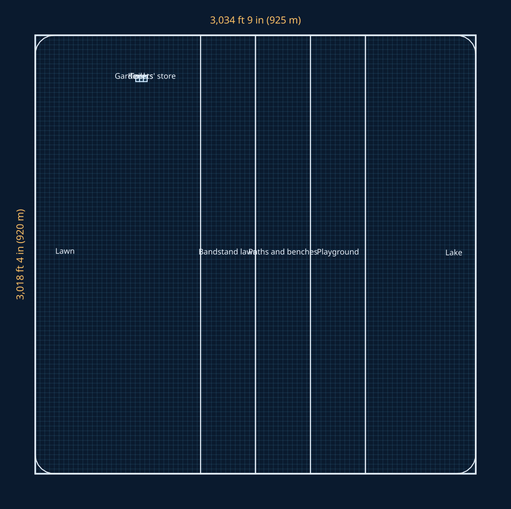

# P3-13 Commons Park: plan

Footprint 3,034 ft 9 in (925 m) × 3,018 ft 4 in (920 m) · structural grid 32 ft 10 in (10 m)

## Levels

| Level | Floor above deck | Height | Floor area |
|---|---|---|---|
| Level 1 · Ground | 0 ft (0 mm) | 13 ft 1 in (4,000 mm) | 3,100 sq ft (288 m²) |

## Elements

| ID | Designation | Type | Name | Level(s) | Size / length | Area | Status |
|---|---|---|---|---|---|---|---|
| E001 | D5F6P3B14A1R1 | zone | Lawn | L1 | 1,138 ft 9 in (347 m) × 3,017 ft 5 in (920 m) | 3,426,400 sq ft (318,323 m²) | proposed |
| E002 | D5F6P3B14A1R2 | room | Kiosk | L1 | 26 ft 3 in (8,000 mm) × 39 ft 4 in (12 m) | 1,033 sq ft (96 m²) | proposed |
| E003 | D5F6P3B14A1R3 | room | Toilets | L1 | 26 ft 3 in (8,000 mm) × 39 ft 4 in (12 m) | 1,033 sq ft (96 m²) | proposed |
| E004 | D5F6P3B14A1R4 | room | Gardeners' store | L1 | 26 ft 3 in (8,000 mm) × 39 ft 4 in (12 m) | 1,033 sq ft (96 m²) | proposed |
| E005 | D5F6P3B14A1R5 | zone | Bandstand lawn | L1 | 378 ft 7 in (115 m) × 3,017 ft 5 in (920 m) | 1,142,286 sq ft (106,122 m²) | proposed |
| E006 | D5F6P3B14A1R6 | zone | Paths and benches | L1 | 378 ft 7 in (115 m) × 3,017 ft 5 in (920 m) | 1,142,286 sq ft (106,122 m²) | proposed |
| E007 | D5F6P3B14A1R7 | zone | Playground | L1 | 378 ft 7 in (115 m) × 3,017 ft 1 in (920 m) | 1,142,286 sq ft (106,122 m²) | proposed |
| E008 | D5F6P3B14A1R8 | zone | Lake | L1 | 760 ft 2 in (232 m) × 3,017 ft 5 in (920 m) | 2,284,114 sq ft (212,201 m²) | proposed |

## Drawings

### Level 1 · Ground

