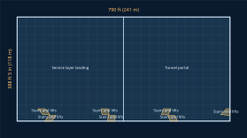
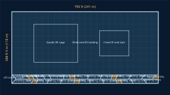
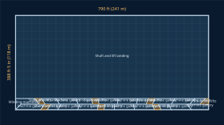

# P3-20 Commons Service Shaft: plan

Footprint 790 ft (241 m) × 388 ft 5 in (118 m) · structural grid 32 ft 10 in (10 m)

## Levels

| Level | Floor above deck | Height | Floor area |
|---|---|---|---|
| Level B1 · Service layer landing | −19 ft 8 in (6,000 mm) | 19 ft 8 in (6,000 mm) | 306,887 sq ft (28,511 m²) |
| Level 1 · Lift landing | 0 ft (0 mm) | 29 ft 6 in (9,000 mm) | 300,945 sq ft (27,959 m²) |
| Level 2 · Winding room | 29 ft 6 in (9,000 mm) | 19 ft 8 in (6,000 mm) | 300,945 sq ft (27,959 m²) |

## Elements

| ID | Designation | Type | Name | Level(s) | Size / length | Area | Status |
|---|---|---|---|---|---|---|---|
| E001 | D5F6P3B20A1L1R1, D5F6P3B20A1L2R1 | room | Shaft and lift landing | L1, L2 | 790 ft (241 m) × 342 ft 6 in (104 m) | 270,600 sq ft (25,140 m²) | proposed |
| E002 |  | fixture | Goods lift cage | L1 | 237 ft 2 in (72 m) × 205 ft 5 in (63 m) | 48,717 sq ft (4,526 m²) | proposed |
| E003 |  | fixture | Crew lift and stair | L1 | 157 ft 10 in (48 m) × 137 ft 2 in (42 m) | 21,642 sq ft (2,011 m²) | proposed |
| E004 | D5F6P3B20A1LB1R1, D5F6P3B20A1L1R2, D5F6P3B20A1L2R2 | core | Stairs and lifts | LB1, L1, L2 | 43 ft (13 m) × 21 ft 8 in (6,600 mm) | 568 sq ft (53 m²) | proposed |
| E005 | D5F6P3B20A1LB1R2, D5F6P3B20A1L1R3, D5F6P3B20A1L2R3 | core | Stairs and lifts | LB1, L1, L2 | 30 ft 2 in (9,200 mm) × 21 ft 8 in (6,600 mm) | 568 sq ft (53 m²) | proposed |
| E006 | D5F6P3B20A1LB1R3, D5F6P3B20A1L1R4, D5F6P3B20A1L2R4 | core | Stairs and lifts | LB1, L1, L2 | 35 ft 5 in (11 m) × 21 ft 8 in (6,600 mm) | 572 sq ft (53 m²) | proposed |
| E007 | D5F6P3B20A1LB1R4, D5F6P3B20A1L1R5, D5F6P3B20A1L2R5 | core | Stairs and lifts | LB1, L1, L2 | 34 ft 5 in (10 m) × 24 ft 11 in (7,600 mm) | 568 sq ft (53 m²) | proposed |
| E008 | D5F6P3B20A1LB1R5, D5F6P3B20A1L1R6, D5F6P3B20A1L2R6 | core | Stairs and lifts | LB1, L1, L2 | 36 ft 5 in (11 m) × 21 ft 8 in (6,600 mm) | 565 sq ft (52 m²) | proposed |
| E009 | D5F6P3B20A1LB1R6, D5F6P3B20A1L1R7, D5F6P3B20A1L2R7 | core | Stairs and lifts | LB1, L1, L2 | 28 ft 10 in (8,800 mm) × 21 ft 8 in (6,600 mm) | 572 sq ft (53 m²) | proposed |
| E010 | D5F6P3B20A1LB1R7, D5F6P3B20A1L1R8, D5F6P3B20A1L2R8 | core | Stairs and lifts | LB1, L1, L2 | 41 ft 8 in (13 m) × 21 ft 8 in (6,600 mm) | 568 sq ft (53 m²) | proposed |
| E011 | D5F6P3B20A1L1R9 | room | Lift control room | L1 | 22 ft 4 in (6,800 mm) × 45 ft 11 in (14 m) | 540 sq ft (50 m²) | proposed |
| E012 | D5F6P3B20A1L1R10 | room | Loading bay | L1 | 94 ft 10 in (29 m) × 21 ft 8 in (6,600 mm) | 1,630 sq ft (151 m²) | proposed |
| E013 | D5F6P3B20A1L1R11 | room | Crew check-in | L1 | 35 ft 5 in (11 m) × 21 ft 8 in (6,600 mm) | 430 sq ft (40 m²) | proposed |
| E014 | D5F6P3B20A1L1R12 | room | Tool store | L1 | 53 ft 6 in (16 m) × 21 ft 8 in (6,600 mm) | 856 sq ft (80 m²) | proposed |
| E015 | D5F6P3B20A1L1R13 | room | Staff toilets and showers | L1 | 46 ft 3 in (14 m) × 21 ft 8 in (6,600 mm) | 746 sq ft (69 m²) | proposed |
| E016 | D5F6P3B20A1L1R14 | room | Holding store | L1 | 79 ft 9 in (24 m) × 21 ft 8 in (6,600 mm) | 1,538 sq ft (143 m²) | proposed |
| E017 | D5F6P3B20A1L1R15 | room | Holding store | L1 | 41 ft (12 m) × 21 ft 8 in (6,600 mm) | 767 sq ft (71 m²) | proposed |
| E018 | D5F6P3B20A1L1R16 | room | Holding store | L1 | 72 ft 10 in (22 m) × 21 ft 8 in (6,600 mm) | 1,531 sq ft (142 m²) | proposed |
| E019 | D5F6P3B20A1L1R17 | room | Holding store | L1 | 73 ft 10 in (22 m) × 21 ft 8 in (6,600 mm) | 1,535 sq ft (143 m²) | proposed |
| E020 | D5F6P3B20A1L1R18 | room | Holding store | L1 | 65 ft (20 m) × 21 ft 8 in (6,600 mm) | 1,265 sq ft (117 m²) | proposed |
| E021 | D5F6P3B20A1L1R19 | room | Holding store | L1 | 82 ft 8 in (25 m) × 21 ft 8 in (6,600 mm) | 1,535 sq ft (143 m²) | proposed |
| E022 | D5F6P3B20A1L1R20 | room | Holding store | L1 | 86 ft 7 in (26 m) × 21 ft 8 in (6,600 mm) | 1,535 sq ft (143 m²) | proposed |
| E023 | D5F6P3B20A1L1R21 | room | Holding store | L1 | 77 ft 9 in (24 m) × 21 ft 8 in (6,600 mm) | 1,265 sq ft (117 m²) | proposed |
| E024 | D5F6P3B20A1L1R22 | room | Holding store | L1 | 80 ft 1 in (24 m) × 23 ft (7,000 mm) | 1,542 sq ft (143 m²) | proposed |
| E025 | D5F6P3B20A1L1R23 | room | Holding store | L1 | 87 ft 3 in (27 m) × 21 ft 8 in (6,600 mm) | 1,535 sq ft (143 m²) | proposed |
| E026 | D5F6P3B20A1L1R24 | room | Holding store | L1 | 71 ft 2 in (22 m) × 21 ft 8 in (6,600 mm) | 1,265 sq ft (117 m²) | proposed |
| E027 | D5F6P3B20A1L1R25 | room | Holding store | L1 | 78 ft 5 in (24 m) × 21 ft 8 in (6,600 mm) | 1,535 sq ft (143 m²) | proposed |
| E028 | D5F6P3B20A1L1R26 | room | Holding store | L1 | 74 ft 6 in (23 m) × 21 ft 8 in (6,600 mm) | 1,538 sq ft (143 m²) | proposed |
| E029 | D5F6P3B20A1L1R27 | room | Holding store | L1 | 59 ft 9 in (18 m) × 21 ft 8 in (6,600 mm) | 1,261 sq ft (117 m²) | proposed |
| E030 | D5F6P3B20A1L1R28 | room | Holding store | L1 | 76 ft 1 in (23 m) × 21 ft 8 in (6,600 mm) | 1,535 sq ft (143 m²) | proposed |
| E031 | D5F6P3B20A1L1R29 | room | Holding store | L1 | 80 ft 1 in (24 m) × 21 ft 8 in (6,600 mm) | 1,535 sq ft (143 m²) | proposed |
| E032 | D5F6P3B20A1L1R30 | room | Holding store | L1 | 71 ft 2 in (22 m) × 21 ft 8 in (6,600 mm) | 1,261 sq ft (117 m²) | proposed |
| E033 | D5F6P3B20A1L1R31 | room | Holding store | L1 | 119 ft 1 in (36 m) × 21 ft 8 in (6,600 mm) | 2,170 sq ft (202 m²) | proposed |
| E034 | D5F6P3B20A1L2R9 | room | Winding machinery | L2 | 95 ft 6 in (29 m) × 45 ft 11 in (14 m) | 2,170 sq ft (202 m²) | proposed |
| E035 | D5F6P3B20A1L2R10 | room | Shaft ventilation fans | L2 | 73 ft 10 in (22 m) × 21 ft 8 in (6,600 mm) | 1,286 sq ft (119 m²) | proposed |
| E036 | D5F6P3B20A1L2R11 | room | Machine gallery | L2 | 89 ft 7 in (27 m) × 21 ft 8 in (6,600 mm) | 1,712 sq ft (159 m²) | proposed |
| E037 | D5F6P3B20A1L2R12 | room | Machine gallery | L2 | 68 ft 3 in (21 m) × 21 ft 8 in (6,600 mm) | 1,339 sq ft (124 m²) | proposed |
| E038 | D5F6P3B20A1L2R13 | room | Machine gallery | L2 | 81 ft 4 in (25 m) × 21 ft 8 in (6,600 mm) | 1,712 sq ft (159 m²) | proposed |
| E039 | D5F6P3B20A1L2R14 | room | Machine gallery | L2 | 83 ft (25 m) × 21 ft 8 in (6,600 mm) | 1,719 sq ft (160 m²) | proposed |
| E040 | D5F6P3B20A1L2R15 | room | Machine gallery | L2 | 48 ft 7 in (15 m) × 21 ft 8 in (6,600 mm) | 899 sq ft (83 m²) | proposed |
| E041 | D5F6P3B20A1L2R16 | room | Machine gallery | L2 | 91 ft 2 in (28 m) × 21 ft 8 in (6,600 mm) | 1,716 sq ft (159 m²) | proposed |
| E042 | D5F6P3B20A1L2R17 | room | Machine gallery | L2 | 95 ft 6 in (29 m) × 21 ft 8 in (6,600 mm) | 1,712 sq ft (159 m²) | proposed |
| E043 | D5F6P3B20A1L2R18 | room | Machine gallery | L2 | 61 ft 8 in (19 m) × 21 ft 8 in (6,600 mm) | 906 sq ft (84 m²) | proposed |
| E044 | D5F6P3B20A1L2R19 | room | Machine gallery | L2 | 87 ft 11 in (27 m) × 23 ft (7,000 mm) | 1,719 sq ft (160 m²) | proposed |
| E045 | D5F6P3B20A1L2R20 | room | Machine gallery | L2 | 94 ft 10 in (29 m) × 21 ft 8 in (6,600 mm) | 1,716 sq ft (159 m²) | proposed |
| E046 | D5F6P3B20A1L2R21 | room | Machine gallery | L2 | 54 ft 2 in (16 m) × 21 ft 8 in (6,600 mm) | 906 sq ft (84 m²) | proposed |
| E047 | D5F6P3B20A1L2R22 | room | Machine gallery | L2 | 86 ft 7 in (26 m) × 21 ft 8 in (6,600 mm) | 1,716 sq ft (159 m²) | proposed |
| E048 | D5F6P3B20A1L2R23 | room | Machine gallery | L2 | 82 ft 4 in (25 m) × 21 ft 8 in (6,600 mm) | 1,719 sq ft (160 m²) | proposed |
| E049 | D5F6P3B20A1L2R24 | room | Machine gallery | L2 | 42 ft 8 in (13 m) × 21 ft 8 in (6,600 mm) | 899 sq ft (83 m²) | proposed |
| E050 | D5F6P3B20A1L2R25 | room | Machine gallery | L2 | 84 ft 8 in (26 m) × 21 ft 8 in (6,600 mm) | 1,712 sq ft (159 m²) | proposed |
| E051 | D5F6P3B20A1L2R26 | room | Machine gallery | L2 | 89 ft 3 in (27 m) × 21 ft 8 in (6,600 mm) | 1,716 sq ft (159 m²) | proposed |
| E052 | D5F6P3B20A1L2R27 | room | Machine gallery | L2 | 55 ft 1 in (17 m) × 21 ft 8 in (6,600 mm) | 902 sq ft (84 m²) | proposed |
| E053 | D5F6P3B20A1L2R28 | room | Machine gallery | L2 | 119 ft 1 in (36 m) × 21 ft 8 in (6,600 mm) | 2,170 sq ft (202 m²) | proposed |
| E054 | D5F6P3B20A1LB1R8 | room | Service layer landing | LB1 | 395 ft (120 m) × 388 ft 5 in (118 m) | 153,443 sq ft (14,255 m²) | proposed |
| E055 | D5F6P3B20A1LB1R9 | room | Tunnel portal | LB1 | 395 ft (120 m) × 388 ft 5 in (118 m) | 153,443 sq ft (14,255 m²) | proposed |

## Drawings

### Level B1 · Service layer landing

### Level 1 · Lift landing

### Level 2 · Winding room

