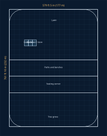

# P3-22 Pocket Park 1: plan

Footprint 579 ft 5 in (177 m) × 761 ft 10 in (232 m) · structural grid 32 ft 10 in (10 m)

## Levels

| Level | Floor above deck | Height | Floor area |
|---|---|---|---|
| Level 1 · Ground | 0 ft (0 mm) | 13 ft 1 in (4,000 mm) | 3,100 sq ft (288 m²) |

## Elements

| ID | Designation | Type | Name | Level(s) | Size / length | Area | Status |
|---|---|---|---|---|---|---|---|
| E001 | D5F6P3B7A2R1 | zone | Lawn | L1 | 578 ft 9 in (176 m) × 327 ft 5 in (100 m) | 185,864 sq ft (17,267 m²) | proposed |
| E002 | D5F6P3B7A2R2 | room | Kiosk | L1 | 26 ft 3 in (8,000 mm) × 39 ft 4 in (12 m) | 1,033 sq ft (96 m²) | proposed |
| E003 | D5F6P3B7A2R3 | room | Toilets | L1 | 26 ft 3 in (8,000 mm) × 39 ft 4 in (12 m) | 1,033 sq ft (96 m²) | proposed |
| E004 | D5F6P3B7A2R4 | room | Gardeners' store | L1 | 26 ft 3 in (8,000 mm) × 39 ft 4 in (12 m) | 1,033 sq ft (96 m²) | proposed |
| E005 | D5F6P3B7A2R5 | zone | Paths and benches | L1 | 578 ft 9 in (176 m) × 106 ft 11 in (33 m) | 61,864 sq ft (5,747 m²) | proposed |
| E006 | D5F6P3B7A2R6 | zone | Seating corner | L1 | 578 ft 5 in (176 m) × 107 ft 3 in (33 m) | 62,054 sq ft (5,765 m²) | proposed |
| E007 | D5F6P3B7A2R7 | zone | Tree grove | L1 | 578 ft 9 in (176 m) × 220 ft 2 in (67 m) | 123,906 sq ft (11,511 m²) | proposed |

## Drawings

### Level 1 · Ground

