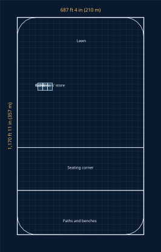

# P3-24 Pocket Park 2: plan

Footprint 687 ft 4 in (210 m) × 1,170 ft 11 in (357 m) · structural grid 32 ft 10 in (10 m)

## Levels

| Level | Floor above deck | Height | Floor area |
|---|---|---|---|
| Level 1 · Ground | 0 ft (0 mm) | 13 ft 1 in (4,000 mm) | 3,100 sq ft (288 m²) |

## Elements

| ID | Designation | Type | Name | Level(s) | Size / length | Area | Status |
|---|---|---|---|---|---|---|---|
| E001 | D5F6P3B17A2R1 | zone | Lawn | L1 | 687 ft (209 m) × 701 ft 1 in (214 m) | 476,331 sq ft (44,253 m²) | proposed |
| E002 | D5F6P3B17A2R2 | room | Kiosk | L1 | 26 ft 3 in (8,000 mm) × 39 ft 4 in (12 m) | 1,033 sq ft (96 m²) | proposed |
| E003 | D5F6P3B17A2R3 | room | Toilets | L1 | 26 ft 3 in (8,000 mm) × 39 ft 4 in (12 m) | 1,033 sq ft (96 m²) | proposed |
| E004 | D5F6P3B17A2R4 | room | Gardeners' store | L1 | 26 ft 3 in (8,000 mm) × 39 ft 4 in (12 m) | 1,033 sq ft (96 m²) | proposed |
| E005 | D5F6P3B17A2R5 | zone | Seating corner | L1 | 686 ft 8 in (209 m) × 231 ft 4 in (70 m) | 158,753 sq ft (14,749 m²) | proposed |
| E006 | D5F6P3B17A2R6 | zone | Paths and benches | L1 | 686 ft 4 in (209 m) × 238 ft 6 in (73 m) | 158,795 sq ft (14,753 m²) | proposed |

## Drawings

### Level 1 · Ground

