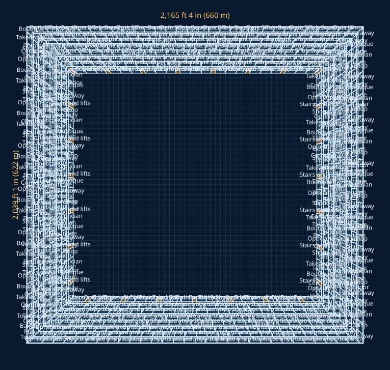
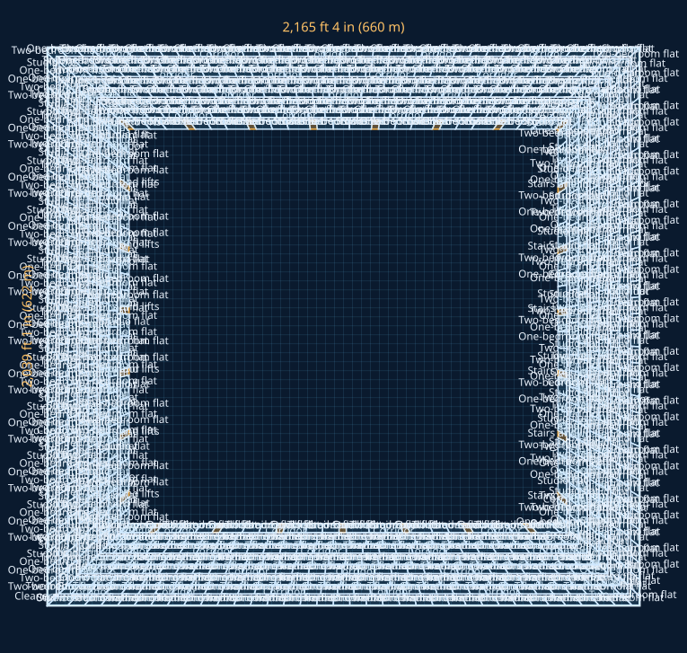

# P3-27 Commons Shops 4: plan

Footprint 2,165 ft 4 in (660 m) × 2,039 ft 1 in (622 m) · structural grid 32 ft 10 in (10 m)

## Levels

| Level | Floor above deck | Height | Floor area |
|---|---|---|---|
| Level 1 · Shop floor | 0 ft (0 mm) | 16 ft 5 in (5,000 mm) | 1,846,905 sq ft (171,583 m²) |
| Level 2 · Flat floor 1 | 16 ft 5 in (5,000 mm) | 10 ft 6 in (3,200 mm) | 1,846,905 sq ft (171,583 m²) |
| Level 3 · Flat floor 2 | 26 ft 11 in (8,200 mm) | 10 ft 6 in (3,200 mm) | 1,846,905 sq ft (171,583 m²) |
| Level 4 · Flat floor 3 | 37 ft 5 in (11 m) | 10 ft 6 in (3,200 mm) | 1,846,905 sq ft (171,583 m²) |

## Elements

| ID | Designation | Type | Name | Level(s) | Size / length | Area | Status |
|---|---|---|---|---|---|---|---|
| E001 | D5F6P3B1A3L1R1 | zone | Corridor | L1 | 9 ft 10 in (3,000 mm) × 401 ft 7 in (122 m) | 3,875 sq ft (360 m²) | proposed |
| E002 | D5F6P3B1A3L1R2 | zone | Corridor | L1 | 9 ft 10 in (3,000 mm) × 397 ft 8 in (121 m) | 3,875 sq ft (360 m²) | proposed |
| E003 | D5F6P3B1A3L1R3 | zone | Corridor | L1 | 9 ft 10 in (3,000 mm) × 395 ft 8 in (121 m) | 3,875 sq ft (360 m²) | proposed |
| E004 | D5F6P3B1A3L1R4 | zone | Corridor | L1 | 9 ft 10 in (3,000 mm) × 397 ft 8 in (121 m) | 3,875 sq ft (360 m²) | proposed |
| E005 | D5F6P3B1A3L1R5 | zone | Corridor | L1 | 13 ft 9 in (4,200 mm) × 397 ft 4 in (121 m) | 3,872 sq ft (360 m²) | proposed |
| E006 | D5F6P3B1A3L1R6 | zone | Corridor | L1 | 401 ft 7 in (122 m) × 9 ft 10 in (3,000 mm) | 3,875 sq ft (360 m²) | proposed |
| E007 | D5F6P3B1A3L1R7 | zone | Corridor | L1 | 398 ft (121 m) × 9 ft 10 in (3,000 mm) | 3,877 sq ft (360 m²) | proposed |
| E008 | D5F6P3B1A3L1R8 | zone | Corridor | L1 | 395 ft 4 in (120 m) × 9 ft 10 in (3,000 mm) | 3,873 sq ft (360 m²) | proposed |
| E009 | D5F6P3B1A3L1R9 | zone | Corridor | L1 | 397 ft (121 m) × 9 ft 10 in (3,000 mm) | 3,877 sq ft (360 m²) | proposed |
| E010 | D5F6P3B1A3L1R10 | zone | Corridor | L1 | 400 ft 3 in (122 m) × 9 ft 10 in (3,000 mm) | 3,873 sq ft (360 m²) | proposed |
| E011 | D5F6P3B1A3L1R11 | zone | Corridor | L1 | 127 ft 4 in (39 m) × 283 ft 10 in (86 m) | 3,873 sq ft (360 m²) | proposed |
| E012 | D5F6P3B1A3L1R12 | zone | Corridor | L1 | 9 ft 10 in (3,000 mm) × 398 ft 7 in (122 m) | 3,875 sq ft (360 m²) | proposed |
| E013 | D5F6P3B1A3L1R13 | zone | Corridor | L1 | 9 ft 10 in (3,000 mm) × 395 ft 8 in (121 m) | 3,875 sq ft (360 m²) | proposed |
| E014 | D5F6P3B1A3L1R14 | zone | Corridor | L1 | 9 ft 10 in (3,000 mm) × 396 ft 8 in (121 m) | 3,875 sq ft (360 m²) | proposed |
| E015 | D5F6P3B1A3L1R15 | zone | Corridor | L1 | 9 ft 10 in (3,000 mm) × 400 ft 7 in (122 m) | 3,875 sq ft (360 m²) | proposed |
| E016 | D5F6P3B1A3L1R16 | zone | Corridor | L1 | 288 ft 1 in (88 m) × 123 ft 4 in (38 m) | 3,873 sq ft (360 m²) | proposed |
| E017 | D5F6P3B1A3L1R17 | zone | Corridor | L1 | 398 ft 11 in (122 m) × 9 ft 10 in (3,000 mm) | 3,875 sq ft (360 m²) | proposed |
| E018 | D5F6P3B1A3L1R18 | zone | Corridor | L1 | 395 ft 4 in (120 m) × 9 ft 10 in (3,000 mm) | 3,875 sq ft (360 m²) | proposed |
| E019 | D5F6P3B1A3L1R19 | zone | Corridor | L1 | 395 ft 8 in (121 m) × 9 ft 10 in (3,000 mm) | 3,875 sq ft (360 m²) | proposed |
| E020 | D5F6P3B1A3L1R20 | zone | Corridor | L1 | 399 ft 7 in (122 m) × 9 ft 10 in (3,000 mm) | 3,875 sq ft (360 m²) | proposed |
| E021 | D5F6P3B1A3L1R21 | zone | Corridor | L1 | 245 ft 1 in (75 m) × 9 ft 10 in (3,000 mm) | 2,325 sq ft (216 m²) | proposed |
| E022 | D5F6P3B1A3L1R22 | zone | Corridor | L1 | 9 ft 10 in (3,000 mm) × 401 ft 7 in (122 m) | 3,877 sq ft (360 m²) | proposed |
| E023 | D5F6P3B1A3L1R23 | zone | Corridor | L1 | 9 ft 10 in (3,000 mm) × 397 ft (121 m) | 3,873 sq ft (360 m²) | proposed |
| E024 | D5F6P3B1A3L1R24 | zone | Corridor | L1 | 9 ft 10 in (3,000 mm) × 396 ft (121 m) | 3,877 sq ft (360 m²) | proposed |
| E025 | D5F6P3B1A3L1R25 | zone | Corridor | L1 | 9 ft 10 in (3,000 mm) × 398 ft 7 in (122 m) | 3,873 sq ft (360 m²) | proposed |
| E026 | D5F6P3B1A3L1R26 | zone | Corridor | L1 | 162 ft 5 in (49 m) × 249 ft (76 m) | 3,877 sq ft (360 m²) | proposed |
| E027 | D5F6P3B1A3L1R27 | zone | Corridor | L1 | 399 ft 11 in (122 m) × 9 ft 10 in (3,000 mm) | 3,875 sq ft (360 m²) | proposed |
| E028 | D5F6P3B1A3L1R28 | zone | Corridor | L1 | 396 ft (121 m) × 9 ft 10 in (3,000 mm) | 3,875 sq ft (360 m²) | proposed |
| E029 | D5F6P3B1A3L1R29 | zone | Corridor | L1 | 395 ft 8 in (121 m) × 9 ft 10 in (3,000 mm) | 3,875 sq ft (360 m²) | proposed |
| E030 | D5F6P3B1A3L1R30 | zone | Corridor | L1 | 399 ft 3 in (122 m) × 9 ft 10 in (3,000 mm) | 3,875 sq ft (360 m²) | proposed |
| E031 | D5F6P3B1A3L1R31 | zone | Corridor | L1 | 222 ft 1 in (68 m) × 189 ft 4 in (58 m) | 3,877 sq ft (360 m²) | proposed |
| E032 | D5F6P3B1A3L1R32 | zone | Corridor | L1 | 9 ft 10 in (3,000 mm) × 399 ft 3 in (122 m) | 3,873 sq ft (360 m²) | proposed |
| E033 | D5F6P3B1A3L1R33 | zone | Corridor | L1 | 9 ft 10 in (3,000 mm) × 396 ft (121 m) | 3,877 sq ft (360 m²) | proposed |
| E034 | D5F6P3B1A3L1R34 | zone | Corridor | L1 | 9 ft 10 in (3,000 mm) × 396 ft 4 in (121 m) | 3,873 sq ft (360 m²) | proposed |
| E035 | D5F6P3B1A3L1R35 | zone | Corridor | L1 | 9 ft 10 in (3,000 mm) × 400 ft 11 in (122 m) | 3,877 sq ft (360 m²) | proposed |
| E036 | D5F6P3B1A3L1R36 | zone | Corridor | L1 | 341 ft 10 in (104 m) × 69 ft 7 in (21 m) | 3,875 sq ft (360 m²) | proposed |
| E037 | D5F6P3B1A3L1R37 | zone | Corridor | L1 | 398 ft 4 in (121 m) × 9 ft 10 in (3,000 mm) | 3,875 sq ft (360 m²) | proposed |
| E038 | D5F6P3B1A3L1R38 | zone | Corridor | L1 | 395 ft 8 in (121 m) × 9 ft 10 in (3,000 mm) | 3,875 sq ft (360 m²) | proposed |
| E039 | D5F6P3B1A3L1R39 | zone | Corridor | L1 | 397 ft 4 in (121 m) × 9 ft 10 in (3,000 mm) | 3,877 sq ft (360 m²) | proposed |
| E040 | D5F6P3B1A3L1R40 | zone | Corridor | L1 | 401 ft 3 in (122 m) × 9 ft 10 in (3,000 mm) | 3,875 sq ft (360 m²) | proposed |
| E041 | D5F6P3B1A3L1R41 | zone | Corridor | L1 | 42 ft 8 in (13 m) × 9 ft 10 in (3,000 mm) | 325 sq ft (30 m²) | proposed |
| E042 | D5F6P3B1A3L1R42 | zone | Corridor | L1 | 9 ft 10 in (3,000 mm) × 401 ft 3 in (122 m) | 3,875 sq ft (360 m²) | proposed |
| E043 | D5F6P3B1A3L1R43 | zone | Corridor | L1 | 9 ft 10 in (3,000 mm) × 396 ft 4 in (121 m) | 3,873 sq ft (360 m²) | proposed |
| E044 | D5F6P3B1A3L1R44 | zone | Corridor | L1 | 9 ft 10 in (3,000 mm) × 396 ft (121 m) | 3,875 sq ft (360 m²) | proposed |
| E045 | D5F6P3B1A3L1R45 | zone | Corridor | L1 | 9 ft 10 in (3,000 mm) × 400 ft 3 in (122 m) | 3,875 sq ft (360 m²) | proposed |
| E046 | D5F6P3B1A3L1R46 | zone | Corridor | L1 | 310 ft 8 in (95 m) × 100 ft 5 in (31 m) | 3,873 sq ft (360 m²) | proposed |
| E047 | D5F6P3B1A3L1R47 | zone | Corridor | L1 | 398 ft (121 m) × 9 ft 10 in (3,000 mm) | 3,873 sq ft (360 m²) | proposed |
| E048 | D5F6P3B1A3L1R48 | zone | Corridor | L1 | 396 ft (121 m) × 9 ft 10 in (3,000 mm) | 3,877 sq ft (360 m²) | proposed |
| E049 | D5F6P3B1A3L1R49 | zone | Corridor | L1 | 398 ft (121 m) × 9 ft 10 in (3,000 mm) | 3,875 sq ft (360 m²) | proposed |
| E050 | D5F6P3B1A3L1R50 | zone | Corridor | L1 | 316 ft 7 in (96 m) × 94 ft 6 in (29 m) | 3,873 sq ft (360 m²) | proposed |
| E051 | D5F6P3B1A3L1R51 | zone | Corridor | L1 | 9 ft 10 in (3,000 mm) × 399 ft 11 in (122 m) | 3,873 sq ft (360 m²) | proposed |
| E052 | D5F6P3B1A3L1R52 | zone | Corridor | L1 | 9 ft 10 in (3,000 mm) × 396 ft (121 m) | 3,875 sq ft (360 m²) | proposed |
| E053 | D5F6P3B1A3L1R53 | zone | Corridor | L1 | 9 ft 10 in (3,000 mm) × 396 ft 8 in (121 m) | 3,875 sq ft (360 m²) | proposed |
| E054 | D5F6P3B1A3L1R54 | zone | Corridor | L1 | 9 ft 10 in (3,000 mm) × 401 ft 3 in (122 m) | 3,875 sq ft (360 m²) | proposed |
| E055 | D5F6P3B1A3L1R55 | zone | Corridor | L1 | 395 ft 4 in (120 m) × 15 ft 9 in (4,800 mm) | 3,873 sq ft (360 m²) | proposed |
| E056 | D5F6P3B1A3L1R56 | zone | Corridor | L1 | 397 ft (121 m) × 9 ft 10 in (3,000 mm) | 3,873 sq ft (360 m²) | proposed |
| E057 | D5F6P3B1A3L1R57 | zone | Corridor | L1 | 396 ft (121 m) × 9 ft 10 in (3,000 mm) | 3,877 sq ft (360 m²) | proposed |
| E058 | D5F6P3B1A3L1R58 | zone | Corridor | L1 | 398 ft 11 in (122 m) × 9 ft 10 in (3,000 mm) | 3,875 sq ft (360 m²) | proposed |
| E059 | D5F6P3B1A3L1R59 | zone | Corridor | L1 | 231 ft 11 in (71 m) × 9 ft 10 in (3,000 mm) | 2,197 sq ft (204 m²) | proposed |
| E060 | D5F6P3B1A3L1R60 | zone | Corridor | L1 | 9 ft 10 in (3,000 mm) × 400 ft 11 in (122 m) | 3,875 sq ft (360 m²) | proposed |
| E061 | D5F6P3B1A3L1R61 | zone | Corridor | L1 | 9 ft 10 in (3,000 mm) × 396 ft 4 in (121 m) | 3,875 sq ft (360 m²) | proposed |
| E062 | D5F6P3B1A3L1R62 | zone | Corridor | L1 | 9 ft 10 in (3,000 mm) × 396 ft 8 in (121 m) | 3,875 sq ft (360 m²) | proposed |
| E063 | D5F6P3B1A3L1R63 | zone | Corridor | L1 | 67 ft 7 in (21 m) × 343 ft 2 in (105 m) | 3,875 sq ft (360 m²) | proposed |
| E064 | D5F6P3B1A3L1R64 | zone | Corridor | L1 | 400 ft 7 in (122 m) × 9 ft 10 in (3,000 mm) | 3,875 sq ft (360 m²) | proposed |
| E065 | D5F6P3B1A3L1R65 | zone | Corridor | L1 | 396 ft 4 in (121 m) × 9 ft 10 in (3,000 mm) | 3,877 sq ft (360 m²) | proposed |
| E066 | D5F6P3B1A3L1R66 | zone | Corridor | L1 | 396 ft 4 in (121 m) × 9 ft 10 in (3,000 mm) | 3,875 sq ft (360 m²) | proposed |
| E067 | D5F6P3B1A3L1R67 | zone | Corridor | L1 | 400 ft 11 in (122 m) × 9 ft 10 in (3,000 mm) | 3,873 sq ft (360 m²) | proposed |
| E068 | D5F6P3B1A3L1R68 | zone | Corridor | L1 | 20 ft (6,100 mm) × 391 ft 1 in (119 m) | 3,877 sq ft (360 m²) | proposed |
| E069 | D5F6P3B1A3L1R69 | zone | Corridor | L1 | 9 ft 10 in (3,000 mm) × 396 ft 4 in (121 m) | 3,875 sq ft (360 m²) | proposed |
| E070 | D5F6P3B1A3L1R70 | zone | Corridor | L1 | 9 ft 10 in (3,000 mm) × 396 ft 4 in (121 m) | 3,873 sq ft (360 m²) | proposed |
| E071 | D5F6P3B1A3L1R71 | zone | Corridor | L1 | 57 ft 5 in (18 m) × 353 ft 4 in (108 m) | 3,875 sq ft (360 m²) | proposed |
| E072 | D5F6P3B1A3L1R72 | zone | Corridor | L1 | 400 ft 7 in (122 m) × 9 ft 10 in (3,000 mm) | 3,875 sq ft (360 m²) | proposed |
| E073 | D5F6P3B1A3L1R73 | zone | Corridor | L1 | 396 ft 4 in (121 m) × 9 ft 10 in (3,000 mm) | 3,877 sq ft (360 m²) | proposed |
| E074 | D5F6P3B1A3L1R74 | zone | Corridor | L1 | 396 ft 4 in (121 m) × 9 ft 10 in (3,000 mm) | 3,875 sq ft (360 m²) | proposed |
| E075 | D5F6P3B1A3L1R75 | zone | Corridor | L1 | 400 ft 11 in (122 m) × 9 ft 10 in (3,000 mm) | 3,875 sq ft (360 m²) | proposed |
| E076 | D5F6P3B1A3L1R76 | zone | Corridor | L1 | 29 ft 10 in (9,100 mm) × 9 ft 10 in (3,000 mm) | 199 sq ft (18 m²) | proposed |
| E077 | D5F6P3B1A3L1R77, D5F6P3B1A3L2R1, D5F6P3B1A3L3R1, D5F6P3B1A3L4R1 | core | Stairs and lifts | L1, L2, L3, L4 | 32 ft 6 in (9,900 mm) × 53 ft 6 in (16 m) | 853 sq ft (79 m²) | proposed |
| E078 | D5F6P3B1A3L1R78, D5F6P3B1A3L2R2, D5F6P3B1A3L3R2, D5F6P3B1A3L4R2 | core | Stairs and lifts | L1, L2, L3, L4 | 32 ft 6 in (9,900 mm) × 43 ft 4 in (13 m) | 847 sq ft (79 m²) | proposed |
| E079 | D5F6P3B1A3L1R79, D5F6P3B1A3L2R3, D5F6P3B1A3L3R3, D5F6P3B1A3L4R3 | core | Stairs and lifts | L1, L2, L3, L4 | 32 ft 6 in (9,900 mm) × 33 ft 10 in (10 m) | 858 sq ft (80 m²) | proposed |
| E080 | D5F6P3B1A3L1R80, D5F6P3B1A3L2R4, D5F6P3B1A3L3R4, D5F6P3B1A3L4R4 | core | Stairs and lifts | L1, L2, L3, L4 | 32 ft 6 in (9,900 mm) × 28 ft 10 in (8,800 mm) | 853 sq ft (79 m²) | proposed |
| E081 | D5F6P3B1A3L1R81, D5F6P3B1A3L2R5, D5F6P3B1A3L3R5, D5F6P3B1A3L4R5 | core | Stairs and lifts | L1, L2, L3, L4 | 32 ft 6 in (9,900 mm) × 39 ft 1 in (12 m) | 858 sq ft (80 m²) | proposed |
| E082 | D5F6P3B1A3L1R82, D5F6P3B1A3L2R6, D5F6P3B1A3L3R6, D5F6P3B1A3L4R6 | core | Stairs and lifts | L1, L2, L3, L4 | 32 ft 6 in (9,900 mm) × 48 ft 11 in (15 m) | 853 sq ft (79 m²) | proposed |
| E083 | D5F6P3B1A3L1R83, D5F6P3B1A3L2R7, D5F6P3B1A3L3R7, D5F6P3B1A3L4R7 | core | Stairs and lifts | L1, L2, L3, L4 | 51 ft 2 in (16 m) × 39 ft 1 in (12 m) | 847 sq ft (79 m²) | proposed |
| E084 | D5F6P3B1A3L1R84, D5F6P3B1A3L2R8, D5F6P3B1A3L3R8, D5F6P3B1A3L4R8 | core | Stairs and lifts | L1, L2, L3, L4 | 49 ft 3 in (15 m) × 32 ft 6 in (9,900 mm) | 858 sq ft (80 m²) | proposed |
| E085 | D5F6P3B1A3L1R85, D5F6P3B1A3L2R9, D5F6P3B1A3L3R9, D5F6P3B1A3L4R9 | core | Stairs and lifts | L1, L2, L3, L4 | 40 ft (12 m) × 32 ft 6 in (9,900 mm) | 853 sq ft (79 m²) | proposed |
| E086 | D5F6P3B1A3L1R86, D5F6P3B1A3L2R10, D5F6P3B1A3L3R10, D5F6P3B1A3L4R10 | core | Stairs and lifts | L1, L2, L3, L4 | 30 ft 6 in (9,300 mm) × 32 ft 6 in (9,900 mm) | 847 sq ft (79 m²) | proposed |
| E087 | D5F6P3B1A3L1R87, D5F6P3B1A3L2R11, D5F6P3B1A3L3R11, D5F6P3B1A3L4R11 | core | Stairs and lifts | L1, L2, L3, L4 | 31 ft 2 in (9,500 mm) × 32 ft 6 in (9,900 mm) | 858 sq ft (80 m²) | proposed |
| E088 | D5F6P3B1A3L1R88, D5F6P3B1A3L2R12, D5F6P3B1A3L3R12, D5F6P3B1A3L4R12 | core | Stairs and lifts | L1, L2, L3, L4 | 40 ft 4 in (12 m) × 32 ft 6 in (9,900 mm) | 858 sq ft (80 m²) | proposed |
| E089 | D5F6P3B1A3L1R89, D5F6P3B1A3L2R13, D5F6P3B1A3L3R13, D5F6P3B1A3L4R13 | core | Stairs and lifts | L1, L2, L3, L4 | 49 ft 3 in (15 m) × 32 ft 6 in (9,900 mm) | 847 sq ft (79 m²) | proposed |
| E090 | D5F6P3B1A3L1R90, D5F6P3B1A3L2R14, D5F6P3B1A3L3R14, D5F6P3B1A3L4R14 | core | Stairs and lifts | L1, L2, L3, L4 | 45 ft 3 in (14 m) × 45 ft 3 in (14 m) | 853 sq ft (79 m²) | proposed |
| E091 | D5F6P3B1A3L1R91, D5F6P3B1A3L2R15, D5F6P3B1A3L3R15, D5F6P3B1A3L4R15 | core | Stairs and lifts | L1, L2, L3, L4 | 32 ft 6 in (9,900 mm) × 48 ft 7 in (15 m) | 853 sq ft (79 m²) | proposed |
| E092 | D5F6P3B1A3L1R92, D5F6P3B1A3L2R16, D5F6P3B1A3L3R16, D5F6P3B1A3L4R16 | core | Stairs and lifts | L1, L2, L3, L4 | 32 ft 6 in (9,900 mm) × 38 ft 9 in (12 m) | 853 sq ft (79 m²) | proposed |
| E093 | D5F6P3B1A3L1R93, D5F6P3B1A3L2R17, D5F6P3B1A3L3R17, D5F6P3B1A3L4R17 | core | Stairs and lifts | L1, L2, L3, L4 | 32 ft 6 in (9,900 mm) × 28 ft 7 in (8,700 mm) | 853 sq ft (79 m²) | proposed |
| E094 | D5F6P3B1A3L1R94, D5F6P3B1A3L2R18, D5F6P3B1A3L3R18, D5F6P3B1A3L4R18 | core | Stairs and lifts | L1, L2, L3, L4 | 32 ft 6 in (9,900 mm) × 33 ft 10 in (10 m) | 853 sq ft (79 m²) | proposed |
| E095 | D5F6P3B1A3L1R95, D5F6P3B1A3L2R19, D5F6P3B1A3L3R19, D5F6P3B1A3L4R19 | core | Stairs and lifts | L1, L2, L3, L4 | 32 ft 6 in (9,900 mm) × 44 ft (13 m) | 853 sq ft (79 m²) | proposed |
| E096 | D5F6P3B1A3L1R96, D5F6P3B1A3L2R20, D5F6P3B1A3L3R20, D5F6P3B1A3L4R20 | core | Stairs and lifts | L1, L2, L3, L4 | 32 ft 6 in (9,900 mm) × 53 ft 10 in (16 m) | 847 sq ft (79 m²) | proposed |
| E097 | D5F6P3B1A3L1R97, D5F6P3B1A3L2R21, D5F6P3B1A3L3R21, D5F6P3B1A3L4R21 | core | Stairs and lifts | L1, L2, L3, L4 | 53 ft 10 in (16 m) × 32 ft 6 in (9,900 mm) | 853 sq ft (79 m²) | proposed |
| E098 | D5F6P3B1A3L1R98, D5F6P3B1A3L2R22, D5F6P3B1A3L3R22, D5F6P3B1A3L4R22 | core | Stairs and lifts | L1, L2, L3, L4 | 44 ft 7 in (14 m) × 32 ft 6 in (9,900 mm) | 853 sq ft (79 m²) | proposed |
| E099 | D5F6P3B1A3L1R99, D5F6P3B1A3L2R23, D5F6P3B1A3L3R23, D5F6P3B1A3L4R23 | core | Stairs and lifts | L1, L2, L3, L4 | 35 ft 5 in (11 m) × 32 ft 6 in (9,900 mm) | 853 sq ft (79 m²) | proposed |
| E100 | D5F6P3B1A3L1R100, D5F6P3B1A3L2R24, D5F6P3B1A3L3R24, D5F6P3B1A3L4R24 | core | Stairs and lifts | L1, L2, L3, L4 | 26 ft 7 in (8,100 mm) × 32 ft 6 in (9,900 mm) | 847 sq ft (79 m²) | proposed |
| E101 | D5F6P3B1A3L1R101, D5F6P3B1A3L2R25, D5F6P3B1A3L3R25, D5F6P3B1A3L4R25 | core | Stairs and lifts | L1, L2, L3, L4 | 35 ft 9 in (11 m) × 32 ft 6 in (9,900 mm) | 858 sq ft (80 m²) | proposed |
| E102 | D5F6P3B1A3L1R102, D5F6P3B1A3L2R26, D5F6P3B1A3L3R26, D5F6P3B1A3L4R26 | core | Stairs and lifts | L1, L2, L3, L4 | 44 ft 7 in (14 m) × 32 ft 6 in (9,900 mm) | 847 sq ft (79 m²) | proposed |
| E103 | D5F6P3B1A3L1R103, D5F6P3B1A3L2R27, D5F6P3B1A3L3R27, D5F6P3B1A3L4R27 | core | Stairs and lifts | L1, L2, L3, L4 | 54 ft 2 in (16 m) × 32 ft 6 in (9,900 mm) | 853 sq ft (79 m²) | proposed |
| E104 | D5F6P3B1A3L1R104 | room | Toilets | L1 | 32 ft 6 in (9,900 mm) × 52 ft 2 in (16 m) | 650 sq ft (60 m²) | proposed |
| E105 | D5F6P3B1A3L1R105 | room | Pub | L1 | 32 ft 6 in (9,900 mm) × 80 ft 9 in (25 m) | 1,614 sq ft (150 m²) | proposed |
| E106 | D5F6P3B1A3L1R106 | room | Bakery | L1 | 32 ft 6 in (9,900 mm) × 56 ft 5 in (17 m) | 863 sq ft (80 m²) | proposed |
| E107 | D5F6P3B1A3L1R107 | room | Café | L1 | 32 ft 6 in (9,900 mm) × 62 ft (19 m) | 1,076 sq ft (100 m²) | proposed |
| E108 | D5F6P3B1A3L1R108 | room | Toy shop | L1 | 32 ft 6 in (9,900 mm) × 61 ft (19 m) | 1,082 sq ft (100 m²) | proposed |
| E109 | D5F6P3B1A3L1R109 | room | Shop | L1 | 32 ft 6 in (9,900 mm) × 95 ft 10 in (29 m) | 2,270 sq ft (211 m²) | proposed |
| E110 | D5F6P3B1A3L1R110 | room | Takeaway | L1 | 32 ft 6 in (9,900 mm) × 93 ft 6 in (28 m) | 2,270 sq ft (211 m²) | proposed |
| E111 | D5F6P3B1A3L1R111 | room | Boutique | L1 | 32 ft 6 in (9,900 mm) × 91 ft 2 in (28 m) | 2,264 sq ft (210 m²) | proposed |
| E112 | D5F6P3B1A3L1R112 | room | Optician | L1 | 32 ft 6 in (9,900 mm) × 88 ft 11 in (27 m) | 2,264 sq ft (210 m²) | proposed |
| E113 | D5F6P3B1A3L1R113 | room | Shop | L1 | 32 ft 6 in (9,900 mm) × 86 ft 7 in (26 m) | 2,264 sq ft (210 m²) | proposed |
| E114 | D5F6P3B1A3L1R114 | room | Takeaway | L1 | 32 ft 6 in (9,900 mm) × 84 ft 8 in (26 m) | 2,270 sq ft (211 m²) | proposed |
| E115 | D5F6P3B1A3L1R115 | room | Boutique | L1 | 32 ft 6 in (9,900 mm) × 82 ft 4 in (25 m) | 2,264 sq ft (210 m²) | proposed |
| E116 | D5F6P3B1A3L1R116 | room | Optician | L1 | 32 ft 6 in (9,900 mm) × 80 ft 1 in (24 m) | 2,270 sq ft (211 m²) | proposed |
| E117 | D5F6P3B1A3L1R117 | room | Shop | L1 | 32 ft 6 in (9,900 mm) × 77 ft 9 in (24 m) | 2,270 sq ft (211 m²) | proposed |
| E118 | D5F6P3B1A3L1R118 | room | Takeaway | L1 | 32 ft 6 in (9,900 mm) × 75 ft 6 in (23 m) | 2,264 sq ft (210 m²) | proposed |
| E119 | D5F6P3B1A3L1R119 | room | Boutique | L1 | 32 ft 6 in (9,900 mm) × 73 ft 2 in (22 m) | 2,264 sq ft (210 m²) | proposed |
| E120 | D5F6P3B1A3L1R120 | room | Optician | L1 | 32 ft 6 in (9,900 mm) × 70 ft 10 in (22 m) | 2,264 sq ft (210 m²) | proposed |
| E121 | D5F6P3B1A3L1R121 | room | Shop | L1 | 32 ft 6 in (9,900 mm) × 70 ft 10 in (22 m) | 2,270 sq ft (211 m²) | proposed |
| E122 | D5F6P3B1A3L1R122 | room | Takeaway | L1 | 32 ft 6 in (9,900 mm) × 73 ft 2 in (22 m) | 2,270 sq ft (211 m²) | proposed |
| E123 | D5F6P3B1A3L1R123 | room | Boutique | L1 | 32 ft 6 in (9,900 mm) × 75 ft 6 in (23 m) | 2,264 sq ft (210 m²) | proposed |
| E124 | D5F6P3B1A3L1R124 | room | Optician | L1 | 32 ft 6 in (9,900 mm) × 77 ft 9 in (24 m) | 2,270 sq ft (211 m²) | proposed |
| E125 | D5F6P3B1A3L1R125 | room | Shop | L1 | 32 ft 6 in (9,900 mm) × 79 ft 9 in (24 m) | 2,264 sq ft (210 m²) | proposed |
| E126 | D5F6P3B1A3L1R126 | room | Takeaway | L1 | 32 ft 6 in (9,900 mm) × 82 ft (25 m) | 2,264 sq ft (210 m²) | proposed |
| E127 | D5F6P3B1A3L1R127 | room | Boutique | L1 | 32 ft 6 in (9,900 mm) × 84 ft 4 in (26 m) | 2,264 sq ft (210 m²) | proposed |
| E128 | D5F6P3B1A3L1R128 | room | Optician | L1 | 32 ft 6 in (9,900 mm) × 86 ft 7 in (26 m) | 2,270 sq ft (211 m²) | proposed |
| E129 | D5F6P3B1A3L1R129 | room | Shop | L1 | 32 ft 6 in (9,900 mm) × 88 ft 11 in (27 m) | 2,270 sq ft (211 m²) | proposed |
| E130 | D5F6P3B1A3L1R130 | room | Takeaway | L1 | 32 ft 6 in (9,900 mm) × 91 ft 2 in (28 m) | 2,264 sq ft (210 m²) | proposed |
| E131 | D5F6P3B1A3L1R131 | room | Boutique | L1 | 32 ft 6 in (9,900 mm) × 93 ft 6 in (28 m) | 2,270 sq ft (211 m²) | proposed |
| E132 | D5F6P3B1A3L1R132 | room | Optician | L1 | 32 ft 6 in (9,900 mm) × 95 ft 6 in (29 m) | 2,264 sq ft (210 m²) | proposed |
| E133 | D5F6P3B1A3L1R133 | room | Shop | L1 | 32 ft 6 in (9,900 mm) × 97 ft 9 in (30 m) | 2,264 sq ft (210 m²) | proposed |
| E134 | D5F6P3B1A3L1R134 | room | Takeaway | L1 | 32 ft 6 in (9,900 mm) × 100 ft 1 in (30 m) | 2,270 sq ft (211 m²) | proposed |
| E135 | D5F6P3B1A3L1R135 | room | Boutique | L1 | 72 ft 2 in (22 m) × 61 ft (19 m) | 2,259 sq ft (210 m²) | proposed |
| E136 | D5F6P3B1A3L1R136 | room | Optician | L1 | 100 ft 1 in (30 m) × 32 ft 6 in (9,900 mm) | 2,270 sq ft (211 m²) | proposed |
| E137 | D5F6P3B1A3L1R137 | room | Shop | L1 | 97 ft 9 in (30 m) × 32 ft 6 in (9,900 mm) | 2,264 sq ft (210 m²) | proposed |
| E138 | D5F6P3B1A3L1R138 | room | Takeaway | L1 | 95 ft 10 in (29 m) × 32 ft 6 in (9,900 mm) | 2,270 sq ft (211 m²) | proposed |
| E139 | D5F6P3B1A3L1R139 | room | Boutique | L1 | 93 ft 6 in (28 m) × 32 ft 6 in (9,900 mm) | 2,264 sq ft (210 m²) | proposed |
| E140 | D5F6P3B1A3L1R140 | room | Optician | L1 | 91 ft 6 in (28 m) × 32 ft 6 in (9,900 mm) | 2,270 sq ft (211 m²) | proposed |
| E141 | D5F6P3B1A3L1R141 | room | Shop | L1 | 89 ft 3 in (27 m) × 32 ft 6 in (9,900 mm) | 2,264 sq ft (210 m²) | proposed |
| E142 | D5F6P3B1A3L1R142 | room | Takeaway | L1 | 87 ft 3 in (27 m) × 32 ft 6 in (9,900 mm) | 2,270 sq ft (211 m²) | proposed |
| E143 | D5F6P3B1A3L1R143 | room | Boutique | L1 | 85 ft (26 m) × 32 ft 6 in (9,900 mm) | 2,264 sq ft (210 m²) | proposed |
| E144 | D5F6P3B1A3L1R144 | room | Optician | L1 | 83 ft (25 m) × 32 ft 6 in (9,900 mm) | 2,270 sq ft (211 m²) | proposed |
| E145 | D5F6P3B1A3L1R145 | room | Shop | L1 | 80 ft 9 in (25 m) × 32 ft 6 in (9,900 mm) | 2,264 sq ft (210 m²) | proposed |
| E146 | D5F6P3B1A3L1R146 | room | Takeaway | L1 | 78 ft 9 in (24 m) × 32 ft 6 in (9,900 mm) | 2,270 sq ft (211 m²) | proposed |
| E147 | D5F6P3B1A3L1R147 | room | Boutique | L1 | 76 ft 5 in (23 m) × 32 ft 6 in (9,900 mm) | 2,264 sq ft (210 m²) | proposed |
| E148 | D5F6P3B1A3L1R148 | room | Optician | L1 | 74 ft 6 in (23 m) × 32 ft 6 in (9,900 mm) | 2,270 sq ft (211 m²) | proposed |
| E149 | D5F6P3B1A3L1R149 | room | Shop | L1 | 72 ft 2 in (22 m) × 32 ft 6 in (9,900 mm) | 2,264 sq ft (210 m²) | proposed |
| E150 | D5F6P3B1A3L1R150 | room | Takeaway | L1 | 70 ft 10 in (22 m) × 32 ft 6 in (9,900 mm) | 2,270 sq ft (211 m²) | proposed |
| E151 | D5F6P3B1A3L1R151 | room | Boutique | L1 | 71 ft 6 in (22 m) × 32 ft 6 in (9,900 mm) | 2,264 sq ft (210 m²) | proposed |
| E152 | D5F6P3B1A3L1R152 | room | Optician | L1 | 73 ft 10 in (22 m) × 32 ft 6 in (9,900 mm) | 2,270 sq ft (211 m²) | proposed |
| E153 | D5F6P3B1A3L1R153 | room | Shop | L1 | 75 ft 6 in (23 m) × 32 ft 6 in (9,900 mm) | 2,259 sq ft (210 m²) | proposed |
| E154 | D5F6P3B1A3L1R154 | room | Takeaway | L1 | 77 ft 9 in (24 m) × 32 ft 6 in (9,900 mm) | 2,270 sq ft (211 m²) | proposed |
| E155 | D5F6P3B1A3L1R155 | room | Boutique | L1 | 79 ft 9 in (24 m) × 32 ft 6 in (9,900 mm) | 2,264 sq ft (210 m²) | proposed |
| E156 | D5F6P3B1A3L1R156 | room | Optician | L1 | 82 ft (25 m) × 32 ft 6 in (9,900 mm) | 2,270 sq ft (211 m²) | proposed |
| E157 | D5F6P3B1A3L1R157 | room | Shop | L1 | 84 ft (26 m) × 32 ft 6 in (9,900 mm) | 2,264 sq ft (210 m²) | proposed |
| E158 | D5F6P3B1A3L1R158 | room | Takeaway | L1 | 86 ft 3 in (26 m) × 32 ft 6 in (9,900 mm) | 2,270 sq ft (211 m²) | proposed |
| E159 | D5F6P3B1A3L1R159 | room | Boutique | L1 | 88 ft 3 in (27 m) × 32 ft 6 in (9,900 mm) | 2,264 sq ft (210 m²) | proposed |
| E160 | D5F6P3B1A3L1R160 | room | Optician | L1 | 90 ft 7 in (28 m) × 32 ft 6 in (9,900 mm) | 2,270 sq ft (211 m²) | proposed |
| E161 | D5F6P3B1A3L1R161 | room | Shop | L1 | 92 ft 6 in (28 m) × 32 ft 6 in (9,900 mm) | 2,264 sq ft (210 m²) | proposed |
| E162 | D5F6P3B1A3L1R162 | room | Takeaway | L1 | 94 ft 10 in (29 m) × 32 ft 6 in (9,900 mm) | 2,270 sq ft (211 m²) | proposed |
| E163 | D5F6P3B1A3L1R163 | room | Boutique | L1 | 96 ft 9 in (30 m) × 32 ft 6 in (9,900 mm) | 2,264 sq ft (210 m²) | proposed |
| E164 | D5F6P3B1A3L1R164 | room | Optician | L1 | 99 ft 1 in (30 m) × 32 ft 6 in (9,900 mm) | 2,270 sq ft (211 m²) | proposed |
| E165 | D5F6P3B1A3L1R165 | room | Shop | L1 | 99 ft 9 in (30 m) × 33 ft 6 in (10 m) | 2,259 sq ft (210 m²) | proposed |
| E166 | D5F6P3B1A3L1R166 | room | Takeaway | L1 | 32 ft 6 in (9,900 mm) × 101 ft 1 in (31 m) | 2,270 sq ft (211 m²) | proposed |
| E167 | D5F6P3B1A3L1R167 | room | Boutique | L1 | 32 ft 6 in (9,900 mm) × 98 ft 9 in (30 m) | 2,264 sq ft (210 m²) | proposed |
| E168 | D5F6P3B1A3L1R168 | room | Optician | L1 | 32 ft 6 in (9,900 mm) × 96 ft 5 in (29 m) | 2,264 sq ft (210 m²) | proposed |
| E169 | D5F6P3B1A3L1R169 | room | Shop | L1 | 32 ft 6 in (9,900 mm) × 94 ft 6 in (29 m) | 2,270 sq ft (211 m²) | proposed |
| E170 | D5F6P3B1A3L1R170 | room | Takeaway | L1 | 32 ft 6 in (9,900 mm) × 92 ft 2 in (28 m) | 2,270 sq ft (211 m²) | proposed |
| E171 | D5F6P3B1A3L1R171 | room | Boutique | L1 | 32 ft 6 in (9,900 mm) × 89 ft 7 in (27 m) | 2,264 sq ft (210 m²) | proposed |
| E172 | D5F6P3B1A3L1R172 | room | Optician | L1 | 32 ft 6 in (9,900 mm) × 87 ft 3 in (27 m) | 2,264 sq ft (210 m²) | proposed |
| E173 | D5F6P3B1A3L1R173 | room | Shop | L1 | 32 ft 6 in (9,900 mm) × 85 ft 4 in (26 m) | 2,270 sq ft (211 m²) | proposed |
| E174 | D5F6P3B1A3L1R174 | room | Takeaway | L1 | 32 ft 6 in (9,900 mm) × 83 ft (25 m) | 2,264 sq ft (210 m²) | proposed |
| E175 | D5F6P3B1A3L1R175 | room | Boutique | L1 | 32 ft 6 in (9,900 mm) × 80 ft 9 in (25 m) | 2,264 sq ft (210 m²) | proposed |
| E176 | D5F6P3B1A3L1R176 | room | Optician | L1 | 32 ft 6 in (9,900 mm) × 78 ft 9 in (24 m) | 2,275 sq ft (211 m²) | proposed |
| E177 | D5F6P3B1A3L1R177 | room | Shop | L1 | 32 ft 6 in (9,900 mm) × 76 ft 1 in (23 m) | 2,264 sq ft (210 m²) | proposed |
| E178 | D5F6P3B1A3L1R178 | room | Takeaway | L1 | 32 ft 6 in (9,900 mm) × 73 ft 10 in (22 m) | 2,264 sq ft (210 m²) | proposed |
| E179 | D5F6P3B1A3L1R179 | room | Boutique | L1 | 32 ft 6 in (9,900 mm) × 71 ft 6 in (22 m) | 2,264 sq ft (210 m²) | proposed |
| E180 | D5F6P3B1A3L1R180 | room | Optician | L1 | 32 ft 6 in (9,900 mm) × 70 ft 10 in (22 m) | 2,270 sq ft (211 m²) | proposed |
| E181 | D5F6P3B1A3L1R181 | room | Shop | L1 | 32 ft 6 in (9,900 mm) × 72 ft 2 in (22 m) | 2,264 sq ft (210 m²) | proposed |
| E182 | D5F6P3B1A3L1R182 | room | Takeaway | L1 | 32 ft 6 in (9,900 mm) × 74 ft 6 in (23 m) | 2,264 sq ft (210 m²) | proposed |
| E183 | D5F6P3B1A3L1R183 | room | Boutique | L1 | 32 ft 6 in (9,900 mm) × 77 ft 1 in (24 m) | 2,275 sq ft (211 m²) | proposed |
| E184 | D5F6P3B1A3L1R184 | room | Optician | L1 | 32 ft 6 in (9,900 mm) × 79 ft 1 in (24 m) | 2,264 sq ft (210 m²) | proposed |
| E185 | D5F6P3B1A3L1R185 | room | Shop | L1 | 32 ft 6 in (9,900 mm) × 81 ft 4 in (25 m) | 2,264 sq ft (210 m²) | proposed |
| E186 | D5F6P3B1A3L1R186 | room | Takeaway | L1 | 32 ft 6 in (9,900 mm) × 83 ft 8 in (26 m) | 2,264 sq ft (210 m²) | proposed |
| E187 | D5F6P3B1A3L1R187 | room | Boutique | L1 | 32 ft 6 in (9,900 mm) × 85 ft 11 in (26 m) | 2,270 sq ft (211 m²) | proposed |
| E188 | D5F6P3B1A3L1R188 | room | Optician | L1 | 32 ft 6 in (9,900 mm) × 87 ft 11 in (27 m) | 2,264 sq ft (210 m²) | proposed |
| E189 | D5F6P3B1A3L1R189 | room | Shop | L1 | 32 ft 6 in (9,900 mm) × 90 ft 7 in (28 m) | 2,270 sq ft (211 m²) | proposed |
| E190 | D5F6P3B1A3L1R190 | room | Takeaway | L1 | 32 ft 6 in (9,900 mm) × 92 ft 10 in (28 m) | 2,270 sq ft (211 m²) | proposed |
| E191 | D5F6P3B1A3L1R191 | room | Boutique | L1 | 32 ft 6 in (9,900 mm) × 94 ft 10 in (29 m) | 2,264 sq ft (210 m²) | proposed |
| E192 | D5F6P3B1A3L1R192 | room | Optician | L1 | 32 ft 6 in (9,900 mm) × 97 ft 1 in (30 m) | 2,264 sq ft (210 m²) | proposed |
| E193 | D5F6P3B1A3L1R193 | room | Shop | L1 | 32 ft 6 in (9,900 mm) × 99 ft 5 in (30 m) | 2,264 sq ft (210 m²) | proposed |
| E194 | D5F6P3B1A3L1R194 | room | Takeaway | L1 | 50 ft 6 in (15 m) × 83 ft (25 m) | 2,264 sq ft (210 m²) | proposed |
| E195 | D5F6P3B1A3L1R195 | room | Boutique | L1 | 100 ft 9 in (31 m) × 32 ft 6 in (9,900 mm) | 2,270 sq ft (211 m²) | proposed |
| E196 | D5F6P3B1A3L1R196 | room | Optician | L1 | 98 ft 5 in (30 m) × 32 ft 6 in (9,900 mm) | 2,264 sq ft (210 m²) | proposed |
| E197 | D5F6P3B1A3L1R197 | room | Shop | L1 | 96 ft 5 in (29 m) × 32 ft 6 in (9,900 mm) | 2,270 sq ft (211 m²) | proposed |
| E198 | D5F6P3B1A3L1R198 | room | Takeaway | L1 | 94 ft 2 in (29 m) × 32 ft 6 in (9,900 mm) | 2,264 sq ft (210 m²) | proposed |
| E199 | D5F6P3B1A3L1R199 | room | Boutique | L1 | 92 ft 2 in (28 m) × 32 ft 6 in (9,900 mm) | 2,270 sq ft (211 m²) | proposed |
| E200 | D5F6P3B1A3L1R200 | room | Optician | L1 | 89 ft 11 in (27 m) × 32 ft 6 in (9,900 mm) | 2,264 sq ft (210 m²) | proposed |
| E201 | D5F6P3B1A3L1R201 | room | Shop | L1 | 87 ft 11 in (27 m) × 32 ft 6 in (9,900 mm) | 2,270 sq ft (211 m²) | proposed |
| E202 | D5F6P3B1A3L1R202 | room | Takeaway | L1 | 85 ft 8 in (26 m) × 32 ft 6 in (9,900 mm) | 2,264 sq ft (210 m²) | proposed |
| E203 | D5F6P3B1A3L1R203 | room | Boutique | L1 | 83 ft 8 in (26 m) × 32 ft 6 in (9,900 mm) | 2,270 sq ft (211 m²) | proposed |
| E204 | D5F6P3B1A3L1R204 | room | Optician | L1 | 81 ft 4 in (25 m) × 32 ft 6 in (9,900 mm) | 2,264 sq ft (210 m²) | proposed |
| E205 | D5F6P3B1A3L1R205 | room | Shop | L1 | 79 ft 5 in (24 m) × 32 ft 6 in (9,900 mm) | 2,270 sq ft (211 m²) | proposed |
| E206 | D5F6P3B1A3L1R206 | room | Takeaway | L1 | 77 ft 1 in (24 m) × 32 ft 6 in (9,900 mm) | 2,264 sq ft (210 m²) | proposed |
| E207 | D5F6P3B1A3L1R207 | room | Boutique | L1 | 75 ft 2 in (23 m) × 32 ft 6 in (9,900 mm) | 2,270 sq ft (211 m²) | proposed |
| E208 | D5F6P3B1A3L1R208 | room | Optician | L1 | 72 ft 10 in (22 m) × 32 ft 6 in (9,900 mm) | 2,264 sq ft (210 m²) | proposed |
| E209 | D5F6P3B1A3L1R209 | room | Shop | L1 | 70 ft 10 in (22 m) × 32 ft 6 in (9,900 mm) | 2,270 sq ft (211 m²) | proposed |
| E210 | D5F6P3B1A3L1R210 | room | Takeaway | L1 | 70 ft 6 in (22 m) × 32 ft 6 in (9,900 mm) | 2,259 sq ft (210 m²) | proposed |
| E211 | D5F6P3B1A3L1R211 | room | Boutique | L1 | 72 ft 10 in (22 m) × 32 ft 6 in (9,900 mm) | 2,270 sq ft (211 m²) | proposed |
| E212 | D5F6P3B1A3L1R212 | room | Optician | L1 | 74 ft 10 in (23 m) × 32 ft 6 in (9,900 mm) | 2,264 sq ft (210 m²) | proposed |
| E213 | D5F6P3B1A3L1R213 | room | Shop | L1 | 77 ft 1 in (24 m) × 32 ft 6 in (9,900 mm) | 2,270 sq ft (211 m²) | proposed |
| E214 | D5F6P3B1A3L1R214 | room | Takeaway | L1 | 79 ft 1 in (24 m) × 32 ft 6 in (9,900 mm) | 2,264 sq ft (210 m²) | proposed |
| E215 | D5F6P3B1A3L1R215 | room | Boutique | L1 | 81 ft 4 in (25 m) × 32 ft 6 in (9,900 mm) | 2,270 sq ft (211 m²) | proposed |
| E216 | D5F6P3B1A3L1R216 | room | Optician | L1 | 83 ft 4 in (25 m) × 32 ft 6 in (9,900 mm) | 2,264 sq ft (210 m²) | proposed |
| E217 | D5F6P3B1A3L1R217 | room | Shop | L1 | 85 ft 8 in (26 m) × 32 ft 6 in (9,900 mm) | 2,270 sq ft (211 m²) | proposed |
| E218 | D5F6P3B1A3L1R218 | room | Takeaway | L1 | 87 ft 7 in (27 m) × 32 ft 6 in (9,900 mm) | 2,264 sq ft (210 m²) | proposed |
| E219 | D5F6P3B1A3L1R219 | room | Boutique | L1 | 89 ft 11 in (27 m) × 32 ft 6 in (9,900 mm) | 2,270 sq ft (211 m²) | proposed |
| E220 | D5F6P3B1A3L1R220 | room | Optician | L1 | 91 ft 10 in (28 m) × 32 ft 6 in (9,900 mm) | 2,264 sq ft (210 m²) | proposed |
| E221 | D5F6P3B1A3L1R221 | room | Shop | L1 | 94 ft 2 in (29 m) × 32 ft 6 in (9,900 mm) | 2,264 sq ft (210 m²) | proposed |
| E222 | D5F6P3B1A3L1R222 | room | Takeaway | L1 | 96 ft 5 in (29 m) × 32 ft 6 in (9,900 mm) | 2,270 sq ft (211 m²) | proposed |
| E223 | D5F6P3B1A3L1R223 | room | Boutique | L1 | 98 ft 5 in (30 m) × 32 ft 6 in (9,900 mm) | 2,264 sq ft (210 m²) | proposed |
| E224 | D5F6P3B1A3L1R224 | room | Optician | L1 | 121 ft 9 in (37 m) × 32 ft 6 in (9,900 mm) | 2,941 sq ft (273 m²) | proposed |
| E225 | D5F6P3B1A3L1R225 | room | Shop | L1 | 32 ft 2 in (9,800 mm) × 101 ft 1 in (31 m) | 2,247 sq ft (209 m²) | proposed |
| E226 | D5F6P3B1A3L1R226 | room | Takeaway | L1 | 32 ft 2 in (9,800 mm) × 98 ft 9 in (30 m) | 2,242 sq ft (208 m²) | proposed |
| E227 | D5F6P3B1A3L1R227 | room | Boutique | L1 | 32 ft 2 in (9,800 mm) × 96 ft 5 in (29 m) | 2,247 sq ft (209 m²) | proposed |
| E228 | D5F6P3B1A3L1R228 | room | Optician | L1 | 32 ft 2 in (9,800 mm) × 93 ft 10 in (29 m) | 2,242 sq ft (208 m²) | proposed |
| E229 | D5F6P3B1A3L1R229 | room | Shop | L1 | 32 ft 2 in (9,800 mm) × 91 ft 6 in (28 m) | 2,242 sq ft (208 m²) | proposed |
| E230 | D5F6P3B1A3L1R230 | room | Takeaway | L1 | 32 ft 2 in (9,800 mm) × 89 ft 3 in (27 m) | 2,247 sq ft (209 m²) | proposed |
| E231 | D5F6P3B1A3L1R231 | room | Boutique | L1 | 32 ft 2 in (9,800 mm) × 86 ft 7 in (26 m) | 2,242 sq ft (208 m²) | proposed |
| E232 | D5F6P3B1A3L1R232 | room | Optician | L1 | 32 ft 2 in (9,800 mm) × 84 ft 8 in (26 m) | 2,247 sq ft (209 m²) | proposed |
| E233 | D5F6P3B1A3L1R233 | room | Shop | L1 | 32 ft 2 in (9,800 mm) × 82 ft 4 in (25 m) | 2,242 sq ft (208 m²) | proposed |
| E234 | D5F6P3B1A3L1R234 | room | Takeaway | L1 | 32 ft 2 in (9,800 mm) × 80 ft 1 in (24 m) | 2,247 sq ft (209 m²) | proposed |
| E235 | D5F6P3B1A3L1R235 | room | Boutique | L1 | 32 ft 2 in (9,800 mm) × 77 ft 5 in (24 m) | 2,242 sq ft (208 m²) | proposed |
| E236 | D5F6P3B1A3L1R236 | room | Optician | L1 | 32 ft 2 in (9,800 mm) × 75 ft 2 in (23 m) | 2,242 sq ft (208 m²) | proposed |
| E237 | D5F6P3B1A3L1R237 | room | Shop | L1 | 32 ft 2 in (9,800 mm) × 72 ft 10 in (22 m) | 2,247 sq ft (209 m²) | proposed |
| E238 | D5F6P3B1A3L1R238 | room | Takeaway | L1 | 32 ft 2 in (9,800 mm) × 70 ft 10 in (22 m) | 2,242 sq ft (208 m²) | proposed |
| E239 | D5F6P3B1A3L1R239 | room | Boutique | L1 | 32 ft 2 in (9,800 mm) × 71 ft 6 in (22 m) | 2,242 sq ft (208 m²) | proposed |
| E240 | D5F6P3B1A3L1R240 | room | Optician | L1 | 32 ft 2 in (9,800 mm) × 74 ft 2 in (23 m) | 2,252 sq ft (209 m²) | proposed |
| E241 | D5F6P3B1A3L1R241 | room | Shop | L1 | 32 ft 2 in (9,800 mm) × 76 ft 1 in (23 m) | 2,242 sq ft (208 m²) | proposed |
| E242 | D5F6P3B1A3L1R242 | room | Takeaway | L1 | 32 ft 2 in (9,800 mm) × 78 ft 5 in (24 m) | 2,242 sq ft (208 m²) | proposed |
| E243 | D5F6P3B1A3L1R243 | room | Boutique | L1 | 32 ft 2 in (9,800 mm) × 80 ft 9 in (25 m) | 2,242 sq ft (208 m²) | proposed |
| E244 | D5F6P3B1A3L1R244 | room | Optician | L1 | 32 ft 2 in (9,800 mm) × 83 ft 4 in (25 m) | 2,247 sq ft (209 m²) | proposed |
| E245 | D5F6P3B1A3L1R245 | room | Shop | L1 | 32 ft 2 in (9,800 mm) × 85 ft 8 in (26 m) | 2,242 sq ft (208 m²) | proposed |
| E246 | D5F6P3B1A3L1R246 | room | Takeaway | L1 | 32 ft 2 in (9,800 mm) × 87 ft 11 in (27 m) | 2,242 sq ft (208 m²) | proposed |
| E247 | D5F6P3B1A3L1R247 | room | Boutique | L1 | 32 ft 2 in (9,800 mm) × 90 ft 7 in (28 m) | 2,252 sq ft (209 m²) | proposed |
| E248 | D5F6P3B1A3L1R248 | room | Optician | L1 | 32 ft 2 in (9,800 mm) × 92 ft 6 in (28 m) | 2,242 sq ft (208 m²) | proposed |
| E249 | D5F6P3B1A3L1R249 | room | Shop | L1 | 32 ft 2 in (9,800 mm) × 94 ft 10 in (29 m) | 2,242 sq ft (208 m²) | proposed |
| E250 | D5F6P3B1A3L1R250 | room | Takeaway | L1 | 32 ft 2 in (9,800 mm) × 97 ft 5 in (30 m) | 2,247 sq ft (209 m²) | proposed |
| E251 | D5F6P3B1A3L1R251 | room | Boutique | L1 | 32 ft 2 in (9,800 mm) × 99 ft 9 in (30 m) | 2,242 sq ft (208 m²) | proposed |
| E252 | D5F6P3B1A3L1R252 | room | Optician | L1 | 63 ft 8 in (19 m) × 69 ft 7 in (21 m) | 2,247 sq ft (209 m²) | proposed |
| E253 | D5F6P3B1A3L1R253 | room | Shop | L1 | 100 ft 1 in (30 m) × 32 ft 2 in (9,800 mm) | 2,247 sq ft (209 m²) | proposed |
| E254 | D5F6P3B1A3L1R254 | room | Takeaway | L1 | 97 ft 9 in (30 m) × 32 ft 2 in (9,800 mm) | 2,242 sq ft (208 m²) | proposed |
| E255 | D5F6P3B1A3L1R255 | room | Boutique | L1 | 95 ft 6 in (29 m) × 32 ft 2 in (9,800 mm) | 2,242 sq ft (208 m²) | proposed |
| E256 | D5F6P3B1A3L1R256 | room | Optician | L1 | 93 ft 6 in (28 m) × 32 ft 2 in (9,800 mm) | 2,247 sq ft (209 m²) | proposed |
| E257 | D5F6P3B1A3L1R257 | room | Shop | L1 | 91 ft 2 in (28 m) × 32 ft 2 in (9,800 mm) | 2,242 sq ft (208 m²) | proposed |
| E258 | D5F6P3B1A3L1R258 | room | Takeaway | L1 | 88 ft 11 in (27 m) × 32 ft 2 in (9,800 mm) | 2,242 sq ft (208 m²) | proposed |
| E259 | D5F6P3B1A3L1R259 | room | Boutique | L1 | 86 ft 11 in (26 m) × 32 ft 2 in (9,800 mm) | 2,247 sq ft (209 m²) | proposed |
| E260 | D5F6P3B1A3L1R260 | room | Optician | L1 | 84 ft 8 in (26 m) × 32 ft 2 in (9,800 mm) | 2,242 sq ft (208 m²) | proposed |
| E261 | D5F6P3B1A3L1R261 | room | Shop | L1 | 82 ft 4 in (25 m) × 32 ft 2 in (9,800 mm) | 2,242 sq ft (208 m²) | proposed |
| E262 | D5F6P3B1A3L1R262 | room | Takeaway | L1 | 80 ft 5 in (24 m) × 32 ft 2 in (9,800 mm) | 2,247 sq ft (209 m²) | proposed |
| E263 | D5F6P3B1A3L1R263 | room | Boutique | L1 | 78 ft 1 in (24 m) × 32 ft 2 in (9,800 mm) | 2,242 sq ft (208 m²) | proposed |
| E264 | D5F6P3B1A3L1R264 | room | Optician | L1 | 76 ft 1 in (23 m) × 32 ft 2 in (9,800 mm) | 2,252 sq ft (209 m²) | proposed |
| E265 | D5F6P3B1A3L1R265 | room | Shop | L1 | 73 ft 6 in (22 m) × 32 ft 2 in (9,800 mm) | 2,242 sq ft (208 m²) | proposed |
| E266 | D5F6P3B1A3L1R266 | room | Takeaway | L1 | 71 ft 2 in (22 m) × 32 ft 2 in (9,800 mm) | 2,242 sq ft (208 m²) | proposed |
| E267 | D5F6P3B1A3L1R267 | room | Boutique | L1 | 70 ft 10 in (22 m) × 32 ft 2 in (9,800 mm) | 2,247 sq ft (209 m²) | proposed |
| E268 | D5F6P3B1A3L1R268 | room | Optician | L1 | 72 ft 6 in (22 m) × 32 ft 2 in (9,800 mm) | 2,242 sq ft (208 m²) | proposed |
| E269 | D5F6P3B1A3L1R269 | room | Shop | L1 | 74 ft 10 in (23 m) × 32 ft 2 in (9,800 mm) | 2,242 sq ft (208 m²) | proposed |
| E270 | D5F6P3B1A3L1R270 | room | Takeaway | L1 | 77 ft 1 in (24 m) × 32 ft 2 in (9,800 mm) | 2,247 sq ft (209 m²) | proposed |
| E271 | D5F6P3B1A3L1R271 | room | Boutique | L1 | 79 ft 1 in (24 m) × 32 ft 2 in (9,800 mm) | 2,242 sq ft (208 m²) | proposed |
| E272 | D5F6P3B1A3L1R272 | room | Optician | L1 | 81 ft 4 in (25 m) × 32 ft 2 in (9,800 mm) | 2,242 sq ft (208 m²) | proposed |
| E273 | D5F6P3B1A3L1R273 | room | Shop | L1 | 83 ft 8 in (26 m) × 32 ft 2 in (9,800 mm) | 2,247 sq ft (209 m²) | proposed |
| E274 | D5F6P3B1A3L1R274 | room | Takeaway | L1 | 85 ft 8 in (26 m) × 32 ft 2 in (9,800 mm) | 2,242 sq ft (208 m²) | proposed |
| E275 | D5F6P3B1A3L1R275 | room | Boutique | L1 | 87 ft 11 in (27 m) × 32 ft 2 in (9,800 mm) | 2,242 sq ft (208 m²) | proposed |
| E276 | D5F6P3B1A3L1R276 | room | Optician | L1 | 90 ft 7 in (28 m) × 32 ft 2 in (9,800 mm) | 2,252 sq ft (209 m²) | proposed |
| E277 | D5F6P3B1A3L1R277 | room | Shop | L1 | 92 ft 6 in (28 m) × 32 ft 2 in (9,800 mm) | 2,242 sq ft (208 m²) | proposed |
| E278 | D5F6P3B1A3L1R278 | room | Takeaway | L1 | 94 ft 10 in (29 m) × 32 ft 2 in (9,800 mm) | 2,242 sq ft (208 m²) | proposed |
| E279 | D5F6P3B1A3L1R279 | room | Boutique | L1 | 97 ft 1 in (30 m) × 32 ft 2 in (9,800 mm) | 2,247 sq ft (209 m²) | proposed |
| E280 | D5F6P3B1A3L1R280 | room | Optician | L1 | 99 ft 1 in (30 m) × 32 ft 2 in (9,800 mm) | 2,242 sq ft (208 m²) | proposed |
| E281 | D5F6P3B1A3L1R281 | room | Shop | L1 | 93 ft 10 in (29 m) × 39 ft 4 in (12 m) | 2,242 sq ft (208 m²) | proposed |
| E282 | D5F6P3B1A3L1R282 | room | Takeaway | L1 | 32 ft 2 in (9,800 mm) × 101 ft 1 in (31 m) | 2,252 sq ft (209 m²) | proposed |
| E283 | D5F6P3B1A3L1R283 | room | Boutique | L1 | 32 ft 2 in (9,800 mm) × 98 ft 5 in (30 m) | 2,242 sq ft (208 m²) | proposed |
| E284 | D5F6P3B1A3L1R284 | room | Optician | L1 | 32 ft 2 in (9,800 mm) × 96 ft 2 in (29 m) | 2,242 sq ft (208 m²) | proposed |
| E285 | D5F6P3B1A3L1R285 | room | Shop | L1 | 32 ft 2 in (9,800 mm) × 93 ft 10 in (29 m) | 2,247 sq ft (209 m²) | proposed |
| E286 | D5F6P3B1A3L1R286 | room | Takeaway | L1 | 32 ft 2 in (9,800 mm) × 91 ft 2 in (28 m) | 2,242 sq ft (208 m²) | proposed |
| E287 | D5F6P3B1A3L1R287 | room | Boutique | L1 | 32 ft 2 in (9,800 mm) × 88 ft 11 in (27 m) | 2,242 sq ft (208 m²) | proposed |
| E288 | D5F6P3B1A3L1R288 | room | Optician | L1 | 32 ft 2 in (9,800 mm) × 86 ft 7 in (26 m) | 2,247 sq ft (209 m²) | proposed |
| E289 | D5F6P3B1A3L1R289 | room | Shop | L1 | 32 ft 2 in (9,800 mm) × 84 ft 4 in (26 m) | 2,247 sq ft (209 m²) | proposed |
| E290 | D5F6P3B1A3L1R290 | room | Takeaway | L1 | 32 ft 2 in (9,800 mm) × 82 ft (25 m) | 2,242 sq ft (208 m²) | proposed |
| E291 | D5F6P3B1A3L1R291 | room | Boutique | L1 | 32 ft 2 in (9,800 mm) × 79 ft 9 in (24 m) | 2,242 sq ft (208 m²) | proposed |
| E292 | D5F6P3B1A3L1R292 | room | Optician | L1 | 32 ft 2 in (9,800 mm) × 77 ft 5 in (24 m) | 2,247 sq ft (209 m²) | proposed |
| E293 | D5F6P3B1A3L1R293 | room | Shop | L1 | 32 ft 2 in (9,800 mm) × 74 ft 10 in (23 m) | 2,242 sq ft (208 m²) | proposed |
| E294 | D5F6P3B1A3L1R294 | room | Takeaway | L1 | 32 ft 2 in (9,800 mm) × 72 ft 6 in (22 m) | 2,242 sq ft (208 m²) | proposed |
| E295 | D5F6P3B1A3L1R295 | room | Boutique | L1 | 32 ft 2 in (9,800 mm) × 71 ft 2 in (22 m) | 2,247 sq ft (209 m²) | proposed |
| E296 | D5F6P3B1A3L1R296 | room | Optician | L1 | 32 ft 2 in (9,800 mm) × 71 ft 10 in (22 m) | 2,242 sq ft (208 m²) | proposed |
| E297 | D5F6P3B1A3L1R297 | room | Shop | L1 | 32 ft 2 in (9,800 mm) × 74 ft 2 in (23 m) | 2,247 sq ft (209 m²) | proposed |
| E298 | D5F6P3B1A3L1R298 | room | Takeaway | L1 | 32 ft 2 in (9,800 mm) × 76 ft 5 in (23 m) | 2,247 sq ft (209 m²) | proposed |
| E299 | D5F6P3B1A3L1R299 | room | Boutique | L1 | 32 ft 2 in (9,800 mm) × 78 ft 9 in (24 m) | 2,242 sq ft (208 m²) | proposed |
| E300 | D5F6P3B1A3L1R300 | room | Optician | L1 | 32 ft 2 in (9,800 mm) × 81 ft (25 m) | 2,242 sq ft (208 m²) | proposed |
| E301 | D5F6P3B1A3L1R301 | room | Shop | L1 | 32 ft 2 in (9,800 mm) × 83 ft 8 in (26 m) | 2,247 sq ft (209 m²) | proposed |
| E302 | D5F6P3B1A3L1R302 | room | Takeaway | L1 | 32 ft 2 in (9,800 mm) × 85 ft 11 in (26 m) | 2,242 sq ft (208 m²) | proposed |
| E303 | D5F6P3B1A3L1R303 | room | Boutique | L1 | 32 ft 2 in (9,800 mm) × 88 ft 3 in (27 m) | 2,242 sq ft (208 m²) | proposed |
| E304 | D5F6P3B1A3L1R304 | room | Optician | L1 | 32 ft 2 in (9,800 mm) × 90 ft 7 in (28 m) | 2,247 sq ft (209 m²) | proposed |
| E305 | D5F6P3B1A3L1R305 | room | Shop | L1 | 32 ft 2 in (9,800 mm) × 92 ft 10 in (28 m) | 2,247 sq ft (209 m²) | proposed |
| E306 | D5F6P3B1A3L1R306 | room | Takeaway | L1 | 32 ft 2 in (9,800 mm) × 95 ft 2 in (29 m) | 2,242 sq ft (208 m²) | proposed |
| E307 | D5F6P3B1A3L1R307 | room | Boutique | L1 | 32 ft 2 in (9,800 mm) × 97 ft 5 in (30 m) | 2,242 sq ft (208 m²) | proposed |
| E308 | D5F6P3B1A3L1R308 | room | Optician | L1 | 32 ft 2 in (9,800 mm) × 100 ft 1 in (30 m) | 2,247 sq ft (209 m²) | proposed |
| E309 | D5F6P3B1A3L1R309 | room | Shop | L1 | 70 ft 10 in (22 m) × 62 ft 4 in (19 m) | 2,242 sq ft (208 m²) | proposed |
| E310 | D5F6P3B1A3L1R310 | room | Takeaway | L1 | 100 ft 1 in (30 m) × 32 ft 2 in (9,800 mm) | 2,247 sq ft (209 m²) | proposed |
| E311 | D5F6P3B1A3L1R311 | room | Boutique | L1 | 97 ft 9 in (30 m) × 32 ft 2 in (9,800 mm) | 2,242 sq ft (208 m²) | proposed |
| E312 | D5F6P3B1A3L1R312 | room | Optician | L1 | 95 ft 6 in (29 m) × 32 ft 2 in (9,800 mm) | 2,247 sq ft (209 m²) | proposed |
| E313 | D5F6P3B1A3L1R313 | room | Shop | L1 | 93 ft 2 in (28 m) × 32 ft 2 in (9,800 mm) | 2,247 sq ft (209 m²) | proposed |
| E314 | D5F6P3B1A3L1R314 | room | Takeaway | L1 | 90 ft 11 in (28 m) × 32 ft 2 in (9,800 mm) | 2,242 sq ft (208 m²) | proposed |
| E315 | D5F6P3B1A3L1R315 | room | Boutique | L1 | 88 ft 7 in (27 m) × 32 ft 2 in (9,800 mm) | 2,242 sq ft (208 m²) | proposed |
| E316 | D5F6P3B1A3L1R316 | room | Optician | L1 | 86 ft 7 in (26 m) × 32 ft 2 in (9,800 mm) | 2,247 sq ft (209 m²) | proposed |
| E317 | D5F6P3B1A3L1R317 | room | Shop | L1 | 84 ft 4 in (26 m) × 32 ft 2 in (9,800 mm) | 2,242 sq ft (208 m²) | proposed |
| E318 | D5F6P3B1A3L1R318 | room | Takeaway | L1 | 82 ft (25 m) × 32 ft 2 in (9,800 mm) | 2,242 sq ft (208 m²) | proposed |
| E319 | D5F6P3B1A3L1R319 | room | Boutique | L1 | 80 ft 1 in (24 m) × 32 ft 2 in (9,800 mm) | 2,247 sq ft (209 m²) | proposed |
| E320 | D5F6P3B1A3L1R320 | room | Optician | L1 | 77 ft 9 in (24 m) × 32 ft 2 in (9,800 mm) | 2,242 sq ft (208 m²) | proposed |
| E321 | D5F6P3B1A3L1R321 | room | Shop | L1 | 75 ft 9 in (23 m) × 32 ft 2 in (9,800 mm) | 2,247 sq ft (209 m²) | proposed |
| E322 | D5F6P3B1A3L1R322 | room | Takeaway | L1 | 73 ft 6 in (22 m) × 32 ft 2 in (9,800 mm) | 2,242 sq ft (208 m²) | proposed |
| E323 | D5F6P3B1A3L1R323 | room | Boutique | L1 | 71 ft 2 in (22 m) × 32 ft 2 in (9,800 mm) | 2,242 sq ft (208 m²) | proposed |
| E324 | D5F6P3B1A3L1R324 | room | Optician | L1 | 71 ft 2 in (22 m) × 32 ft 2 in (9,800 mm) | 2,252 sq ft (209 m²) | proposed |
| E325 | D5F6P3B1A3L1R325 | room | Shop | L1 | 72 ft 10 in (22 m) × 32 ft 2 in (9,800 mm) | 2,242 sq ft (208 m²) | proposed |
| E326 | D5F6P3B1A3L1R326 | room | Takeaway | L1 | 75 ft 2 in (23 m) × 32 ft 2 in (9,800 mm) | 2,242 sq ft (208 m²) | proposed |
| E327 | D5F6P3B1A3L1R327 | room | Boutique | L1 | 77 ft 5 in (24 m) × 32 ft 2 in (9,800 mm) | 2,247 sq ft (209 m²) | proposed |
| E328 | D5F6P3B1A3L1R328 | room | Optician | L1 | 79 ft 5 in (24 m) × 32 ft 2 in (9,800 mm) | 2,242 sq ft (208 m²) | proposed |
| E329 | D5F6P3B1A3L1R329 | room | Shop | L1 | 81 ft 8 in (25 m) × 32 ft 2 in (9,800 mm) | 2,242 sq ft (208 m²) | proposed |
| E330 | D5F6P3B1A3L1R330 | room | Takeaway | L1 | 84 ft (26 m) × 32 ft 2 in (9,800 mm) | 2,247 sq ft (209 m²) | proposed |
| E331 | D5F6P3B1A3L1R331 | room | Boutique | L1 | 85 ft 11 in (26 m) × 32 ft 2 in (9,800 mm) | 2,242 sq ft (208 m²) | proposed |
| E332 | D5F6P3B1A3L1R332 | room | Optician | L1 | 88 ft 3 in (27 m) × 32 ft 2 in (9,800 mm) | 2,242 sq ft (208 m²) | proposed |
| E333 | D5F6P3B1A3L1R333 | room | Shop | L1 | 90 ft 7 in (28 m) × 32 ft 2 in (9,800 mm) | 2,247 sq ft (209 m²) | proposed |
| E334 | D5F6P3B1A3L1R334 | room | Takeaway | L1 | 92 ft 6 in (28 m) × 32 ft 2 in (9,800 mm) | 2,242 sq ft (208 m²) | proposed |
| E335 | D5F6P3B1A3L1R335 | room | Boutique | L1 | 94 ft 10 in (29 m) × 32 ft 2 in (9,800 mm) | 2,242 sq ft (208 m²) | proposed |
| E336 | D5F6P3B1A3L1R336 | room | Optician | L1 | 97 ft 5 in (30 m) × 32 ft 2 in (9,800 mm) | 2,252 sq ft (209 m²) | proposed |
| E337 | D5F6P3B1A3L1R337 | room | Shop | L1 | 99 ft 5 in (30 m) × 32 ft 2 in (9,800 mm) | 2,242 sq ft (208 m²) | proposed |
| E338 | D5F6P3B1A3L1R338 | room | Takeaway | L1 | 86 ft 7 in (26 m) × 32 ft 2 in (9,800 mm) | 1,772 sq ft (165 m²) | proposed |
| E339 | D5F6P3B1A3L1R339 | room | Boutique | L1 | 32 ft 6 in (9,900 mm) × 101 ft 1 in (31 m) | 2,270 sq ft (211 m²) | proposed |
| E340 | D5F6P3B1A3L1R340 | room | Optician | L1 | 32 ft 6 in (9,900 mm) × 98 ft 5 in (30 m) | 2,264 sq ft (210 m²) | proposed |
| E341 | D5F6P3B1A3L1R341 | room | Shop | L1 | 32 ft 6 in (9,900 mm) × 96 ft 2 in (29 m) | 2,270 sq ft (211 m²) | proposed |
| E342 | D5F6P3B1A3L1R342 | room | Takeaway | L1 | 32 ft 6 in (9,900 mm) × 93 ft 6 in (28 m) | 2,264 sq ft (210 m²) | proposed |
| E343 | D5F6P3B1A3L1R343 | room | Boutique | L1 | 32 ft 6 in (9,900 mm) × 91 ft 2 in (28 m) | 2,270 sq ft (211 m²) | proposed |
| E344 | D5F6P3B1A3L1R344 | room | Optician | L1 | 32 ft 6 in (9,900 mm) × 88 ft 7 in (27 m) | 2,264 sq ft (210 m²) | proposed |
| E345 | D5F6P3B1A3L1R345 | room | Shop | L1 | 32 ft 6 in (9,900 mm) × 86 ft 3 in (26 m) | 2,264 sq ft (210 m²) | proposed |
| E346 | D5F6P3B1A3L1R346 | room | Takeaway | L1 | 32 ft 6 in (9,900 mm) × 84 ft (26 m) | 2,270 sq ft (211 m²) | proposed |
| E347 | D5F6P3B1A3L1R347 | room | Boutique | L1 | 32 ft 6 in (9,900 mm) × 81 ft 4 in (25 m) | 2,264 sq ft (210 m²) | proposed |
| E348 | D5F6P3B1A3L1R348 | room | Optician | L1 | 32 ft 6 in (9,900 mm) × 79 ft 1 in (24 m) | 2,270 sq ft (211 m²) | proposed |
| E349 | D5F6P3B1A3L1R349 | room | Shop | L1 | 32 ft 6 in (9,900 mm) × 76 ft 5 in (23 m) | 2,264 sq ft (210 m²) | proposed |
| E350 | D5F6P3B1A3L1R350 | room | Takeaway | L1 | 32 ft 6 in (9,900 mm) × 74 ft 2 in (23 m) | 2,270 sq ft (211 m²) | proposed |
| E351 | D5F6P3B1A3L1R351 | room | Boutique | L1 | 32 ft 6 in (9,900 mm) × 71 ft 6 in (22 m) | 2,264 sq ft (210 m²) | proposed |
| E352 | D5F6P3B1A3L1R352 | room | Optician | L1 | 32 ft 6 in (9,900 mm) × 70 ft 10 in (22 m) | 2,264 sq ft (210 m²) | proposed |
| E353 | D5F6P3B1A3L1R353 | room | Shop | L1 | 32 ft 6 in (9,900 mm) × 72 ft 10 in (22 m) | 2,270 sq ft (211 m²) | proposed |
| E354 | D5F6P3B1A3L1R354 | room | Takeaway | L1 | 32 ft 6 in (9,900 mm) × 75 ft 2 in (23 m) | 2,264 sq ft (210 m²) | proposed |
| E355 | D5F6P3B1A3L1R355 | room | Boutique | L1 | 32 ft 6 in (9,900 mm) × 77 ft 9 in (24 m) | 2,270 sq ft (211 m²) | proposed |
| E356 | D5F6P3B1A3L1R356 | room | Optician | L1 | 32 ft 6 in (9,900 mm) × 80 ft 1 in (24 m) | 2,264 sq ft (210 m²) | proposed |
| E357 | D5F6P3B1A3L1R357 | room | Shop | L1 | 32 ft 6 in (9,900 mm) × 82 ft 8 in (25 m) | 2,270 sq ft (211 m²) | proposed |
| E358 | D5F6P3B1A3L1R358 | room | Takeaway | L1 | 32 ft 6 in (9,900 mm) × 85 ft (26 m) | 2,264 sq ft (210 m²) | proposed |
| E359 | D5F6P3B1A3L1R359 | room | Boutique | L1 | 32 ft 6 in (9,900 mm) × 87 ft 3 in (27 m) | 2,264 sq ft (210 m²) | proposed |
| E360 | D5F6P3B1A3L1R360 | room | Optician | L1 | 32 ft 6 in (9,900 mm) × 89 ft 11 in (27 m) | 2,270 sq ft (211 m²) | proposed |
| E361 | D5F6P3B1A3L1R361 | room | Shop | L1 | 32 ft 6 in (9,900 mm) × 92 ft 2 in (28 m) | 2,264 sq ft (210 m²) | proposed |
| E362 | D5F6P3B1A3L1R362 | room | Takeaway | L1 | 32 ft 6 in (9,900 mm) × 94 ft 10 in (29 m) | 2,270 sq ft (211 m²) | proposed |
| E363 | D5F6P3B1A3L1R363 | room | Boutique | L1 | 32 ft 6 in (9,900 mm) × 97 ft 1 in (30 m) | 2,264 sq ft (210 m²) | proposed |
| E364 | D5F6P3B1A3L1R364 | room | Optician | L1 | 32 ft 6 in (9,900 mm) × 99 ft 9 in (30 m) | 2,270 sq ft (211 m²) | proposed |
| E365 | D5F6P3B1A3L1R365 | room | Shop | L1 | 59 ft 1 in (18 m) × 74 ft 10 in (23 m) | 2,275 sq ft (211 m²) | proposed |
| E366 | D5F6P3B1A3L1R366 | room | Takeaway | L1 | 100 ft 1 in (30 m) × 32 ft 6 in (9,900 mm) | 2,264 sq ft (210 m²) | proposed |
| E367 | D5F6P3B1A3L1R367 | room | Boutique | L1 | 97 ft 9 in (30 m) × 32 ft 6 in (9,900 mm) | 2,264 sq ft (210 m²) | proposed |
| E368 | D5F6P3B1A3L1R368 | room | Optician | L1 | 95 ft 10 in (29 m) × 32 ft 6 in (9,900 mm) | 2,270 sq ft (211 m²) | proposed |
| E369 | D5F6P3B1A3L1R369 | room | Shop | L1 | 93 ft 6 in (28 m) × 32 ft 6 in (9,900 mm) | 2,270 sq ft (211 m²) | proposed |
| E370 | D5F6P3B1A3L1R370 | room | Takeaway | L1 | 90 ft 11 in (28 m) × 32 ft 6 in (9,900 mm) | 2,264 sq ft (210 m²) | proposed |
| E371 | D5F6P3B1A3L1R371 | room | Boutique | L1 | 88 ft 7 in (27 m) × 32 ft 6 in (9,900 mm) | 2,264 sq ft (210 m²) | proposed |
| E372 | D5F6P3B1A3L1R372 | room | Optician | L1 | 86 ft 7 in (26 m) × 32 ft 6 in (9,900 mm) | 2,270 sq ft (211 m²) | proposed |
| E373 | D5F6P3B1A3L1R373 | room | Shop | L1 | 84 ft 4 in (26 m) × 32 ft 6 in (9,900 mm) | 2,264 sq ft (210 m²) | proposed |
| E374 | D5F6P3B1A3L1R374 | room | Takeaway | L1 | 82 ft (25 m) × 32 ft 6 in (9,900 mm) | 2,270 sq ft (211 m²) | proposed |
| E375 | D5F6P3B1A3L1R375 | room | Boutique | L1 | 79 ft 5 in (24 m) × 32 ft 6 in (9,900 mm) | 2,264 sq ft (210 m²) | proposed |
| E376 | D5F6P3B1A3L1R376 | room | Optician | L1 | 77 ft 5 in (24 m) × 32 ft 6 in (9,900 mm) | 2,270 sq ft (211 m²) | proposed |
| E377 | D5F6P3B1A3L1R377 | room | Shop | L1 | 75 ft 2 in (23 m) × 32 ft 6 in (9,900 mm) | 2,264 sq ft (210 m²) | proposed |
| E378 | D5F6P3B1A3L1R378 | room | Takeaway | L1 | 72 ft 10 in (22 m) × 32 ft 6 in (9,900 mm) | 2,264 sq ft (210 m²) | proposed |
| E379 | D5F6P3B1A3L1R379 | room | Boutique | L1 | 71 ft 2 in (22 m) × 32 ft 6 in (9,900 mm) | 2,270 sq ft (211 m²) | proposed |
| E380 | D5F6P3B1A3L1R380 | room | Optician | L1 | 71 ft 6 in (22 m) × 32 ft 6 in (9,900 mm) | 2,270 sq ft (211 m²) | proposed |
| E381 | D5F6P3B1A3L1R381 | room | Shop | L1 | 73 ft 6 in (22 m) × 32 ft 6 in (9,900 mm) | 2,264 sq ft (210 m²) | proposed |
| E382 | D5F6P3B1A3L1R382 | room | Takeaway | L1 | 75 ft 9 in (23 m) × 32 ft 6 in (9,900 mm) | 2,264 sq ft (210 m²) | proposed |
| E383 | D5F6P3B1A3L1R383 | room | Boutique | L1 | 78 ft 1 in (24 m) × 32 ft 6 in (9,900 mm) | 2,264 sq ft (210 m²) | proposed |
| E384 | D5F6P3B1A3L1R384 | room | Optician | L1 | 80 ft 5 in (24 m) × 32 ft 6 in (9,900 mm) | 2,270 sq ft (211 m²) | proposed |
| E385 | D5F6P3B1A3L1R385 | room | Shop | L1 | 82 ft 8 in (25 m) × 32 ft 6 in (9,900 mm) | 2,270 sq ft (211 m²) | proposed |
| E386 | D5F6P3B1A3L1R386 | room | Takeaway | L1 | 85 ft (26 m) × 32 ft 6 in (9,900 mm) | 2,264 sq ft (210 m²) | proposed |
| E387 | D5F6P3B1A3L1R387 | room | Boutique | L1 | 87 ft 3 in (27 m) × 32 ft 6 in (9,900 mm) | 2,264 sq ft (210 m²) | proposed |
| E388 | D5F6P3B1A3L1R388 | room | Optician | L1 | 89 ft 7 in (27 m) × 32 ft 6 in (9,900 mm) | 2,270 sq ft (211 m²) | proposed |
| E389 | D5F6P3B1A3L1R389 | room | Shop | L1 | 91 ft 6 in (28 m) × 32 ft 6 in (9,900 mm) | 2,264 sq ft (210 m²) | proposed |
| E390 | D5F6P3B1A3L1R390 | room | Takeaway | L1 | 94 ft 2 in (29 m) × 32 ft 6 in (9,900 mm) | 2,270 sq ft (211 m²) | proposed |
| E391 | D5F6P3B1A3L1R391 | room | Boutique | L1 | 96 ft 5 in (29 m) × 32 ft 6 in (9,900 mm) | 2,264 sq ft (210 m²) | proposed |
| E392 | D5F6P3B1A3L1R392 | room | Optician | L1 | 98 ft 9 in (30 m) × 32 ft 6 in (9,900 mm) | 2,270 sq ft (211 m²) | proposed |
| E393 | D5F6P3B1A3L1R393 | room | Shop | L1 | 100 ft 9 in (31 m) × 32 ft 6 in (9,900 mm) | 2,264 sq ft (210 m²) | proposed |
| E394 | D5F6P3B1A3L1R394 | room | Takeaway | L1 | 35 ft 1 in (11 m) × 98 ft 5 in (30 m) | 2,275 sq ft (211 m²) | proposed |
| E395 | D5F6P3B1A3L1R395 | room | Boutique | L1 | 32 ft 6 in (9,900 mm) × 98 ft 5 in (30 m) | 2,264 sq ft (210 m²) | proposed |
| E396 | D5F6P3B1A3L1R396 | room | Optician | L1 | 32 ft 6 in (9,900 mm) × 96 ft 2 in (29 m) | 2,264 sq ft (210 m²) | proposed |
| E397 | D5F6P3B1A3L1R397 | room | Shop | L1 | 32 ft 6 in (9,900 mm) × 93 ft 10 in (29 m) | 2,270 sq ft (211 m²) | proposed |
| E398 | D5F6P3B1A3L1R398 | room | Takeaway | L1 | 32 ft 6 in (9,900 mm) × 91 ft 2 in (28 m) | 2,264 sq ft (210 m²) | proposed |
| E399 | D5F6P3B1A3L1R399 | room | Boutique | L1 | 32 ft 6 in (9,900 mm) × 88 ft 11 in (27 m) | 2,270 sq ft (211 m²) | proposed |
| E400 | D5F6P3B1A3L1R400 | room | Optician | L1 | 32 ft 6 in (9,900 mm) × 86 ft 3 in (26 m) | 2,264 sq ft (210 m²) | proposed |
| E401 | D5F6P3B1A3L1R401 | room | Shop | L1 | 32 ft 6 in (9,900 mm) × 84 ft (26 m) | 2,270 sq ft (211 m²) | proposed |
| E402 | D5F6P3B1A3L1R402 | room | Takeaway | L1 | 32 ft 6 in (9,900 mm) × 81 ft 4 in (25 m) | 2,264 sq ft (210 m²) | proposed |
| E403 | D5F6P3B1A3L1R403 | room | Boutique | L1 | 32 ft 6 in (9,900 mm) × 79 ft 1 in (24 m) | 2,264 sq ft (210 m²) | proposed |
| E404 | D5F6P3B1A3L1R404 | room | Optician | L1 | 32 ft 6 in (9,900 mm) × 76 ft 9 in (23 m) | 2,270 sq ft (211 m²) | proposed |
| E405 | D5F6P3B1A3L1R405 | room | Shop | L1 | 32 ft 6 in (9,900 mm) × 74 ft 2 in (23 m) | 2,264 sq ft (210 m²) | proposed |
| E406 | D5F6P3B1A3L1R406 | room | Takeaway | L1 | 32 ft 6 in (9,900 mm) × 71 ft 10 in (22 m) | 2,270 sq ft (211 m²) | proposed |
| E407 | D5F6P3B1A3L1R407 | room | Boutique | L1 | 32 ft 6 in (9,900 mm) × 70 ft 10 in (22 m) | 2,264 sq ft (210 m²) | proposed |
| E408 | D5F6P3B1A3L1R408 | room | Optician | L1 | 32 ft 6 in (9,900 mm) × 72 ft 10 in (22 m) | 2,270 sq ft (211 m²) | proposed |
| E409 | D5F6P3B1A3L1R409 | room | Shop | L1 | 32 ft 6 in (9,900 mm) × 75 ft 2 in (23 m) | 2,264 sq ft (210 m²) | proposed |
| E410 | D5F6P3B1A3L1R410 | room | Takeaway | L1 | 32 ft 6 in (9,900 mm) × 77 ft 5 in (24 m) | 2,264 sq ft (210 m²) | proposed |
| E411 | D5F6P3B1A3L1R411 | room | Boutique | L1 | 32 ft 6 in (9,900 mm) × 80 ft 1 in (24 m) | 2,270 sq ft (211 m²) | proposed |
| E412 | D5F6P3B1A3L1R412 | room | Optician | L1 | 32 ft 6 in (9,900 mm) × 82 ft 4 in (25 m) | 2,264 sq ft (210 m²) | proposed |
| E413 | D5F6P3B1A3L1R413 | room | Shop | L1 | 32 ft 6 in (9,900 mm) × 85 ft (26 m) | 2,270 sq ft (211 m²) | proposed |
| E414 | D5F6P3B1A3L1R414 | room | Takeaway | L1 | 32 ft 6 in (9,900 mm) × 87 ft 3 in (27 m) | 2,264 sq ft (210 m²) | proposed |
| E415 | D5F6P3B1A3L1R415 | room | Boutique | L1 | 32 ft 6 in (9,900 mm) × 89 ft 11 in (27 m) | 2,270 sq ft (211 m²) | proposed |
| E416 | D5F6P3B1A3L1R416 | room | Optician | L1 | 32 ft 6 in (9,900 mm) × 92 ft 2 in (28 m) | 2,264 sq ft (210 m²) | proposed |
| E417 | D5F6P3B1A3L1R417 | room | Shop | L1 | 32 ft 6 in (9,900 mm) × 94 ft 6 in (29 m) | 2,264 sq ft (210 m²) | proposed |
| E418 | D5F6P3B1A3L1R418 | room | Takeaway | L1 | 32 ft 6 in (9,900 mm) × 97 ft 1 in (30 m) | 2,270 sq ft (211 m²) | proposed |
| E419 | D5F6P3B1A3L1R419 | room | Boutique | L1 | 32 ft 6 in (9,900 mm) × 99 ft 5 in (30 m) | 2,264 sq ft (210 m²) | proposed |
| E420 | D5F6P3B1A3L1R420 | room | Optician | L1 | 56 ft 5 in (17 m) × 77 ft 5 in (24 m) | 2,275 sq ft (211 m²) | proposed |
| E421 | D5F6P3B1A3L1R421 | room | Shop | L1 | 100 ft 5 in (31 m) × 32 ft 6 in (9,900 mm) | 2,270 sq ft (211 m²) | proposed |
| E422 | D5F6P3B1A3L1R422 | room | Takeaway | L1 | 97 ft 9 in (30 m) × 32 ft 6 in (9,900 mm) | 2,264 sq ft (210 m²) | proposed |
| E423 | D5F6P3B1A3L1R423 | room | Boutique | L1 | 95 ft 10 in (29 m) × 32 ft 6 in (9,900 mm) | 2,270 sq ft (211 m²) | proposed |
| E424 | D5F6P3B1A3L1R424 | room | Optician | L1 | 93 ft 6 in (28 m) × 32 ft 6 in (9,900 mm) | 2,264 sq ft (210 m²) | proposed |
| E425 | D5F6P3B1A3L1R425 | room | Shop | L1 | 91 ft 2 in (28 m) × 32 ft 6 in (9,900 mm) | 2,264 sq ft (210 m²) | proposed |
| E426 | D5F6P3B1A3L1R426 | room | Takeaway | L1 | 88 ft 11 in (27 m) × 32 ft 6 in (9,900 mm) | 2,270 sq ft (211 m²) | proposed |
| E427 | D5F6P3B1A3L1R427 | room | Boutique | L1 | 86 ft 7 in (26 m) × 32 ft 6 in (9,900 mm) | 2,270 sq ft (211 m²) | proposed |
| E428 | D5F6P3B1A3L1R428 | room | Optician | L1 | 84 ft 4 in (26 m) × 32 ft 6 in (9,900 mm) | 2,264 sq ft (210 m²) | proposed |
| E429 | D5F6P3B1A3L1R429 | room | Shop | L1 | 82 ft (25 m) × 32 ft 6 in (9,900 mm) | 2,264 sq ft (210 m²) | proposed |
| E430 | D5F6P3B1A3L1R430 | room | Takeaway | L1 | 79 ft 9 in (24 m) × 32 ft 6 in (9,900 mm) | 2,264 sq ft (210 m²) | proposed |
| E431 | D5F6P3B1A3L1R431 | room | Boutique | L1 | 77 ft 9 in (24 m) × 32 ft 6 in (9,900 mm) | 2,275 sq ft (211 m²) | proposed |
| E432 | D5F6P3B1A3L1R432 | room | Optician | L1 | 75 ft 2 in (23 m) × 32 ft 6 in (9,900 mm) | 2,264 sq ft (210 m²) | proposed |
| E433 | D5F6P3B1A3L1R433 | room | Shop | L1 | 72 ft 10 in (22 m) × 32 ft 6 in (9,900 mm) | 2,264 sq ft (210 m²) | proposed |
| E434 | D5F6P3B1A3L1R434 | room | Takeaway | L1 | 70 ft 10 in (22 m) × 32 ft 6 in (9,900 mm) | 2,264 sq ft (210 m²) | proposed |
| E435 | D5F6P3B1A3L1R435 | room | Boutique | L1 | 71 ft 2 in (22 m) × 32 ft 6 in (9,900 mm) | 2,270 sq ft (211 m²) | proposed |
| E436 | D5F6P3B1A3L1R436 | room | Optician | L1 | 73 ft 6 in (22 m) × 32 ft 6 in (9,900 mm) | 2,270 sq ft (211 m²) | proposed |
| E437 | D5F6P3B1A3L1R437 | room | Shop | L1 | 75 ft 9 in (23 m) × 32 ft 6 in (9,900 mm) | 2,264 sq ft (210 m²) | proposed |
| E438 | D5F6P3B1A3L1R438 | room | Takeaway | L1 | 78 ft 1 in (24 m) × 32 ft 6 in (9,900 mm) | 2,264 sq ft (210 m²) | proposed |
| E439 | D5F6P3B1A3L1R439 | room | Boutique | L1 | 80 ft 5 in (24 m) × 32 ft 6 in (9,900 mm) | 2,264 sq ft (210 m²) | proposed |
| E440 | D5F6P3B1A3L1R440 | room | Optician | L1 | 82 ft 8 in (25 m) × 32 ft 6 in (9,900 mm) | 2,270 sq ft (211 m²) | proposed |
| E441 | D5F6P3B1A3L1R441 | room | Shop | L1 | 85 ft (26 m) × 32 ft 6 in (9,900 mm) | 2,270 sq ft (211 m²) | proposed |
| E442 | D5F6P3B1A3L1R442 | room | Takeaway | L1 | 87 ft 3 in (27 m) × 32 ft 6 in (9,900 mm) | 2,264 sq ft (210 m²) | proposed |
| E443 | D5F6P3B1A3L1R443 | room | Boutique | L1 | 89 ft 7 in (27 m) × 32 ft 6 in (9,900 mm) | 2,264 sq ft (210 m²) | proposed |
| E444 | D5F6P3B1A3L1R444 | room | Optician | L1 | 91 ft 10 in (28 m) × 32 ft 6 in (9,900 mm) | 2,270 sq ft (211 m²) | proposed |
| E445 | D5F6P3B1A3L1R445 | room | Shop | L1 | 93 ft 10 in (29 m) × 32 ft 6 in (9,900 mm) | 2,264 sq ft (210 m²) | proposed |
| E446 | D5F6P3B1A3L1R446 | room | Takeaway | L1 | 96 ft 5 in (29 m) × 32 ft 6 in (9,900 mm) | 2,270 sq ft (211 m²) | proposed |
| E447 | D5F6P3B1A3L1R447 | room | Boutique | L1 | 98 ft 9 in (30 m) × 32 ft 6 in (9,900 mm) | 2,264 sq ft (210 m²) | proposed |
| E448 | D5F6P3B1A3L1R448 | room | Optician | L1 | 106 ft 8 in (32 m) × 32 ft 6 in (9,900 mm) | 2,446 sq ft (227 m²) | proposed |
| E449 | D5F6P3B1A3L1R449 | room | Shop | L1 | 32 ft 6 in (9,900 mm) × 101 ft 1 in (31 m) | 2,270 sq ft (211 m²) | proposed |
| E450 | D5F6P3B1A3L1R450 | room | Takeaway | L1 | 32 ft 6 in (9,900 mm) × 98 ft 5 in (30 m) | 2,264 sq ft (210 m²) | proposed |
| E451 | D5F6P3B1A3L1R451 | room | Boutique | L1 | 32 ft 6 in (9,900 mm) × 95 ft 10 in (29 m) | 2,264 sq ft (210 m²) | proposed |
| E452 | D5F6P3B1A3L1R452 | room | Optician | L1 | 32 ft 6 in (9,900 mm) × 93 ft 2 in (28 m) | 2,270 sq ft (211 m²) | proposed |
| E453 | D5F6P3B1A3L1R453 | room | Shop | L1 | 32 ft 6 in (9,900 mm) × 90 ft 7 in (28 m) | 2,264 sq ft (210 m²) | proposed |
| E454 | D5F6P3B1A3L1R454 | room | Takeaway | L1 | 32 ft 6 in (9,900 mm) × 88 ft 3 in (27 m) | 2,270 sq ft (211 m²) | proposed |
| E455 | D5F6P3B1A3L1R455 | room | Boutique | L1 | 32 ft 6 in (9,900 mm) × 85 ft 8 in (26 m) | 2,264 sq ft (210 m²) | proposed |
| E456 | D5F6P3B1A3L1R456 | room | Optician | L1 | 32 ft 6 in (9,900 mm) × 83 ft 4 in (25 m) | 2,270 sq ft (211 m²) | proposed |
| E457 | D5F6P3B1A3L1R457 | room | Shop | L1 | 32 ft 6 in (9,900 mm) × 80 ft 5 in (24 m) | 2,264 sq ft (210 m²) | proposed |
| E458 | D5F6P3B1A3L1R458 | room | Takeaway | L1 | 32 ft 6 in (9,900 mm) × 77 ft 9 in (24 m) | 2,264 sq ft (210 m²) | proposed |
| E459 | D5F6P3B1A3L1R459 | room | Boutique | L1 | 32 ft 6 in (9,900 mm) × 75 ft 6 in (23 m) | 2,270 sq ft (211 m²) | proposed |
| E460 | D5F6P3B1A3L1R460 | room | Optician | L1 | 32 ft 6 in (9,900 mm) × 72 ft 10 in (22 m) | 2,264 sq ft (210 m²) | proposed |
| E461 | D5F6P3B1A3L1R461 | room | Shop | L1 | 32 ft 6 in (9,900 mm) × 71 ft 2 in (22 m) | 2,270 sq ft (211 m²) | proposed |
| E462 | D5F6P3B1A3L1R462 | room | Takeaway | L1 | 32 ft 6 in (9,900 mm) × 71 ft 10 in (22 m) | 2,270 sq ft (211 m²) | proposed |
| E463 | D5F6P3B1A3L1R463 | room | Boutique | L1 | 32 ft 6 in (9,900 mm) × 74 ft 2 in (23 m) | 2,259 sq ft (210 m²) | proposed |
| E464 | D5F6P3B1A3L1R464 | room | Optician | L1 | 32 ft 6 in (9,900 mm) × 77 ft 1 in (24 m) | 2,270 sq ft (211 m²) | proposed |
| E465 | D5F6P3B1A3L1R465 | room | Shop | L1 | 32 ft 6 in (9,900 mm) × 79 ft 5 in (24 m) | 2,264 sq ft (210 m²) | proposed |
| E466 | D5F6P3B1A3L1R466 | room | Takeaway | L1 | 32 ft 6 in (9,900 mm) × 82 ft (25 m) | 2,270 sq ft (211 m²) | proposed |
| E467 | D5F6P3B1A3L1R467 | room | Boutique | L1 | 32 ft 6 in (9,900 mm) × 84 ft 8 in (26 m) | 2,270 sq ft (211 m²) | proposed |
| E468 | D5F6P3B1A3L1R468 | room | Optician | L1 | 32 ft 6 in (9,900 mm) × 86 ft 11 in (26 m) | 2,264 sq ft (210 m²) | proposed |
| E469 | D5F6P3B1A3L1R469 | room | Shop | L1 | 32 ft 6 in (9,900 mm) × 89 ft 7 in (27 m) | 2,264 sq ft (210 m²) | proposed |
| E470 | D5F6P3B1A3L1R470 | room | Takeaway | L1 | 32 ft 6 in (9,900 mm) × 92 ft 2 in (28 m) | 2,264 sq ft (210 m²) | proposed |
| E471 | D5F6P3B1A3L1R471 | room | Boutique | L1 | 32 ft 6 in (9,900 mm) × 94 ft 10 in (29 m) | 2,270 sq ft (211 m²) | proposed |
| E472 | D5F6P3B1A3L1R472 | room | Optician | L1 | 32 ft 6 in (9,900 mm) × 97 ft 5 in (30 m) | 2,270 sq ft (211 m²) | proposed |
| E473 | D5F6P3B1A3L1R473 | room | Shop | L1 | 32 ft 6 in (9,900 mm) × 99 ft 9 in (30 m) | 2,264 sq ft (210 m²) | proposed |
| E474 | D5F6P3B1A3L1R474 | room | Takeaway | L1 | 73 ft 2 in (22 m) × 60 ft (18 m) | 2,264 sq ft (210 m²) | proposed |
| E475 | D5F6P3B1A3L1R475 | room | Boutique | L1 | 99 ft 9 in (30 m) × 32 ft 6 in (9,900 mm) | 2,270 sq ft (211 m²) | proposed |
| E476 | D5F6P3B1A3L1R476 | room | Optician | L1 | 97 ft 5 in (30 m) × 32 ft 6 in (9,900 mm) | 2,270 sq ft (211 m²) | proposed |
| E477 | D5F6P3B1A3L1R477 | room | Shop | L1 | 94 ft 10 in (29 m) × 32 ft 6 in (9,900 mm) | 2,264 sq ft (210 m²) | proposed |
| E478 | D5F6P3B1A3L1R478 | room | Takeaway | L1 | 92 ft 6 in (28 m) × 32 ft 6 in (9,900 mm) | 2,264 sq ft (210 m²) | proposed |
| E479 | D5F6P3B1A3L1R479 | room | Boutique | L1 | 90 ft 3 in (28 m) × 32 ft 6 in (9,900 mm) | 2,270 sq ft (211 m²) | proposed |
| E480 | D5F6P3B1A3L1R480 | room | Optician | L1 | 87 ft 7 in (27 m) × 32 ft 6 in (9,900 mm) | 2,264 sq ft (210 m²) | proposed |
| E481 | D5F6P3B1A3L1R481 | room | Shop | L1 | 85 ft 4 in (26 m) × 32 ft 6 in (9,900 mm) | 2,270 sq ft (211 m²) | proposed |
| E482 | D5F6P3B1A3L1R482 | room | Takeaway | L1 | 82 ft 8 in (25 m) × 32 ft 6 in (9,900 mm) | 2,264 sq ft (210 m²) | proposed |
| E483 | D5F6P3B1A3L1R483 | room | Boutique | L1 | 80 ft 5 in (24 m) × 32 ft 6 in (9,900 mm) | 2,264 sq ft (210 m²) | proposed |
| E484 | D5F6P3B1A3L1R484 | room | Optician | L1 | 78 ft 1 in (24 m) × 32 ft 6 in (9,900 mm) | 2,270 sq ft (211 m²) | proposed |
| E485 | D5F6P3B1A3L1R485 | room | Shop | L1 | 75 ft 9 in (23 m) × 32 ft 6 in (9,900 mm) | 2,270 sq ft (211 m²) | proposed |
| E486 | D5F6P3B1A3L1R486 | room | Takeaway | L1 | 73 ft 6 in (22 m) × 32 ft 6 in (9,900 mm) | 2,264 sq ft (210 m²) | proposed |
| E487 | D5F6P3B1A3L1R487 | room | Boutique | L1 | 71 ft 2 in (22 m) × 32 ft 6 in (9,900 mm) | 2,270 sq ft (211 m²) | proposed |
| E488 | D5F6P3B1A3L1R488 | room | Optician | L1 | 70 ft 10 in (22 m) × 32 ft 6 in (9,900 mm) | 2,264 sq ft (210 m²) | proposed |
| E489 | D5F6P3B1A3L1R489 | room | Shop | L1 | 73 ft 2 in (22 m) × 32 ft 6 in (9,900 mm) | 2,264 sq ft (210 m²) | proposed |
| E490 | D5F6P3B1A3L1R490 | room | Takeaway | L1 | 75 ft 9 in (23 m) × 32 ft 6 in (9,900 mm) | 2,270 sq ft (211 m²) | proposed |
| E491 | D5F6P3B1A3L1R491 | room | Boutique | L1 | 78 ft 1 in (24 m) × 32 ft 6 in (9,900 mm) | 2,264 sq ft (210 m²) | proposed |
| E492 | D5F6P3B1A3L1R492 | room | Optician | L1 | 80 ft 5 in (24 m) × 32 ft 6 in (9,900 mm) | 2,264 sq ft (210 m²) | proposed |
| E493 | D5F6P3B1A3L1R493 | room | Shop | L1 | 83 ft (25 m) × 32 ft 6 in (9,900 mm) | 2,270 sq ft (211 m²) | proposed |
| E494 | D5F6P3B1A3L1R494 | room | Takeaway | L1 | 85 ft 4 in (26 m) × 32 ft 6 in (9,900 mm) | 2,264 sq ft (210 m²) | proposed |
| E495 | D5F6P3B1A3L1R495 | room | Boutique | L1 | 87 ft 7 in (27 m) × 32 ft 6 in (9,900 mm) | 2,264 sq ft (210 m²) | proposed |
| E496 | D5F6P3B1A3L1R496 | room | Optician | L1 | 90 ft 3 in (28 m) × 32 ft 6 in (9,900 mm) | 2,275 sq ft (211 m²) | proposed |
| E497 | D5F6P3B1A3L1R497 | room | Shop | L1 | 92 ft 2 in (28 m) × 32 ft 6 in (9,900 mm) | 2,264 sq ft (210 m²) | proposed |
| E498 | D5F6P3B1A3L1R498 | room | Takeaway | L1 | 94 ft 6 in (29 m) × 32 ft 6 in (9,900 mm) | 2,264 sq ft (210 m²) | proposed |
| E499 | D5F6P3B1A3L1R499 | room | Boutique | L1 | 97 ft 1 in (30 m) × 32 ft 6 in (9,900 mm) | 2,270 sq ft (211 m²) | proposed |
| E500 | D5F6P3B1A3L1R500 | room | Optician | L1 | 99 ft 5 in (30 m) × 32 ft 6 in (9,900 mm) | 2,264 sq ft (210 m²) | proposed |
| E501 | D5F6P3B1A3L1R501 | room | Shop | L1 | 74 ft 10 in (23 m) × 58 ft 9 in (18 m) | 2,270 sq ft (211 m²) | proposed |
| E502 | D5F6P3B1A3L1R502 | room | Takeaway | L1 | 32 ft 6 in (9,900 mm) × 99 ft 9 in (30 m) | 2,264 sq ft (210 m²) | proposed |
| E503 | D5F6P3B1A3L1R503 | room | Boutique | L1 | 32 ft 6 in (9,900 mm) × 97 ft 1 in (30 m) | 2,264 sq ft (210 m²) | proposed |
| E504 | D5F6P3B1A3L1R504 | room | Optician | L1 | 32 ft 6 in (9,900 mm) × 94 ft 10 in (29 m) | 2,270 sq ft (211 m²) | proposed |
| E505 | D5F6P3B1A3L1R505 | room | Shop | L1 | 32 ft 6 in (9,900 mm) × 92 ft 2 in (28 m) | 2,264 sq ft (210 m²) | proposed |
| E506 | D5F6P3B1A3L1R506 | room | Takeaway | L1 | 32 ft 6 in (9,900 mm) × 89 ft 11 in (27 m) | 2,270 sq ft (211 m²) | proposed |
| E507 | D5F6P3B1A3L1R507 | room | Boutique | L1 | 32 ft 6 in (9,900 mm) × 87 ft 3 in (27 m) | 2,270 sq ft (211 m²) | proposed |
| E508 | D5F6P3B1A3L1R508 | room | Optician | L1 | 32 ft 6 in (9,900 mm) × 84 ft 4 in (26 m) | 2,259 sq ft (210 m²) | proposed |
| E509 | D5F6P3B1A3L1R509 | room | Shop | L1 | 32 ft 6 in (9,900 mm) × 82 ft (25 m) | 2,270 sq ft (211 m²) | proposed |
| E510 | D5F6P3B1A3L1R510 | room | Takeaway | L1 | 32 ft 6 in (9,900 mm) × 79 ft 5 in (24 m) | 2,264 sq ft (210 m²) | proposed |
| E511 | D5F6P3B1A3L1R511 | room | Boutique | L1 | 32 ft 6 in (9,900 mm) × 77 ft 1 in (24 m) | 2,270 sq ft (211 m²) | proposed |
| E512 | D5F6P3B1A3L1R512 | room | Optician | L1 | 32 ft 6 in (9,900 mm) × 74 ft 6 in (23 m) | 2,270 sq ft (211 m²) | proposed |
| E513 | D5F6P3B1A3L1R513 | room | Shop | L1 | 32 ft 6 in (9,900 mm) × 71 ft 10 in (22 m) | 2,264 sq ft (210 m²) | proposed |
| E514 | D5F6P3B1A3L1R514 | room | Takeaway | L1 | 32 ft 6 in (9,900 mm) × 71 ft 2 in (22 m) | 2,264 sq ft (210 m²) | proposed |
| E515 | D5F6P3B1A3L1R515 | room | Boutique | L1 | 32 ft 6 in (9,900 mm) × 72 ft 10 in (22 m) | 2,264 sq ft (210 m²) | proposed |
| E516 | D5F6P3B1A3L1R516 | room | Optician | L1 | 32 ft 6 in (9,900 mm) × 75 ft 6 in (23 m) | 2,270 sq ft (211 m²) | proposed |
| E517 | D5F6P3B1A3L1R517 | room | Shop | L1 | 32 ft 6 in (9,900 mm) × 78 ft 1 in (24 m) | 2,270 sq ft (211 m²) | proposed |
| E518 | D5F6P3B1A3L1R518 | room | Takeaway | L1 | 32 ft 6 in (9,900 mm) × 80 ft 5 in (24 m) | 2,264 sq ft (210 m²) | proposed |
| E519 | D5F6P3B1A3L1R519 | room | Boutique | L1 | 32 ft 6 in (9,900 mm) × 83 ft (25 m) | 2,270 sq ft (211 m²) | proposed |
| E520 | D5F6P3B1A3L1R520 | room | Optician | L1 | 32 ft 6 in (9,900 mm) × 85 ft 4 in (26 m) | 2,259 sq ft (210 m²) | proposed |
| E521 | D5F6P3B1A3L1R521 | room | Shop | L1 | 32 ft 6 in (9,900 mm) × 88 ft 3 in (27 m) | 2,270 sq ft (211 m²) | proposed |
| E522 | D5F6P3B1A3L1R522 | room | Takeaway | L1 | 32 ft 6 in (9,900 mm) × 90 ft 11 in (28 m) | 2,270 sq ft (211 m²) | proposed |
| E523 | D5F6P3B1A3L1R523 | room | Boutique | L1 | 32 ft 6 in (9,900 mm) × 93 ft 2 in (28 m) | 2,264 sq ft (210 m²) | proposed |
| E524 | D5F6P3B1A3L1R524 | room | Optician | L1 | 32 ft 6 in (9,900 mm) × 95 ft 10 in (29 m) | 2,270 sq ft (211 m²) | proposed |
| E525 | D5F6P3B1A3L1R525 | room | Shop | L1 | 32 ft 6 in (9,900 mm) × 98 ft 1 in (30 m) | 2,264 sq ft (210 m²) | proposed |
| E526 | D5F6P3B1A3L1R526 | room | Takeaway | L1 | 32 ft 6 in (9,900 mm) × 100 ft 9 in (31 m) | 2,264 sq ft (210 m²) | proposed |
| E527 | D5F6P3B1A3L1R527 | room | Boutique | L1 | 99 ft 5 in (30 m) × 34 ft 1 in (10 m) | 2,270 sq ft (211 m²) | proposed |
| E528 | D5F6P3B1A3L1R528 | room | Optician | L1 | 98 ft 5 in (30 m) × 32 ft 6 in (9,900 mm) | 2,264 sq ft (210 m²) | proposed |
| E529 | D5F6P3B1A3L1R529 | room | Shop | L1 | 96 ft 5 in (29 m) × 32 ft 6 in (9,900 mm) | 2,270 sq ft (211 m²) | proposed |
| E530 | D5F6P3B1A3L1R530 | room | Takeaway | L1 | 94 ft 2 in (29 m) × 32 ft 6 in (9,900 mm) | 2,270 sq ft (211 m²) | proposed |
| E531 | D5F6P3B1A3L1R531 | room | Boutique | L1 | 91 ft 6 in (28 m) × 32 ft 6 in (9,900 mm) | 2,264 sq ft (210 m²) | proposed |
| E532 | D5F6P3B1A3L1R532 | room | Optician | L1 | 89 ft 3 in (27 m) × 32 ft 6 in (9,900 mm) | 2,264 sq ft (210 m²) | proposed |
| E533 | D5F6P3B1A3L1R533 | room | Shop | L1 | 86 ft 11 in (26 m) × 32 ft 6 in (9,900 mm) | 2,270 sq ft (211 m²) | proposed |
| E534 | D5F6P3B1A3L1R534 | room | Takeaway | L1 | 84 ft 4 in (26 m) × 32 ft 6 in (9,900 mm) | 2,264 sq ft (210 m²) | proposed |
| E535 | D5F6P3B1A3L1R535 | room | Boutique | L1 | 82 ft (25 m) × 32 ft 6 in (9,900 mm) | 2,270 sq ft (211 m²) | proposed |
| E536 | D5F6P3B1A3L1R536 | room | Optician | L1 | 79 ft 5 in (24 m) × 32 ft 6 in (9,900 mm) | 2,264 sq ft (210 m²) | proposed |
| E537 | D5F6P3B1A3L1R537 | room | Shop | L1 | 77 ft 1 in (24 m) × 32 ft 6 in (9,900 mm) | 2,264 sq ft (210 m²) | proposed |
| E538 | D5F6P3B1A3L1R538 | room | Takeaway | L1 | 74 ft 10 in (23 m) × 32 ft 6 in (9,900 mm) | 2,270 sq ft (211 m²) | proposed |
| E539 | D5F6P3B1A3L1R539 | room | Boutique | L1 | 72 ft 2 in (22 m) × 32 ft 6 in (9,900 mm) | 2,264 sq ft (210 m²) | proposed |
| E540 | D5F6P3B1A3L1R540 | room | Optician | L1 | 70 ft 10 in (22 m) × 32 ft 6 in (9,900 mm) | 2,270 sq ft (211 m²) | proposed |
| E541 | D5F6P3B1A3L1R541 | room | Shop | L1 | 71 ft 10 in (22 m) × 32 ft 6 in (9,900 mm) | 2,270 sq ft (211 m²) | proposed |
| E542 | D5F6P3B1A3L1R542 | room | Takeaway | L1 | 74 ft 2 in (23 m) × 32 ft 6 in (9,900 mm) | 2,264 sq ft (210 m²) | proposed |
| E543 | D5F6P3B1A3L1R543 | room | Boutique | L1 | 76 ft 5 in (23 m) × 32 ft 6 in (9,900 mm) | 2,264 sq ft (210 m²) | proposed |
| E544 | D5F6P3B1A3L1R544 | room | Optician | L1 | 79 ft 1 in (24 m) × 32 ft 6 in (9,900 mm) | 2,270 sq ft (211 m²) | proposed |
| E545 | D5F6P3B1A3L1R545 | room | Shop | L1 | 81 ft 4 in (25 m) × 32 ft 6 in (9,900 mm) | 2,264 sq ft (210 m²) | proposed |
| E546 | D5F6P3B1A3L1R546 | room | Takeaway | L1 | 83 ft 8 in (26 m) × 32 ft 6 in (9,900 mm) | 2,264 sq ft (210 m²) | proposed |
| E547 | D5F6P3B1A3L1R547 | room | Boutique | L1 | 86 ft 3 in (26 m) × 32 ft 6 in (9,900 mm) | 2,270 sq ft (211 m²) | proposed |
| E548 | D5F6P3B1A3L1R548 | room | Optician | L1 | 88 ft 7 in (27 m) × 32 ft 6 in (9,900 mm) | 2,264 sq ft (210 m²) | proposed |
| E549 | D5F6P3B1A3L1R549 | room | Shop | L1 | 90 ft 11 in (28 m) × 32 ft 6 in (9,900 mm) | 2,264 sq ft (210 m²) | proposed |
| E550 | D5F6P3B1A3L1R550 | room | Takeaway | L1 | 93 ft 6 in (28 m) × 32 ft 6 in (9,900 mm) | 2,270 sq ft (211 m²) | proposed |
| E551 | D5F6P3B1A3L1R551 | room | Boutique | L1 | 95 ft 10 in (29 m) × 32 ft 6 in (9,900 mm) | 2,270 sq ft (211 m²) | proposed |
| E552 | D5F6P3B1A3L1R552 | room | Optician | L1 | 97 ft 9 in (30 m) × 32 ft 6 in (9,900 mm) | 2,264 sq ft (210 m²) | proposed |
| E553 | D5F6P3B1A3L1R553 | room | Shop | L1 | 117 ft 2 in (36 m) × 32 ft 6 in (9,900 mm) | 2,803 sq ft (260 m²) | proposed |
| E554 | D5F6P3B1A3L1R554 | room | Takeaway | L1 | 32 ft 6 in (9,900 mm) × 100 ft 9 in (31 m) | 2,264 sq ft (210 m²) | proposed |
| E555 | D5F6P3B1A3L1R555 | room | Boutique | L1 | 32 ft 6 in (9,900 mm) × 98 ft 1 in (30 m) | 2,264 sq ft (210 m²) | proposed |
| E556 | D5F6P3B1A3L1R556 | room | Optician | L1 | 32 ft 6 in (9,900 mm) × 95 ft 10 in (29 m) | 2,270 sq ft (211 m²) | proposed |
| E557 | D5F6P3B1A3L1R557 | room | Shop | L1 | 32 ft 6 in (9,900 mm) × 92 ft 10 in (28 m) | 2,264 sq ft (210 m²) | proposed |
| E558 | D5F6P3B1A3L1R558 | room | Takeaway | L1 | 32 ft 6 in (9,900 mm) × 90 ft 3 in (28 m) | 2,270 sq ft (211 m²) | proposed |
| E559 | D5F6P3B1A3L1R559 | room | Boutique | L1 | 32 ft 6 in (9,900 mm) × 87 ft 7 in (27 m) | 2,264 sq ft (210 m²) | proposed |
| E560 | D5F6P3B1A3L1R560 | room | Optician | L1 | 32 ft 6 in (9,900 mm) × 85 ft (26 m) | 2,264 sq ft (210 m²) | proposed |
| E561 | D5F6P3B1A3L1R561 | room | Shop | L1 | 32 ft 6 in (9,900 mm) × 82 ft 4 in (25 m) | 2,270 sq ft (211 m²) | proposed |
| E562 | D5F6P3B1A3L1R562 | room | Takeaway | L1 | 32 ft 6 in (9,900 mm) × 79 ft 9 in (24 m) | 2,270 sq ft (211 m²) | proposed |
| E563 | D5F6P3B1A3L1R563 | room | Boutique | L1 | 32 ft 6 in (9,900 mm) × 76 ft 9 in (23 m) | 2,259 sq ft (210 m²) | proposed |
| E564 | D5F6P3B1A3L1R564 | room | Optician | L1 | 32 ft 6 in (9,900 mm) × 74 ft 6 in (23 m) | 2,270 sq ft (211 m²) | proposed |
| E565 | D5F6P3B1A3L1R565 | room | Shop | L1 | 32 ft 6 in (9,900 mm) × 71 ft 10 in (22 m) | 2,270 sq ft (211 m²) | proposed |
| E566 | D5F6P3B1A3L1R566 | room | Takeaway | L1 | 32 ft 6 in (9,900 mm) × 71 ft 2 in (22 m) | 2,270 sq ft (211 m²) | proposed |
| E567 | D5F6P3B1A3L1R567 | room | Boutique | L1 | 32 ft 6 in (9,900 mm) × 72 ft 10 in (22 m) | 2,259 sq ft (210 m²) | proposed |
| E568 | D5F6P3B1A3L1R568 | room | Optician | L1 | 32 ft 6 in (9,900 mm) × 75 ft 9 in (23 m) | 2,270 sq ft (211 m²) | proposed |
| E569 | D5F6P3B1A3L1R569 | room | Shop | L1 | 32 ft 6 in (9,900 mm) × 78 ft 5 in (24 m) | 2,270 sq ft (211 m²) | proposed |
| E570 | D5F6P3B1A3L1R570 | room | Takeaway | L1 | 32 ft 6 in (9,900 mm) × 81 ft (25 m) | 2,264 sq ft (210 m²) | proposed |
| E571 | D5F6P3B1A3L1R571 | room | Boutique | L1 | 32 ft 6 in (9,900 mm) × 83 ft 8 in (26 m) | 2,264 sq ft (210 m²) | proposed |
| E572 | D5F6P3B1A3L1R572 | room | Optician | L1 | 32 ft 6 in (9,900 mm) × 86 ft 3 in (26 m) | 2,270 sq ft (211 m²) | proposed |
| E573 | D5F6P3B1A3L1R573 | room | Shop | L1 | 32 ft 6 in (9,900 mm) × 88 ft 11 in (27 m) | 2,264 sq ft (210 m²) | proposed |
| E574 | D5F6P3B1A3L1R574 | room | Takeaway | L1 | 32 ft 6 in (9,900 mm) × 91 ft 10 in (28 m) | 2,270 sq ft (211 m²) | proposed |
| E575 | D5F6P3B1A3L1R575 | room | Boutique | L1 | 32 ft 6 in (9,900 mm) × 94 ft 2 in (29 m) | 2,264 sq ft (210 m²) | proposed |
| E576 | D5F6P3B1A3L1R576 | room | Optician | L1 | 32 ft 6 in (9,900 mm) × 96 ft 9 in (30 m) | 2,264 sq ft (210 m²) | proposed |
| E577 | D5F6P3B1A3L1R577 | room | Shop | L1 | 32 ft 6 in (9,900 mm) × 99 ft 9 in (30 m) | 2,270 sq ft (211 m²) | proposed |
| E578 | D5F6P3B1A3L1R578 | room | Takeaway | L1 | 68 ft 3 in (21 m) × 65 ft (20 m) | 2,259 sq ft (210 m²) | proposed |
| E579 | D5F6P3B1A3L1R579 | room | Boutique | L1 | 99 ft 9 in (30 m) × 32 ft 6 in (9,900 mm) | 2,270 sq ft (211 m²) | proposed |
| E580 | D5F6P3B1A3L1R580 | room | Optician | L1 | 97 ft 1 in (30 m) × 32 ft 6 in (9,900 mm) | 2,264 sq ft (210 m²) | proposed |
| E581 | D5F6P3B1A3L1R581 | room | Shop | L1 | 94 ft 10 in (29 m) × 32 ft 6 in (9,900 mm) | 2,270 sq ft (211 m²) | proposed |
| E582 | D5F6P3B1A3L1R582 | room | Takeaway | L1 | 92 ft 2 in (28 m) × 32 ft 6 in (9,900 mm) | 2,264 sq ft (210 m²) | proposed |
| E583 | D5F6P3B1A3L1R583 | room | Boutique | L1 | 89 ft 11 in (27 m) × 32 ft 6 in (9,900 mm) | 2,270 sq ft (211 m²) | proposed |
| E584 | D5F6P3B1A3L1R584 | room | Optician | L1 | 87 ft 3 in (27 m) × 32 ft 6 in (9,900 mm) | 2,264 sq ft (210 m²) | proposed |
| E585 | D5F6P3B1A3L1R585 | room | Shop | L1 | 85 ft (26 m) × 32 ft 6 in (9,900 mm) | 2,270 sq ft (211 m²) | proposed |
| E586 | D5F6P3B1A3L1R586 | room | Takeaway | L1 | 82 ft 4 in (25 m) × 32 ft 6 in (9,900 mm) | 2,264 sq ft (210 m²) | proposed |
| E587 | D5F6P3B1A3L1R587 | room | Boutique | L1 | 80 ft 1 in (24 m) × 32 ft 6 in (9,900 mm) | 2,270 sq ft (211 m²) | proposed |
| E588 | D5F6P3B1A3L1R588 | room | Optician | L1 | 77 ft 5 in (24 m) × 32 ft 6 in (9,900 mm) | 2,264 sq ft (210 m²) | proposed |
| E589 | D5F6P3B1A3L1R589 | room | Shop | L1 | 75 ft 2 in (23 m) × 32 ft 6 in (9,900 mm) | 2,270 sq ft (211 m²) | proposed |
| E590 | D5F6P3B1A3L1R590 | room | Takeaway | L1 | 72 ft 6 in (22 m) × 32 ft 6 in (9,900 mm) | 2,264 sq ft (210 m²) | proposed |
| E591 | D5F6P3B1A3L1R591 | room | Boutique | L1 | 71 ft 2 in (22 m) × 32 ft 6 in (9,900 mm) | 2,270 sq ft (211 m²) | proposed |
| E592 | D5F6P3B1A3L1R592 | room | Optician | L1 | 71 ft 10 in (22 m) × 32 ft 6 in (9,900 mm) | 2,264 sq ft (210 m²) | proposed |
| E593 | D5F6P3B1A3L1R593 | room | Shop | L1 | 74 ft 2 in (23 m) × 32 ft 6 in (9,900 mm) | 2,264 sq ft (210 m²) | proposed |
| E594 | D5F6P3B1A3L1R594 | room | Takeaway | L1 | 76 ft 9 in (23 m) × 32 ft 6 in (9,900 mm) | 2,270 sq ft (211 m²) | proposed |
| E595 | D5F6P3B1A3L1R595 | room | Boutique | L1 | 79 ft 1 in (24 m) × 32 ft 6 in (9,900 mm) | 2,264 sq ft (210 m²) | proposed |
| E596 | D5F6P3B1A3L1R596 | room | Optician | L1 | 81 ft 8 in (25 m) × 32 ft 6 in (9,900 mm) | 2,264 sq ft (210 m²) | proposed |
| E597 | D5F6P3B1A3L1R597 | room | Shop | L1 | 84 ft 4 in (26 m) × 32 ft 6 in (9,900 mm) | 2,264 sq ft (210 m²) | proposed |
| E598 | D5F6P3B1A3L1R598 | room | Takeaway | L1 | 86 ft 11 in (26 m) × 32 ft 6 in (9,900 mm) | 2,270 sq ft (211 m²) | proposed |
| E599 | D5F6P3B1A3L1R599 | room | Boutique | L1 | 89 ft 3 in (27 m) × 32 ft 6 in (9,900 mm) | 2,264 sq ft (210 m²) | proposed |
| E600 | D5F6P3B1A3L1R600 | room | Optician | L1 | 91 ft 10 in (28 m) × 32 ft 6 in (9,900 mm) | 2,270 sq ft (211 m²) | proposed |
| E601 | D5F6P3B1A3L1R601 | room | Shop | L1 | 94 ft 2 in (29 m) × 32 ft 6 in (9,900 mm) | 2,264 sq ft (210 m²) | proposed |
| E602 | D5F6P3B1A3L1R602 | room | Takeaway | L1 | 96 ft 9 in (30 m) × 32 ft 6 in (9,900 mm) | 2,270 sq ft (211 m²) | proposed |
| E603 | D5F6P3B1A3L1R603 | room | Boutique | L1 | 99 ft 1 in (30 m) × 32 ft 6 in (9,900 mm) | 2,264 sq ft (210 m²) | proposed |
| E604 | D5F6P3B1A3L1R604 | room | Optician | L1 | 84 ft 8 in (26 m) × 48 ft 7 in (15 m) | 2,264 sq ft (210 m²) | proposed |
| E605 | D5F6P3B1A3L1R605 | room | Shop | L1 | 32 ft 6 in (9,900 mm) × 100 ft 1 in (30 m) | 2,264 sq ft (210 m²) | proposed |
| E606 | D5F6P3B1A3L1R606 | room | Takeaway | L1 | 32 ft 6 in (9,900 mm) × 97 ft 9 in (30 m) | 2,270 sq ft (211 m²) | proposed |
| E607 | D5F6P3B1A3L1R607 | room | Boutique | L1 | 32 ft 6 in (9,900 mm) × 94 ft 10 in (29 m) | 2,264 sq ft (210 m²) | proposed |
| E608 | D5F6P3B1A3L1R608 | room | Optician | L1 | 32 ft 6 in (9,900 mm) × 92 ft 2 in (28 m) | 2,270 sq ft (211 m²) | proposed |
| E609 | D5F6P3B1A3L1R609 | room | Shop | L1 | 32 ft 6 in (9,900 mm) × 89 ft 7 in (27 m) | 2,264 sq ft (210 m²) | proposed |
| E610 | D5F6P3B1A3L1R610 | room | Takeaway | L1 | 32 ft 6 in (9,900 mm) × 86 ft 11 in (26 m) | 2,264 sq ft (210 m²) | proposed |
| E611 | D5F6P3B1A3L1R611 | room | Boutique | L1 | 32 ft 6 in (9,900 mm) × 84 ft 4 in (26 m) | 2,270 sq ft (211 m²) | proposed |
| E612 | D5F6P3B1A3L1R612 | room | Optician | L1 | 32 ft 6 in (9,900 mm) × 81 ft 8 in (25 m) | 2,270 sq ft (211 m²) | proposed |
| E613 | D5F6P3B1A3L1R613 | room | Shop | L1 | 32 ft 6 in (9,900 mm) × 79 ft 1 in (24 m) | 2,264 sq ft (210 m²) | proposed |
| E614 | D5F6P3B1A3L1R614 | room | Takeaway | L1 | 32 ft 6 in (9,900 mm) × 76 ft 5 in (23 m) | 2,264 sq ft (210 m²) | proposed |
| E615 | D5F6P3B1A3L1R615 | room | Boutique | L1 | 32 ft 6 in (9,900 mm) × 73 ft 10 in (22 m) | 2,270 sq ft (211 m²) | proposed |
| E616 | D5F6P3B1A3L1R616 | room | Optician | L1 | 32 ft 6 in (9,900 mm) × 71 ft 2 in (22 m) | 2,270 sq ft (211 m²) | proposed |
| E617 | D5F6P3B1A3L1R617 | room | Shop | L1 | 32 ft 6 in (9,900 mm) × 70 ft 10 in (22 m) | 2,259 sq ft (210 m²) | proposed |
| E618 | D5F6P3B1A3L1R618 | room | Takeaway | L1 | 32 ft 6 in (9,900 mm) × 73 ft 10 in (22 m) | 2,270 sq ft (211 m²) | proposed |
| E619 | D5F6P3B1A3L1R619 | room | Boutique | L1 | 32 ft 6 in (9,900 mm) × 76 ft 5 in (23 m) | 2,270 sq ft (211 m²) | proposed |
| E620 | D5F6P3B1A3L1R620 | room | Optician | L1 | 32 ft 6 in (9,900 mm) × 79 ft 1 in (24 m) | 2,264 sq ft (210 m²) | proposed |
| E621 | D5F6P3B1A3L1R621 | room | Shop | L1 | 32 ft 6 in (9,900 mm) × 81 ft 8 in (25 m) | 2,264 sq ft (210 m²) | proposed |
| E622 | D5F6P3B1A3L1R622 | room | Takeaway | L1 | 32 ft 6 in (9,900 mm) × 84 ft 4 in (26 m) | 2,270 sq ft (211 m²) | proposed |
| E623 | D5F6P3B1A3L1R623 | room | Boutique | L1 | 32 ft 6 in (9,900 mm) × 86 ft 11 in (26 m) | 2,264 sq ft (210 m²) | proposed |
| E624 | D5F6P3B1A3L1R624 | room | Optician | L1 | 32 ft 6 in (9,900 mm) × 89 ft 11 in (27 m) | 2,270 sq ft (211 m²) | proposed |
| E625 | D5F6P3B1A3L1R625 | room | Shop | L1 | 32 ft 6 in (9,900 mm) × 92 ft 2 in (28 m) | 2,264 sq ft (210 m²) | proposed |
| E626 | D5F6P3B1A3L1R626 | room | Takeaway | L1 | 32 ft 6 in (9,900 mm) × 94 ft 10 in (29 m) | 2,264 sq ft (210 m²) | proposed |
| E627 | D5F6P3B1A3L1R627 | room | Boutique | L1 | 32 ft 6 in (9,900 mm) × 97 ft 9 in (30 m) | 2,270 sq ft (211 m²) | proposed |
| E628 | D5F6P3B1A3L1R628 | room | Optician | L1 | 32 ft 6 in (9,900 mm) × 100 ft 5 in (31 m) | 2,270 sq ft (211 m²) | proposed |
| E629 | D5F6P3B1A3L1R629 | room | Shop | L1 | 84 ft 8 in (26 m) × 48 ft 7 in (15 m) | 2,259 sq ft (210 m²) | proposed |
| E630 | D5F6P3B1A3L1R630 | room | Takeaway | L1 | 99 ft 1 in (30 m) × 32 ft 6 in (9,900 mm) | 2,264 sq ft (210 m²) | proposed |
| E631 | D5F6P3B1A3L1R631 | room | Boutique | L1 | 96 ft 9 in (30 m) × 32 ft 6 in (9,900 mm) | 2,270 sq ft (211 m²) | proposed |
| E632 | D5F6P3B1A3L1R632 | room | Optician | L1 | 94 ft 2 in (29 m) × 32 ft 6 in (9,900 mm) | 2,264 sq ft (210 m²) | proposed |
| E633 | D5F6P3B1A3L1R633 | room | Shop | L1 | 91 ft 10 in (28 m) × 32 ft 6 in (9,900 mm) | 2,270 sq ft (211 m²) | proposed |
| E634 | D5F6P3B1A3L1R634 | room | Takeaway | L1 | 89 ft 3 in (27 m) × 32 ft 6 in (9,900 mm) | 2,264 sq ft (210 m²) | proposed |
| E635 | D5F6P3B1A3L1R635 | room | Boutique | L1 | 86 ft 11 in (26 m) × 32 ft 6 in (9,900 mm) | 2,270 sq ft (211 m²) | proposed |
| E636 | D5F6P3B1A3L1R636 | room | Optician | L1 | 84 ft 4 in (26 m) × 32 ft 6 in (9,900 mm) | 2,264 sq ft (210 m²) | proposed |
| E637 | D5F6P3B1A3L1R637 | room | Shop | L1 | 82 ft (25 m) × 32 ft 6 in (9,900 mm) | 2,270 sq ft (211 m²) | proposed |
| E638 | D5F6P3B1A3L1R638 | room | Takeaway | L1 | 79 ft 5 in (24 m) × 32 ft 6 in (9,900 mm) | 2,264 sq ft (210 m²) | proposed |
| E639 | D5F6P3B1A3L1R639 | room | Boutique | L1 | 77 ft 1 in (24 m) × 32 ft 6 in (9,900 mm) | 2,270 sq ft (211 m²) | proposed |
| E640 | D5F6P3B1A3L1R640 | room | Optician | L1 | 74 ft 6 in (23 m) × 32 ft 6 in (9,900 mm) | 2,264 sq ft (210 m²) | proposed |
| E641 | D5F6P3B1A3L1R641 | room | Shop | L1 | 71 ft 10 in (22 m) × 32 ft 6 in (9,900 mm) | 2,264 sq ft (210 m²) | proposed |
| E642 | D5F6P3B1A3L1R642 | room | Takeaway | L1 | 70 ft 10 in (22 m) × 32 ft 6 in (9,900 mm) | 2,264 sq ft (210 m²) | proposed |
| E643 | D5F6P3B1A3L1R643 | room | Boutique | L1 | 72 ft 10 in (22 m) × 32 ft 6 in (9,900 mm) | 2,270 sq ft (211 m²) | proposed |
| E644 | D5F6P3B1A3L1R644 | room | Optician | L1 | 75 ft 2 in (23 m) × 32 ft 6 in (9,900 mm) | 2,264 sq ft (210 m²) | proposed |
| E645 | D5F6P3B1A3L1R645 | room | Shop | L1 | 77 ft 9 in (24 m) × 32 ft 6 in (9,900 mm) | 2,270 sq ft (211 m²) | proposed |
| E646 | D5F6P3B1A3L1R646 | room | Takeaway | L1 | 80 ft 1 in (24 m) × 32 ft 6 in (9,900 mm) | 2,264 sq ft (210 m²) | proposed |
| E647 | D5F6P3B1A3L1R647 | room | Boutique | L1 | 82 ft 4 in (25 m) × 32 ft 6 in (9,900 mm) | 2,264 sq ft (210 m²) | proposed |
| E648 | D5F6P3B1A3L1R648 | room | Optician | L1 | 85 ft (26 m) × 32 ft 6 in (9,900 mm) | 2,270 sq ft (211 m²) | proposed |
| E649 | D5F6P3B1A3L1R649 | room | Shop | L1 | 87 ft 3 in (27 m) × 32 ft 6 in (9,900 mm) | 2,264 sq ft (210 m²) | proposed |
| E650 | D5F6P3B1A3L1R650 | room | Takeaway | L1 | 89 ft 11 in (27 m) × 32 ft 6 in (9,900 mm) | 2,270 sq ft (211 m²) | proposed |
| E651 | D5F6P3B1A3L1R651 | room | Boutique | L1 | 92 ft 2 in (28 m) × 32 ft 6 in (9,900 mm) | 2,264 sq ft (210 m²) | proposed |
| E652 | D5F6P3B1A3L1R652 | room | Optician | L1 | 94 ft 10 in (29 m) × 32 ft 6 in (9,900 mm) | 2,270 sq ft (211 m²) | proposed |
| E653 | D5F6P3B1A3L1R653 | room | Shop | L1 | 97 ft 1 in (30 m) × 32 ft 6 in (9,900 mm) | 2,264 sq ft (210 m²) | proposed |
| E654 | D5F6P3B1A3L1R654 | room | Takeaway | L1 | 99 ft 9 in (30 m) × 32 ft 6 in (9,900 mm) | 2,270 sq ft (211 m²) | proposed |
| E655 | D5F6P3B1A3L1R655 | room | Boutique | L1 | 68 ft 3 in (21 m) × 32 ft 6 in (9,900 mm) | 1,183 sq ft (110 m²) | proposed |
| E656 | D5F6P3B1A3L1R656 | room | Optician | L1 | 32 ft 2 in (9,800 mm) × 100 ft 9 in (31 m) | 2,247 sq ft (209 m²) | proposed |
| E657 | D5F6P3B1A3L1R657 | room | Shop | L1 | 32 ft 2 in (9,800 mm) × 97 ft 9 in (30 m) | 2,242 sq ft (208 m²) | proposed |
| E658 | D5F6P3B1A3L1R658 | room | Takeaway | L1 | 32 ft 2 in (9,800 mm) × 95 ft 2 in (29 m) | 2,242 sq ft (208 m²) | proposed |
| E659 | D5F6P3B1A3L1R659 | room | Boutique | L1 | 32 ft 2 in (9,800 mm) × 92 ft 6 in (28 m) | 2,242 sq ft (208 m²) | proposed |
| E660 | D5F6P3B1A3L1R660 | room | Optician | L1 | 32 ft 2 in (9,800 mm) × 89 ft 11 in (27 m) | 2,247 sq ft (209 m²) | proposed |
| E661 | D5F6P3B1A3L1R661 | room | Shop | L1 | 32 ft 2 in (9,800 mm) × 86 ft 11 in (26 m) | 2,242 sq ft (208 m²) | proposed |
| E662 | D5F6P3B1A3L1R662 | room | Takeaway | L1 | 32 ft 2 in (9,800 mm) × 84 ft 4 in (26 m) | 2,247 sq ft (209 m²) | proposed |
| E663 | D5F6P3B1A3L1R663 | room | Boutique | L1 | 32 ft 2 in (9,800 mm) × 81 ft 4 in (25 m) | 2,242 sq ft (208 m²) | proposed |
| E664 | D5F6P3B1A3L1R664 | room | Optician | L1 | 32 ft 2 in (9,800 mm) × 78 ft 9 in (24 m) | 2,247 sq ft (209 m²) | proposed |
| E665 | D5F6P3B1A3L1R665 | room | Shop | L1 | 32 ft 2 in (9,800 mm) × 75 ft 9 in (23 m) | 2,242 sq ft (208 m²) | proposed |
| E666 | D5F6P3B1A3L1R666 | room | Takeaway | L1 | 32 ft 2 in (9,800 mm) × 73 ft 2 in (22 m) | 2,247 sq ft (209 m²) | proposed |
| E667 | D5F6P3B1A3L1R667 | room | Boutique | L1 | 32 ft 2 in (9,800 mm) × 71 ft 2 in (22 m) | 2,242 sq ft (208 m²) | proposed |
| E668 | D5F6P3B1A3L1R668 | room | Optician | L1 | 32 ft 2 in (9,800 mm) × 72 ft 2 in (22 m) | 2,247 sq ft (209 m²) | proposed |
| E669 | D5F6P3B1A3L1R669 | room | Shop | L1 | 32 ft 2 in (9,800 mm) × 74 ft 10 in (23 m) | 2,242 sq ft (208 m²) | proposed |
| E670 | D5F6P3B1A3L1R670 | room | Takeaway | L1 | 32 ft 2 in (9,800 mm) × 77 ft 9 in (24 m) | 2,242 sq ft (208 m²) | proposed |
| E671 | D5F6P3B1A3L1R671 | room | Boutique | L1 | 32 ft 2 in (9,800 mm) × 80 ft 9 in (25 m) | 2,247 sq ft (209 m²) | proposed |
| E672 | D5F6P3B1A3L1R672 | room | Optician | L1 | 32 ft 2 in (9,800 mm) × 83 ft 4 in (25 m) | 2,242 sq ft (208 m²) | proposed |
| E673 | D5F6P3B1A3L1R673 | room | Shop | L1 | 32 ft 2 in (9,800 mm) × 86 ft 3 in (26 m) | 2,247 sq ft (209 m²) | proposed |
| E674 | D5F6P3B1A3L1R674 | room | Takeaway | L1 | 32 ft 2 in (9,800 mm) × 88 ft 11 in (27 m) | 2,242 sq ft (208 m²) | proposed |
| E675 | D5F6P3B1A3L1R675 | room | Boutique | L1 | 32 ft 2 in (9,800 mm) × 91 ft 10 in (28 m) | 2,247 sq ft (209 m²) | proposed |
| E676 | D5F6P3B1A3L1R676 | room | Optician | L1 | 32 ft 2 in (9,800 mm) × 94 ft 6 in (29 m) | 2,242 sq ft (208 m²) | proposed |
| E677 | D5F6P3B1A3L1R677 | room | Shop | L1 | 32 ft 2 in (9,800 mm) × 97 ft 5 in (30 m) | 2,247 sq ft (209 m²) | proposed |
| E678 | D5F6P3B1A3L1R678 | room | Takeaway | L1 | 32 ft 2 in (9,800 mm) × 100 ft 1 in (30 m) | 2,242 sq ft (208 m²) | proposed |
| E679 | D5F6P3B1A3L1R679 | room | Boutique | L1 | 82 ft 8 in (25 m) × 50 ft 6 in (15 m) | 2,247 sq ft (209 m²) | proposed |
| E680 | D5F6P3B1A3L1R680 | room | Optician | L1 | 98 ft 9 in (30 m) × 32 ft 2 in (9,800 mm) | 2,236 sq ft (208 m²) | proposed |
| E681 | D5F6P3B1A3L1R681 | room | Shop | L1 | 96 ft 5 in (29 m) × 32 ft 2 in (9,800 mm) | 2,247 sq ft (209 m²) | proposed |
| E682 | D5F6P3B1A3L1R682 | room | Takeaway | L1 | 93 ft 10 in (29 m) × 32 ft 2 in (9,800 mm) | 2,247 sq ft (209 m²) | proposed |
| E683 | D5F6P3B1A3L1R683 | room | Boutique | L1 | 91 ft 2 in (28 m) × 32 ft 2 in (9,800 mm) | 2,242 sq ft (208 m²) | proposed |
| E684 | D5F6P3B1A3L1R684 | room | Optician | L1 | 88 ft 11 in (27 m) × 32 ft 2 in (9,800 mm) | 2,247 sq ft (209 m²) | proposed |
| E685 | D5F6P3B1A3L1R685 | room | Shop | L1 | 85 ft 11 in (26 m) × 32 ft 2 in (9,800 mm) | 2,242 sq ft (208 m²) | proposed |
| E686 | D5F6P3B1A3L1R686 | room | Takeaway | L1 | 83 ft 4 in (25 m) × 32 ft 2 in (9,800 mm) | 2,242 sq ft (208 m²) | proposed |
| E687 | D5F6P3B1A3L1R687 | room | Boutique | L1 | 81 ft (25 m) × 32 ft 2 in (9,800 mm) | 2,247 sq ft (209 m²) | proposed |
| E688 | D5F6P3B1A3L1R688 | room | Optician | L1 | 78 ft 5 in (24 m) × 32 ft 2 in (9,800 mm) | 2,247 sq ft (209 m²) | proposed |
| E689 | D5F6P3B1A3L1R689 | room | Shop | L1 | 75 ft 6 in (23 m) × 32 ft 2 in (9,800 mm) | 2,236 sq ft (208 m²) | proposed |
| E690 | D5F6P3B1A3L1R690 | room | Takeaway | L1 | 73 ft 2 in (22 m) × 32 ft 2 in (9,800 mm) | 2,247 sq ft (209 m²) | proposed |
| E691 | D5F6P3B1A3L1R691 | room | Boutique | L1 | 71 ft 2 in (22 m) × 32 ft 2 in (9,800 mm) | 2,247 sq ft (209 m²) | proposed |
| E692 | D5F6P3B1A3L1R692 | room | Optician | L1 | 71 ft 6 in (22 m) × 32 ft 2 in (9,800 mm) | 2,242 sq ft (208 m²) | proposed |
| E693 | D5F6P3B1A3L1R693 | room | Shop | L1 | 74 ft 2 in (23 m) × 32 ft 2 in (9,800 mm) | 2,247 sq ft (209 m²) | proposed |
| E694 | D5F6P3B1A3L1R694 | room | Takeaway | L1 | 76 ft 9 in (23 m) × 32 ft 2 in (9,800 mm) | 2,242 sq ft (208 m²) | proposed |
| E695 | D5F6P3B1A3L1R695 | room | Boutique | L1 | 79 ft 5 in (24 m) × 32 ft 2 in (9,800 mm) | 2,242 sq ft (208 m²) | proposed |
| E696 | D5F6P3B1A3L1R696 | room | Optician | L1 | 82 ft (25 m) × 32 ft 2 in (9,800 mm) | 2,247 sq ft (209 m²) | proposed |
| E697 | D5F6P3B1A3L1R697 | room | Shop | L1 | 84 ft 8 in (26 m) × 32 ft 2 in (9,800 mm) | 2,247 sq ft (209 m²) | proposed |
| E698 | D5F6P3B1A3L1R698 | room | Takeaway | L1 | 86 ft 11 in (26 m) × 32 ft 2 in (9,800 mm) | 2,242 sq ft (208 m²) | proposed |
| E699 | D5F6P3B1A3L1R699 | room | Boutique | L1 | 89 ft 7 in (27 m) × 32 ft 2 in (9,800 mm) | 2,242 sq ft (208 m²) | proposed |
| E700 | D5F6P3B1A3L1R700 | room | Optician | L1 | 92 ft 6 in (28 m) × 32 ft 2 in (9,800 mm) | 2,247 sq ft (209 m²) | proposed |
| E701 | D5F6P3B1A3L1R701 | room | Shop | L1 | 94 ft 10 in (29 m) × 32 ft 2 in (9,800 mm) | 2,242 sq ft (208 m²) | proposed |
| E702 | D5F6P3B1A3L1R702 | room | Takeaway | L1 | 97 ft 5 in (30 m) × 32 ft 2 in (9,800 mm) | 2,247 sq ft (209 m²) | proposed |
| E703 | D5F6P3B1A3L1R703 | room | Boutique | L1 | 99 ft 9 in (30 m) × 32 ft 2 in (9,800 mm) | 2,236 sq ft (208 m²) | proposed |
| E704 | D5F6P3B1A3L1R704 | room | Optician | L1 | 55 ft 9 in (17 m) × 77 ft 5 in (24 m) | 2,252 sq ft (209 m²) | proposed |
| E705 | D5F6P3B1A3L1R705 | room | Shop | L1 | 32 ft 2 in (9,800 mm) × 98 ft 9 in (30 m) | 2,242 sq ft (208 m²) | proposed |
| E706 | D5F6P3B1A3L1R706 | room | Takeaway | L1 | 32 ft 2 in (9,800 mm) × 96 ft 2 in (29 m) | 2,242 sq ft (208 m²) | proposed |
| E707 | D5F6P3B1A3L1R707 | room | Boutique | L1 | 32 ft 2 in (9,800 mm) × 93 ft 6 in (28 m) | 2,242 sq ft (208 m²) | proposed |
| E708 | D5F6P3B1A3L1R708 | room | Optician | L1 | 32 ft 2 in (9,800 mm) × 90 ft 11 in (28 m) | 2,247 sq ft (209 m²) | proposed |
| E709 | D5F6P3B1A3L1R709 | room | Shop | L1 | 32 ft 2 in (9,800 mm) × 87 ft 11 in (27 m) | 2,242 sq ft (208 m²) | proposed |
| E710 | D5F6P3B1A3L1R710 | room | Takeaway | L1 | 32 ft 2 in (9,800 mm) × 85 ft 4 in (26 m) | 2,247 sq ft (209 m²) | proposed |
| E711 | D5F6P3B1A3L1R711 | room | Boutique | L1 | 32 ft 2 in (9,800 mm) × 82 ft 4 in (25 m) | 2,242 sq ft (208 m²) | proposed |
| E712 | D5F6P3B1A3L1R712 | room | Optician | L1 | 32 ft 2 in (9,800 mm) × 79 ft 5 in (24 m) | 2,242 sq ft (208 m²) | proposed |
| E713 | D5F6P3B1A3L1R713 | room | Shop | L1 | 32 ft 2 in (9,800 mm) × 76 ft 9 in (23 m) | 2,247 sq ft (209 m²) | proposed |
| E714 | D5F6P3B1A3L1R714 | room | Takeaway | L1 | 32 ft 2 in (9,800 mm) × 73 ft 10 in (22 m) | 2,242 sq ft (208 m²) | proposed |
| E715 | D5F6P3B1A3L1R715 | room | Boutique | L1 | 32 ft 2 in (9,800 mm) × 71 ft 2 in (22 m) | 2,247 sq ft (209 m²) | proposed |
| E716 | D5F6P3B1A3L1R716 | room | Optician | L1 | 32 ft 2 in (9,800 mm) × 71 ft 2 in (22 m) | 2,242 sq ft (208 m²) | proposed |
| E717 | D5F6P3B1A3L1R717 | room | Shop | L1 | 32 ft 2 in (9,800 mm) × 74 ft 2 in (23 m) | 2,247 sq ft (209 m²) | proposed |
| E718 | D5F6P3B1A3L1R718 | room | Takeaway | L1 | 32 ft 2 in (9,800 mm) × 76 ft 9 in (23 m) | 2,242 sq ft (208 m²) | proposed |
| E719 | D5F6P3B1A3L1R719 | room | Boutique | L1 | 32 ft 2 in (9,800 mm) × 79 ft 9 in (24 m) | 2,247 sq ft (209 m²) | proposed |
| E720 | D5F6P3B1A3L1R720 | room | Optician | L1 | 32 ft 2 in (9,800 mm) × 82 ft 4 in (25 m) | 2,242 sq ft (208 m²) | proposed |
| E721 | D5F6P3B1A3L1R721 | room | Shop | L1 | 32 ft 2 in (9,800 mm) × 85 ft 4 in (26 m) | 2,247 sq ft (209 m²) | proposed |
| E722 | D5F6P3B1A3L1R722 | room | Takeaway | L1 | 32 ft 2 in (9,800 mm) × 87 ft 11 in (27 m) | 2,242 sq ft (208 m²) | proposed |
| E723 | D5F6P3B1A3L1R723 | room | Boutique | L1 | 32 ft 2 in (9,800 mm) × 90 ft 11 in (28 m) | 2,247 sq ft (209 m²) | proposed |
| E724 | D5F6P3B1A3L1R724 | room | Optician | L1 | 32 ft 2 in (9,800 mm) × 93 ft 6 in (28 m) | 2,242 sq ft (208 m²) | proposed |
| E725 | D5F6P3B1A3L1R725 | room | Shop | L1 | 32 ft 2 in (9,800 mm) × 96 ft 5 in (29 m) | 2,247 sq ft (209 m²) | proposed |
| E726 | D5F6P3B1A3L1R726 | room | Takeaway | L1 | 32 ft 2 in (9,800 mm) × 99 ft 1 in (30 m) | 2,242 sq ft (208 m²) | proposed |
| E727 | D5F6P3B1A3L1R727 | room | Boutique | L1 | 59 ft 1 in (18 m) × 73 ft 10 in (22 m) | 2,242 sq ft (208 m²) | proposed |
| E728 | D5F6P3B1A3L1R728 | room | Optician | L1 | 99 ft 9 in (30 m) × 32 ft 2 in (9,800 mm) | 2,242 sq ft (208 m²) | proposed |
| E729 | D5F6P3B1A3L1R729 | room | Shop | L1 | 97 ft 5 in (30 m) × 32 ft 2 in (9,800 mm) | 2,247 sq ft (209 m²) | proposed |
| E730 | D5F6P3B1A3L1R730 | room | Takeaway | L1 | 94 ft 10 in (29 m) × 32 ft 2 in (9,800 mm) | 2,247 sq ft (209 m²) | proposed |
| E731 | D5F6P3B1A3L1R731 | room | Boutique | L1 | 92 ft 2 in (28 m) × 32 ft 2 in (9,800 mm) | 2,242 sq ft (208 m²) | proposed |
| E732 | D5F6P3B1A3L1R732 | room | Optician | L1 | 89 ft 7 in (27 m) × 32 ft 2 in (9,800 mm) | 2,242 sq ft (208 m²) | proposed |
| E733 | D5F6P3B1A3L1R733 | room | Shop | L1 | 86 ft 11 in (26 m) × 32 ft 2 in (9,800 mm) | 2,247 sq ft (209 m²) | proposed |
| E734 | D5F6P3B1A3L1R734 | room | Takeaway | L1 | 84 ft 4 in (26 m) × 32 ft 2 in (9,800 mm) | 2,242 sq ft (208 m²) | proposed |
| E735 | D5F6P3B1A3L1R735 | room | Boutique | L1 | 82 ft (25 m) × 32 ft 2 in (9,800 mm) | 2,247 sq ft (209 m²) | proposed |
| E736 | D5F6P3B1A3L1R736 | room | Optician | L1 | 79 ft 1 in (24 m) × 32 ft 2 in (9,800 mm) | 2,242 sq ft (208 m²) | proposed |
| E737 | D5F6P3B1A3L1R737 | room | Shop | L1 | 76 ft 5 in (23 m) × 32 ft 2 in (9,800 mm) | 2,242 sq ft (208 m²) | proposed |
| E738 | D5F6P3B1A3L1R738 | room | Takeaway | L1 | 74 ft 2 in (23 m) × 32 ft 2 in (9,800 mm) | 2,247 sq ft (209 m²) | proposed |
| E739 | D5F6P3B1A3L1R739 | room | Boutique | L1 | 71 ft 6 in (22 m) × 32 ft 2 in (9,800 mm) | 2,247 sq ft (209 m²) | proposed |
| E740 | D5F6P3B1A3L1R740 | room | Optician | L1 | 70 ft 10 in (22 m) × 32 ft 2 in (9,800 mm) | 2,242 sq ft (208 m²) | proposed |
| E741 | D5F6P3B1A3L1R741 | room | Shop | L1 | 73 ft 2 in (22 m) × 32 ft 2 in (9,800 mm) | 2,242 sq ft (208 m²) | proposed |
| E742 | D5F6P3B1A3L1R742 | room | Takeaway | L1 | 76 ft 1 in (23 m) × 32 ft 2 in (9,800 mm) | 2,247 sq ft (209 m²) | proposed |
| E743 | D5F6P3B1A3L1R743 | room | Boutique | L1 | 78 ft 5 in (24 m) × 32 ft 2 in (9,800 mm) | 2,242 sq ft (208 m²) | proposed |
| E744 | D5F6P3B1A3L1R744 | room | Optician | L1 | 81 ft (25 m) × 32 ft 2 in (9,800 mm) | 2,247 sq ft (209 m²) | proposed |
| E745 | D5F6P3B1A3L1R745 | room | Shop | L1 | 83 ft 8 in (26 m) × 32 ft 2 in (9,800 mm) | 2,247 sq ft (209 m²) | proposed |
| E746 | D5F6P3B1A3L1R746 | room | Takeaway | L1 | 85 ft 11 in (26 m) × 32 ft 2 in (9,800 mm) | 2,236 sq ft (208 m²) | proposed |
| E747 | D5F6P3B1A3L1R747 | room | Boutique | L1 | 88 ft 11 in (27 m) × 32 ft 2 in (9,800 mm) | 2,247 sq ft (209 m²) | proposed |
| E748 | D5F6P3B1A3L1R748 | room | Optician | L1 | 91 ft 6 in (28 m) × 32 ft 2 in (9,800 mm) | 2,247 sq ft (209 m²) | proposed |
| E749 | D5F6P3B1A3L1R749 | room | Shop | L1 | 93 ft 10 in (29 m) × 32 ft 2 in (9,800 mm) | 2,242 sq ft (208 m²) | proposed |
| E750 | D5F6P3B1A3L1R750 | room | Takeaway | L1 | 96 ft 5 in (29 m) × 32 ft 2 in (9,800 mm) | 2,242 sq ft (208 m²) | proposed |
| E751 | D5F6P3B1A3L1R751 | room | Boutique | L1 | 99 ft 5 in (30 m) × 32 ft 2 in (9,800 mm) | 2,247 sq ft (209 m²) | proposed |
| E752 | D5F6P3B1A3L1R752 | room | Optician | L1 | 79 ft 1 in (24 m) × 32 ft 2 in (9,800 mm) | 1,530 sq ft (142 m²) | proposed |
| E753 | D5F6P3B1A3L1R753 | room | Shop | L1 | 32 ft 6 in (9,900 mm) × 100 ft 9 in (31 m) | 2,264 sq ft (210 m²) | proposed |
| E754 | D5F6P3B1A3L1R754 | room | Takeaway | L1 | 32 ft 6 in (9,900 mm) × 98 ft 1 in (30 m) | 2,275 sq ft (211 m²) | proposed |
| E755 | D5F6P3B1A3L1R755 | room | Boutique | L1 | 32 ft 6 in (9,900 mm) × 94 ft 10 in (29 m) | 2,264 sq ft (210 m²) | proposed |
| E756 | D5F6P3B1A3L1R756 | room | Optician | L1 | 32 ft 6 in (9,900 mm) × 91 ft 10 in (28 m) | 2,264 sq ft (210 m²) | proposed |
| E757 | D5F6P3B1A3L1R757 | room | Shop | L1 | 32 ft 6 in (9,900 mm) × 89 ft 3 in (27 m) | 2,270 sq ft (211 m²) | proposed |
| E758 | D5F6P3B1A3L1R758 | room | Takeaway | L1 | 32 ft 6 in (9,900 mm) × 86 ft 3 in (26 m) | 2,264 sq ft (210 m²) | proposed |
| E759 | D5F6P3B1A3L1R759 | room | Boutique | L1 | 32 ft 6 in (9,900 mm) × 83 ft 4 in (25 m) | 2,264 sq ft (210 m²) | proposed |
| E760 | D5F6P3B1A3L1R760 | room | Optician | L1 | 32 ft 6 in (9,900 mm) × 80 ft 5 in (24 m) | 2,264 sq ft (210 m²) | proposed |
| E761 | D5F6P3B1A3L1R761 | room | Shop | L1 | 32 ft 6 in (9,900 mm) × 77 ft 9 in (24 m) | 2,275 sq ft (211 m²) | proposed |
| E762 | D5F6P3B1A3L1R762 | room | Takeaway | L1 | 32 ft 6 in (9,900 mm) × 74 ft 6 in (23 m) | 2,264 sq ft (210 m²) | proposed |
| E763 | D5F6P3B1A3L1R763 | room | Boutique | L1 | 32 ft 6 in (9,900 mm) × 71 ft 6 in (22 m) | 2,264 sq ft (210 m²) | proposed |
| E764 | D5F6P3B1A3L1R764 | room | Optician | L1 | 32 ft 6 in (9,900 mm) × 71 ft 2 in (22 m) | 2,270 sq ft (211 m²) | proposed |
| E765 | D5F6P3B1A3L1R765 | room | Shop | L1 | 32 ft 6 in (9,900 mm) × 73 ft 6 in (22 m) | 2,264 sq ft (210 m²) | proposed |
| E766 | D5F6P3B1A3L1R766 | room | Takeaway | L1 | 32 ft 6 in (9,900 mm) × 76 ft 5 in (23 m) | 2,264 sq ft (210 m²) | proposed |
| E767 | D5F6P3B1A3L1R767 | room | Boutique | L1 | 32 ft 6 in (9,900 mm) × 79 ft 5 in (24 m) | 2,270 sq ft (211 m²) | proposed |
| E768 | D5F6P3B1A3L1R768 | room | Optician | L1 | 32 ft 6 in (9,900 mm) × 82 ft 4 in (25 m) | 2,270 sq ft (211 m²) | proposed |
| E769 | D5F6P3B1A3L1R769 | room | Shop | L1 | 32 ft 6 in (9,900 mm) × 85 ft 4 in (26 m) | 2,264 sq ft (210 m²) | proposed |
| E770 | D5F6P3B1A3L1R770 | room | Takeaway | L1 | 32 ft 6 in (9,900 mm) × 88 ft 3 in (27 m) | 2,264 sq ft (210 m²) | proposed |
| E771 | D5F6P3B1A3L1R771 | room | Boutique | L1 | 32 ft 6 in (9,900 mm) × 91 ft 2 in (28 m) | 2,270 sq ft (211 m²) | proposed |
| E772 | D5F6P3B1A3L1R772 | room | Optician | L1 | 32 ft 6 in (9,900 mm) × 93 ft 10 in (29 m) | 2,264 sq ft (210 m²) | proposed |
| E773 | D5F6P3B1A3L1R773 | room | Shop | L1 | 32 ft 6 in (9,900 mm) × 96 ft 9 in (30 m) | 2,264 sq ft (210 m²) | proposed |
| E774 | D5F6P3B1A3L1R774 | room | Takeaway | L1 | 32 ft 6 in (9,900 mm) × 99 ft 9 in (30 m) | 2,270 sq ft (211 m²) | proposed |
| E775 | D5F6P3B1A3L1R775 | room | Boutique | L1 | 77 ft 9 in (24 m) × 55 ft 5 in (17 m) | 2,270 sq ft (211 m²) | proposed |
| E776 | D5F6P3B1A3L1R776 | room | Optician | L1 | 99 ft 1 in (30 m) × 32 ft 6 in (9,900 mm) | 2,270 sq ft (211 m²) | proposed |
| E777 | D5F6P3B1A3L1R777 | room | Shop | L1 | 96 ft 5 in (29 m) × 32 ft 6 in (9,900 mm) | 2,270 sq ft (211 m²) | proposed |
| E778 | D5F6P3B1A3L1R778 | room | Takeaway | L1 | 93 ft 6 in (28 m) × 32 ft 6 in (9,900 mm) | 2,259 sq ft (210 m²) | proposed |
| E779 | D5F6P3B1A3L1R779 | room | Boutique | L1 | 91 ft 2 in (28 m) × 32 ft 6 in (9,900 mm) | 2,270 sq ft (211 m²) | proposed |
| E780 | D5F6P3B1A3L1R780 | room | Optician | L1 | 88 ft 3 in (27 m) × 32 ft 6 in (9,900 mm) | 2,264 sq ft (210 m²) | proposed |
| E781 | D5F6P3B1A3L1R781 | room | Shop | L1 | 85 ft 8 in (26 m) × 32 ft 6 in (9,900 mm) | 2,270 sq ft (211 m²) | proposed |
| E782 | D5F6P3B1A3L1R782 | room | Takeaway | L1 | 83 ft (25 m) × 32 ft 6 in (9,900 mm) | 2,270 sq ft (211 m²) | proposed |
| E783 | D5F6P3B1A3L1R783 | room | Boutique | L1 | 80 ft 1 in (24 m) × 32 ft 6 in (9,900 mm) | 2,259 sq ft (210 m²) | proposed |
| E784 | D5F6P3B1A3L1R784 | room | Optician | L1 | 77 ft 9 in (24 m) × 32 ft 6 in (9,900 mm) | 2,270 sq ft (211 m²) | proposed |
| E785 | D5F6P3B1A3L1R785 | room | Shop | L1 | 75 ft 2 in (23 m) × 32 ft 6 in (9,900 mm) | 2,270 sq ft (211 m²) | proposed |
| E786 | D5F6P3B1A3L1R786 | room | Takeaway | L1 | 72 ft 2 in (22 m) × 32 ft 6 in (9,900 mm) | 2,264 sq ft (210 m²) | proposed |
| E787 | D5F6P3B1A3L1R787 | room | Boutique | L1 | 71 ft 2 in (22 m) × 32 ft 6 in (9,900 mm) | 2,270 sq ft (211 m²) | proposed |
| E788 | D5F6P3B1A3L1R788 | room | Optician | L1 | 72 ft 6 in (22 m) × 32 ft 6 in (9,900 mm) | 2,259 sq ft (210 m²) | proposed |
| E789 | D5F6P3B1A3L1R789 | room | Shop | L1 | 75 ft 6 in (23 m) × 32 ft 6 in (9,900 mm) | 2,270 sq ft (211 m²) | proposed |
| E790 | D5F6P3B1A3L1R790 | room | Takeaway | L1 | 78 ft 1 in (24 m) × 32 ft 6 in (9,900 mm) | 2,270 sq ft (211 m²) | proposed |
| E791 | D5F6P3B1A3L1R791 | room | Boutique | L1 | 80 ft 9 in (25 m) × 32 ft 6 in (9,900 mm) | 2,264 sq ft (210 m²) | proposed |
| E792 | D5F6P3B1A3L1R792 | room | Optician | L1 | 83 ft 8 in (26 m) × 32 ft 6 in (9,900 mm) | 2,270 sq ft (211 m²) | proposed |
| E793 | D5F6P3B1A3L1R793 | room | Shop | L1 | 86 ft 3 in (26 m) × 32 ft 6 in (9,900 mm) | 2,270 sq ft (211 m²) | proposed |
| E794 | D5F6P3B1A3L1R794 | room | Takeaway | L1 | 88 ft 7 in (27 m) × 32 ft 6 in (9,900 mm) | 2,259 sq ft (210 m²) | proposed |
| E795 | D5F6P3B1A3L1R795 | room | Boutique | L1 | 91 ft 6 in (28 m) × 32 ft 6 in (9,900 mm) | 2,270 sq ft (211 m²) | proposed |
| E796 | D5F6P3B1A3L1R796 | room | Optician | L1 | 94 ft 2 in (29 m) × 32 ft 6 in (9,900 mm) | 2,270 sq ft (211 m²) | proposed |
| E797 | D5F6P3B1A3L1R797 | room | Shop | L1 | 96 ft 9 in (30 m) × 32 ft 6 in (9,900 mm) | 2,264 sq ft (210 m²) | proposed |
| E798 | D5F6P3B1A3L1R798 | room | Takeaway | L1 | 99 ft 9 in (30 m) × 32 ft 6 in (9,900 mm) | 2,270 sq ft (211 m²) | proposed |
| E799 | D5F6P3B1A3L1R799 | room | Boutique | L1 | 65 ft 7 in (20 m) × 67 ft 7 in (21 m) | 2,264 sq ft (210 m²) | proposed |
| E800 | D5F6P3B1A3L1R800 | room | Optician | L1 | 32 ft 6 in (9,900 mm) × 99 ft 5 in (30 m) | 2,270 sq ft (211 m²) | proposed |
| E801 | D5F6P3B1A3L1R801 | room | Shop | L1 | 32 ft 6 in (9,900 mm) × 96 ft 5 in (29 m) | 2,264 sq ft (210 m²) | proposed |
| E802 | D5F6P3B1A3L1R802 | room | Takeaway | L1 | 32 ft 6 in (9,900 mm) × 93 ft 6 in (29 m) | 2,270 sq ft (211 m²) | proposed |
| E803 | D5F6P3B1A3L1R803 | room | Boutique | L1 | 32 ft 6 in (9,900 mm) × 90 ft 7 in (28 m) | 2,270 sq ft (211 m²) | proposed |
| E804 | D5F6P3B1A3L1R804 | room | Optician | L1 | 32 ft 6 in (9,900 mm) × 87 ft 7 in (27 m) | 2,264 sq ft (210 m²) | proposed |
| E805 | D5F6P3B1A3L1R805 | room | Shop | L1 | 32 ft 6 in (9,900 mm) × 84 ft 8 in (26 m) | 2,264 sq ft (210 m²) | proposed |
| E806 | D5F6P3B1A3L1R806 | room | Takeaway | L1 | 32 ft 6 in (9,900 mm) × 81 ft 8 in (25 m) | 2,264 sq ft (210 m²) | proposed |
| E807 | D5F6P3B1A3L1R807 | room | Boutique | L1 | 32 ft 6 in (9,900 mm) × 79 ft 1 in (24 m) | 2,270 sq ft (211 m²) | proposed |
| E808 | D5F6P3B1A3L1R808 | room | Optician | L1 | 32 ft 6 in (9,900 mm) × 76 ft 1 in (23 m) | 2,264 sq ft (210 m²) | proposed |
| E809 | D5F6P3B1A3L1R809 | room | Shop | L1 | 32 ft 6 in (9,900 mm) × 73 ft 2 in (22 m) | 2,270 sq ft (211 m²) | proposed |
| E810 | D5F6P3B1A3L1R810 | room | Takeaway | L1 | 32 ft 6 in (9,900 mm) × 71 ft 2 in (22 m) | 2,270 sq ft (211 m²) | proposed |
| E811 | D5F6P3B1A3L1R811 | room | Boutique | L1 | 32 ft 6 in (9,900 mm) × 72 ft 2 in (22 m) | 2,264 sq ft (210 m²) | proposed |
| E812 | D5F6P3B1A3L1R812 | room | Optician | L1 | 32 ft 6 in (9,900 mm) × 75 ft 2 in (23 m) | 2,264 sq ft (210 m²) | proposed |
| E813 | D5F6P3B1A3L1R813 | room | Shop | L1 | 32 ft 6 in (9,900 mm) × 78 ft 1 in (24 m) | 2,270 sq ft (211 m²) | proposed |
| E814 | D5F6P3B1A3L1R814 | room | Takeaway | L1 | 32 ft 6 in (9,900 mm) × 80 ft 9 in (25 m) | 2,264 sq ft (210 m²) | proposed |
| E815 | D5F6P3B1A3L1R815 | room | Boutique | L1 | 32 ft 6 in (9,900 mm) × 83 ft 8 in (26 m) | 2,264 sq ft (210 m²) | proposed |
| E816 | D5F6P3B1A3L1R816 | room | Optician | L1 | 32 ft 6 in (9,900 mm) × 86 ft 11 in (26 m) | 2,270 sq ft (211 m²) | proposed |
| E817 | D5F6P3B1A3L1R817 | room | Shop | L1 | 32 ft 6 in (9,900 mm) × 89 ft 11 in (27 m) | 2,270 sq ft (211 m²) | proposed |
| E818 | D5F6P3B1A3L1R818 | room | Takeaway | L1 | 32 ft 6 in (9,900 mm) × 92 ft 6 in (28 m) | 2,264 sq ft (210 m²) | proposed |
| E819 | D5F6P3B1A3L1R819 | room | Boutique | L1 | 32 ft 6 in (9,900 mm) × 95 ft 6 in (29 m) | 2,264 sq ft (210 m²) | proposed |
| E820 | D5F6P3B1A3L1R820 | room | Optician | L1 | 32 ft 6 in (9,900 mm) × 98 ft 5 in (30 m) | 2,270 sq ft (211 m²) | proposed |
| E821 | D5F6P3B1A3L1R821 | room | Shop | L1 | 44 ft 7 in (14 m) × 88 ft 7 in (27 m) | 2,270 sq ft (211 m²) | proposed |
| E822 | D5F6P3B1A3L1R822 | room | Takeaway | L1 | 100 ft 5 in (31 m) × 32 ft 6 in (9,900 mm) | 2,270 sq ft (211 m²) | proposed |
| E823 | D5F6P3B1A3L1R823 | room | Boutique | L1 | 97 ft 5 in (30 m) × 32 ft 6 in (9,900 mm) | 2,259 sq ft (210 m²) | proposed |
| E824 | D5F6P3B1A3L1R824 | room | Optician | L1 | 95 ft 2 in (29 m) × 32 ft 6 in (9,900 mm) | 2,270 sq ft (211 m²) | proposed |
| E825 | D5F6P3B1A3L1R825 | room | Shop | L1 | 92 ft 6 in (28 m) × 32 ft 6 in (9,900 mm) | 2,270 sq ft (211 m²) | proposed |
| E826 | D5F6P3B1A3L1R826 | room | Takeaway | L1 | 89 ft 7 in (27 m) × 32 ft 6 in (9,900 mm) | 2,264 sq ft (210 m²) | proposed |
| E827 | D5F6P3B1A3L1R827 | room | Boutique | L1 | 86 ft 11 in (26 m) × 32 ft 6 in (9,900 mm) | 2,270 sq ft (211 m²) | proposed |
| E828 | D5F6P3B1A3L1R828 | room | Optician | L1 | 84 ft 4 in (26 m) × 32 ft 6 in (9,900 mm) | 2,270 sq ft (211 m²) | proposed |
| E829 | D5F6P3B1A3L1R829 | room | Shop | L1 | 81 ft 4 in (25 m) × 32 ft 6 in (9,900 mm) | 2,259 sq ft (210 m²) | proposed |
| E830 | D5F6P3B1A3L1R830 | room | Takeaway | L1 | 79 ft 1 in (24 m) × 32 ft 6 in (9,900 mm) | 2,270 sq ft (211 m²) | proposed |
| E831 | D5F6P3B1A3L1R831 | room | Boutique | L1 | 76 ft 1 in (23 m) × 32 ft 6 in (9,900 mm) | 2,264 sq ft (210 m²) | proposed |
| E832 | D5F6P3B1A3L1R832 | room | Optician | L1 | 73 ft 6 in (22 m) × 32 ft 6 in (9,900 mm) | 2,270 sq ft (211 m²) | proposed |
| E833 | D5F6P3B1A3L1R833 | room | Shop | L1 | 71 ft 2 in (22 m) × 32 ft 6 in (9,900 mm) | 2,270 sq ft (211 m²) | proposed |
| E834 | D5F6P3B1A3L1R834 | room | Takeaway | L1 | 71 ft 2 in (22 m) × 32 ft 6 in (9,900 mm) | 2,259 sq ft (210 m²) | proposed |
| E835 | D5F6P3B1A3L1R835 | room | Boutique | L1 | 74 ft 2 in (23 m) × 32 ft 6 in (9,900 mm) | 2,270 sq ft (211 m²) | proposed |
| E836 | D5F6P3B1A3L1R836 | room | Optician | L1 | 76 ft 9 in (23 m) × 32 ft 6 in (9,900 mm) | 2,270 sq ft (211 m²) | proposed |
| E837 | D5F6P3B1A3L1R837 | room | Shop | L1 | 79 ft 5 in (24 m) × 32 ft 6 in (9,900 mm) | 2,264 sq ft (210 m²) | proposed |
| E838 | D5F6P3B1A3L1R838 | room | Takeaway | L1 | 82 ft 4 in (25 m) × 32 ft 6 in (9,900 mm) | 2,270 sq ft (211 m²) | proposed |
| E839 | D5F6P3B1A3L1R839 | room | Boutique | L1 | 84 ft 8 in (26 m) × 32 ft 6 in (9,900 mm) | 2,259 sq ft (210 m²) | proposed |
| E840 | D5F6P3B1A3L1R840 | room | Optician | L1 | 87 ft 7 in (27 m) × 32 ft 6 in (9,900 mm) | 2,270 sq ft (211 m²) | proposed |
| E841 | D5F6P3B1A3L1R841 | room | Shop | L1 | 90 ft 3 in (28 m) × 32 ft 6 in (9,900 mm) | 2,270 sq ft (211 m²) | proposed |
| E842 | D5F6P3B1A3L1R842 | room | Takeaway | L1 | 92 ft 10 in (28 m) × 32 ft 6 in (9,900 mm) | 2,264 sq ft (210 m²) | proposed |
| E843 | D5F6P3B1A3L1R843 | room | Boutique | L1 | 95 ft 10 in (29 m) × 32 ft 6 in (9,900 mm) | 2,270 sq ft (211 m²) | proposed |
| E844 | D5F6P3B1A3L1R844 | room | Optician | L1 | 98 ft 1 in (30 m) × 32 ft 6 in (9,900 mm) | 2,264 sq ft (210 m²) | proposed |
| E845 | D5F6P3B1A3L1R845 | room | Shop | L1 | 98 ft 9 in (30 m) × 32 ft 6 in (9,900 mm) | 2,201 sq ft (204 m²) | proposed |
| E846 | D5F6P3B1A3L1R846 | room | Takeaway | L1 | 32 ft 6 in (9,900 mm) × 130 ft 11 in (40 m) | 3,271 sq ft (304 m²) | proposed |
| E847 | D5F6P3B1A3L1R847 | room | Boutique | L1 | 32 ft 6 in (9,900 mm) × 94 ft 10 in (29 m) | 2,264 sq ft (210 m²) | proposed |
| E848 | D5F6P3B1A3L1R848 | room | Optician | L1 | 32 ft 6 in (9,900 mm) × 92 ft 2 in (28 m) | 2,275 sq ft (211 m²) | proposed |
| E849 | D5F6P3B1A3L1R849 | room | Shop | L1 | 32 ft 6 in (9,900 mm) × 81 ft (25 m) | 2,009 sq ft (187 m²) | proposed |
| E850 | D5F6P3B1A3L1R850 | room | Takeaway | L1 | 32 ft 6 in (9,900 mm) × 85 ft 4 in (26 m) | 2,275 sq ft (211 m²) | proposed |
| E851 | D5F6P3B1A3L1R851 | room | Boutique | L1 | 32 ft 6 in (9,900 mm) × 82 ft (25 m) | 2,264 sq ft (210 m²) | proposed |
| E852 | D5F6P3B1A3L1R852 | room | Optician | L1 | 32 ft 6 in (9,900 mm) × 71 ft 2 in (22 m) | 2,009 sq ft (187 m²) | proposed |
| E853 | D5F6P3B1A3L1R853 | room | Shop | L1 | 32 ft 6 in (9,900 mm) × 75 ft 2 in (23 m) | 2,264 sq ft (210 m²) | proposed |
| E854 | D5F6P3B1A3L1R854 | room | Takeaway | L1 | 32 ft 6 in (9,900 mm) × 72 ft 2 in (22 m) | 2,270 sq ft (211 m²) | proposed |
| E855 | D5F6P3B1A3L1R855 | room | Boutique | L1 | 32 ft 6 in (9,900 mm) × 63 ft 4 in (19 m) | 2,009 sq ft (187 m²) | proposed |
| E856 | D5F6P3B1A3L1R856 | room | Optician | L1 | 32 ft 6 in (9,900 mm) × 74 ft 6 in (23 m) | 2,270 sq ft (211 m²) | proposed |
| E857 | D5F6P3B1A3L1R857 | room | Shop | L1 | 32 ft 6 in (9,900 mm) × 77 ft 5 in (24 m) | 2,264 sq ft (210 m²) | proposed |
| E858 | D5F6P3B1A3L1R858 | room | Takeaway | L1 | 32 ft 6 in (9,900 mm) × 72 ft 6 in (22 m) | 2,009 sq ft (187 m²) | proposed |
| E859 | D5F6P3B1A3L1R859 | room | Boutique | L1 | 32 ft 6 in (9,900 mm) × 84 ft 4 in (26 m) | 2,264 sq ft (210 m²) | proposed |
| E860 | D5F6P3B1A3L1R860 | room | Optician | L1 | 32 ft 6 in (9,900 mm) × 87 ft 7 in (27 m) | 2,270 sq ft (211 m²) | proposed |
| E861 | D5F6P3B1A3L1R861 | room | Shop | L1 | 32 ft 6 in (9,900 mm) × 82 ft 8 in (25 m) | 2,014 sq ft (187 m²) | proposed |
| E862 | D5F6P3B1A3L1R862 | room | Takeaway | L1 | 32 ft 6 in (9,900 mm) × 94 ft 6 in (29 m) | 2,264 sq ft (210 m²) | proposed |
| E863 | D5F6P3B1A3L1R863 | room | Boutique | L1 | 32 ft 6 in (9,900 mm) × 97 ft 5 in (30 m) | 2,264 sq ft (210 m²) | proposed |
| E864 | D5F6P3B1A3L1R864 | room | Optician | L1 | 32 ft 6 in (9,900 mm) × 92 ft 6 in (28 m) | 2,014 sq ft (187 m²) | proposed |
| E865 | D5F6P3B1A3L1R865 | room | Shop | L1 | 100 ft 1 in (30 m) × 32 ft 6 in (9,900 mm) | 2,270 sq ft (211 m²) | proposed |
| E866 | D5F6P3B1A3L1R866 | room | Takeaway | L1 | 97 ft 1 in (30 m) × 32 ft 6 in (9,900 mm) | 2,264 sq ft (210 m²) | proposed |
| E867 | D5F6P3B1A3L1R867 | room | Boutique | L1 | 86 ft 7 in (26 m) × 32 ft 6 in (9,900 mm) | 2,014 sq ft (187 m²) | proposed |
| E868 | D5F6P3B1A3L1R868 | room | Optician | L1 | 90 ft 7 in (28 m) × 32 ft 6 in (9,900 mm) | 2,264 sq ft (210 m²) | proposed |
| E869 | D5F6P3B1A3L1R869 | room | Shop | L1 | 87 ft 11 in (27 m) × 32 ft 6 in (9,900 mm) | 2,270 sq ft (211 m²) | proposed |
| E870 | D5F6P3B1A3L1R870 | room | Takeaway | L1 | 77 ft 5 in (24 m) × 32 ft 6 in (9,900 mm) | 2,009 sq ft (187 m²) | proposed |
| E871 | D5F6P3B1A3L1R871 | room | Boutique | L1 | 81 ft 4 in (25 m) × 32 ft 6 in (9,900 mm) | 2,264 sq ft (210 m²) | proposed |
| E872 | D5F6P3B1A3L1R872 | room | Optician | L1 | 78 ft 9 in (24 m) × 32 ft 6 in (9,900 mm) | 2,270 sq ft (211 m²) | proposed |
| E873 | D5F6P3B1A3L1R873 | room | Shop | L1 | 68 ft 3 in (21 m) × 32 ft 6 in (9,900 mm) | 2,014 sq ft (187 m²) | proposed |
| E874 | D5F6P3B1A3L1R874 | room | Takeaway | L1 | 72 ft 6 in (22 m) × 32 ft 6 in (9,900 mm) | 2,270 sq ft (211 m²) | proposed |
| E875 | D5F6P3B1A3L1R875 | room | Boutique | L1 | 71 ft 2 in (22 m) × 32 ft 6 in (9,900 mm) | 2,264 sq ft (210 m²) | proposed |
| E876 | D5F6P3B1A3L1R876 | room | Optician | L1 | 65 ft (20 m) × 32 ft 6 in (9,900 mm) | 2,014 sq ft (187 m²) | proposed |
| E877 | D5F6P3B1A3L1R877 | room | Shop | L1 | 76 ft 5 in (23 m) × 32 ft 6 in (9,900 mm) | 2,264 sq ft (210 m²) | proposed |
| E878 | D5F6P3B1A3L1R878 | room | Takeaway | L1 | 79 ft 5 in (24 m) × 32 ft 6 in (9,900 mm) | 2,264 sq ft (210 m²) | proposed |
| E879 | D5F6P3B1A3L1R879 | room | Boutique | L1 | 74 ft 2 in (23 m) × 32 ft 6 in (9,900 mm) | 2,009 sq ft (187 m²) | proposed |
| E880 | D5F6P3B1A3L1R880 | room | Optician | L1 | 85 ft 8 in (26 m) × 32 ft 6 in (9,900 mm) | 2,264 sq ft (210 m²) | proposed |
| E881 | D5F6P3B1A3L1R881 | room | Shop | L1 | 88 ft 7 in (27 m) × 32 ft 6 in (9,900 mm) | 2,270 sq ft (211 m²) | proposed |
| E882 | D5F6P3B1A3L1R882 | room | Takeaway | L1 | 83 ft 4 in (25 m) × 32 ft 6 in (9,900 mm) | 2,014 sq ft (187 m²) | proposed |
| E883 | D5F6P3B1A3L1R883 | room | Boutique | L1 | 94 ft 10 in (29 m) × 32 ft 6 in (9,900 mm) | 2,270 sq ft (211 m²) | proposed |
| E884 | D5F6P3B1A3L1R884 | room | Optician | L1 | 97 ft 5 in (30 m) × 32 ft 6 in (9,900 mm) | 2,264 sq ft (210 m²) | proposed |
| E885 | D5F6P3B1A3L1R885 | room | Shop | L1 | 92 ft 6 in (28 m) × 32 ft 6 in (9,900 mm) | 2,014 sq ft (187 m²) | proposed |
| E886 | D5F6P3B1A3L1R886 | room | Takeaway | L1 | 32 ft 6 in (9,900 mm) × 100 ft 1 in (30 m) | 2,264 sq ft (210 m²) | proposed |
| E887 | D5F6P3B1A3L1R887 | room | Boutique | L1 | 32 ft 6 in (9,900 mm) × 97 ft 1 in (30 m) | 2,270 sq ft (211 m²) | proposed |
| E888 | D5F6P3B1A3L1R888 | room | Optician | L1 | 32 ft 6 in (9,900 mm) × 86 ft 3 in (26 m) | 2,014 sq ft (187 m²) | proposed |
| E889 | D5F6P3B1A3L1R889 | room | Shop | L1 | 32 ft 6 in (9,900 mm) × 89 ft 11 in (27 m) | 2,264 sq ft (210 m²) | proposed |
| E890 | D5F6P3B1A3L1R890 | room | Takeaway | L1 | 32 ft 6 in (9,900 mm) × 86 ft 11 in (26 m) | 2,264 sq ft (210 m²) | proposed |
| E891 | D5F6P3B1A3L1R891 | room | Boutique | L1 | 32 ft 6 in (9,900 mm) × 76 ft 5 in (23 m) | 2,014 sq ft (187 m²) | proposed |
| E892 | D5F6P3B1A3L1R892 | room | Optician | L1 | 32 ft 6 in (9,900 mm) × 80 ft 1 in (24 m) | 2,264 sq ft (210 m²) | proposed |
| E893 | D5F6P3B1A3L1R893 | room | Shop | L1 | 32 ft 6 in (9,900 mm) × 77 ft 1 in (24 m) | 2,270 sq ft (211 m²) | proposed |
| E894 | D5F6P3B1A3L1R894 | room | Takeaway | L1 | 32 ft 6 in (9,900 mm) × 66 ft 3 in (20 m) | 2,014 sq ft (187 m²) | proposed |
| E895 | D5F6P3B1A3L1R895 | room | Boutique | L1 | 32 ft 6 in (9,900 mm) × 71 ft 2 in (22 m) | 2,264 sq ft (210 m²) | proposed |
| E896 | D5F6P3B1A3L1R896 | room | Optician | L1 | 32 ft 6 in (9,900 mm) × 72 ft 6 in (22 m) | 2,264 sq ft (210 m²) | proposed |
| E897 | D5F6P3B1A3L1R897 | room | Shop | L1 | 32 ft 6 in (9,900 mm) × 67 ft 7 in (21 m) | 2,014 sq ft (187 m²) | proposed |
| E898 | D5F6P3B1A3L1R898 | room | Takeaway | L1 | 32 ft 6 in (9,900 mm) × 79 ft 9 in (24 m) | 2,270 sq ft (211 m²) | proposed |
| E899 | D5F6P3B1A3L1R899 | room | Boutique | L1 | 32 ft 6 in (9,900 mm) × 82 ft 8 in (25 m) | 2,264 sq ft (210 m²) | proposed |
| E900 | D5F6P3B1A3L1R900 | room | Optician | L1 | 32 ft 6 in (9,900 mm) × 77 ft 9 in (24 m) | 2,014 sq ft (187 m²) | proposed |
| E901 | D5F6P3B1A3L1R901 | room | Shop | L1 | 32 ft 6 in (9,900 mm) × 89 ft 7 in (27 m) | 2,264 sq ft (210 m²) | proposed |
| E902 | D5F6P3B1A3L1R902 | room | Takeaway | L1 | 32 ft 6 in (9,900 mm) × 92 ft 10 in (28 m) | 2,270 sq ft (211 m²) | proposed |
| E903 | D5F6P3B1A3L1R903 | room | Boutique | L1 | 32 ft 6 in (9,900 mm) × 87 ft 11 in (27 m) | 2,014 sq ft (187 m²) | proposed |
| E904 | D5F6P3B1A3L1R904 | room | Optician | L1 | 32 ft 6 in (9,900 mm) × 99 ft 9 in (30 m) | 2,270 sq ft (211 m²) | proposed |
| E905 | D5F6P3B1A3L1R905 | room | Shop | L1 | 76 ft 5 in (23 m) × 56 ft 9 in (17 m) | 2,264 sq ft (210 m²) | proposed |
| E906 | D5F6P3B1A3L1R906 | room | Takeaway | L1 | 91 ft 2 in (28 m) × 32 ft 6 in (9,900 mm) | 2,014 sq ft (187 m²) | proposed |
| E907 | D5F6P3B1A3L1R907 | room | Boutique | L1 | 95 ft 6 in (29 m) × 32 ft 6 in (9,900 mm) | 2,264 sq ft (210 m²) | proposed |
| E908 | D5F6P3B1A3L1R908 | room | Optician | L1 | 92 ft 6 in (28 m) × 32 ft 6 in (9,900 mm) | 2,264 sq ft (210 m²) | proposed |
| E909 | D5F6P3B1A3L1R909 | room | Shop | L1 | 82 ft 4 in (25 m) × 32 ft 6 in (9,900 mm) | 2,019 sq ft (188 m²) | proposed |
| E910 | D5F6P3B1A3L1R910 | room | Takeaway | L1 | 85 ft 11 in (26 m) × 32 ft 6 in (9,900 mm) | 2,264 sq ft (210 m²) | proposed |
| E911 | D5F6P3B1A3L1R911 | room | Boutique | L1 | 83 ft 4 in (25 m) × 32 ft 6 in (9,900 mm) | 2,270 sq ft (211 m²) | proposed |
| E912 | D5F6P3B1A3L1R912 | room | Optician | L1 | 72 ft 10 in (22 m) × 32 ft 6 in (9,900 mm) | 2,009 sq ft (187 m²) | proposed |
| E913 | D5F6P3B1A3L1R913 | room | Shop | L1 | 77 ft 1 in (24 m) × 32 ft 6 in (9,900 mm) | 2,270 sq ft (211 m²) | proposed |
| E914 | D5F6P3B1A3L1R914 | room | Takeaway | L1 | 74 ft 2 in (23 m) × 32 ft 6 in (9,900 mm) | 2,264 sq ft (210 m²) | proposed |
| E915 | D5F6P3B1A3L1R915 | room | Boutique | L1 | 63 ft 8 in (19 m) × 32 ft 6 in (9,900 mm) | 2,014 sq ft (187 m²) | proposed |
| E916 | D5F6P3B1A3L1R916 | room | Optician | L1 | 71 ft 10 in (22 m) × 32 ft 6 in (9,900 mm) | 2,270 sq ft (211 m²) | proposed |
| E917 | D5F6P3B1A3L1R917 | room | Shop | L1 | 74 ft 10 in (23 m) × 32 ft 6 in (9,900 mm) | 2,270 sq ft (211 m²) | proposed |
| E918 | D5F6P3B1A3L1R918 | room | Takeaway | L1 | 69 ft 7 in (21 m) × 32 ft 6 in (9,900 mm) | 2,009 sq ft (187 m²) | proposed |
| E919 | D5F6P3B1A3L1R919 | room | Boutique | L1 | 81 ft (25 m) × 32 ft 6 in (9,900 mm) | 2,264 sq ft (210 m²) | proposed |
| E920 | D5F6P3B1A3L1R920 | room | Optician | L1 | 84 ft (26 m) × 32 ft 6 in (9,900 mm) | 2,270 sq ft (211 m²) | proposed |
| E921 | D5F6P3B1A3L1R921 | room | Shop | L1 | 78 ft 9 in (24 m) × 32 ft 6 in (9,900 mm) | 2,014 sq ft (187 m²) | proposed |
| E922 | D5F6P3B1A3L1R922 | room | Takeaway | L1 | 90 ft 3 in (28 m) × 32 ft 6 in (9,900 mm) | 2,264 sq ft (210 m²) | proposed |
| E923 | D5F6P3B1A3L1R923 | room | Boutique | L1 | 93 ft 2 in (28 m) × 32 ft 6 in (9,900 mm) | 2,270 sq ft (211 m²) | proposed |
| E924 | D5F6P3B1A3L1R924 | room | Optician | L1 | 87 ft 11 in (27 m) × 32 ft 6 in (9,900 mm) | 2,014 sq ft (187 m²) | proposed |
| E925 | D5F6P3B1A3L1R925 | room | Shop | L1 | 131 ft 3 in (40 m) × 32 ft 6 in (9,900 mm) | 3,271 sq ft (304 m²) | proposed |
| E926 | D5F6P3B1A3L2R28, D5F6P3B1A3L3R28, D5F6P3B1A3L4R28 | zone | Corridor | L2, L3, L4 | 9 ft 10 in (3,000 mm) × 401 ft 7 in (122 m) | 3,875 sq ft (360 m²) | proposed |
| E927 | D5F6P3B1A3L2R29, D5F6P3B1A3L3R29, D5F6P3B1A3L4R29 | zone | Corridor | L2, L3, L4 | 9 ft 10 in (3,000 mm) × 397 ft 8 in (121 m) | 3,875 sq ft (360 m²) | proposed |
| E928 | D5F6P3B1A3L2R30, D5F6P3B1A3L3R30, D5F6P3B1A3L4R30 | zone | Corridor | L2, L3, L4 | 9 ft 10 in (3,000 mm) × 395 ft 8 in (121 m) | 3,875 sq ft (360 m²) | proposed |
| E929 | D5F6P3B1A3L2R31, D5F6P3B1A3L3R31, D5F6P3B1A3L4R31 | zone | Corridor | L2, L3, L4 | 9 ft 10 in (3,000 mm) × 397 ft 8 in (121 m) | 3,875 sq ft (360 m²) | proposed |
| E930 | D5F6P3B1A3L2R32, D5F6P3B1A3L3R32, D5F6P3B1A3L4R32 | zone | Corridor | L2, L3, L4 | 13 ft 9 in (4,200 mm) × 397 ft 4 in (121 m) | 3,872 sq ft (360 m²) | proposed |
| E931 | D5F6P3B1A3L2R33, D5F6P3B1A3L3R33, D5F6P3B1A3L4R33 | zone | Corridor | L2, L3, L4 | 401 ft 7 in (122 m) × 9 ft 10 in (3,000 mm) | 3,875 sq ft (360 m²) | proposed |
| E932 | D5F6P3B1A3L2R34, D5F6P3B1A3L3R34, D5F6P3B1A3L4R34 | zone | Corridor | L2, L3, L4 | 398 ft (121 m) × 9 ft 10 in (3,000 mm) | 3,877 sq ft (360 m²) | proposed |
| E933 | D5F6P3B1A3L2R35, D5F6P3B1A3L3R35, D5F6P3B1A3L4R35 | zone | Corridor | L2, L3, L4 | 395 ft 4 in (120 m) × 9 ft 10 in (3,000 mm) | 3,873 sq ft (360 m²) | proposed |
| E934 | D5F6P3B1A3L2R36, D5F6P3B1A3L3R36, D5F6P3B1A3L4R36 | zone | Corridor | L2, L3, L4 | 397 ft (121 m) × 9 ft 10 in (3,000 mm) | 3,877 sq ft (360 m²) | proposed |
| E935 | D5F6P3B1A3L2R37, D5F6P3B1A3L3R37, D5F6P3B1A3L4R37 | zone | Corridor | L2, L3, L4 | 400 ft 3 in (122 m) × 9 ft 10 in (3,000 mm) | 3,873 sq ft (360 m²) | proposed |
| E936 | D5F6P3B1A3L2R38, D5F6P3B1A3L3R38, D5F6P3B1A3L4R38 | zone | Corridor | L2, L3, L4 | 127 ft 4 in (39 m) × 283 ft 10 in (86 m) | 3,873 sq ft (360 m²) | proposed |
| E937 | D5F6P3B1A3L2R39, D5F6P3B1A3L3R39, D5F6P3B1A3L4R39 | zone | Corridor | L2, L3, L4 | 9 ft 10 in (3,000 mm) × 398 ft 7 in (122 m) | 3,875 sq ft (360 m²) | proposed |
| E938 | D5F6P3B1A3L2R40, D5F6P3B1A3L3R40, D5F6P3B1A3L4R40 | zone | Corridor | L2, L3, L4 | 9 ft 10 in (3,000 mm) × 395 ft 8 in (121 m) | 3,875 sq ft (360 m²) | proposed |
| E939 | D5F6P3B1A3L2R41, D5F6P3B1A3L3R41, D5F6P3B1A3L4R41 | zone | Corridor | L2, L3, L4 | 9 ft 10 in (3,000 mm) × 396 ft 8 in (121 m) | 3,875 sq ft (360 m²) | proposed |
| E940 | D5F6P3B1A3L2R42, D5F6P3B1A3L3R42, D5F6P3B1A3L4R42 | zone | Corridor | L2, L3, L4 | 9 ft 10 in (3,000 mm) × 400 ft 7 in (122 m) | 3,875 sq ft (360 m²) | proposed |
| E941 | D5F6P3B1A3L2R43, D5F6P3B1A3L3R43, D5F6P3B1A3L4R43 | zone | Corridor | L2, L3, L4 | 288 ft 1 in (88 m) × 123 ft 4 in (38 m) | 3,873 sq ft (360 m²) | proposed |
| E942 | D5F6P3B1A3L2R44, D5F6P3B1A3L3R44, D5F6P3B1A3L4R44 | zone | Corridor | L2, L3, L4 | 398 ft 11 in (122 m) × 9 ft 10 in (3,000 mm) | 3,875 sq ft (360 m²) | proposed |
| E943 | D5F6P3B1A3L2R45, D5F6P3B1A3L3R45, D5F6P3B1A3L4R45 | zone | Corridor | L2, L3, L4 | 395 ft 4 in (120 m) × 9 ft 10 in (3,000 mm) | 3,875 sq ft (360 m²) | proposed |
| E944 | D5F6P3B1A3L2R46, D5F6P3B1A3L3R46, D5F6P3B1A3L4R46 | zone | Corridor | L2, L3, L4 | 395 ft 8 in (121 m) × 9 ft 10 in (3,000 mm) | 3,875 sq ft (360 m²) | proposed |
| E945 | D5F6P3B1A3L2R47, D5F6P3B1A3L3R47, D5F6P3B1A3L4R47 | zone | Corridor | L2, L3, L4 | 399 ft 7 in (122 m) × 9 ft 10 in (3,000 mm) | 3,875 sq ft (360 m²) | proposed |
| E946 | D5F6P3B1A3L2R48, D5F6P3B1A3L3R48, D5F6P3B1A3L4R48 | zone | Corridor | L2, L3, L4 | 245 ft 1 in (75 m) × 9 ft 10 in (3,000 mm) | 2,325 sq ft (216 m²) | proposed |
| E947 | D5F6P3B1A3L2R49, D5F6P3B1A3L3R49, D5F6P3B1A3L4R49 | zone | Corridor | L2, L3, L4 | 9 ft 10 in (3,000 mm) × 401 ft 7 in (122 m) | 3,877 sq ft (360 m²) | proposed |
| E948 | D5F6P3B1A3L2R50, D5F6P3B1A3L3R50, D5F6P3B1A3L4R50 | zone | Corridor | L2, L3, L4 | 9 ft 10 in (3,000 mm) × 397 ft (121 m) | 3,873 sq ft (360 m²) | proposed |
| E949 | D5F6P3B1A3L2R51, D5F6P3B1A3L3R51, D5F6P3B1A3L4R51 | zone | Corridor | L2, L3, L4 | 9 ft 10 in (3,000 mm) × 396 ft (121 m) | 3,877 sq ft (360 m²) | proposed |
| E950 | D5F6P3B1A3L2R52, D5F6P3B1A3L3R52, D5F6P3B1A3L4R52 | zone | Corridor | L2, L3, L4 | 9 ft 10 in (3,000 mm) × 398 ft 7 in (122 m) | 3,873 sq ft (360 m²) | proposed |
| E951 | D5F6P3B1A3L2R53, D5F6P3B1A3L3R53, D5F6P3B1A3L4R53 | zone | Corridor | L2, L3, L4 | 162 ft 5 in (49 m) × 249 ft (76 m) | 3,877 sq ft (360 m²) | proposed |
| E952 | D5F6P3B1A3L2R54, D5F6P3B1A3L3R54, D5F6P3B1A3L4R54 | zone | Corridor | L2, L3, L4 | 399 ft 11 in (122 m) × 9 ft 10 in (3,000 mm) | 3,875 sq ft (360 m²) | proposed |
| E953 | D5F6P3B1A3L2R55, D5F6P3B1A3L3R55, D5F6P3B1A3L4R55 | zone | Corridor | L2, L3, L4 | 396 ft (121 m) × 9 ft 10 in (3,000 mm) | 3,875 sq ft (360 m²) | proposed |
| E954 | D5F6P3B1A3L2R56, D5F6P3B1A3L3R56, D5F6P3B1A3L4R56 | zone | Corridor | L2, L3, L4 | 395 ft 8 in (121 m) × 9 ft 10 in (3,000 mm) | 3,875 sq ft (360 m²) | proposed |
| E955 | D5F6P3B1A3L2R57, D5F6P3B1A3L3R57, D5F6P3B1A3L4R57 | zone | Corridor | L2, L3, L4 | 399 ft 3 in (122 m) × 9 ft 10 in (3,000 mm) | 3,875 sq ft (360 m²) | proposed |
| E956 | D5F6P3B1A3L2R58, D5F6P3B1A3L3R58, D5F6P3B1A3L4R58 | zone | Corridor | L2, L3, L4 | 222 ft 1 in (68 m) × 189 ft 4 in (58 m) | 3,877 sq ft (360 m²) | proposed |
| E957 | D5F6P3B1A3L2R59, D5F6P3B1A3L3R59, D5F6P3B1A3L4R59 | zone | Corridor | L2, L3, L4 | 9 ft 10 in (3,000 mm) × 399 ft 3 in (122 m) | 3,873 sq ft (360 m²) | proposed |
| E958 | D5F6P3B1A3L2R60, D5F6P3B1A3L3R60, D5F6P3B1A3L4R60 | zone | Corridor | L2, L3, L4 | 9 ft 10 in (3,000 mm) × 396 ft (121 m) | 3,877 sq ft (360 m²) | proposed |
| E959 | D5F6P3B1A3L2R61, D5F6P3B1A3L3R61, D5F6P3B1A3L4R61 | zone | Corridor | L2, L3, L4 | 9 ft 10 in (3,000 mm) × 396 ft 4 in (121 m) | 3,873 sq ft (360 m²) | proposed |
| E960 | D5F6P3B1A3L2R62, D5F6P3B1A3L3R62, D5F6P3B1A3L4R62 | zone | Corridor | L2, L3, L4 | 9 ft 10 in (3,000 mm) × 400 ft 11 in (122 m) | 3,877 sq ft (360 m²) | proposed |
| E961 | D5F6P3B1A3L2R63, D5F6P3B1A3L3R63, D5F6P3B1A3L4R63 | zone | Corridor | L2, L3, L4 | 341 ft 10 in (104 m) × 69 ft 7 in (21 m) | 3,875 sq ft (360 m²) | proposed |
| E962 | D5F6P3B1A3L2R64, D5F6P3B1A3L3R64, D5F6P3B1A3L4R64 | zone | Corridor | L2, L3, L4 | 398 ft 4 in (121 m) × 9 ft 10 in (3,000 mm) | 3,875 sq ft (360 m²) | proposed |
| E963 | D5F6P3B1A3L2R65, D5F6P3B1A3L3R65, D5F6P3B1A3L4R65 | zone | Corridor | L2, L3, L4 | 395 ft 8 in (121 m) × 9 ft 10 in (3,000 mm) | 3,875 sq ft (360 m²) | proposed |
| E964 | D5F6P3B1A3L2R66, D5F6P3B1A3L3R66, D5F6P3B1A3L4R66 | zone | Corridor | L2, L3, L4 | 397 ft 4 in (121 m) × 9 ft 10 in (3,000 mm) | 3,877 sq ft (360 m²) | proposed |
| E965 | D5F6P3B1A3L2R67, D5F6P3B1A3L3R67, D5F6P3B1A3L4R67 | zone | Corridor | L2, L3, L4 | 401 ft 3 in (122 m) × 9 ft 10 in (3,000 mm) | 3,875 sq ft (360 m²) | proposed |
| E966 | D5F6P3B1A3L2R68, D5F6P3B1A3L3R68, D5F6P3B1A3L4R68 | zone | Corridor | L2, L3, L4 | 42 ft 8 in (13 m) × 9 ft 10 in (3,000 mm) | 325 sq ft (30 m²) | proposed |
| E967 | D5F6P3B1A3L2R69, D5F6P3B1A3L3R69, D5F6P3B1A3L4R69 | zone | Corridor | L2, L3, L4 | 9 ft 10 in (3,000 mm) × 401 ft 3 in (122 m) | 3,875 sq ft (360 m²) | proposed |
| E968 | D5F6P3B1A3L2R70, D5F6P3B1A3L3R70, D5F6P3B1A3L4R70 | zone | Corridor | L2, L3, L4 | 9 ft 10 in (3,000 mm) × 396 ft 4 in (121 m) | 3,873 sq ft (360 m²) | proposed |
| E969 | D5F6P3B1A3L2R71, D5F6P3B1A3L3R71, D5F6P3B1A3L4R71 | zone | Corridor | L2, L3, L4 | 9 ft 10 in (3,000 mm) × 396 ft (121 m) | 3,875 sq ft (360 m²) | proposed |
| E970 | D5F6P3B1A3L2R72, D5F6P3B1A3L3R72, D5F6P3B1A3L4R72 | zone | Corridor | L2, L3, L4 | 9 ft 10 in (3,000 mm) × 400 ft 3 in (122 m) | 3,875 sq ft (360 m²) | proposed |
| E971 | D5F6P3B1A3L2R73, D5F6P3B1A3L3R73, D5F6P3B1A3L4R73 | zone | Corridor | L2, L3, L4 | 310 ft 8 in (95 m) × 100 ft 5 in (31 m) | 3,873 sq ft (360 m²) | proposed |
| E972 | D5F6P3B1A3L2R74, D5F6P3B1A3L3R74, D5F6P3B1A3L4R74 | zone | Corridor | L2, L3, L4 | 398 ft (121 m) × 9 ft 10 in (3,000 mm) | 3,873 sq ft (360 m²) | proposed |
| E973 | D5F6P3B1A3L2R75, D5F6P3B1A3L3R75, D5F6P3B1A3L4R75 | zone | Corridor | L2, L3, L4 | 396 ft (121 m) × 9 ft 10 in (3,000 mm) | 3,877 sq ft (360 m²) | proposed |
| E974 | D5F6P3B1A3L2R76, D5F6P3B1A3L3R76, D5F6P3B1A3L4R76 | zone | Corridor | L2, L3, L4 | 398 ft (121 m) × 9 ft 10 in (3,000 mm) | 3,875 sq ft (360 m²) | proposed |
| E975 | D5F6P3B1A3L2R77, D5F6P3B1A3L3R77, D5F6P3B1A3L4R77 | zone | Corridor | L2, L3, L4 | 316 ft 7 in (96 m) × 94 ft 6 in (29 m) | 3,873 sq ft (360 m²) | proposed |
| E976 | D5F6P3B1A3L2R78, D5F6P3B1A3L3R78, D5F6P3B1A3L4R78 | zone | Corridor | L2, L3, L4 | 9 ft 10 in (3,000 mm) × 399 ft 11 in (122 m) | 3,873 sq ft (360 m²) | proposed |
| E977 | D5F6P3B1A3L2R79, D5F6P3B1A3L3R79, D5F6P3B1A3L4R79 | zone | Corridor | L2, L3, L4 | 9 ft 10 in (3,000 mm) × 396 ft (121 m) | 3,875 sq ft (360 m²) | proposed |
| E978 | D5F6P3B1A3L2R80, D5F6P3B1A3L3R80, D5F6P3B1A3L4R80 | zone | Corridor | L2, L3, L4 | 9 ft 10 in (3,000 mm) × 396 ft 8 in (121 m) | 3,875 sq ft (360 m²) | proposed |
| E979 | D5F6P3B1A3L2R81, D5F6P3B1A3L3R81, D5F6P3B1A3L4R81 | zone | Corridor | L2, L3, L4 | 9 ft 10 in (3,000 mm) × 401 ft 3 in (122 m) | 3,875 sq ft (360 m²) | proposed |
| E980 | D5F6P3B1A3L2R82, D5F6P3B1A3L3R82, D5F6P3B1A3L4R82 | zone | Corridor | L2, L3, L4 | 395 ft 4 in (120 m) × 15 ft 9 in (4,800 mm) | 3,873 sq ft (360 m²) | proposed |
| E981 | D5F6P3B1A3L2R83, D5F6P3B1A3L3R83, D5F6P3B1A3L4R83 | zone | Corridor | L2, L3, L4 | 397 ft (121 m) × 9 ft 10 in (3,000 mm) | 3,873 sq ft (360 m²) | proposed |
| E982 | D5F6P3B1A3L2R84, D5F6P3B1A3L3R84, D5F6P3B1A3L4R84 | zone | Corridor | L2, L3, L4 | 396 ft (121 m) × 9 ft 10 in (3,000 mm) | 3,877 sq ft (360 m²) | proposed |
| E983 | D5F6P3B1A3L2R85, D5F6P3B1A3L3R85, D5F6P3B1A3L4R85 | zone | Corridor | L2, L3, L4 | 398 ft 11 in (122 m) × 9 ft 10 in (3,000 mm) | 3,875 sq ft (360 m²) | proposed |
| E984 | D5F6P3B1A3L2R86, D5F6P3B1A3L3R86, D5F6P3B1A3L4R86 | zone | Corridor | L2, L3, L4 | 231 ft 11 in (71 m) × 9 ft 10 in (3,000 mm) | 2,197 sq ft (204 m²) | proposed |
| E985 | D5F6P3B1A3L2R87, D5F6P3B1A3L3R87, D5F6P3B1A3L4R87 | zone | Corridor | L2, L3, L4 | 9 ft 10 in (3,000 mm) × 400 ft 11 in (122 m) | 3,875 sq ft (360 m²) | proposed |
| E986 | D5F6P3B1A3L2R88, D5F6P3B1A3L3R88, D5F6P3B1A3L4R88 | zone | Corridor | L2, L3, L4 | 9 ft 10 in (3,000 mm) × 396 ft 4 in (121 m) | 3,875 sq ft (360 m²) | proposed |
| E987 | D5F6P3B1A3L2R89, D5F6P3B1A3L3R89, D5F6P3B1A3L4R89 | zone | Corridor | L2, L3, L4 | 9 ft 10 in (3,000 mm) × 396 ft 8 in (121 m) | 3,875 sq ft (360 m²) | proposed |
| E988 | D5F6P3B1A3L2R90, D5F6P3B1A3L3R90, D5F6P3B1A3L4R90 | zone | Corridor | L2, L3, L4 | 67 ft 7 in (21 m) × 343 ft 2 in (105 m) | 3,875 sq ft (360 m²) | proposed |
| E989 | D5F6P3B1A3L2R91, D5F6P3B1A3L3R91, D5F6P3B1A3L4R91 | zone | Corridor | L2, L3, L4 | 400 ft 7 in (122 m) × 9 ft 10 in (3,000 mm) | 3,875 sq ft (360 m²) | proposed |
| E990 | D5F6P3B1A3L2R92, D5F6P3B1A3L3R92, D5F6P3B1A3L4R92 | zone | Corridor | L2, L3, L4 | 396 ft 4 in (121 m) × 9 ft 10 in (3,000 mm) | 3,877 sq ft (360 m²) | proposed |
| E991 | D5F6P3B1A3L2R93, D5F6P3B1A3L3R93, D5F6P3B1A3L4R93 | zone | Corridor | L2, L3, L4 | 396 ft 4 in (121 m) × 9 ft 10 in (3,000 mm) | 3,875 sq ft (360 m²) | proposed |
| E992 | D5F6P3B1A3L2R94, D5F6P3B1A3L3R94, D5F6P3B1A3L4R94 | zone | Corridor | L2, L3, L4 | 400 ft 11 in (122 m) × 9 ft 10 in (3,000 mm) | 3,873 sq ft (360 m²) | proposed |
| E993 | D5F6P3B1A3L2R95, D5F6P3B1A3L3R95, D5F6P3B1A3L4R95 | zone | Corridor | L2, L3, L4 | 20 ft (6,100 mm) × 391 ft 1 in (119 m) | 3,877 sq ft (360 m²) | proposed |
| E994 | D5F6P3B1A3L2R96, D5F6P3B1A3L3R96, D5F6P3B1A3L4R96 | zone | Corridor | L2, L3, L4 | 9 ft 10 in (3,000 mm) × 396 ft 4 in (121 m) | 3,875 sq ft (360 m²) | proposed |
| E995 | D5F6P3B1A3L2R97, D5F6P3B1A3L3R97, D5F6P3B1A3L4R97 | zone | Corridor | L2, L3, L4 | 9 ft 10 in (3,000 mm) × 396 ft 4 in (121 m) | 3,873 sq ft (360 m²) | proposed |
| E996 | D5F6P3B1A3L2R98, D5F6P3B1A3L3R98, D5F6P3B1A3L4R98 | zone | Corridor | L2, L3, L4 | 57 ft 5 in (18 m) × 353 ft 4 in (108 m) | 3,875 sq ft (360 m²) | proposed |
| E997 | D5F6P3B1A3L2R99, D5F6P3B1A3L3R99, D5F6P3B1A3L4R99 | zone | Corridor | L2, L3, L4 | 400 ft 7 in (122 m) × 9 ft 10 in (3,000 mm) | 3,875 sq ft (360 m²) | proposed |
| E998 | D5F6P3B1A3L2R100, D5F6P3B1A3L3R100, D5F6P3B1A3L4R100 | zone | Corridor | L2, L3, L4 | 396 ft 4 in (121 m) × 9 ft 10 in (3,000 mm) | 3,877 sq ft (360 m²) | proposed |
| E999 | D5F6P3B1A3L2R101, D5F6P3B1A3L3R101, D5F6P3B1A3L4R101 | zone | Corridor | L2, L3, L4 | 396 ft 4 in (121 m) × 9 ft 10 in (3,000 mm) | 3,875 sq ft (360 m²) | proposed |
| E1000 | D5F6P3B1A3L2R102, D5F6P3B1A3L3R102, D5F6P3B1A3L4R102 | zone | Corridor | L2, L3, L4 | 400 ft 11 in (122 m) × 9 ft 10 in (3,000 mm) | 3,875 sq ft (360 m²) | proposed |
| E1001 | D5F6P3B1A3L2R103, D5F6P3B1A3L3R103, D5F6P3B1A3L4R103 | zone | Corridor | L2, L3, L4 | 29 ft 10 in (9,100 mm) × 9 ft 10 in (3,000 mm) | 199 sq ft (18 m²) | proposed |
| E1002 | D5F6P3B1A3L2R104, D5F6P3B1A3L3R104, D5F6P3B1A3L4R104 | room | Cleaners' room | L2, L3, L4 | 32 ft 6 in (9,900 mm) × 43 ft 8 in (13 m) | 368 sq ft (34 m²) | proposed |
| E1003 | D5F6P3B1A3L2R105, D5F6P3B1A3L3R105, D5F6P3B1A3L4R105 | room | Two-bedroom flat | L2, L3, L4 | 32 ft 6 in (9,900 mm) × 90 ft 11 in (28 m) | 1,939 sq ft (180 m²) | proposed |
| E1004 | D5F6P3B1A3L2R106, D5F6P3B1A3L3R106, D5F6P3B1A3L4R106 | room | One-bedroom flat | L2, L3, L4 | 32 ft 6 in (9,900 mm) × 88 ft 11 in (27 m) | 1,945 sq ft (181 m²) | proposed |
| E1005 | D5F6P3B1A3L2R107, D5F6P3B1A3L3R107, D5F6P3B1A3L4R107 | room | Studio flat | L2, L3, L4 | 32 ft 6 in (9,900 mm) × 86 ft 11 in (26 m) | 1,945 sq ft (181 m²) | proposed |
| E1006 | D5F6P3B1A3L2R108, D5F6P3B1A3L3R108, D5F6P3B1A3L4R108 | room | Two-bedroom flat | L2, L3, L4 | 32 ft 6 in (9,900 mm) × 85 ft (26 m) | 1,939 sq ft (180 m²) | proposed |
| E1007 | D5F6P3B1A3L2R109, D5F6P3B1A3L3R109, D5F6P3B1A3L4R109 | room | One-bedroom flat | L2, L3, L4 | 32 ft 6 in (9,900 mm) × 83 ft 4 in (25 m) | 1,945 sq ft (181 m²) | proposed |
| E1008 | D5F6P3B1A3L2R110, D5F6P3B1A3L3R110, D5F6P3B1A3L4R110 | room | Studio flat | L2, L3, L4 | 32 ft 6 in (9,900 mm) × 81 ft 4 in (25 m) | 1,945 sq ft (181 m²) | proposed |
| E1009 | D5F6P3B1A3L2R111, D5F6P3B1A3L3R111, D5F6P3B1A3L4R111 | room | Two-bedroom flat | L2, L3, L4 | 32 ft 6 in (9,900 mm) × 79 ft 1 in (24 m) | 1,939 sq ft (180 m²) | proposed |
| E1010 | D5F6P3B1A3L2R112, D5F6P3B1A3L3R112, D5F6P3B1A3L4R112 | room | One-bedroom flat | L2, L3, L4 | 32 ft 6 in (9,900 mm) × 77 ft 5 in (24 m) | 1,945 sq ft (181 m²) | proposed |
| E1011 | D5F6P3B1A3L2R113, D5F6P3B1A3L3R113, D5F6P3B1A3L4R113 | room | Studio flat | L2, L3, L4 | 32 ft 6 in (9,900 mm) × 75 ft 6 in (23 m) | 1,945 sq ft (181 m²) | proposed |
| E1012 | D5F6P3B1A3L2R114, D5F6P3B1A3L3R114, D5F6P3B1A3L4R114 | room | Two-bedroom flat | L2, L3, L4 | 32 ft 6 in (9,900 mm) × 73 ft 6 in (22 m) | 1,945 sq ft (181 m²) | proposed |
| E1013 | D5F6P3B1A3L2R115, D5F6P3B1A3L3R115, D5F6P3B1A3L4R115 | room | One-bedroom flat | L2, L3, L4 | 32 ft 6 in (9,900 mm) × 71 ft 6 in (22 m) | 1,939 sq ft (180 m²) | proposed |
| E1014 | D5F6P3B1A3L2R116, D5F6P3B1A3L3R116, D5F6P3B1A3L4R116 | room | Studio flat | L2, L3, L4 | 32 ft 6 in (9,900 mm) × 69 ft 7 in (21 m) | 1,939 sq ft (180 m²) | proposed |
| E1015 | D5F6P3B1A3L2R117, D5F6P3B1A3L3R117, D5F6P3B1A3L4R117 | room | Two-bedroom flat | L2, L3, L4 | 32 ft 6 in (9,900 mm) × 67 ft 11 in (21 m) | 1,950 sq ft (181 m²) | proposed |
| E1016 | D5F6P3B1A3L2R118, D5F6P3B1A3L3R118, D5F6P3B1A3L4R118 | room | One-bedroom flat | L2, L3, L4 | 32 ft 6 in (9,900 mm) × 65 ft 7 in (20 m) | 1,939 sq ft (180 m²) | proposed |
| E1017 | D5F6P3B1A3L2R119, D5F6P3B1A3L3R119, D5F6P3B1A3L4R119 | room | Studio flat | L2, L3, L4 | 32 ft 6 in (9,900 mm) × 64 ft (20 m) | 1,945 sq ft (181 m²) | proposed |
| E1018 | D5F6P3B1A3L2R120, D5F6P3B1A3L3R120, D5F6P3B1A3L4R120 | room | Two-bedroom flat | L2, L3, L4 | 32 ft 6 in (9,900 mm) × 62 ft (19 m) | 1,939 sq ft (180 m²) | proposed |
| E1019 | D5F6P3B1A3L2R121, D5F6P3B1A3L3R121, D5F6P3B1A3L4R121 | room | One-bedroom flat | L2, L3, L4 | 32 ft 6 in (9,900 mm) × 61 ft (19 m) | 1,945 sq ft (181 m²) | proposed |
| E1020 | D5F6P3B1A3L2R122, D5F6P3B1A3L3R122, D5F6P3B1A3L4R122 | room | Studio flat | L2, L3, L4 | 32 ft 6 in (9,900 mm) × 61 ft 8 in (19 m) | 1,945 sq ft (181 m²) | proposed |
| E1021 | D5F6P3B1A3L2R123, D5F6P3B1A3L3R123, D5F6P3B1A3L4R123 | room | Two-bedroom flat | L2, L3, L4 | 32 ft 6 in (9,900 mm) × 63 ft 4 in (19 m) | 1,939 sq ft (180 m²) | proposed |
| E1022 | D5F6P3B1A3L2R124, D5F6P3B1A3L3R124, D5F6P3B1A3L4R124 | room | One-bedroom flat | L2, L3, L4 | 32 ft 6 in (9,900 mm) × 65 ft 7 in (20 m) | 1,945 sq ft (181 m²) | proposed |
| E1023 | D5F6P3B1A3L2R125, D5F6P3B1A3L3R125, D5F6P3B1A3L4R125 | room | Studio flat | L2, L3, L4 | 32 ft 6 in (9,900 mm) × 67 ft 7 in (21 m) | 1,945 sq ft (181 m²) | proposed |
| E1024 | D5F6P3B1A3L2R126, D5F6P3B1A3L3R126, D5F6P3B1A3L4R126 | room | Two-bedroom flat | L2, L3, L4 | 32 ft 6 in (9,900 mm) × 69 ft 3 in (21 m) | 1,939 sq ft (180 m²) | proposed |
| E1025 | D5F6P3B1A3L2R127, D5F6P3B1A3L3R127, D5F6P3B1A3L4R127 | room | One-bedroom flat | L2, L3, L4 | 32 ft 6 in (9,900 mm) × 71 ft 2 in (22 m) | 1,945 sq ft (181 m²) | proposed |
| E1026 | D5F6P3B1A3L2R128, D5F6P3B1A3L3R128, D5F6P3B1A3L4R128 | room | Studio flat | L2, L3, L4 | 32 ft 6 in (9,900 mm) × 73 ft 2 in (22 m) | 1,945 sq ft (181 m²) | proposed |
| E1027 | D5F6P3B1A3L2R129, D5F6P3B1A3L3R129, D5F6P3B1A3L4R129 | room | Two-bedroom flat | L2, L3, L4 | 32 ft 6 in (9,900 mm) × 75 ft 2 in (23 m) | 1,939 sq ft (180 m²) | proposed |
| E1028 | D5F6P3B1A3L2R130, D5F6P3B1A3L3R130, D5F6P3B1A3L4R130 | room | One-bedroom flat | L2, L3, L4 | 32 ft 6 in (9,900 mm) × 77 ft 1 in (24 m) | 1,945 sq ft (181 m²) | proposed |
| E1029 | D5F6P3B1A3L2R131, D5F6P3B1A3L3R131, D5F6P3B1A3L4R131 | room | Studio flat | L2, L3, L4 | 32 ft 6 in (9,900 mm) × 79 ft 1 in (24 m) | 1,945 sq ft (181 m²) | proposed |
| E1030 | D5F6P3B1A3L2R132, D5F6P3B1A3L3R132, D5F6P3B1A3L4R132 | room | Two-bedroom flat | L2, L3, L4 | 32 ft 6 in (9,900 mm) × 81 ft (25 m) | 1,945 sq ft (181 m²) | proposed |
| E1031 | D5F6P3B1A3L2R133, D5F6P3B1A3L3R133, D5F6P3B1A3L4R133 | room | One-bedroom flat | L2, L3, L4 | 32 ft 6 in (9,900 mm) × 82 ft 8 in (25 m) | 1,939 sq ft (180 m²) | proposed |
| E1032 | D5F6P3B1A3L2R134, D5F6P3B1A3L3R134, D5F6P3B1A3L4R134 | room | Studio flat | L2, L3, L4 | 32 ft 6 in (9,900 mm) × 84 ft 8 in (26 m) | 1,939 sq ft (180 m²) | proposed |
| E1033 | D5F6P3B1A3L2R135, D5F6P3B1A3L3R135, D5F6P3B1A3L4R135 | room | Two-bedroom flat | L2, L3, L4 | 32 ft 6 in (9,900 mm) × 86 ft 11 in (26 m) | 1,950 sq ft (181 m²) | proposed |
| E1034 | D5F6P3B1A3L2R136, D5F6P3B1A3L3R136, D5F6P3B1A3L4R136 | room | One-bedroom flat | L2, L3, L4 | 32 ft 6 in (9,900 mm) × 88 ft 7 in (27 m) | 1,939 sq ft (180 m²) | proposed |
| E1035 | D5F6P3B1A3L2R137, D5F6P3B1A3L3R137, D5F6P3B1A3L4R137 | room | Studio flat | L2, L3, L4 | 32 ft 6 in (9,900 mm) × 90 ft 7 in (28 m) | 1,945 sq ft (181 m²) | proposed |
| E1036 | D5F6P3B1A3L2R138, D5F6P3B1A3L3R138, D5F6P3B1A3L4R138 | room | Two-bedroom flat | L2, L3, L4 | 70 ft 3 in (21 m) × 53 ft 2 in (16 m) | 1,934 sq ft (180 m²) | proposed |
| E1037 | D5F6P3B1A3L2R139, D5F6P3B1A3L3R139, D5F6P3B1A3L4R139 | room | One-bedroom flat | L2, L3, L4 | 90 ft 3 in (28 m) × 32 ft 6 in (9,900 mm) | 1,945 sq ft (181 m²) | proposed |
| E1038 | D5F6P3B1A3L2R140, D5F6P3B1A3L3R140, D5F6P3B1A3L4R140 | room | Studio flat | L2, L3, L4 | 88 ft 7 in (27 m) × 32 ft 6 in (9,900 mm) | 1,950 sq ft (181 m²) | proposed |
| E1039 | D5F6P3B1A3L2R141, D5F6P3B1A3L3R141, D5F6P3B1A3L4R141 | room | Two-bedroom flat | L2, L3, L4 | 86 ft 3 in (26 m) × 32 ft 6 in (9,900 mm) | 1,939 sq ft (180 m²) | proposed |
| E1040 | D5F6P3B1A3L2R142, D5F6P3B1A3L3R142, D5F6P3B1A3L4R142 | room | One-bedroom flat | L2, L3, L4 | 84 ft 8 in (26 m) × 32 ft 6 in (9,900 mm) | 1,945 sq ft (181 m²) | proposed |
| E1041 | D5F6P3B1A3L2R143, D5F6P3B1A3L3R143, D5F6P3B1A3L4R143 | room | Studio flat | L2, L3, L4 | 82 ft 8 in (25 m) × 32 ft 6 in (9,900 mm) | 1,939 sq ft (180 m²) | proposed |
| E1042 | D5F6P3B1A3L2R144, D5F6P3B1A3L3R144, D5F6P3B1A3L4R144 | room | Two-bedroom flat | L2, L3, L4 | 81 ft (25 m) × 32 ft 6 in (9,900 mm) | 1,945 sq ft (181 m²) | proposed |
| E1043 | D5F6P3B1A3L2R145, D5F6P3B1A3L3R145, D5F6P3B1A3L4R145 | room | One-bedroom flat | L2, L3, L4 | 79 ft 1 in (24 m) × 32 ft 6 in (9,900 mm) | 1,939 sq ft (180 m²) | proposed |
| E1044 | D5F6P3B1A3L2R146, D5F6P3B1A3L3R146, D5F6P3B1A3L4R146 | room | Studio flat | L2, L3, L4 | 77 ft 5 in (24 m) × 32 ft 6 in (9,900 mm) | 1,945 sq ft (181 m²) | proposed |
| E1045 | D5F6P3B1A3L2R147, D5F6P3B1A3L3R147, D5F6P3B1A3L4R147 | room | Two-bedroom flat | L2, L3, L4 | 75 ft 9 in (23 m) × 32 ft 6 in (9,900 mm) | 1,945 sq ft (181 m²) | proposed |
| E1046 | D5F6P3B1A3L2R148, D5F6P3B1A3L3R148, D5F6P3B1A3L4R148 | room | One-bedroom flat | L2, L3, L4 | 73 ft 10 in (22 m) × 32 ft 6 in (9,900 mm) | 1,939 sq ft (180 m²) | proposed |
| E1047 | D5F6P3B1A3L2R149, D5F6P3B1A3L3R149, D5F6P3B1A3L4R149 | room | Studio flat | L2, L3, L4 | 72 ft 2 in (22 m) × 32 ft 6 in (9,900 mm) | 1,945 sq ft (181 m²) | proposed |
| E1048 | D5F6P3B1A3L2R150, D5F6P3B1A3L3R150, D5F6P3B1A3L4R150 | room | Two-bedroom flat | L2, L3, L4 | 70 ft 3 in (21 m) × 32 ft 6 in (9,900 mm) | 1,945 sq ft (181 m²) | proposed |
| E1049 | D5F6P3B1A3L2R151, D5F6P3B1A3L3R151, D5F6P3B1A3L4R151 | room | One-bedroom flat | L2, L3, L4 | 68 ft 3 in (21 m) × 32 ft 6 in (9,900 mm) | 1,945 sq ft (181 m²) | proposed |
| E1050 | D5F6P3B1A3L2R152, D5F6P3B1A3L3R152, D5F6P3B1A3L4R152 | room | Studio flat | L2, L3, L4 | 66 ft 3 in (20 m) × 32 ft 6 in (9,900 mm) | 1,939 sq ft (180 m²) | proposed |
| E1051 | D5F6P3B1A3L2R153, D5F6P3B1A3L3R153, D5F6P3B1A3L4R153 | room | Two-bedroom flat | L2, L3, L4 | 64 ft 8 in (20 m) × 32 ft 6 in (9,900 mm) | 1,945 sq ft (181 m²) | proposed |
| E1052 | D5F6P3B1A3L2R154, D5F6P3B1A3L3R154, D5F6P3B1A3L4R154 | room | One-bedroom flat | L2, L3, L4 | 62 ft 8 in (19 m) × 32 ft 6 in (9,900 mm) | 1,939 sq ft (180 m²) | proposed |
| E1053 | D5F6P3B1A3L2R155, D5F6P3B1A3L3R155, D5F6P3B1A3L4R155 | room | Studio flat | L2, L3, L4 | 61 ft (19 m) × 32 ft 6 in (9,900 mm) | 1,945 sq ft (181 m²) | proposed |
| E1054 | D5F6P3B1A3L2R156, D5F6P3B1A3L3R156, D5F6P3B1A3L4R156 | room | Two-bedroom flat | L2, L3, L4 | 60 ft 8 in (18 m) × 32 ft 6 in (9,900 mm) | 1,945 sq ft (181 m²) | proposed |
| E1055 | D5F6P3B1A3L2R157, D5F6P3B1A3L3R157, D5F6P3B1A3L4R157 | room | One-bedroom flat | L2, L3, L4 | 62 ft (19 m) × 32 ft 6 in (9,900 mm) | 1,939 sq ft (180 m²) | proposed |
| E1056 | D5F6P3B1A3L2R158, D5F6P3B1A3L3R158, D5F6P3B1A3L4R158 | room | Studio flat | L2, L3, L4 | 64 ft (20 m) × 32 ft 6 in (9,900 mm) | 1,945 sq ft (181 m²) | proposed |
| E1057 | D5F6P3B1A3L2R159, D5F6P3B1A3L3R159, D5F6P3B1A3L4R159 | room | Two-bedroom flat | L2, L3, L4 | 65 ft 7 in (20 m) × 32 ft 6 in (9,900 mm) | 1,939 sq ft (180 m²) | proposed |
| E1058 | D5F6P3B1A3L2R160, D5F6P3B1A3L3R160, D5F6P3B1A3L4R160 | room | One-bedroom flat | L2, L3, L4 | 67 ft 11 in (21 m) × 32 ft 6 in (9,900 mm) | 1,950 sq ft (181 m²) | proposed |
| E1059 | D5F6P3B1A3L2R161, D5F6P3B1A3L3R161, D5F6P3B1A3L4R161 | room | Studio flat | L2, L3, L4 | 69 ft 7 in (21 m) × 32 ft 6 in (9,900 mm) | 1,939 sq ft (180 m²) | proposed |
| E1060 | D5F6P3B1A3L2R162, D5F6P3B1A3L3R162, D5F6P3B1A3L4R162 | room | Two-bedroom flat | L2, L3, L4 | 71 ft 6 in (22 m) × 32 ft 6 in (9,900 mm) | 1,945 sq ft (181 m²) | proposed |
| E1061 | D5F6P3B1A3L2R163, D5F6P3B1A3L3R163, D5F6P3B1A3L4R163 | room | One-bedroom flat | L2, L3, L4 | 73 ft 2 in (22 m) × 32 ft 6 in (9,900 mm) | 1,945 sq ft (181 m²) | proposed |
| E1062 | D5F6P3B1A3L2R164, D5F6P3B1A3L3R164, D5F6P3B1A3L4R164 | room | Studio flat | L2, L3, L4 | 74 ft 10 in (23 m) × 32 ft 6 in (9,900 mm) | 1,939 sq ft (180 m²) | proposed |
| E1063 | D5F6P3B1A3L2R165, D5F6P3B1A3L3R165, D5F6P3B1A3L4R165 | room | Two-bedroom flat | L2, L3, L4 | 76 ft 9 in (23 m) × 32 ft 6 in (9,900 mm) | 1,945 sq ft (181 m²) | proposed |
| E1064 | D5F6P3B1A3L2R166, D5F6P3B1A3L3R166, D5F6P3B1A3L4R166 | room | One-bedroom flat | L2, L3, L4 | 78 ft 5 in (24 m) × 32 ft 6 in (9,900 mm) | 1,939 sq ft (180 m²) | proposed |
| E1065 | D5F6P3B1A3L2R167, D5F6P3B1A3L3R167, D5F6P3B1A3L4R167 | room | Studio flat | L2, L3, L4 | 80 ft 5 in (24 m) × 32 ft 6 in (9,900 mm) | 1,945 sq ft (181 m²) | proposed |
| E1066 | D5F6P3B1A3L2R168, D5F6P3B1A3L3R168, D5F6P3B1A3L4R168 | room | Two-bedroom flat | L2, L3, L4 | 82 ft (25 m) × 32 ft 6 in (9,900 mm) | 1,939 sq ft (180 m²) | proposed |
| E1067 | D5F6P3B1A3L2R169, D5F6P3B1A3L3R169, D5F6P3B1A3L4R169 | room | One-bedroom flat | L2, L3, L4 | 84 ft (26 m) × 32 ft 6 in (9,900 mm) | 1,945 sq ft (181 m²) | proposed |
| E1068 | D5F6P3B1A3L2R170, D5F6P3B1A3L3R170, D5F6P3B1A3L4R170 | room | Studio flat | L2, L3, L4 | 85 ft 11 in (26 m) × 32 ft 6 in (9,900 mm) | 1,945 sq ft (181 m²) | proposed |
| E1069 | D5F6P3B1A3L2R171, D5F6P3B1A3L3R171, D5F6P3B1A3L4R171 | room | Two-bedroom flat | L2, L3, L4 | 87 ft 11 in (27 m) × 32 ft 6 in (9,900 mm) | 1,945 sq ft (181 m²) | proposed |
| E1070 | D5F6P3B1A3L2R172, D5F6P3B1A3L3R172, D5F6P3B1A3L4R172 | room | One-bedroom flat | L2, L3, L4 | 89 ft 7 in (27 m) × 32 ft 6 in (9,900 mm) | 1,945 sq ft (181 m²) | proposed |
| E1071 | D5F6P3B1A3L2R173, D5F6P3B1A3L3R173, D5F6P3B1A3L4R173 | room | Studio flat | L2, L3, L4 | 91 ft 2 in (28 m) × 32 ft 6 in (9,900 mm) | 1,939 sq ft (180 m²) | proposed |
| E1072 | D5F6P3B1A3L2R174, D5F6P3B1A3L3R174, D5F6P3B1A3L4R174 | room | Two-bedroom flat | L2, L3, L4 | 33 ft 2 in (10 m) × 90 ft 7 in (28 m) | 1,939 sq ft (180 m²) | proposed |
| E1073 | D5F6P3B1A3L2R175, D5F6P3B1A3L3R175, D5F6P3B1A3L4R175 | room | One-bedroom flat | L2, L3, L4 | 32 ft 6 in (9,900 mm) × 89 ft 3 in (27 m) | 1,939 sq ft (180 m²) | proposed |
| E1074 | D5F6P3B1A3L2R176, D5F6P3B1A3L3R176, D5F6P3B1A3L4R176 | room | Studio flat | L2, L3, L4 | 32 ft 6 in (9,900 mm) × 87 ft 7 in (27 m) | 1,950 sq ft (181 m²) | proposed |
| E1075 | D5F6P3B1A3L2R177, D5F6P3B1A3L3R177, D5F6P3B1A3L4R177 | room | Two-bedroom flat | L2, L3, L4 | 32 ft 6 in (9,900 mm) × 85 ft 4 in (26 m) | 1,939 sq ft (180 m²) | proposed |
| E1076 | D5F6P3B1A3L2R178, D5F6P3B1A3L3R178, D5F6P3B1A3L4R178 | room | One-bedroom flat | L2, L3, L4 | 32 ft 6 in (9,900 mm) × 83 ft 8 in (26 m) | 1,945 sq ft (181 m²) | proposed |
| E1077 | D5F6P3B1A3L2R179, D5F6P3B1A3L3R179, D5F6P3B1A3L4R179 | room | Studio flat | L2, L3, L4 | 32 ft 6 in (9,900 mm) × 81 ft 8 in (25 m) | 1,939 sq ft (180 m²) | proposed |
| E1078 | D5F6P3B1A3L2R180, D5F6P3B1A3L3R180, D5F6P3B1A3L4R180 | room | Two-bedroom flat | L2, L3, L4 | 32 ft 6 in (9,900 mm) × 79 ft 9 in (24 m) | 1,945 sq ft (181 m²) | proposed |
| E1079 | D5F6P3B1A3L2R181, D5F6P3B1A3L3R181, D5F6P3B1A3L4R181 | room | One-bedroom flat | L2, L3, L4 | 32 ft 6 in (9,900 mm) × 77 ft 9 in (24 m) | 1,945 sq ft (181 m²) | proposed |
| E1080 | D5F6P3B1A3L2R182, D5F6P3B1A3L3R182, D5F6P3B1A3L4R182 | room | Studio flat | L2, L3, L4 | 32 ft 6 in (9,900 mm) × 75 ft 9 in (23 m) | 1,939 sq ft (180 m²) | proposed |
| E1081 | D5F6P3B1A3L2R183, D5F6P3B1A3L3R183, D5F6P3B1A3L4R183 | room | Two-bedroom flat | L2, L3, L4 | 32 ft 6 in (9,900 mm) × 73 ft 10 in (22 m) | 1,945 sq ft (181 m²) | proposed |
| E1082 | D5F6P3B1A3L2R184, D5F6P3B1A3L3R184, D5F6P3B1A3L4R184 | room | One-bedroom flat | L2, L3, L4 | 32 ft 6 in (9,900 mm) × 71 ft 10 in (22 m) | 1,945 sq ft (181 m²) | proposed |
| E1083 | D5F6P3B1A3L2R185, D5F6P3B1A3L3R185, D5F6P3B1A3L4R185 | room | Studio flat | L2, L3, L4 | 32 ft 6 in (9,900 mm) × 69 ft 11 in (21 m) | 1,939 sq ft (180 m²) | proposed |
| E1084 | D5F6P3B1A3L2R186, D5F6P3B1A3L3R186, D5F6P3B1A3L4R186 | room | Two-bedroom flat | L2, L3, L4 | 32 ft 6 in (9,900 mm) × 68 ft 3 in (21 m) | 1,945 sq ft (181 m²) | proposed |
| E1085 | D5F6P3B1A3L2R187, D5F6P3B1A3L3R187, D5F6P3B1A3L4R187 | room | One-bedroom flat | L2, L3, L4 | 32 ft 6 in (9,900 mm) × 66 ft 3 in (20 m) | 1,945 sq ft (181 m²) | proposed |
| E1086 | D5F6P3B1A3L2R188, D5F6P3B1A3L3R188, D5F6P3B1A3L4R188 | room | Studio flat | L2, L3, L4 | 32 ft 6 in (9,900 mm) × 64 ft (20 m) | 1,939 sq ft (180 m²) | proposed |
| E1087 | D5F6P3B1A3L2R189, D5F6P3B1A3L3R189, D5F6P3B1A3L4R189 | room | Two-bedroom flat | L2, L3, L4 | 32 ft 6 in (9,900 mm) × 62 ft 4 in (19 m) | 1,945 sq ft (181 m²) | proposed |
| E1088 | D5F6P3B1A3L2R190, D5F6P3B1A3L3R190, D5F6P3B1A3L4R190 | room | One-bedroom flat | L2, L3, L4 | 32 ft 6 in (9,900 mm) × 60 ft 8 in (18 m) | 1,939 sq ft (180 m²) | proposed |
| E1089 | D5F6P3B1A3L2R191, D5F6P3B1A3L3R191, D5F6P3B1A3L4R191 | room | Studio flat | L2, L3, L4 | 32 ft 6 in (9,900 mm) × 61 ft 4 in (19 m) | 1,950 sq ft (181 m²) | proposed |
| E1090 | D5F6P3B1A3L2R192, D5F6P3B1A3L3R192, D5F6P3B1A3L4R192 | room | Two-bedroom flat | L2, L3, L4 | 32 ft 6 in (9,900 mm) × 63 ft (19 m) | 1,939 sq ft (180 m²) | proposed |
| E1091 | D5F6P3B1A3L2R193, D5F6P3B1A3L3R193, D5F6P3B1A3L4R193 | room | One-bedroom flat | L2, L3, L4 | 32 ft 6 in (9,900 mm) × 65 ft (20 m) | 1,939 sq ft (180 m²) | proposed |
| E1092 | D5F6P3B1A3L2R194, D5F6P3B1A3L3R194, D5F6P3B1A3L4R194 | room | Studio flat | L2, L3, L4 | 32 ft 6 in (9,900 mm) × 67 ft 3 in (20 m) | 1,950 sq ft (181 m²) | proposed |
| E1093 | D5F6P3B1A3L2R195, D5F6P3B1A3L3R195, D5F6P3B1A3L4R195 | room | Two-bedroom flat | L2, L3, L4 | 32 ft 6 in (9,900 mm) × 68 ft 11 in (21 m) | 1,939 sq ft (180 m²) | proposed |
| E1094 | D5F6P3B1A3L2R196, D5F6P3B1A3L3R196, D5F6P3B1A3L4R196 | room | One-bedroom flat | L2, L3, L4 | 32 ft 6 in (9,900 mm) × 70 ft 10 in (22 m) | 1,945 sq ft (181 m²) | proposed |
| E1095 | D5F6P3B1A3L2R197, D5F6P3B1A3L3R197, D5F6P3B1A3L4R197 | room | Studio flat | L2, L3, L4 | 32 ft 6 in (9,900 mm) × 72 ft 6 in (22 m) | 1,939 sq ft (180 m²) | proposed |
| E1096 | D5F6P3B1A3L2R198, D5F6P3B1A3L3R198, D5F6P3B1A3L4R198 | room | Two-bedroom flat | L2, L3, L4 | 32 ft 6 in (9,900 mm) × 74 ft 10 in (23 m) | 1,945 sq ft (181 m²) | proposed |
| E1097 | D5F6P3B1A3L2R199, D5F6P3B1A3L3R199, D5F6P3B1A3L4R199 | room | One-bedroom flat | L2, L3, L4 | 32 ft 6 in (9,900 mm) × 76 ft 9 in (23 m) | 1,945 sq ft (181 m²) | proposed |
| E1098 | D5F6P3B1A3L2R200, D5F6P3B1A3L3R200, D5F6P3B1A3L4R200 | room | Studio flat | L2, L3, L4 | 32 ft 6 in (9,900 mm) × 78 ft 5 in (24 m) | 1,939 sq ft (180 m²) | proposed |
| E1099 | D5F6P3B1A3L2R201, D5F6P3B1A3L3R201, D5F6P3B1A3L4R201 | room | Two-bedroom flat | L2, L3, L4 | 32 ft 6 in (9,900 mm) × 80 ft 5 in (24 m) | 1,939 sq ft (180 m²) | proposed |
| E1100 | D5F6P3B1A3L2R202, D5F6P3B1A3L3R202, D5F6P3B1A3L4R202 | room | One-bedroom flat | L2, L3, L4 | 32 ft 6 in (9,900 mm) × 82 ft 8 in (25 m) | 1,950 sq ft (181 m²) | proposed |
| E1101 | D5F6P3B1A3L2R203, D5F6P3B1A3L3R203, D5F6P3B1A3L4R203 | room | Studio flat | L2, L3, L4 | 32 ft 6 in (9,900 mm) × 84 ft 4 in (26 m) | 1,939 sq ft (180 m²) | proposed |
| E1102 | D5F6P3B1A3L2R204, D5F6P3B1A3L3R204, D5F6P3B1A3L4R204 | room | Two-bedroom flat | L2, L3, L4 | 32 ft 6 in (9,900 mm) × 86 ft 3 in (26 m) | 1,945 sq ft (181 m²) | proposed |
| E1103 | D5F6P3B1A3L2R205, D5F6P3B1A3L3R205, D5F6P3B1A3L4R205 | room | One-bedroom flat | L2, L3, L4 | 32 ft 6 in (9,900 mm) × 88 ft 3 in (27 m) | 1,945 sq ft (181 m²) | proposed |
| E1104 | D5F6P3B1A3L2R206, D5F6P3B1A3L3R206, D5F6P3B1A3L4R206 | room | Studio flat | L2, L3, L4 | 32 ft 6 in (9,900 mm) × 90 ft 3 in (28 m) | 1,939 sq ft (180 m²) | proposed |
| E1105 | D5F6P3B1A3L2R207, D5F6P3B1A3L3R207, D5F6P3B1A3L4R207 | room | Two-bedroom flat | L2, L3, L4 | 58 ft 5 in (18 m) × 65 ft 3 in (20 m) | 1,939 sq ft (180 m²) | proposed |
| E1106 | D5F6P3B1A3L2R208, D5F6P3B1A3L3R208, D5F6P3B1A3L4R208 | room | One-bedroom flat | L2, L3, L4 | 90 ft 7 in (28 m) × 32 ft 6 in (9,900 mm) | 1,945 sq ft (181 m²) | proposed |
| E1107 | D5F6P3B1A3L2R209, D5F6P3B1A3L3R209, D5F6P3B1A3L4R209 | room | Studio flat | L2, L3, L4 | 88 ft 7 in (27 m) × 32 ft 6 in (9,900 mm) | 1,939 sq ft (180 m²) | proposed |
| E1108 | D5F6P3B1A3L2R210, D5F6P3B1A3L3R210, D5F6P3B1A3L4R210 | room | Two-bedroom flat | L2, L3, L4 | 86 ft 11 in (26 m) × 32 ft 6 in (9,900 mm) | 1,945 sq ft (181 m²) | proposed |
| E1109 | D5F6P3B1A3L2R211, D5F6P3B1A3L3R211, D5F6P3B1A3L4R211 | room | One-bedroom flat | L2, L3, L4 | 85 ft 4 in (26 m) × 32 ft 6 in (9,900 mm) | 1,945 sq ft (181 m²) | proposed |
| E1110 | D5F6P3B1A3L2R212, D5F6P3B1A3L3R212, D5F6P3B1A3L4R212 | room | Studio flat | L2, L3, L4 | 83 ft 4 in (25 m) × 32 ft 6 in (9,900 mm) | 1,945 sq ft (181 m²) | proposed |
| E1111 | D5F6P3B1A3L2R213, D5F6P3B1A3L3R213, D5F6P3B1A3L4R213 | room | Two-bedroom flat | L2, L3, L4 | 81 ft 4 in (25 m) × 32 ft 6 in (9,900 mm) | 1,945 sq ft (181 m²) | proposed |
| E1112 | D5F6P3B1A3L2R214, D5F6P3B1A3L3R214, D5F6P3B1A3L4R214 | room | One-bedroom flat | L2, L3, L4 | 79 ft 5 in (24 m) × 32 ft 6 in (9,900 mm) | 1,939 sq ft (180 m²) | proposed |
| E1113 | D5F6P3B1A3L2R215, D5F6P3B1A3L3R215, D5F6P3B1A3L4R215 | room | Studio flat | L2, L3, L4 | 77 ft 9 in (24 m) × 32 ft 6 in (9,900 mm) | 1,945 sq ft (181 m²) | proposed |
| E1114 | D5F6P3B1A3L2R216, D5F6P3B1A3L3R216, D5F6P3B1A3L4R216 | room | Two-bedroom flat | L2, L3, L4 | 75 ft 9 in (23 m) × 32 ft 6 in (9,900 mm) | 1,939 sq ft (180 m²) | proposed |
| E1115 | D5F6P3B1A3L2R217, D5F6P3B1A3L3R217, D5F6P3B1A3L4R217 | room | One-bedroom flat | L2, L3, L4 | 74 ft 2 in (23 m) × 32 ft 6 in (9,900 mm) | 1,945 sq ft (181 m²) | proposed |
| E1116 | D5F6P3B1A3L2R218, D5F6P3B1A3L3R218, D5F6P3B1A3L4R218 | room | Studio flat | L2, L3, L4 | 72 ft 6 in (22 m) × 32 ft 6 in (9,900 mm) | 1,945 sq ft (181 m²) | proposed |
| E1117 | D5F6P3B1A3L2R219, D5F6P3B1A3L3R219, D5F6P3B1A3L4R219 | room | Two-bedroom flat | L2, L3, L4 | 70 ft 6 in (22 m) × 32 ft 6 in (9,900 mm) | 1,939 sq ft (180 m²) | proposed |
| E1118 | D5F6P3B1A3L2R220, D5F6P3B1A3L3R220, D5F6P3B1A3L4R220 | room | One-bedroom flat | L2, L3, L4 | 68 ft 11 in (21 m) × 32 ft 6 in (9,900 mm) | 1,945 sq ft (181 m²) | proposed |
| E1119 | D5F6P3B1A3L2R221, D5F6P3B1A3L3R221, D5F6P3B1A3L4R221 | room | Studio flat | L2, L3, L4 | 66 ft 11 in (20 m) × 32 ft 6 in (9,900 mm) | 1,939 sq ft (180 m²) | proposed |
| E1120 | D5F6P3B1A3L2R222, D5F6P3B1A3L3R222, D5F6P3B1A3L4R222 | room | Two-bedroom flat | L2, L3, L4 | 65 ft 3 in (20 m) × 32 ft 6 in (9,900 mm) | 1,950 sq ft (181 m²) | proposed |
| E1121 | D5F6P3B1A3L2R223, D5F6P3B1A3L3R223, D5F6P3B1A3L4R223 | room | One-bedroom flat | L2, L3, L4 | 63 ft (19 m) × 32 ft 6 in (9,900 mm) | 1,939 sq ft (180 m²) | proposed |
| E1122 | D5F6P3B1A3L2R224, D5F6P3B1A3L3R224, D5F6P3B1A3L4R224 | room | Studio flat | L2, L3, L4 | 61 ft 4 in (19 m) × 32 ft 6 in (9,900 mm) | 1,945 sq ft (181 m²) | proposed |
| E1123 | D5F6P3B1A3L2R225, D5F6P3B1A3L3R225, D5F6P3B1A3L4R225 | room | Two-bedroom flat | L2, L3, L4 | 60 ft 8 in (18 m) × 32 ft 6 in (9,900 mm) | 1,939 sq ft (180 m²) | proposed |
| E1124 | D5F6P3B1A3L2R226, D5F6P3B1A3L3R226, D5F6P3B1A3L4R226 | room | One-bedroom flat | L2, L3, L4 | 62 ft (19 m) × 32 ft 6 in (9,900 mm) | 1,945 sq ft (181 m²) | proposed |
| E1125 | D5F6P3B1A3L2R227, D5F6P3B1A3L3R227, D5F6P3B1A3L4R227 | room | Studio flat | L2, L3, L4 | 63 ft 8 in (19 m) × 32 ft 6 in (9,900 mm) | 1,945 sq ft (181 m²) | proposed |
| E1126 | D5F6P3B1A3L2R228, D5F6P3B1A3L3R228, D5F6P3B1A3L4R228 | room | Two-bedroom flat | L2, L3, L4 | 65 ft 3 in (20 m) × 32 ft 6 in (9,900 mm) | 1,939 sq ft (180 m²) | proposed |
| E1127 | D5F6P3B1A3L2R229, D5F6P3B1A3L3R229, D5F6P3B1A3L4R229 | room | One-bedroom flat | L2, L3, L4 | 67 ft 3 in (21 m) × 32 ft 6 in (9,900 mm) | 1,945 sq ft (181 m²) | proposed |
| E1128 | D5F6P3B1A3L2R230, D5F6P3B1A3L3R230, D5F6P3B1A3L4R230 | room | Studio flat | L2, L3, L4 | 68 ft 11 in (21 m) × 32 ft 6 in (9,900 mm) | 1,939 sq ft (180 m²) | proposed |
| E1129 | D5F6P3B1A3L2R231, D5F6P3B1A3L3R231, D5F6P3B1A3L4R231 | room | Two-bedroom flat | L2, L3, L4 | 70 ft 10 in (22 m) × 32 ft 6 in (9,900 mm) | 1,945 sq ft (181 m²) | proposed |
| E1130 | D5F6P3B1A3L2R232, D5F6P3B1A3L3R232, D5F6P3B1A3L4R232 | room | One-bedroom flat | L2, L3, L4 | 72 ft 10 in (22 m) × 32 ft 6 in (9,900 mm) | 1,945 sq ft (181 m²) | proposed |
| E1131 | D5F6P3B1A3L2R233, D5F6P3B1A3L3R233, D5F6P3B1A3L4R233 | room | Studio flat | L2, L3, L4 | 74 ft 10 in (23 m) × 32 ft 6 in (9,900 mm) | 1,945 sq ft (181 m²) | proposed |
| E1132 | D5F6P3B1A3L2R234, D5F6P3B1A3L3R234, D5F6P3B1A3L4R234 | room | Two-bedroom flat | L2, L3, L4 | 76 ft 5 in (23 m) × 32 ft 6 in (9,900 mm) | 1,945 sq ft (181 m²) | proposed |
| E1133 | D5F6P3B1A3L2R235, D5F6P3B1A3L3R235, D5F6P3B1A3L4R235 | room | One-bedroom flat | L2, L3, L4 | 78 ft 1 in (24 m) × 32 ft 6 in (9,900 mm) | 1,939 sq ft (180 m²) | proposed |
| E1134 | D5F6P3B1A3L2R236, D5F6P3B1A3L3R236, D5F6P3B1A3L4R236 | room | Studio flat | L2, L3, L4 | 80 ft 1 in (24 m) × 32 ft 6 in (9,900 mm) | 1,945 sq ft (181 m²) | proposed |
| E1135 | D5F6P3B1A3L2R237, D5F6P3B1A3L3R237, D5F6P3B1A3L4R237 | room | Two-bedroom flat | L2, L3, L4 | 81 ft 8 in (25 m) × 32 ft 6 in (9,900 mm) | 1,939 sq ft (180 m²) | proposed |
| E1136 | D5F6P3B1A3L2R238, D5F6P3B1A3L3R238, D5F6P3B1A3L4R238 | room | One-bedroom flat | L2, L3, L4 | 83 ft 8 in (26 m) × 32 ft 6 in (9,900 mm) | 1,945 sq ft (181 m²) | proposed |
| E1137 | D5F6P3B1A3L2R239, D5F6P3B1A3L3R239, D5F6P3B1A3L4R239 | room | Studio flat | L2, L3, L4 | 85 ft 4 in (26 m) × 32 ft 6 in (9,900 mm) | 1,939 sq ft (180 m²) | proposed |
| E1138 | D5F6P3B1A3L2R240, D5F6P3B1A3L3R240, D5F6P3B1A3L4R240 | room | Two-bedroom flat | L2, L3, L4 | 87 ft 3 in (27 m) × 32 ft 6 in (9,900 mm) | 1,945 sq ft (181 m²) | proposed |
| E1139 | D5F6P3B1A3L2R241, D5F6P3B1A3L3R241, D5F6P3B1A3L4R241 | room | One-bedroom flat | L2, L3, L4 | 88 ft 11 in (27 m) × 32 ft 6 in (9,900 mm) | 1,939 sq ft (180 m²) | proposed |
| E1140 | D5F6P3B1A3L2R242, D5F6P3B1A3L3R242, D5F6P3B1A3L4R242 | room | Studio flat | L2, L3, L4 | 104 ft (32 m) × 32 ft 6 in (9,900 mm) | 2,360 sq ft (219 m²) | proposed |
| E1141 | D5F6P3B1A3L2R243, D5F6P3B1A3L3R243, D5F6P3B1A3L4R243 | room | Two-bedroom flat | L2, L3, L4 | 32 ft 2 in (9,800 mm) × 91 ft 2 in (28 m) | 1,925 sq ft (179 m²) | proposed |
| E1142 | D5F6P3B1A3L2R244, D5F6P3B1A3L3R244, D5F6P3B1A3L4R244 | room | One-bedroom flat | L2, L3, L4 | 32 ft 2 in (9,800 mm) × 89 ft 3 in (27 m) | 1,925 sq ft (179 m²) | proposed |
| E1143 | D5F6P3B1A3L2R245, D5F6P3B1A3L3R245, D5F6P3B1A3L4R245 | room | Studio flat | L2, L3, L4 | 32 ft 2 in (9,800 mm) × 86 ft 11 in (26 m) | 1,920 sq ft (178 m²) | proposed |
| E1144 | D5F6P3B1A3L2R246, D5F6P3B1A3L3R246, D5F6P3B1A3L4R246 | room | Two-bedroom flat | L2, L3, L4 | 32 ft 2 in (9,800 mm) × 85 ft (26 m) | 1,920 sq ft (178 m²) | proposed |
| E1145 | D5F6P3B1A3L2R247, D5F6P3B1A3L3R247, D5F6P3B1A3L4R247 | room | One-bedroom flat | L2, L3, L4 | 32 ft 2 in (9,800 mm) × 83 ft 4 in (25 m) | 1,930 sq ft (179 m²) | proposed |
| E1146 | D5F6P3B1A3L2R248, D5F6P3B1A3L3R248, D5F6P3B1A3L4R248 | room | Studio flat | L2, L3, L4 | 32 ft 2 in (9,800 mm) × 81 ft (25 m) | 1,920 sq ft (178 m²) | proposed |
| E1147 | D5F6P3B1A3L2R249, D5F6P3B1A3L3R249, D5F6P3B1A3L4R249 | room | Two-bedroom flat | L2, L3, L4 | 32 ft 2 in (9,800 mm) × 79 ft 1 in (24 m) | 1,925 sq ft (179 m²) | proposed |
| E1148 | D5F6P3B1A3L2R250, D5F6P3B1A3L3R250, D5F6P3B1A3L4R250 | room | One-bedroom flat | L2, L3, L4 | 32 ft 2 in (9,800 mm) × 77 ft 1 in (24 m) | 1,925 sq ft (179 m²) | proposed |
| E1149 | D5F6P3B1A3L2R251, D5F6P3B1A3L3R251, D5F6P3B1A3L4R251 | room | Studio flat | L2, L3, L4 | 32 ft 2 in (9,800 mm) × 75 ft 2 in (23 m) | 1,920 sq ft (178 m²) | proposed |
| E1150 | D5F6P3B1A3L2R252, D5F6P3B1A3L3R252, D5F6P3B1A3L4R252 | room | Two-bedroom flat | L2, L3, L4 | 32 ft 2 in (9,800 mm) × 73 ft 2 in (22 m) | 1,925 sq ft (179 m²) | proposed |
| E1151 | D5F6P3B1A3L2R253, D5F6P3B1A3L3R253, D5F6P3B1A3L4R253 | room | One-bedroom flat | L2, L3, L4 | 32 ft 2 in (9,800 mm) × 70 ft 10 in (22 m) | 1,920 sq ft (178 m²) | proposed |
| E1152 | D5F6P3B1A3L2R254, D5F6P3B1A3L3R254, D5F6P3B1A3L4R254 | room | Studio flat | L2, L3, L4 | 32 ft 2 in (9,800 mm) × 69 ft 3 in (21 m) | 1,930 sq ft (179 m²) | proposed |
| E1153 | D5F6P3B1A3L2R255, D5F6P3B1A3L3R255, D5F6P3B1A3L4R255 | room | Two-bedroom flat | L2, L3, L4 | 32 ft 2 in (9,800 mm) × 66 ft 11 in (20 m) | 1,920 sq ft (178 m²) | proposed |
| E1154 | D5F6P3B1A3L2R256, D5F6P3B1A3L3R256, D5F6P3B1A3L4R256 | room | One-bedroom flat | L2, L3, L4 | 32 ft 2 in (9,800 mm) × 65 ft (20 m) | 1,920 sq ft (178 m²) | proposed |
| E1155 | D5F6P3B1A3L2R257, D5F6P3B1A3L3R257, D5F6P3B1A3L4R257 | room | Studio flat | L2, L3, L4 | 32 ft 2 in (9,800 mm) × 63 ft (19 m) | 1,925 sq ft (179 m²) | proposed |
| E1156 | D5F6P3B1A3L2R258, D5F6P3B1A3L3R258, D5F6P3B1A3L4R258 | room | Two-bedroom flat | L2, L3, L4 | 32 ft 2 in (9,800 mm) × 61 ft (19 m) | 1,925 sq ft (179 m²) | proposed |
| E1157 | D5F6P3B1A3L2R259, D5F6P3B1A3L3R259, D5F6P3B1A3L4R259 | room | One-bedroom flat | L2, L3, L4 | 32 ft 2 in (9,800 mm) × 61 ft (19 m) | 1,925 sq ft (179 m²) | proposed |
| E1158 | D5F6P3B1A3L2R260, D5F6P3B1A3L3R260, D5F6P3B1A3L4R260 | room | Studio flat | L2, L3, L4 | 32 ft 2 in (9,800 mm) × 62 ft 8 in (19 m) | 1,920 sq ft (178 m²) | proposed |
| E1159 | D5F6P3B1A3L2R261, D5F6P3B1A3L3R261, D5F6P3B1A3L4R261 | room | Two-bedroom flat | L2, L3, L4 | 32 ft 2 in (9,800 mm) × 64 ft 8 in (20 m) | 1,920 sq ft (178 m²) | proposed |
| E1160 | D5F6P3B1A3L2R262, D5F6P3B1A3L3R262, D5F6P3B1A3L4R262 | room | One-bedroom flat | L2, L3, L4 | 32 ft 2 in (9,800 mm) × 66 ft 11 in (20 m) | 1,930 sq ft (179 m²) | proposed |
| E1161 | D5F6P3B1A3L2R263, D5F6P3B1A3L3R263, D5F6P3B1A3L4R263 | room | Studio flat | L2, L3, L4 | 32 ft 2 in (9,800 mm) × 68 ft 7 in (21 m) | 1,920 sq ft (178 m²) | proposed |
| E1162 | D5F6P3B1A3L2R264, D5F6P3B1A3L3R264, D5F6P3B1A3L4R264 | room | Two-bedroom flat | L2, L3, L4 | 32 ft 2 in (9,800 mm) × 70 ft 10 in (22 m) | 1,925 sq ft (179 m²) | proposed |
| E1163 | D5F6P3B1A3L2R265, D5F6P3B1A3L3R265, D5F6P3B1A3L4R265 | room | One-bedroom flat | L2, L3, L4 | 32 ft 2 in (9,800 mm) × 72 ft 10 in (22 m) | 1,920 sq ft (178 m²) | proposed |
| E1164 | D5F6P3B1A3L2R266, D5F6P3B1A3L3R266, D5F6P3B1A3L4R266 | room | Studio flat | L2, L3, L4 | 32 ft 2 in (9,800 mm) × 74 ft 10 in (23 m) | 1,925 sq ft (179 m²) | proposed |
| E1165 | D5F6P3B1A3L2R267, D5F6P3B1A3L3R267, D5F6P3B1A3L4R267 | room | Two-bedroom flat | L2, L3, L4 | 32 ft 2 in (9,800 mm) × 76 ft 9 in (23 m) | 1,925 sq ft (179 m²) | proposed |
| E1166 | D5F6P3B1A3L2R268, D5F6P3B1A3L3R268, D5F6P3B1A3L4R268 | room | One-bedroom flat | L2, L3, L4 | 32 ft 2 in (9,800 mm) × 78 ft 9 in (24 m) | 1,920 sq ft (178 m²) | proposed |
| E1167 | D5F6P3B1A3L2R269, D5F6P3B1A3L3R269, D5F6P3B1A3L4R269 | room | Studio flat | L2, L3, L4 | 32 ft 2 in (9,800 mm) × 81 ft (25 m) | 1,925 sq ft (179 m²) | proposed |
| E1168 | D5F6P3B1A3L2R270, D5F6P3B1A3L3R270, D5F6P3B1A3L4R270 | room | Two-bedroom flat | L2, L3, L4 | 32 ft 2 in (9,800 mm) × 83 ft (25 m) | 1,925 sq ft (179 m²) | proposed |
| E1169 | D5F6P3B1A3L2R271, D5F6P3B1A3L3R271, D5F6P3B1A3L4R271 | room | One-bedroom flat | L2, L3, L4 | 32 ft 2 in (9,800 mm) × 84 ft 8 in (26 m) | 1,920 sq ft (178 m²) | proposed |
| E1170 | D5F6P3B1A3L2R272, D5F6P3B1A3L3R272, D5F6P3B1A3L4R272 | room | Studio flat | L2, L3, L4 | 32 ft 2 in (9,800 mm) × 86 ft 11 in (27 m) | 1,925 sq ft (179 m²) | proposed |
| E1171 | D5F6P3B1A3L2R273, D5F6P3B1A3L3R273, D5F6P3B1A3L4R273 | room | Two-bedroom flat | L2, L3, L4 | 32 ft 2 in (9,800 mm) × 88 ft 11 in (27 m) | 1,920 sq ft (178 m²) | proposed |
| E1172 | D5F6P3B1A3L2R274, D5F6P3B1A3L3R274, D5F6P3B1A3L4R274 | room | One-bedroom flat | L2, L3, L4 | 32 ft 2 in (9,800 mm) × 91 ft 2 in (28 m) | 1,930 sq ft (179 m²) | proposed |
| E1173 | D5F6P3B1A3L2R275, D5F6P3B1A3L3R275, D5F6P3B1A3L4R275 | room | Studio flat | L2, L3, L4 | 83 ft 4 in (25 m) × 40 ft (12 m) | 1,920 sq ft (178 m²) | proposed |
| E1174 | D5F6P3B1A3L2R276, D5F6P3B1A3L3R276, D5F6P3B1A3L4R276 | room | Two-bedroom flat | L2, L3, L4 | 89 ft 7 in (27 m) × 32 ft 2 in (9,800 mm) | 1,925 sq ft (179 m²) | proposed |
| E1175 | D5F6P3B1A3L2R277, D5F6P3B1A3L3R277, D5F6P3B1A3L4R277 | room | One-bedroom flat | L2, L3, L4 | 87 ft 7 in (27 m) × 32 ft 2 in (9,800 mm) | 1,925 sq ft (179 m²) | proposed |
| E1176 | D5F6P3B1A3L2R278, D5F6P3B1A3L3R278, D5F6P3B1A3L4R278 | room | Studio flat | L2, L3, L4 | 85 ft 8 in (26 m) × 32 ft 2 in (9,800 mm) | 1,920 sq ft (178 m²) | proposed |
| E1177 | D5F6P3B1A3L2R279, D5F6P3B1A3L3R279, D5F6P3B1A3L4R279 | room | Two-bedroom flat | L2, L3, L4 | 84 ft (26 m) × 32 ft 2 in (9,800 mm) | 1,925 sq ft (179 m²) | proposed |
| E1178 | D5F6P3B1A3L2R280, D5F6P3B1A3L3R280, D5F6P3B1A3L4R280 | room | One-bedroom flat | L2, L3, L4 | 82 ft (25 m) × 32 ft 2 in (9,800 mm) | 1,920 sq ft (178 m²) | proposed |
| E1179 | D5F6P3B1A3L2R281, D5F6P3B1A3L3R281, D5F6P3B1A3L4R281 | room | Studio flat | L2, L3, L4 | 80 ft 5 in (24 m) × 32 ft 2 in (9,800 mm) | 1,930 sq ft (179 m²) | proposed |
| E1180 | D5F6P3B1A3L2R282, D5F6P3B1A3L3R282, D5F6P3B1A3L4R282 | room | Two-bedroom flat | L2, L3, L4 | 78 ft 1 in (24 m) × 32 ft 2 in (9,800 mm) | 1,920 sq ft (178 m²) | proposed |
| E1181 | D5F6P3B1A3L2R283, D5F6P3B1A3L3R283, D5F6P3B1A3L4R283 | room | One-bedroom flat | L2, L3, L4 | 76 ft 5 in (23 m) × 32 ft 2 in (9,800 mm) | 1,925 sq ft (179 m²) | proposed |
| E1182 | D5F6P3B1A3L2R284, D5F6P3B1A3L3R284, D5F6P3B1A3L4R284 | room | Studio flat | L2, L3, L4 | 74 ft 6 in (23 m) × 32 ft 2 in (9,800 mm) | 1,920 sq ft (178 m²) | proposed |
| E1183 | D5F6P3B1A3L2R285, D5F6P3B1A3L3R285, D5F6P3B1A3L4R285 | room | Two-bedroom flat | L2, L3, L4 | 72 ft 10 in (22 m) × 32 ft 2 in (9,800 mm) | 1,925 sq ft (179 m²) | proposed |
| E1184 | D5F6P3B1A3L2R286, D5F6P3B1A3L3R286, D5F6P3B1A3L4R286 | room | One-bedroom flat | L2, L3, L4 | 70 ft 10 in (22 m) × 32 ft 2 in (9,800 mm) | 1,925 sq ft (179 m²) | proposed |
| E1185 | D5F6P3B1A3L2R287, D5F6P3B1A3L3R287, D5F6P3B1A3L4R287 | room | Studio flat | L2, L3, L4 | 68 ft 7 in (21 m) × 32 ft 2 in (9,800 mm) | 1,920 sq ft (178 m²) | proposed |
| E1186 | D5F6P3B1A3L2R288, D5F6P3B1A3L3R288, D5F6P3B1A3L4R288 | room | Two-bedroom flat | L2, L3, L4 | 66 ft 11 in (20 m) × 32 ft 2 in (9,800 mm) | 1,925 sq ft (179 m²) | proposed |
| E1187 | D5F6P3B1A3L2R289, D5F6P3B1A3L3R289, D5F6P3B1A3L4R289 | room | One-bedroom flat | L2, L3, L4 | 65 ft (20 m) × 32 ft 2 in (9,800 mm) | 1,920 sq ft (178 m²) | proposed |
| E1188 | D5F6P3B1A3L2R290, D5F6P3B1A3L3R290, D5F6P3B1A3L4R290 | room | Studio flat | L2, L3, L4 | 63 ft 4 in (19 m) × 32 ft 2 in (9,800 mm) | 1,930 sq ft (179 m²) | proposed |
| E1189 | D5F6P3B1A3L2R291, D5F6P3B1A3L3R291, D5F6P3B1A3L4R291 | room | Two-bedroom flat | L2, L3, L4 | 61 ft (19 m) × 32 ft 2 in (9,800 mm) | 1,920 sq ft (178 m²) | proposed |
| E1190 | D5F6P3B1A3L2R292, D5F6P3B1A3L3R292, D5F6P3B1A3L4R292 | room | One-bedroom flat | L2, L3, L4 | 60 ft 8 in (18 m) × 32 ft 2 in (9,800 mm) | 1,925 sq ft (179 m²) | proposed |
| E1191 | D5F6P3B1A3L2R293, D5F6P3B1A3L3R293, D5F6P3B1A3L4R293 | room | Studio flat | L2, L3, L4 | 62 ft (19 m) × 32 ft 2 in (9,800 mm) | 1,920 sq ft (178 m²) | proposed |
| E1192 | D5F6P3B1A3L2R294, D5F6P3B1A3L3R294, D5F6P3B1A3L4R294 | room | Two-bedroom flat | L2, L3, L4 | 64 ft (20 m) × 32 ft 2 in (9,800 mm) | 1,925 sq ft (179 m²) | proposed |
| E1193 | D5F6P3B1A3L2R295, D5F6P3B1A3L3R295, D5F6P3B1A3L4R295 | room | One-bedroom flat | L2, L3, L4 | 65 ft 11 in (20 m) × 32 ft 2 in (9,800 mm) | 1,925 sq ft (179 m²) | proposed |
| E1194 | D5F6P3B1A3L2R296, D5F6P3B1A3L3R296, D5F6P3B1A3L4R296 | room | Studio flat | L2, L3, L4 | 67 ft 11 in (21 m) × 32 ft 2 in (9,800 mm) | 1,920 sq ft (178 m²) | proposed |
| E1195 | D5F6P3B1A3L2R297, D5F6P3B1A3L3R297, D5F6P3B1A3L4R297 | room | Two-bedroom flat | L2, L3, L4 | 69 ft 11 in (21 m) × 32 ft 2 in (9,800 mm) | 1,925 sq ft (179 m²) | proposed |
| E1196 | D5F6P3B1A3L2R298, D5F6P3B1A3L3R298, D5F6P3B1A3L4R298 | room | One-bedroom flat | L2, L3, L4 | 71 ft 6 in (22 m) × 32 ft 2 in (9,800 mm) | 1,920 sq ft (178 m²) | proposed |
| E1197 | D5F6P3B1A3L2R299, D5F6P3B1A3L3R299, D5F6P3B1A3L4R299 | room | Studio flat | L2, L3, L4 | 73 ft 6 in (22 m) × 32 ft 2 in (9,800 mm) | 1,925 sq ft (179 m²) | proposed |
| E1198 | D5F6P3B1A3L2R300, D5F6P3B1A3L3R300, D5F6P3B1A3L4R300 | room | Two-bedroom flat | L2, L3, L4 | 75 ft 6 in (23 m) × 32 ft 2 in (9,800 mm) | 1,925 sq ft (179 m²) | proposed |
| E1199 | D5F6P3B1A3L2R301, D5F6P3B1A3L3R301, D5F6P3B1A3L4R301 | room | One-bedroom flat | L2, L3, L4 | 77 ft 5 in (24 m) × 32 ft 2 in (9,800 mm) | 1,925 sq ft (179 m²) | proposed |
| E1200 | D5F6P3B1A3L2R302, D5F6P3B1A3L3R302, D5F6P3B1A3L4R302 | room | Studio flat | L2, L3, L4 | 79 ft 1 in (24 m) × 32 ft 2 in (9,800 mm) | 1,920 sq ft (178 m²) | proposed |
| E1201 | D5F6P3B1A3L2R303, D5F6P3B1A3L3R303, D5F6P3B1A3L4R303 | room | Two-bedroom flat | L2, L3, L4 | 81 ft (25 m) × 32 ft 2 in (9,800 mm) | 1,925 sq ft (179 m²) | proposed |
| E1202 | D5F6P3B1A3L2R304, D5F6P3B1A3L3R304, D5F6P3B1A3L4R304 | room | One-bedroom flat | L2, L3, L4 | 83 ft (25 m) × 32 ft 2 in (9,800 mm) | 1,925 sq ft (179 m²) | proposed |
| E1203 | D5F6P3B1A3L2R305, D5F6P3B1A3L3R305, D5F6P3B1A3L4R305 | room | Studio flat | L2, L3, L4 | 85 ft (26 m) × 32 ft 2 in (9,800 mm) | 1,920 sq ft (178 m²) | proposed |
| E1204 | D5F6P3B1A3L2R306, D5F6P3B1A3L3R306, D5F6P3B1A3L4R306 | room | Two-bedroom flat | L2, L3, L4 | 86 ft 11 in (26 m) × 32 ft 2 in (9,800 mm) | 1,925 sq ft (179 m²) | proposed |
| E1205 | D5F6P3B1A3L2R307, D5F6P3B1A3L3R307, D5F6P3B1A3L4R307 | room | One-bedroom flat | L2, L3, L4 | 88 ft 7 in (27 m) × 32 ft 2 in (9,800 mm) | 1,920 sq ft (178 m²) | proposed |
| E1206 | D5F6P3B1A3L2R308, D5F6P3B1A3L3R308, D5F6P3B1A3L4R308 | room | Studio flat | L2, L3, L4 | 90 ft 7 in (28 m) × 32 ft 2 in (9,800 mm) | 1,925 sq ft (179 m²) | proposed |
| E1207 | D5F6P3B1A3L2R309, D5F6P3B1A3L3R309, D5F6P3B1A3L4R309 | room | Two-bedroom flat | L2, L3, L4 | 54 ft 6 in (17 m) × 68 ft 11 in (21 m) | 1,925 sq ft (179 m²) | proposed |
| E1208 | D5F6P3B1A3L2R310, D5F6P3B1A3L3R310, D5F6P3B1A3L4R310 | room | One-bedroom flat | L2, L3, L4 | 32 ft 2 in (9,800 mm) × 89 ft 11 in (27 m) | 1,925 sq ft (179 m²) | proposed |
| E1209 | D5F6P3B1A3L2R311, D5F6P3B1A3L3R311, D5F6P3B1A3L4R311 | room | Studio flat | L2, L3, L4 | 32 ft 2 in (9,800 mm) × 87 ft 11 in (27 m) | 1,925 sq ft (179 m²) | proposed |
| E1210 | D5F6P3B1A3L2R312, D5F6P3B1A3L3R312, D5F6P3B1A3L4R312 | room | Two-bedroom flat | L2, L3, L4 | 32 ft 2 in (9,800 mm) × 85 ft 11 in (26 m) | 1,920 sq ft (178 m²) | proposed |
| E1211 | D5F6P3B1A3L2R313, D5F6P3B1A3L3R313, D5F6P3B1A3L4R313 | room | One-bedroom flat | L2, L3, L4 | 32 ft 2 in (9,800 mm) × 84 ft (26 m) | 1,925 sq ft (179 m²) | proposed |
| E1212 | D5F6P3B1A3L2R314, D5F6P3B1A3L3R314, D5F6P3B1A3L4R314 | room | Studio flat | L2, L3, L4 | 32 ft 2 in (9,800 mm) × 81 ft 8 in (25 m) | 1,920 sq ft (178 m²) | proposed |
| E1213 | D5F6P3B1A3L2R315, D5F6P3B1A3L3R315, D5F6P3B1A3L4R315 | room | Two-bedroom flat | L2, L3, L4 | 32 ft 2 in (9,800 mm) × 80 ft 1 in (24 m) | 1,930 sq ft (179 m²) | proposed |
| E1214 | D5F6P3B1A3L2R316, D5F6P3B1A3L3R316, D5F6P3B1A3L4R316 | room | One-bedroom flat | L2, L3, L4 | 32 ft 2 in (9,800 mm) × 77 ft 9 in (24 m) | 1,920 sq ft (178 m²) | proposed |
| E1215 | D5F6P3B1A3L2R317, D5F6P3B1A3L3R317, D5F6P3B1A3L4R317 | room | Studio flat | L2, L3, L4 | 32 ft 2 in (9,800 mm) × 75 ft 9 in (23 m) | 1,920 sq ft (178 m²) | proposed |
| E1216 | D5F6P3B1A3L2R318, D5F6P3B1A3L3R318, D5F6P3B1A3L4R318 | room | Two-bedroom flat | L2, L3, L4 | 32 ft 2 in (9,800 mm) × 73 ft 10 in (22 m) | 1,925 sq ft (179 m²) | proposed |
| E1217 | D5F6P3B1A3L2R319, D5F6P3B1A3L3R319, D5F6P3B1A3L4R319 | room | One-bedroom flat | L2, L3, L4 | 32 ft 2 in (9,800 mm) × 71 ft 10 in (22 m) | 1,925 sq ft (179 m²) | proposed |
| E1218 | D5F6P3B1A3L2R320, D5F6P3B1A3L3R320, D5F6P3B1A3L4R320 | room | Studio flat | L2, L3, L4 | 32 ft 2 in (9,800 mm) × 69 ft 11 in (21 m) | 1,925 sq ft (179 m²) | proposed |
| E1219 | D5F6P3B1A3L2R321, D5F6P3B1A3L3R321, D5F6P3B1A3L4R321 | room | Two-bedroom flat | L2, L3, L4 | 32 ft 2 in (9,800 mm) × 67 ft 7 in (21 m) | 1,920 sq ft (178 m²) | proposed |
| E1220 | D5F6P3B1A3L2R322, D5F6P3B1A3L3R322, D5F6P3B1A3L4R322 | room | One-bedroom flat | L2, L3, L4 | 32 ft 2 in (9,800 mm) × 65 ft 7 in (20 m) | 1,920 sq ft (178 m²) | proposed |
| E1221 | D5F6P3B1A3L2R323, D5F6P3B1A3L3R323, D5F6P3B1A3L4R323 | room | Studio flat | L2, L3, L4 | 32 ft 2 in (9,800 mm) × 64 ft (20 m) | 1,930 sq ft (179 m²) | proposed |
| E1222 | D5F6P3B1A3L2R324, D5F6P3B1A3L3R324, D5F6P3B1A3L4R324 | room | Two-bedroom flat | L2, L3, L4 | 32 ft 2 in (9,800 mm) × 61 ft 8 in (19 m) | 1,920 sq ft (178 m²) | proposed |
| E1223 | D5F6P3B1A3L2R325, D5F6P3B1A3L3R325, D5F6P3B1A3L4R325 | room | One-bedroom flat | L2, L3, L4 | 32 ft 2 in (9,800 mm) × 61 ft (19 m) | 1,925 sq ft (179 m²) | proposed |
| E1224 | D5F6P3B1A3L2R326, D5F6P3B1A3L3R326, D5F6P3B1A3L4R326 | room | Studio flat | L2, L3, L4 | 32 ft 2 in (9,800 mm) × 62 ft (19 m) | 1,920 sq ft (178 m²) | proposed |
| E1225 | D5F6P3B1A3L2R327, D5F6P3B1A3L3R327, D5F6P3B1A3L4R327 | room | Two-bedroom flat | L2, L3, L4 | 32 ft 2 in (9,800 mm) × 64 ft (20 m) | 1,925 sq ft (179 m²) | proposed |
| E1226 | D5F6P3B1A3L2R328, D5F6P3B1A3L3R328, D5F6P3B1A3L4R328 | room | One-bedroom flat | L2, L3, L4 | 32 ft 2 in (9,800 mm) × 65 ft 11 in (20 m) | 1,925 sq ft (179 m²) | proposed |
| E1227 | D5F6P3B1A3L2R329, D5F6P3B1A3L3R329, D5F6P3B1A3L4R329 | room | Studio flat | L2, L3, L4 | 32 ft 2 in (9,800 mm) × 67 ft 11 in (21 m) | 1,920 sq ft (178 m²) | proposed |
| E1228 | D5F6P3B1A3L2R330, D5F6P3B1A3L3R330, D5F6P3B1A3L4R330 | room | Two-bedroom flat | L2, L3, L4 | 32 ft 2 in (9,800 mm) × 70 ft 3 in (21 m) | 1,925 sq ft (179 m²) | proposed |
| E1229 | D5F6P3B1A3L2R331, D5F6P3B1A3L3R331, D5F6P3B1A3L4R331 | room | One-bedroom flat | L2, L3, L4 | 32 ft 2 in (9,800 mm) × 72 ft 2 in (22 m) | 1,925 sq ft (179 m²) | proposed |
| E1230 | D5F6P3B1A3L2R332, D5F6P3B1A3L3R332, D5F6P3B1A3L4R332 | room | Studio flat | L2, L3, L4 | 32 ft 2 in (9,800 mm) × 73 ft 10 in (22 m) | 1,920 sq ft (178 m²) | proposed |
| E1231 | D5F6P3B1A3L2R333, D5F6P3B1A3L3R333, D5F6P3B1A3L4R333 | room | Two-bedroom flat | L2, L3, L4 | 32 ft 2 in (9,800 mm) × 76 ft 1 in (23 m) | 1,925 sq ft (179 m²) | proposed |
| E1232 | D5F6P3B1A3L2R334, D5F6P3B1A3L3R334, D5F6P3B1A3L4R334 | room | One-bedroom flat | L2, L3, L4 | 32 ft 2 in (9,800 mm) × 78 ft 1 in (24 m) | 1,925 sq ft (179 m²) | proposed |
| E1233 | D5F6P3B1A3L2R335, D5F6P3B1A3L3R335, D5F6P3B1A3L4R335 | room | Studio flat | L2, L3, L4 | 32 ft 2 in (9,800 mm) × 80 ft 1 in (24 m) | 1,925 sq ft (179 m²) | proposed |
| E1234 | D5F6P3B1A3L2R336, D5F6P3B1A3L3R336, D5F6P3B1A3L4R336 | room | Two-bedroom flat | L2, L3, L4 | 32 ft 2 in (9,800 mm) × 82 ft (25 m) | 1,920 sq ft (178 m²) | proposed |
| E1235 | D5F6P3B1A3L2R337, D5F6P3B1A3L3R337, D5F6P3B1A3L4R337 | room | One-bedroom flat | L2, L3, L4 | 32 ft 2 in (9,800 mm) × 84 ft (26 m) | 1,920 sq ft (178 m²) | proposed |
| E1236 | D5F6P3B1A3L2R338, D5F6P3B1A3L3R338, D5F6P3B1A3L4R338 | room | Studio flat | L2, L3, L4 | 32 ft 2 in (9,800 mm) × 86 ft 3 in (26 m) | 1,930 sq ft (179 m²) | proposed |
| E1237 | D5F6P3B1A3L2R339, D5F6P3B1A3L3R339, D5F6P3B1A3L4R339 | room | Two-bedroom flat | L2, L3, L4 | 32 ft 2 in (9,800 mm) × 87 ft 11 in (27 m) | 1,920 sq ft (178 m²) | proposed |
| E1238 | D5F6P3B1A3L2R340, D5F6P3B1A3L3R340, D5F6P3B1A3L4R340 | room | One-bedroom flat | L2, L3, L4 | 32 ft 2 in (9,800 mm) × 90 ft 3 in (28 m) | 1,925 sq ft (179 m²) | proposed |
| E1239 | D5F6P3B1A3L2R341, D5F6P3B1A3L3R341, D5F6P3B1A3L4R341 | room | Studio flat | L2, L3, L4 | 61 ft (19 m) × 62 ft 4 in (19 m) | 1,920 sq ft (178 m²) | proposed |
| E1240 | D5F6P3B1A3L2R342, D5F6P3B1A3L3R342, D5F6P3B1A3L4R342 | room | Two-bedroom flat | L2, L3, L4 | 90 ft 7 in (28 m) × 32 ft 2 in (9,800 mm) | 1,930 sq ft (179 m²) | proposed |
| E1241 | D5F6P3B1A3L2R343, D5F6P3B1A3L3R343, D5F6P3B1A3L4R343 | room | One-bedroom flat | L2, L3, L4 | 88 ft 3 in (27 m) × 32 ft 2 in (9,800 mm) | 1,920 sq ft (178 m²) | proposed |
| E1242 | D5F6P3B1A3L2R344, D5F6P3B1A3L3R344, D5F6P3B1A3L4R344 | room | Studio flat | L2, L3, L4 | 86 ft 7 in (26 m) × 32 ft 2 in (9,800 mm) | 1,925 sq ft (179 m²) | proposed |
| E1243 | D5F6P3B1A3L2R345, D5F6P3B1A3L3R345, D5F6P3B1A3L4R345 | room | Two-bedroom flat | L2, L3, L4 | 84 ft 8 in (26 m) × 32 ft 2 in (9,800 mm) | 1,920 sq ft (178 m²) | proposed |
| E1244 | D5F6P3B1A3L2R346, D5F6P3B1A3L3R346, D5F6P3B1A3L4R346 | room | One-bedroom flat | L2, L3, L4 | 83 ft (25 m) × 32 ft 2 in (9,800 mm) | 1,925 sq ft (179 m²) | proposed |
| E1245 | D5F6P3B1A3L2R347, D5F6P3B1A3L3R347, D5F6P3B1A3L4R347 | room | Studio flat | L2, L3, L4 | 81 ft (25 m) × 32 ft 2 in (9,800 mm) | 1,925 sq ft (179 m²) | proposed |
| E1246 | D5F6P3B1A3L2R348, D5F6P3B1A3L3R348, D5F6P3B1A3L4R348 | room | Two-bedroom flat | L2, L3, L4 | 78 ft 9 in (24 m) × 32 ft 2 in (9,800 mm) | 1,920 sq ft (178 m²) | proposed |
| E1247 | D5F6P3B1A3L2R349, D5F6P3B1A3L3R349, D5F6P3B1A3L4R349 | room | One-bedroom flat | L2, L3, L4 | 77 ft 1 in (24 m) × 32 ft 2 in (9,800 mm) | 1,925 sq ft (179 m²) | proposed |
| E1248 | D5F6P3B1A3L2R350, D5F6P3B1A3L3R350, D5F6P3B1A3L4R350 | room | Studio flat | L2, L3, L4 | 75 ft 2 in (23 m) × 32 ft 2 in (9,800 mm) | 1,920 sq ft (178 m²) | proposed |
| E1249 | D5F6P3B1A3L2R351, D5F6P3B1A3L3R351, D5F6P3B1A3L4R351 | room | Two-bedroom flat | L2, L3, L4 | 73 ft 6 in (22 m) × 32 ft 2 in (9,800 mm) | 1,930 sq ft (179 m²) | proposed |
| E1250 | D5F6P3B1A3L2R352, D5F6P3B1A3L3R352, D5F6P3B1A3L4R352 | room | One-bedroom flat | L2, L3, L4 | 71 ft 2 in (22 m) × 32 ft 2 in (9,800 mm) | 1,920 sq ft (178 m²) | proposed |
| E1251 | D5F6P3B1A3L2R353, D5F6P3B1A3L3R353, D5F6P3B1A3L4R353 | room | Studio flat | L2, L3, L4 | 69 ft 7 in (21 m) × 32 ft 2 in (9,800 mm) | 1,925 sq ft (179 m²) | proposed |
| E1252 | D5F6P3B1A3L2R354, D5F6P3B1A3L3R354, D5F6P3B1A3L4R354 | room | Two-bedroom flat | L2, L3, L4 | 67 ft 7 in (21 m) × 32 ft 2 in (9,800 mm) | 1,920 sq ft (178 m²) | proposed |
| E1253 | D5F6P3B1A3L2R355, D5F6P3B1A3L3R355, D5F6P3B1A3L4R355 | room | One-bedroom flat | L2, L3, L4 | 65 ft 11 in (20 m) × 32 ft 2 in (9,800 mm) | 1,925 sq ft (179 m²) | proposed |
| E1254 | D5F6P3B1A3L2R356, D5F6P3B1A3L3R356, D5F6P3B1A3L4R356 | room | Studio flat | L2, L3, L4 | 64 ft (20 m) × 32 ft 2 in (9,800 mm) | 1,925 sq ft (179 m²) | proposed |
| E1255 | D5F6P3B1A3L2R357, D5F6P3B1A3L3R357, D5F6P3B1A3L4R357 | room | Two-bedroom flat | L2, L3, L4 | 61 ft 8 in (19 m) × 32 ft 2 in (9,800 mm) | 1,920 sq ft (178 m²) | proposed |
| E1256 | D5F6P3B1A3L2R358, D5F6P3B1A3L3R358, D5F6P3B1A3L4R358 | room | One-bedroom flat | L2, L3, L4 | 60 ft 8 in (18 m) × 32 ft 2 in (9,800 mm) | 1,925 sq ft (179 m²) | proposed |
| E1257 | D5F6P3B1A3L2R359, D5F6P3B1A3L3R359, D5F6P3B1A3L4R359 | room | Studio flat | L2, L3, L4 | 61 ft 4 in (19 m) × 32 ft 2 in (9,800 mm) | 1,920 sq ft (178 m²) | proposed |
| E1258 | D5F6P3B1A3L2R360, D5F6P3B1A3L3R360, D5F6P3B1A3L4R360 | room | Two-bedroom flat | L2, L3, L4 | 63 ft 4 in (19 m) × 32 ft 2 in (9,800 mm) | 1,925 sq ft (179 m²) | proposed |
| E1259 | D5F6P3B1A3L2R361, D5F6P3B1A3L3R361, D5F6P3B1A3L4R361 | room | One-bedroom flat | L2, L3, L4 | 65 ft 3 in (20 m) × 32 ft 2 in (9,800 mm) | 1,925 sq ft (179 m²) | proposed |
| E1260 | D5F6P3B1A3L2R362, D5F6P3B1A3L3R362, D5F6P3B1A3L4R362 | room | Studio flat | L2, L3, L4 | 67 ft 3 in (21 m) × 32 ft 2 in (9,800 mm) | 1,925 sq ft (179 m²) | proposed |
| E1261 | D5F6P3B1A3L2R363, D5F6P3B1A3L3R363, D5F6P3B1A3L4R363 | room | Two-bedroom flat | L2, L3, L4 | 68 ft 11 in (21 m) × 32 ft 2 in (9,800 mm) | 1,920 sq ft (178 m²) | proposed |
| E1262 | D5F6P3B1A3L2R364, D5F6P3B1A3L3R364, D5F6P3B1A3L4R364 | room | One-bedroom flat | L2, L3, L4 | 70 ft 10 in (22 m) × 32 ft 2 in (9,800 mm) | 1,925 sq ft (179 m²) | proposed |
| E1263 | D5F6P3B1A3L2R365, D5F6P3B1A3L3R365, D5F6P3B1A3L4R365 | room | Studio flat | L2, L3, L4 | 72 ft 10 in (22 m) × 32 ft 2 in (9,800 mm) | 1,925 sq ft (179 m²) | proposed |
| E1264 | D5F6P3B1A3L2R366, D5F6P3B1A3L3R366, D5F6P3B1A3L4R366 | room | Two-bedroom flat | L2, L3, L4 | 74 ft 10 in (23 m) × 32 ft 2 in (9,800 mm) | 1,925 sq ft (179 m²) | proposed |
| E1265 | D5F6P3B1A3L2R367, D5F6P3B1A3L3R367, D5F6P3B1A3L4R367 | room | One-bedroom flat | L2, L3, L4 | 76 ft 5 in (23 m) × 32 ft 2 in (9,800 mm) | 1,920 sq ft (178 m²) | proposed |
| E1266 | D5F6P3B1A3L2R368, D5F6P3B1A3L3R368, D5F6P3B1A3L4R368 | room | Studio flat | L2, L3, L4 | 78 ft 5 in (24 m) × 32 ft 2 in (9,800 mm) | 1,920 sq ft (178 m²) | proposed |
| E1267 | D5F6P3B1A3L2R369, D5F6P3B1A3L3R369, D5F6P3B1A3L4R369 | room | Two-bedroom flat | L2, L3, L4 | 80 ft 5 in (24 m) × 32 ft 2 in (9,800 mm) | 1,925 sq ft (179 m²) | proposed |
| E1268 | D5F6P3B1A3L2R370, D5F6P3B1A3L3R370, D5F6P3B1A3L4R370 | room | One-bedroom flat | L2, L3, L4 | 82 ft 4 in (25 m) × 32 ft 2 in (9,800 mm) | 1,925 sq ft (179 m²) | proposed |
| E1269 | D5F6P3B1A3L2R371, D5F6P3B1A3L3R371, D5F6P3B1A3L4R371 | room | Studio flat | L2, L3, L4 | 84 ft 4 in (26 m) × 32 ft 2 in (9,800 mm) | 1,925 sq ft (179 m²) | proposed |
| E1270 | D5F6P3B1A3L2R372, D5F6P3B1A3L3R372, D5F6P3B1A3L4R372 | room | Two-bedroom flat | L2, L3, L4 | 85 ft 11 in (26 m) × 32 ft 2 in (9,800 mm) | 1,920 sq ft (178 m²) | proposed |
| E1271 | D5F6P3B1A3L2R373, D5F6P3B1A3L3R373, D5F6P3B1A3L4R373 | room | One-bedroom flat | L2, L3, L4 | 87 ft 11 in (27 m) × 32 ft 2 in (9,800 mm) | 1,925 sq ft (179 m²) | proposed |
| E1272 | D5F6P3B1A3L2R374, D5F6P3B1A3L3R374, D5F6P3B1A3L4R374 | room | Studio flat | L2, L3, L4 | 89 ft 7 in (27 m) × 32 ft 2 in (9,800 mm) | 1,920 sq ft (178 m²) | proposed |
| E1273 | D5F6P3B1A3L2R375, D5F6P3B1A3L3R375, D5F6P3B1A3L4R375 | room | Two-bedroom flat | L2, L3, L4 | 76 ft 9 in (23 m) × 32 ft 2 in (9,800 mm) | 1,456 sq ft (135 m²) | proposed |
| E1274 | D5F6P3B1A3L2R376, D5F6P3B1A3L3R376, D5F6P3B1A3L4R376 | room | One-bedroom flat | L2, L3, L4 | 32 ft 6 in (9,900 mm) × 91 ft 2 in (28 m) | 1,945 sq ft (181 m²) | proposed |
| E1275 | D5F6P3B1A3L2R377, D5F6P3B1A3L3R377, D5F6P3B1A3L4R377 | room | Studio flat | L2, L3, L4 | 32 ft 6 in (9,900 mm) × 88 ft 11 in (27 m) | 1,939 sq ft (180 m²) | proposed |
| E1276 | D5F6P3B1A3L2R378, D5F6P3B1A3L3R378, D5F6P3B1A3L4R378 | room | Two-bedroom flat | L2, L3, L4 | 32 ft 6 in (9,900 mm) × 87 ft 3 in (27 m) | 1,950 sq ft (181 m²) | proposed |
| E1277 | D5F6P3B1A3L2R379, D5F6P3B1A3L3R379, D5F6P3B1A3L4R379 | room | One-bedroom flat | L2, L3, L4 | 32 ft 6 in (9,900 mm) × 85 ft (26 m) | 1,939 sq ft (180 m²) | proposed |
| E1278 | D5F6P3B1A3L2R380, D5F6P3B1A3L3R380, D5F6P3B1A3L4R380 | room | Studio flat | L2, L3, L4 | 32 ft 6 in (9,900 mm) × 83 ft (25 m) | 1,945 sq ft (181 m²) | proposed |
| E1279 | D5F6P3B1A3L2R381, D5F6P3B1A3L3R381, D5F6P3B1A3L4R381 | room | Two-bedroom flat | L2, L3, L4 | 32 ft 6 in (9,900 mm) × 80 ft 9 in (25 m) | 1,945 sq ft (181 m²) | proposed |
| E1280 | D5F6P3B1A3L2R382, D5F6P3B1A3L3R382, D5F6P3B1A3L4R382 | room | One-bedroom flat | L2, L3, L4 | 32 ft 6 in (9,900 mm) × 78 ft 5 in (24 m) | 1,939 sq ft (180 m²) | proposed |
| E1281 | D5F6P3B1A3L2R383, D5F6P3B1A3L3R383, D5F6P3B1A3L4R383 | room | Studio flat | L2, L3, L4 | 32 ft 6 in (9,900 mm) × 76 ft 5 in (23 m) | 1,945 sq ft (181 m²) | proposed |
| E1282 | D5F6P3B1A3L2R384, D5F6P3B1A3L3R384, D5F6P3B1A3L4R384 | room | Two-bedroom flat | L2, L3, L4 | 32 ft 6 in (9,900 mm) × 74 ft 6 in (23 m) | 1,945 sq ft (181 m²) | proposed |
| E1283 | D5F6P3B1A3L2R385, D5F6P3B1A3L3R385, D5F6P3B1A3L4R385 | room | One-bedroom flat | L2, L3, L4 | 32 ft 6 in (9,900 mm) × 72 ft 6 in (22 m) | 1,945 sq ft (181 m²) | proposed |
| E1284 | D5F6P3B1A3L2R386, D5F6P3B1A3L3R386, D5F6P3B1A3L4R386 | room | Studio flat | L2, L3, L4 | 32 ft 6 in (9,900 mm) × 70 ft 3 in (21 m) | 1,939 sq ft (180 m²) | proposed |
| E1285 | D5F6P3B1A3L2R387, D5F6P3B1A3L3R387, D5F6P3B1A3L4R387 | room | Two-bedroom flat | L2, L3, L4 | 32 ft 6 in (9,900 mm) × 68 ft 3 in (21 m) | 1,945 sq ft (181 m²) | proposed |
| E1286 | D5F6P3B1A3L2R388, D5F6P3B1A3L3R388, D5F6P3B1A3L4R388 | room | One-bedroom flat | L2, L3, L4 | 32 ft 6 in (9,900 mm) × 65 ft 11 in (20 m) | 1,939 sq ft (180 m²) | proposed |
| E1287 | D5F6P3B1A3L2R389, D5F6P3B1A3L3R389, D5F6P3B1A3L4R389 | room | Studio flat | L2, L3, L4 | 32 ft 6 in (9,900 mm) × 64 ft (20 m) | 1,945 sq ft (181 m²) | proposed |
| E1288 | D5F6P3B1A3L2R390, D5F6P3B1A3L3R390, D5F6P3B1A3L4R390 | room | Two-bedroom flat | L2, L3, L4 | 32 ft 6 in (9,900 mm) × 61 ft 8 in (19 m) | 1,939 sq ft (180 m²) | proposed |
| E1289 | D5F6P3B1A3L2R391, D5F6P3B1A3L3R391, D5F6P3B1A3L4R391 | room | One-bedroom flat | L2, L3, L4 | 32 ft 6 in (9,900 mm) × 61 ft (19 m) | 1,950 sq ft (181 m²) | proposed |
| E1290 | D5F6P3B1A3L2R392, D5F6P3B1A3L3R392, D5F6P3B1A3L4R392 | room | Studio flat | L2, L3, L4 | 32 ft 6 in (9,900 mm) × 61 ft 8 in (19 m) | 1,939 sq ft (180 m²) | proposed |
| E1291 | D5F6P3B1A3L2R393, D5F6P3B1A3L3R393, D5F6P3B1A3L4R393 | room | Two-bedroom flat | L2, L3, L4 | 32 ft 6 in (9,900 mm) × 64 ft (20 m) | 1,945 sq ft (181 m²) | proposed |
| E1292 | D5F6P3B1A3L2R394, D5F6P3B1A3L3R394, D5F6P3B1A3L4R394 | room | One-bedroom flat | L2, L3, L4 | 32 ft 6 in (9,900 mm) × 65 ft 11 in (20 m) | 1,939 sq ft (180 m²) | proposed |
| E1293 | D5F6P3B1A3L2R395, D5F6P3B1A3L3R395, D5F6P3B1A3L4R395 | room | Studio flat | L2, L3, L4 | 32 ft 6 in (9,900 mm) × 68 ft 3 in (21 m) | 1,945 sq ft (181 m²) | proposed |
| E1294 | D5F6P3B1A3L2R396, D5F6P3B1A3L3R396, D5F6P3B1A3L4R396 | room | Two-bedroom flat | L2, L3, L4 | 32 ft 6 in (9,900 mm) × 70 ft 3 in (21 m) | 1,939 sq ft (180 m²) | proposed |
| E1295 | D5F6P3B1A3L2R397, D5F6P3B1A3L3R397, D5F6P3B1A3L4R397 | room | One-bedroom flat | L2, L3, L4 | 32 ft 6 in (9,900 mm) × 72 ft 6 in (22 m) | 1,950 sq ft (181 m²) | proposed |
| E1296 | D5F6P3B1A3L2R398, D5F6P3B1A3L3R398, D5F6P3B1A3L4R398 | room | Studio flat | L2, L3, L4 | 32 ft 6 in (9,900 mm) × 74 ft 2 in (23 m) | 1,939 sq ft (180 m²) | proposed |
| E1297 | D5F6P3B1A3L2R399, D5F6P3B1A3L3R399, D5F6P3B1A3L4R399 | room | Two-bedroom flat | L2, L3, L4 | 32 ft 6 in (9,900 mm) × 76 ft 5 in (23 m) | 1,945 sq ft (181 m²) | proposed |
| E1298 | D5F6P3B1A3L2R400, D5F6P3B1A3L3R400, D5F6P3B1A3L4R400 | room | One-bedroom flat | L2, L3, L4 | 32 ft 6 in (9,900 mm) × 78 ft 5 in (24 m) | 1,939 sq ft (180 m²) | proposed |
| E1299 | D5F6P3B1A3L2R401, D5F6P3B1A3L3R401, D5F6P3B1A3L4R401 | room | Studio flat | L2, L3, L4 | 32 ft 6 in (9,900 mm) × 80 ft 9 in (25 m) | 1,945 sq ft (181 m²) | proposed |
| E1300 | D5F6P3B1A3L2R402, D5F6P3B1A3L3R402, D5F6P3B1A3L4R402 | room | Two-bedroom flat | L2, L3, L4 | 32 ft 6 in (9,900 mm) × 82 ft 8 in (25 m) | 1,939 sq ft (180 m²) | proposed |
| E1301 | D5F6P3B1A3L2R403, D5F6P3B1A3L3R403, D5F6P3B1A3L4R403 | room | One-bedroom flat | L2, L3, L4 | 32 ft 6 in (9,900 mm) × 85 ft (26 m) | 1,945 sq ft (181 m²) | proposed |
| E1302 | D5F6P3B1A3L2R404, D5F6P3B1A3L3R404, D5F6P3B1A3L4R404 | room | Studio flat | L2, L3, L4 | 32 ft 6 in (9,900 mm) × 86 ft 11 in (26 m) | 1,945 sq ft (181 m²) | proposed |
| E1303 | D5F6P3B1A3L2R405, D5F6P3B1A3L3R405, D5F6P3B1A3L4R405 | room | Two-bedroom flat | L2, L3, L4 | 32 ft 6 in (9,900 mm) × 88 ft 11 in (27 m) | 1,945 sq ft (181 m²) | proposed |
| E1304 | D5F6P3B1A3L2R406, D5F6P3B1A3L3R406, D5F6P3B1A3L4R406 | room | One-bedroom flat | L2, L3, L4 | 32 ft 6 in (9,900 mm) × 90 ft 11 in (28 m) | 1,939 sq ft (180 m²) | proposed |
| E1305 | D5F6P3B1A3L2R407, D5F6P3B1A3L3R407, D5F6P3B1A3L4R407 | room | Studio flat | L2, L3, L4 | 88 ft 7 in (27 m) × 35 ft 5 in (11 m) | 1,950 sq ft (181 m²) | proposed |
| E1306 | D5F6P3B1A3L2R408, D5F6P3B1A3L3R408, D5F6P3B1A3L4R408 | room | Two-bedroom flat | L2, L3, L4 | 89 ft 7 in (27 m) × 32 ft 6 in (9,900 mm) | 1,945 sq ft (181 m²) | proposed |
| E1307 | D5F6P3B1A3L2R409, D5F6P3B1A3L3R409, D5F6P3B1A3L4R409 | room | One-bedroom flat | L2, L3, L4 | 87 ft 3 in (27 m) × 32 ft 6 in (9,900 mm) | 1,939 sq ft (180 m²) | proposed |
| E1308 | D5F6P3B1A3L2R410, D5F6P3B1A3L3R410, D5F6P3B1A3L4R410 | room | Studio flat | L2, L3, L4 | 85 ft 8 in (26 m) × 32 ft 6 in (9,900 mm) | 1,945 sq ft (181 m²) | proposed |
| E1309 | D5F6P3B1A3L2R411, D5F6P3B1A3L3R411, D5F6P3B1A3L4R411 | room | Two-bedroom flat | L2, L3, L4 | 83 ft 8 in (26 m) × 32 ft 6 in (9,900 mm) | 1,945 sq ft (181 m²) | proposed |
| E1310 | D5F6P3B1A3L2R412, D5F6P3B1A3L3R412, D5F6P3B1A3L4R412 | room | One-bedroom flat | L2, L3, L4 | 81 ft 4 in (25 m) × 32 ft 6 in (9,900 mm) | 1,939 sq ft (180 m²) | proposed |
| E1311 | D5F6P3B1A3L2R413, D5F6P3B1A3L3R413, D5F6P3B1A3L4R413 | room | Studio flat | L2, L3, L4 | 79 ft 9 in (24 m) × 32 ft 6 in (9,900 mm) | 1,945 sq ft (181 m²) | proposed |
| E1312 | D5F6P3B1A3L2R414, D5F6P3B1A3L3R414, D5F6P3B1A3L4R414 | room | Two-bedroom flat | L2, L3, L4 | 77 ft 9 in (24 m) × 32 ft 6 in (9,900 mm) | 1,945 sq ft (181 m²) | proposed |
| E1313 | D5F6P3B1A3L2R415, D5F6P3B1A3L3R415, D5F6P3B1A3L4R415 | room | One-bedroom flat | L2, L3, L4 | 75 ft 6 in (23 m) × 32 ft 6 in (9,900 mm) | 1,939 sq ft (180 m²) | proposed |
| E1314 | D5F6P3B1A3L2R416, D5F6P3B1A3L3R416, D5F6P3B1A3L4R416 | room | Studio flat | L2, L3, L4 | 73 ft 10 in (22 m) × 32 ft 6 in (9,900 mm) | 1,945 sq ft (181 m²) | proposed |
| E1315 | D5F6P3B1A3L2R417, D5F6P3B1A3L3R417, D5F6P3B1A3L4R417 | room | Two-bedroom flat | L2, L3, L4 | 71 ft 10 in (22 m) × 32 ft 6 in (9,900 mm) | 1,945 sq ft (181 m²) | proposed |
| E1316 | D5F6P3B1A3L2R418, D5F6P3B1A3L3R418, D5F6P3B1A3L4R418 | room | One-bedroom flat | L2, L3, L4 | 69 ft 7 in (21 m) × 32 ft 6 in (9,900 mm) | 1,939 sq ft (180 m²) | proposed |
| E1317 | D5F6P3B1A3L2R419, D5F6P3B1A3L3R419, D5F6P3B1A3L4R419 | room | Studio flat | L2, L3, L4 | 67 ft 11 in (21 m) × 32 ft 6 in (9,900 mm) | 1,945 sq ft (181 m²) | proposed |
| E1318 | D5F6P3B1A3L2R420, D5F6P3B1A3L3R420, D5F6P3B1A3L4R420 | room | Two-bedroom flat | L2, L3, L4 | 65 ft 11 in (20 m) × 32 ft 6 in (9,900 mm) | 1,939 sq ft (180 m²) | proposed |
| E1319 | D5F6P3B1A3L2R421, D5F6P3B1A3L3R421, D5F6P3B1A3L4R421 | room | One-bedroom flat | L2, L3, L4 | 64 ft 4 in (20 m) × 32 ft 6 in (9,900 mm) | 1,950 sq ft (181 m²) | proposed |
| E1320 | D5F6P3B1A3L2R422, D5F6P3B1A3L3R422, D5F6P3B1A3L4R422 | room | Studio flat | L2, L3, L4 | 62 ft (19 m) × 32 ft 6 in (9,900 mm) | 1,939 sq ft (180 m²) | proposed |
| E1321 | D5F6P3B1A3L2R423, D5F6P3B1A3L3R423, D5F6P3B1A3L4R423 | room | Two-bedroom flat | L2, L3, L4 | 60 ft 8 in (18 m) × 32 ft 6 in (9,900 mm) | 1,939 sq ft (180 m²) | proposed |
| E1322 | D5F6P3B1A3L2R424, D5F6P3B1A3L3R424, D5F6P3B1A3L4R424 | room | One-bedroom flat | L2, L3, L4 | 61 ft 8 in (19 m) × 32 ft 6 in (9,900 mm) | 1,950 sq ft (181 m²) | proposed |
| E1323 | D5F6P3B1A3L2R425, D5F6P3B1A3L3R425, D5F6P3B1A3L4R425 | room | Studio flat | L2, L3, L4 | 63 ft 4 in (19 m) × 32 ft 6 in (9,900 mm) | 1,939 sq ft (180 m²) | proposed |
| E1324 | D5F6P3B1A3L2R426, D5F6P3B1A3L3R426, D5F6P3B1A3L4R426 | room | Two-bedroom flat | L2, L3, L4 | 65 ft 3 in (20 m) × 32 ft 6 in (9,900 mm) | 1,939 sq ft (180 m²) | proposed |
| E1325 | D5F6P3B1A3L2R427, D5F6P3B1A3L3R427, D5F6P3B1A3L4R427 | room | One-bedroom flat | L2, L3, L4 | 67 ft 7 in (21 m) × 32 ft 6 in (9,900 mm) | 1,950 sq ft (181 m²) | proposed |
| E1326 | D5F6P3B1A3L2R428, D5F6P3B1A3L3R428, D5F6P3B1A3L4R428 | room | Studio flat | L2, L3, L4 | 69 ft 3 in (21 m) × 32 ft 6 in (9,900 mm) | 1,939 sq ft (180 m²) | proposed |
| E1327 | D5F6P3B1A3L2R429, D5F6P3B1A3L3R429, D5F6P3B1A3L4R429 | room | Two-bedroom flat | L2, L3, L4 | 71 ft 2 in (22 m) × 32 ft 6 in (9,900 mm) | 1,939 sq ft (180 m²) | proposed |
| E1328 | D5F6P3B1A3L2R430, D5F6P3B1A3L3R430, D5F6P3B1A3L4R430 | room | One-bedroom flat | L2, L3, L4 | 73 ft 6 in (22 m) × 32 ft 6 in (9,900 mm) | 1,950 sq ft (181 m²) | proposed |
| E1329 | D5F6P3B1A3L2R431, D5F6P3B1A3L3R431, D5F6P3B1A3L4R431 | room | Studio flat | L2, L3, L4 | 75 ft 2 in (23 m) × 32 ft 6 in (9,900 mm) | 1,939 sq ft (180 m²) | proposed |
| E1330 | D5F6P3B1A3L2R432, D5F6P3B1A3L3R432, D5F6P3B1A3L4R432 | room | Two-bedroom flat | L2, L3, L4 | 77 ft 1 in (24 m) × 32 ft 6 in (9,900 mm) | 1,939 sq ft (180 m²) | proposed |
| E1331 | D5F6P3B1A3L2R433, D5F6P3B1A3L3R433, D5F6P3B1A3L4R433 | room | One-bedroom flat | L2, L3, L4 | 79 ft 1 in (24 m) × 32 ft 6 in (9,900 mm) | 1,945 sq ft (181 m²) | proposed |
| E1332 | D5F6P3B1A3L2R434, D5F6P3B1A3L3R434, D5F6P3B1A3L4R434 | room | Studio flat | L2, L3, L4 | 81 ft (25 m) × 32 ft 6 in (9,900 mm) | 1,945 sq ft (181 m²) | proposed |
| E1333 | D5F6P3B1A3L2R435, D5F6P3B1A3L3R435, D5F6P3B1A3L4R435 | room | Two-bedroom flat | L2, L3, L4 | 83 ft (25 m) × 32 ft 6 in (9,900 mm) | 1,939 sq ft (180 m²) | proposed |
| E1334 | D5F6P3B1A3L2R436, D5F6P3B1A3L3R436, D5F6P3B1A3L4R436 | room | One-bedroom flat | L2, L3, L4 | 85 ft (26 m) × 32 ft 6 in (9,900 mm) | 1,945 sq ft (181 m²) | proposed |
| E1335 | D5F6P3B1A3L2R437, D5F6P3B1A3L3R437, D5F6P3B1A3L4R437 | room | Studio flat | L2, L3, L4 | 86 ft 11 in (26 m) × 32 ft 6 in (9,900 mm) | 1,945 sq ft (181 m²) | proposed |
| E1336 | D5F6P3B1A3L2R438, D5F6P3B1A3L3R438, D5F6P3B1A3L4R438 | room | Two-bedroom flat | L2, L3, L4 | 88 ft 11 in (27 m) × 32 ft 6 in (9,900 mm) | 1,945 sq ft (181 m²) | proposed |
| E1337 | D5F6P3B1A3L2R439, D5F6P3B1A3L3R439, D5F6P3B1A3L4R439 | room | One-bedroom flat | L2, L3, L4 | 90 ft 7 in (28 m) × 32 ft 6 in (9,900 mm) | 1,939 sq ft (180 m²) | proposed |
| E1338 | D5F6P3B1A3L2R440, D5F6P3B1A3L3R440, D5F6P3B1A3L4R440 | room | Studio flat | L2, L3, L4 | 44 ft 11 in (14 m) × 78 ft 9 in (24 m) | 1,950 sq ft (181 m²) | proposed |
| E1339 | D5F6P3B1A3L2R441, D5F6P3B1A3L3R441, D5F6P3B1A3L4R441 | room | Two-bedroom flat | L2, L3, L4 | 32 ft 6 in (9,900 mm) × 89 ft 7 in (27 m) | 1,945 sq ft (181 m²) | proposed |
| E1340 | D5F6P3B1A3L2R442, D5F6P3B1A3L3R442, D5F6P3B1A3L4R442 | room | One-bedroom flat | L2, L3, L4 | 32 ft 6 in (9,900 mm) × 87 ft 7 in (27 m) | 1,945 sq ft (181 m²) | proposed |
| E1341 | D5F6P3B1A3L2R443, D5F6P3B1A3L3R443, D5F6P3B1A3L4R443 | room | Studio flat | L2, L3, L4 | 32 ft 6 in (9,900 mm) × 85 ft 4 in (26 m) | 1,939 sq ft (180 m²) | proposed |
| E1342 | D5F6P3B1A3L2R444, D5F6P3B1A3L3R444, D5F6P3B1A3L4R444 | room | Two-bedroom flat | L2, L3, L4 | 32 ft 6 in (9,900 mm) × 83 ft 4 in (25 m) | 1,945 sq ft (181 m²) | proposed |
| E1343 | D5F6P3B1A3L2R445, D5F6P3B1A3L3R445, D5F6P3B1A3L4R445 | room | One-bedroom flat | L2, L3, L4 | 32 ft 6 in (9,900 mm) × 81 ft (25 m) | 1,939 sq ft (180 m²) | proposed |
| E1344 | D5F6P3B1A3L2R446, D5F6P3B1A3L3R446, D5F6P3B1A3L4R446 | room | Studio flat | L2, L3, L4 | 32 ft 6 in (9,900 mm) × 79 ft 1 in (24 m) | 1,945 sq ft (181 m²) | proposed |
| E1345 | D5F6P3B1A3L2R447, D5F6P3B1A3L3R447, D5F6P3B1A3L4R447 | room | Two-bedroom flat | L2, L3, L4 | 32 ft 6 in (9,900 mm) × 76 ft 9 in (23 m) | 1,939 sq ft (180 m²) | proposed |
| E1346 | D5F6P3B1A3L2R448, D5F6P3B1A3L3R448, D5F6P3B1A3L4R448 | room | One-bedroom flat | L2, L3, L4 | 32 ft 6 in (9,900 mm) × 75 ft 2 in (23 m) | 1,950 sq ft (181 m²) | proposed |
| E1347 | D5F6P3B1A3L2R449, D5F6P3B1A3L3R449, D5F6P3B1A3L4R449 | room | Studio flat | L2, L3, L4 | 32 ft 6 in (9,900 mm) × 72 ft 10 in (22 m) | 1,939 sq ft (180 m²) | proposed |
| E1348 | D5F6P3B1A3L2R450, D5F6P3B1A3L3R450, D5F6P3B1A3L4R450 | room | Two-bedroom flat | L2, L3, L4 | 32 ft 6 in (9,900 mm) × 70 ft 10 in (22 m) | 1,945 sq ft (181 m²) | proposed |
| E1349 | D5F6P3B1A3L2R451, D5F6P3B1A3L3R451, D5F6P3B1A3L4R451 | room | One-bedroom flat | L2, L3, L4 | 32 ft 6 in (9,900 mm) × 68 ft 7 in (21 m) | 1,939 sq ft (180 m²) | proposed |
| E1350 | D5F6P3B1A3L2R452, D5F6P3B1A3L3R452, D5F6P3B1A3L4R452 | room | Studio flat | L2, L3, L4 | 32 ft 6 in (9,900 mm) × 66 ft 7 in (20 m) | 1,945 sq ft (181 m²) | proposed |
| E1351 | D5F6P3B1A3L2R453, D5F6P3B1A3L3R453, D5F6P3B1A3L4R453 | room | Two-bedroom flat | L2, L3, L4 | 32 ft 6 in (9,900 mm) × 64 ft 4 in (20 m) | 1,939 sq ft (180 m²) | proposed |
| E1352 | D5F6P3B1A3L2R454, D5F6P3B1A3L3R454, D5F6P3B1A3L4R454 | room | One-bedroom flat | L2, L3, L4 | 32 ft 6 in (9,900 mm) × 62 ft 8 in (19 m) | 1,950 sq ft (181 m²) | proposed |
| E1353 | D5F6P3B1A3L2R455, D5F6P3B1A3L3R455, D5F6P3B1A3L4R455 | room | Studio flat | L2, L3, L4 | 32 ft 6 in (9,900 mm) × 60 ft 8 in (18 m) | 1,939 sq ft (180 m²) | proposed |
| E1354 | D5F6P3B1A3L2R456, D5F6P3B1A3L3R456, D5F6P3B1A3L4R456 | room | Two-bedroom flat | L2, L3, L4 | 32 ft 6 in (9,900 mm) × 61 ft 4 in (19 m) | 1,945 sq ft (181 m²) | proposed |
| E1355 | D5F6P3B1A3L2R457, D5F6P3B1A3L3R457, D5F6P3B1A3L4R457 | room | One-bedroom flat | L2, L3, L4 | 32 ft 6 in (9,900 mm) × 63 ft 4 in (19 m) | 1,939 sq ft (180 m²) | proposed |
| E1356 | D5F6P3B1A3L2R458, D5F6P3B1A3L3R458, D5F6P3B1A3L4R458 | room | Studio flat | L2, L3, L4 | 32 ft 6 in (9,900 mm) × 65 ft 7 in (20 m) | 1,945 sq ft (181 m²) | proposed |
| E1357 | D5F6P3B1A3L2R459, D5F6P3B1A3L3R459, D5F6P3B1A3L4R459 | room | Two-bedroom flat | L2, L3, L4 | 32 ft 6 in (9,900 mm) × 67 ft 7 in (21 m) | 1,939 sq ft (180 m²) | proposed |
| E1358 | D5F6P3B1A3L2R460, D5F6P3B1A3L3R460, D5F6P3B1A3L4R460 | room | One-bedroom flat | L2, L3, L4 | 32 ft 6 in (9,900 mm) × 69 ft 11 in (21 m) | 1,945 sq ft (181 m²) | proposed |
| E1359 | D5F6P3B1A3L2R461, D5F6P3B1A3L3R461, D5F6P3B1A3L4R461 | room | Studio flat | L2, L3, L4 | 32 ft 6 in (9,900 mm) × 71 ft 10 in (22 m) | 1,945 sq ft (181 m²) | proposed |
| E1360 | D5F6P3B1A3L2R462, D5F6P3B1A3L3R462, D5F6P3B1A3L4R462 | room | Two-bedroom flat | L2, L3, L4 | 32 ft 6 in (9,900 mm) × 73 ft 10 in (22 m) | 1,945 sq ft (181 m²) | proposed |
| E1361 | D5F6P3B1A3L2R463, D5F6P3B1A3L3R463, D5F6P3B1A3L4R463 | room | One-bedroom flat | L2, L3, L4 | 32 ft 6 in (9,900 mm) × 75 ft 9 in (23 m) | 1,939 sq ft (180 m²) | proposed |
| E1362 | D5F6P3B1A3L2R464, D5F6P3B1A3L3R464, D5F6P3B1A3L4R464 | room | Studio flat | L2, L3, L4 | 32 ft 6 in (9,900 mm) × 78 ft 1 in (24 m) | 1,945 sq ft (181 m²) | proposed |
| E1363 | D5F6P3B1A3L2R465, D5F6P3B1A3L3R465, D5F6P3B1A3L4R465 | room | Two-bedroom flat | L2, L3, L4 | 32 ft 6 in (9,900 mm) × 80 ft 1 in (24 m) | 1,939 sq ft (180 m²) | proposed |
| E1364 | D5F6P3B1A3L2R466, D5F6P3B1A3L3R466, D5F6P3B1A3L4R466 | room | One-bedroom flat | L2, L3, L4 | 32 ft 6 in (9,900 mm) × 82 ft 4 in (25 m) | 1,945 sq ft (181 m²) | proposed |
| E1365 | D5F6P3B1A3L2R467, D5F6P3B1A3L3R467, D5F6P3B1A3L4R467 | room | Studio flat | L2, L3, L4 | 32 ft 6 in (9,900 mm) × 84 ft 4 in (26 m) | 1,945 sq ft (181 m²) | proposed |
| E1366 | D5F6P3B1A3L2R468, D5F6P3B1A3L3R468, D5F6P3B1A3L4R468 | room | Two-bedroom flat | L2, L3, L4 | 32 ft 6 in (9,900 mm) × 86 ft 3 in (26 m) | 1,945 sq ft (181 m²) | proposed |
| E1367 | D5F6P3B1A3L2R469, D5F6P3B1A3L3R469, D5F6P3B1A3L4R469 | room | One-bedroom flat | L2, L3, L4 | 32 ft 6 in (9,900 mm) × 88 ft 7 in (27 m) | 1,945 sq ft (181 m²) | proposed |
| E1368 | D5F6P3B1A3L2R470, D5F6P3B1A3L3R470, D5F6P3B1A3L4R470 | room | Studio flat | L2, L3, L4 | 32 ft 6 in (9,900 mm) × 90 ft 7 in (28 m) | 1,939 sq ft (180 m²) | proposed |
| E1369 | D5F6P3B1A3L2R471, D5F6P3B1A3L3R471, D5F6P3B1A3L4R471 | room | Two-bedroom flat | L2, L3, L4 | 76 ft 1 in (23 m) × 47 ft 11 in (15 m) | 1,950 sq ft (181 m²) | proposed |
| E1370 | D5F6P3B1A3L2R472, D5F6P3B1A3L3R472, D5F6P3B1A3L4R472 | room | One-bedroom flat | L2, L3, L4 | 89 ft 11 in (27 m) × 32 ft 6 in (9,900 mm) | 1,945 sq ft (181 m²) | proposed |
| E1371 | D5F6P3B1A3L2R473, D5F6P3B1A3L3R473, D5F6P3B1A3L4R473 | room | Studio flat | L2, L3, L4 | 87 ft 7 in (27 m) × 32 ft 6 in (9,900 mm) | 1,939 sq ft (180 m²) | proposed |
| E1372 | D5F6P3B1A3L2R474, D5F6P3B1A3L3R474, D5F6P3B1A3L4R474 | room | Two-bedroom flat | L2, L3, L4 | 85 ft 11 in (26 m) × 32 ft 6 in (9,900 mm) | 1,945 sq ft (181 m²) | proposed |
| E1373 | D5F6P3B1A3L2R475, D5F6P3B1A3L3R475, D5F6P3B1A3L4R475 | room | One-bedroom flat | L2, L3, L4 | 84 ft (26 m) × 32 ft 6 in (9,900 mm) | 1,939 sq ft (180 m²) | proposed |
| E1374 | D5F6P3B1A3L2R476, D5F6P3B1A3L3R476, D5F6P3B1A3L4R476 | room | Studio flat | L2, L3, L4 | 82 ft (25 m) × 32 ft 6 in (9,900 mm) | 1,945 sq ft (181 m²) | proposed |
| E1375 | D5F6P3B1A3L2R477, D5F6P3B1A3L3R477, D5F6P3B1A3L4R477 | room | Two-bedroom flat | L2, L3, L4 | 80 ft 1 in (24 m) × 32 ft 6 in (9,900 mm) | 1,945 sq ft (181 m²) | proposed |
| E1376 | D5F6P3B1A3L2R478, D5F6P3B1A3L3R478, D5F6P3B1A3L4R478 | room | One-bedroom flat | L2, L3, L4 | 78 ft 1 in (24 m) × 32 ft 6 in (9,900 mm) | 1,939 sq ft (180 m²) | proposed |
| E1377 | D5F6P3B1A3L2R479, D5F6P3B1A3L3R479, D5F6P3B1A3L4R479 | room | Studio flat | L2, L3, L4 | 76 ft 1 in (23 m) × 32 ft 6 in (9,900 mm) | 1,945 sq ft (181 m²) | proposed |
| E1378 | D5F6P3B1A3L2R480, D5F6P3B1A3L3R480, D5F6P3B1A3L4R480 | room | Two-bedroom flat | L2, L3, L4 | 74 ft 2 in (23 m) × 32 ft 6 in (9,900 mm) | 1,945 sq ft (181 m²) | proposed |
| E1379 | D5F6P3B1A3L2R481, D5F6P3B1A3L3R481, D5F6P3B1A3L4R481 | room | One-bedroom flat | L2, L3, L4 | 72 ft 2 in (22 m) × 32 ft 6 in (9,900 mm) | 1,939 sq ft (180 m²) | proposed |
| E1380 | D5F6P3B1A3L2R482, D5F6P3B1A3L3R482, D5F6P3B1A3L4R482 | room | Studio flat | L2, L3, L4 | 70 ft 3 in (21 m) × 32 ft 6 in (9,900 mm) | 1,945 sq ft (181 m²) | proposed |
| E1381 | D5F6P3B1A3L2R483, D5F6P3B1A3L3R483, D5F6P3B1A3L4R483 | room | Two-bedroom flat | L2, L3, L4 | 68 ft 3 in (21 m) × 32 ft 6 in (9,900 mm) | 1,945 sq ft (181 m²) | proposed |
| E1382 | D5F6P3B1A3L2R484, D5F6P3B1A3L3R484, D5F6P3B1A3L4R484 | room | One-bedroom flat | L2, L3, L4 | 66 ft 3 in (20 m) × 32 ft 6 in (9,900 mm) | 1,939 sq ft (180 m²) | proposed |
| E1383 | D5F6P3B1A3L2R485, D5F6P3B1A3L3R485, D5F6P3B1A3L4R485 | room | Studio flat | L2, L3, L4 | 64 ft 8 in (20 m) × 32 ft 6 in (9,900 mm) | 1,950 sq ft (181 m²) | proposed |
| E1384 | D5F6P3B1A3L2R486, D5F6P3B1A3L3R486, D5F6P3B1A3L4R486 | room | Two-bedroom flat | L2, L3, L4 | 62 ft 4 in (19 m) × 32 ft 6 in (9,900 mm) | 1,939 sq ft (180 m²) | proposed |
| E1385 | D5F6P3B1A3L2R487, D5F6P3B1A3L3R487, D5F6P3B1A3L4R487 | room | One-bedroom flat | L2, L3, L4 | 60 ft 8 in (18 m) × 32 ft 6 in (9,900 mm) | 1,939 sq ft (180 m²) | proposed |
| E1386 | D5F6P3B1A3L2R488, D5F6P3B1A3L3R488, D5F6P3B1A3L4R488 | room | Studio flat | L2, L3, L4 | 61 ft 4 in (19 m) × 32 ft 6 in (9,900 mm) | 1,950 sq ft (181 m²) | proposed |
| E1387 | D5F6P3B1A3L2R489, D5F6P3B1A3L3R489, D5F6P3B1A3L4R489 | room | Two-bedroom flat | L2, L3, L4 | 63 ft (19 m) × 32 ft 6 in (9,900 mm) | 1,939 sq ft (180 m²) | proposed |
| E1388 | D5F6P3B1A3L2R490, D5F6P3B1A3L3R490, D5F6P3B1A3L4R490 | room | One-bedroom flat | L2, L3, L4 | 65 ft (20 m) × 32 ft 6 in (9,900 mm) | 1,939 sq ft (180 m²) | proposed |
| E1389 | D5F6P3B1A3L2R491, D5F6P3B1A3L3R491, D5F6P3B1A3L4R491 | room | Studio flat | L2, L3, L4 | 66 ft 11 in (20 m) × 32 ft 6 in (9,900 mm) | 1,945 sq ft (181 m²) | proposed |
| E1390 | D5F6P3B1A3L2R492, D5F6P3B1A3L3R492, D5F6P3B1A3L4R492 | room | Two-bedroom flat | L2, L3, L4 | 68 ft 11 in (21 m) × 32 ft 6 in (9,900 mm) | 1,945 sq ft (181 m²) | proposed |
| E1391 | D5F6P3B1A3L2R493, D5F6P3B1A3L3R493, D5F6P3B1A3L4R493 | room | One-bedroom flat | L2, L3, L4 | 70 ft 10 in (22 m) × 32 ft 6 in (9,900 mm) | 1,939 sq ft (180 m²) | proposed |
| E1392 | D5F6P3B1A3L2R494, D5F6P3B1A3L3R494, D5F6P3B1A3L4R494 | room | Studio flat | L2, L3, L4 | 72 ft 10 in (22 m) × 32 ft 6 in (9,900 mm) | 1,945 sq ft (181 m²) | proposed |
| E1393 | D5F6P3B1A3L2R495, D5F6P3B1A3L3R495, D5F6P3B1A3L4R495 | room | Two-bedroom flat | L2, L3, L4 | 74 ft 10 in (23 m) × 32 ft 6 in (9,900 mm) | 1,945 sq ft (181 m²) | proposed |
| E1394 | D5F6P3B1A3L2R496, D5F6P3B1A3L3R496, D5F6P3B1A3L4R496 | room | One-bedroom flat | L2, L3, L4 | 76 ft 9 in (23 m) × 32 ft 6 in (9,900 mm) | 1,939 sq ft (180 m²) | proposed |
| E1395 | D5F6P3B1A3L2R497, D5F6P3B1A3L3R497, D5F6P3B1A3L4R497 | room | Studio flat | L2, L3, L4 | 78 ft 9 in (24 m) × 32 ft 6 in (9,900 mm) | 1,945 sq ft (181 m²) | proposed |
| E1396 | D5F6P3B1A3L2R498, D5F6P3B1A3L3R498, D5F6P3B1A3L4R498 | room | Two-bedroom flat | L2, L3, L4 | 80 ft 9 in (25 m) × 32 ft 6 in (9,900 mm) | 1,945 sq ft (181 m²) | proposed |
| E1397 | D5F6P3B1A3L2R499, D5F6P3B1A3L3R499, D5F6P3B1A3L4R499 | room | One-bedroom flat | L2, L3, L4 | 82 ft 8 in (25 m) × 32 ft 6 in (9,900 mm) | 1,945 sq ft (181 m²) | proposed |
| E1398 | D5F6P3B1A3L2R500, D5F6P3B1A3L3R500, D5F6P3B1A3L4R500 | room | Studio flat | L2, L3, L4 | 84 ft 4 in (26 m) × 32 ft 6 in (9,900 mm) | 1,939 sq ft (180 m²) | proposed |
| E1399 | D5F6P3B1A3L2R501, D5F6P3B1A3L3R501, D5F6P3B1A3L4R501 | room | Two-bedroom flat | L2, L3, L4 | 86 ft 7 in (26 m) × 32 ft 6 in (9,900 mm) | 1,945 sq ft (181 m²) | proposed |
| E1400 | D5F6P3B1A3L2R502, D5F6P3B1A3L3R502, D5F6P3B1A3L4R502 | room | One-bedroom flat | L2, L3, L4 | 88 ft 7 in (27 m) × 32 ft 6 in (9,900 mm) | 1,945 sq ft (181 m²) | proposed |
| E1401 | D5F6P3B1A3L2R503, D5F6P3B1A3L3R503, D5F6P3B1A3L4R503 | room | Studio flat | L2, L3, L4 | 116 ft 2 in (35 m) × 32 ft 6 in (9,900 mm) | 2,765 sq ft (257 m²) | proposed |
| E1402 | D5F6P3B1A3L2R504, D5F6P3B1A3L3R504, D5F6P3B1A3L4R504 | room | Two-bedroom flat | L2, L3, L4 | 32 ft 6 in (9,900 mm) × 91 ft 2 in (28 m) | 1,945 sq ft (181 m²) | proposed |
| E1403 | D5F6P3B1A3L2R505, D5F6P3B1A3L3R505, D5F6P3B1A3L4R505 | room | One-bedroom flat | L2, L3, L4 | 32 ft 6 in (9,900 mm) × 88 ft 11 in (27 m) | 1,939 sq ft (180 m²) | proposed |
| E1404 | D5F6P3B1A3L2R506, D5F6P3B1A3L3R506, D5F6P3B1A3L4R506 | room | Studio flat | L2, L3, L4 | 32 ft 6 in (9,900 mm) × 86 ft 11 in (26 m) | 1,945 sq ft (181 m²) | proposed |
| E1405 | D5F6P3B1A3L2R507, D5F6P3B1A3L3R507, D5F6P3B1A3L4R507 | room | Two-bedroom flat | L2, L3, L4 | 32 ft 6 in (9,900 mm) × 84 ft 8 in (26 m) | 1,945 sq ft (181 m²) | proposed |
| E1406 | D5F6P3B1A3L2R508, D5F6P3B1A3L3R508, D5F6P3B1A3L4R508 | room | One-bedroom flat | L2, L3, L4 | 32 ft 6 in (9,900 mm) × 82 ft 4 in (25 m) | 1,939 sq ft (180 m²) | proposed |
| E1407 | D5F6P3B1A3L2R509, D5F6P3B1A3L3R509, D5F6P3B1A3L4R509 | room | Studio flat | L2, L3, L4 | 32 ft 6 in (9,900 mm) × 80 ft 5 in (24 m) | 1,945 sq ft (181 m²) | proposed |
| E1408 | D5F6P3B1A3L2R510, D5F6P3B1A3L3R510, D5F6P3B1A3L4R510 | room | Two-bedroom flat | L2, L3, L4 | 32 ft 6 in (9,900 mm) × 78 ft 1 in (24 m) | 1,945 sq ft (181 m²) | proposed |
| E1409 | D5F6P3B1A3L2R511, D5F6P3B1A3L3R511, D5F6P3B1A3L4R511 | room | One-bedroom flat | L2, L3, L4 | 32 ft 6 in (9,900 mm) × 75 ft 9 in (23 m) | 1,939 sq ft (180 m²) | proposed |
| E1410 | D5F6P3B1A3L2R512, D5F6P3B1A3L3R512, D5F6P3B1A3L4R512 | room | Studio flat | L2, L3, L4 | 32 ft 6 in (9,900 mm) × 73 ft 10 in (22 m) | 1,945 sq ft (181 m²) | proposed |
| E1411 | D5F6P3B1A3L2R513, D5F6P3B1A3L3R513, D5F6P3B1A3L4R513 | room | Two-bedroom flat | L2, L3, L4 | 32 ft 6 in (9,900 mm) × 71 ft 6 in (22 m) | 1,945 sq ft (181 m²) | proposed |
| E1412 | D5F6P3B1A3L2R514, D5F6P3B1A3L3R514, D5F6P3B1A3L4R514 | room | One-bedroom flat | L2, L3, L4 | 32 ft 6 in (9,900 mm) × 69 ft 3 in (21 m) | 1,939 sq ft (180 m²) | proposed |
| E1413 | D5F6P3B1A3L2R515, D5F6P3B1A3L3R515, D5F6P3B1A3L4R515 | room | Studio flat | L2, L3, L4 | 32 ft 6 in (9,900 mm) × 67 ft 3 in (20 m) | 1,945 sq ft (181 m²) | proposed |
| E1414 | D5F6P3B1A3L2R516, D5F6P3B1A3L3R516, D5F6P3B1A3L4R516 | room | Two-bedroom flat | L2, L3, L4 | 32 ft 6 in (9,900 mm) × 65 ft (20 m) | 1,945 sq ft (181 m²) | proposed |
| E1415 | D5F6P3B1A3L2R517, D5F6P3B1A3L3R517, D5F6P3B1A3L4R517 | room | One-bedroom flat | L2, L3, L4 | 32 ft 6 in (9,900 mm) × 62 ft 8 in (19 m) | 1,939 sq ft (180 m²) | proposed |
| E1416 | D5F6P3B1A3L2R518, D5F6P3B1A3L3R518, D5F6P3B1A3L4R518 | room | Studio flat | L2, L3, L4 | 32 ft 6 in (9,900 mm) × 61 ft (19 m) | 1,945 sq ft (181 m²) | proposed |
| E1417 | D5F6P3B1A3L2R519, D5F6P3B1A3L3R519, D5F6P3B1A3L4R519 | room | Two-bedroom flat | L2, L3, L4 | 32 ft 6 in (9,900 mm) × 61 ft 4 in (19 m) | 1,945 sq ft (181 m²) | proposed |
| E1418 | D5F6P3B1A3L2R520, D5F6P3B1A3L3R520, D5F6P3B1A3L4R520 | room | One-bedroom flat | L2, L3, L4 | 32 ft 6 in (9,900 mm) × 63 ft 4 in (19 m) | 1,939 sq ft (180 m²) | proposed |
| E1419 | D5F6P3B1A3L2R521, D5F6P3B1A3L3R521, D5F6P3B1A3L4R521 | room | Studio flat | L2, L3, L4 | 32 ft 6 in (9,900 mm) × 65 ft 7 in (20 m) | 1,945 sq ft (181 m²) | proposed |
| E1420 | D5F6P3B1A3L2R522, D5F6P3B1A3L3R522, D5F6P3B1A3L4R522 | room | Two-bedroom flat | L2, L3, L4 | 32 ft 6 in (9,900 mm) × 67 ft 11 in (21 m) | 1,945 sq ft (181 m²) | proposed |
| E1421 | D5F6P3B1A3L2R523, D5F6P3B1A3L3R523, D5F6P3B1A3L4R523 | room | One-bedroom flat | L2, L3, L4 | 32 ft 6 in (9,900 mm) × 69 ft 11 in (21 m) | 1,939 sq ft (180 m²) | proposed |
| E1422 | D5F6P3B1A3L2R524, D5F6P3B1A3L3R524, D5F6P3B1A3L4R524 | room | Studio flat | L2, L3, L4 | 32 ft 6 in (9,900 mm) × 72 ft 2 in (22 m) | 1,945 sq ft (181 m²) | proposed |
| E1423 | D5F6P3B1A3L2R525, D5F6P3B1A3L3R525, D5F6P3B1A3L4R525 | room | Two-bedroom flat | L2, L3, L4 | 32 ft 6 in (9,900 mm) × 74 ft 6 in (23 m) | 1,945 sq ft (181 m²) | proposed |
| E1424 | D5F6P3B1A3L2R526, D5F6P3B1A3L3R526, D5F6P3B1A3L4R526 | room | One-bedroom flat | L2, L3, L4 | 32 ft 6 in (9,900 mm) × 76 ft 5 in (23 m) | 1,939 sq ft (180 m²) | proposed |
| E1425 | D5F6P3B1A3L2R527, D5F6P3B1A3L3R527, D5F6P3B1A3L4R527 | room | Studio flat | L2, L3, L4 | 32 ft 6 in (9,900 mm) × 78 ft 9 in (24 m) | 1,945 sq ft (181 m²) | proposed |
| E1426 | D5F6P3B1A3L2R528, D5F6P3B1A3L3R528, D5F6P3B1A3L4R528 | room | Two-bedroom flat | L2, L3, L4 | 32 ft 6 in (9,900 mm) × 81 ft (25 m) | 1,945 sq ft (181 m²) | proposed |
| E1427 | D5F6P3B1A3L2R529, D5F6P3B1A3L3R529, D5F6P3B1A3L4R529 | room | One-bedroom flat | L2, L3, L4 | 32 ft 6 in (9,900 mm) × 83 ft (25 m) | 1,939 sq ft (180 m²) | proposed |
| E1428 | D5F6P3B1A3L2R530, D5F6P3B1A3L3R530, D5F6P3B1A3L4R530 | room | Studio flat | L2, L3, L4 | 32 ft 6 in (9,900 mm) × 85 ft 4 in (26 m) | 1,945 sq ft (181 m²) | proposed |
| E1429 | D5F6P3B1A3L2R531, D5F6P3B1A3L3R531, D5F6P3B1A3L4R531 | room | Two-bedroom flat | L2, L3, L4 | 32 ft 6 in (9,900 mm) × 87 ft 7 in (27 m) | 1,945 sq ft (181 m²) | proposed |
| E1430 | D5F6P3B1A3L2R532, D5F6P3B1A3L3R532, D5F6P3B1A3L4R532 | room | One-bedroom flat | L2, L3, L4 | 32 ft 6 in (9,900 mm) × 89 ft 7 in (27 m) | 1,939 sq ft (180 m²) | proposed |
| E1431 | D5F6P3B1A3L2R533, D5F6P3B1A3L3R533, D5F6P3B1A3L4R533 | room | Studio flat | L2, L3, L4 | 53 ft 10 in (16 m) × 69 ft 11 in (21 m) | 1,945 sq ft (181 m²) | proposed |
| E1432 | D5F6P3B1A3L2R534, D5F6P3B1A3L3R534, D5F6P3B1A3L4R534 | room | Two-bedroom flat | L2, L3, L4 | 90 ft 7 in (28 m) × 32 ft 6 in (9,900 mm) | 1,945 sq ft (181 m²) | proposed |
| E1433 | D5F6P3B1A3L2R535, D5F6P3B1A3L3R535, D5F6P3B1A3L4R535 | room | One-bedroom flat | L2, L3, L4 | 88 ft 3 in (27 m) × 32 ft 6 in (9,900 mm) | 1,939 sq ft (180 m²) | proposed |
| E1434 | D5F6P3B1A3L2R536, D5F6P3B1A3L3R536, D5F6P3B1A3L4R536 | room | Studio flat | L2, L3, L4 | 86 ft 3 in (26 m) × 32 ft 6 in (9,900 mm) | 1,945 sq ft (181 m²) | proposed |
| E1435 | D5F6P3B1A3L2R537, D5F6P3B1A3L3R537, D5F6P3B1A3L4R537 | room | Two-bedroom flat | L2, L3, L4 | 84 ft 4 in (26 m) × 32 ft 6 in (9,900 mm) | 1,945 sq ft (181 m²) | proposed |
| E1436 | D5F6P3B1A3L2R538, D5F6P3B1A3L3R538, D5F6P3B1A3L4R538 | room | One-bedroom flat | L2, L3, L4 | 82 ft 4 in (25 m) × 32 ft 6 in (9,900 mm) | 1,939 sq ft (180 m²) | proposed |
| E1437 | D5F6P3B1A3L2R539, D5F6P3B1A3L3R539, D5F6P3B1A3L4R539 | room | Studio flat | L2, L3, L4 | 80 ft 5 in (24 m) × 32 ft 6 in (9,900 mm) | 1,945 sq ft (181 m²) | proposed |
| E1438 | D5F6P3B1A3L2R540, D5F6P3B1A3L3R540, D5F6P3B1A3L4R540 | room | Two-bedroom flat | L2, L3, L4 | 78 ft 1 in (24 m) × 32 ft 6 in (9,900 mm) | 1,939 sq ft (180 m²) | proposed |
| E1439 | D5F6P3B1A3L2R541, D5F6P3B1A3L3R541, D5F6P3B1A3L4R541 | room | One-bedroom flat | L2, L3, L4 | 76 ft 5 in (23 m) × 32 ft 6 in (9,900 mm) | 1,950 sq ft (181 m²) | proposed |
| E1440 | D5F6P3B1A3L2R542, D5F6P3B1A3L3R542, D5F6P3B1A3L4R542 | room | Studio flat | L2, L3, L4 | 74 ft 2 in (23 m) × 32 ft 6 in (9,900 mm) | 1,939 sq ft (180 m²) | proposed |
| E1441 | D5F6P3B1A3L2R543, D5F6P3B1A3L3R543, D5F6P3B1A3L4R543 | room | Two-bedroom flat | L2, L3, L4 | 72 ft 2 in (22 m) × 32 ft 6 in (9,900 mm) | 1,945 sq ft (181 m²) | proposed |
| E1442 | D5F6P3B1A3L2R544, D5F6P3B1A3L3R544, D5F6P3B1A3L4R544 | room | One-bedroom flat | L2, L3, L4 | 69 ft 11 in (21 m) × 32 ft 6 in (9,900 mm) | 1,939 sq ft (180 m²) | proposed |
| E1443 | D5F6P3B1A3L2R545, D5F6P3B1A3L3R545, D5F6P3B1A3L4R545 | room | Studio flat | L2, L3, L4 | 67 ft 11 in (21 m) × 32 ft 6 in (9,900 mm) | 1,945 sq ft (181 m²) | proposed |
| E1444 | D5F6P3B1A3L2R546, D5F6P3B1A3L3R546, D5F6P3B1A3L4R546 | room | Two-bedroom flat | L2, L3, L4 | 65 ft 11 in (20 m) × 32 ft 6 in (9,900 mm) | 1,945 sq ft (181 m²) | proposed |
| E1445 | D5F6P3B1A3L2R547, D5F6P3B1A3L3R547, D5F6P3B1A3L4R547 | room | One-bedroom flat | L2, L3, L4 | 64 ft (20 m) × 32 ft 6 in (9,900 mm) | 1,939 sq ft (180 m²) | proposed |
| E1446 | D5F6P3B1A3L2R548, D5F6P3B1A3L3R548, D5F6P3B1A3L4R548 | room | Studio flat | L2, L3, L4 | 62 ft (19 m) × 32 ft 6 in (9,900 mm) | 1,945 sq ft (181 m²) | proposed |
| E1447 | D5F6P3B1A3L2R549, D5F6P3B1A3L3R549, D5F6P3B1A3L4R549 | room | Two-bedroom flat | L2, L3, L4 | 60 ft 8 in (18 m) × 32 ft 6 in (9,900 mm) | 1,939 sq ft (180 m²) | proposed |
| E1448 | D5F6P3B1A3L2R550, D5F6P3B1A3L3R550, D5F6P3B1A3L4R550 | room | One-bedroom flat | L2, L3, L4 | 62 ft (19 m) × 32 ft 6 in (9,900 mm) | 1,950 sq ft (181 m²) | proposed |
| E1449 | D5F6P3B1A3L2R551, D5F6P3B1A3L3R551, D5F6P3B1A3L4R551 | room | Studio flat | L2, L3, L4 | 63 ft 8 in (19 m) × 32 ft 6 in (9,900 mm) | 1,939 sq ft (180 m²) | proposed |
| E1450 | D5F6P3B1A3L2R552, D5F6P3B1A3L3R552, D5F6P3B1A3L4R552 | room | Two-bedroom flat | L2, L3, L4 | 65 ft 11 in (20 m) × 32 ft 6 in (9,900 mm) | 1,945 sq ft (181 m²) | proposed |
| E1451 | D5F6P3B1A3L2R553, D5F6P3B1A3L3R553, D5F6P3B1A3L4R553 | room | One-bedroom flat | L2, L3, L4 | 67 ft 11 in (21 m) × 32 ft 6 in (9,900 mm) | 1,939 sq ft (180 m²) | proposed |
| E1452 | D5F6P3B1A3L2R554, D5F6P3B1A3L3R554, D5F6P3B1A3L4R554 | room | Studio flat | L2, L3, L4 | 70 ft 3 in (21 m) × 32 ft 6 in (9,900 mm) | 1,945 sq ft (181 m²) | proposed |
| E1453 | D5F6P3B1A3L2R555, D5F6P3B1A3L3R555, D5F6P3B1A3L4R555 | room | Two-bedroom flat | L2, L3, L4 | 72 ft 2 in (22 m) × 32 ft 6 in (9,900 mm) | 1,945 sq ft (181 m²) | proposed |
| E1454 | D5F6P3B1A3L2R556, D5F6P3B1A3L3R556, D5F6P3B1A3L4R556 | room | One-bedroom flat | L2, L3, L4 | 73 ft 10 in (22 m) × 32 ft 6 in (9,900 mm) | 1,939 sq ft (180 m²) | proposed |
| E1455 | D5F6P3B1A3L2R557, D5F6P3B1A3L3R557, D5F6P3B1A3L4R557 | room | Studio flat | L2, L3, L4 | 76 ft 1 in (23 m) × 32 ft 6 in (9,900 mm) | 1,945 sq ft (181 m²) | proposed |
| E1456 | D5F6P3B1A3L2R558, D5F6P3B1A3L3R558, D5F6P3B1A3L4R558 | room | Two-bedroom flat | L2, L3, L4 | 78 ft 1 in (24 m) × 32 ft 6 in (9,900 mm) | 1,939 sq ft (180 m²) | proposed |
| E1457 | D5F6P3B1A3L2R559, D5F6P3B1A3L3R559, D5F6P3B1A3L4R559 | room | One-bedroom flat | L2, L3, L4 | 80 ft 5 in (24 m) × 32 ft 6 in (9,900 mm) | 1,950 sq ft (181 m²) | proposed |
| E1458 | D5F6P3B1A3L2R560, D5F6P3B1A3L3R560, D5F6P3B1A3L4R560 | room | Studio flat | L2, L3, L4 | 82 ft (25 m) × 32 ft 6 in (9,900 mm) | 1,939 sq ft (180 m²) | proposed |
| E1459 | D5F6P3B1A3L2R561, D5F6P3B1A3L3R561, D5F6P3B1A3L4R561 | room | Two-bedroom flat | L2, L3, L4 | 84 ft 4 in (26 m) × 32 ft 6 in (9,900 mm) | 1,945 sq ft (181 m²) | proposed |
| E1460 | D5F6P3B1A3L2R562, D5F6P3B1A3L3R562, D5F6P3B1A3L4R562 | room | One-bedroom flat | L2, L3, L4 | 86 ft 3 in (26 m) × 32 ft 6 in (9,900 mm) | 1,939 sq ft (180 m²) | proposed |
| E1461 | D5F6P3B1A3L2R563, D5F6P3B1A3L3R563, D5F6P3B1A3L4R563 | room | Studio flat | L2, L3, L4 | 88 ft 3 in (27 m) × 32 ft 6 in (9,900 mm) | 1,939 sq ft (180 m²) | proposed |
| E1462 | D5F6P3B1A3L2R564, D5F6P3B1A3L3R564, D5F6P3B1A3L4R564 | room | Two-bedroom flat | L2, L3, L4 | 90 ft 7 in (28 m) × 32 ft 6 in (9,900 mm) | 1,950 sq ft (181 m²) | proposed |
| E1463 | D5F6P3B1A3L2R565, D5F6P3B1A3L3R565, D5F6P3B1A3L4R565 | room | One-bedroom flat | L2, L3, L4 | 55 ft 1 in (17 m) × 68 ft 3 in (21 m) | 1,939 sq ft (180 m²) | proposed |
| E1464 | D5F6P3B1A3L2R566, D5F6P3B1A3L3R566, D5F6P3B1A3L4R566 | room | Studio flat | L2, L3, L4 | 32 ft 6 in (9,900 mm) × 89 ft 7 in (27 m) | 1,945 sq ft (181 m²) | proposed |
| E1465 | D5F6P3B1A3L2R567, D5F6P3B1A3L3R567, D5F6P3B1A3L4R567 | room | Two-bedroom flat | L2, L3, L4 | 32 ft 6 in (9,900 mm) × 87 ft 3 in (27 m) | 1,939 sq ft (180 m²) | proposed |
| E1466 | D5F6P3B1A3L2R568, D5F6P3B1A3L3R568, D5F6P3B1A3L4R568 | room | One-bedroom flat | L2, L3, L4 | 32 ft 6 in (9,900 mm) × 85 ft 4 in (26 m) | 1,945 sq ft (181 m²) | proposed |
| E1467 | D5F6P3B1A3L2R569, D5F6P3B1A3L3R569, D5F6P3B1A3L4R569 | room | Studio flat | L2, L3, L4 | 32 ft 6 in (9,900 mm) × 83 ft (25 m) | 1,939 sq ft (180 m²) | proposed |
| E1468 | D5F6P3B1A3L2R570, D5F6P3B1A3L3R570, D5F6P3B1A3L4R570 | room | Two-bedroom flat | L2, L3, L4 | 32 ft 6 in (9,900 mm) × 81 ft (25 m) | 1,945 sq ft (181 m²) | proposed |
| E1469 | D5F6P3B1A3L2R571, D5F6P3B1A3L3R571, D5F6P3B1A3L4R571 | room | One-bedroom flat | L2, L3, L4 | 32 ft 6 in (9,900 mm) × 78 ft 9 in (24 m) | 1,945 sq ft (181 m²) | proposed |
| E1470 | D5F6P3B1A3L2R572, D5F6P3B1A3L3R572, D5F6P3B1A3L4R572 | room | Studio flat | L2, L3, L4 | 32 ft 6 in (9,900 mm) × 76 ft 5 in (23 m) | 1,939 sq ft (180 m²) | proposed |
| E1471 | D5F6P3B1A3L2R573, D5F6P3B1A3L3R573, D5F6P3B1A3L4R573 | room | Two-bedroom flat | L2, L3, L4 | 32 ft 6 in (9,900 mm) × 74 ft 6 in (23 m) | 1,945 sq ft (181 m²) | proposed |
| E1472 | D5F6P3B1A3L2R574, D5F6P3B1A3L3R574, D5F6P3B1A3L4R574 | room | One-bedroom flat | L2, L3, L4 | 32 ft 6 in (9,900 mm) × 72 ft 2 in (22 m) | 1,945 sq ft (181 m²) | proposed |
| E1473 | D5F6P3B1A3L2R575, D5F6P3B1A3L3R575, D5F6P3B1A3L4R575 | room | Studio flat | L2, L3, L4 | 32 ft 6 in (9,900 mm) × 69 ft 11 in (21 m) | 1,939 sq ft (180 m²) | proposed |
| E1474 | D5F6P3B1A3L2R576, D5F6P3B1A3L3R576, D5F6P3B1A3L4R576 | room | Two-bedroom flat | L2, L3, L4 | 32 ft 6 in (9,900 mm) × 67 ft 11 in (21 m) | 1,945 sq ft (181 m²) | proposed |
| E1475 | D5F6P3B1A3L2R577, D5F6P3B1A3L3R577, D5F6P3B1A3L4R577 | room | One-bedroom flat | L2, L3, L4 | 32 ft 6 in (9,900 mm) × 65 ft 7 in (20 m) | 1,945 sq ft (181 m²) | proposed |
| E1476 | D5F6P3B1A3L2R578, D5F6P3B1A3L3R578, D5F6P3B1A3L4R578 | room | Studio flat | L2, L3, L4 | 32 ft 6 in (9,900 mm) × 63 ft 4 in (19 m) | 1,939 sq ft (180 m²) | proposed |
| E1477 | D5F6P3B1A3L2R579, D5F6P3B1A3L3R579, D5F6P3B1A3L4R579 | room | Two-bedroom flat | L2, L3, L4 | 32 ft 6 in (9,900 mm) × 61 ft 4 in (19 m) | 1,945 sq ft (181 m²) | proposed |
| E1478 | D5F6P3B1A3L2R580, D5F6P3B1A3L3R580, D5F6P3B1A3L4R580 | room | One-bedroom flat | L2, L3, L4 | 32 ft 6 in (9,900 mm) × 61 ft (19 m) | 1,945 sq ft (181 m²) | proposed |
| E1479 | D5F6P3B1A3L2R581, D5F6P3B1A3L3R581, D5F6P3B1A3L4R581 | room | Studio flat | L2, L3, L4 | 32 ft 6 in (9,900 mm) × 62 ft 8 in (19 m) | 1,939 sq ft (180 m²) | proposed |
| E1480 | D5F6P3B1A3L2R582, D5F6P3B1A3L3R582, D5F6P3B1A3L4R582 | room | Two-bedroom flat | L2, L3, L4 | 32 ft 6 in (9,900 mm) × 65 ft (20 m) | 1,945 sq ft (181 m²) | proposed |
| E1481 | D5F6P3B1A3L2R583, D5F6P3B1A3L3R583, D5F6P3B1A3L4R583 | room | One-bedroom flat | L2, L3, L4 | 32 ft 6 in (9,900 mm) × 67 ft 3 in (20 m) | 1,945 sq ft (181 m²) | proposed |
| E1482 | D5F6P3B1A3L2R584, D5F6P3B1A3L3R584, D5F6P3B1A3L4R584 | room | Studio flat | L2, L3, L4 | 32 ft 6 in (9,900 mm) × 69 ft 3 in (21 m) | 1,939 sq ft (180 m²) | proposed |
| E1483 | D5F6P3B1A3L2R585, D5F6P3B1A3L3R585, D5F6P3B1A3L4R585 | room | Two-bedroom flat | L2, L3, L4 | 32 ft 6 in (9,900 mm) × 71 ft 6 in (22 m) | 1,945 sq ft (181 m²) | proposed |
| E1484 | D5F6P3B1A3L2R586, D5F6P3B1A3L3R586, D5F6P3B1A3L4R586 | room | One-bedroom flat | L2, L3, L4 | 32 ft 6 in (9,900 mm) × 73 ft 10 in (22 m) | 1,945 sq ft (181 m²) | proposed |
| E1485 | D5F6P3B1A3L2R587, D5F6P3B1A3L3R587, D5F6P3B1A3L4R587 | room | Studio flat | L2, L3, L4 | 32 ft 6 in (9,900 mm) × 75 ft 9 in (23 m) | 1,939 sq ft (180 m²) | proposed |
| E1486 | D5F6P3B1A3L2R588, D5F6P3B1A3L3R588, D5F6P3B1A3L4R588 | room | Two-bedroom flat | L2, L3, L4 | 32 ft 6 in (9,900 mm) × 78 ft 1 in (24 m) | 1,945 sq ft (181 m²) | proposed |
| E1487 | D5F6P3B1A3L2R589, D5F6P3B1A3L3R589, D5F6P3B1A3L4R589 | room | One-bedroom flat | L2, L3, L4 | 32 ft 6 in (9,900 mm) × 80 ft 5 in (24 m) | 1,945 sq ft (181 m²) | proposed |
| E1488 | D5F6P3B1A3L2R590, D5F6P3B1A3L3R590, D5F6P3B1A3L4R590 | room | Studio flat | L2, L3, L4 | 32 ft 6 in (9,900 mm) × 82 ft 4 in (25 m) | 1,939 sq ft (180 m²) | proposed |
| E1489 | D5F6P3B1A3L2R591, D5F6P3B1A3L3R591, D5F6P3B1A3L4R591 | room | Two-bedroom flat | L2, L3, L4 | 32 ft 6 in (9,900 mm) × 84 ft 8 in (26 m) | 1,945 sq ft (181 m²) | proposed |
| E1490 | D5F6P3B1A3L2R592, D5F6P3B1A3L3R592, D5F6P3B1A3L4R592 | room | One-bedroom flat | L2, L3, L4 | 32 ft 6 in (9,900 mm) × 86 ft 11 in (26 m) | 1,945 sq ft (181 m²) | proposed |
| E1491 | D5F6P3B1A3L2R593, D5F6P3B1A3L3R593, D5F6P3B1A3L4R593 | room | Studio flat | L2, L3, L4 | 32 ft 6 in (9,900 mm) × 88 ft 11 in (27 m) | 1,939 sq ft (180 m²) | proposed |
| E1492 | D5F6P3B1A3L2R594, D5F6P3B1A3L3R594, D5F6P3B1A3L4R594 | room | Two-bedroom flat | L2, L3, L4 | 32 ft 6 in (9,900 mm) × 91 ft 2 in (28 m) | 1,945 sq ft (181 m²) | proposed |
| E1493 | D5F6P3B1A3L2R595, D5F6P3B1A3L3R595, D5F6P3B1A3L4R595 | room | One-bedroom flat | L2, L3, L4 | 89 ft 7 in (27 m) × 34 ft 1 in (10 m) | 1,945 sq ft (181 m²) | proposed |
| E1494 | D5F6P3B1A3L2R596, D5F6P3B1A3L3R596, D5F6P3B1A3L4R596 | room | Studio flat | L2, L3, L4 | 89 ft 3 in (27 m) × 32 ft 6 in (9,900 mm) | 1,945 sq ft (181 m²) | proposed |
| E1495 | D5F6P3B1A3L2R597, D5F6P3B1A3L3R597, D5F6P3B1A3L4R597 | room | Two-bedroom flat | L2, L3, L4 | 87 ft 3 in (27 m) × 32 ft 6 in (9,900 mm) | 1,945 sq ft (181 m²) | proposed |
| E1496 | D5F6P3B1A3L2R598, D5F6P3B1A3L3R598, D5F6P3B1A3L4R598 | room | One-bedroom flat | L2, L3, L4 | 85 ft (26 m) × 32 ft 6 in (9,900 mm) | 1,939 sq ft (180 m²) | proposed |
| E1497 | D5F6P3B1A3L2R599, D5F6P3B1A3L3R599, D5F6P3B1A3L4R599 | room | Studio flat | L2, L3, L4 | 83 ft (25 m) × 32 ft 6 in (9,900 mm) | 1,945 sq ft (181 m²) | proposed |
| E1498 | D5F6P3B1A3L2R600, D5F6P3B1A3L3R600, D5F6P3B1A3L4R600 | room | Two-bedroom flat | L2, L3, L4 | 81 ft (25 m) × 32 ft 6 in (9,900 mm) | 1,945 sq ft (181 m²) | proposed |
| E1499 | D5F6P3B1A3L2R601, D5F6P3B1A3L3R601, D5F6P3B1A3L4R601 | room | One-bedroom flat | L2, L3, L4 | 79 ft 1 in (24 m) × 32 ft 6 in (9,900 mm) | 1,939 sq ft (180 m²) | proposed |
| E1500 | D5F6P3B1A3L2R602, D5F6P3B1A3L3R602, D5F6P3B1A3L4R602 | room | Studio flat | L2, L3, L4 | 77 ft 1 in (24 m) × 32 ft 6 in (9,900 mm) | 1,945 sq ft (181 m²) | proposed |
| E1501 | D5F6P3B1A3L2R603, D5F6P3B1A3L3R603, D5F6P3B1A3L4R603 | room | Two-bedroom flat | L2, L3, L4 | 74 ft 10 in (23 m) × 32 ft 6 in (9,900 mm) | 1,939 sq ft (180 m²) | proposed |
| E1502 | D5F6P3B1A3L2R604, D5F6P3B1A3L3R604, D5F6P3B1A3L4R604 | room | One-bedroom flat | L2, L3, L4 | 72 ft 10 in (22 m) × 32 ft 6 in (9,900 mm) | 1,945 sq ft (181 m²) | proposed |
| E1503 | D5F6P3B1A3L2R605, D5F6P3B1A3L3R605, D5F6P3B1A3L4R605 | room | Studio flat | L2, L3, L4 | 70 ft 10 in (22 m) × 32 ft 6 in (9,900 mm) | 1,945 sq ft (181 m²) | proposed |
| E1504 | D5F6P3B1A3L2R606, D5F6P3B1A3L3R606, D5F6P3B1A3L4R606 | room | Two-bedroom flat | L2, L3, L4 | 68 ft 11 in (21 m) × 32 ft 6 in (9,900 mm) | 1,945 sq ft (181 m²) | proposed |
| E1505 | D5F6P3B1A3L2R607, D5F6P3B1A3L3R607, D5F6P3B1A3L4R607 | room | One-bedroom flat | L2, L3, L4 | 66 ft 7 in (20 m) × 32 ft 6 in (9,900 mm) | 1,939 sq ft (180 m²) | proposed |
| E1506 | D5F6P3B1A3L2R608, D5F6P3B1A3L3R608, D5F6P3B1A3L4R608 | room | Studio flat | L2, L3, L4 | 64 ft 8 in (20 m) × 32 ft 6 in (9,900 mm) | 1,945 sq ft (181 m²) | proposed |
| E1507 | D5F6P3B1A3L2R609, D5F6P3B1A3L3R609, D5F6P3B1A3L4R609 | room | Two-bedroom flat | L2, L3, L4 | 62 ft 8 in (19 m) × 32 ft 6 in (9,900 mm) | 1,945 sq ft (181 m²) | proposed |
| E1508 | D5F6P3B1A3L2R610, D5F6P3B1A3L3R610, D5F6P3B1A3L4R610 | room | One-bedroom flat | L2, L3, L4 | 60 ft 8 in (18 m) × 32 ft 6 in (9,900 mm) | 1,939 sq ft (180 m²) | proposed |
| E1509 | D5F6P3B1A3L2R611, D5F6P3B1A3L3R611, D5F6P3B1A3L4R611 | room | Studio flat | L2, L3, L4 | 61 ft (19 m) × 32 ft 6 in (9,900 mm) | 1,945 sq ft (181 m²) | proposed |
| E1510 | D5F6P3B1A3L2R612, D5F6P3B1A3L3R612, D5F6P3B1A3L4R612 | room | Two-bedroom flat | L2, L3, L4 | 63 ft (19 m) × 32 ft 6 in (9,900 mm) | 1,939 sq ft (180 m²) | proposed |
| E1511 | D5F6P3B1A3L2R613, D5F6P3B1A3L3R613, D5F6P3B1A3L4R613 | room | One-bedroom flat | L2, L3, L4 | 65 ft 3 in (20 m) × 32 ft 6 in (9,900 mm) | 1,945 sq ft (181 m²) | proposed |
| E1512 | D5F6P3B1A3L2R614, D5F6P3B1A3L3R614, D5F6P3B1A3L4R614 | room | Studio flat | L2, L3, L4 | 67 ft 3 in (20 m) × 32 ft 6 in (9,900 mm) | 1,945 sq ft (181 m²) | proposed |
| E1513 | D5F6P3B1A3L2R615, D5F6P3B1A3L3R615, D5F6P3B1A3L4R615 | room | Two-bedroom flat | L2, L3, L4 | 69 ft 3 in (21 m) × 32 ft 6 in (9,900 mm) | 1,945 sq ft (181 m²) | proposed |
| E1514 | D5F6P3B1A3L2R616, D5F6P3B1A3L3R616, D5F6P3B1A3L4R616 | room | One-bedroom flat | L2, L3, L4 | 71 ft 2 in (22 m) × 32 ft 6 in (9,900 mm) | 1,939 sq ft (180 m²) | proposed |
| E1515 | D5F6P3B1A3L2R617, D5F6P3B1A3L3R617, D5F6P3B1A3L4R617 | room | Studio flat | L2, L3, L4 | 73 ft 6 in (22 m) × 32 ft 6 in (9,900 mm) | 1,945 sq ft (181 m²) | proposed |
| E1516 | D5F6P3B1A3L2R618, D5F6P3B1A3L3R618, D5F6P3B1A3L4R618 | room | Two-bedroom flat | L2, L3, L4 | 75 ft 6 in (23 m) × 32 ft 6 in (9,900 mm) | 1,945 sq ft (181 m²) | proposed |
| E1517 | D5F6P3B1A3L2R619, D5F6P3B1A3L3R619, D5F6P3B1A3L4R619 | room | One-bedroom flat | L2, L3, L4 | 77 ft 1 in (24 m) × 32 ft 6 in (9,900 mm) | 1,939 sq ft (180 m²) | proposed |
| E1518 | D5F6P3B1A3L2R620, D5F6P3B1A3L3R620, D5F6P3B1A3L4R620 | room | Studio flat | L2, L3, L4 | 79 ft 5 in (24 m) × 32 ft 6 in (9,900 mm) | 1,945 sq ft (181 m²) | proposed |
| E1519 | D5F6P3B1A3L2R621, D5F6P3B1A3L3R621, D5F6P3B1A3L4R621 | room | Two-bedroom flat | L2, L3, L4 | 81 ft 4 in (25 m) × 32 ft 6 in (9,900 mm) | 1,939 sq ft (180 m²) | proposed |
| E1520 | D5F6P3B1A3L2R622, D5F6P3B1A3L3R622, D5F6P3B1A3L4R622 | room | One-bedroom flat | L2, L3, L4 | 83 ft 8 in (26 m) × 32 ft 6 in (9,900 mm) | 1,945 sq ft (181 m²) | proposed |
| E1521 | D5F6P3B1A3L2R623, D5F6P3B1A3L3R623, D5F6P3B1A3L4R623 | room | Studio flat | L2, L3, L4 | 85 ft 8 in (26 m) × 32 ft 6 in (9,900 mm) | 1,945 sq ft (181 m²) | proposed |
| E1522 | D5F6P3B1A3L2R624, D5F6P3B1A3L3R624, D5F6P3B1A3L4R624 | room | Two-bedroom flat | L2, L3, L4 | 87 ft 7 in (27 m) × 32 ft 6 in (9,900 mm) | 1,945 sq ft (181 m²) | proposed |
| E1523 | D5F6P3B1A3L2R625, D5F6P3B1A3L3R625, D5F6P3B1A3L4R625 | room | One-bedroom flat | L2, L3, L4 | 89 ft 7 in (27 m) × 32 ft 6 in (9,900 mm) | 1,939 sq ft (180 m²) | proposed |
| E1524 | D5F6P3B1A3L2R626, D5F6P3B1A3L3R626, D5F6P3B1A3L4R626 | room | Studio flat | L2, L3, L4 | 78 ft 1 in (24 m) × 32 ft 6 in (9,900 mm) | 1,508 sq ft (140 m²) | proposed |
| E1525 | D5F6P3B1A3L2R627, D5F6P3B1A3L3R627, D5F6P3B1A3L4R627 | room | Two-bedroom flat | L2, L3, L4 | 32 ft 6 in (9,900 mm) × 90 ft 11 in (28 m) | 1,939 sq ft (180 m²) | proposed |
| E1526 | D5F6P3B1A3L2R628, D5F6P3B1A3L3R628, D5F6P3B1A3L4R628 | room | One-bedroom flat | L2, L3, L4 | 32 ft 6 in (9,900 mm) × 88 ft 7 in (27 m) | 1,939 sq ft (180 m²) | proposed |
| E1527 | D5F6P3B1A3L2R629, D5F6P3B1A3L3R629, D5F6P3B1A3L4R629 | room | Studio flat | L2, L3, L4 | 32 ft 6 in (9,900 mm) × 86 ft 7 in (26 m) | 1,945 sq ft (181 m²) | proposed |
| E1528 | D5F6P3B1A3L2R630, D5F6P3B1A3L3R630, D5F6P3B1A3L4R630 | room | Two-bedroom flat | L2, L3, L4 | 32 ft 6 in (9,900 mm) × 84 ft 4 in (26 m) | 1,945 sq ft (181 m²) | proposed |
| E1529 | D5F6P3B1A3L2R631, D5F6P3B1A3L3R631, D5F6P3B1A3L4R631 | room | One-bedroom flat | L2, L3, L4 | 32 ft 6 in (9,900 mm) × 82 ft (25 m) | 1,945 sq ft (181 m²) | proposed |
| E1530 | D5F6P3B1A3L2R632, D5F6P3B1A3L3R632, D5F6P3B1A3L4R632 | room | Studio flat | L2, L3, L4 | 32 ft 6 in (9,900 mm) × 79 ft 9 in (24 m) | 1,945 sq ft (181 m²) | proposed |
| E1531 | D5F6P3B1A3L2R633, D5F6P3B1A3L3R633, D5F6P3B1A3L4R633 | room | Two-bedroom flat | L2, L3, L4 | 32 ft 6 in (9,900 mm) × 77 ft 5 in (24 m) | 1,939 sq ft (180 m²) | proposed |
| E1532 | D5F6P3B1A3L2R634, D5F6P3B1A3L3R634, D5F6P3B1A3L4R634 | room | One-bedroom flat | L2, L3, L4 | 32 ft 6 in (9,900 mm) × 75 ft 6 in (23 m) | 1,945 sq ft (181 m²) | proposed |
| E1533 | D5F6P3B1A3L2R635, D5F6P3B1A3L3R635, D5F6P3B1A3L4R635 | room | Studio flat | L2, L3, L4 | 32 ft 6 in (9,900 mm) × 72 ft 10 in (22 m) | 1,939 sq ft (180 m²) | proposed |
| E1534 | D5F6P3B1A3L2R636, D5F6P3B1A3L3R636, D5F6P3B1A3L4R636 | room | Two-bedroom flat | L2, L3, L4 | 32 ft 6 in (9,900 mm) × 70 ft 6 in (22 m) | 1,945 sq ft (181 m²) | proposed |
| E1535 | D5F6P3B1A3L2R637, D5F6P3B1A3L3R637, D5F6P3B1A3L4R637 | room | One-bedroom flat | L2, L3, L4 | 32 ft 6 in (9,900 mm) × 68 ft 3 in (21 m) | 1,945 sq ft (181 m²) | proposed |
| E1536 | D5F6P3B1A3L2R638, D5F6P3B1A3L3R638, D5F6P3B1A3L4R638 | room | Studio flat | L2, L3, L4 | 32 ft 6 in (9,900 mm) × 65 ft 11 in (20 m) | 1,939 sq ft (180 m²) | proposed |
| E1537 | D5F6P3B1A3L2R639, D5F6P3B1A3L3R639, D5F6P3B1A3L4R639 | room | Two-bedroom flat | L2, L3, L4 | 32 ft 6 in (9,900 mm) × 64 ft (20 m) | 1,945 sq ft (181 m²) | proposed |
| E1538 | D5F6P3B1A3L2R640, D5F6P3B1A3L3R640, D5F6P3B1A3L4R640 | room | One-bedroom flat | L2, L3, L4 | 32 ft 6 in (9,900 mm) × 61 ft 8 in (19 m) | 1,945 sq ft (181 m²) | proposed |
| E1539 | D5F6P3B1A3L2R641, D5F6P3B1A3L3R641, D5F6P3B1A3L4R641 | room | Studio flat | L2, L3, L4 | 32 ft 6 in (9,900 mm) × 61 ft (19 m) | 1,945 sq ft (181 m²) | proposed |
| E1540 | D5F6P3B1A3L2R642, D5F6P3B1A3L3R642, D5F6P3B1A3L4R642 | room | Two-bedroom flat | L2, L3, L4 | 32 ft 6 in (9,900 mm) × 62 ft 8 in (19 m) | 1,945 sq ft (181 m²) | proposed |
| E1541 | D5F6P3B1A3L2R643, D5F6P3B1A3L3R643, D5F6P3B1A3L4R643 | room | One-bedroom flat | L2, L3, L4 | 32 ft 6 in (9,900 mm) × 64 ft 8 in (20 m) | 1,934 sq ft (180 m²) | proposed |
| E1542 | D5F6P3B1A3L2R644, D5F6P3B1A3L3R644, D5F6P3B1A3L4R644 | room | Studio flat | L2, L3, L4 | 32 ft 6 in (9,900 mm) × 67 ft 3 in (21 m) | 1,945 sq ft (181 m²) | proposed |
| E1543 | D5F6P3B1A3L2R645, D5F6P3B1A3L3R645, D5F6P3B1A3L4R645 | room | Two-bedroom flat | L2, L3, L4 | 32 ft 6 in (9,900 mm) × 69 ft 7 in (21 m) | 1,945 sq ft (181 m²) | proposed |
| E1544 | D5F6P3B1A3L2R646, D5F6P3B1A3L3R646, D5F6P3B1A3L4R646 | room | One-bedroom flat | L2, L3, L4 | 32 ft 6 in (9,900 mm) × 71 ft 10 in (22 m) | 1,945 sq ft (181 m²) | proposed |
| E1545 | D5F6P3B1A3L2R647, D5F6P3B1A3L3R647, D5F6P3B1A3L4R647 | room | Studio flat | L2, L3, L4 | 32 ft 6 in (9,900 mm) × 73 ft 10 in (22 m) | 1,939 sq ft (180 m²) | proposed |
| E1546 | D5F6P3B1A3L2R648, D5F6P3B1A3L3R648, D5F6P3B1A3L4R648 | room | Two-bedroom flat | L2, L3, L4 | 32 ft 6 in (9,900 mm) × 76 ft 1 in (23 m) | 1,945 sq ft (181 m²) | proposed |
| E1547 | D5F6P3B1A3L2R649, D5F6P3B1A3L3R649, D5F6P3B1A3L4R649 | room | One-bedroom flat | L2, L3, L4 | 32 ft 6 in (9,900 mm) × 78 ft 5 in (24 m) | 1,945 sq ft (181 m²) | proposed |
| E1548 | D5F6P3B1A3L2R650, D5F6P3B1A3L3R650, D5F6P3B1A3L4R650 | room | Studio flat | L2, L3, L4 | 32 ft 6 in (9,900 mm) × 80 ft 9 in (25 m) | 1,945 sq ft (181 m²) | proposed |
| E1549 | D5F6P3B1A3L2R651, D5F6P3B1A3L3R651, D5F6P3B1A3L4R651 | room | Two-bedroom flat | L2, L3, L4 | 32 ft 6 in (9,900 mm) × 83 ft (25 m) | 1,939 sq ft (180 m²) | proposed |
| E1550 | D5F6P3B1A3L2R652, D5F6P3B1A3L3R652, D5F6P3B1A3L4R652 | room | One-bedroom flat | L2, L3, L4 | 32 ft 6 in (9,900 mm) × 85 ft 4 in (26 m) | 1,939 sq ft (180 m²) | proposed |
| E1551 | D5F6P3B1A3L2R653, D5F6P3B1A3L3R653, D5F6P3B1A3L4R653 | room | Studio flat | L2, L3, L4 | 32 ft 6 in (9,900 mm) × 87 ft 7 in (27 m) | 1,945 sq ft (181 m²) | proposed |
| E1552 | D5F6P3B1A3L2R654, D5F6P3B1A3L3R654, D5F6P3B1A3L4R654 | room | Two-bedroom flat | L2, L3, L4 | 32 ft 6 in (9,900 mm) × 89 ft 11 in (27 m) | 1,945 sq ft (181 m²) | proposed |
| E1553 | D5F6P3B1A3L2R655, D5F6P3B1A3L3R655, D5F6P3B1A3L4R655 | room | One-bedroom flat | L2, L3, L4 | 58 ft 5 in (18 m) × 65 ft (20 m) | 1,934 sq ft (180 m²) | proposed |
| E1554 | D5F6P3B1A3L2R656, D5F6P3B1A3L3R656, D5F6P3B1A3L4R656 | room | Studio flat | L2, L3, L4 | 90 ft 3 in (28 m) × 32 ft 6 in (9,900 mm) | 1,945 sq ft (181 m²) | proposed |
| E1555 | D5F6P3B1A3L2R657, D5F6P3B1A3L3R657, D5F6P3B1A3L4R657 | room | Two-bedroom flat | L2, L3, L4 | 87 ft 11 in (27 m) × 32 ft 6 in (9,900 mm) | 1,945 sq ft (181 m²) | proposed |
| E1556 | D5F6P3B1A3L2R658, D5F6P3B1A3L3R658, D5F6P3B1A3L4R658 | room | One-bedroom flat | L2, L3, L4 | 85 ft 11 in (26 m) × 32 ft 6 in (9,900 mm) | 1,945 sq ft (181 m²) | proposed |
| E1557 | D5F6P3B1A3L2R659, D5F6P3B1A3L3R659, D5F6P3B1A3L4R659 | room | Studio flat | L2, L3, L4 | 84 ft (26 m) × 32 ft 6 in (9,900 mm) | 1,945 sq ft (181 m²) | proposed |
| E1558 | D5F6P3B1A3L2R660, D5F6P3B1A3L3R660, D5F6P3B1A3L4R660 | room | Two-bedroom flat | L2, L3, L4 | 81 ft 8 in (25 m) × 32 ft 6 in (9,900 mm) | 1,939 sq ft (180 m²) | proposed |
| E1559 | D5F6P3B1A3L2R661, D5F6P3B1A3L3R661, D5F6P3B1A3L4R661 | room | One-bedroom flat | L2, L3, L4 | 79 ft 9 in (24 m) × 32 ft 6 in (9,900 mm) | 1,945 sq ft (181 m²) | proposed |
| E1560 | D5F6P3B1A3L2R662, D5F6P3B1A3L3R662, D5F6P3B1A3L4R662 | room | Studio flat | L2, L3, L4 | 77 ft 5 in (24 m) × 32 ft 6 in (9,900 mm) | 1,939 sq ft (180 m²) | proposed |
| E1561 | D5F6P3B1A3L2R663, D5F6P3B1A3L3R663, D5F6P3B1A3L4R663 | room | Two-bedroom flat | L2, L3, L4 | 75 ft 6 in (23 m) × 32 ft 6 in (9,900 mm) | 1,945 sq ft (181 m²) | proposed |
| E1562 | D5F6P3B1A3L2R664, D5F6P3B1A3L3R664, D5F6P3B1A3L4R664 | room | One-bedroom flat | L2, L3, L4 | 73 ft 2 in (22 m) × 32 ft 6 in (9,900 mm) | 1,939 sq ft (180 m²) | proposed |
| E1563 | D5F6P3B1A3L2R665, D5F6P3B1A3L3R665, D5F6P3B1A3L4R665 | room | Studio flat | L2, L3, L4 | 71 ft 2 in (22 m) × 32 ft 6 in (9,900 mm) | 1,945 sq ft (181 m²) | proposed |
| E1564 | D5F6P3B1A3L2R666, D5F6P3B1A3L3R666, D5F6P3B1A3L4R666 | room | Two-bedroom flat | L2, L3, L4 | 69 ft 3 in (21 m) × 32 ft 6 in (9,900 mm) | 1,945 sq ft (181 m²) | proposed |
| E1565 | D5F6P3B1A3L2R667, D5F6P3B1A3L3R667, D5F6P3B1A3L4R667 | room | One-bedroom flat | L2, L3, L4 | 67 ft 3 in (20 m) × 32 ft 6 in (9,900 mm) | 1,945 sq ft (181 m²) | proposed |
| E1566 | D5F6P3B1A3L2R668, D5F6P3B1A3L3R668, D5F6P3B1A3L4R668 | room | Studio flat | L2, L3, L4 | 65 ft (20 m) × 32 ft 6 in (9,900 mm) | 1,945 sq ft (181 m²) | proposed |
| E1567 | D5F6P3B1A3L2R669, D5F6P3B1A3L3R669, D5F6P3B1A3L4R669 | room | Two-bedroom flat | L2, L3, L4 | 62 ft 8 in (19 m) × 32 ft 6 in (9,900 mm) | 1,939 sq ft (180 m²) | proposed |
| E1568 | D5F6P3B1A3L2R670, D5F6P3B1A3L3R670, D5F6P3B1A3L4R670 | room | One-bedroom flat | L2, L3, L4 | 61 ft (19 m) × 32 ft 6 in (9,900 mm) | 1,945 sq ft (181 m²) | proposed |
| E1569 | D5F6P3B1A3L2R671, D5F6P3B1A3L3R671, D5F6P3B1A3L4R671 | room | Studio flat | L2, L3, L4 | 61 ft (19 m) × 32 ft 6 in (9,900 mm) | 1,939 sq ft (180 m²) | proposed |
| E1570 | D5F6P3B1A3L2R672, D5F6P3B1A3L3R672, D5F6P3B1A3L4R672 | room | Two-bedroom flat | L2, L3, L4 | 63 ft 4 in (19 m) × 32 ft 6 in (9,900 mm) | 1,945 sq ft (181 m²) | proposed |
| E1571 | D5F6P3B1A3L2R673, D5F6P3B1A3L3R673, D5F6P3B1A3L4R673 | room | One-bedroom flat | L2, L3, L4 | 65 ft 3 in (20 m) × 32 ft 6 in (9,900 mm) | 1,939 sq ft (180 m²) | proposed |
| E1572 | D5F6P3B1A3L2R674, D5F6P3B1A3L3R674, D5F6P3B1A3L4R674 | room | Studio flat | L2, L3, L4 | 67 ft 7 in (21 m) × 32 ft 6 in (9,900 mm) | 1,945 sq ft (181 m²) | proposed |
| E1573 | D5F6P3B1A3L2R675, D5F6P3B1A3L3R675, D5F6P3B1A3L4R675 | room | Two-bedroom flat | L2, L3, L4 | 69 ft 7 in (21 m) × 32 ft 6 in (9,900 mm) | 1,945 sq ft (181 m²) | proposed |
| E1574 | D5F6P3B1A3L2R676, D5F6P3B1A3L3R676, D5F6P3B1A3L4R676 | room | One-bedroom flat | L2, L3, L4 | 71 ft 6 in (22 m) × 32 ft 6 in (9,900 mm) | 1,945 sq ft (181 m²) | proposed |
| E1575 | D5F6P3B1A3L2R677, D5F6P3B1A3L3R677, D5F6P3B1A3L4R677 | room | Studio flat | L2, L3, L4 | 73 ft 10 in (22 m) × 32 ft 6 in (9,900 mm) | 1,945 sq ft (181 m²) | proposed |
| E1576 | D5F6P3B1A3L2R678, D5F6P3B1A3L3R678, D5F6P3B1A3L4R678 | room | Two-bedroom flat | L2, L3, L4 | 75 ft 9 in (23 m) × 32 ft 6 in (9,900 mm) | 1,939 sq ft (180 m²) | proposed |
| E1577 | D5F6P3B1A3L2R679, D5F6P3B1A3L3R679, D5F6P3B1A3L4R679 | room | One-bedroom flat | L2, L3, L4 | 78 ft 1 in (24 m) × 32 ft 6 in (9,900 mm) | 1,945 sq ft (181 m²) | proposed |
| E1578 | D5F6P3B1A3L2R680, D5F6P3B1A3L3R680, D5F6P3B1A3L4R680 | room | Studio flat | L2, L3, L4 | 80 ft 1 in (24 m) × 32 ft 6 in (9,900 mm) | 1,939 sq ft (180 m²) | proposed |
| E1579 | D5F6P3B1A3L2R681, D5F6P3B1A3L3R681, D5F6P3B1A3L4R681 | room | Two-bedroom flat | L2, L3, L4 | 82 ft 4 in (25 m) × 32 ft 6 in (9,900 mm) | 1,945 sq ft (181 m²) | proposed |
| E1580 | D5F6P3B1A3L2R682, D5F6P3B1A3L3R682, D5F6P3B1A3L4R682 | room | One-bedroom flat | L2, L3, L4 | 84 ft 4 in (26 m) × 32 ft 6 in (9,900 mm) | 1,939 sq ft (180 m²) | proposed |
| E1581 | D5F6P3B1A3L2R683, D5F6P3B1A3L3R683, D5F6P3B1A3L4R683 | room | Studio flat | L2, L3, L4 | 86 ft 7 in (26 m) × 32 ft 6 in (9,900 mm) | 1,945 sq ft (181 m²) | proposed |
| E1582 | D5F6P3B1A3L2R684, D5F6P3B1A3L3R684, D5F6P3B1A3L4R684 | room | Two-bedroom flat | L2, L3, L4 | 88 ft 7 in (27 m) × 32 ft 6 in (9,900 mm) | 1,945 sq ft (181 m²) | proposed |
| E1583 | D5F6P3B1A3L2R685, D5F6P3B1A3L3R685, D5F6P3B1A3L4R685 | room | One-bedroom flat | L2, L3, L4 | 90 ft 7 in (28 m) × 32 ft 6 in (9,900 mm) | 1,945 sq ft (181 m²) | proposed |
| E1584 | D5F6P3B1A3L2R686, D5F6P3B1A3L3R686, D5F6P3B1A3L4R686 | room | Studio flat | L2, L3, L4 | 45 ft 3 in (14 m) × 78 ft 1 in (24 m) | 1,934 sq ft (180 m²) | proposed |
| E1585 | D5F6P3B1A3L2R687, D5F6P3B1A3L3R687, D5F6P3B1A3L4R687 | room | Two-bedroom flat | L2, L3, L4 | 32 ft 6 in (9,900 mm) × 89 ft 7 in (27 m) | 1,945 sq ft (181 m²) | proposed |
| E1586 | D5F6P3B1A3L2R688, D5F6P3B1A3L3R688, D5F6P3B1A3L4R688 | room | One-bedroom flat | L2, L3, L4 | 32 ft 6 in (9,900 mm) × 87 ft 3 in (27 m) | 1,945 sq ft (181 m²) | proposed |
| E1587 | D5F6P3B1A3L2R689, D5F6P3B1A3L3R689, D5F6P3B1A3L4R689 | room | Studio flat | L2, L3, L4 | 32 ft 6 in (9,900 mm) × 84 ft 8 in (26 m) | 1,939 sq ft (180 m²) | proposed |
| E1588 | D5F6P3B1A3L2R690, D5F6P3B1A3L3R690, D5F6P3B1A3L4R690 | room | Two-bedroom flat | L2, L3, L4 | 32 ft 6 in (9,900 mm) × 82 ft 4 in (25 m) | 1,945 sq ft (181 m²) | proposed |
| E1589 | D5F6P3B1A3L2R691, D5F6P3B1A3L3R691, D5F6P3B1A3L4R691 | room | One-bedroom flat | L2, L3, L4 | 32 ft 6 in (9,900 mm) × 80 ft 1 in (24 m) | 1,939 sq ft (180 m²) | proposed |
| E1590 | D5F6P3B1A3L2R692, D5F6P3B1A3L3R692, D5F6P3B1A3L4R692 | room | Studio flat | L2, L3, L4 | 32 ft 6 in (9,900 mm) × 78 ft 1 in (24 m) | 1,945 sq ft (181 m²) | proposed |
| E1591 | D5F6P3B1A3L2R693, D5F6P3B1A3L3R693, D5F6P3B1A3L4R693 | room | Two-bedroom flat | L2, L3, L4 | 32 ft 6 in (9,900 mm) × 75 ft 9 in (23 m) | 1,945 sq ft (181 m²) | proposed |
| E1592 | D5F6P3B1A3L2R694, D5F6P3B1A3L3R694, D5F6P3B1A3L4R694 | room | One-bedroom flat | L2, L3, L4 | 32 ft 6 in (9,900 mm) × 73 ft 6 in (22 m) | 1,945 sq ft (181 m²) | proposed |
| E1593 | D5F6P3B1A3L2R695, D5F6P3B1A3L3R695, D5F6P3B1A3L4R695 | room | Studio flat | L2, L3, L4 | 32 ft 6 in (9,900 mm) × 71 ft 2 in (22 m) | 1,945 sq ft (181 m²) | proposed |
| E1594 | D5F6P3B1A3L2R696, D5F6P3B1A3L3R696, D5F6P3B1A3L4R696 | room | Two-bedroom flat | L2, L3, L4 | 32 ft 6 in (9,900 mm) × 68 ft 11 in (21 m) | 1,939 sq ft (180 m²) | proposed |
| E1595 | D5F6P3B1A3L2R697, D5F6P3B1A3L3R697, D5F6P3B1A3L4R697 | room | One-bedroom flat | L2, L3, L4 | 32 ft 6 in (9,900 mm) × 66 ft 7 in (20 m) | 1,939 sq ft (180 m²) | proposed |
| E1596 | D5F6P3B1A3L2R698, D5F6P3B1A3L3R698, D5F6P3B1A3L4R698 | room | Studio flat | L2, L3, L4 | 32 ft 6 in (9,900 mm) × 64 ft 4 in (20 m) | 1,945 sq ft (181 m²) | proposed |
| E1597 | D5F6P3B1A3L2R699, D5F6P3B1A3L3R699, D5F6P3B1A3L4R699 | room | Two-bedroom flat | L2, L3, L4 | 32 ft 6 in (9,900 mm) × 62 ft (19 m) | 1,945 sq ft (181 m²) | proposed |
| E1598 | D5F6P3B1A3L2R700, D5F6P3B1A3L3R700, D5F6P3B1A3L4R700 | room | One-bedroom flat | L2, L3, L4 | 32 ft 6 in (9,900 mm) × 60 ft 8 in (18 m) | 1,939 sq ft (180 m²) | proposed |
| E1599 | D5F6P3B1A3L2R701, D5F6P3B1A3L3R701, D5F6P3B1A3L4R701 | room | Studio flat | L2, L3, L4 | 32 ft 6 in (9,900 mm) × 62 ft (19 m) | 1,945 sq ft (181 m²) | proposed |
| E1600 | D5F6P3B1A3L2R702, D5F6P3B1A3L3R702, D5F6P3B1A3L4R702 | room | Two-bedroom flat | L2, L3, L4 | 32 ft 6 in (9,900 mm) × 64 ft 4 in (20 m) | 1,945 sq ft (181 m²) | proposed |
| E1601 | D5F6P3B1A3L2R703, D5F6P3B1A3L3R703, D5F6P3B1A3L4R703 | room | One-bedroom flat | L2, L3, L4 | 32 ft 6 in (9,900 mm) × 66 ft 7 in (20 m) | 1,945 sq ft (181 m²) | proposed |
| E1602 | D5F6P3B1A3L2R704, D5F6P3B1A3L3R704, D5F6P3B1A3L4R704 | room | Studio flat | L2, L3, L4 | 32 ft 6 in (9,900 mm) × 68 ft 11 in (21 m) | 1,945 sq ft (181 m²) | proposed |
| E1603 | D5F6P3B1A3L2R705, D5F6P3B1A3L3R705, D5F6P3B1A3L4R705 | room | Two-bedroom flat | L2, L3, L4 | 32 ft 6 in (9,900 mm) × 70 ft 10 in (22 m) | 1,934 sq ft (180 m²) | proposed |
| E1604 | D5F6P3B1A3L2R706, D5F6P3B1A3L3R706, D5F6P3B1A3L4R706 | room | One-bedroom flat | L2, L3, L4 | 32 ft 6 in (9,900 mm) × 73 ft 6 in (22 m) | 1,945 sq ft (181 m²) | proposed |
| E1605 | D5F6P3B1A3L2R707, D5F6P3B1A3L3R707, D5F6P3B1A3L4R707 | room | Studio flat | L2, L3, L4 | 32 ft 6 in (9,900 mm) × 75 ft 9 in (23 m) | 1,945 sq ft (181 m²) | proposed |
| E1606 | D5F6P3B1A3L2R708, D5F6P3B1A3L3R708, D5F6P3B1A3L4R708 | room | Two-bedroom flat | L2, L3, L4 | 32 ft 6 in (9,900 mm) × 78 ft 1 in (24 m) | 1,945 sq ft (181 m²) | proposed |
| E1607 | D5F6P3B1A3L2R709, D5F6P3B1A3L3R709, D5F6P3B1A3L4R709 | room | One-bedroom flat | L2, L3, L4 | 32 ft 6 in (9,900 mm) × 80 ft 5 in (24 m) | 1,945 sq ft (181 m²) | proposed |
| E1608 | D5F6P3B1A3L2R710, D5F6P3B1A3L3R710, D5F6P3B1A3L4R710 | room | Studio flat | L2, L3, L4 | 32 ft 6 in (9,900 mm) × 82 ft 4 in (25 m) | 1,939 sq ft (180 m²) | proposed |
| E1609 | D5F6P3B1A3L2R711, D5F6P3B1A3L3R711, D5F6P3B1A3L4R711 | room | Two-bedroom flat | L2, L3, L4 | 32 ft 6 in (9,900 mm) × 84 ft 8 in (26 m) | 1,945 sq ft (181 m²) | proposed |
| E1610 | D5F6P3B1A3L2R712, D5F6P3B1A3L3R712, D5F6P3B1A3L4R712 | room | One-bedroom flat | L2, L3, L4 | 32 ft 6 in (9,900 mm) × 86 ft 11 in (26 m) | 1,945 sq ft (181 m²) | proposed |
| E1611 | D5F6P3B1A3L2R713, D5F6P3B1A3L3R713, D5F6P3B1A3L4R713 | room | Studio flat | L2, L3, L4 | 32 ft 6 in (9,900 mm) × 89 ft 3 in (27 m) | 1,939 sq ft (180 m²) | proposed |
| E1612 | D5F6P3B1A3L2R714, D5F6P3B1A3L3R714, D5F6P3B1A3L4R714 | room | Two-bedroom flat | L2, L3, L4 | 45 ft 7 in (14 m) × 78 ft 1 in (24 m) | 1,939 sq ft (180 m²) | proposed |
| E1613 | D5F6P3B1A3L2R715, D5F6P3B1A3L3R715, D5F6P3B1A3L4R715 | room | One-bedroom flat | L2, L3, L4 | 90 ft 11 in (28 m) × 32 ft 6 in (9,900 mm) | 1,945 sq ft (181 m²) | proposed |
| E1614 | D5F6P3B1A3L2R716, D5F6P3B1A3L3R716, D5F6P3B1A3L4R716 | room | Studio flat | L2, L3, L4 | 88 ft 7 in (27 m) × 32 ft 6 in (9,900 mm) | 1,939 sq ft (180 m²) | proposed |
| E1615 | D5F6P3B1A3L2R717, D5F6P3B1A3L3R717, D5F6P3B1A3L4R717 | room | Two-bedroom flat | L2, L3, L4 | 86 ft 7 in (26 m) × 32 ft 6 in (9,900 mm) | 1,945 sq ft (181 m²) | proposed |
| E1616 | D5F6P3B1A3L2R718, D5F6P3B1A3L3R718, D5F6P3B1A3L4R718 | room | One-bedroom flat | L2, L3, L4 | 84 ft 4 in (26 m) × 32 ft 6 in (9,900 mm) | 1,939 sq ft (180 m²) | proposed |
| E1617 | D5F6P3B1A3L2R719, D5F6P3B1A3L3R719, D5F6P3B1A3L4R719 | room | Studio flat | L2, L3, L4 | 82 ft 4 in (25 m) × 32 ft 6 in (9,900 mm) | 1,945 sq ft (181 m²) | proposed |
| E1618 | D5F6P3B1A3L2R720, D5F6P3B1A3L3R720, D5F6P3B1A3L4R720 | room | Two-bedroom flat | L2, L3, L4 | 80 ft 1 in (24 m) × 32 ft 6 in (9,900 mm) | 1,945 sq ft (181 m²) | proposed |
| E1619 | D5F6P3B1A3L2R721, D5F6P3B1A3L3R721, D5F6P3B1A3L4R721 | room | One-bedroom flat | L2, L3, L4 | 77 ft 9 in (24 m) × 32 ft 6 in (9,900 mm) | 1,939 sq ft (180 m²) | proposed |
| E1620 | D5F6P3B1A3L2R722, D5F6P3B1A3L3R722, D5F6P3B1A3L4R722 | room | Studio flat | L2, L3, L4 | 75 ft 9 in (23 m) × 32 ft 6 in (9,900 mm) | 1,945 sq ft (181 m²) | proposed |
| E1621 | D5F6P3B1A3L2R723, D5F6P3B1A3L3R723, D5F6P3B1A3L4R723 | room | Two-bedroom flat | L2, L3, L4 | 73 ft 10 in (22 m) × 32 ft 6 in (9,900 mm) | 1,945 sq ft (181 m²) | proposed |
| E1622 | D5F6P3B1A3L2R724, D5F6P3B1A3L3R724, D5F6P3B1A3L4R724 | room | One-bedroom flat | L2, L3, L4 | 71 ft 10 in (22 m) × 32 ft 6 in (9,900 mm) | 1,945 sq ft (181 m²) | proposed |
| E1623 | D5F6P3B1A3L2R725, D5F6P3B1A3L3R725, D5F6P3B1A3L4R725 | room | Studio flat | L2, L3, L4 | 69 ft 7 in (21 m) × 32 ft 6 in (9,900 mm) | 1,939 sq ft (180 m²) | proposed |
| E1624 | D5F6P3B1A3L2R726, D5F6P3B1A3L3R726, D5F6P3B1A3L4R726 | room | Two-bedroom flat | L2, L3, L4 | 67 ft 7 in (21 m) × 32 ft 6 in (9,900 mm) | 1,945 sq ft (181 m²) | proposed |
| E1625 | D5F6P3B1A3L2R727, D5F6P3B1A3L3R727, D5F6P3B1A3L4R727 | room | One-bedroom flat | L2, L3, L4 | 65 ft 3 in (20 m) × 32 ft 6 in (9,900 mm) | 1,939 sq ft (180 m²) | proposed |
| E1626 | D5F6P3B1A3L2R728, D5F6P3B1A3L3R728, D5F6P3B1A3L4R728 | room | Studio flat | L2, L3, L4 | 63 ft 4 in (19 m) × 32 ft 6 in (9,900 mm) | 1,945 sq ft (181 m²) | proposed |
| E1627 | D5F6P3B1A3L2R729, D5F6P3B1A3L3R729, D5F6P3B1A3L4R729 | room | Two-bedroom flat | L2, L3, L4 | 61 ft (19 m) × 32 ft 6 in (9,900 mm) | 1,939 sq ft (180 m²) | proposed |
| E1628 | D5F6P3B1A3L2R730, D5F6P3B1A3L3R730, D5F6P3B1A3L4R730 | room | One-bedroom flat | L2, L3, L4 | 61 ft (19 m) × 32 ft 6 in (9,900 mm) | 1,945 sq ft (181 m²) | proposed |
| E1629 | D5F6P3B1A3L2R731, D5F6P3B1A3L3R731, D5F6P3B1A3L4R731 | room | Studio flat | L2, L3, L4 | 63 ft (19 m) × 32 ft 6 in (9,900 mm) | 1,945 sq ft (181 m²) | proposed |
| E1630 | D5F6P3B1A3L2R732, D5F6P3B1A3L3R732, D5F6P3B1A3L4R732 | room | Two-bedroom flat | L2, L3, L4 | 65 ft (20 m) × 32 ft 6 in (9,900 mm) | 1,945 sq ft (181 m²) | proposed |
| E1631 | D5F6P3B1A3L2R733, D5F6P3B1A3L3R733, D5F6P3B1A3L4R733 | room | One-bedroom flat | L2, L3, L4 | 66 ft 11 in (20 m) × 32 ft 6 in (9,900 mm) | 1,945 sq ft (181 m²) | proposed |
| E1632 | D5F6P3B1A3L2R734, D5F6P3B1A3L3R734, D5F6P3B1A3L4R734 | room | Studio flat | L2, L3, L4 | 68 ft 11 in (21 m) × 32 ft 6 in (9,900 mm) | 1,939 sq ft (180 m²) | proposed |
| E1633 | D5F6P3B1A3L2R735, D5F6P3B1A3L3R735, D5F6P3B1A3L4R735 | room | Two-bedroom flat | L2, L3, L4 | 71 ft 2 in (22 m) × 32 ft 6 in (9,900 mm) | 1,945 sq ft (181 m²) | proposed |
| E1634 | D5F6P3B1A3L2R736, D5F6P3B1A3L3R736, D5F6P3B1A3L4R736 | room | One-bedroom flat | L2, L3, L4 | 73 ft 2 in (22 m) × 32 ft 6 in (9,900 mm) | 1,939 sq ft (180 m²) | proposed |
| E1635 | D5F6P3B1A3L2R737, D5F6P3B1A3L3R737, D5F6P3B1A3L4R737 | room | Studio flat | L2, L3, L4 | 75 ft 6 in (23 m) × 32 ft 6 in (9,900 mm) | 1,945 sq ft (181 m²) | proposed |
| E1636 | D5F6P3B1A3L2R738, D5F6P3B1A3L3R738, D5F6P3B1A3L4R738 | room | Two-bedroom flat | L2, L3, L4 | 77 ft 5 in (24 m) × 32 ft 6 in (9,900 mm) | 1,939 sq ft (180 m²) | proposed |
| E1637 | D5F6P3B1A3L2R739, D5F6P3B1A3L3R739, D5F6P3B1A3L4R739 | room | One-bedroom flat | L2, L3, L4 | 79 ft 9 in (24 m) × 32 ft 6 in (9,900 mm) | 1,945 sq ft (181 m²) | proposed |
| E1638 | D5F6P3B1A3L2R740, D5F6P3B1A3L3R740, D5F6P3B1A3L4R740 | room | Studio flat | L2, L3, L4 | 82 ft (25 m) × 32 ft 6 in (9,900 mm) | 1,945 sq ft (181 m²) | proposed |
| E1639 | D5F6P3B1A3L2R741, D5F6P3B1A3L3R741, D5F6P3B1A3L4R741 | room | Two-bedroom flat | L2, L3, L4 | 84 ft (26 m) × 32 ft 6 in (9,900 mm) | 1,945 sq ft (181 m²) | proposed |
| E1640 | D5F6P3B1A3L2R742, D5F6P3B1A3L3R742, D5F6P3B1A3L4R742 | room | One-bedroom flat | L2, L3, L4 | 85 ft 11 in (26 m) × 32 ft 6 in (9,900 mm) | 1,945 sq ft (181 m²) | proposed |
| E1641 | D5F6P3B1A3L2R743, D5F6P3B1A3L3R743, D5F6P3B1A3L4R743 | room | Studio flat | L2, L3, L4 | 87 ft 11 in (27 m) × 32 ft 6 in (9,900 mm) | 1,939 sq ft (180 m²) | proposed |
| E1642 | D5F6P3B1A3L2R744, D5F6P3B1A3L3R744, D5F6P3B1A3L4R744 | room | Two-bedroom flat | L2, L3, L4 | 117 ft 2 in (36 m) × 32 ft 6 in (9,900 mm) | 2,803 sq ft (260 m²) | proposed |
| E1643 | D5F6P3B1A3L2R745, D5F6P3B1A3L3R745, D5F6P3B1A3L4R745 | room | One-bedroom flat | L2, L3, L4 | 32 ft 2 in (9,800 mm) × 90 ft 11 in (28 m) | 1,925 sq ft (179 m²) | proposed |
| E1644 | D5F6P3B1A3L2R746, D5F6P3B1A3L3R746, D5F6P3B1A3L4R746 | room | Studio flat | L2, L3, L4 | 32 ft 2 in (9,800 mm) × 88 ft 7 in (27 m) | 1,925 sq ft (179 m²) | proposed |
| E1645 | D5F6P3B1A3L2R747, D5F6P3B1A3L3R747, D5F6P3B1A3L4R747 | room | Two-bedroom flat | L2, L3, L4 | 32 ft 2 in (9,800 mm) × 85 ft 11 in (26 m) | 1,920 sq ft (178 m²) | proposed |
| E1646 | D5F6P3B1A3L2R748, D5F6P3B1A3L3R748, D5F6P3B1A3L4R748 | room | One-bedroom flat | L2, L3, L4 | 32 ft 2 in (9,800 mm) × 83 ft 8 in (26 m) | 1,920 sq ft (178 m²) | proposed |
| E1647 | D5F6P3B1A3L2R749, D5F6P3B1A3L3R749, D5F6P3B1A3L4R749 | room | Studio flat | L2, L3, L4 | 32 ft 2 in (9,800 mm) × 81 ft 8 in (25 m) | 1,925 sq ft (179 m²) | proposed |
| E1648 | D5F6P3B1A3L2R750, D5F6P3B1A3L3R750, D5F6P3B1A3L4R750 | room | Two-bedroom flat | L2, L3, L4 | 32 ft 2 in (9,800 mm) × 79 ft 1 in (24 m) | 1,920 sq ft (178 m²) | proposed |
| E1649 | D5F6P3B1A3L2R751, D5F6P3B1A3L3R751, D5F6P3B1A3L4R751 | room | One-bedroom flat | L2, L3, L4 | 32 ft 2 in (9,800 mm) × 76 ft 9 in (23 m) | 1,925 sq ft (179 m²) | proposed |
| E1650 | D5F6P3B1A3L2R752, D5F6P3B1A3L3R752, D5F6P3B1A3L4R752 | room | Studio flat | L2, L3, L4 | 32 ft 2 in (9,800 mm) × 74 ft 6 in (23 m) | 1,925 sq ft (179 m²) | proposed |
| E1651 | D5F6P3B1A3L2R753, D5F6P3B1A3L3R753, D5F6P3B1A3L4R753 | room | Two-bedroom flat | L2, L3, L4 | 32 ft 2 in (9,800 mm) × 72 ft 2 in (22 m) | 1,925 sq ft (179 m²) | proposed |
| E1652 | D5F6P3B1A3L2R754, D5F6P3B1A3L3R754, D5F6P3B1A3L4R754 | room | One-bedroom flat | L2, L3, L4 | 32 ft 2 in (9,800 mm) × 69 ft 7 in (21 m) | 1,920 sq ft (178 m²) | proposed |
| E1653 | D5F6P3B1A3L2R755, D5F6P3B1A3L3R755, D5F6P3B1A3L4R755 | room | Studio flat | L2, L3, L4 | 32 ft 2 in (9,800 mm) × 67 ft 3 in (20 m) | 1,925 sq ft (179 m²) | proposed |
| E1654 | D5F6P3B1A3L2R756, D5F6P3B1A3L3R756, D5F6P3B1A3L4R756 | room | Two-bedroom flat | L2, L3, L4 | 32 ft 2 in (9,800 mm) × 65 ft (20 m) | 1,925 sq ft (179 m²) | proposed |
| E1655 | D5F6P3B1A3L2R757, D5F6P3B1A3L3R757, D5F6P3B1A3L4R757 | room | One-bedroom flat | L2, L3, L4 | 32 ft 2 in (9,800 mm) × 62 ft 4 in (19 m) | 1,920 sq ft (178 m²) | proposed |
| E1656 | D5F6P3B1A3L2R758, D5F6P3B1A3L3R758, D5F6P3B1A3L4R758 | room | Studio flat | L2, L3, L4 | 32 ft 2 in (9,800 mm) × 61 ft (19 m) | 1,925 sq ft (179 m²) | proposed |
| E1657 | D5F6P3B1A3L2R759, D5F6P3B1A3L3R759, D5F6P3B1A3L4R759 | room | Two-bedroom flat | L2, L3, L4 | 32 ft 2 in (9,800 mm) × 62 ft (19 m) | 1,925 sq ft (179 m²) | proposed |
| E1658 | D5F6P3B1A3L2R760, D5F6P3B1A3L3R760, D5F6P3B1A3L4R760 | room | One-bedroom flat | L2, L3, L4 | 32 ft 2 in (9,800 mm) × 64 ft 4 in (20 m) | 1,920 sq ft (178 m²) | proposed |
| E1659 | D5F6P3B1A3L2R761, D5F6P3B1A3L3R761, D5F6P3B1A3L4R761 | room | Studio flat | L2, L3, L4 | 32 ft 2 in (9,800 mm) × 66 ft 11 in (20 m) | 1,925 sq ft (179 m²) | proposed |
| E1660 | D5F6P3B1A3L2R762, D5F6P3B1A3L3R762, D5F6P3B1A3L4R762 | room | Two-bedroom flat | L2, L3, L4 | 32 ft 2 in (9,800 mm) × 69 ft 3 in (21 m) | 1,925 sq ft (179 m²) | proposed |
| E1661 | D5F6P3B1A3L2R763, D5F6P3B1A3L3R763, D5F6P3B1A3L4R763 | room | One-bedroom flat | L2, L3, L4 | 32 ft 2 in (9,800 mm) × 71 ft 6 in (22 m) | 1,925 sq ft (179 m²) | proposed |
| E1662 | D5F6P3B1A3L2R764, D5F6P3B1A3L3R764, D5F6P3B1A3L4R764 | room | Studio flat | L2, L3, L4 | 32 ft 2 in (9,800 mm) × 73 ft 10 in (22 m) | 1,920 sq ft (178 m²) | proposed |
| E1663 | D5F6P3B1A3L2R765, D5F6P3B1A3L3R765, D5F6P3B1A3L4R765 | room | Two-bedroom flat | L2, L3, L4 | 32 ft 2 in (9,800 mm) × 76 ft 5 in (23 m) | 1,925 sq ft (179 m²) | proposed |
| E1664 | D5F6P3B1A3L2R766, D5F6P3B1A3L3R766, D5F6P3B1A3L4R766 | room | One-bedroom flat | L2, L3, L4 | 32 ft 2 in (9,800 mm) × 78 ft 9 in (24 m) | 1,925 sq ft (179 m²) | proposed |
| E1665 | D5F6P3B1A3L2R767, D5F6P3B1A3L3R767, D5F6P3B1A3L4R767 | room | Studio flat | L2, L3, L4 | 32 ft 2 in (9,800 mm) × 81 ft (25 m) | 1,920 sq ft (178 m²) | proposed |
| E1666 | D5F6P3B1A3L2R768, D5F6P3B1A3L3R768, D5F6P3B1A3L4R768 | room | Two-bedroom flat | L2, L3, L4 | 32 ft 2 in (9,800 mm) × 83 ft 8 in (26 m) | 1,925 sq ft (179 m²) | proposed |
| E1667 | D5F6P3B1A3L2R769, D5F6P3B1A3L3R769, D5F6P3B1A3L4R769 | room | One-bedroom flat | L2, L3, L4 | 32 ft 2 in (9,800 mm) × 85 ft 11 in (26 m) | 1,925 sq ft (179 m²) | proposed |
| E1668 | D5F6P3B1A3L2R770, D5F6P3B1A3L3R770, D5F6P3B1A3L4R770 | room | Studio flat | L2, L3, L4 | 32 ft 2 in (9,800 mm) × 88 ft 3 in (27 m) | 1,920 sq ft (178 m²) | proposed |
| E1669 | D5F6P3B1A3L2R771, D5F6P3B1A3L3R771, D5F6P3B1A3L4R771 | room | Two-bedroom flat | L2, L3, L4 | 32 ft 2 in (9,800 mm) × 90 ft 11 in (28 m) | 1,925 sq ft (179 m²) | proposed |
| E1670 | D5F6P3B1A3L2R772, D5F6P3B1A3L3R772, D5F6P3B1A3L4R772 | room | One-bedroom flat | L2, L3, L4 | 82 ft 8 in (25 m) × 40 ft 8 in (12 m) | 1,925 sq ft (179 m²) | proposed |
| E1671 | D5F6P3B1A3L2R773, D5F6P3B1A3L3R773, D5F6P3B1A3L4R773 | room | Studio flat | L2, L3, L4 | 89 ft 3 in (27 m) × 32 ft 2 in (9,800 mm) | 1,920 sq ft (178 m²) | proposed |
| E1672 | D5F6P3B1A3L2R774, D5F6P3B1A3L3R774, D5F6P3B1A3L4R774 | room | Two-bedroom flat | L2, L3, L4 | 87 ft 3 in (27 m) × 32 ft 2 in (9,800 mm) | 1,925 sq ft (179 m²) | proposed |
| E1673 | D5F6P3B1A3L2R775, D5F6P3B1A3L3R775, D5F6P3B1A3L4R775 | room | One-bedroom flat | L2, L3, L4 | 85 ft (26 m) × 32 ft 2 in (9,800 mm) | 1,925 sq ft (179 m²) | proposed |
| E1674 | D5F6P3B1A3L2R776, D5F6P3B1A3L3R776, D5F6P3B1A3L4R776 | room | Studio flat | L2, L3, L4 | 82 ft 4 in (25 m) × 32 ft 2 in (9,800 mm) | 1,920 sq ft (178 m²) | proposed |
| E1675 | D5F6P3B1A3L2R777, D5F6P3B1A3L3R777, D5F6P3B1A3L4R777 | room | Two-bedroom flat | L2, L3, L4 | 80 ft 1 in (24 m) × 32 ft 2 in (9,800 mm) | 1,920 sq ft (178 m²) | proposed |
| E1676 | D5F6P3B1A3L2R778, D5F6P3B1A3L3R778, D5F6P3B1A3L4R778 | room | One-bedroom flat | L2, L3, L4 | 78 ft 1 in (24 m) × 32 ft 2 in (9,800 mm) | 1,925 sq ft (179 m²) | proposed |
| E1677 | D5F6P3B1A3L2R779, D5F6P3B1A3L3R779, D5F6P3B1A3L4R779 | room | Studio flat | L2, L3, L4 | 75 ft 9 in (23 m) × 32 ft 2 in (9,800 mm) | 1,925 sq ft (179 m²) | proposed |
| E1678 | D5F6P3B1A3L2R780, D5F6P3B1A3L3R780, D5F6P3B1A3L4R780 | room | Two-bedroom flat | L2, L3, L4 | 73 ft 6 in (22 m) × 32 ft 2 in (9,800 mm) | 1,920 sq ft (178 m²) | proposed |
| E1679 | D5F6P3B1A3L2R781, D5F6P3B1A3L3R781, D5F6P3B1A3L4R781 | room | One-bedroom flat | L2, L3, L4 | 71 ft 6 in (22 m) × 32 ft 2 in (9,800 mm) | 1,925 sq ft (179 m²) | proposed |
| E1680 | D5F6P3B1A3L2R782, D5F6P3B1A3L3R782, D5F6P3B1A3L4R782 | room | Studio flat | L2, L3, L4 | 69 ft 3 in (21 m) × 32 ft 2 in (9,800 mm) | 1,925 sq ft (179 m²) | proposed |
| E1681 | D5F6P3B1A3L2R783, D5F6P3B1A3L3R783, D5F6P3B1A3L4R783 | room | Two-bedroom flat | L2, L3, L4 | 66 ft 11 in (20 m) × 32 ft 2 in (9,800 mm) | 1,920 sq ft (178 m²) | proposed |
| E1682 | D5F6P3B1A3L2R784, D5F6P3B1A3L3R784, D5F6P3B1A3L4R784 | room | One-bedroom flat | L2, L3, L4 | 65 ft (20 m) × 32 ft 2 in (9,800 mm) | 1,925 sq ft (179 m²) | proposed |
| E1683 | D5F6P3B1A3L2R785, D5F6P3B1A3L3R785, D5F6P3B1A3L4R785 | room | Studio flat | L2, L3, L4 | 62 ft 8 in (19 m) × 32 ft 2 in (9,800 mm) | 1,925 sq ft (179 m²) | proposed |
| E1684 | D5F6P3B1A3L2R786, D5F6P3B1A3L3R786, D5F6P3B1A3L4R786 | room | Two-bedroom flat | L2, L3, L4 | 61 ft (19 m) × 32 ft 2 in (9,800 mm) | 1,925 sq ft (179 m²) | proposed |
| E1685 | D5F6P3B1A3L2R787, D5F6P3B1A3L3R787, D5F6P3B1A3L4R787 | room | One-bedroom flat | L2, L3, L4 | 61 ft 4 in (19 m) × 32 ft 2 in (9,800 mm) | 1,920 sq ft (178 m²) | proposed |
| E1686 | D5F6P3B1A3L2R788, D5F6P3B1A3L3R788, D5F6P3B1A3L4R788 | room | Studio flat | L2, L3, L4 | 63 ft 8 in (19 m) × 32 ft 2 in (9,800 mm) | 1,925 sq ft (179 m²) | proposed |
| E1687 | D5F6P3B1A3L2R789, D5F6P3B1A3L3R789, D5F6P3B1A3L4R789 | room | Two-bedroom flat | L2, L3, L4 | 65 ft 11 in (20 m) × 32 ft 2 in (9,800 mm) | 1,925 sq ft (179 m²) | proposed |
| E1688 | D5F6P3B1A3L2R790, D5F6P3B1A3L3R790, D5F6P3B1A3L4R790 | room | One-bedroom flat | L2, L3, L4 | 67 ft 11 in (21 m) × 32 ft 2 in (9,800 mm) | 1,920 sq ft (178 m²) | proposed |
| E1689 | D5F6P3B1A3L2R791, D5F6P3B1A3L3R791, D5F6P3B1A3L4R791 | room | Studio flat | L2, L3, L4 | 70 ft 3 in (21 m) × 32 ft 2 in (9,800 mm) | 1,925 sq ft (179 m²) | proposed |
| E1690 | D5F6P3B1A3L2R792, D5F6P3B1A3L3R792, D5F6P3B1A3L4R792 | room | Two-bedroom flat | L2, L3, L4 | 72 ft 6 in (22 m) × 32 ft 2 in (9,800 mm) | 1,925 sq ft (179 m²) | proposed |
| E1691 | D5F6P3B1A3L2R793, D5F6P3B1A3L3R793, D5F6P3B1A3L4R793 | room | One-bedroom flat | L2, L3, L4 | 74 ft 10 in (23 m) × 32 ft 2 in (9,800 mm) | 1,925 sq ft (179 m²) | proposed |
| E1692 | D5F6P3B1A3L2R794, D5F6P3B1A3L3R794, D5F6P3B1A3L4R794 | room | Studio flat | L2, L3, L4 | 76 ft 9 in (23 m) × 32 ft 2 in (9,800 mm) | 1,920 sq ft (178 m²) | proposed |
| E1693 | D5F6P3B1A3L2R795, D5F6P3B1A3L3R795, D5F6P3B1A3L4R795 | room | Two-bedroom flat | L2, L3, L4 | 79 ft 1 in (24 m) × 32 ft 2 in (9,800 mm) | 1,925 sq ft (179 m²) | proposed |
| E1694 | D5F6P3B1A3L2R796, D5F6P3B1A3L3R796, D5F6P3B1A3L4R796 | room | One-bedroom flat | L2, L3, L4 | 81 ft 4 in (25 m) × 32 ft 2 in (9,800 mm) | 1,925 sq ft (179 m²) | proposed |
| E1695 | D5F6P3B1A3L2R797, D5F6P3B1A3L3R797, D5F6P3B1A3L4R797 | room | Studio flat | L2, L3, L4 | 83 ft 4 in (25 m) × 32 ft 2 in (9,800 mm) | 1,920 sq ft (178 m²) | proposed |
| E1696 | D5F6P3B1A3L2R798, D5F6P3B1A3L3R798, D5F6P3B1A3L4R798 | room | Two-bedroom flat | L2, L3, L4 | 85 ft 8 in (26 m) × 32 ft 2 in (9,800 mm) | 1,925 sq ft (179 m²) | proposed |
| E1697 | D5F6P3B1A3L2R799, D5F6P3B1A3L3R799, D5F6P3B1A3L4R799 | room | One-bedroom flat | L2, L3, L4 | 87 ft 11 in (27 m) × 32 ft 2 in (9,800 mm) | 1,920 sq ft (178 m²) | proposed |
| E1698 | D5F6P3B1A3L2R800, D5F6P3B1A3L3R800, D5F6P3B1A3L4R800 | room | Studio flat | L2, L3, L4 | 90 ft 3 in (28 m) × 32 ft 2 in (9,800 mm) | 1,920 sq ft (178 m²) | proposed |
| E1699 | D5F6P3B1A3L2R801, D5F6P3B1A3L3R801, D5F6P3B1A3L4R801 | room | Two-bedroom flat | L2, L3, L4 | 55 ft 9 in (17 m) × 67 ft 7 in (21 m) | 1,930 sq ft (179 m²) | proposed |
| E1700 | D5F6P3B1A3L2R802, D5F6P3B1A3L3R802, D5F6P3B1A3L4R802 | room | One-bedroom flat | L2, L3, L4 | 32 ft 2 in (9,800 mm) × 89 ft 7 in (27 m) | 1,925 sq ft (179 m²) | proposed |
| E1701 | D5F6P3B1A3L2R803, D5F6P3B1A3L3R803, D5F6P3B1A3L4R803 | room | Studio flat | L2, L3, L4 | 32 ft 2 in (9,800 mm) × 86 ft 11 in (26 m) | 1,915 sq ft (178 m²) | proposed |
| E1702 | D5F6P3B1A3L2R804, D5F6P3B1A3L3R804, D5F6P3B1A3L4R804 | room | Two-bedroom flat | L2, L3, L4 | 32 ft 2 in (9,800 mm) × 85 ft (26 m) | 1,925 sq ft (179 m²) | proposed |
| E1703 | D5F6P3B1A3L2R805, D5F6P3B1A3L3R805, D5F6P3B1A3L4R805 | room | One-bedroom flat | L2, L3, L4 | 32 ft 2 in (9,800 mm) × 82 ft 8 in (25 m) | 1,925 sq ft (179 m²) | proposed |
| E1704 | D5F6P3B1A3L2R806, D5F6P3B1A3L3R806, D5F6P3B1A3L4R806 | room | Studio flat | L2, L3, L4 | 32 ft 2 in (9,800 mm) × 80 ft 1 in (24 m) | 1,920 sq ft (178 m²) | proposed |
| E1705 | D5F6P3B1A3L2R807, D5F6P3B1A3L3R807, D5F6P3B1A3L4R807 | room | Two-bedroom flat | L2, L3, L4 | 32 ft 2 in (9,800 mm) × 77 ft 9 in (24 m) | 1,925 sq ft (179 m²) | proposed |
| E1706 | D5F6P3B1A3L2R808, D5F6P3B1A3L3R808, D5F6P3B1A3L4R808 | room | One-bedroom flat | L2, L3, L4 | 32 ft 2 in (9,800 mm) × 75 ft 6 in (23 m) | 1,925 sq ft (179 m²) | proposed |
| E1707 | D5F6P3B1A3L2R809, D5F6P3B1A3L3R809, D5F6P3B1A3L4R809 | room | Studio flat | L2, L3, L4 | 32 ft 2 in (9,800 mm) × 72 ft 10 in (22 m) | 1,920 sq ft (178 m²) | proposed |
| E1708 | D5F6P3B1A3L2R810, D5F6P3B1A3L3R810, D5F6P3B1A3L4R810 | room | Two-bedroom flat | L2, L3, L4 | 32 ft 2 in (9,800 mm) × 70 ft 6 in (22 m) | 1,925 sq ft (179 m²) | proposed |
| E1709 | D5F6P3B1A3L2R811, D5F6P3B1A3L3R811, D5F6P3B1A3L4R811 | room | One-bedroom flat | L2, L3, L4 | 32 ft 2 in (9,800 mm) × 68 ft 3 in (21 m) | 1,925 sq ft (179 m²) | proposed |
| E1710 | D5F6P3B1A3L2R812, D5F6P3B1A3L3R812, D5F6P3B1A3L4R812 | room | Studio flat | L2, L3, L4 | 32 ft 2 in (9,800 mm) × 65 ft 11 in (20 m) | 1,925 sq ft (179 m²) | proposed |
| E1711 | D5F6P3B1A3L2R813, D5F6P3B1A3L3R813, D5F6P3B1A3L4R813 | room | Two-bedroom flat | L2, L3, L4 | 32 ft 2 in (9,800 mm) × 63 ft 4 in (19 m) | 1,920 sq ft (178 m²) | proposed |
| E1712 | D5F6P3B1A3L2R814, D5F6P3B1A3L3R814, D5F6P3B1A3L4R814 | room | One-bedroom flat | L2, L3, L4 | 32 ft 2 in (9,800 mm) × 61 ft (19 m) | 1,925 sq ft (179 m²) | proposed |
| E1713 | D5F6P3B1A3L2R815, D5F6P3B1A3L3R815, D5F6P3B1A3L4R815 | room | Studio flat | L2, L3, L4 | 32 ft 2 in (9,800 mm) × 61 ft (19 m) | 1,925 sq ft (179 m²) | proposed |
| E1714 | D5F6P3B1A3L2R816, D5F6P3B1A3L3R816, D5F6P3B1A3L4R816 | room | Two-bedroom flat | L2, L3, L4 | 32 ft 2 in (9,800 mm) × 63 ft 4 in (19 m) | 1,920 sq ft (178 m²) | proposed |
| E1715 | D5F6P3B1A3L2R817, D5F6P3B1A3L3R817, D5F6P3B1A3L4R817 | room | One-bedroom flat | L2, L3, L4 | 32 ft 2 in (9,800 mm) × 65 ft 11 in (20 m) | 1,925 sq ft (179 m²) | proposed |
| E1716 | D5F6P3B1A3L2R818, D5F6P3B1A3L3R818, D5F6P3B1A3L4R818 | room | Studio flat | L2, L3, L4 | 32 ft 2 in (9,800 mm) × 68 ft 3 in (21 m) | 1,925 sq ft (179 m²) | proposed |
| E1717 | D5F6P3B1A3L2R819, D5F6P3B1A3L3R819, D5F6P3B1A3L4R819 | room | Two-bedroom flat | L2, L3, L4 | 32 ft 2 in (9,800 mm) × 70 ft 6 in (22 m) | 1,920 sq ft (178 m²) | proposed |
| E1718 | D5F6P3B1A3L2R820, D5F6P3B1A3L3R820, D5F6P3B1A3L4R820 | room | One-bedroom flat | L2, L3, L4 | 32 ft 2 in (9,800 mm) × 73 ft 2 in (22 m) | 1,925 sq ft (179 m²) | proposed |
| E1719 | D5F6P3B1A3L2R821, D5F6P3B1A3L3R821, D5F6P3B1A3L4R821 | room | Studio flat | L2, L3, L4 | 32 ft 2 in (9,800 mm) × 75 ft 6 in (23 m) | 1,925 sq ft (179 m²) | proposed |
| E1720 | D5F6P3B1A3L2R822, D5F6P3B1A3L3R822, D5F6P3B1A3L4R822 | room | Two-bedroom flat | L2, L3, L4 | 32 ft 2 in (9,800 mm) × 77 ft 9 in (24 m) | 1,920 sq ft (178 m²) | proposed |
| E1721 | D5F6P3B1A3L2R823, D5F6P3B1A3L3R823, D5F6P3B1A3L4R823 | room | One-bedroom flat | L2, L3, L4 | 32 ft 2 in (9,800 mm) × 80 ft 5 in (24 m) | 1,925 sq ft (179 m²) | proposed |
| E1722 | D5F6P3B1A3L2R824, D5F6P3B1A3L3R824, D5F6P3B1A3L4R824 | room | Studio flat | L2, L3, L4 | 32 ft 2 in (9,800 mm) × 82 ft 8 in (25 m) | 1,925 sq ft (179 m²) | proposed |
| E1723 | D5F6P3B1A3L2R825, D5F6P3B1A3L3R825, D5F6P3B1A3L4R825 | room | Two-bedroom flat | L2, L3, L4 | 32 ft 2 in (9,800 mm) × 85 ft (26 m) | 1,925 sq ft (179 m²) | proposed |
| E1724 | D5F6P3B1A3L2R826, D5F6P3B1A3L3R826, D5F6P3B1A3L4R826 | room | One-bedroom flat | L2, L3, L4 | 32 ft 2 in (9,800 mm) × 87 ft 3 in (27 m) | 1,920 sq ft (178 m²) | proposed |
| E1725 | D5F6P3B1A3L2R827, D5F6P3B1A3L3R827, D5F6P3B1A3L4R827 | room | Studio flat | L2, L3, L4 | 32 ft 2 in (9,800 mm) × 89 ft 11 in (27 m) | 1,925 sq ft (179 m²) | proposed |
| E1726 | D5F6P3B1A3L2R828, D5F6P3B1A3L3R828, D5F6P3B1A3L4R828 | room | Two-bedroom flat | L2, L3, L4 | 59 ft 1 in (18 m) × 64 ft (20 m) | 1,920 sq ft (178 m²) | proposed |
| E1727 | D5F6P3B1A3L2R829, D5F6P3B1A3L3R829, D5F6P3B1A3L4R829 | room | One-bedroom flat | L2, L3, L4 | 89 ft 11 in (27 m) × 32 ft 2 in (9,800 mm) | 1,920 sq ft (178 m²) | proposed |
| E1728 | D5F6P3B1A3L2R830, D5F6P3B1A3L3R830, D5F6P3B1A3L4R830 | room | Studio flat | L2, L3, L4 | 87 ft 11 in (27 m) × 32 ft 2 in (9,800 mm) | 1,925 sq ft (179 m²) | proposed |
| E1729 | D5F6P3B1A3L2R831, D5F6P3B1A3L3R831, D5F6P3B1A3L4R831 | room | Two-bedroom flat | L2, L3, L4 | 85 ft 8 in (26 m) × 32 ft 2 in (9,800 mm) | 1,925 sq ft (179 m²) | proposed |
| E1730 | D5F6P3B1A3L2R832, D5F6P3B1A3L3R832, D5F6P3B1A3L4R832 | room | One-bedroom flat | L2, L3, L4 | 83 ft 4 in (25 m) × 32 ft 2 in (9,800 mm) | 1,925 sq ft (179 m²) | proposed |
| E1731 | D5F6P3B1A3L2R833, D5F6P3B1A3L3R833, D5F6P3B1A3L4R833 | room | Studio flat | L2, L3, L4 | 81 ft (25 m) × 32 ft 2 in (9,800 mm) | 1,920 sq ft (178 m²) | proposed |
| E1732 | D5F6P3B1A3L2R834, D5F6P3B1A3L3R834, D5F6P3B1A3L4R834 | room | Two-bedroom flat | L2, L3, L4 | 79 ft 1 in (24 m) × 32 ft 2 in (9,800 mm) | 1,925 sq ft (179 m²) | proposed |
| E1733 | D5F6P3B1A3L2R835, D5F6P3B1A3L3R835, D5F6P3B1A3L4R835 | room | One-bedroom flat | L2, L3, L4 | 76 ft 9 in (23 m) × 32 ft 2 in (9,800 mm) | 1,925 sq ft (179 m²) | proposed |
| E1734 | D5F6P3B1A3L2R836, D5F6P3B1A3L3R836, D5F6P3B1A3L4R836 | room | Studio flat | L2, L3, L4 | 74 ft 6 in (23 m) × 32 ft 2 in (9,800 mm) | 1,920 sq ft (178 m²) | proposed |
| E1735 | D5F6P3B1A3L2R837, D5F6P3B1A3L3R837, D5F6P3B1A3L4R837 | room | Two-bedroom flat | L2, L3, L4 | 72 ft 6 in (22 m) × 32 ft 2 in (9,800 mm) | 1,925 sq ft (179 m²) | proposed |
| E1736 | D5F6P3B1A3L2R838, D5F6P3B1A3L3R838, D5F6P3B1A3L4R838 | room | One-bedroom flat | L2, L3, L4 | 70 ft 3 in (21 m) × 32 ft 2 in (9,800 mm) | 1,925 sq ft (179 m²) | proposed |
| E1737 | D5F6P3B1A3L2R839, D5F6P3B1A3L3R839, D5F6P3B1A3L4R839 | room | Studio flat | L2, L3, L4 | 67 ft 11 in (21 m) × 32 ft 2 in (9,800 mm) | 1,925 sq ft (179 m²) | proposed |
| E1738 | D5F6P3B1A3L2R840, D5F6P3B1A3L3R840, D5F6P3B1A3L4R840 | room | Two-bedroom flat | L2, L3, L4 | 65 ft 7 in (20 m) × 32 ft 2 in (9,800 mm) | 1,920 sq ft (178 m²) | proposed |
| E1739 | D5F6P3B1A3L2R841, D5F6P3B1A3L3R841, D5F6P3B1A3L4R841 | room | One-bedroom flat | L2, L3, L4 | 63 ft 8 in (19 m) × 32 ft 2 in (9,800 mm) | 1,925 sq ft (179 m²) | proposed |
| E1740 | D5F6P3B1A3L2R842, D5F6P3B1A3L3R842, D5F6P3B1A3L4R842 | room | Studio flat | L2, L3, L4 | 61 ft 4 in (19 m) × 32 ft 2 in (9,800 mm) | 1,925 sq ft (179 m²) | proposed |
| E1741 | D5F6P3B1A3L2R843, D5F6P3B1A3L3R843, D5F6P3B1A3L4R843 | room | Two-bedroom flat | L2, L3, L4 | 60 ft 8 in (18 m) × 32 ft 2 in (9,800 mm) | 1,920 sq ft (178 m²) | proposed |
| E1742 | D5F6P3B1A3L2R844, D5F6P3B1A3L3R844, D5F6P3B1A3L4R844 | room | One-bedroom flat | L2, L3, L4 | 62 ft 8 in (19 m) × 32 ft 2 in (9,800 mm) | 1,925 sq ft (179 m²) | proposed |
| E1743 | D5F6P3B1A3L2R845, D5F6P3B1A3L3R845, D5F6P3B1A3L4R845 | room | Studio flat | L2, L3, L4 | 65 ft (20 m) × 32 ft 2 in (9,800 mm) | 1,925 sq ft (179 m²) | proposed |
| E1744 | D5F6P3B1A3L2R846, D5F6P3B1A3L3R846, D5F6P3B1A3L4R846 | room | Two-bedroom flat | L2, L3, L4 | 66 ft 11 in (20 m) × 32 ft 2 in (9,800 mm) | 1,920 sq ft (178 m²) | proposed |
| E1745 | D5F6P3B1A3L2R847, D5F6P3B1A3L3R847, D5F6P3B1A3L4R847 | room | One-bedroom flat | L2, L3, L4 | 69 ft 3 in (21 m) × 32 ft 2 in (9,800 mm) | 1,925 sq ft (179 m²) | proposed |
| E1746 | D5F6P3B1A3L2R848, D5F6P3B1A3L3R848, D5F6P3B1A3L4R848 | room | Studio flat | L2, L3, L4 | 71 ft 6 in (22 m) × 32 ft 2 in (9,800 mm) | 1,925 sq ft (179 m²) | proposed |
| E1747 | D5F6P3B1A3L2R849, D5F6P3B1A3L3R849, D5F6P3B1A3L4R849 | room | Two-bedroom flat | L2, L3, L4 | 73 ft 10 in (22 m) × 32 ft 2 in (9,800 mm) | 1,925 sq ft (179 m²) | proposed |
| E1748 | D5F6P3B1A3L2R850, D5F6P3B1A3L3R850, D5F6P3B1A3L4R850 | room | One-bedroom flat | L2, L3, L4 | 75 ft 9 in (23 m) × 32 ft 2 in (9,800 mm) | 1,915 sq ft (178 m²) | proposed |
| E1749 | D5F6P3B1A3L2R851, D5F6P3B1A3L3R851, D5F6P3B1A3L4R851 | room | Studio flat | L2, L3, L4 | 78 ft 5 in (24 m) × 32 ft 2 in (9,800 mm) | 1,925 sq ft (179 m²) | proposed |
| E1750 | D5F6P3B1A3L2R852, D5F6P3B1A3L3R852, D5F6P3B1A3L4R852 | room | Two-bedroom flat | L2, L3, L4 | 80 ft 9 in (25 m) × 32 ft 2 in (9,800 mm) | 1,925 sq ft (179 m²) | proposed |
| E1751 | D5F6P3B1A3L2R853, D5F6P3B1A3L3R853, D5F6P3B1A3L4R853 | room | One-bedroom flat | L2, L3, L4 | 82 ft 8 in (25 m) × 32 ft 2 in (9,800 mm) | 1,920 sq ft (178 m²) | proposed |
| E1752 | D5F6P3B1A3L2R854, D5F6P3B1A3L3R854, D5F6P3B1A3L4R854 | room | Studio flat | L2, L3, L4 | 85 ft (26 m) × 32 ft 2 in (9,800 mm) | 1,925 sq ft (179 m²) | proposed |
| E1753 | D5F6P3B1A3L2R855, D5F6P3B1A3L3R855, D5F6P3B1A3L4R855 | room | Two-bedroom flat | L2, L3, L4 | 87 ft 3 in (27 m) × 32 ft 2 in (9,800 mm) | 1,925 sq ft (179 m²) | proposed |
| E1754 | D5F6P3B1A3L2R856, D5F6P3B1A3L3R856, D5F6P3B1A3L4R856 | room | One-bedroom flat | L2, L3, L4 | 89 ft 7 in (27 m) × 32 ft 2 in (9,800 mm) | 1,925 sq ft (179 m²) | proposed |
| E1755 | D5F6P3B1A3L2R857, D5F6P3B1A3L3R857, D5F6P3B1A3L4R857 | room | Studio flat | L2, L3, L4 | 79 ft 1 in (24 m) × 32 ft 2 in (9,800 mm) | 1,530 sq ft (142 m²) | proposed |
| E1756 | D5F6P3B1A3L2R858, D5F6P3B1A3L3R858, D5F6P3B1A3L4R858 | room | Two-bedroom flat | L2, L3, L4 | 32 ft 6 in (9,900 mm) × 91 ft 2 in (28 m) | 1,945 sq ft (181 m²) | proposed |
| E1757 | D5F6P3B1A3L2R859, D5F6P3B1A3L3R859, D5F6P3B1A3L4R859 | room | One-bedroom flat | L2, L3, L4 | 32 ft 6 in (9,900 mm) × 88 ft 7 in (27 m) | 1,945 sq ft (181 m²) | proposed |
| E1758 | D5F6P3B1A3L2R860, D5F6P3B1A3L3R860, D5F6P3B1A3L4R860 | room | Studio flat | L2, L3, L4 | 32 ft 6 in (9,900 mm) × 85 ft 11 in (26 m) | 1,945 sq ft (181 m²) | proposed |
| E1759 | D5F6P3B1A3L2R861, D5F6P3B1A3L3R861, D5F6P3B1A3L4R861 | room | Two-bedroom flat | L2, L3, L4 | 32 ft 6 in (9,900 mm) × 83 ft 4 in (25 m) | 1,939 sq ft (180 m²) | proposed |
| E1760 | D5F6P3B1A3L2R862, D5F6P3B1A3L3R862, D5F6P3B1A3L4R862 | room | One-bedroom flat | L2, L3, L4 | 32 ft 6 in (9,900 mm) × 81 ft (25 m) | 1,945 sq ft (181 m²) | proposed |
| E1761 | D5F6P3B1A3L2R863, D5F6P3B1A3L3R863, D5F6P3B1A3L4R863 | room | Studio flat | L2, L3, L4 | 32 ft 6 in (9,900 mm) × 78 ft 5 in (24 m) | 1,939 sq ft (180 m²) | proposed |
| E1762 | D5F6P3B1A3L2R864, D5F6P3B1A3L3R864, D5F6P3B1A3L4R864 | room | Two-bedroom flat | L2, L3, L4 | 32 ft 6 in (9,900 mm) × 76 ft 1 in (23 m) | 1,945 sq ft (181 m²) | proposed |
| E1763 | D5F6P3B1A3L2R865, D5F6P3B1A3L3R865, D5F6P3B1A3L4R865 | room | One-bedroom flat | L2, L3, L4 | 32 ft 6 in (9,900 mm) × 73 ft 6 in (22 m) | 1,939 sq ft (180 m²) | proposed |
| E1764 | D5F6P3B1A3L2R866, D5F6P3B1A3L3R866, D5F6P3B1A3L4R866 | room | Studio flat | L2, L3, L4 | 32 ft 6 in (9,900 mm) × 71 ft 2 in (22 m) | 1,945 sq ft (181 m²) | proposed |
| E1765 | D5F6P3B1A3L2R867, D5F6P3B1A3L3R867, D5F6P3B1A3L4R867 | room | Two-bedroom flat | L2, L3, L4 | 32 ft 6 in (9,900 mm) × 68 ft 7 in (21 m) | 1,945 sq ft (181 m²) | proposed |
| E1766 | D5F6P3B1A3L2R868, D5F6P3B1A3L3R868, D5F6P3B1A3L4R868 | room | One-bedroom flat | L2, L3, L4 | 32 ft 6 in (9,900 mm) × 65 ft 11 in (20 m) | 1,945 sq ft (181 m²) | proposed |
| E1767 | D5F6P3B1A3L2R869, D5F6P3B1A3L3R869, D5F6P3B1A3L4R869 | room | Studio flat | L2, L3, L4 | 32 ft 6 in (9,900 mm) × 63 ft 8 in (19 m) | 1,945 sq ft (181 m²) | proposed |
| E1768 | D5F6P3B1A3L2R870, D5F6P3B1A3L3R870, D5F6P3B1A3L4R870 | room | Two-bedroom flat | L2, L3, L4 | 32 ft 6 in (9,900 mm) × 61 ft (19 m) | 1,939 sq ft (180 m²) | proposed |
| E1769 | D5F6P3B1A3L2R871, D5F6P3B1A3L3R871, D5F6P3B1A3L4R871 | room | One-bedroom flat | L2, L3, L4 | 32 ft 6 in (9,900 mm) × 61 ft (19 m) | 1,945 sq ft (181 m²) | proposed |
| E1770 | D5F6P3B1A3L2R872, D5F6P3B1A3L3R872, D5F6P3B1A3L4R872 | room | Studio flat | L2, L3, L4 | 32 ft 6 in (9,900 mm) × 63 ft 4 in (19 m) | 1,939 sq ft (180 m²) | proposed |
| E1771 | D5F6P3B1A3L2R873, D5F6P3B1A3L3R873, D5F6P3B1A3L4R873 | room | Two-bedroom flat | L2, L3, L4 | 32 ft 6 in (9,900 mm) × 65 ft 11 in (20 m) | 1,945 sq ft (181 m²) | proposed |
| E1772 | D5F6P3B1A3L2R874, D5F6P3B1A3L3R874, D5F6P3B1A3L4R874 | room | One-bedroom flat | L2, L3, L4 | 32 ft 6 in (9,900 mm) × 68 ft 3 in (21 m) | 1,939 sq ft (180 m²) | proposed |
| E1773 | D5F6P3B1A3L2R875, D5F6P3B1A3L3R875, D5F6P3B1A3L4R875 | room | Studio flat | L2, L3, L4 | 32 ft 6 in (9,900 mm) × 70 ft 10 in (22 m) | 1,945 sq ft (181 m²) | proposed |
| E1774 | D5F6P3B1A3L2R876, D5F6P3B1A3L3R876, D5F6P3B1A3L4R876 | room | Two-bedroom flat | L2, L3, L4 | 32 ft 6 in (9,900 mm) × 73 ft 6 in (22 m) | 1,945 sq ft (181 m²) | proposed |
| E1775 | D5F6P3B1A3L2R877, D5F6P3B1A3L3R877, D5F6P3B1A3L4R877 | room | One-bedroom flat | L2, L3, L4 | 32 ft 6 in (9,900 mm) × 76 ft 1 in (23 m) | 1,945 sq ft (181 m²) | proposed |
| E1776 | D5F6P3B1A3L2R878, D5F6P3B1A3L3R878, D5F6P3B1A3L4R878 | room | Studio flat | L2, L3, L4 | 32 ft 6 in (9,900 mm) × 78 ft 5 in (24 m) | 1,939 sq ft (180 m²) | proposed |
| E1777 | D5F6P3B1A3L2R879, D5F6P3B1A3L3R879, D5F6P3B1A3L4R879 | room | Two-bedroom flat | L2, L3, L4 | 32 ft 6 in (9,900 mm) × 81 ft (25 m) | 1,945 sq ft (181 m²) | proposed |
| E1778 | D5F6P3B1A3L2R880, D5F6P3B1A3L3R880, D5F6P3B1A3L4R880 | room | One-bedroom flat | L2, L3, L4 | 32 ft 6 in (9,900 mm) × 83 ft 4 in (25 m) | 1,945 sq ft (181 m²) | proposed |
| E1779 | D5F6P3B1A3L2R881, D5F6P3B1A3L3R881, D5F6P3B1A3L4R881 | room | Studio flat | L2, L3, L4 | 32 ft 6 in (9,900 mm) × 85 ft 8 in (26 m) | 1,939 sq ft (180 m²) | proposed |
| E1780 | D5F6P3B1A3L2R882, D5F6P3B1A3L3R882, D5F6P3B1A3L4R882 | room | Two-bedroom flat | L2, L3, L4 | 32 ft 6 in (9,900 mm) × 88 ft 3 in (27 m) | 1,945 sq ft (181 m²) | proposed |
| E1781 | D5F6P3B1A3L2R883, D5F6P3B1A3L3R883, D5F6P3B1A3L4R883 | room | One-bedroom flat | L2, L3, L4 | 32 ft 6 in (9,900 mm) × 90 ft 7 in (28 m) | 1,939 sq ft (180 m²) | proposed |
| E1782 | D5F6P3B1A3L2R884, D5F6P3B1A3L3R884, D5F6P3B1A3L4R884 | room | Studio flat | L2, L3, L4 | 87 ft 7 in (27 m) × 36 ft 1 in (11 m) | 1,950 sq ft (181 m²) | proposed |
| E1783 | D5F6P3B1A3L2R885, D5F6P3B1A3L3R885, D5F6P3B1A3L4R885 | room | Two-bedroom flat | L2, L3, L4 | 88 ft 11 in (27 m) × 32 ft 6 in (9,900 mm) | 1,945 sq ft (181 m²) | proposed |
| E1784 | D5F6P3B1A3L2R886, D5F6P3B1A3L3R886, D5F6P3B1A3L4R886 | room | One-bedroom flat | L2, L3, L4 | 86 ft 7 in (26 m) × 32 ft 6 in (9,900 mm) | 1,945 sq ft (181 m²) | proposed |
| E1785 | D5F6P3B1A3L2R887, D5F6P3B1A3L3R887, D5F6P3B1A3L4R887 | room | Studio flat | L2, L3, L4 | 84 ft 4 in (26 m) × 32 ft 6 in (9,900 mm) | 1,939 sq ft (180 m²) | proposed |
| E1786 | D5F6P3B1A3L2R888, D5F6P3B1A3L3R888, D5F6P3B1A3L4R888 | room | Two-bedroom flat | L2, L3, L4 | 82 ft (25 m) × 32 ft 6 in (9,900 mm) | 1,939 sq ft (180 m²) | proposed |
| E1787 | D5F6P3B1A3L2R889, D5F6P3B1A3L3R889, D5F6P3B1A3L4R889 | room | One-bedroom flat | L2, L3, L4 | 79 ft 9 in (24 m) × 32 ft 6 in (9,900 mm) | 1,945 sq ft (181 m²) | proposed |
| E1788 | D5F6P3B1A3L2R890, D5F6P3B1A3L3R890, D5F6P3B1A3L4R890 | room | Studio flat | L2, L3, L4 | 77 ft 5 in (24 m) × 32 ft 6 in (9,900 mm) | 1,945 sq ft (181 m²) | proposed |
| E1789 | D5F6P3B1A3L2R891, D5F6P3B1A3L3R891, D5F6P3B1A3L4R891 | room | Two-bedroom flat | L2, L3, L4 | 75 ft 2 in (23 m) × 32 ft 6 in (9,900 mm) | 1,945 sq ft (181 m²) | proposed |
| E1790 | D5F6P3B1A3L2R892, D5F6P3B1A3L3R892, D5F6P3B1A3L4R892 | room | One-bedroom flat | L2, L3, L4 | 72 ft 10 in (22 m) × 32 ft 6 in (9,900 mm) | 1,945 sq ft (181 m²) | proposed |
| E1791 | D5F6P3B1A3L2R893, D5F6P3B1A3L3R893, D5F6P3B1A3L4R893 | room | Studio flat | L2, L3, L4 | 70 ft 6 in (22 m) × 32 ft 6 in (9,900 mm) | 1,939 sq ft (180 m²) | proposed |
| E1792 | D5F6P3B1A3L2R894, D5F6P3B1A3L3R894, D5F6P3B1A3L4R894 | room | Two-bedroom flat | L2, L3, L4 | 68 ft 3 in (21 m) × 32 ft 6 in (9,900 mm) | 1,939 sq ft (180 m²) | proposed |
| E1793 | D5F6P3B1A3L2R895, D5F6P3B1A3L3R895, D5F6P3B1A3L4R895 | room | One-bedroom flat | L2, L3, L4 | 65 ft 11 in (20 m) × 32 ft 6 in (9,900 mm) | 1,945 sq ft (181 m²) | proposed |
| E1794 | D5F6P3B1A3L2R896, D5F6P3B1A3L3R896, D5F6P3B1A3L4R896 | room | Studio flat | L2, L3, L4 | 63 ft 8 in (19 m) × 32 ft 6 in (9,900 mm) | 1,945 sq ft (181 m²) | proposed |
| E1795 | D5F6P3B1A3L2R897, D5F6P3B1A3L3R897, D5F6P3B1A3L4R897 | room | Two-bedroom flat | L2, L3, L4 | 61 ft 4 in (19 m) × 32 ft 6 in (9,900 mm) | 1,945 sq ft (181 m²) | proposed |
| E1796 | D5F6P3B1A3L2R898, D5F6P3B1A3L3R898, D5F6P3B1A3L4R898 | room | One-bedroom flat | L2, L3, L4 | 61 ft (19 m) × 32 ft 6 in (9,900 mm) | 1,945 sq ft (181 m²) | proposed |
| E1797 | D5F6P3B1A3L2R899, D5F6P3B1A3L3R899, D5F6P3B1A3L4R899 | room | Studio flat | L2, L3, L4 | 62 ft 8 in (19 m) × 32 ft 6 in (9,900 mm) | 1,934 sq ft (180 m²) | proposed |
| E1798 | D5F6P3B1A3L2R900, D5F6P3B1A3L3R900, D5F6P3B1A3L4R900 | room | Two-bedroom flat | L2, L3, L4 | 65 ft 3 in (20 m) × 32 ft 6 in (9,900 mm) | 1,945 sq ft (181 m²) | proposed |
| E1799 | D5F6P3B1A3L2R901, D5F6P3B1A3L3R901, D5F6P3B1A3L4R901 | room | One-bedroom flat | L2, L3, L4 | 67 ft 7 in (21 m) × 32 ft 6 in (9,900 mm) | 1,945 sq ft (181 m²) | proposed |
| E1800 | D5F6P3B1A3L2R902, D5F6P3B1A3L3R902, D5F6P3B1A3L4R902 | room | Studio flat | L2, L3, L4 | 69 ft 11 in (21 m) × 32 ft 6 in (9,900 mm) | 1,945 sq ft (181 m²) | proposed |
| E1801 | D5F6P3B1A3L2R903, D5F6P3B1A3L3R903, D5F6P3B1A3L4R903 | room | Two-bedroom flat | L2, L3, L4 | 72 ft 2 in (22 m) × 32 ft 6 in (9,900 mm) | 1,945 sq ft (181 m²) | proposed |
| E1802 | D5F6P3B1A3L2R904, D5F6P3B1A3L3R904, D5F6P3B1A3L4R904 | room | One-bedroom flat | L2, L3, L4 | 74 ft 6 in (23 m) × 32 ft 6 in (9,900 mm) | 1,945 sq ft (181 m²) | proposed |
| E1803 | D5F6P3B1A3L2R905, D5F6P3B1A3L3R905, D5F6P3B1A3L4R905 | room | Studio flat | L2, L3, L4 | 76 ft 5 in (23 m) × 32 ft 6 in (9,900 mm) | 1,934 sq ft (180 m²) | proposed |
| E1804 | D5F6P3B1A3L2R906, D5F6P3B1A3L3R906, D5F6P3B1A3L4R906 | room | Two-bedroom flat | L2, L3, L4 | 79 ft 1 in (24 m) × 32 ft 6 in (9,900 mm) | 1,945 sq ft (181 m²) | proposed |
| E1805 | D5F6P3B1A3L2R907, D5F6P3B1A3L3R907, D5F6P3B1A3L4R907 | room | One-bedroom flat | L2, L3, L4 | 81 ft 4 in (25 m) × 32 ft 6 in (9,900 mm) | 1,945 sq ft (181 m²) | proposed |
| E1806 | D5F6P3B1A3L2R908, D5F6P3B1A3L3R908, D5F6P3B1A3L4R908 | room | Studio flat | L2, L3, L4 | 83 ft 8 in (26 m) × 32 ft 6 in (9,900 mm) | 1,945 sq ft (181 m²) | proposed |
| E1807 | D5F6P3B1A3L2R909, D5F6P3B1A3L3R909, D5F6P3B1A3L4R909 | room | Two-bedroom flat | L2, L3, L4 | 85 ft 11 in (26 m) × 32 ft 6 in (9,900 mm) | 1,945 sq ft (181 m²) | proposed |
| E1808 | D5F6P3B1A3L2R910, D5F6P3B1A3L3R910, D5F6P3B1A3L4R910 | room | One-bedroom flat | L2, L3, L4 | 88 ft 3 in (27 m) × 32 ft 6 in (9,900 mm) | 1,945 sq ft (181 m²) | proposed |
| E1809 | D5F6P3B1A3L2R911, D5F6P3B1A3L3R911, D5F6P3B1A3L4R911 | room | Studio flat | L2, L3, L4 | 90 ft 7 in (28 m) × 32 ft 6 in (9,900 mm) | 1,939 sq ft (180 m²) | proposed |
| E1810 | D5F6P3B1A3L2R912, D5F6P3B1A3L3R912, D5F6P3B1A3L4R912 | room | Two-bedroom flat | L2, L3, L4 | 46 ft 3 in (14 m) × 77 ft 5 in (24 m) | 1,945 sq ft (181 m²) | proposed |
| E1811 | D5F6P3B1A3L2R913, D5F6P3B1A3L3R913, D5F6P3B1A3L4R913 | room | One-bedroom flat | L2, L3, L4 | 32 ft 6 in (9,900 mm) × 89 ft 3 in (27 m) | 1,945 sq ft (181 m²) | proposed |
| E1812 | D5F6P3B1A3L2R914, D5F6P3B1A3L3R914, D5F6P3B1A3L4R914 | room | Studio flat | L2, L3, L4 | 32 ft 6 in (9,900 mm) × 86 ft 7 in (26 m) | 1,939 sq ft (180 m²) | proposed |
| E1813 | D5F6P3B1A3L2R915, D5F6P3B1A3L3R915, D5F6P3B1A3L4R915 | room | Two-bedroom flat | L2, L3, L4 | 32 ft 6 in (9,900 mm) × 84 ft 4 in (26 m) | 1,950 sq ft (181 m²) | proposed |
| E1814 | D5F6P3B1A3L2R916, D5F6P3B1A3L3R916, D5F6P3B1A3L4R916 | room | One-bedroom flat | L2, L3, L4 | 32 ft 6 in (9,900 mm) × 81 ft 4 in (25 m) | 1,939 sq ft (180 m²) | proposed |
| E1815 | D5F6P3B1A3L2R917, D5F6P3B1A3L3R917, D5F6P3B1A3L4R917 | room | Studio flat | L2, L3, L4 | 32 ft 6 in (9,900 mm) × 79 ft 1 in (24 m) | 1,945 sq ft (181 m²) | proposed |
| E1816 | D5F6P3B1A3L2R918, D5F6P3B1A3L3R918, D5F6P3B1A3L4R918 | room | Two-bedroom flat | L2, L3, L4 | 32 ft 6 in (9,900 mm) × 76 ft 5 in (23 m) | 1,939 sq ft (180 m²) | proposed |
| E1817 | D5F6P3B1A3L2R919, D5F6P3B1A3L3R919, D5F6P3B1A3L4R919 | room | One-bedroom flat | L2, L3, L4 | 32 ft 6 in (9,900 mm) × 74 ft 2 in (23 m) | 1,945 sq ft (181 m²) | proposed |
| E1818 | D5F6P3B1A3L2R920, D5F6P3B1A3L3R920, D5F6P3B1A3L4R920 | room | Studio flat | L2, L3, L4 | 32 ft 6 in (9,900 mm) × 71 ft 6 in (22 m) | 1,939 sq ft (180 m²) | proposed |
| E1819 | D5F6P3B1A3L2R921, D5F6P3B1A3L3R921, D5F6P3B1A3L4R921 | room | Two-bedroom flat | L2, L3, L4 | 32 ft 6 in (9,900 mm) × 69 ft 3 in (21 m) | 1,945 sq ft (181 m²) | proposed |
| E1820 | D5F6P3B1A3L2R922, D5F6P3B1A3L3R922, D5F6P3B1A3L4R922 | room | One-bedroom flat | L2, L3, L4 | 32 ft 6 in (9,900 mm) × 66 ft 11 in (20 m) | 1,945 sq ft (181 m²) | proposed |
| E1821 | D5F6P3B1A3L2R923, D5F6P3B1A3L3R923, D5F6P3B1A3L4R923 | room | Studio flat | L2, L3, L4 | 32 ft 6 in (9,900 mm) × 64 ft 4 in (20 m) | 1,945 sq ft (181 m²) | proposed |
| E1822 | D5F6P3B1A3L2R924, D5F6P3B1A3L3R924, D5F6P3B1A3L4R924 | room | Two-bedroom flat | L2, L3, L4 | 32 ft 6 in (9,900 mm) × 61 ft 8 in (19 m) | 1,945 sq ft (181 m²) | proposed |
| E1823 | D5F6P3B1A3L2R925, D5F6P3B1A3L3R925, D5F6P3B1A3L4R925 | room | One-bedroom flat | L2, L3, L4 | 32 ft 6 in (9,900 mm) × 61 ft (19 m) | 1,939 sq ft (180 m²) | proposed |
| E1824 | D5F6P3B1A3L2R926, D5F6P3B1A3L3R926, D5F6P3B1A3L4R926 | room | Studio flat | L2, L3, L4 | 32 ft 6 in (9,900 mm) × 63 ft (19 m) | 1,945 sq ft (181 m²) | proposed |
| E1825 | D5F6P3B1A3L2R927, D5F6P3B1A3L3R927, D5F6P3B1A3L4R927 | room | Two-bedroom flat | L2, L3, L4 | 32 ft 6 in (9,900 mm) × 65 ft 3 in (20 m) | 1,939 sq ft (180 m²) | proposed |
| E1826 | D5F6P3B1A3L2R928, D5F6P3B1A3L3R928, D5F6P3B1A3L4R928 | room | One-bedroom flat | L2, L3, L4 | 32 ft 6 in (9,900 mm) × 67 ft 11 in (21 m) | 1,945 sq ft (181 m²) | proposed |
| E1827 | D5F6P3B1A3L2R929, D5F6P3B1A3L3R929, D5F6P3B1A3L4R929 | room | Studio flat | L2, L3, L4 | 32 ft 6 in (9,900 mm) × 70 ft 3 in (21 m) | 1,939 sq ft (180 m²) | proposed |
| E1828 | D5F6P3B1A3L2R930, D5F6P3B1A3L3R930, D5F6P3B1A3L4R930 | room | Two-bedroom flat | L2, L3, L4 | 32 ft 6 in (9,900 mm) × 72 ft 10 in (22 m) | 1,945 sq ft (181 m²) | proposed |
| E1829 | D5F6P3B1A3L2R931, D5F6P3B1A3L3R931, D5F6P3B1A3L4R931 | room | One-bedroom flat | L2, L3, L4 | 32 ft 6 in (9,900 mm) × 75 ft 2 in (23 m) | 1,939 sq ft (180 m²) | proposed |
| E1830 | D5F6P3B1A3L2R932, D5F6P3B1A3L3R932, D5F6P3B1A3L4R932 | room | Studio flat | L2, L3, L4 | 32 ft 6 in (9,900 mm) × 78 ft 1 in (24 m) | 1,950 sq ft (181 m²) | proposed |
| E1831 | D5F6P3B1A3L2R933, D5F6P3B1A3L3R933, D5F6P3B1A3L4R933 | room | Two-bedroom flat | L2, L3, L4 | 32 ft 6 in (9,900 mm) × 80 ft 5 in (24 m) | 1,945 sq ft (181 m²) | proposed |
| E1832 | D5F6P3B1A3L2R934, D5F6P3B1A3L3R934, D5F6P3B1A3L4R934 | room | One-bedroom flat | L2, L3, L4 | 32 ft 6 in (9,900 mm) × 82 ft 8 in (25 m) | 1,939 sq ft (180 m²) | proposed |
| E1833 | D5F6P3B1A3L2R935, D5F6P3B1A3L3R935, D5F6P3B1A3L4R935 | room | Studio flat | L2, L3, L4 | 32 ft 6 in (9,900 mm) × 85 ft 4 in (26 m) | 1,945 sq ft (181 m²) | proposed |
| E1834 | D5F6P3B1A3L2R936, D5F6P3B1A3L3R936, D5F6P3B1A3L4R936 | room | Two-bedroom flat | L2, L3, L4 | 32 ft 6 in (9,900 mm) × 87 ft 7 in (27 m) | 1,939 sq ft (180 m²) | proposed |
| E1835 | D5F6P3B1A3L2R937, D5F6P3B1A3L3R937, D5F6P3B1A3L4R937 | room | One-bedroom flat | L2, L3, L4 | 32 ft 6 in (9,900 mm) × 90 ft 3 in (28 m) | 1,945 sq ft (181 m²) | proposed |
| E1836 | D5F6P3B1A3L2R938, D5F6P3B1A3L3R938, D5F6P3B1A3L4R938 | room | Studio flat | L2, L3, L4 | 74 ft 2 in (23 m) × 49 ft 6 in (15 m) | 1,950 sq ft (181 m²) | proposed |
| E1837 | D5F6P3B1A3L2R939, D5F6P3B1A3L3R939, D5F6P3B1A3L4R939 | room | Two-bedroom flat | L2, L3, L4 | 89 ft 3 in (27 m) × 32 ft 6 in (9,900 mm) | 1,939 sq ft (180 m²) | proposed |
| E1838 | D5F6P3B1A3L2R940, D5F6P3B1A3L3R940, D5F6P3B1A3L4R940 | room | One-bedroom flat | L2, L3, L4 | 86 ft 11 in (26 m) × 32 ft 6 in (9,900 mm) | 1,939 sq ft (180 m²) | proposed |
| E1839 | D5F6P3B1A3L2R941, D5F6P3B1A3L3R941, D5F6P3B1A3L4R941 | room | Studio flat | L2, L3, L4 | 85 ft (26 m) × 32 ft 6 in (9,900 mm) | 1,945 sq ft (181 m²) | proposed |
| E1840 | D5F6P3B1A3L2R942, D5F6P3B1A3L3R942, D5F6P3B1A3L4R942 | room | Two-bedroom flat | L2, L3, L4 | 82 ft 8 in (25 m) × 32 ft 6 in (9,900 mm) | 1,945 sq ft (181 m²) | proposed |
| E1841 | D5F6P3B1A3L2R943, D5F6P3B1A3L3R943, D5F6P3B1A3L4R943 | room | One-bedroom flat | L2, L3, L4 | 80 ft 5 in (24 m) × 32 ft 6 in (9,900 mm) | 1,945 sq ft (181 m²) | proposed |
| E1842 | D5F6P3B1A3L2R944, D5F6P3B1A3L3R944, D5F6P3B1A3L4R944 | room | Studio flat | L2, L3, L4 | 77 ft 9 in (24 m) × 32 ft 6 in (9,900 mm) | 1,939 sq ft (180 m²) | proposed |
| E1843 | D5F6P3B1A3L2R945, D5F6P3B1A3L3R945, D5F6P3B1A3L4R945 | room | Two-bedroom flat | L2, L3, L4 | 75 ft 6 in (23 m) × 32 ft 6 in (9,900 mm) | 1,945 sq ft (181 m²) | proposed |
| E1844 | D5F6P3B1A3L2R946, D5F6P3B1A3L3R946, D5F6P3B1A3L4R946 | room | One-bedroom flat | L2, L3, L4 | 73 ft 2 in (22 m) × 32 ft 6 in (9,900 mm) | 1,939 sq ft (180 m²) | proposed |
| E1845 | D5F6P3B1A3L2R947, D5F6P3B1A3L3R947, D5F6P3B1A3L4R947 | room | Studio flat | L2, L3, L4 | 71 ft 2 in (22 m) × 32 ft 6 in (9,900 mm) | 1,945 sq ft (181 m²) | proposed |
| E1846 | D5F6P3B1A3L2R948, D5F6P3B1A3L3R948, D5F6P3B1A3L4R948 | room | Two-bedroom flat | L2, L3, L4 | 68 ft 11 in (21 m) × 32 ft 6 in (9,900 mm) | 1,945 sq ft (181 m²) | proposed |
| E1847 | D5F6P3B1A3L2R949, D5F6P3B1A3L3R949, D5F6P3B1A3L4R949 | room | One-bedroom flat | L2, L3, L4 | 66 ft 7 in (20 m) × 32 ft 6 in (9,900 mm) | 1,945 sq ft (181 m²) | proposed |
| E1848 | D5F6P3B1A3L2R950, D5F6P3B1A3L3R950, D5F6P3B1A3L4R950 | room | Studio flat | L2, L3, L4 | 64 ft (20 m) × 32 ft 6 in (9,900 mm) | 1,939 sq ft (180 m²) | proposed |
| E1849 | D5F6P3B1A3L2R951, D5F6P3B1A3L3R951, D5F6P3B1A3L4R951 | room | Two-bedroom flat | L2, L3, L4 | 61 ft 8 in (19 m) × 32 ft 6 in (9,900 mm) | 1,945 sq ft (181 m²) | proposed |
| E1850 | D5F6P3B1A3L2R952, D5F6P3B1A3L3R952, D5F6P3B1A3L4R952 | room | One-bedroom flat | L2, L3, L4 | 60 ft 8 in (18 m) × 32 ft 6 in (9,900 mm) | 1,939 sq ft (180 m²) | proposed |
| E1851 | D5F6P3B1A3L2R953, D5F6P3B1A3L3R953, D5F6P3B1A3L4R953 | room | Studio flat | L2, L3, L4 | 62 ft 4 in (19 m) × 32 ft 6 in (9,900 mm) | 1,945 sq ft (181 m²) | proposed |
| E1852 | D5F6P3B1A3L2R954, D5F6P3B1A3L3R954, D5F6P3B1A3L4R954 | room | Two-bedroom flat | L2, L3, L4 | 64 ft 8 in (20 m) × 32 ft 6 in (9,900 mm) | 1,945 sq ft (181 m²) | proposed |
| E1853 | D5F6P3B1A3L2R955, D5F6P3B1A3L3R955, D5F6P3B1A3L4R955 | room | One-bedroom flat | L2, L3, L4 | 66 ft 11 in (20 m) × 32 ft 6 in (9,900 mm) | 1,945 sq ft (181 m²) | proposed |
| E1854 | D5F6P3B1A3L2R956, D5F6P3B1A3L3R956, D5F6P3B1A3L4R956 | room | Studio flat | L2, L3, L4 | 69 ft 3 in (21 m) × 32 ft 6 in (9,900 mm) | 1,939 sq ft (180 m²) | proposed |
| E1855 | D5F6P3B1A3L2R957, D5F6P3B1A3L3R957, D5F6P3B1A3L4R957 | room | Two-bedroom flat | L2, L3, L4 | 71 ft 10 in (22 m) × 32 ft 6 in (9,900 mm) | 1,945 sq ft (181 m²) | proposed |
| E1856 | D5F6P3B1A3L2R958, D5F6P3B1A3L3R958, D5F6P3B1A3L4R958 | room | One-bedroom flat | L2, L3, L4 | 73 ft 10 in (22 m) × 32 ft 6 in (9,900 mm) | 1,939 sq ft (180 m²) | proposed |
| E1857 | D5F6P3B1A3L2R959, D5F6P3B1A3L3R959, D5F6P3B1A3L4R959 | room | Studio flat | L2, L3, L4 | 76 ft 1 in (23 m) × 32 ft 6 in (9,900 mm) | 1,945 sq ft (181 m²) | proposed |
| E1858 | D5F6P3B1A3L2R960, D5F6P3B1A3L3R960, D5F6P3B1A3L4R960 | room | Two-bedroom flat | L2, L3, L4 | 78 ft 5 in (24 m) × 32 ft 6 in (9,900 mm) | 1,945 sq ft (181 m²) | proposed |
| E1859 | D5F6P3B1A3L2R961, D5F6P3B1A3L3R961, D5F6P3B1A3L4R961 | room | One-bedroom flat | L2, L3, L4 | 80 ft 9 in (25 m) × 32 ft 6 in (9,900 mm) | 1,945 sq ft (181 m²) | proposed |
| E1860 | D5F6P3B1A3L2R962, D5F6P3B1A3L3R962, D5F6P3B1A3L4R962 | room | Studio flat | L2, L3, L4 | 83 ft (25 m) × 32 ft 6 in (9,900 mm) | 1,939 sq ft (180 m²) | proposed |
| E1861 | D5F6P3B1A3L2R963, D5F6P3B1A3L3R963, D5F6P3B1A3L4R963 | room | Two-bedroom flat | L2, L3, L4 | 85 ft 8 in (26 m) × 32 ft 6 in (9,900 mm) | 1,945 sq ft (181 m²) | proposed |
| E1862 | D5F6P3B1A3L2R964, D5F6P3B1A3L3R964, D5F6P3B1A3L4R964 | room | One-bedroom flat | L2, L3, L4 | 87 ft 7 in (27 m) × 32 ft 6 in (9,900 mm) | 1,939 sq ft (180 m²) | proposed |
| E1863 | D5F6P3B1A3L2R965, D5F6P3B1A3L3R965, D5F6P3B1A3L4R965 | room | Studio flat | L2, L3, L4 | 89 ft 11 in (27 m) × 32 ft 6 in (9,900 mm) | 1,945 sq ft (181 m²) | proposed |
| E1864 | D5F6P3B1A3L2R966, D5F6P3B1A3L3R966, D5F6P3B1A3L4R966 | room | Two-bedroom flat | L2, L3, L4 | 59 ft 9 in (18 m) × 32 ft 6 in (9,900 mm) | 906 sq ft (84 m²) | proposed |
| E1865 | D5F6P3B1A3L2R967, D5F6P3B1A3L3R967, D5F6P3B1A3L4R967 | room | One-bedroom flat | L2, L3, L4 | 32 ft 6 in (9,900 mm) × 90 ft 11 in (28 m) | 1,939 sq ft (180 m²) | proposed |
| E1866 | D5F6P3B1A3L2R968, D5F6P3B1A3L3R968, D5F6P3B1A3L4R968 | room | Studio flat | L2, L3, L4 | 32 ft 6 in (9,900 mm) × 69 ft 11 in (21 m) | 1,332 sq ft (124 m²) | proposed |
| E1867 | D5F6P3B1A3L2R969, D5F6P3B1A3L3R969, D5F6P3B1A3L4R969 | room | Two-bedroom flat | L2, L3, L4 | 32 ft 6 in (9,900 mm) × 85 ft 4 in (26 m) | 1,945 sq ft (181 m²) | proposed |
| E1868 | D5F6P3B1A3L2R970, D5F6P3B1A3L3R970, D5F6P3B1A3L4R970 | room | One-bedroom flat | L2, L3, L4 | 32 ft 6 in (9,900 mm) × 82 ft 8 in (25 m) | 1,939 sq ft (180 m²) | proposed |
| E1869 | D5F6P3B1A3L2R971, D5F6P3B1A3L3R971, D5F6P3B1A3L4R971 | room | Studio flat | L2, L3, L4 | 32 ft 6 in (9,900 mm) × 101 ft 8 in (31 m) | 2,664 sq ft (248 m²) | proposed |
| E1870 | D5F6P3B1A3L2R972, D5F6P3B1A3L3R972, D5F6P3B1A3L4R972 | room | Two-bedroom flat | L2, L3, L4 | 32 ft 6 in (9,900 mm) × 75 ft 6 in (23 m) | 1,950 sq ft (181 m²) | proposed |
| E1871 | D5F6P3B1A3L2R973, D5F6P3B1A3L3R973, D5F6P3B1A3L4R973 | room | One-bedroom flat | L2, L3, L4 | 32 ft 6 in (9,900 mm) × 72 ft 6 in (22 m) | 1,939 sq ft (180 m²) | proposed |
| E1872 | D5F6P3B1A3L2R974, D5F6P3B1A3L3R974, D5F6P3B1A3L4R974 | room | Studio flat | L2, L3, L4 | 32 ft 6 in (9,900 mm) × 91 ft 6 in (28 m) | 2,659 sq ft (247 m²) | proposed |
| E1873 | D5F6P3B1A3L2R975, D5F6P3B1A3L3R975, D5F6P3B1A3L4R975 | room | Two-bedroom flat | L2, L3, L4 | 32 ft 6 in (9,900 mm) × 65 ft 3 in (20 m) | 1,939 sq ft (180 m²) | proposed |
| E1874 | D5F6P3B1A3L2R976, D5F6P3B1A3L3R976, D5F6P3B1A3L4R976 | room | One-bedroom flat | L2, L3, L4 | 32 ft 6 in (9,900 mm) × 62 ft 8 in (19 m) | 1,945 sq ft (181 m²) | proposed |
| E1875 | D5F6P3B1A3L2R977, D5F6P3B1A3L3R977, D5F6P3B1A3L4R977 | room | Studio flat | L2, L3, L4 | 32 ft 6 in (9,900 mm) × 83 ft 8 in (26 m) | 2,659 sq ft (247 m²) | proposed |
| E1876 | D5F6P3B1A3L2R978, D5F6P3B1A3L3R978, D5F6P3B1A3L4R978 | room | Two-bedroom flat | L2, L3, L4 | 32 ft 6 in (9,900 mm) × 64 ft 4 in (20 m) | 1,945 sq ft (181 m²) | proposed |
| E1877 | D5F6P3B1A3L2R979, D5F6P3B1A3L3R979, D5F6P3B1A3L4R979 | room | One-bedroom flat | L2, L3, L4 | 32 ft 6 in (9,900 mm) × 66 ft 11 in (20 m) | 1,939 sq ft (180 m²) | proposed |
| E1878 | D5F6P3B1A3L2R980, D5F6P3B1A3L3R980, D5F6P3B1A3L4R980 | room | Studio flat | L2, L3, L4 | 32 ft 6 in (9,900 mm) × 92 ft 2 in (28 m) | 2,659 sq ft (247 m²) | proposed |
| E1879 | D5F6P3B1A3L2R981, D5F6P3B1A3L3R981, D5F6P3B1A3L4R981 | room | Two-bedroom flat | L2, L3, L4 | 32 ft 6 in (9,900 mm) × 74 ft 2 in (23 m) | 1,939 sq ft (180 m²) | proposed |
| E1880 | D5F6P3B1A3L2R982, D5F6P3B1A3L3R982, D5F6P3B1A3L4R982 | room | One-bedroom flat | L2, L3, L4 | 32 ft 6 in (9,900 mm) × 77 ft 1 in (24 m) | 1,945 sq ft (181 m²) | proposed |
| E1881 | D5F6P3B1A3L2R983, D5F6P3B1A3L3R983, D5F6P3B1A3L4R983 | room | Studio flat | L2, L3, L4 | 32 ft 6 in (9,900 mm) × 102 ft 4 in (31 m) | 2,664 sq ft (248 m²) | proposed |
| E1882 | D5F6P3B1A3L2R984, D5F6P3B1A3L3R984, D5F6P3B1A3L4R984 | room | Two-bedroom flat | L2, L3, L4 | 32 ft 6 in (9,900 mm) × 84 ft 4 in (26 m) | 1,939 sq ft (180 m²) | proposed |
| E1883 | D5F6P3B1A3L2R985, D5F6P3B1A3L3R985, D5F6P3B1A3L4R985 | room | One-bedroom flat | L2, L3, L4 | 32 ft 6 in (9,900 mm) × 86 ft 11 in (27 m) | 1,939 sq ft (180 m²) | proposed |
| E1884 | D5F6P3B1A3L2R986, D5F6P3B1A3L3R986, D5F6P3B1A3L4R986 | room | Studio flat | L2, L3, L4 | 32 ft 6 in (9,900 mm) × 112 ft 2 in (34 m) | 2,664 sq ft (247 m²) | proposed |
| E1885 | D5F6P3B1A3L2R987, D5F6P3B1A3L3R987, D5F6P3B1A3L4R987 | room | Two-bedroom flat | L2, L3, L4 | 90 ft 3 in (28 m) × 32 ft 6 in (9,900 mm) | 1,945 sq ft (181 m²) | proposed |
| E1886 | D5F6P3B1A3L2R988, D5F6P3B1A3L3R988, D5F6P3B1A3L4R988 | room | One-bedroom flat | L2, L3, L4 | 87 ft 11 in (27 m) × 32 ft 6 in (9,900 mm) | 1,945 sq ft (181 m²) | proposed |
| E1887 | D5F6P3B1A3L2R989, D5F6P3B1A3L3R989, D5F6P3B1A3L4R989 | room | Studio flat | L2, L3, L4 | 106 ft 11 in (33 m) × 32 ft 6 in (9,900 mm) | 2,659 sq ft (247 m²) | proposed |
| E1888 | D5F6P3B1A3L2R990, D5F6P3B1A3L3R990, D5F6P3B1A3L4R990 | room | Two-bedroom flat | L2, L3, L4 | 80 ft 9 in (25 m) × 32 ft 6 in (9,900 mm) | 1,939 sq ft (180 m²) | proposed |
| E1889 | D5F6P3B1A3L2R991, D5F6P3B1A3L3R991, D5F6P3B1A3L4R991 | room | One-bedroom flat | L2, L3, L4 | 78 ft 5 in (24 m) × 32 ft 6 in (9,900 mm) | 1,945 sq ft (181 m²) | proposed |
| E1890 | D5F6P3B1A3L2R992, D5F6P3B1A3L3R992, D5F6P3B1A3L4R992 | room | Studio flat | L2, L3, L4 | 97 ft 9 in (30 m) × 32 ft 6 in (9,900 mm) | 2,659 sq ft (247 m²) | proposed |
| E1891 | D5F6P3B1A3L2R993, D5F6P3B1A3L3R993, D5F6P3B1A3L4R993 | room | Two-bedroom flat | L2, L3, L4 | 71 ft 10 in (22 m) × 32 ft 6 in (9,900 mm) | 1,945 sq ft (181 m²) | proposed |
| E1892 | D5F6P3B1A3L2R994, D5F6P3B1A3L3R994, D5F6P3B1A3L4R994 | room | One-bedroom flat | L2, L3, L4 | 69 ft 3 in (21 m) × 32 ft 6 in (9,900 mm) | 1,939 sq ft (180 m²) | proposed |
| E1893 | D5F6P3B1A3L2R995, D5F6P3B1A3L3R995, D5F6P3B1A3L4R995 | room | Studio flat | L2, L3, L4 | 88 ft 7 in (27 m) × 32 ft 6 in (9,900 mm) | 2,664 sq ft (248 m²) | proposed |
| E1894 | D5F6P3B1A3L2R996, D5F6P3B1A3L3R996, D5F6P3B1A3L4R996 | room | Two-bedroom flat | L2, L3, L4 | 62 ft 8 in (19 m) × 32 ft 6 in (9,900 mm) | 1,945 sq ft (181 m²) | proposed |
| E1895 | D5F6P3B1A3L2R997, D5F6P3B1A3L3R997, D5F6P3B1A3L4R997 | room | One-bedroom flat | L2, L3, L4 | 61 ft (19 m) × 32 ft 6 in (9,900 mm) | 1,945 sq ft (181 m²) | proposed |
| E1896 | D5F6P3B1A3L2R998, D5F6P3B1A3L3R998, D5F6P3B1A3L4R998 | room | Studio flat | L2, L3, L4 | 84 ft 4 in (26 m) × 32 ft 6 in (9,900 mm) | 2,659 sq ft (247 m²) | proposed |
| E1897 | D5F6P3B1A3L2R999, D5F6P3B1A3L3R999, D5F6P3B1A3L4R999 | room | Two-bedroom flat | L2, L3, L4 | 66 ft 3 in (20 m) × 32 ft 6 in (9,900 mm) | 1,939 sq ft (180 m²) | proposed |
| E1898 | D5F6P3B1A3L2R1000, D5F6P3B1A3L3R1000, D5F6P3B1A3L4R1000 | room | One-bedroom flat | L2, L3, L4 | 68 ft 11 in (21 m) × 32 ft 6 in (9,900 mm) | 1,945 sq ft (181 m²) | proposed |
| E1899 | D5F6P3B1A3L2R1001, D5F6P3B1A3L3R1001, D5F6P3B1A3L4R1001 | room | Studio flat | L2, L3, L4 | 93 ft 6 in (28 m) × 32 ft 6 in (9,900 mm) | 2,653 sq ft (247 m²) | proposed |
| E1900 | D5F6P3B1A3L2R1002, D5F6P3B1A3L3R1002, D5F6P3B1A3L4R1002 | room | Two-bedroom flat | L2, L3, L4 | 75 ft 6 in (23 m) × 32 ft 6 in (9,900 mm) | 1,945 sq ft (181 m²) | proposed |
| E1901 | D5F6P3B1A3L2R1003, D5F6P3B1A3L3R1003, D5F6P3B1A3L4R1003 | room | One-bedroom flat | L2, L3, L4 | 77 ft 9 in (24 m) × 32 ft 6 in (9,900 mm) | 1,939 sq ft (180 m²) | proposed |
| E1902 | D5F6P3B1A3L2R1004, D5F6P3B1A3L3R1004, D5F6P3B1A3L4R1004 | room | Studio flat | L2, L3, L4 | 103 ft (31 m) × 32 ft 6 in (9,900 mm) | 2,664 sq ft (248 m²) | proposed |
| E1903 | D5F6P3B1A3L2R1005, D5F6P3B1A3L3R1005, D5F6P3B1A3L4R1005 | room | Two-bedroom flat | L2, L3, L4 | 84 ft 8 in (26 m) × 32 ft 6 in (9,900 mm) | 1,945 sq ft (181 m²) | proposed |
| E1904 | D5F6P3B1A3L2R1006, D5F6P3B1A3L3R1006, D5F6P3B1A3L4R1006 | room | One-bedroom flat | L2, L3, L4 | 86 ft 11 in (26 m) × 32 ft 6 in (9,900 mm) | 1,939 sq ft (180 m²) | proposed |
| E1905 | D5F6P3B1A3L2R1007, D5F6P3B1A3L3R1007, D5F6P3B1A3L4R1007 | room | Studio flat | L2, L3, L4 | 112 ft 2 in (34 m) × 32 ft 6 in (9,900 mm) | 2,664 sq ft (248 m²) | proposed |
| E1906 | D5F6P3B1A3L2R1008, D5F6P3B1A3L3R1008, D5F6P3B1A3L4R1008 | room | Two-bedroom flat | L2, L3, L4 | 32 ft 6 in (9,900 mm) × 90 ft 3 in (28 m) | 1,939 sq ft (180 m²) | proposed |
| E1907 | D5F6P3B1A3L2R1009, D5F6P3B1A3L3R1009, D5F6P3B1A3L4R1009 | room | One-bedroom flat | L2, L3, L4 | 32 ft 6 in (9,900 mm) × 87 ft 11 in (27 m) | 1,950 sq ft (181 m²) | proposed |
| E1908 | D5F6P3B1A3L2R1010, D5F6P3B1A3L3R1010, D5F6P3B1A3L4R1010 | room | Studio flat | L2, L3, L4 | 32 ft 6 in (9,900 mm) × 106 ft 8 in (32 m) | 2,659 sq ft (247 m²) | proposed |
| E1909 | D5F6P3B1A3L2R1011, D5F6P3B1A3L3R1011, D5F6P3B1A3L4R1011 | room | Two-bedroom flat | L2, L3, L4 | 32 ft 6 in (9,900 mm) × 80 ft 1 in (24 m) | 1,939 sq ft (180 m²) | proposed |
| E1910 | D5F6P3B1A3L2R1012, D5F6P3B1A3L3R1012, D5F6P3B1A3L4R1012 | room | One-bedroom flat | L2, L3, L4 | 32 ft 6 in (9,900 mm) × 77 ft 9 in (24 m) | 1,945 sq ft (181 m²) | proposed |
| E1911 | D5F6P3B1A3L2R1013, D5F6P3B1A3L3R1013, D5F6P3B1A3L4R1013 | room | Studio flat | L2, L3, L4 | 32 ft 6 in (9,900 mm) × 96 ft 9 in (30 m) | 2,659 sq ft (247 m²) | proposed |
| E1912 | D5F6P3B1A3L2R1014, D5F6P3B1A3L3R1014, D5F6P3B1A3L4R1014 | room | Two-bedroom flat | L2, L3, L4 | 32 ft 6 in (9,900 mm) × 70 ft 3 in (21 m) | 1,939 sq ft (180 m²) | proposed |
| E1913 | D5F6P3B1A3L2R1015, D5F6P3B1A3L3R1015, D5F6P3B1A3L4R1015 | room | One-bedroom flat | L2, L3, L4 | 32 ft 6 in (9,900 mm) × 67 ft 11 in (21 m) | 1,950 sq ft (181 m²) | proposed |
| E1914 | D5F6P3B1A3L2R1016, D5F6P3B1A3L3R1016, D5F6P3B1A3L4R1016 | room | Studio flat | L2, L3, L4 | 32 ft 6 in (9,900 mm) × 86 ft 7 in (26 m) | 2,659 sq ft (247 m²) | proposed |
| E1915 | D5F6P3B1A3L2R1017, D5F6P3B1A3L3R1017, D5F6P3B1A3L4R1017 | room | Two-bedroom flat | L2, L3, L4 | 32 ft 6 in (9,900 mm) × 61 ft (19 m) | 1,939 sq ft (180 m²) | proposed |
| E1916 | D5F6P3B1A3L2R1018, D5F6P3B1A3L3R1018, D5F6P3B1A3L4R1018 | room | One-bedroom flat | L2, L3, L4 | 32 ft 6 in (9,900 mm) × 62 ft (19 m) | 1,945 sq ft (181 m²) | proposed |
| E1917 | D5F6P3B1A3L2R1019, D5F6P3B1A3L3R1019, D5F6P3B1A3L4R1019 | room | Studio flat | L2, L3, L4 | 32 ft 6 in (9,900 mm) × 86 ft 11 in (26 m) | 2,659 sq ft (247 m²) | proposed |
| E1918 | D5F6P3B1A3L2R1020, D5F6P3B1A3L3R1020, D5F6P3B1A3L4R1020 | room | Two-bedroom flat | L2, L3, L4 | 32 ft 6 in (9,900 mm) × 69 ft 7 in (21 m) | 1,950 sq ft (181 m²) | proposed |
| E1919 | D5F6P3B1A3L2R1021, D5F6P3B1A3L3R1021, D5F6P3B1A3L4R1021 | room | One-bedroom flat | L2, L3, L4 | 32 ft 6 in (9,900 mm) × 71 ft 10 in (22 m) | 1,939 sq ft (180 m²) | proposed |
| E1920 | D5F6P3B1A3L2R1022, D5F6P3B1A3L3R1022, D5F6P3B1A3L4R1022 | room | Studio flat | L2, L3, L4 | 32 ft 6 in (9,900 mm) × 97 ft 1 in (30 m) | 2,659 sq ft (247 m²) | proposed |
| E1921 | D5F6P3B1A3L2R1023, D5F6P3B1A3L3R1023, D5F6P3B1A3L4R1023 | room | Two-bedroom flat | L2, L3, L4 | 32 ft 6 in (9,900 mm) × 79 ft 5 in (24 m) | 1,945 sq ft (181 m²) | proposed |
| E1922 | D5F6P3B1A3L2R1024, D5F6P3B1A3L3R1024, D5F6P3B1A3L4R1024 | room | One-bedroom flat | L2, L3, L4 | 32 ft 6 in (9,900 mm) × 81 ft 8 in (25 m) | 1,939 sq ft (180 m²) | proposed |
| E1923 | D5F6P3B1A3L2R1025, D5F6P3B1A3L3R1025, D5F6P3B1A3L4R1025 | room | Studio flat | L2, L3, L4 | 32 ft 6 in (9,900 mm) × 107 ft 3 in (33 m) | 2,664 sq ft (248 m²) | proposed |
| E1924 | D5F6P3B1A3L2R1026, D5F6P3B1A3L3R1026, D5F6P3B1A3L4R1026 | room | Two-bedroom flat | L2, L3, L4 | 32 ft 6 in (9,900 mm) × 89 ft 7 in (27 m) | 1,950 sq ft (181 m²) | proposed |
| E1925 | D5F6P3B1A3L2R1027, D5F6P3B1A3L3R1027, D5F6P3B1A3L4R1027 | room | One-bedroom flat | L2, L3, L4 | 57 ft 1 in (17 m) × 66 ft 3 in (20 m) | 1,939 sq ft (180 m²) | proposed |
| E1926 | D5F6P3B1A3L2R1028, D5F6P3B1A3L3R1028, D5F6P3B1A3L4R1028 | room | Studio flat | L2, L3, L4 | 111 ft 7 in (34 m) × 32 ft 6 in (9,900 mm) | 2,659 sq ft (247 m²) | proposed |
| E1927 | D5F6P3B1A3L2R1029, D5F6P3B1A3L3R1029, D5F6P3B1A3L4R1029 | room | Two-bedroom flat | L2, L3, L4 | 85 ft 8 in (26 m) × 32 ft 6 in (9,900 mm) | 1,939 sq ft (180 m²) | proposed |
| E1928 | D5F6P3B1A3L2R1030, D5F6P3B1A3L3R1030, D5F6P3B1A3L4R1030 | room | One-bedroom flat | L2, L3, L4 | 83 ft 4 in (25 m) × 32 ft 6 in (9,900 mm) | 1,945 sq ft (181 m²) | proposed |
| E1929 | D5F6P3B1A3L2R1031, D5F6P3B1A3L3R1031, D5F6P3B1A3L4R1031 | room | Studio flat | L2, L3, L4 | 102 ft 8 in (31 m) × 32 ft 6 in (9,900 mm) | 2,664 sq ft (247 m²) | proposed |
| E1930 | D5F6P3B1A3L2R1032, D5F6P3B1A3L3R1032, D5F6P3B1A3L4R1032 | room | Two-bedroom flat | L2, L3, L4 | 76 ft 5 in (23 m) × 32 ft 6 in (9,900 mm) | 1,945 sq ft (181 m²) | proposed |
| E1931 | D5F6P3B1A3L2R1033, D5F6P3B1A3L3R1033, D5F6P3B1A3L4R1033 | room | One-bedroom flat | L2, L3, L4 | 73 ft 10 in (22 m) × 32 ft 6 in (9,900 mm) | 1,939 sq ft (180 m²) | proposed |
| E1932 | D5F6P3B1A3L2R1034, D5F6P3B1A3L3R1034, D5F6P3B1A3L4R1034 | room | Studio flat | L2, L3, L4 | 93 ft 2 in (28 m) × 32 ft 6 in (9,900 mm) | 2,659 sq ft (247 m²) | proposed |
| E1933 | D5F6P3B1A3L2R1035, D5F6P3B1A3L3R1035, D5F6P3B1A3L4R1035 | room | Two-bedroom flat | L2, L3, L4 | 67 ft 3 in (20 m) × 32 ft 6 in (9,900 mm) | 1,945 sq ft (181 m²) | proposed |
| E1934 | D5F6P3B1A3L2R1036, D5F6P3B1A3L3R1036, D5F6P3B1A3L4R1036 | room | One-bedroom flat | L2, L3, L4 | 64 ft 8 in (20 m) × 32 ft 6 in (9,900 mm) | 1,939 sq ft (180 m²) | proposed |
| E1935 | D5F6P3B1A3L2R1037, D5F6P3B1A3L3R1037, D5F6P3B1A3L4R1037 | room | Studio flat | L2, L3, L4 | 84 ft (26 m) × 32 ft 6 in (9,900 mm) | 2,664 sq ft (248 m²) | proposed |
| E1936 | D5F6P3B1A3L2R1038, D5F6P3B1A3L3R1038, D5F6P3B1A3L4R1038 | room | Two-bedroom flat | L2, L3, L4 | 61 ft 8 in (19 m) × 32 ft 6 in (9,900 mm) | 1,945 sq ft (181 m²) | proposed |
| E1937 | D5F6P3B1A3L2R1039, D5F6P3B1A3L3R1039, D5F6P3B1A3L4R1039 | room | One-bedroom flat | L2, L3, L4 | 64 ft 4 in (20 m) × 32 ft 6 in (9,900 mm) | 1,950 sq ft (181 m²) | proposed |
| E1938 | D5F6P3B1A3L2R1040, D5F6P3B1A3L3R1040, D5F6P3B1A3L4R1040 | room | Studio flat | L2, L3, L4 | 88 ft 11 in (27 m) × 32 ft 6 in (9,900 mm) | 2,653 sq ft (247 m²) | proposed |
| E1939 | D5F6P3B1A3L2R1041, D5F6P3B1A3L3R1041, D5F6P3B1A3L4R1041 | room | Two-bedroom flat | L2, L3, L4 | 70 ft 10 in (22 m) × 32 ft 6 in (9,900 mm) | 1,939 sq ft (180 m²) | proposed |
| E1940 | D5F6P3B1A3L2R1042, D5F6P3B1A3L3R1042, D5F6P3B1A3L4R1042 | room | One-bedroom flat | L2, L3, L4 | 73 ft 6 in (22 m) × 32 ft 6 in (9,900 mm) | 1,945 sq ft (181 m²) | proposed |
| E1941 | D5F6P3B1A3L2R1043, D5F6P3B1A3L3R1043, D5F6P3B1A3L4R1043 | room | Studio flat | L2, L3, L4 | 98 ft 5 in (30 m) × 32 ft 6 in (9,900 mm) | 2,664 sq ft (248 m²) | proposed |
| E1942 | D5F6P3B1A3L2R1044, D5F6P3B1A3L3R1044, D5F6P3B1A3L4R1044 | room | Two-bedroom flat | L2, L3, L4 | 80 ft 1 in (24 m) × 32 ft 6 in (9,900 mm) | 1,945 sq ft (181 m²) | proposed |
| E1943 | D5F6P3B1A3L2R1045, D5F6P3B1A3L3R1045, D5F6P3B1A3L4R1045 | room | One-bedroom flat | L2, L3, L4 | 82 ft 4 in (25 m) × 32 ft 6 in (9,900 mm) | 1,939 sq ft (180 m²) | proposed |
| E1944 | D5F6P3B1A3L2R1046, D5F6P3B1A3L3R1046, D5F6P3B1A3L4R1046 | room | Studio flat | L2, L3, L4 | 107 ft 7 in (33 m) × 32 ft 6 in (9,900 mm) | 2,664 sq ft (247 m²) | proposed |
| E1945 | D5F6P3B1A3L2R1047, D5F6P3B1A3L3R1047, D5F6P3B1A3L4R1047 | room | Two-bedroom flat | L2, L3, L4 | 89 ft 7 in (27 m) × 32 ft 6 in (9,900 mm) | 1,945 sq ft (181 m²) | proposed |
| E1946 | D5F6P3B1A3L2R1048, D5F6P3B1A3L3R1048, D5F6P3B1A3L4R1048 | room | One-bedroom flat | L2, L3, L4 | 72 ft 6 in (22 m) × 32 ft 6 in (9,900 mm) | 1,327 sq ft (123 m²) | proposed |

## Drawings

### Level 1 · Shop floor

### Level 2 · Flat floor 1

### Level 3 · Flat floor 2

### Level 4 · Flat floor 3

