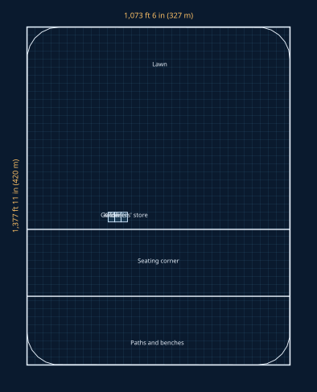

# P3-30 Pocket Park 5: plan

Footprint 1,073 ft 6 in (327 m) × 1,377 ft 11 in (420 m) · structural grid 32 ft 10 in (10 m)

## Levels

| Level | Floor above deck | Height | Floor area |
|---|---|---|---|
| Level 1 · Ground | 0 ft (0 mm) | 13 ft 1 in (4,000 mm) | 3,100 sq ft (288 m²) |

## Elements

| ID | Designation | Type | Name | Level(s) | Size / length | Area | Status |
|---|---|---|---|---|---|---|---|
| E001 | D5F6P3B5A2R1 | zone | Lawn | L1 | 1,073 ft 2 in (327 m) × 825 ft 2 in (252 m) | 876,727 sq ft (81,451 m²) | proposed |
| E002 | D5F6P3B5A2R2 | room | Kiosk | L1 | 26 ft 3 in (8,000 mm) × 39 ft 4 in (12 m) | 1,033 sq ft (96 m²) | proposed |
| E003 | D5F6P3B5A2R3 | room | Toilets | L1 | 26 ft 3 in (8,000 mm) × 39 ft 4 in (12 m) | 1,033 sq ft (96 m²) | proposed |
| E004 | D5F6P3B5A2R4 | room | Gardeners' store | L1 | 26 ft 3 in (8,000 mm) × 39 ft 4 in (12 m) | 1,033 sq ft (96 m²) | proposed |
| E005 | D5F6P3B5A2R5 | zone | Seating corner | L1 | 1,072 ft 6 in (327 m) × 272 ft 8 in (83 m) | 292,361 sq ft (27,161 m²) | proposed |
| E006 | D5F6P3B5A2R6 | zone | Paths and benches | L1 | 1,072 ft 6 in (327 m) × 280 ft 2 in (85 m) | 292,317 sq ft (27,157 m²) | proposed |

## Drawings

### Level 1 · Ground

