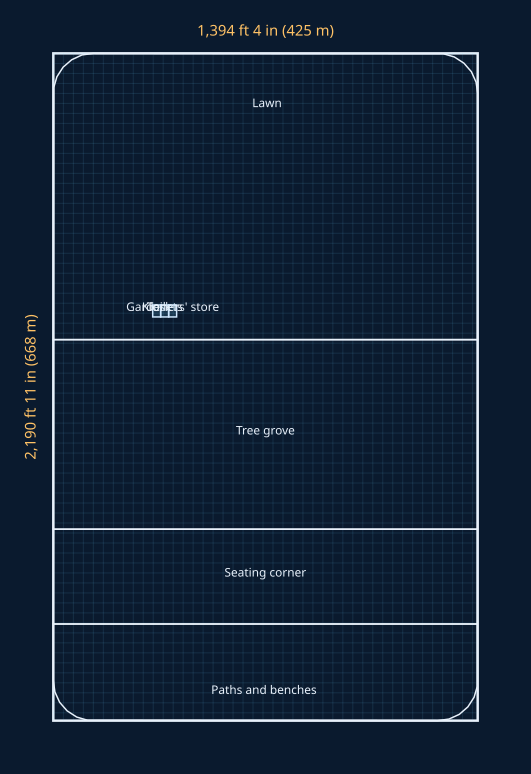

# P3-32 Pocket Park 6: plan

Footprint 1,394 ft 4 in (425 m) × 2,190 ft 11 in (668 m) · structural grid 32 ft 10 in (10 m)

## Levels

| Level | Floor above deck | Height | Floor area |
|---|---|---|---|
| Level 1 · Ground | 0 ft (0 mm) | 13 ft 1 in (4,000 mm) | 3,100 sq ft (288 m²) |

## Elements

| ID | Designation | Type | Name | Level(s) | Size / length | Area | Status |
|---|---|---|---|---|---|---|---|
| E001 | D5F6P3B7A3R1 | zone | Lawn | L1 | 1,393 ft 8 in (425 m) × 940 ft (286 m) | 1,301,096 sq ft (120,876 m²) | proposed |
| E002 | D5F6P3B7A3R2 | room | Kiosk | L1 | 26 ft 3 in (8,000 mm) × 39 ft 4 in (12 m) | 1,033 sq ft (96 m²) | proposed |
| E003 | D5F6P3B7A3R3 | room | Toilets | L1 | 26 ft 3 in (8,000 mm) × 39 ft 4 in (12 m) | 1,033 sq ft (96 m²) | proposed |
| E004 | D5F6P3B7A3R4 | room | Gardeners' store | L1 | 26 ft 3 in (8,000 mm) × 39 ft 4 in (12 m) | 1,033 sq ft (96 m²) | proposed |
| E005 | D5F6P3B7A3R5 | zone | Tree grove | L1 | 1,393 ft 4 in (425 m) × 622 ft 5 in (190 m) | 866,997 sq ft (80,547 m²) | proposed |
| E006 | D5F6P3B7A3R6 | zone | Seating corner | L1 | 1,393 ft 4 in (425 m) × 311 ft 4 in (95 m) | 433,727 sq ft (40,295 m²) | proposed |
| E007 | D5F6P3B7A3R7 | zone | Paths and benches | L1 | 1,393 ft 1 in (425 m) × 317 ft 3 in (97 m) | 433,650 sq ft (40,287 m²) | proposed |

## Drawings

### Level 1 · Ground

