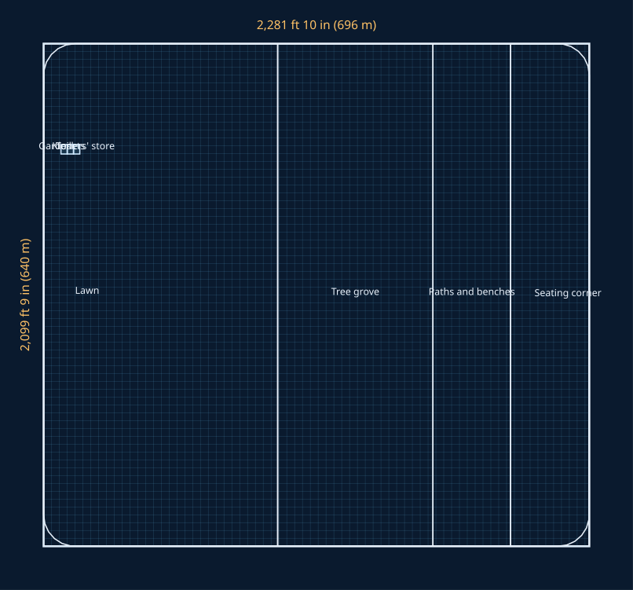

# P3-39 Pocket Park 10: plan

Footprint 2,281 ft 10 in (696 m) × 2,099 ft 9 in (640 m) · structural grid 32 ft 10 in (10 m)

## Levels

| Level | Floor above deck | Height | Floor area |
|---|---|---|---|
| Level 1 · Ground | 0 ft (0 mm) | 13 ft 1 in (4,000 mm) | 3,100 sq ft (288 m²) |

## Elements

| ID | Designation | Type | Name | Level(s) | Size / length | Area | Status |
|---|---|---|---|---|---|---|---|
| E001 | D5F6P3B17A3R1 | zone | Lawn | L1 | 978 ft 8 in (298 m) × 2,099 ft 1 in (640 m) | 2,044,915 sq ft (189,979 m²) | proposed |
| E002 | D5F6P3B17A3R2 | room | Kiosk | L1 | 26 ft 3 in (8,000 mm) × 39 ft 4 in (12 m) | 1,033 sq ft (96 m²) | proposed |
| E003 | D5F6P3B17A3R3 | room | Toilets | L1 | 26 ft 3 in (8,000 mm) × 39 ft 4 in (12 m) | 1,033 sq ft (96 m²) | proposed |
| E004 | D5F6P3B17A3R4 | room | Gardeners' store | L1 | 26 ft 3 in (8,000 mm) × 39 ft 4 in (12 m) | 1,033 sq ft (96 m²) | proposed |
| E005 | D5F6P3B17A3R5 | zone | Tree grove | L1 | 649 ft 3 in (198 m) × 2,098 ft 9 in (640 m) | 1,362,462 sq ft (126,577 m²) | proposed |
| E006 | D5F6P3B17A3R6 | zone | Paths and benches | L1 | 324 ft 10 in (99 m) × 2,098 ft 9 in (640 m) | 681,575 sq ft (63,320 m²) | proposed |
| E007 | D5F6P3B17A3R7 | zone | Seating corner | L1 | 329 ft 1 in (100 m) × 2,098 ft 5 in (640 m) | 681,758 sq ft (63,337 m²) | proposed |

## Drawings

### Level 1 · Ground

