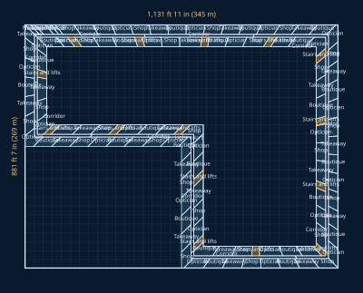
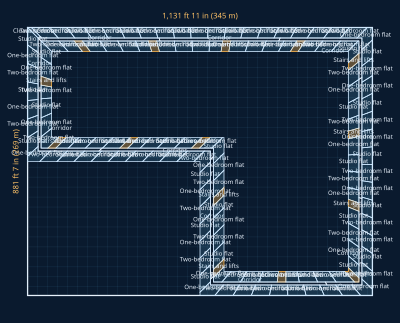

# P3-40 Commons Shops 11: plan

Footprint 1,131 ft 11 in (345 m) × 881 ft 7 in (269 m) · structural grid 32 ft 10 in (10 m)

## Levels

| Level | Floor above deck | Height | Floor area |
|---|---|---|---|
| Level 1 · Shop floor | 0 ft (0 mm) | 16 ft 5 in (5,000 mm) | 242,187 sq ft (22,500 m²) |
| Level 2 · Flat floor 1 | 16 ft 5 in (5,000 mm) | 10 ft 6 in (3,200 mm) | 242,187 sq ft (22,500 m²) |
| Level 3 · Flat floor 2 | 26 ft 11 in (8,200 mm) | 10 ft 6 in (3,200 mm) | 242,187 sq ft (22,500 m²) |
| Level 4 · Flat floor 3 | 37 ft 5 in (11 m) | 10 ft 6 in (3,200 mm) | 242,187 sq ft (22,500 m²) |
| Level 5 · Flat floor 4 | 47 ft 11 in (15 m) | 10 ft 6 in (3,200 mm) | 242,187 sq ft (22,500 m²) |

## Elements

| ID | Designation | Type | Name | Level(s) | Size / length | Area | Status |
|---|---|---|---|---|---|---|---|
| E001 | D5F6P3B18A3L1R1 | zone | Light court | L1 | 974 ft 5 in (297 m) × 724 ft 1 in (221 m) | 456,187 sq ft (42,381 m²) | proposed |
| E002 | D5F6P3B18A3L1R2 | zone | Corridor | L1 | 399 ft 11 in (122 m) × 9 ft 10 in (3,000 mm) | 3,875 sq ft (360 m²) | proposed |
| E003 | D5F6P3B18A3L1R3 | zone | Corridor | L1 | 397 ft 4 in (121 m) × 9 ft 10 in (3,000 mm) | 3,875 sq ft (360 m²) | proposed |
| E004 | D5F6P3B18A3L1R4 | zone | Corridor | L1 | 273 ft (83 m) × 136 ft 2 in (42 m) | 3,875 sq ft (360 m²) | proposed |
| E005 | D5F6P3B18A3L1R5 | zone | Corridor | L1 | 9 ft 10 in (3,000 mm) × 398 ft 4 in (121 m) | 3,875 sq ft (360 m²) | proposed |
| E006 | D5F6P3B18A3L1R6 | zone | Corridor | L1 | 120 ft 1 in (37 m) × 287 ft 5 in (88 m) | 3,875 sq ft (360 m²) | proposed |
| E007 | D5F6P3B18A3L1R7 | zone | Corridor | L1 | 382 ft 3 in (116 m) × 28 ft 10 in (8,800 mm) | 3,875 sq ft (360 m²) | proposed |
| E008 | D5F6P3B18A3L1R8 | zone | Corridor | L1 | 9 ft 10 in (3,000 mm) × 403 ft 7 in (123 m) | 3,875 sq ft (360 m²) | proposed |
| E009 | D5F6P3B18A3L1R9 | zone | Corridor | L1 | 375 ft 8 in (114 m) × 37 ft 9 in (12 m) | 3,875 sq ft (360 m²) | proposed |
| E010 | D5F6P3B18A3L1R10 | zone | Corridor | L1 | 210 ft (64 m) × 198 ft 10 in (61 m) | 3,875 sq ft (360 m²) | proposed |
| E011 | D5F6P3B18A3L1R11 | zone | Corridor | L1 | 9 ft 10 in (3,000 mm) × 173 ft 11 in (53 m) | 1,660 sq ft (154 m²) | proposed |
| E012 | D5F6P3B18A3L1R12, D5F6P3B18A3L2R1, D5F6P3B18A3L3R1, D5F6P3B18A3L4R1, D5F6P3B18A3L5R1 | core | Stairs and lifts | L1, L2, L3, L4, L5 | 52 ft 10 in (16 m) × 34 ft 5 in (10 m) | 910 sq ft (85 m²) | proposed |
| E013 | D5F6P3B18A3L1R13, D5F6P3B18A3L2R2, D5F6P3B18A3L3R2, D5F6P3B18A3L4R2, D5F6P3B18A3L5R2 | core | Stairs and lifts | L1, L2, L3, L4, L5 | 36 ft 5 in (11 m) × 34 ft 5 in (10 m) | 904 sq ft (84 m²) | proposed |
| E014 | D5F6P3B18A3L1R14, D5F6P3B18A3L2R3, D5F6P3B18A3L3R3, D5F6P3B18A3L4R3, D5F6P3B18A3L5R3 | core | Stairs and lifts | L1, L2, L3, L4, L5 | 31 ft 10 in (9,700 mm) × 34 ft 5 in (10 m) | 899 sq ft (83 m²) | proposed |
| E015 | D5F6P3B18A3L1R15, D5F6P3B18A3L2R4, D5F6P3B18A3L3R4, D5F6P3B18A3L4R4, D5F6P3B18A3L5R4 | core | Stairs and lifts | L1, L2, L3, L4, L5 | 48 ft 3 in (15 m) × 34 ft 5 in (10 m) | 910 sq ft (85 m²) | proposed |
| E016 | D5F6P3B18A3L1R16, D5F6P3B18A3L2R5, D5F6P3B18A3L3R5, D5F6P3B18A3L4R5, D5F6P3B18A3L5R5 | core | Stairs and lifts | L1, L2, L3, L4, L5 | 34 ft 5 in (10 m) × 55 ft 9 in (17 m) | 899 sq ft (83 m²) | proposed |
| E017 | D5F6P3B18A3L1R17, D5F6P3B18A3L2R6, D5F6P3B18A3L3R6, D5F6P3B18A3L4R6, D5F6P3B18A3L5R6 | core | Stairs and lifts | L1, L2, L3, L4, L5 | 34 ft 5 in (10 m) × 34 ft 9 in (11 m) | 904 sq ft (84 m²) | proposed |
| E018 | D5F6P3B18A3L1R18, D5F6P3B18A3L2R7, D5F6P3B18A3L3R7, D5F6P3B18A3L4R7, D5F6P3B18A3L5R7 | core | Stairs and lifts | L1, L2, L3, L4, L5 | 34 ft 5 in (10 m) × 39 ft 4 in (12 m) | 910 sq ft (85 m²) | proposed |
| E019 | D5F6P3B18A3L1R19, D5F6P3B18A3L2R8, D5F6P3B18A3L3R8, D5F6P3B18A3L4R8, D5F6P3B18A3L5R8 | core | Stairs and lifts | L1, L2, L3, L4, L5 | 46 ft 7 in (14 m) × 46 ft 11 in (14 m) | 904 sq ft (84 m²) | proposed |
| E020 | D5F6P3B18A3L1R20, D5F6P3B18A3L2R9, D5F6P3B18A3L3R9, D5F6P3B18A3L4R9, D5F6P3B18A3L5R9 | core | Stairs and lifts | L1, L2, L3, L4, L5 | 28 ft 3 in (8,600 mm) × 34 ft 5 in (10 m) | 899 sq ft (83 m²) | proposed |
| E021 | D5F6P3B18A3L1R21, D5F6P3B18A3L2R10, D5F6P3B18A3L3R10, D5F6P3B18A3L4R10, D5F6P3B18A3L5R10 | core | Stairs and lifts | L1, L2, L3, L4, L5 | 34 ft 5 in (10 m) × 60 ft 8 in (18 m) | 904 sq ft (84 m²) | proposed |
| E022 | D5F6P3B18A3L1R22, D5F6P3B18A3L2R11, D5F6P3B18A3L3R11, D5F6P3B18A3L4R11, D5F6P3B18A3L5R11 | core | Stairs and lifts | L1, L2, L3, L4, L5 | 34 ft 5 in (10 m) × 60 ft 8 in (18 m) | 904 sq ft (84 m²) | proposed |
| E023 | D5F6P3B18A3L1R23, D5F6P3B18A3L2R12, D5F6P3B18A3L3R12, D5F6P3B18A3L4R12, D5F6P3B18A3L5R12 | core | Stairs and lifts | L1, L2, L3, L4, L5 | 60 ft 8 in (18 m) × 34 ft 5 in (10 m) | 904 sq ft (84 m²) | proposed |
| E024 | D5F6P3B18A3L1R24, D5F6P3B18A3L2R13, D5F6P3B18A3L3R13, D5F6P3B18A3L4R13, D5F6P3B18A3L5R13 | core | Stairs and lifts | L1, L2, L3, L4, L5 | 60 ft 8 in (18 m) × 34 ft 5 in (10 m) | 904 sq ft (84 m²) | proposed |
| E025 | D5F6P3B18A3L1R25, D5F6P3B18A3L2R14, D5F6P3B18A3L3R14, D5F6P3B18A3L4R14, D5F6P3B18A3L5R14 | core | Stairs and lifts | L1, L2, L3, L4, L5 | 60 ft 8 in (18 m) × 34 ft 5 in (10 m) | 904 sq ft (84 m²) | proposed |
| E026 | D5F6P3B18A3L1R26, D5F6P3B18A3L2R15, D5F6P3B18A3L3R15, D5F6P3B18A3L4R15, D5F6P3B18A3L5R15 | core | Stairs and lifts | L1, L2, L3, L4, L5 | 34 ft 5 in (10 m) × 35 ft 1 in (11 m) | 899 sq ft (83 m²) | proposed |
| E027 | D5F6P3B18A3L1R27 | room | Toilets | L1 | 52 ft 6 in (16 m) × 34 ft 5 in (10 m) | 644 sq ft (60 m²) | proposed |
| E028 | D5F6P3B18A3L1R28 | room | Newsagent | L1 | 48 ft 3 in (15 m) × 34 ft 5 in (10 m) | 537 sq ft (50 m²) | proposed |
| E029 | D5F6P3B18A3L1R29 | room | Bookshop | L1 | 68 ft 7 in (21 m) × 34 ft 5 in (10 m) | 1,294 sq ft (120 m²) | proposed |
| E030 | D5F6P3B18A3L1R30 | room | Hairdresser | L1 | 48 ft 3 in (15 m) × 34 ft 5 in (10 m) | 650 sq ft (60 m²) | proposed |
| E031 | D5F6P3B18A3L1R31 | room | Florist | L1 | 44 ft (13 m) × 34 ft 5 in (10 m) | 537 sq ft (50 m²) | proposed |
| E032 | D5F6P3B18A3L1R32 | room | Shop | L1 | 91 ft 2 in (28 m) × 34 ft 5 in (10 m) | 2,255 sq ft (209 m²) | proposed |
| E033 | D5F6P3B18A3L1R33 | room | Takeaway | L1 | 87 ft 3 in (27 m) × 34 ft 5 in (10 m) | 2,266 sq ft (211 m²) | proposed |
| E034 | D5F6P3B18A3L1R34 | room | Boutique | L1 | 83 ft (25 m) × 34 ft 5 in (10 m) | 2,260 sq ft (210 m²) | proposed |
| E035 | D5F6P3B18A3L1R35 | room | Optician | L1 | 79 ft 1 in (24 m) × 34 ft 5 in (10 m) | 2,260 sq ft (210 m²) | proposed |
| E036 | D5F6P3B18A3L1R36 | room | Shop | L1 | 74 ft 10 in (23 m) × 34 ft 5 in (10 m) | 2,255 sq ft (209 m²) | proposed |
| E037 | D5F6P3B18A3L1R37 | room | Takeaway | L1 | 70 ft 10 in (22 m) × 34 ft 5 in (10 m) | 2,266 sq ft (211 m²) | proposed |
| E038 | D5F6P3B18A3L1R38 | room | Boutique | L1 | 67 ft 7 in (21 m) × 34 ft 5 in (10 m) | 2,260 sq ft (210 m²) | proposed |
| E039 | D5F6P3B18A3L1R39 | room | Optician | L1 | 68 ft 7 in (21 m) × 34 ft 5 in (10 m) | 2,255 sq ft (209 m²) | proposed |
| E040 | D5F6P3B18A3L1R40 | room | Shop | L1 | 72 ft 10 in (22 m) × 34 ft 5 in (10 m) | 2,260 sq ft (210 m²) | proposed |
| E041 | D5F6P3B18A3L1R41 | room | Takeaway | L1 | 77 ft 1 in (24 m) × 34 ft 5 in (10 m) | 2,266 sq ft (211 m²) | proposed |
| E042 | D5F6P3B18A3L1R42 | room | Boutique | L1 | 81 ft (25 m) × 34 ft 5 in (10 m) | 2,260 sq ft (210 m²) | proposed |
| E043 | D5F6P3B18A3L1R43 | room | Optician | L1 | 85 ft (26 m) × 34 ft 5 in (10 m) | 2,255 sq ft (209 m²) | proposed |
| E044 | D5F6P3B18A3L1R44 | room | Shop | L1 | 89 ft 7 in (27 m) × 34 ft 5 in (10 m) | 2,266 sq ft (211 m²) | proposed |
| E045 | D5F6P3B18A3L1R45 | room | Takeaway | L1 | 93 ft 6 in (28 m) × 34 ft 5 in (10 m) | 2,260 sq ft (210 m²) | proposed |
| E046 | D5F6P3B18A3L1R46 | room | Boutique | L1 | 97 ft 5 in (30 m) × 34 ft 5 in (10 m) | 2,255 sq ft (209 m²) | proposed |
| E047 | D5F6P3B18A3L1R47 | room | Optician | L1 | 41 ft 4 in (13 m) × 90 ft 11 in (28 m) | 2,266 sq ft (211 m²) | proposed |
| E048 | D5F6P3B18A3L1R48 | room | Shop | L1 | 34 ft 5 in (10 m) × 92 ft 6 in (28 m) | 2,255 sq ft (209 m²) | proposed |
| E049 | D5F6P3B18A3L1R49 | room | Takeaway | L1 | 34 ft 5 in (10 m) × 87 ft 3 in (27 m) | 2,260 sq ft (210 m²) | proposed |
| E050 | D5F6P3B18A3L1R50 | room | Boutique | L1 | 34 ft 5 in (10 m) × 82 ft (25 m) | 2,260 sq ft (210 m²) | proposed |
| E051 | D5F6P3B18A3L1R51 | room | Optician | L1 | 34 ft 5 in (10 m) × 76 ft 9 in (23 m) | 2,266 sq ft (211 m²) | proposed |
| E052 | D5F6P3B18A3L1R52 | room | Shop | L1 | 34 ft 5 in (10 m) × 71 ft 2 in (22 m) | 2,260 sq ft (210 m²) | proposed |
| E053 | D5F6P3B18A3L1R53 | room | Takeaway | L1 | 34 ft 5 in (10 m) × 68 ft 3 in (21 m) | 2,260 sq ft (210 m²) | proposed |
| E054 | D5F6P3B18A3L1R54 | room | Boutique | L1 | 34 ft 5 in (10 m) × 70 ft 6 in (22 m) | 2,260 sq ft (210 m²) | proposed |
| E055 | D5F6P3B18A3L1R55 | room | Optician | L1 | 34 ft 5 in (10 m) × 75 ft 9 in (23 m) | 2,255 sq ft (209 m²) | proposed |
| E056 | D5F6P3B18A3L1R56 | room | Shop | L1 | 34 ft 5 in (10 m) × 81 ft 4 in (25 m) | 2,260 sq ft (210 m²) | proposed |
| E057 | D5F6P3B18A3L1R57 | room | Takeaway | L1 | 34 ft 5 in (10 m) × 86 ft 7 in (26 m) | 2,260 sq ft (210 m²) | proposed |
| E058 | D5F6P3B18A3L1R58 | room | Boutique | L1 | 34 ft 5 in (10 m) × 92 ft 2 in (28 m) | 2,266 sq ft (211 m²) | proposed |
| E059 | D5F6P3B18A3L1R59 | room | Optician | L1 | 34 ft 5 in (10 m) × 97 ft 5 in (30 m) | 2,260 sq ft (210 m²) | proposed |
| E060 | D5F6P3B18A3L1R60 | room | Shop | L1 | 94 ft 10 in (29 m) × 35 ft 5 in (11 m) | 2,260 sq ft (210 m²) | proposed |
| E061 | D5F6P3B18A3L1R61 | room | Takeaway | L1 | 87 ft 3 in (27 m) × 34 ft 5 in (10 m) | 2,260 sq ft (210 m²) | proposed |
| E062 | D5F6P3B18A3L1R62 | room | Boutique | L1 | 78 ft 9 in (24 m) × 34 ft 5 in (10 m) | 2,255 sq ft (209 m²) | proposed |
| E063 | D5F6P3B18A3L1R63 | room | Optician | L1 | 70 ft 6 in (22 m) × 34 ft 5 in (10 m) | 2,260 sq ft (210 m²) | proposed |
| E064 | D5F6P3B18A3L1R64 | room | Shop | L1 | 69 ft 11 in (21 m) × 34 ft 5 in (10 m) | 2,260 sq ft (210 m²) | proposed |
| E065 | D5F6P3B18A3L1R65 | room | Takeaway | L1 | 77 ft 9 in (24 m) × 34 ft 5 in (10 m) | 2,260 sq ft (210 m²) | proposed |
| E066 | D5F6P3B18A3L1R66 | room | Boutique | L1 | 86 ft 3 in (26 m) × 34 ft 5 in (10 m) | 2,260 sq ft (210 m²) | proposed |
| E067 | D5F6P3B18A3L1R67 | room | Optician | L1 | 94 ft 10 in (29 m) × 34 ft 5 in (10 m) | 2,260 sq ft (210 m²) | proposed |
| E068 | D5F6P3B18A3L1R68 | room | Shop | L1 | 41 ft 8 in (13 m) × 92 ft 6 in (28 m) | 2,266 sq ft (211 m²) | proposed |
| E069 | D5F6P3B18A3L1R69 | room | Takeaway | L1 | 34 ft 5 in (10 m) × 100 ft 1 in (30 m) | 2,260 sq ft (210 m²) | proposed |
| E070 | D5F6P3B18A3L1R70 | room | Boutique | L1 | 34 ft 5 in (10 m) × 100 ft 1 in (30 m) | 2,260 sq ft (210 m²) | proposed |
| E071 | D5F6P3B18A3L1R71 | room | Optician | L1 | 34 ft 5 in (10 m) × 100 ft 1 in (30 m) | 2,260 sq ft (210 m²) | proposed |
| E072 | D5F6P3B18A3L1R72 | room | Shop | L1 | 34 ft 5 in (10 m) × 100 ft 1 in (30 m) | 2,260 sq ft (210 m²) | proposed |
| E073 | D5F6P3B18A3L1R73 | room | Takeaway | L1 | 34 ft 5 in (10 m) × 100 ft 1 in (30 m) | 2,260 sq ft (210 m²) | proposed |
| E074 | D5F6P3B18A3L1R74 | room | Boutique | L1 | 45 ft 7 in (14 m) × 88 ft 11 in (27 m) | 2,260 sq ft (210 m²) | proposed |
| E075 | D5F6P3B18A3L1R75 | room | Optician | L1 | 100 ft 1 in (30 m) × 34 ft 5 in (10 m) | 2,260 sq ft (210 m²) | proposed |
| E076 | D5F6P3B18A3L1R76 | room | Shop | L1 | 100 ft 1 in (30 m) × 34 ft 5 in (10 m) | 2,260 sq ft (210 m²) | proposed |
| E077 | D5F6P3B18A3L1R77 | room | Takeaway | L1 | 100 ft 1 in (30 m) × 34 ft 5 in (10 m) | 2,260 sq ft (210 m²) | proposed |
| E078 | D5F6P3B18A3L1R78 | room | Boutique | L1 | 100 ft 1 in (30 m) × 34 ft 5 in (10 m) | 2,260 sq ft (210 m²) | proposed |
| E079 | D5F6P3B18A3L1R79 | room | Optician | L1 | 100 ft 1 in (30 m) × 34 ft 5 in (10 m) | 2,260 sq ft (210 m²) | proposed |
| E080 | D5F6P3B18A3L1R80 | room | Shop | L1 | 100 ft 1 in (30 m) × 34 ft 5 in (10 m) | 2,260 sq ft (210 m²) | proposed |
| E081 | D5F6P3B18A3L1R81 | room | Takeaway | L1 | 100 ft 1 in (30 m) × 34 ft 5 in (10 m) | 2,260 sq ft (210 m²) | proposed |
| E082 | D5F6P3B18A3L1R82 | room | Boutique | L1 | 100 ft 1 in (30 m) × 34 ft 5 in (10 m) | 2,260 sq ft (210 m²) | proposed |
| E083 | D5F6P3B18A3L1R83 | room | Optician | L1 | 64 ft 4 in (20 m) × 67 ft 3 in (20 m) | 2,260 sq ft (210 m²) | proposed |
| E084 | D5F6P3B18A3L1R84 | room | Shop | L1 | 34 ft 5 in (10 m) × 88 ft 7 in (27 m) | 2,260 sq ft (210 m²) | proposed |
| E085 | D5F6P3B18A3L1R85 | room | Takeaway | L1 | 34 ft 5 in (10 m) × 77 ft 5 in (24 m) | 2,260 sq ft (210 m²) | proposed |
| E086 | D5F6P3B18A3L1R86 | room | Boutique | L1 | 34 ft 5 in (10 m) × 71 ft 2 in (22 m) | 2,260 sq ft (210 m²) | proposed |
| E087 | D5F6P3B18A3L1R87 | room | Optician | L1 | 34 ft 5 in (10 m) × 76 ft 1 in (23 m) | 2,260 sq ft (210 m²) | proposed |
| E088 | D5F6P3B18A3L1R88 | room | Shop | L1 | 34 ft 5 in (10 m) × 87 ft 3 in (27 m) | 2,260 sq ft (210 m²) | proposed |
| E089 | D5F6P3B18A3L1R89 | room | Takeaway | L1 | 34 ft 5 in (10 m) × 73 ft 6 in (22 m) | 1,469 sq ft (136 m²) | proposed |
| E090 | D5F6P3B18A3L1R90 | room | Boutique | L1 | 97 ft 9 in (30 m) × 34 ft 5 in (10 m) | 2,260 sq ft (210 m²) | proposed |
| E091 | D5F6P3B18A3L1R91 | room | Optician | L1 | 67 ft 7 in (21 m) × 34 ft 5 in (10 m) | 1,345 sq ft (125 m²) | proposed |
| E092 | D5F6P3B18A3L1R92 | room | Shop | L1 | 88 ft 11 in (27 m) × 34 ft 5 in (10 m) | 2,260 sq ft (210 m²) | proposed |
| E093 | D5F6P3B18A3L1R93 | room | Takeaway | L1 | 84 ft 4 in (26 m) × 34 ft 5 in (10 m) | 2,255 sq ft (209 m²) | proposed |
| E094 | D5F6P3B18A3L1R94 | room | Boutique | L1 | 92 ft 2 in (28 m) × 34 ft 5 in (10 m) | 2,696 sq ft (250 m²) | proposed |
| E095 | D5F6P3B18A3L1R95 | room | Optician | L1 | 72 ft 6 in (22 m) × 34 ft 5 in (10 m) | 2,255 sq ft (209 m²) | proposed |
| E096 | D5F6P3B18A3L1R96 | room | Shop | L1 | 68 ft 7 in (21 m) × 34 ft 5 in (10 m) | 2,266 sq ft (211 m²) | proposed |
| E097 | D5F6P3B18A3L1R97 | room | Takeaway | L1 | 81 ft (25 m) × 34 ft 5 in (10 m) | 2,696 sq ft (250 m²) | proposed |
| E098 | D5F6P3B18A3L1R98 | room | Boutique | L1 | 74 ft 6 in (23 m) × 34 ft 5 in (10 m) | 2,260 sq ft (210 m²) | proposed |
| E099 | D5F6P3B18A3L1R99 | room | Optician | L1 | 79 ft 1 in (24 m) × 34 ft 5 in (10 m) | 2,260 sq ft (210 m²) | proposed |
| E100 | D5F6P3B18A3L1R100 | room | Shop | L1 | 96 ft 5 in (29 m) × 34 ft 5 in (10 m) | 2,690 sq ft (250 m²) | proposed |
| E101 | D5F6P3B18A3L1R101 | room | Takeaway | L1 | 90 ft 7 in (28 m) × 34 ft 5 in (10 m) | 2,260 sq ft (210 m²) | proposed |
| E102 | D5F6P3B18A3L1R102 | room | Boutique | L1 | 95 ft 2 in (29 m) × 34 ft 5 in (10 m) | 2,260 sq ft (210 m²) | proposed |
| E103 | D5F6P3B18A3L1R103 | room | Optician | L1 | 72 ft 10 in (22 m) × 71 ft 2 in (22 m) | 2,696 sq ft (250 m²) | proposed |
| E104 | D5F6P3B18A3L1R104 | room | Shop | L1 | 34 ft 5 in (10 m) × 91 ft 2 in (28 m) | 2,260 sq ft (210 m²) | proposed |
| E105 | D5F6P3B18A3L1R105 | room | Takeaway | L1 | 34 ft 5 in (10 m) × 85 ft 4 in (26 m) | 2,260 sq ft (210 m²) | proposed |
| E106 | D5F6P3B18A3L1R106 | room | Boutique | L1 | 34 ft 5 in (10 m) × 91 ft 6 in (28 m) | 2,696 sq ft (250 m²) | proposed |
| E107 | D5F6P3B18A3L1R107 | room | Optician | L1 | 34 ft 5 in (10 m) × 69 ft 11 in (21 m) | 2,260 sq ft (210 m²) | proposed |
| E108 | D5F6P3B18A3L1R108 | room | Shop | L1 | 34 ft 5 in (10 m) × 68 ft 7 in (21 m) | 2,260 sq ft (210 m²) | proposed |
| E109 | D5F6P3B18A3L1R109 | room | Takeaway | L1 | 34 ft 5 in (10 m) × 86 ft 3 in (26 m) | 2,690 sq ft (250 m²) | proposed |
| E110 | D5F6P3B18A3L1R110 | room | Boutique | L1 | 34 ft 5 in (10 m) × 82 ft 8 in (25 m) | 2,255 sq ft (209 m²) | proposed |
| E111 | D5F6P3B18A3L1R111 | room | Optician | L1 | 34 ft 5 in (10 m) × 88 ft 11 in (27 m) | 2,260 sq ft (210 m²) | proposed |
| E112 | D5F6P3B18A3L1R112 | room | Shop | L1 | 34 ft 5 in (10 m) × 107 ft 11 in (33 m) | 2,696 sq ft (250 m²) | proposed |
| E113 | D5F6P3B18A3L1R113 | room | Takeaway | L1 | 92 ft 10 in (28 m) × 34 ft 5 in (10 m) | 2,260 sq ft (210 m²) | proposed |
| E114 | D5F6P3B18A3L1R114 | room | Boutique | L1 | 82 ft 8 in (25 m) × 34 ft 5 in (10 m) | 2,260 sq ft (210 m²) | proposed |
| E115 | D5F6P3B18A3L1R115 | room | Optician | L1 | 84 ft 4 in (26 m) × 34 ft 5 in (10 m) | 2,696 sq ft (250 m²) | proposed |
| E116 | D5F6P3B18A3L1R116 | room | Shop | L1 | 75 ft 2 in (23 m) × 34 ft 5 in (10 m) | 2,266 sq ft (211 m²) | proposed |
| E117 | D5F6P3B18A3L1R117 | room | Takeaway | L1 | 85 ft (26 m) × 34 ft 5 in (10 m) | 2,255 sq ft (209 m²) | proposed |
| E118 | D5F6P3B18A3L1R118 | room | Boutique | L1 | 92 ft 6 in (28 m) × 49 ft 10 in (15 m) | 2,701 sq ft (251 m²) | proposed |
| E119 | D5F6P3B18A3L1R119 | room | Optician | L1 | 34 ft 5 in (10 m) × 100 ft 1 in (30 m) | 2,260 sq ft (210 m²) | proposed |
| E120 | D5F6P3B18A3L1R120 | room | Shop | L1 | 34 ft 5 in (10 m) × 100 ft 1 in (30 m) | 2,260 sq ft (210 m²) | proposed |
| E121 | D5F6P3B18A3L1R121 | room | Takeaway | L1 | 34 ft 5 in (10 m) × 112 ft 6 in (34 m) | 2,690 sq ft (250 m²) | proposed |
| E122 | D5F6P3B18A3L1R122 | room | Boutique | L1 | 34 ft 5 in (10 m) × 100 ft 1 in (30 m) | 2,260 sq ft (210 m²) | proposed |
| E123 | D5F6P3B18A3L1R123 | room | Optician | L1 | 34 ft 5 in (10 m) × 100 ft 1 in (30 m) | 2,260 sq ft (210 m²) | proposed |
| E124 | D5F6P3B18A3L1R124 | room | Shop | L1 | 80 ft 5 in (24 m) × 66 ft 7 in (20 m) | 2,690 sq ft (250 m²) | proposed |
| E125 | D5F6P3B18A3L1R125 | room | Takeaway | L1 | 100 ft 1 in (30 m) × 34 ft 5 in (10 m) | 2,260 sq ft (210 m²) | proposed |
| E126 | D5F6P3B18A3L1R126 | room | Boutique | L1 | 100 ft 1 in (30 m) × 34 ft 5 in (10 m) | 2,260 sq ft (210 m²) | proposed |
| E127 | D5F6P3B18A3L1R127 | room | Optician | L1 | 112 ft 6 in (34 m) × 34 ft 5 in (10 m) | 2,690 sq ft (250 m²) | proposed |
| E128 | D5F6P3B18A3L1R128 | room | Shop | L1 | 100 ft 1 in (30 m) × 34 ft 5 in (10 m) | 2,260 sq ft (210 m²) | proposed |
| E129 | D5F6P3B18A3L1R129 | room | Takeaway | L1 | 100 ft 1 in (30 m) × 34 ft 5 in (10 m) | 2,260 sq ft (210 m²) | proposed |
| E130 | D5F6P3B18A3L1R130 | room | Boutique | L1 | 112 ft 10 in (34 m) × 34 ft 5 in (10 m) | 2,701 sq ft (251 m²) | proposed |
| E131 | D5F6P3B18A3L1R131 | room | Optician | L1 | 56 ft 9 in (17 m) × 72 ft 10 in (22 m) | 2,255 sq ft (209 m²) | proposed |
| E132 | D5F6P3B18A3L1R132 | room | Shop | L1 | 34 ft 5 in (10 m) × 83 ft 8 in (26 m) | 2,266 sq ft (211 m²) | proposed |
| E133 | D5F6P3B18A3L1R133 | room | Takeaway | L1 | 34 ft 5 in (10 m) × 86 ft 7 in (26 m) | 2,690 sq ft (250 m²) | proposed |
| E134 | D5F6P3B18A3L1R134 | room | Boutique | L1 | 34 ft 5 in (10 m) × 84 ft 8 in (26 m) | 2,266 sq ft (211 m²) | proposed |
| E135 | D5F6P3B18A3L1R135 | room | Optician | L1 | 34 ft 5 in (10 m) × 69 ft 3 in (21 m) | 1,345 sq ft (125 m²) | proposed |
| E136 | D5F6P3B18A3L2R16, D5F6P3B18A3L3R16, D5F6P3B18A3L4R16, D5F6P3B18A3L5R16 | zone | Corridor | L2, L3, L4, L5 | 399 ft 11 in (122 m) × 9 ft 10 in (3,000 mm) | 3,875 sq ft (360 m²) | proposed |
| E137 | D5F6P3B18A3L2R17, D5F6P3B18A3L3R17, D5F6P3B18A3L4R17, D5F6P3B18A3L5R17 | zone | Corridor | L2, L3, L4, L5 | 397 ft 4 in (121 m) × 9 ft 10 in (3,000 mm) | 3,875 sq ft (360 m²) | proposed |
| E138 | D5F6P3B18A3L2R18, D5F6P3B18A3L3R18, D5F6P3B18A3L4R18, D5F6P3B18A3L5R18 | zone | Corridor | L2, L3, L4, L5 | 273 ft (83 m) × 136 ft 2 in (42 m) | 3,875 sq ft (360 m²) | proposed |
| E139 | D5F6P3B18A3L2R19, D5F6P3B18A3L3R19, D5F6P3B18A3L4R19, D5F6P3B18A3L5R19 | zone | Corridor | L2, L3, L4, L5 | 9 ft 10 in (3,000 mm) × 398 ft 4 in (121 m) | 3,875 sq ft (360 m²) | proposed |
| E140 | D5F6P3B18A3L2R20, D5F6P3B18A3L3R20, D5F6P3B18A3L4R20, D5F6P3B18A3L5R20 | zone | Corridor | L2, L3, L4, L5 | 120 ft 1 in (37 m) × 287 ft 5 in (88 m) | 3,875 sq ft (360 m²) | proposed |
| E141 | D5F6P3B18A3L2R21, D5F6P3B18A3L3R21, D5F6P3B18A3L4R21, D5F6P3B18A3L5R21 | zone | Corridor | L2, L3, L4, L5 | 382 ft 3 in (116 m) × 28 ft 10 in (8,800 mm) | 3,875 sq ft (360 m²) | proposed |
| E142 | D5F6P3B18A3L2R22, D5F6P3B18A3L3R22, D5F6P3B18A3L4R22, D5F6P3B18A3L5R22 | zone | Corridor | L2, L3, L4, L5 | 9 ft 10 in (3,000 mm) × 403 ft 7 in (123 m) | 3,875 sq ft (360 m²) | proposed |
| E143 | D5F6P3B18A3L2R23, D5F6P3B18A3L3R23, D5F6P3B18A3L4R23, D5F6P3B18A3L5R23 | zone | Corridor | L2, L3, L4, L5 | 375 ft 8 in (114 m) × 37 ft 9 in (12 m) | 3,875 sq ft (360 m²) | proposed |
| E144 | D5F6P3B18A3L2R24, D5F6P3B18A3L3R24, D5F6P3B18A3L4R24, D5F6P3B18A3L5R24 | zone | Corridor | L2, L3, L4, L5 | 210 ft (64 m) × 198 ft 10 in (61 m) | 3,875 sq ft (360 m²) | proposed |
| E145 | D5F6P3B18A3L2R25, D5F6P3B18A3L3R25, D5F6P3B18A3L4R25, D5F6P3B18A3L5R25 | zone | Corridor | L2, L3, L4, L5 | 9 ft 10 in (3,000 mm) × 173 ft 11 in (53 m) | 1,660 sq ft (154 m²) | proposed |
| E146 | D5F6P3B18A3L2R26, D5F6P3B18A3L3R26, D5F6P3B18A3L4R26, D5F6P3B18A3L5R26 | room | Cleaners' room | L2, L3, L4, L5 | 46 ft 3 in (14 m) × 34 ft 5 in (10 m) | 418 sq ft (39 m²) | proposed |
| E147 | D5F6P3B18A3L2R27, D5F6P3B18A3L3R27, D5F6P3B18A3L4R27, D5F6P3B18A3L5R27 | room | Two-bedroom flat | L2, L3, L4, L5 | 88 ft 3 in (27 m) × 34 ft 5 in (10 m) | 1,938 sq ft (180 m²) | proposed |
| E148 | D5F6P3B18A3L2R28, D5F6P3B18A3L3R28, D5F6P3B18A3L4R28, D5F6P3B18A3L5R28 | room | One-bedroom flat | L2, L3, L4, L5 | 84 ft 8 in (26 m) × 34 ft 5 in (10 m) | 1,938 sq ft (180 m²) | proposed |
| E149 | D5F6P3B18A3L2R29, D5F6P3B18A3L3R29, D5F6P3B18A3L4R29, D5F6P3B18A3L5R29 | room | Studio flat | L2, L3, L4, L5 | 81 ft (25 m) × 34 ft 5 in (10 m) | 1,933 sq ft (180 m²) | proposed |
| E150 | D5F6P3B18A3L2R30, D5F6P3B18A3L3R30, D5F6P3B18A3L4R30, D5F6P3B18A3L5R30 | room | Two-bedroom flat | L2, L3, L4, L5 | 77 ft 9 in (24 m) × 34 ft 5 in (10 m) | 1,938 sq ft (180 m²) | proposed |
| E151 | D5F6P3B18A3L2R31, D5F6P3B18A3L3R31, D5F6P3B18A3L4R31, D5F6P3B18A3L5R31 | room | One-bedroom flat | L2, L3, L4, L5 | 74 ft 2 in (23 m) × 34 ft 5 in (10 m) | 1,938 sq ft (180 m²) | proposed |
| E152 | D5F6P3B18A3L2R32, D5F6P3B18A3L3R32, D5F6P3B18A3L4R32, D5F6P3B18A3L5R32 | room | Studio flat | L2, L3, L4, L5 | 70 ft 6 in (22 m) × 34 ft 5 in (10 m) | 1,938 sq ft (180 m²) | proposed |
| E153 | D5F6P3B18A3L2R33, D5F6P3B18A3L3R33, D5F6P3B18A3L4R33, D5F6P3B18A3L5R33 | room | Two-bedroom flat | L2, L3, L4, L5 | 66 ft 11 in (20 m) × 34 ft 5 in (10 m) | 1,938 sq ft (180 m²) | proposed |
| E154 | D5F6P3B18A3L2R34, D5F6P3B18A3L3R34, D5F6P3B18A3L4R34, D5F6P3B18A3L5R34 | room | One-bedroom flat | L2, L3, L4, L5 | 63 ft 4 in (19 m) × 34 ft 5 in (10 m) | 1,933 sq ft (180 m²) | proposed |
| E155 | D5F6P3B18A3L2R35, D5F6P3B18A3L3R35, D5F6P3B18A3L4R35, D5F6P3B18A3L5R35 | room | Studio flat | L2, L3, L4, L5 | 60 ft (18 m) × 34 ft 5 in (10 m) | 1,938 sq ft (180 m²) | proposed |
| E156 | D5F6P3B18A3L2R36, D5F6P3B18A3L3R36, D5F6P3B18A3L4R36, D5F6P3B18A3L5R36 | room | Two-bedroom flat | L2, L3, L4, L5 | 58 ft 1 in (18 m) × 34 ft 5 in (10 m) | 1,938 sq ft (180 m²) | proposed |
| E157 | D5F6P3B18A3L2R37, D5F6P3B18A3L3R37, D5F6P3B18A3L4R37, D5F6P3B18A3L5R37 | room | One-bedroom flat | L2, L3, L4, L5 | 59 ft 9 in (18 m) × 34 ft 5 in (10 m) | 1,938 sq ft (180 m²) | proposed |
| E158 | D5F6P3B18A3L2R38, D5F6P3B18A3L3R38, D5F6P3B18A3L4R38, D5F6P3B18A3L5R38 | room | Studio flat | L2, L3, L4, L5 | 63 ft 4 in (19 m) × 34 ft 5 in (10 m) | 1,938 sq ft (180 m²) | proposed |
| E159 | D5F6P3B18A3L2R39, D5F6P3B18A3L3R39, D5F6P3B18A3L4R39, D5F6P3B18A3L5R39 | room | Two-bedroom flat | L2, L3, L4, L5 | 66 ft 7 in (20 m) × 34 ft 5 in (10 m) | 1,933 sq ft (180 m²) | proposed |
| E160 | D5F6P3B18A3L2R40, D5F6P3B18A3L3R40, D5F6P3B18A3L4R40, D5F6P3B18A3L5R40 | room | One-bedroom flat | L2, L3, L4, L5 | 70 ft 3 in (21 m) × 34 ft 5 in (10 m) | 1,938 sq ft (180 m²) | proposed |
| E161 | D5F6P3B18A3L2R41, D5F6P3B18A3L3R41, D5F6P3B18A3L4R41, D5F6P3B18A3L5R41 | room | Studio flat | L2, L3, L4, L5 | 73 ft 10 in (22 m) × 34 ft 5 in (10 m) | 1,938 sq ft (180 m²) | proposed |
| E162 | D5F6P3B18A3L2R42, D5F6P3B18A3L3R42, D5F6P3B18A3L4R42, D5F6P3B18A3L5R42 | room | Two-bedroom flat | L2, L3, L4, L5 | 77 ft 5 in (24 m) × 34 ft 5 in (10 m) | 1,938 sq ft (180 m²) | proposed |
| E163 | D5F6P3B18A3L2R43, D5F6P3B18A3L3R43, D5F6P3B18A3L4R43, D5F6P3B18A3L5R43 | room | One-bedroom flat | L2, L3, L4, L5 | 81 ft (25 m) × 34 ft 5 in (10 m) | 1,938 sq ft (180 m²) | proposed |
| E164 | D5F6P3B18A3L2R44, D5F6P3B18A3L3R44, D5F6P3B18A3L4R44, D5F6P3B18A3L5R44 | room | Studio flat | L2, L3, L4, L5 | 84 ft 4 in (26 m) × 34 ft 5 in (10 m) | 1,933 sq ft (180 m²) | proposed |
| E165 | D5F6P3B18A3L2R45, D5F6P3B18A3L3R45, D5F6P3B18A3L4R45, D5F6P3B18A3L5R45 | room | Two-bedroom flat | L2, L3, L4, L5 | 87 ft 11 in (27 m) × 34 ft 5 in (10 m) | 1,938 sq ft (180 m²) | proposed |
| E166 | D5F6P3B18A3L2R46, D5F6P3B18A3L3R46, D5F6P3B18A3L4R46, D5F6P3B18A3L5R46 | room | One-bedroom flat | L2, L3, L4, L5 | 50 ft 10 in (16 m) × 72 ft 2 in (22 m) | 1,938 sq ft (180 m²) | proposed |
| E167 | D5F6P3B18A3L2R47, D5F6P3B18A3L3R47, D5F6P3B18A3L4R47, D5F6P3B18A3L5R47 | room | Studio flat | L2, L3, L4, L5 | 34 ft 5 in (10 m) × 85 ft 4 in (26 m) | 1,944 sq ft (181 m²) | proposed |
| E168 | D5F6P3B18A3L2R48, D5F6P3B18A3L3R48, D5F6P3B18A3L4R48, D5F6P3B18A3L5R48 | room | Two-bedroom flat | L2, L3, L4, L5 | 34 ft 5 in (10 m) × 80 ft 5 in (24 m) | 1,933 sq ft (180 m²) | proposed |
| E169 | D5F6P3B18A3L2R49, D5F6P3B18A3L3R49, D5F6P3B18A3L4R49, D5F6P3B18A3L5R49 | room | One-bedroom flat | L2, L3, L4, L5 | 34 ft 5 in (10 m) × 76 ft 1 in (23 m) | 1,938 sq ft (180 m²) | proposed |
| E170 | D5F6P3B18A3L2R50, D5F6P3B18A3L3R50, D5F6P3B18A3L4R50, D5F6P3B18A3L5R50 | room | Studio flat | L2, L3, L4, L5 | 34 ft 5 in (10 m) × 71 ft 6 in (22 m) | 1,938 sq ft (180 m²) | proposed |
| E171 | D5F6P3B18A3L2R51, D5F6P3B18A3L3R51, D5F6P3B18A3L4R51, D5F6P3B18A3L5R51 | room | Two-bedroom flat | L2, L3, L4, L5 | 34 ft 5 in (10 m) × 66 ft 11 in (20 m) | 1,938 sq ft (180 m²) | proposed |
| E172 | D5F6P3B18A3L2R52, D5F6P3B18A3L3R52, D5F6P3B18A3L4R52, D5F6P3B18A3L5R52 | room | One-bedroom flat | L2, L3, L4, L5 | 34 ft 5 in (10 m) × 62 ft 4 in (19 m) | 1,938 sq ft (180 m²) | proposed |
| E173 | D5F6P3B18A3L2R53, D5F6P3B18A3L3R53, D5F6P3B18A3L4R53, D5F6P3B18A3L5R53 | room | Studio flat | L2, L3, L4, L5 | 34 ft 5 in (10 m) × 58 ft 5 in (18 m) | 1,938 sq ft (180 m²) | proposed |
| E174 | D5F6P3B18A3L2R54, D5F6P3B18A3L3R54, D5F6P3B18A3L4R54, D5F6P3B18A3L5R54 | room | Two-bedroom flat | L2, L3, L4, L5 | 34 ft 5 in (10 m) × 59 ft 1 in (18 m) | 1,933 sq ft (180 m²) | proposed |
| E175 | D5F6P3B18A3L2R55, D5F6P3B18A3L3R55, D5F6P3B18A3L4R55, D5F6P3B18A3L5R55 | room | One-bedroom flat | L2, L3, L4, L5 | 34 ft 5 in (10 m) × 64 ft (20 m) | 1,944 sq ft (181 m²) | proposed |
| E176 | D5F6P3B18A3L2R56, D5F6P3B18A3L3R56, D5F6P3B18A3L4R56, D5F6P3B18A3L5R56 | room | Studio flat | L2, L3, L4, L5 | 34 ft 5 in (10 m) × 68 ft 3 in (21 m) | 1,933 sq ft (180 m²) | proposed |
| E177 | D5F6P3B18A3L2R57, D5F6P3B18A3L3R57, D5F6P3B18A3L4R57, D5F6P3B18A3L5R57 | room | Two-bedroom flat | L2, L3, L4, L5 | 34 ft 5 in (10 m) × 73 ft 2 in (22 m) | 1,938 sq ft (180 m²) | proposed |
| E178 | D5F6P3B18A3L2R58, D5F6P3B18A3L3R58, D5F6P3B18A3L4R58, D5F6P3B18A3L5R58 | room | One-bedroom flat | L2, L3, L4, L5 | 34 ft 5 in (10 m) × 77 ft 9 in (24 m) | 1,938 sq ft (180 m²) | proposed |
| E179 | D5F6P3B18A3L2R59, D5F6P3B18A3L3R59, D5F6P3B18A3L4R59, D5F6P3B18A3L5R59 | room | Studio flat | L2, L3, L4, L5 | 34 ft 5 in (10 m) × 82 ft (25 m) | 1,933 sq ft (180 m²) | proposed |
| E180 | D5F6P3B18A3L2R60, D5F6P3B18A3L3R60, D5F6P3B18A3L4R60, D5F6P3B18A3L5R60 | room | Two-bedroom flat | L2, L3, L4, L5 | 34 ft 5 in (10 m) × 86 ft 11 in (26 m) | 1,944 sq ft (181 m²) | proposed |
| E181 | D5F6P3B18A3L2R61, D5F6P3B18A3L3R61, D5F6P3B18A3L4R61, D5F6P3B18A3L5R61 | room | One-bedroom flat | L2, L3, L4, L5 | 68 ft 3 in (21 m) × 53 ft 10 in (16 m) | 1,938 sq ft (180 m²) | proposed |
| E182 | D5F6P3B18A3L2R62, D5F6P3B18A3L3R62, D5F6P3B18A3L4R62, D5F6P3B18A3L5R62 | room | Studio flat | L2, L3, L4, L5 | 82 ft 4 in (25 m) × 34 ft 5 in (10 m) | 1,933 sq ft (180 m²) | proposed |
| E183 | D5F6P3B18A3L2R63, D5F6P3B18A3L3R63, D5F6P3B18A3L4R63, D5F6P3B18A3L5R63 | room | Two-bedroom flat | L2, L3, L4, L5 | 75 ft 2 in (23 m) × 34 ft 5 in (10 m) | 1,938 sq ft (180 m²) | proposed |
| E184 | D5F6P3B18A3L2R64, D5F6P3B18A3L3R64, D5F6P3B18A3L4R64, D5F6P3B18A3L5R64 | room | One-bedroom flat | L2, L3, L4, L5 | 67 ft 11 in (21 m) × 34 ft 5 in (10 m) | 1,938 sq ft (180 m²) | proposed |
| E185 | D5F6P3B18A3L2R65, D5F6P3B18A3L3R65, D5F6P3B18A3L4R65, D5F6P3B18A3L5R65 | room | Studio flat | L2, L3, L4, L5 | 60 ft 8 in (18 m) × 34 ft 5 in (10 m) | 1,938 sq ft (180 m²) | proposed |
| E186 | D5F6P3B18A3L2R66, D5F6P3B18A3L3R66, D5F6P3B18A3L4R66, D5F6P3B18A3L5R66 | room | Two-bedroom flat | L2, L3, L4, L5 | 60 ft (18 m) × 34 ft 5 in (10 m) | 1,938 sq ft (180 m²) | proposed |
| E187 | D5F6P3B18A3L2R67, D5F6P3B18A3L3R67, D5F6P3B18A3L4R67, D5F6P3B18A3L5R67 | room | One-bedroom flat | L2, L3, L4, L5 | 66 ft 7 in (20 m) × 34 ft 5 in (10 m) | 1,938 sq ft (180 m²) | proposed |
| E188 | D5F6P3B18A3L2R68, D5F6P3B18A3L3R68, D5F6P3B18A3L4R68, D5F6P3B18A3L5R68 | room | Studio flat | L2, L3, L4, L5 | 73 ft 10 in (22 m) × 34 ft 5 in (10 m) | 1,938 sq ft (180 m²) | proposed |
| E189 | D5F6P3B18A3L2R69, D5F6P3B18A3L3R69, D5F6P3B18A3L4R69, D5F6P3B18A3L5R69 | room | Two-bedroom flat | L2, L3, L4, L5 | 81 ft (25 m) × 34 ft 5 in (10 m) | 1,933 sq ft (180 m²) | proposed |
| E190 | D5F6P3B18A3L2R70, D5F6P3B18A3L3R70, D5F6P3B18A3L4R70, D5F6P3B18A3L5R70 | room | One-bedroom flat | L2, L3, L4, L5 | 77 ft 1 in (24 m) × 45 ft 3 in (14 m) | 1,944 sq ft (181 m²) | proposed |
| E191 | D5F6P3B18A3L2R71, D5F6P3B18A3L3R71, D5F6P3B18A3L4R71, D5F6P3B18A3L5R71 | room | Studio flat | L2, L3, L4, L5 | 34 ft 5 in (10 m) × 90 ft 7 in (28 m) | 1,933 sq ft (180 m²) | proposed |
| E192 | D5F6P3B18A3L2R72, D5F6P3B18A3L3R72, D5F6P3B18A3L4R72, D5F6P3B18A3L5R72 | room | Two-bedroom flat | L2, L3, L4, L5 | 34 ft 5 in (10 m) × 90 ft 7 in (28 m) | 1,933 sq ft (180 m²) | proposed |
| E193 | D5F6P3B18A3L2R73, D5F6P3B18A3L3R73, D5F6P3B18A3L4R73, D5F6P3B18A3L5R73 | room | One-bedroom flat | L2, L3, L4, L5 | 34 ft 5 in (10 m) × 90 ft 11 in (28 m) | 1,944 sq ft (181 m²) | proposed |
| E194 | D5F6P3B18A3L2R74, D5F6P3B18A3L3R74, D5F6P3B18A3L4R74, D5F6P3B18A3L5R74 | room | Studio flat | L2, L3, L4, L5 | 34 ft 5 in (10 m) × 90 ft 7 in (28 m) | 1,933 sq ft (180 m²) | proposed |
| E195 | D5F6P3B18A3L2R75, D5F6P3B18A3L3R75, D5F6P3B18A3L4R75, D5F6P3B18A3L5R75 | room | Two-bedroom flat | L2, L3, L4, L5 | 34 ft 5 in (10 m) × 90 ft 11 in (28 m) | 1,944 sq ft (181 m²) | proposed |
| E196 | D5F6P3B18A3L2R76, D5F6P3B18A3L3R76, D5F6P3B18A3L4R76, D5F6P3B18A3L5R76 | room | One-bedroom flat | L2, L3, L4, L5 | 34 ft 5 in (10 m) × 90 ft 7 in (28 m) | 1,933 sq ft (180 m²) | proposed |
| E197 | D5F6P3B18A3L2R77, D5F6P3B18A3L3R77, D5F6P3B18A3L4R77, D5F6P3B18A3L5R77 | room | Studio flat | L2, L3, L4, L5 | 34 ft 5 in (10 m) × 90 ft 11 in (28 m) | 1,944 sq ft (181 m²) | proposed |
| E198 | D5F6P3B18A3L2R78, D5F6P3B18A3L3R78, D5F6P3B18A3L4R78, D5F6P3B18A3L5R78 | room | Two-bedroom flat | L2, L3, L4, L5 | 54 ft 6 in (17 m) × 70 ft 6 in (22 m) | 1,933 sq ft (180 m²) | proposed |
| E199 | D5F6P3B18A3L2R79, D5F6P3B18A3L3R79, D5F6P3B18A3L4R79, D5F6P3B18A3L5R79 | room | One-bedroom flat | L2, L3, L4, L5 | 90 ft 7 in (28 m) × 34 ft 5 in (10 m) | 1,933 sq ft (180 m²) | proposed |
| E200 | D5F6P3B18A3L2R80, D5F6P3B18A3L3R80, D5F6P3B18A3L4R80, D5F6P3B18A3L5R80 | room | Studio flat | L2, L3, L4, L5 | 90 ft 11 in (28 m) × 34 ft 5 in (10 m) | 1,944 sq ft (181 m²) | proposed |
| E201 | D5F6P3B18A3L2R81, D5F6P3B18A3L3R81, D5F6P3B18A3L4R81, D5F6P3B18A3L5R81 | room | Two-bedroom flat | L2, L3, L4, L5 | 90 ft 7 in (28 m) × 34 ft 5 in (10 m) | 1,933 sq ft (180 m²) | proposed |
| E202 | D5F6P3B18A3L2R82, D5F6P3B18A3L3R82, D5F6P3B18A3L4R82, D5F6P3B18A3L5R82 | room | One-bedroom flat | L2, L3, L4, L5 | 90 ft 11 in (28 m) × 34 ft 5 in (10 m) | 1,944 sq ft (181 m²) | proposed |
| E203 | D5F6P3B18A3L2R83, D5F6P3B18A3L3R83, D5F6P3B18A3L4R83, D5F6P3B18A3L5R83 | room | Studio flat | L2, L3, L4, L5 | 90 ft 7 in (28 m) × 34 ft 5 in (10 m) | 1,933 sq ft (180 m²) | proposed |
| E204 | D5F6P3B18A3L2R84, D5F6P3B18A3L3R84, D5F6P3B18A3L4R84, D5F6P3B18A3L5R84 | room | Two-bedroom flat | L2, L3, L4, L5 | 90 ft 11 in (28 m) × 34 ft 5 in (10 m) | 1,944 sq ft (181 m²) | proposed |
| E205 | D5F6P3B18A3L2R85, D5F6P3B18A3L3R85, D5F6P3B18A3L4R85, D5F6P3B18A3L5R85 | room | One-bedroom flat | L2, L3, L4, L5 | 90 ft 7 in (28 m) × 34 ft 5 in (10 m) | 1,933 sq ft (180 m²) | proposed |
| E206 | D5F6P3B18A3L2R86, D5F6P3B18A3L3R86, D5F6P3B18A3L4R86, D5F6P3B18A3L5R86 | room | Studio flat | L2, L3, L4, L5 | 90 ft 7 in (28 m) × 34 ft 5 in (10 m) | 1,933 sq ft (180 m²) | proposed |
| E207 | D5F6P3B18A3L2R87, D5F6P3B18A3L3R87, D5F6P3B18A3L4R87, D5F6P3B18A3L5R87 | room | Two-bedroom flat | L2, L3, L4, L5 | 90 ft 11 in (28 m) × 34 ft 5 in (10 m) | 1,944 sq ft (181 m²) | proposed |
| E208 | D5F6P3B18A3L2R88, D5F6P3B18A3L3R88, D5F6P3B18A3L4R88, D5F6P3B18A3L5R88 | room | One-bedroom flat | L2, L3, L4, L5 | 74 ft 2 in (23 m) × 49 ft 6 in (15 m) | 1,938 sq ft (180 m²) | proposed |
| E209 | D5F6P3B18A3L2R89, D5F6P3B18A3L3R89, D5F6P3B18A3L4R89, D5F6P3B18A3L5R89 | room | Studio flat | L2, L3, L4, L5 | 34 ft 5 in (10 m) × 83 ft (25 m) | 1,938 sq ft (180 m²) | proposed |
| E210 | D5F6P3B18A3L2R90, D5F6P3B18A3L3R90, D5F6P3B18A3L4R90, D5F6P3B18A3L5R90 | room | Two-bedroom flat | L2, L3, L4, L5 | 34 ft 5 in (10 m) × 73 ft 6 in (22 m) | 1,933 sq ft (180 m²) | proposed |
| E211 | D5F6P3B18A3L2R91, D5F6P3B18A3L3R91, D5F6P3B18A3L4R91, D5F6P3B18A3L5R91 | room | One-bedroom flat | L2, L3, L4, L5 | 34 ft 5 in (10 m) × 64 ft 4 in (20 m) | 1,938 sq ft (180 m²) | proposed |
| E212 | D5F6P3B18A3L2R92, D5F6P3B18A3L3R92, D5F6P3B18A3L4R92, D5F6P3B18A3L5R92 | room | Studio flat | L2, L3, L4, L5 | 34 ft 5 in (10 m) × 61 ft (19 m) | 1,938 sq ft (180 m²) | proposed |
| E213 | D5F6P3B18A3L2R93, D5F6P3B18A3L3R93, D5F6P3B18A3L4R93, D5F6P3B18A3L5R93 | room | Two-bedroom flat | L2, L3, L4, L5 | 34 ft 5 in (10 m) × 67 ft 3 in (20 m) | 1,938 sq ft (180 m²) | proposed |
| E214 | D5F6P3B18A3L2R94, D5F6P3B18A3L3R94, D5F6P3B18A3L4R94, D5F6P3B18A3L5R94 | room | One-bedroom flat | L2, L3, L4, L5 | 34 ft 5 in (10 m) × 76 ft 9 in (23 m) | 1,933 sq ft (180 m²) | proposed |
| E215 | D5F6P3B18A3L2R95, D5F6P3B18A3L3R95, D5F6P3B18A3L4R95, D5F6P3B18A3L5R95 | room | Studio flat | L2, L3, L4, L5 | 34 ft 5 in (10 m) × 82 ft 8 in (25 m) | 1,814 sq ft (169 m²) | proposed |
| E216 | D5F6P3B18A3L2R96, D5F6P3B18A3L3R96, D5F6P3B18A3L4R96, D5F6P3B18A3L5R96 | room | Two-bedroom flat | L2, L3, L4, L5 | 88 ft 11 in (27 m) × 34 ft 5 in (10 m) | 1,938 sq ft (180 m²) | proposed |
| E217 | D5F6P3B18A3L2R97, D5F6P3B18A3L3R97, D5F6P3B18A3L4R97, D5F6P3B18A3L5R97 | room | One-bedroom flat | L2, L3, L4, L5 | 77 ft 5 in (24 m) × 34 ft 5 in (10 m) | 1,667 sq ft (155 m²) | proposed |
| E218 | D5F6P3B18A3L2R98, D5F6P3B18A3L3R98, D5F6P3B18A3L4R98, D5F6P3B18A3L5R98 | room | Studio flat | L2, L3, L4, L5 | 79 ft 9 in (24 m) × 34 ft 5 in (10 m) | 1,933 sq ft (180 m²) | proposed |
| E219 | D5F6P3B18A3L2R99, D5F6P3B18A3L3R99, D5F6P3B18A3L4R99, D5F6P3B18A3L5R99 | room | Two-bedroom flat | L2, L3, L4, L5 | 76 ft 1 in (23 m) × 34 ft 5 in (10 m) | 1,938 sq ft (180 m²) | proposed |
| E220 | D5F6P3B18A3L2R100, D5F6P3B18A3L3R100, D5F6P3B18A3L4R100, D5F6P3B18A3L5R100 | room | One-bedroom flat | L2, L3, L4, L5 | 72 ft 2 in (22 m) × 34 ft 5 in (10 m) | 1,938 sq ft (180 m²) | proposed |
| E221 | D5F6P3B18A3L2R101, D5F6P3B18A3L3R101, D5F6P3B18A3L4R101, D5F6P3B18A3L5R101 | room | Studio flat | L2, L3, L4, L5 | 53 ft 2 in (16 m) × 34 ft 5 in (10 m) | 1,401 sq ft (130 m²) | proposed |
| E222 | D5F6P3B18A3L2R102, D5F6P3B18A3L3R102, D5F6P3B18A3L4R102, D5F6P3B18A3L5R102 | room | Two-bedroom flat | L2, L3, L4, L5 | 63 ft 8 in (19 m) × 34 ft 5 in (10 m) | 1,938 sq ft (180 m²) | proposed |
| E223 | D5F6P3B18A3L2R103, D5F6P3B18A3L3R103, D5F6P3B18A3L4R103, D5F6P3B18A3L5R103 | room | One-bedroom flat | L2, L3, L4, L5 | 59 ft 9 in (18 m) × 34 ft 5 in (10 m) | 1,933 sq ft (180 m²) | proposed |
| E224 | D5F6P3B18A3L2R104, D5F6P3B18A3L3R104, D5F6P3B18A3L4R104, D5F6P3B18A3L5R104 | room | Studio flat | L2, L3, L4, L5 | 58 ft 1 in (18 m) × 34 ft 5 in (10 m) | 1,938 sq ft (180 m²) | proposed |
| E225 | D5F6P3B18A3L2R105, D5F6P3B18A3L3R105, D5F6P3B18A3L4R105, D5F6P3B18A3L5R105 | room | Two-bedroom flat | L2, L3, L4, L5 | 44 ft 3 in (14 m) × 34 ft 5 in (10 m) | 1,407 sq ft (131 m²) | proposed |
| E226 | D5F6P3B18A3L2R106, D5F6P3B18A3L3R106, D5F6P3B18A3L4R106, D5F6P3B18A3L5R106 | room | One-bedroom flat | L2, L3, L4, L5 | 65 ft (20 m) × 34 ft 5 in (10 m) | 1,944 sq ft (181 m²) | proposed |
| E227 | D5F6P3B18A3L2R107, D5F6P3B18A3L3R107, D5F6P3B18A3L4R107, D5F6P3B18A3L5R107 | room | Studio flat | L2, L3, L4, L5 | 68 ft 7 in (21 m) × 34 ft 5 in (10 m) | 1,933 sq ft (180 m²) | proposed |
| E228 | D5F6P3B18A3L2R108, D5F6P3B18A3L3R108, D5F6P3B18A3L4R108, D5F6P3B18A3L5R108 | room | Two-bedroom flat | L2, L3, L4, L5 | 72 ft 6 in (22 m) × 34 ft 5 in (10 m) | 1,938 sq ft (180 m²) | proposed |
| E229 | D5F6P3B18A3L2R109, D5F6P3B18A3L3R109, D5F6P3B18A3L4R109, D5F6P3B18A3L5R109 | room | One-bedroom flat | L2, L3, L4, L5 | 60 ft (18 m) × 34 ft 5 in (10 m) | 1,396 sq ft (130 m²) | proposed |
| E230 | D5F6P3B18A3L2R110, D5F6P3B18A3L3R110, D5F6P3B18A3L4R110, D5F6P3B18A3L5R110 | room | Studio flat | L2, L3, L4, L5 | 80 ft 9 in (25 m) × 34 ft 5 in (10 m) | 1,933 sq ft (180 m²) | proposed |
| E231 | D5F6P3B18A3L2R111, D5F6P3B18A3L3R111, D5F6P3B18A3L4R111, D5F6P3B18A3L5R111 | room | Two-bedroom flat | L2, L3, L4, L5 | 85 ft (26 m) × 34 ft 5 in (10 m) | 1,944 sq ft (181 m²) | proposed |
| E232 | D5F6P3B18A3L2R112, D5F6P3B18A3L3R112, D5F6P3B18A3L4R112, D5F6P3B18A3L5R112 | room | One-bedroom flat | L2, L3, L4, L5 | 88 ft 7 in (27 m) × 34 ft 5 in (10 m) | 1,933 sq ft (180 m²) | proposed |
| E233 | D5F6P3B18A3L2R113, D5F6P3B18A3L3R113, D5F6P3B18A3L4R113, D5F6P3B18A3L5R113 | room | Studio flat | L2, L3, L4, L5 | 36 ft 9 in (11 m) × 71 ft 2 in (22 m) | 1,407 sq ft (131 m²) | proposed |
| E234 | D5F6P3B18A3L2R114, D5F6P3B18A3L3R114, D5F6P3B18A3L4R114, D5F6P3B18A3L5R114 | room | Two-bedroom flat | L2, L3, L4, L5 | 34 ft 5 in (10 m) × 82 ft 4 in (25 m) | 1,938 sq ft (180 m²) | proposed |
| E235 | D5F6P3B18A3L2R115, D5F6P3B18A3L3R115, D5F6P3B18A3L4R115, D5F6P3B18A3L5R115 | room | One-bedroom flat | L2, L3, L4, L5 | 34 ft 5 in (10 m) × 77 ft 5 in (24 m) | 1,944 sq ft (181 m²) | proposed |
| E236 | D5F6P3B18A3L2R116, D5F6P3B18A3L3R116, D5F6P3B18A3L4R116, D5F6P3B18A3L5R116 | room | Studio flat | L2, L3, L4, L5 | 34 ft 5 in (10 m) × 71 ft 10 in (22 m) | 1,933 sq ft (180 m²) | proposed |
| E237 | D5F6P3B18A3L2R117, D5F6P3B18A3L3R117, D5F6P3B18A3L4R117, D5F6P3B18A3L5R117 | room | Two-bedroom flat | L2, L3, L4, L5 | 34 ft 5 in (10 m) × 52 ft 2 in (16 m) | 1,401 sq ft (130 m²) | proposed |
| E238 | D5F6P3B18A3L2R118, D5F6P3B18A3L3R118, D5F6P3B18A3L4R118, D5F6P3B18A3L5R118 | room | One-bedroom flat | L2, L3, L4, L5 | 34 ft 5 in (10 m) × 61 ft (19 m) | 1,938 sq ft (180 m²) | proposed |
| E239 | D5F6P3B18A3L2R119, D5F6P3B18A3L3R119, D5F6P3B18A3L4R119, D5F6P3B18A3L5R119 | room | Studio flat | L2, L3, L4, L5 | 34 ft 5 in (10 m) × 58 ft 9 in (18 m) | 1,933 sq ft (180 m²) | proposed |
| E240 | D5F6P3B18A3L2R120, D5F6P3B18A3L3R120, D5F6P3B18A3L4R120, D5F6P3B18A3L5R120 | room | Two-bedroom flat | L2, L3, L4, L5 | 34 ft 5 in (10 m) × 62 ft (19 m) | 1,944 sq ft (181 m²) | proposed |
| E241 | D5F6P3B18A3L2R121, D5F6P3B18A3L3R121, D5F6P3B18A3L4R121, D5F6P3B18A3L5R121 | room | One-bedroom flat | L2, L3, L4, L5 | 34 ft 5 in (10 m) × 50 ft 6 in (15 m) | 1,396 sq ft (130 m²) | proposed |
| E242 | D5F6P3B18A3L2R122, D5F6P3B18A3L3R122, D5F6P3B18A3L4R122, D5F6P3B18A3L5R122 | room | Studio flat | L2, L3, L4, L5 | 34 ft 5 in (10 m) × 72 ft 10 in (22 m) | 1,933 sq ft (180 m²) | proposed |
| E243 | D5F6P3B18A3L2R123, D5F6P3B18A3L3R123, D5F6P3B18A3L4R123, D5F6P3B18A3L5R123 | room | Two-bedroom flat | L2, L3, L4, L5 | 34 ft 5 in (10 m) × 78 ft 1 in (24 m) | 1,938 sq ft (180 m²) | proposed |
| E244 | D5F6P3B18A3L2R124, D5F6P3B18A3L3R124, D5F6P3B18A3L4R124, D5F6P3B18A3L5R124 | room | One-bedroom flat | L2, L3, L4, L5 | 34 ft 5 in (10 m) × 83 ft 4 in (25 m) | 1,938 sq ft (180 m²) | proposed |
| E245 | D5F6P3B18A3L2R125, D5F6P3B18A3L3R125, D5F6P3B18A3L4R125, D5F6P3B18A3L5R125 | room | Studio flat | L2, L3, L4, L5 | 34 ft 5 in (10 m) × 72 ft 2 in (22 m) | 1,401 sq ft (130 m²) | proposed |
| E246 | D5F6P3B18A3L2R126, D5F6P3B18A3L3R126, D5F6P3B18A3L4R126, D5F6P3B18A3L5R126 | room | Two-bedroom flat | L2, L3, L4, L5 | 84 ft 4 in (26 m) × 34 ft 5 in (10 m) | 1,938 sq ft (180 m²) | proposed |
| E247 | D5F6P3B18A3L2R127, D5F6P3B18A3L3R127, D5F6P3B18A3L4R127, D5F6P3B18A3L5R127 | room | One-bedroom flat | L2, L3, L4, L5 | 75 ft 6 in (23 m) × 34 ft 5 in (10 m) | 1,938 sq ft (180 m²) | proposed |
| E248 | D5F6P3B18A3L2R128, D5F6P3B18A3L3R128, D5F6P3B18A3L4R128, D5F6P3B18A3L5R128 | room | Studio flat | L2, L3, L4, L5 | 66 ft 7 in (20 m) × 34 ft 5 in (10 m) | 1,933 sq ft (180 m²) | proposed |
| E249 | D5F6P3B18A3L2R129, D5F6P3B18A3L3R129, D5F6P3B18A3L4R129, D5F6P3B18A3L5R129 | room | Two-bedroom flat | L2, L3, L4, L5 | 44 ft (13 m) × 34 ft 5 in (10 m) | 1,407 sq ft (131 m²) | proposed |
| E250 | D5F6P3B18A3L2R130, D5F6P3B18A3L3R130, D5F6P3B18A3L4R130, D5F6P3B18A3L5R130 | room | One-bedroom flat | L2, L3, L4, L5 | 65 ft (20 m) × 34 ft 5 in (10 m) | 1,938 sq ft (180 m²) | proposed |
| E251 | D5F6P3B18A3L2R131, D5F6P3B18A3L3R131, D5F6P3B18A3L4R131, D5F6P3B18A3L5R131 | room | Studio flat | L2, L3, L4, L5 | 73 ft 10 in (22 m) × 34 ft 5 in (10 m) | 1,938 sq ft (180 m²) | proposed |
| E252 | D5F6P3B18A3L2R132, D5F6P3B18A3L3R132, D5F6P3B18A3L4R132, D5F6P3B18A3L5R132 | room | Two-bedroom flat | L2, L3, L4, L5 | 82 ft 8 in (25 m) × 34 ft 5 in (10 m) | 1,944 sq ft (181 m²) | proposed |
| E253 | D5F6P3B18A3L2R133, D5F6P3B18A3L3R133, D5F6P3B18A3L4R133, D5F6P3B18A3L5R133 | room | One-bedroom flat | L2, L3, L4, L5 | 57 ft 9 in (18 m) × 49 ft 10 in (15 m) | 1,401 sq ft (130 m²) | proposed |
| E254 | D5F6P3B18A3L2R134, D5F6P3B18A3L3R134, D5F6P3B18A3L4R134, D5F6P3B18A3L5R134 | room | Studio flat | L2, L3, L4, L5 | 34 ft 5 in (10 m) × 90 ft 7 in (28 m) | 1,933 sq ft (180 m²) | proposed |
| E255 | D5F6P3B18A3L2R135, D5F6P3B18A3L3R135, D5F6P3B18A3L4R135, D5F6P3B18A3L5R135 | room | Two-bedroom flat | L2, L3, L4, L5 | 34 ft 5 in (10 m) × 90 ft 7 in (28 m) | 1,933 sq ft (180 m²) | proposed |
| E256 | D5F6P3B18A3L2R136, D5F6P3B18A3L3R136, D5F6P3B18A3L4R136, D5F6P3B18A3L5R136 | room | One-bedroom flat | L2, L3, L4, L5 | 34 ft 5 in (10 m) × 90 ft 11 in (28 m) | 1,944 sq ft (181 m²) | proposed |
| E257 | D5F6P3B18A3L2R137, D5F6P3B18A3L3R137, D5F6P3B18A3L4R137, D5F6P3B18A3L5R137 | room | Studio flat | L2, L3, L4, L5 | 34 ft 5 in (10 m) × 75 ft 2 in (23 m) | 1,401 sq ft (130 m²) | proposed |
| E258 | D5F6P3B18A3L2R138, D5F6P3B18A3L3R138, D5F6P3B18A3L4R138, D5F6P3B18A3L5R138 | room | Two-bedroom flat | L2, L3, L4, L5 | 34 ft 5 in (10 m) × 90 ft 7 in (28 m) | 1,933 sq ft (180 m²) | proposed |
| E259 | D5F6P3B18A3L2R139, D5F6P3B18A3L3R139, D5F6P3B18A3L4R139, D5F6P3B18A3L5R139 | room | One-bedroom flat | L2, L3, L4, L5 | 34 ft 5 in (10 m) × 90 ft 11 in (28 m) | 1,944 sq ft (181 m²) | proposed |
| E260 | D5F6P3B18A3L2R140, D5F6P3B18A3L3R140, D5F6P3B18A3L4R140, D5F6P3B18A3L5R140 | room | Studio flat | L2, L3, L4, L5 | 39 ft 8 in (12 m) × 85 ft 4 in (26 m) | 1,933 sq ft (180 m²) | proposed |
| E261 | D5F6P3B18A3L2R141, D5F6P3B18A3L3R141, D5F6P3B18A3L4R141, D5F6P3B18A3L5R141 | room | Two-bedroom flat | L2, L3, L4, L5 | 75 ft 2 in (23 m) × 34 ft 5 in (10 m) | 1,401 sq ft (130 m²) | proposed |
| E262 | D5F6P3B18A3L2R142, D5F6P3B18A3L3R142, D5F6P3B18A3L4R142, D5F6P3B18A3L5R142 | room | One-bedroom flat | L2, L3, L4, L5 | 90 ft 7 in (28 m) × 34 ft 5 in (10 m) | 1,933 sq ft (180 m²) | proposed |
| E263 | D5F6P3B18A3L2R143, D5F6P3B18A3L3R143, D5F6P3B18A3L4R143, D5F6P3B18A3L5R143 | room | Studio flat | L2, L3, L4, L5 | 90 ft 11 in (28 m) × 34 ft 5 in (10 m) | 1,944 sq ft (181 m²) | proposed |
| E264 | D5F6P3B18A3L2R144, D5F6P3B18A3L3R144, D5F6P3B18A3L4R144, D5F6P3B18A3L5R144 | room | Two-bedroom flat | L2, L3, L4, L5 | 90 ft 7 in (28 m) × 34 ft 5 in (10 m) | 1,933 sq ft (180 m²) | proposed |
| E265 | D5F6P3B18A3L2R145, D5F6P3B18A3L3R145, D5F6P3B18A3L4R145, D5F6P3B18A3L5R145 | room | One-bedroom flat | L2, L3, L4, L5 | 75 ft 2 in (23 m) × 34 ft 5 in (10 m) | 1,401 sq ft (130 m²) | proposed |
| E266 | D5F6P3B18A3L2R146, D5F6P3B18A3L3R146, D5F6P3B18A3L4R146, D5F6P3B18A3L5R146 | room | Studio flat | L2, L3, L4, L5 | 90 ft 11 in (28 m) × 34 ft 5 in (10 m) | 1,944 sq ft (181 m²) | proposed |
| E267 | D5F6P3B18A3L2R147, D5F6P3B18A3L3R147, D5F6P3B18A3L4R147, D5F6P3B18A3L5R147 | room | Two-bedroom flat | L2, L3, L4, L5 | 90 ft 7 in (28 m) × 34 ft 5 in (10 m) | 1,933 sq ft (180 m²) | proposed |
| E268 | D5F6P3B18A3L2R148, D5F6P3B18A3L3R148, D5F6P3B18A3L4R148, D5F6P3B18A3L5R148 | room | One-bedroom flat | L2, L3, L4, L5 | 90 ft 11 in (28 m) × 34 ft 5 in (10 m) | 1,944 sq ft (181 m²) | proposed |
| E269 | D5F6P3B18A3L2R149, D5F6P3B18A3L3R149, D5F6P3B18A3L4R149, D5F6P3B18A3L5R149 | room | Studio flat | L2, L3, L4, L5 | 75 ft 2 in (23 m) × 34 ft 5 in (10 m) | 1,401 sq ft (130 m²) | proposed |
| E270 | D5F6P3B18A3L2R150, D5F6P3B18A3L3R150, D5F6P3B18A3L4R150, D5F6P3B18A3L5R150 | room | Two-bedroom flat | L2, L3, L4, L5 | 56 ft 9 in (17 m) × 64 ft 8 in (20 m) | 1,933 sq ft (180 m²) | proposed |
| E271 | D5F6P3B18A3L2R151, D5F6P3B18A3L3R151, D5F6P3B18A3L4R151, D5F6P3B18A3L5R151 | room | One-bedroom flat | L2, L3, L4, L5 | 34 ft 5 in (10 m) × 77 ft 5 in (24 m) | 1,938 sq ft (180 m²) | proposed |
| E272 | D5F6P3B18A3L2R152, D5F6P3B18A3L3R152, D5F6P3B18A3L4R152, D5F6P3B18A3L5R152 | room | Studio flat | L2, L3, L4, L5 | 34 ft 5 in (10 m) × 65 ft 3 in (20 m) | 1,938 sq ft (180 m²) | proposed |
| E273 | D5F6P3B18A3L2R153, D5F6P3B18A3L3R153, D5F6P3B18A3L4R153, D5F6P3B18A3L5R153 | room | Two-bedroom flat | L2, L3, L4, L5 | 34 ft 5 in (10 m) × 45 ft 3 in (14 m) | 1,401 sq ft (130 m²) | proposed |
| E274 | D5F6P3B18A3L2R154, D5F6P3B18A3L3R154, D5F6P3B18A3L4R154, D5F6P3B18A3L5R154 | room | One-bedroom flat | L2, L3, L4, L5 | 34 ft 5 in (10 m) × 74 ft 2 in (23 m) | 1,938 sq ft (180 m²) | proposed |
| E275 | D5F6P3B18A3L2R155, D5F6P3B18A3L3R155, D5F6P3B18A3L4R155, D5F6P3B18A3L5R155 | room | Studio flat | L2, L3, L4, L5 | 34 ft 5 in (10 m) × 77 ft 9 in (24 m) | 1,673 sq ft (155 m²) | proposed |

## Drawings

### Level 1 · Shop floor

### Level 2 · Flat floor 1

### Level 3 · Flat floor 2

### Level 4 · Flat floor 3

### Level 5 · Flat floor 4

