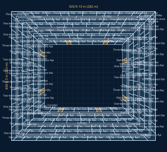
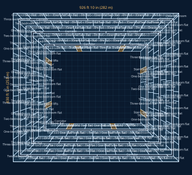

# P4-04 Family Apartments 2: plan

Footprint 926 ft 10 in (282 m) × 830 ft 5 in (253 m) · structural grid 32 ft 10 in (10 m)

## Levels

| Level | Floor above deck | Height | Floor area |
|---|---|---|---|
| Level 1 · Ground floor | 0 ft (0 mm) | 14 ft 9 in (4,500 mm) | 481,938 sq ft (44,774 m²) |
| Level 2 · Flat floor 1 | 14 ft 9 in (4,500 mm) | 10 ft 6 in (3,200 mm) | 481,938 sq ft (44,774 m²) |
| Level 3 · Flat floor 2 | 25 ft 3 in (7,700 mm) | 10 ft 6 in (3,200 mm) | 481,938 sq ft (44,774 m²) |
| Level 4 · Flat floor 3 | 35 ft 9 in (11 m) | 10 ft 6 in (3,200 mm) | 481,938 sq ft (44,774 m²) |
| Level 5 · Flat floor 4 | 46 ft 3 in (14 m) | 10 ft 6 in (3,200 mm) | 481,938 sq ft (44,774 m²) |
| Level 6 · Flat floor 5 | 56 ft 9 in (17 m) | 10 ft 6 in (3,200 mm) | 481,938 sq ft (44,774 m²) |

## Elements

| ID | Designation | Type | Name | Level(s) | Size / length | Area | Status |
|---|---|---|---|---|---|---|---|
| E001 | D5F6P4B3A1L1R1 | zone | Corridor | L1 | 9 ft 10 in (3,000 mm) × 398 ft 11 in (122 m) | 3,877 sq ft (360 m²) | proposed |
| E002 | D5F6P4B3A1L1R2 | zone | Corridor | L1 | 37 ft 9 in (12 m) × 370 ft 9 in (113 m) | 3,877 sq ft (360 m²) | proposed |
| E003 | D5F6P4B3A1L1R3 | zone | Corridor | L1 | 398 ft 4 in (121 m) × 9 ft 10 in (3,000 mm) | 3,873 sq ft (360 m²) | proposed |
| E004 | D5F6P4B3A1L1R4 | zone | Corridor | L1 | 398 ft 4 in (121 m) × 9 ft 10 in (3,000 mm) | 3,875 sq ft (360 m²) | proposed |
| E005 | D5F6P4B3A1L1R5 | zone | Corridor | L1 | 49 ft 10 in (15 m) × 358 ft 7 in (109 m) | 3,877 sq ft (360 m²) | proposed |
| E006 | D5F6P4B3A1L1R6 | zone | Corridor | L1 | 9 ft 10 in (3,000 mm) × 398 ft 7 in (121 m) | 3,873 sq ft (360 m²) | proposed |
| E007 | D5F6P4B3A1L1R7 | zone | Corridor | L1 | 386 ft 10 in (118 m) × 22 ft 4 in (6,800 mm) | 3,878 sq ft (360 m²) | proposed |
| E008 | D5F6P4B3A1L1R8 | zone | Corridor | L1 | 398 ft (121 m) × 9 ft 10 in (3,000 mm) | 3,873 sq ft (360 m²) | proposed |
| E009 | D5F6P4B3A1L1R9 | zone | Corridor | L1 | 89 ft 11 in (27 m) × 9 ft 10 in (3,000 mm) | 798 sq ft (74 m²) | proposed |
| E010 | D5F6P4B3A1L1R10 | zone | Corridor | L1 | 9 ft 10 in (3,000 mm) × 399 ft 11 in (122 m) | 3,873 sq ft (360 m²) | proposed |
| E011 | D5F6P4B3A1L1R11 | zone | Corridor | L1 | 177 ft 2 in (54 m) × 230 ft (70 m) | 3,872 sq ft (360 m²) | proposed |
| E012 | D5F6P4B3A1L1R12 | zone | Corridor | L1 | 398 ft 11 in (122 m) × 9 ft 10 in (3,000 mm) | 3,875 sq ft (360 m²) | proposed |
| E013 | D5F6P4B3A1L1R13 | zone | Corridor | L1 | 157 ft 10 in (48 m) × 249 ft 4 in (76 m) | 3,872 sq ft (360 m²) | proposed |
| E014 | D5F6P4B3A1L1R14 | zone | Corridor | L1 | 29 ft 2 in (8,900 mm) × 379 ft 11 in (116 m) | 3,872 sq ft (360 m²) | proposed |
| E015 | D5F6P4B3A1L1R15 | zone | Corridor | L1 | 399 ft 3 in (122 m) × 9 ft 10 in (3,000 mm) | 3,875 sq ft (360 m²) | proposed |
| E016 | D5F6P4B3A1L1R16 | zone | Corridor | L1 | 306 ft 1 in (93 m) × 9 ft 10 in (3,000 mm) | 2,956 sq ft (275 m²) | proposed |
| E017 | D5F6P4B3A1L1R17 | zone | Corridor | L1 | 9 ft 10 in (3,000 mm) × 401 ft 11 in (122 m) | 3,875 sq ft (360 m²) | proposed |
| E018 | D5F6P4B3A1L1R18 | zone | Corridor | L1 | 317 ft 3 in (97 m) × 89 ft 11 in (27 m) | 3,873 sq ft (360 m²) | proposed |
| E019 | D5F6P4B3A1L1R19 | zone | Corridor | L1 | 265 ft 5 in (81 m) × 140 ft 9 in (43 m) | 3,875 sq ft (360 m²) | proposed |
| E020 | D5F6P4B3A1L1R20 | zone | Corridor | L1 | 60 ft 8 in (18 m) × 348 ft 9 in (106 m) | 3,873 sq ft (360 m²) | proposed |
| E021 | D5F6P4B3A1L1R21 | zone | Corridor | L1 | 400 ft 3 in (122 m) × 9 ft 10 in (3,000 mm) | 3,875 sq ft (360 m²) | proposed |
| E022 | D5F6P4B3A1L1R22 | zone | Corridor | L1 | 133 ft 10 in (41 m) × 9 ft 10 in (3,000 mm) | 1,243 sq ft (116 m²) | proposed |
| E023 | D5F6P4B3A1L1R23, D5F6P4B3A1L2R1, D5F6P4B3A1L3R1, D5F6P4B3A1L4R1, D5F6P4B3A1L5R1, D5F6P4B3A1L6R1 | core | Stairs and lifts | L1, L2, L3, L4, L5, L6 | 30 ft 6 in (9,300 mm) × 40 ft (12 m) | 806 sq ft (75 m²) | proposed |
| E024 | D5F6P4B3A1L1R24, D5F6P4B3A1L2R2, D5F6P4B3A1L3R2, D5F6P4B3A1L4R2, D5F6P4B3A1L5R2, D5F6P4B3A1L6R2 | core | Stairs and lifts | L1, L2, L3, L4, L5, L6 | 30 ft 6 in (9,300 mm) × 46 ft 7 in (14 m) | 796 sq ft (74 m²) | proposed |
| E025 | D5F6P4B3A1L1R25, D5F6P4B3A1L2R3, D5F6P4B3A1L3R3, D5F6P4B3A1L4R3, D5F6P4B3A1L5R3, D5F6P4B3A1L6R3 | core | Stairs and lifts | L1, L2, L3, L4, L5, L6 | 37 ft 5 in (11 m) × 30 ft 6 in (9,300 mm) | 801 sq ft (74 m²) | proposed |
| E026 | D5F6P4B3A1L1R26, D5F6P4B3A1L2R4, D5F6P4B3A1L3R4, D5F6P4B3A1L4R4, D5F6P4B3A1L5R4, D5F6P4B3A1L6R4 | core | Stairs and lifts | L1, L2, L3, L4, L5, L6 | 43 ft (13 m) × 30 ft 6 in (9,300 mm) | 806 sq ft (75 m²) | proposed |
| E027 | D5F6P4B3A1L1R27, D5F6P4B3A1L2R5, D5F6P4B3A1L3R5, D5F6P4B3A1L4R5, D5F6P4B3A1L5R5, D5F6P4B3A1L6R5 | core | Stairs and lifts | L1, L2, L3, L4, L5, L6 | 30 ft 6 in (9,300 mm) × 40 ft (12 m) | 806 sq ft (75 m²) | proposed |
| E028 | D5F6P4B3A1L1R28, D5F6P4B3A1L2R6, D5F6P4B3A1L3R6, D5F6P4B3A1L4R6, D5F6P4B3A1L5R6, D5F6P4B3A1L6R6 | core | Stairs and lifts | L1, L2, L3, L4, L5, L6 | 30 ft 6 in (9,300 mm) × 46 ft 7 in (14 m) | 796 sq ft (74 m²) | proposed |
| E029 | D5F6P4B3A1L1R29, D5F6P4B3A1L2R7, D5F6P4B3A1L3R7, D5F6P4B3A1L4R7, D5F6P4B3A1L5R7, D5F6P4B3A1L6R7 | core | Stairs and lifts | L1, L2, L3, L4, L5, L6 | 37 ft 5 in (11 m) × 30 ft 6 in (9,300 mm) | 801 sq ft (74 m²) | proposed |
| E030 | D5F6P4B3A1L1R30, D5F6P4B3A1L2R8, D5F6P4B3A1L3R8, D5F6P4B3A1L4R8, D5F6P4B3A1L5R8, D5F6P4B3A1L6R8 | core | Stairs and lifts | L1, L2, L3, L4, L5, L6 | 43 ft (13 m) × 30 ft 6 in (9,300 mm) | 806 sq ft (75 m²) | proposed |
| E031 | D5F6P4B3A1L1R31 | room | Entrance lobby | L1 | 30 ft 6 in (9,300 mm) × 57 ft 9 in (18 m) | 861 sq ft (80 m²) | proposed |
| E032 | D5F6P4B3A1L1R32 | room | Bike and pram store | L1 | 30 ft 6 in (9,300 mm) × 48 ft 11 in (15 m) | 646 sq ft (60 m²) | proposed |
| E033 | D5F6P4B3A1L1R33 | room | Bin store | L1 | 30 ft 6 in (9,300 mm) × 37 ft 1 in (11 m) | 325 sq ft (30 m²) | proposed |
| E034 | D5F6P4B3A1L1R34 | room | Two-bedroom flat | L1 | 30 ft 6 in (9,300 mm) × 112 ft 2 in (34 m) | 2,738 sq ft (254 m²) | proposed |
| E035 | D5F6P4B3A1L1R35 | room | Three-bedroom flat | L1 | 30 ft 6 in (9,300 mm) × 105 ft 4 in (32 m) | 2,738 sq ft (254 m²) | proposed |
| E036 | D5F6P4B3A1L1R36 | room | One-bedroom flat | L1 | 30 ft 6 in (9,300 mm) × 63 ft (19 m) | 1,612 sq ft (150 m²) | proposed |
| E037 | D5F6P4B3A1L1R37 | room | Two-bedroom flat | L1 | 30 ft 6 in (9,300 mm) × 94 ft 10 in (29 m) | 2,743 sq ft (255 m²) | proposed |
| E038 | D5F6P4B3A1L1R38 | room | Three-bedroom flat | L1 | 30 ft 6 in (9,300 mm) × 93 ft 6 in (28 m) | 2,743 sq ft (255 m²) | proposed |
| E039 | D5F6P4B3A1L1R39 | room | One-bedroom flat | L1 | 30 ft 6 in (9,300 mm) × 60 ft 4 in (18 m) | 1,612 sq ft (150 m²) | proposed |
| E040 | D5F6P4B3A1L1R40 | room | Two-bedroom flat | L1 | 30 ft 6 in (9,300 mm) × 102 ft 8 in (31 m) | 2,738 sq ft (254 m²) | proposed |
| E041 | D5F6P4B3A1L1R41 | room | Three-bedroom flat | L1 | 30 ft 6 in (9,300 mm) × 109 ft 7 in (33 m) | 2,738 sq ft (254 m²) | proposed |
| E042 | D5F6P4B3A1L1R42 | room | One-bedroom flat | L1 | 30 ft 6 in (9,300 mm) × 78 ft 1 in (24 m) | 1,612 sq ft (150 m²) | proposed |
| E043 | D5F6P4B3A1L1R43 | room | Two-bedroom flat | L1 | 76 ft 1 in (23 m) × 71 ft 6 in (22 m) | 2,743 sq ft (255 m²) | proposed |
| E044 | D5F6P4B3A1L1R44 | room | Three-bedroom flat | L1 | 113 ft 10 in (35 m) × 30 ft 6 in (9,300 mm) | 2,738 sq ft (254 m²) | proposed |
| E045 | D5F6P4B3A1L1R45 | room | One-bedroom flat | L1 | 72 ft 2 in (22 m) × 30 ft 6 in (9,300 mm) | 1,612 sq ft (150 m²) | proposed |
| E046 | D5F6P4B3A1L1R46 | room | Two-bedroom flat | L1 | 104 ft 4 in (32 m) × 30 ft 6 in (9,300 mm) | 2,738 sq ft (254 m²) | proposed |
| E047 | D5F6P4B3A1L1R47 | room | Three-bedroom flat | L1 | 98 ft 5 in (30 m) × 30 ft 6 in (9,300 mm) | 2,743 sq ft (255 m²) | proposed |
| E048 | D5F6P4B3A1L1R48 | room | One-bedroom flat | L1 | 56 ft 5 in (17 m) × 30 ft 6 in (9,300 mm) | 1,612 sq ft (150 m²) | proposed |
| E049 | D5F6P4B3A1L1R49 | room | Two-bedroom flat | L1 | 92 ft 10 in (28 m) × 30 ft 6 in (9,300 mm) | 2,738 sq ft (254 m²) | proposed |
| E050 | D5F6P4B3A1L1R50 | room | Three-bedroom flat | L1 | 97 ft 5 in (30 m) × 30 ft 6 in (9,300 mm) | 2,743 sq ft (255 m²) | proposed |
| E051 | D5F6P4B3A1L1R51 | room | One-bedroom flat | L1 | 65 ft (20 m) × 30 ft 6 in (9,300 mm) | 1,607 sq ft (149 m²) | proposed |
| E052 | D5F6P4B3A1L1R52 | room | Two-bedroom flat | L1 | 106 ft 11 in (33 m) × 30 ft 6 in (9,300 mm) | 2,743 sq ft (255 m²) | proposed |
| E053 | D5F6P4B3A1L1R53 | room | Three-bedroom flat | L1 | 112 ft 10 in (34 m) × 30 ft 6 in (9,300 mm) | 2,738 sq ft (254 m²) | proposed |
| E054 | D5F6P4B3A1L1R54 | room | One-bedroom flat | L1 | 81 ft (25 m) × 30 ft 6 in (9,300 mm) | 1,612 sq ft (150 m²) | proposed |
| E055 | D5F6P4B3A1L1R55 | room | Two-bedroom flat | L1 | 39 ft 8 in (12 m) × 107 ft 11 in (33 m) | 2,743 sq ft (255 m²) | proposed |
| E056 | D5F6P4B3A1L1R56 | room | Three-bedroom flat | L1 | 30 ft 6 in (9,300 mm) × 110 ft 7 in (34 m) | 2,738 sq ft (254 m²) | proposed |
| E057 | D5F6P4B3A1L1R57 | room | One-bedroom flat | L1 | 30 ft 6 in (9,300 mm) × 68 ft 3 in (21 m) | 1,612 sq ft (150 m²) | proposed |
| E058 | D5F6P4B3A1L1R58 | room | Two-bedroom flat | L1 | 30 ft 6 in (9,300 mm) × 99 ft 9 in (30 m) | 2,738 sq ft (254 m²) | proposed |
| E059 | D5F6P4B3A1L1R59 | room | Three-bedroom flat | L1 | 30 ft 6 in (9,300 mm) × 93 ft 2 in (28 m) | 2,743 sq ft (255 m²) | proposed |
| E060 | D5F6P4B3A1L1R60 | room | One-bedroom flat | L1 | 30 ft 6 in (9,300 mm) × 54 ft 9 in (17 m) | 1,612 sq ft (150 m²) | proposed |
| E061 | D5F6P4B3A1L1R61 | room | Two-bedroom flat | L1 | 30 ft 6 in (9,300 mm) × 97 ft 5 in (30 m) | 2,743 sq ft (255 m²) | proposed |
| E062 | D5F6P4B3A1L1R62 | room | Three-bedroom flat | L1 | 30 ft 6 in (9,300 mm) × 104 ft 4 in (32 m) | 2,738 sq ft (254 m²) | proposed |
| E063 | D5F6P4B3A1L1R63 | room | One-bedroom flat | L1 | 30 ft 6 in (9,300 mm) × 72 ft 10 in (22 m) | 1,612 sq ft (150 m²) | proposed |
| E064 | D5F6P4B3A1L1R64 | room | Two-bedroom flat | L1 | 30 ft 6 in (9,300 mm) × 115 ft 2 in (35 m) | 2,738 sq ft (254 m²) | proposed |
| E065 | D5F6P4B3A1L1R65 | room | Three-bedroom flat | L1 | 95 ft 10 in (29 m) × 51 ft 10 in (16 m) | 2,738 sq ft (254 m²) | proposed |
| E066 | D5F6P4B3A1L1R66 | room | One-bedroom flat | L1 | 77 ft 1 in (23 m) × 30 ft 6 in (9,300 mm) | 1,617 sq ft (150 m²) | proposed |
| E067 | D5F6P4B3A1L1R67 | room | Two-bedroom flat | L1 | 108 ft 11 in (33 m) × 30 ft 6 in (9,300 mm) | 2,738 sq ft (254 m²) | proposed |
| E068 | D5F6P4B3A1L1R68 | room | Three-bedroom flat | L1 | 103 ft (31 m) × 30 ft 6 in (9,300 mm) | 2,743 sq ft (255 m²) | proposed |
| E069 | D5F6P4B3A1L1R69 | room | One-bedroom flat | L1 | 61 ft (19 m) × 30 ft 6 in (9,300 mm) | 1,607 sq ft (149 m²) | proposed |
| E070 | D5F6P4B3A1L1R70 | room | Two-bedroom flat | L1 | 93 ft 2 in (28 m) × 30 ft 6 in (9,300 mm) | 2,738 sq ft (254 m²) | proposed |
| E071 | D5F6P4B3A1L1R71 | room | Three-bedroom flat | L1 | 92 ft 10 in (28 m) × 30 ft 6 in (9,300 mm) | 2,743 sq ft (255 m²) | proposed |
| E072 | D5F6P4B3A1L1R72 | room | One-bedroom flat | L1 | 60 ft 4 in (18 m) × 30 ft 6 in (9,300 mm) | 1,612 sq ft (150 m²) | proposed |
| E073 | D5F6P4B3A1L1R73 | room | Two-bedroom flat | L1 | 102 ft 4 in (31 m) × 30 ft 6 in (9,300 mm) | 2,743 sq ft (255 m²) | proposed |
| E074 | D5F6P4B3A1L1R74 | room | Three-bedroom flat | L1 | 108 ft 3 in (33 m) × 30 ft 6 in (9,300 mm) | 2,738 sq ft (254 m²) | proposed |
| E075 | D5F6P4B3A1L1R75 | room | One-bedroom flat | L1 | 76 ft 1 in (23 m) × 30 ft 6 in (9,300 mm) | 1,612 sq ft (150 m²) | proposed |
| E076 | D5F6P4B3A1L1R76 | room | Two-bedroom flat | L1 | 106 ft 4 in (32 m) × 30 ft 6 in (9,300 mm) | 2,397 sq ft (223 m²) | proposed |
| E077 | D5F6P4B3A1L1R77 | room | Three-bedroom flat | L1 | 30 ft 6 in (9,300 mm) × 116 ft 6 in (36 m) | 2,738 sq ft (254 m²) | proposed |
| E078 | D5F6P4B3A1L1R78 | room | One-bedroom flat | L1 | 30 ft 6 in (9,300 mm) × 73 ft 10 in (22 m) | 1,617 sq ft (150 m²) | proposed |
| E079 | D5F6P4B3A1L1R79 | room | Two-bedroom flat | L1 | 30 ft 6 in (9,300 mm) × 104 ft 8 in (32 m) | 2,743 sq ft (255 m²) | proposed |
| E080 | D5F6P4B3A1L1R80 | room | Three-bedroom flat | L1 | 30 ft 6 in (9,300 mm) × 96 ft 9 in (30 m) | 2,738 sq ft (254 m²) | proposed |
| E081 | D5F6P4B3A1L1R81 | room | One-bedroom flat | L1 | 30 ft 6 in (9,300 mm) × 55 ft 1 in (17 m) | 1,612 sq ft (150 m²) | proposed |
| E082 | D5F6P4B3A1L1R82 | room | Two-bedroom flat | L1 | 30 ft 6 in (9,300 mm) × 94 ft 10 in (29 m) | 2,738 sq ft (254 m²) | proposed |
| E083 | D5F6P4B3A1L1R83 | room | Three-bedroom flat | L1 | 30 ft 6 in (9,300 mm) × 102 ft 4 in (31 m) | 2,738 sq ft (254 m²) | proposed |
| E084 | D5F6P4B3A1L1R84 | room | One-bedroom flat | L1 | 30 ft 6 in (9,300 mm) × 71 ft 6 in (22 m) | 1,612 sq ft (150 m²) | proposed |
| E085 | D5F6P4B3A1L1R85 | room | Two-bedroom flat | L1 | 30 ft 6 in (9,300 mm) × 114 ft 10 in (35 m) | 2,743 sq ft (255 m²) | proposed |
| E086 | D5F6P4B3A1L1R86 | room | Three-bedroom flat | L1 | 96 ft 2 in (29 m) × 51 ft 6 in (16 m) | 2,743 sq ft (255 m²) | proposed |
| E087 | D5F6P4B3A1L1R87 | room | One-bedroom flat | L1 | 76 ft 5 in (23 m) × 30 ft 6 in (9,300 mm) | 1,612 sq ft (150 m²) | proposed |
| E088 | D5F6P4B3A1L1R88 | room | Two-bedroom flat | L1 | 107 ft 11 in (33 m) × 30 ft 6 in (9,300 mm) | 2,738 sq ft (254 m²) | proposed |
| E089 | D5F6P4B3A1L1R89 | room | Three-bedroom flat | L1 | 101 ft 5 in (31 m) × 30 ft 6 in (9,300 mm) | 2,743 sq ft (255 m²) | proposed |
| E090 | D5F6P4B3A1L1R90 | room | One-bedroom flat | L1 | 59 ft 1 in (18 m) × 30 ft 6 in (9,300 mm) | 1,612 sq ft (150 m²) | proposed |
| E091 | D5F6P4B3A1L1R91 | room | Two-bedroom flat | L1 | 93 ft 2 in (28 m) × 30 ft 6 in (9,300 mm) | 2,738 sq ft (254 m²) | proposed |
| E092 | D5F6P4B3A1L1R92 | room | Three-bedroom flat | L1 | 95 ft 10 in (29 m) × 30 ft 6 in (9,300 mm) | 2,738 sq ft (254 m²) | proposed |
| E093 | D5F6P4B3A1L1R93 | room | One-bedroom flat | L1 | 64 ft 4 in (20 m) × 30 ft 6 in (9,300 mm) | 1,612 sq ft (150 m²) | proposed |
| E094 | D5F6P4B3A1L1R94 | room | Two-bedroom flat | L1 | 106 ft 8 in (32 m) × 30 ft 6 in (9,300 mm) | 2,743 sq ft (255 m²) | proposed |
| E095 | D5F6P4B3A1L1R95 | room | Three-bedroom flat | L1 | 113 ft 2 in (34 m) × 30 ft 6 in (9,300 mm) | 2,738 sq ft (254 m²) | proposed |
| E096 | D5F6P4B3A1L1R96 | room | One-bedroom flat | L1 | 79 ft 1 in (24 m) × 33 ft 2 in (10 m) | 1,617 sq ft (150 m²) | proposed |
| E097 | D5F6P4B3A1L1R97 | room | Two-bedroom flat | L1 | 30 ft 6 in (9,300 mm) × 116 ft 6 in (36 m) | 2,743 sq ft (255 m²) | proposed |
| E098 | D5F6P4B3A1L1R98 | room | Three-bedroom flat | L1 | 30 ft 6 in (9,300 mm) × 108 ft 7 in (33 m) | 2,738 sq ft (254 m²) | proposed |
| E099 | D5F6P4B3A1L1R99 | room | One-bedroom flat | L1 | 30 ft 6 in (9,300 mm) × 65 ft 7 in (20 m) | 1,612 sq ft (150 m²) | proposed |
| E100 | D5F6P4B3A1L1R100 | room | Two-bedroom flat | L1 | 30 ft 6 in (9,300 mm) × 96 ft 5 in (29 m) | 2,738 sq ft (254 m²) | proposed |
| E101 | D5F6P4B3A1L1R101 | room | Three-bedroom flat | L1 | 30 ft 6 in (9,300 mm) × 93 ft 6 in (28 m) | 2,738 sq ft (254 m²) | proposed |
| E102 | D5F6P4B3A1L1R102 | room | One-bedroom flat | L1 | 30 ft 6 in (9,300 mm) × 59 ft 9 in (18 m) | 1,612 sq ft (150 m²) | proposed |
| E103 | D5F6P4B3A1L1R103 | room | Two-bedroom flat | L1 | 30 ft 6 in (9,300 mm) × 103 ft (31 m) | 2,743 sq ft (255 m²) | proposed |
| E104 | D5F6P4B3A1L1R104 | room | Three-bedroom flat | L1 | 30 ft 6 in (9,300 mm) × 110 ft 7 in (34 m) | 2,738 sq ft (254 m²) | proposed |
| E105 | D5F6P4B3A1L1R105 | room | One-bedroom flat | L1 | 30 ft 6 in (9,300 mm) × 79 ft 9 in (24 m) | 1,617 sq ft (150 m²) | proposed |
| E106 | D5F6P4B3A1L1R106 | room | Two-bedroom flat | L1 | 98 ft 5 in (30 m) × 48 ft 11 in (15 m) | 2,738 sq ft (254 m²) | proposed |
| E107 | D5F6P4B3A1L1R107 | room | Three-bedroom flat | L1 | 111 ft 11 in (34 m) × 30 ft 6 in (9,300 mm) | 2,743 sq ft (255 m²) | proposed |
| E108 | D5F6P4B3A1L1R108 | room | One-bedroom flat | L1 | 69 ft 7 in (21 m) × 30 ft 6 in (9,300 mm) | 1,612 sq ft (150 m²) | proposed |
| E109 | D5F6P4B3A1L1R109 | room | Two-bedroom flat | L1 | 101 ft 1 in (31 m) × 30 ft 6 in (9,300 mm) | 2,738 sq ft (254 m²) | proposed |
| E110 | D5F6P4B3A1L1R110 | room | Three-bedroom flat | L1 | 94 ft 6 in (29 m) × 30 ft 6 in (9,300 mm) | 2,743 sq ft (255 m²) | proposed |
| E111 | D5F6P4B3A1L1R111 | room | One-bedroom flat | L1 | 54 ft 9 in (17 m) × 30 ft 6 in (9,300 mm) | 1,612 sq ft (150 m²) | proposed |
| E112 | D5F6P4B3A1L1R112 | room | Two-bedroom flat | L1 | 95 ft 10 in (29 m) × 30 ft 6 in (9,300 mm) | 2,738 sq ft (254 m²) | proposed |
| E113 | D5F6P4B3A1L1R113 | room | Three-bedroom flat | L1 | 102 ft 8 in (31 m) × 30 ft 6 in (9,300 mm) | 2,738 sq ft (254 m²) | proposed |
| E114 | D5F6P4B3A1L1R114 | room | One-bedroom flat | L1 | 71 ft 2 in (22 m) × 30 ft 6 in (9,300 mm) | 1,612 sq ft (150 m²) | proposed |
| E115 | D5F6P4B3A1L1R115 | room | Two-bedroom flat | L1 | 113 ft 6 in (35 m) × 30 ft 6 in (9,300 mm) | 2,743 sq ft (255 m²) | proposed |
| E116 | D5F6P4B3A1L1R116 | room | Three-bedroom flat | L1 | 76 ft 5 in (23 m) × 30 ft 6 in (9,300 mm) | 1,457 sq ft (135 m²) | proposed |
| E117 | D5F6P4B3A1L1R117 | room | One-bedroom flat | L1 | 30 ft 10 in (9,400 mm) × 81 ft (25 m) | 1,629 sq ft (151 m²) | proposed |
| E118 | D5F6P4B3A1L1R118 | room | Two-bedroom flat | L1 | 30 ft 10 in (9,400 mm) × 111 ft 3 in (34 m) | 2,767 sq ft (257 m²) | proposed |
| E119 | D5F6P4B3A1L1R119 | room | Three-bedroom flat | L1 | 30 ft 10 in (9,400 mm) × 103 ft (31 m) | 2,772 sq ft (258 m²) | proposed |
| E120 | D5F6P4B3A1L1R120 | room | One-bedroom flat | L1 | 30 ft 10 in (9,400 mm) × 59 ft 1 in (18 m) | 1,624 sq ft (151 m²) | proposed |
| E121 | D5F6P4B3A1L1R121 | room | Two-bedroom flat | L1 | 30 ft 10 in (9,400 mm) × 93 ft 10 in (29 m) | 2,767 sq ft (257 m²) | proposed |
| E122 | D5F6P4B3A1L1R122 | room | Three-bedroom flat | L1 | 30 ft 10 in (9,400 mm) × 98 ft 5 in (30 m) | 2,772 sq ft (258 m²) | proposed |
| E123 | D5F6P4B3A1L1R123 | room | One-bedroom flat | L1 | 30 ft 10 in (9,400 mm) × 67 ft 11 in (21 m) | 1,629 sq ft (151 m²) | proposed |
| E124 | D5F6P4B3A1L1R124 | room | Two-bedroom flat | L1 | 30 ft 10 in (9,400 mm) × 111 ft 7 in (34 m) | 2,772 sq ft (258 m²) | proposed |
| E125 | D5F6P4B3A1L1R125 | room | Three-bedroom flat | L1 | 68 ft 7 in (21 m) × 78 ft 9 in (24 m) | 2,767 sq ft (257 m²) | proposed |
| E126 | D5F6P4B3A1L1R126 | room | One-bedroom flat | L1 | 78 ft 1 in (24 m) × 30 ft 10 in (9,400 mm) | 1,629 sq ft (151 m²) | proposed |
| E127 | D5F6P4B3A1L1R127 | room | Two-bedroom flat | L1 | 109 ft 3 in (33 m) × 30 ft 10 in (9,400 mm) | 2,767 sq ft (257 m²) | proposed |
| E128 | D5F6P4B3A1L1R128 | room | Three-bedroom flat | L1 | 102 ft (31 m) × 30 ft 10 in (9,400 mm) | 2,767 sq ft (257 m²) | proposed |
| E129 | D5F6P4B3A1L1R129 | room | One-bedroom flat | L1 | 59 ft 5 in (18 m) × 30 ft 10 in (9,400 mm) | 1,634 sq ft (152 m²) | proposed |
| E130 | D5F6P4B3A1L1R130 | room | Two-bedroom flat | L1 | 93 ft 2 in (28 m) × 30 ft 10 in (9,400 mm) | 2,762 sq ft (257 m²) | proposed |
| E131 | D5F6P4B3A1L1R131 | room | Three-bedroom flat | L1 | 96 ft 5 in (29 m) × 30 ft 10 in (9,400 mm) | 2,772 sq ft (258 m²) | proposed |
| E132 | D5F6P4B3A1L1R132 | room | One-bedroom flat | L1 | 65 ft 3 in (20 m) × 30 ft 10 in (9,400 mm) | 1,629 sq ft (151 m²) | proposed |
| E133 | D5F6P4B3A1L1R133 | room | Two-bedroom flat | L1 | 108 ft 3 in (33 m) × 30 ft 10 in (9,400 mm) | 2,772 sq ft (258 m²) | proposed |
| E134 | D5F6P4B3A1L1R134 | room | Three-bedroom flat | L1 | 115 ft 2 in (35 m) × 30 ft 10 in (9,400 mm) | 2,767 sq ft (257 m²) | proposed |
| E135 | D5F6P4B3A1L1R135 | room | One-bedroom flat | L1 | 47 ft 7 in (14 m) × 64 ft (20 m) | 1,624 sq ft (151 m²) | proposed |
| E136 | D5F6P4B3A1L1R136 | room | Two-bedroom flat | L1 | 30 ft 10 in (9,400 mm) × 112 ft 10 in (34 m) | 2,772 sq ft (258 m²) | proposed |
| E137 | D5F6P4B3A1L1R137 | room | Three-bedroom flat | L1 | 30 ft 10 in (9,400 mm) × 104 ft 4 in (32 m) | 2,767 sq ft (257 m²) | proposed |
| E138 | D5F6P4B3A1L1R138 | room | One-bedroom flat | L1 | 30 ft 10 in (9,400 mm) × 61 ft (19 m) | 1,629 sq ft (151 m²) | proposed |
| E139 | D5F6P4B3A1L1R139 | room | Two-bedroom flat | L1 | 30 ft 10 in (9,400 mm) × 94 ft 2 in (29 m) | 2,772 sq ft (258 m²) | proposed |
| E140 | D5F6P4B3A1L1R140 | room | Three-bedroom flat | L1 | 30 ft 10 in (9,400 mm) × 96 ft 5 in (29 m) | 2,767 sq ft (257 m²) | proposed |
| E141 | D5F6P4B3A1L1R141 | room | One-bedroom flat | L1 | 30 ft 10 in (9,400 mm) × 66 ft 3 in (20 m) | 1,629 sq ft (151 m²) | proposed |
| E142 | D5F6P4B3A1L1R142 | room | Two-bedroom flat | L1 | 30 ft 10 in (9,400 mm) × 109 ft 11 in (34 m) | 2,767 sq ft (257 m²) | proposed |
| E143 | D5F6P4B3A1L1R143 | room | Three-bedroom flat | L1 | 51 ft 6 in (16 m) × 95 ft 10 in (29 m) | 2,772 sq ft (258 m²) | proposed |
| E144 | D5F6P4B3A1L1R144 | room | One-bedroom flat | L1 | 79 ft 5 in (24 m) × 30 ft 10 in (9,400 mm) | 1,624 sq ft (151 m²) | proposed |
| E145 | D5F6P4B3A1L1R145 | room | Two-bedroom flat | L1 | 110 ft 11 in (34 m) × 30 ft 10 in (9,400 mm) | 2,772 sq ft (258 m²) | proposed |
| E146 | D5F6P4B3A1L1R146 | room | Three-bedroom flat | L1 | 103 ft 4 in (32 m) × 30 ft 10 in (9,400 mm) | 2,767 sq ft (257 m²) | proposed |
| E147 | D5F6P4B3A1L1R147 | room | One-bedroom flat | L1 | 60 ft 8 in (18 m) × 30 ft 10 in (9,400 mm) | 1,629 sq ft (151 m²) | proposed |
| E148 | D5F6P4B3A1L1R148 | room | Two-bedroom flat | L1 | 93 ft 6 in (28 m) × 30 ft 10 in (9,400 mm) | 2,767 sq ft (257 m²) | proposed |
| E149 | D5F6P4B3A1L1R149 | room | Three-bedroom flat | L1 | 95 ft 2 in (29 m) × 30 ft 10 in (9,400 mm) | 2,772 sq ft (258 m²) | proposed |
| E150 | D5F6P4B3A1L1R150 | room | One-bedroom flat | L1 | 63 ft 8 in (19 m) × 30 ft 10 in (9,400 mm) | 1,624 sq ft (151 m²) | proposed |
| E151 | D5F6P4B3A1L1R151 | room | Two-bedroom flat | L1 | 106 ft 8 in (32 m) × 30 ft 10 in (9,400 mm) | 2,772 sq ft (258 m²) | proposed |
| E152 | D5F6P4B3A1L1R152 | room | Three-bedroom flat | L1 | 113 ft 10 in (35 m) × 30 ft 10 in (9,400 mm) | 2,772 sq ft (258 m²) | proposed |
| E153 | D5F6P4B3A1L1R153 | room | One-bedroom flat | L1 | 64 ft 8 in (20 m) × 30 ft 10 in (9,400 mm) | 1,093 sq ft (102 m²) | proposed |
| E154 | D5F6P4B3A1L1R154 | room | Two-bedroom flat | L1 | 30 ft 6 in (9,300 mm) × 115 ft 6 in (35 m) | 2,738 sq ft (254 m²) | proposed |
| E155 | D5F6P4B3A1L1R155 | room | Three-bedroom flat | L1 | 30 ft 6 in (9,300 mm) × 106 ft (32 m) | 2,738 sq ft (254 m²) | proposed |
| E156 | D5F6P4B3A1L1R156 | room | One-bedroom flat | L1 | 30 ft 6 in (9,300 mm) × 61 ft 8 in (19 m) | 1,612 sq ft (150 m²) | proposed |
| E157 | D5F6P4B3A1L1R157 | room | Two-bedroom flat | L1 | 30 ft 6 in (9,300 mm) × 94 ft 10 in (29 m) | 2,743 sq ft (255 m²) | proposed |
| E158 | D5F6P4B3A1L1R158 | room | Three-bedroom flat | L1 | 30 ft 6 in (9,300 mm) × 98 ft 1 in (30 m) | 2,738 sq ft (254 m²) | proposed |
| E159 | D5F6P4B3A1L1R159 | room | One-bedroom flat | L1 | 30 ft 6 in (9,300 mm) × 68 ft 7 in (21 m) | 1,607 sq ft (149 m²) | proposed |
| E160 | D5F6P4B3A1L1R160 | room | Two-bedroom flat | L1 | 30 ft 6 in (9,300 mm) × 113 ft 2 in (34 m) | 2,743 sq ft (255 m²) | proposed |
| E161 | D5F6P4B3A1L1R161 | room | Three-bedroom flat | L1 | 94 ft 10 in (29 m) × 51 ft 6 in (16 m) | 2,733 sq ft (254 m²) | proposed |
| E162 | D5F6P4B3A1L1R162 | room | One-bedroom flat | L1 | 74 ft 10 in (23 m) × 30 ft 6 in (9,300 mm) | 1,607 sq ft (149 m²) | proposed |
| E163 | D5F6P4B3A1L1R163 | room | Two-bedroom flat | L1 | 105 ft 8 in (32 m) × 30 ft 6 in (9,300 mm) | 2,748 sq ft (255 m²) | proposed |
| E164 | D5F6P4B3A1L1R164 | room | Three-bedroom flat | L1 | 97 ft 1 in (30 m) × 30 ft 6 in (9,300 mm) | 2,738 sq ft (254 m²) | proposed |
| E165 | D5F6P4B3A1L1R165 | room | One-bedroom flat | L1 | 55 ft 1 in (17 m) × 30 ft 6 in (9,300 mm) | 1,612 sq ft (150 m²) | proposed |
| E166 | D5F6P4B3A1L1R166 | room | Two-bedroom flat | L1 | 95 ft 2 in (29 m) × 30 ft 6 in (9,300 mm) | 2,738 sq ft (254 m²) | proposed |
| E167 | D5F6P4B3A1L1R167 | room | Three-bedroom flat | L1 | 103 ft 4 in (32 m) × 30 ft 6 in (9,300 mm) | 2,738 sq ft (254 m²) | proposed |
| E168 | D5F6P4B3A1L1R168 | room | One-bedroom flat | L1 | 72 ft 10 in (22 m) × 30 ft 6 in (9,300 mm) | 1,612 sq ft (150 m²) | proposed |
| E169 | D5F6P4B3A1L1R169 | room | Two-bedroom flat | L1 | 114 ft 10 in (35 m) × 31 ft 6 in (9,600 mm) | 2,733 sq ft (254 m²) | proposed |
| E170 | D5F6P4B3A1L1R170 | room | Three-bedroom flat | L1 | 30 ft 6 in (9,300 mm) × 115 ft 6 in (35 m) | 2,743 sq ft (255 m²) | proposed |
| E171 | D5F6P4B3A1L1R171 | room | One-bedroom flat | L1 | 30 ft 6 in (9,300 mm) × 70 ft 10 in (22 m) | 1,607 sq ft (149 m²) | proposed |
| E172 | D5F6P4B3A1L1R172 | room | Two-bedroom flat | L1 | 30 ft 6 in (9,300 mm) × 100 ft 5 in (31 m) | 2,738 sq ft (254 m²) | proposed |
| E173 | D5F6P4B3A1L1R173 | room | Three-bedroom flat | L1 | 30 ft 6 in (9,300 mm) × 94 ft 10 in (29 m) | 2,743 sq ft (255 m²) | proposed |
| E174 | D5F6P4B3A1L1R174 | room | One-bedroom flat | L1 | 30 ft 6 in (9,300 mm) × 59 ft 5 in (18 m) | 1,612 sq ft (150 m²) | proposed |
| E175 | D5F6P4B3A1L1R175 | room | Two-bedroom flat | L1 | 30 ft 6 in (9,300 mm) × 103 ft 8 in (32 m) | 2,738 sq ft (254 m²) | proposed |
| E176 | D5F6P4B3A1L1R176 | room | Three-bedroom flat | L1 | 30 ft 6 in (9,300 mm) × 113 ft 6 in (35 m) | 2,743 sq ft (255 m²) | proposed |
| E177 | D5F6P4B3A1L1R177 | room | One-bedroom flat | L1 | 60 ft 8 in (18 m) × 50 ft 6 in (15 m) | 1,602 sq ft (149 m²) | proposed |
| E178 | D5F6P4B3A1L1R178 | room | Two-bedroom flat | L1 | 113 ft 6 in (35 m) × 30 ft 6 in (9,300 mm) | 2,738 sq ft (254 m²) | proposed |
| E179 | D5F6P4B3A1L1R179 | room | Three-bedroom flat | L1 | 105 ft 4 in (32 m) × 30 ft 6 in (9,300 mm) | 2,743 sq ft (255 m²) | proposed |
| E180 | D5F6P4B3A1L1R180 | room | One-bedroom flat | L1 | 61 ft 8 in (19 m) × 30 ft 6 in (9,300 mm) | 1,612 sq ft (150 m²) | proposed |
| E181 | D5F6P4B3A1L1R181 | room | Two-bedroom flat | L1 | 93 ft 10 in (29 m) × 30 ft 6 in (9,300 mm) | 2,738 sq ft (254 m²) | proposed |
| E182 | D5F6P4B3A1L1R182 | room | Three-bedroom flat | L1 | 95 ft 6 in (29 m) × 30 ft 6 in (9,300 mm) | 2,743 sq ft (255 m²) | proposed |
| E183 | D5F6P4B3A1L1R183 | room | One-bedroom flat | L1 | 64 ft 8 in (20 m) × 30 ft 6 in (9,300 mm) | 1,607 sq ft (149 m²) | proposed |
| E184 | D5F6P4B3A1L1R184 | room | Two-bedroom flat | L1 | 108 ft 3 in (33 m) × 30 ft 6 in (9,300 mm) | 2,738 sq ft (254 m²) | proposed |
| E185 | D5F6P4B3A1L1R185 | room | Three-bedroom flat | L1 | 113 ft 10 in (35 m) × 30 ft 6 in (9,300 mm) | 2,663 sq ft (247 m²) | proposed |
| E186 | D5F6P4B3A1L1R186 | room | One-bedroom flat | L1 | 30 ft 6 in (9,300 mm) × 80 ft 1 in (24 m) | 1,607 sq ft (149 m²) | proposed |
| E187 | D5F6P4B3A1L1R187 | room | Two-bedroom flat | L1 | 30 ft 6 in (9,300 mm) × 108 ft 11 in (33 m) | 2,743 sq ft (255 m²) | proposed |
| E188 | D5F6P4B3A1L1R188 | room | Three-bedroom flat | L1 | 30 ft 6 in (9,300 mm) × 98 ft 1 in (30 m) | 2,738 sq ft (254 m²) | proposed |
| E189 | D5F6P4B3A1L1R189 | room | One-bedroom flat | L1 | 30 ft 6 in (9,300 mm) × 56 ft 1 in (17 m) | 1,617 sq ft (150 m²) | proposed |
| E190 | D5F6P4B3A1L1R190 | room | Two-bedroom flat | L1 | 30 ft 6 in (9,300 mm) × 98 ft 1 in (30 m) | 2,733 sq ft (254 m²) | proposed |
| E191 | D5F6P4B3A1L1R191 | room | Three-bedroom flat | L1 | 30 ft 6 in (9,300 mm) × 108 ft 11 in (33 m) | 2,743 sq ft (255 m²) | proposed |
| E192 | D5F6P4B3A1L1R192 | room | One-bedroom flat | L1 | 32 ft 2 in (9,800 mm) × 78 ft 5 in (24 m) | 1,607 sq ft (149 m²) | proposed |
| E193 | D5F6P4B3A1L1R193 | room | Two-bedroom flat | L1 | 115 ft 10 in (35 m) × 30 ft 6 in (9,300 mm) | 2,743 sq ft (255 m²) | proposed |
| E194 | D5F6P4B3A1L1R194 | room | Three-bedroom flat | L1 | 106 ft 8 in (32 m) × 30 ft 6 in (9,300 mm) | 2,738 sq ft (254 m²) | proposed |
| E195 | D5F6P4B3A1L1R195 | room | One-bedroom flat | L1 | 62 ft 8 in (19 m) × 30 ft 6 in (9,300 mm) | 1,612 sq ft (150 m²) | proposed |
| E196 | D5F6P4B3A1L1R196 | room | Two-bedroom flat | L1 | 94 ft 2 in (29 m) × 30 ft 6 in (9,300 mm) | 2,738 sq ft (254 m²) | proposed |
| E197 | D5F6P4B3A1L1R197 | room | Three-bedroom flat | L1 | 96 ft 2 in (29 m) × 30 ft 6 in (9,300 mm) | 2,743 sq ft (255 m²) | proposed |
| E198 | D5F6P4B3A1L1R198 | room | One-bedroom flat | L1 | 66 ft 3 in (20 m) × 30 ft 6 in (9,300 mm) | 1,612 sq ft (150 m²) | proposed |
| E199 | D5F6P4B3A1L1R199 | room | Two-bedroom flat | L1 | 110 ft 3 in (34 m) × 30 ft 6 in (9,300 mm) | 2,738 sq ft (254 m²) | proposed |
| E200 | D5F6P4B3A1L1R200 | room | Three-bedroom flat | L1 | 83 ft 8 in (26 m) × 62 ft 4 in (19 m) | 2,738 sq ft (254 m²) | proposed |
| E201 | D5F6P4B3A1L1R201 | room | One-bedroom flat | L1 | 30 ft 6 in (9,300 mm) × 76 ft 1 in (23 m) | 1,607 sq ft (149 m²) | proposed |
| E202 | D5F6P4B3A1L1R202 | room | Two-bedroom flat | L1 | 30 ft 6 in (9,300 mm) × 105 ft (32 m) | 2,743 sq ft (255 m²) | proposed |
| E203 | D5F6P4B3A1L1R203 | room | Three-bedroom flat | L1 | 30 ft 6 in (9,300 mm) × 95 ft 2 in (29 m) | 2,738 sq ft (254 m²) | proposed |
| E204 | D5F6P4B3A1L1R204 | room | One-bedroom flat | L1 | 30 ft 6 in (9,300 mm) × 57 ft 1 in (17 m) | 1,612 sq ft (150 m²) | proposed |
| E205 | D5F6P4B3A1L1R205 | room | Two-bedroom flat | L1 | 30 ft 6 in (9,300 mm) × 102 ft 4 in (31 m) | 2,738 sq ft (254 m²) | proposed |
| E206 | D5F6P4B3A1L1R206 | room | Three-bedroom flat | L1 | 30 ft 6 in (9,300 mm) × 112 ft 10 in (34 m) | 2,738 sq ft (254 m²) | proposed |
| E207 | D5F6P4B3A1L1R207 | room | One-bedroom flat | L1 | 64 ft 4 in (20 m) × 46 ft 11 in (14 m) | 1,612 sq ft (150 m²) | proposed |
| E208 | D5F6P4B3A1L1R208 | room | Two-bedroom flat | L1 | 112 ft 6 in (34 m) × 30 ft 6 in (9,300 mm) | 2,743 sq ft (255 m²) | proposed |
| E209 | D5F6P4B3A1L1R209 | room | Three-bedroom flat | L1 | 103 ft 4 in (32 m) × 30 ft 6 in (9,300 mm) | 2,738 sq ft (254 m²) | proposed |
| E210 | D5F6P4B3A1L1R210 | room | One-bedroom flat | L1 | 59 ft 5 in (18 m) × 30 ft 6 in (9,300 mm) | 1,612 sq ft (150 m²) | proposed |
| E211 | D5F6P4B3A1L1R211 | room | Two-bedroom flat | L1 | 94 ft 2 in (29 m) × 30 ft 6 in (9,300 mm) | 2,738 sq ft (254 m²) | proposed |
| E212 | D5F6P4B3A1L1R212 | room | Three-bedroom flat | L1 | 99 ft 5 in (30 m) × 30 ft 6 in (9,300 mm) | 2,743 sq ft (255 m²) | proposed |
| E213 | D5F6P4B3A1L1R213 | room | One-bedroom flat | L1 | 69 ft 7 in (21 m) × 30 ft 6 in (9,300 mm) | 1,612 sq ft (150 m²) | proposed |
| E214 | D5F6P4B3A1L1R214 | room | Two-bedroom flat | L1 | 136 ft 10 in (42 m) × 30 ft 6 in (9,300 mm) | 3,414 sq ft (317 m²) | proposed |
| E215 | D5F6P4B3A1L1R215 | room | Three-bedroom flat | L1 | 30 ft 6 in (9,300 mm) × 130 ft 7 in (40 m) | 3,283 sq ft (305 m²) | proposed |
| E216 | D5F6P4B3A1L1R216 | room | One-bedroom flat | L1 | 30 ft 6 in (9,300 mm) × 60 ft 8 in (18 m) | 1,607 sq ft (149 m²) | proposed |
| E217 | D5F6P4B3A1L1R217 | room | Two-bedroom flat | L1 | 30 ft 6 in (9,300 mm) × 96 ft 2 in (29 m) | 2,743 sq ft (255 m²) | proposed |
| E218 | D5F6P4B3A1L1R218 | room | Three-bedroom flat | L1 | 30 ft 6 in (9,300 mm) × 86 ft 3 in (26 m) | 2,222 sq ft (206 m²) | proposed |
| E219 | D5F6P4B3A1L1R219 | room | One-bedroom flat | L1 | 30 ft 6 in (9,300 mm) × 78 ft 9 in (24 m) | 1,612 sq ft (150 m²) | proposed |
| E220 | D5F6P4B3A1L1R220 | room | Two-bedroom flat | L1 | 108 ft 11 in (33 m) × 36 ft 9 in (11 m) | 2,743 sq ft (255 m²) | proposed |
| E221 | D5F6P4B3A1L1R221 | room | Three-bedroom flat | L1 | 89 ft 7 in (27 m) × 30 ft 6 in (9,300 mm) | 2,217 sq ft (206 m²) | proposed |
| E222 | D5F6P4B3A1L1R222 | room | One-bedroom flat | L1 | 59 ft 5 in (18 m) × 30 ft 6 in (9,300 mm) | 1,612 sq ft (150 m²) | proposed |
| E223 | D5F6P4B3A1L1R223 | room | Two-bedroom flat | L1 | 95 ft 2 in (29 m) × 30 ft 6 in (9,300 mm) | 2,743 sq ft (255 m²) | proposed |
| E224 | D5F6P4B3A1L1R224 | room | Three-bedroom flat | L1 | 83 ft 8 in (26 m) × 30 ft 6 in (9,300 mm) | 2,217 sq ft (206 m²) | proposed |
| E225 | D5F6P4B3A1L1R225 | room | One-bedroom flat | L1 | 73 ft 10 in (22 m) × 30 ft 6 in (9,300 mm) | 1,607 sq ft (149 m²) | proposed |
| E226 | D5F6P4B3A1L1R226 | room | Two-bedroom flat | L1 | 82 ft 4 in (25 m) × 63 ft (19 m) | 2,743 sq ft (255 m²) | proposed |
| E227 | D5F6P4B3A1L1R227 | room | Three-bedroom flat | L1 | 30 ft 6 in (9,300 mm) × 93 ft 2 in (28 m) | 2,217 sq ft (206 m²) | proposed |
| E228 | D5F6P4B3A1L1R228 | room | One-bedroom flat | L1 | 30 ft 6 in (9,300 mm) × 60 ft 8 in (18 m) | 1,607 sq ft (149 m²) | proposed |
| E229 | D5F6P4B3A1L1R229 | room | Two-bedroom flat | L1 | 30 ft 6 in (9,300 mm) × 96 ft 2 in (29 m) | 2,743 sq ft (255 m²) | proposed |
| E230 | D5F6P4B3A1L1R230 | room | Three-bedroom flat | L1 | 30 ft 6 in (9,300 mm) × 86 ft 3 in (26 m) | 2,222 sq ft (206 m²) | proposed |
| E231 | D5F6P4B3A1L1R231 | room | One-bedroom flat | L1 | 30 ft 6 in (9,300 mm) × 78 ft 9 in (24 m) | 1,612 sq ft (150 m²) | proposed |
| E232 | D5F6P4B3A1L1R232 | room | Two-bedroom flat | L1 | 108 ft 11 in (33 m) × 36 ft 9 in (11 m) | 2,743 sq ft (255 m²) | proposed |
| E233 | D5F6P4B3A1L1R233 | room | Three-bedroom flat | L1 | 89 ft 7 in (27 m) × 30 ft 6 in (9,300 mm) | 2,217 sq ft (206 m²) | proposed |
| E234 | D5F6P4B3A1L1R234 | room | One-bedroom flat | L1 | 59 ft 5 in (18 m) × 30 ft 6 in (9,300 mm) | 1,612 sq ft (150 m²) | proposed |
| E235 | D5F6P4B3A1L1R235 | room | Two-bedroom flat | L1 | 95 ft 2 in (29 m) × 30 ft 6 in (9,300 mm) | 2,743 sq ft (255 m²) | proposed |
| E236 | D5F6P4B3A1L1R236 | room | Three-bedroom flat | L1 | 83 ft 8 in (26 m) × 30 ft 6 in (9,300 mm) | 2,217 sq ft (206 m²) | proposed |
| E237 | D5F6P4B3A1L1R237 | room | One-bedroom flat | L1 | 73 ft 10 in (22 m) × 30 ft 6 in (9,300 mm) | 1,607 sq ft (149 m²) | proposed |
| E238 | D5F6P4B3A1L1R238 | room | Two-bedroom flat | L1 | 82 ft 4 in (25 m) × 30 ft 6 in (9,300 mm) | 1,677 sq ft (156 m²) | proposed |
| E239 | D5F6P4B3A1L2R9, D5F6P4B3A1L3R9, D5F6P4B3A1L4R9, D5F6P4B3A1L5R9, D5F6P4B3A1L6R9 | zone | Corridor | L2, L3, L4, L5, L6 | 9 ft 10 in (3,000 mm) × 398 ft 11 in (122 m) | 3,877 sq ft (360 m²) | proposed |
| E240 | D5F6P4B3A1L2R10, D5F6P4B3A1L3R10, D5F6P4B3A1L4R10, D5F6P4B3A1L5R10, D5F6P4B3A1L6R10 | zone | Corridor | L2, L3, L4, L5, L6 | 37 ft 9 in (12 m) × 370 ft 9 in (113 m) | 3,877 sq ft (360 m²) | proposed |
| E241 | D5F6P4B3A1L2R11, D5F6P4B3A1L3R11, D5F6P4B3A1L4R11, D5F6P4B3A1L5R11, D5F6P4B3A1L6R11 | zone | Corridor | L2, L3, L4, L5, L6 | 398 ft 4 in (121 m) × 9 ft 10 in (3,000 mm) | 3,873 sq ft (360 m²) | proposed |
| E242 | D5F6P4B3A1L2R12, D5F6P4B3A1L3R12, D5F6P4B3A1L4R12, D5F6P4B3A1L5R12, D5F6P4B3A1L6R12 | zone | Corridor | L2, L3, L4, L5, L6 | 398 ft 4 in (121 m) × 9 ft 10 in (3,000 mm) | 3,875 sq ft (360 m²) | proposed |
| E243 | D5F6P4B3A1L2R13, D5F6P4B3A1L3R13, D5F6P4B3A1L4R13, D5F6P4B3A1L5R13, D5F6P4B3A1L6R13 | zone | Corridor | L2, L3, L4, L5, L6 | 49 ft 10 in (15 m) × 358 ft 7 in (109 m) | 3,877 sq ft (360 m²) | proposed |
| E244 | D5F6P4B3A1L2R14, D5F6P4B3A1L3R14, D5F6P4B3A1L4R14, D5F6P4B3A1L5R14, D5F6P4B3A1L6R14 | zone | Corridor | L2, L3, L4, L5, L6 | 9 ft 10 in (3,000 mm) × 398 ft 7 in (121 m) | 3,873 sq ft (360 m²) | proposed |
| E245 | D5F6P4B3A1L2R15, D5F6P4B3A1L3R15, D5F6P4B3A1L4R15, D5F6P4B3A1L5R15, D5F6P4B3A1L6R15 | zone | Corridor | L2, L3, L4, L5, L6 | 386 ft 10 in (118 m) × 22 ft 4 in (6,800 mm) | 3,878 sq ft (360 m²) | proposed |
| E246 | D5F6P4B3A1L2R16, D5F6P4B3A1L3R16, D5F6P4B3A1L4R16, D5F6P4B3A1L5R16, D5F6P4B3A1L6R16 | zone | Corridor | L2, L3, L4, L5, L6 | 398 ft (121 m) × 9 ft 10 in (3,000 mm) | 3,873 sq ft (360 m²) | proposed |
| E247 | D5F6P4B3A1L2R17, D5F6P4B3A1L3R17, D5F6P4B3A1L4R17, D5F6P4B3A1L5R17, D5F6P4B3A1L6R17 | zone | Corridor | L2, L3, L4, L5, L6 | 89 ft 11 in (27 m) × 9 ft 10 in (3,000 mm) | 798 sq ft (74 m²) | proposed |
| E248 | D5F6P4B3A1L2R18, D5F6P4B3A1L3R18, D5F6P4B3A1L4R18, D5F6P4B3A1L5R18, D5F6P4B3A1L6R18 | zone | Corridor | L2, L3, L4, L5, L6 | 9 ft 10 in (3,000 mm) × 399 ft 11 in (122 m) | 3,873 sq ft (360 m²) | proposed |
| E249 | D5F6P4B3A1L2R19, D5F6P4B3A1L3R19, D5F6P4B3A1L4R19, D5F6P4B3A1L5R19, D5F6P4B3A1L6R19 | zone | Corridor | L2, L3, L4, L5, L6 | 177 ft 2 in (54 m) × 230 ft (70 m) | 3,872 sq ft (360 m²) | proposed |
| E250 | D5F6P4B3A1L2R20, D5F6P4B3A1L3R20, D5F6P4B3A1L4R20, D5F6P4B3A1L5R20, D5F6P4B3A1L6R20 | zone | Corridor | L2, L3, L4, L5, L6 | 398 ft 11 in (122 m) × 9 ft 10 in (3,000 mm) | 3,875 sq ft (360 m²) | proposed |
| E251 | D5F6P4B3A1L2R21, D5F6P4B3A1L3R21, D5F6P4B3A1L4R21, D5F6P4B3A1L5R21, D5F6P4B3A1L6R21 | zone | Corridor | L2, L3, L4, L5, L6 | 157 ft 10 in (48 m) × 249 ft 4 in (76 m) | 3,872 sq ft (360 m²) | proposed |
| E252 | D5F6P4B3A1L2R22, D5F6P4B3A1L3R22, D5F6P4B3A1L4R22, D5F6P4B3A1L5R22, D5F6P4B3A1L6R22 | zone | Corridor | L2, L3, L4, L5, L6 | 29 ft 2 in (8,900 mm) × 379 ft 11 in (116 m) | 3,872 sq ft (360 m²) | proposed |
| E253 | D5F6P4B3A1L2R23, D5F6P4B3A1L3R23, D5F6P4B3A1L4R23, D5F6P4B3A1L5R23, D5F6P4B3A1L6R23 | zone | Corridor | L2, L3, L4, L5, L6 | 399 ft 3 in (122 m) × 9 ft 10 in (3,000 mm) | 3,875 sq ft (360 m²) | proposed |
| E254 | D5F6P4B3A1L2R24, D5F6P4B3A1L3R24, D5F6P4B3A1L4R24, D5F6P4B3A1L5R24, D5F6P4B3A1L6R24 | zone | Corridor | L2, L3, L4, L5, L6 | 306 ft 1 in (93 m) × 9 ft 10 in (3,000 mm) | 2,956 sq ft (275 m²) | proposed |
| E255 | D5F6P4B3A1L2R25, D5F6P4B3A1L3R25, D5F6P4B3A1L4R25, D5F6P4B3A1L5R25, D5F6P4B3A1L6R25 | zone | Corridor | L2, L3, L4, L5, L6 | 9 ft 10 in (3,000 mm) × 401 ft 11 in (122 m) | 3,875 sq ft (360 m²) | proposed |
| E256 | D5F6P4B3A1L2R26, D5F6P4B3A1L3R26, D5F6P4B3A1L4R26, D5F6P4B3A1L5R26, D5F6P4B3A1L6R26 | zone | Corridor | L2, L3, L4, L5, L6 | 317 ft 3 in (97 m) × 89 ft 11 in (27 m) | 3,873 sq ft (360 m²) | proposed |
| E257 | D5F6P4B3A1L2R27, D5F6P4B3A1L3R27, D5F6P4B3A1L4R27, D5F6P4B3A1L5R27, D5F6P4B3A1L6R27 | zone | Corridor | L2, L3, L4, L5, L6 | 265 ft 5 in (81 m) × 140 ft 9 in (43 m) | 3,875 sq ft (360 m²) | proposed |
| E258 | D5F6P4B3A1L2R28, D5F6P4B3A1L3R28, D5F6P4B3A1L4R28, D5F6P4B3A1L5R28, D5F6P4B3A1L6R28 | zone | Corridor | L2, L3, L4, L5, L6 | 60 ft 8 in (18 m) × 348 ft 9 in (106 m) | 3,873 sq ft (360 m²) | proposed |
| E259 | D5F6P4B3A1L2R29, D5F6P4B3A1L3R29, D5F6P4B3A1L4R29, D5F6P4B3A1L5R29, D5F6P4B3A1L6R29 | zone | Corridor | L2, L3, L4, L5, L6 | 400 ft 3 in (122 m) × 9 ft 10 in (3,000 mm) | 3,875 sq ft (360 m²) | proposed |
| E260 | D5F6P4B3A1L2R30, D5F6P4B3A1L3R30, D5F6P4B3A1L4R30, D5F6P4B3A1L5R30, D5F6P4B3A1L6R30 | zone | Corridor | L2, L3, L4, L5, L6 | 133 ft 10 in (41 m) × 9 ft 10 in (3,000 mm) | 1,243 sq ft (116 m²) | proposed |
| E261 | D5F6P4B3A1L2R31, D5F6P4B3A1L3R31, D5F6P4B3A1L4R31, D5F6P4B3A1L5R31, D5F6P4B3A1L6R31 | room | Cleaners' room | L2, L3, L4, L5, L6 | 30 ft 6 in (9,300 mm) × 41 ft (12 m) | 330 sq ft (31 m²) | proposed |
| E262 | D5F6P4B3A1L2R32, D5F6P4B3A1L3R32, D5F6P4B3A1L4R32, D5F6P4B3A1L5R32, D5F6P4B3A1L6R32 | room | Two-bedroom flat | L2, L3, L4, L5, L6 | 30 ft 6 in (9,300 mm) × 116 ft 2 in (35 m) | 2,738 sq ft (254 m²) | proposed |
| E263 | D5F6P4B3A1L2R33, D5F6P4B3A1L3R33, D5F6P4B3A1L4R33, D5F6P4B3A1L5R33, D5F6P4B3A1L6R33 | room | Three-bedroom flat | L2, L3, L4, L5, L6 | 30 ft 6 in (9,300 mm) × 109 ft 3 in (33 m) | 2,738 sq ft (254 m²) | proposed |
| E264 | D5F6P4B3A1L2R34, D5F6P4B3A1L3R34, D5F6P4B3A1L4R34, D5F6P4B3A1L5R34, D5F6P4B3A1L6R34 | room | One-bedroom flat | L2, L3, L4, L5, L6 | 30 ft 6 in (9,300 mm) × 66 ft 11 in (20 m) | 1,612 sq ft (150 m²) | proposed |
| E265 | D5F6P4B3A1L2R35, D5F6P4B3A1L3R35, D5F6P4B3A1L4R35, D5F6P4B3A1L5R35, D5F6P4B3A1L6R35 | room | Two-bedroom flat | L2, L3, L4, L5, L6 | 30 ft 6 in (9,300 mm) × 98 ft 5 in (30 m) | 2,738 sq ft (254 m²) | proposed |
| E266 | D5F6P4B3A1L2R36, D5F6P4B3A1L3R36, D5F6P4B3A1L4R36, D5F6P4B3A1L5R36, D5F6P4B3A1L6R36 | room | Three-bedroom flat | L2, L3, L4, L5, L6 | 30 ft 6 in (9,300 mm) × 93 ft 6 in (29 m) | 2,743 sq ft (255 m²) | proposed |
| E267 | D5F6P4B3A1L2R37, D5F6P4B3A1L3R37, D5F6P4B3A1L4R37, D5F6P4B3A1L5R37, D5F6P4B3A1L6R37 | room | One-bedroom flat | L2, L3, L4, L5, L6 | 30 ft 6 in (9,300 mm) × 56 ft 9 in (17 m) | 1,612 sq ft (150 m²) | proposed |
| E268 | D5F6P4B3A1L2R38, D5F6P4B3A1L3R38, D5F6P4B3A1L4R38, D5F6P4B3A1L5R38, D5F6P4B3A1L6R38 | room | Two-bedroom flat | L2, L3, L4, L5, L6 | 30 ft 6 in (9,300 mm) × 99 ft 1 in (30 m) | 2,738 sq ft (254 m²) | proposed |
| E269 | D5F6P4B3A1L2R39, D5F6P4B3A1L3R39, D5F6P4B3A1L4R39, D5F6P4B3A1L5R39, D5F6P4B3A1L6R39 | room | Three-bedroom flat | L2, L3, L4, L5, L6 | 30 ft 6 in (9,300 mm) × 106 ft (32 m) | 2,743 sq ft (255 m²) | proposed |
| E270 | D5F6P4B3A1L2R40, D5F6P4B3A1L3R40, D5F6P4B3A1L4R40, D5F6P4B3A1L5R40, D5F6P4B3A1L6R40 | room | One-bedroom flat | L2, L3, L4, L5, L6 | 30 ft 6 in (9,300 mm) × 74 ft 2 in (23 m) | 1,607 sq ft (149 m²) | proposed |
| E271 | D5F6P4B3A1L2R41, D5F6P4B3A1L3R41, D5F6P4B3A1L4R41, D5F6P4B3A1L5R41, D5F6P4B3A1L6R41 | room | Two-bedroom flat | L2, L3, L4, L5, L6 | 30 ft 6 in (9,300 mm) × 116 ft 10 in (36 m) | 2,743 sq ft (255 m²) | proposed |
| E272 | D5F6P4B3A1L2R42, D5F6P4B3A1L3R42, D5F6P4B3A1L4R42, D5F6P4B3A1L5R42, D5F6P4B3A1L6R42 | room | Three-bedroom flat | L2, L3, L4, L5, L6 | 115 ft 2 in (35 m) × 32 ft 6 in (9,900 mm) | 2,738 sq ft (254 m²) | proposed |
| E273 | D5F6P4B3A1L2R43, D5F6P4B3A1L3R43, D5F6P4B3A1L4R43, D5F6P4B3A1L5R43, D5F6P4B3A1L6R43 | room | One-bedroom flat | L2, L3, L4, L5, L6 | 75 ft 9 in (23 m) × 30 ft 6 in (9,300 mm) | 1,617 sq ft (150 m²) | proposed |
| E274 | D5F6P4B3A1L2R44, D5F6P4B3A1L3R44, D5F6P4B3A1L4R44, D5F6P4B3A1L5R44, D5F6P4B3A1L6R44 | room | Two-bedroom flat | L2, L3, L4, L5, L6 | 107 ft 7 in (33 m) × 30 ft 6 in (9,300 mm) | 2,738 sq ft (254 m²) | proposed |
| E275 | D5F6P4B3A1L2R45, D5F6P4B3A1L3R45, D5F6P4B3A1L4R45, D5F6P4B3A1L5R45, D5F6P4B3A1L6R45 | room | Three-bedroom flat | L2, L3, L4, L5, L6 | 101 ft 5 in (31 m) × 30 ft 6 in (9,300 mm) | 2,738 sq ft (254 m²) | proposed |
| E276 | D5F6P4B3A1L2R46, D5F6P4B3A1L3R46, D5F6P4B3A1L4R46, D5F6P4B3A1L5R46, D5F6P4B3A1L6R46 | room | One-bedroom flat | L2, L3, L4, L5, L6 | 59 ft 9 in (18 m) × 30 ft 6 in (9,300 mm) | 1,612 sq ft (150 m²) | proposed |
| E277 | D5F6P4B3A1L2R47, D5F6P4B3A1L3R47, D5F6P4B3A1L4R47, D5F6P4B3A1L5R47, D5F6P4B3A1L6R47 | room | Two-bedroom flat | L2, L3, L4, L5, L6 | 92 ft 10 in (28 m) × 30 ft 6 in (9,300 mm) | 2,738 sq ft (254 m²) | proposed |
| E278 | D5F6P4B3A1L2R48, D5F6P4B3A1L3R48, D5F6P4B3A1L4R48, D5F6P4B3A1L5R48, D5F6P4B3A1L6R48 | room | Three-bedroom flat | L2, L3, L4, L5, L6 | 93 ft 10 in (29 m) × 30 ft 6 in (9,300 mm) | 2,743 sq ft (255 m²) | proposed |
| E279 | D5F6P4B3A1L2R49, D5F6P4B3A1L3R49, D5F6P4B3A1L4R49, D5F6P4B3A1L5R49, D5F6P4B3A1L6R49 | room | One-bedroom flat | L2, L3, L4, L5, L6 | 61 ft 8 in (19 m) × 30 ft 6 in (9,300 mm) | 1,612 sq ft (150 m²) | proposed |
| E280 | D5F6P4B3A1L2R50, D5F6P4B3A1L3R50, D5F6P4B3A1L4R50, D5F6P4B3A1L5R50, D5F6P4B3A1L6R50 | room | Two-bedroom flat | L2, L3, L4, L5, L6 | 103 ft 8 in (32 m) × 30 ft 6 in (9,300 mm) | 2,743 sq ft (255 m²) | proposed |
| E281 | D5F6P4B3A1L2R51, D5F6P4B3A1L3R51, D5F6P4B3A1L4R51, D5F6P4B3A1L5R51, D5F6P4B3A1L6R51 | room | Three-bedroom flat | L2, L3, L4, L5, L6 | 109 ft 7 in (33 m) × 30 ft 6 in (9,300 mm) | 2,738 sq ft (254 m²) | proposed |
| E282 | D5F6P4B3A1L2R52, D5F6P4B3A1L3R52, D5F6P4B3A1L4R52, D5F6P4B3A1L5R52, D5F6P4B3A1L6R52 | room | One-bedroom flat | L2, L3, L4, L5, L6 | 77 ft 5 in (24 m) × 30 ft 6 in (9,300 mm) | 1,607 sq ft (149 m²) | proposed |
| E283 | D5F6P4B3A1L2R53, D5F6P4B3A1L3R53, D5F6P4B3A1L4R53, D5F6P4B3A1L5R53, D5F6P4B3A1L6R53 | room | Two-bedroom flat | L2, L3, L4, L5, L6 | 87 ft 3 in (27 m) × 60 ft 8 in (18 m) | 2,748 sq ft (255 m²) | proposed |
| E284 | D5F6P4B3A1L2R54, D5F6P4B3A1L3R54, D5F6P4B3A1L4R54, D5F6P4B3A1L5R54, D5F6P4B3A1L6R54 | room | Three-bedroom flat | L2, L3, L4, L5, L6 | 30 ft 6 in (9,300 mm) × 114 ft 6 in (35 m) | 2,738 sq ft (254 m²) | proposed |
| E285 | D5F6P4B3A1L2R55, D5F6P4B3A1L3R55, D5F6P4B3A1L4R55, D5F6P4B3A1L5R55, D5F6P4B3A1L6R55 | room | One-bedroom flat | L2, L3, L4, L5, L6 | 30 ft 6 in (9,300 mm) × 72 ft 2 in (22 m) | 1,612 sq ft (150 m²) | proposed |
| E286 | D5F6P4B3A1L2R56, D5F6P4B3A1L3R56, D5F6P4B3A1L4R56, D5F6P4B3A1L5R56, D5F6P4B3A1L6R56 | room | Two-bedroom flat | L2, L3, L4, L5, L6 | 30 ft 6 in (9,300 mm) × 103 ft 8 in (32 m) | 2,738 sq ft (254 m²) | proposed |
| E287 | D5F6P4B3A1L2R57, D5F6P4B3A1L3R57, D5F6P4B3A1L4R57, D5F6P4B3A1L5R57, D5F6P4B3A1L6R57 | room | Three-bedroom flat | L2, L3, L4, L5, L6 | 30 ft 6 in (9,300 mm) × 96 ft 9 in (30 m) | 2,738 sq ft (254 m²) | proposed |
| E288 | D5F6P4B3A1L2R58, D5F6P4B3A1L3R58, D5F6P4B3A1L4R58, D5F6P4B3A1L5R58, D5F6P4B3A1L6R58 | room | One-bedroom flat | L2, L3, L4, L5, L6 | 30 ft 6 in (9,300 mm) × 54 ft 9 in (17 m) | 1,612 sq ft (150 m²) | proposed |
| E289 | D5F6P4B3A1L2R59, D5F6P4B3A1L3R59, D5F6P4B3A1L4R59, D5F6P4B3A1L5R59, D5F6P4B3A1L6R59 | room | Two-bedroom flat | L2, L3, L4, L5, L6 | 30 ft 6 in (9,300 mm) × 93 ft 10 in (29 m) | 2,743 sq ft (255 m²) | proposed |
| E290 | D5F6P4B3A1L2R60, D5F6P4B3A1L3R60, D5F6P4B3A1L4R60, D5F6P4B3A1L5R60, D5F6P4B3A1L6R60 | room | Three-bedroom flat | L2, L3, L4, L5, L6 | 30 ft 6 in (9,300 mm) × 100 ft 9 in (31 m) | 2,738 sq ft (254 m²) | proposed |
| E291 | D5F6P4B3A1L2R61, D5F6P4B3A1L3R61, D5F6P4B3A1L4R61, D5F6P4B3A1L5R61, D5F6P4B3A1L6R61 | room | One-bedroom flat | L2, L3, L4, L5, L6 | 30 ft 6 in (9,300 mm) × 69 ft 3 in (21 m) | 1,612 sq ft (150 m²) | proposed |
| E292 | D5F6P4B3A1L2R62, D5F6P4B3A1L3R62, D5F6P4B3A1L4R62, D5F6P4B3A1L5R62, D5F6P4B3A1L6R62 | room | Two-bedroom flat | L2, L3, L4, L5, L6 | 30 ft 6 in (9,300 mm) × 111 ft 7 in (34 m) | 2,738 sq ft (254 m²) | proposed |
| E293 | D5F6P4B3A1L2R63, D5F6P4B3A1L3R63, D5F6P4B3A1L4R63, D5F6P4B3A1L5R63, D5F6P4B3A1L6R63 | room | Three-bedroom flat | L2, L3, L4, L5, L6 | 48 ft 3 in (15 m) × 99 ft 5 in (30 m) | 2,743 sq ft (255 m²) | proposed |
| E294 | D5F6P4B3A1L2R64, D5F6P4B3A1L3R64, D5F6P4B3A1L4R64, D5F6P4B3A1L5R64, D5F6P4B3A1L6R64 | room | One-bedroom flat | L2, L3, L4, L5, L6 | 80 ft 5 in (24 m) × 30 ft 6 in (9,300 mm) | 1,612 sq ft (150 m²) | proposed |
| E295 | D5F6P4B3A1L2R65, D5F6P4B3A1L3R65, D5F6P4B3A1L4R65, D5F6P4B3A1L5R65, D5F6P4B3A1L6R65 | room | Two-bedroom flat | L2, L3, L4, L5, L6 | 112 ft 6 in (34 m) × 30 ft 6 in (9,300 mm) | 2,738 sq ft (254 m²) | proposed |
| E296 | D5F6P4B3A1L2R66, D5F6P4B3A1L3R66, D5F6P4B3A1L4R66, D5F6P4B3A1L5R66, D5F6P4B3A1L6R66 | room | Three-bedroom flat | L2, L3, L4, L5, L6 | 106 ft 4 in (32 m) × 30 ft 6 in (9,300 mm) | 2,738 sq ft (254 m²) | proposed |
| E297 | D5F6P4B3A1L2R67, D5F6P4B3A1L3R67, D5F6P4B3A1L4R67, D5F6P4B3A1L5R67, D5F6P4B3A1L6R67 | room | One-bedroom flat | L2, L3, L4, L5, L6 | 64 ft 8 in (20 m) × 30 ft 6 in (9,300 mm) | 1,617 sq ft (150 m²) | proposed |
| E298 | D5F6P4B3A1L2R68, D5F6P4B3A1L3R68, D5F6P4B3A1L4R68, D5F6P4B3A1L5R68, D5F6P4B3A1L6R68 | room | Two-bedroom flat | L2, L3, L4, L5, L6 | 96 ft 5 in (29 m) × 30 ft 6 in (9,300 mm) | 2,738 sq ft (254 m²) | proposed |
| E299 | D5F6P4B3A1L2R69, D5F6P4B3A1L3R69, D5F6P4B3A1L4R69, D5F6P4B3A1L5R69, D5F6P4B3A1L6R69 | room | Three-bedroom flat | L2, L3, L4, L5, L6 | 92 ft 10 in (28 m) × 30 ft 6 in (9,300 mm) | 2,743 sq ft (255 m²) | proposed |
| E300 | D5F6P4B3A1L2R70, D5F6P4B3A1L3R70, D5F6P4B3A1L4R70, D5F6P4B3A1L5R70, D5F6P4B3A1L6R70 | room | One-bedroom flat | L2, L3, L4, L5, L6 | 56 ft 9 in (17 m) × 30 ft 6 in (9,300 mm) | 1,607 sq ft (149 m²) | proposed |
| E301 | D5F6P4B3A1L2R71, D5F6P4B3A1L3R71, D5F6P4B3A1L4R71, D5F6P4B3A1L5R71, D5F6P4B3A1L6R71 | room | Two-bedroom flat | L2, L3, L4, L5, L6 | 98 ft 9 in (30 m) × 30 ft 6 in (9,300 mm) | 2,743 sq ft (255 m²) | proposed |
| E302 | D5F6P4B3A1L2R72, D5F6P4B3A1L3R72, D5F6P4B3A1L4R72, D5F6P4B3A1L5R72, D5F6P4B3A1L6R72 | room | Three-bedroom flat | L2, L3, L4, L5, L6 | 104 ft 8 in (32 m) × 30 ft 6 in (9,300 mm) | 2,738 sq ft (254 m²) | proposed |
| E303 | D5F6P4B3A1L2R73, D5F6P4B3A1L3R73, D5F6P4B3A1L4R73, D5F6P4B3A1L5R73, D5F6P4B3A1L6R73 | room | One-bedroom flat | L2, L3, L4, L5, L6 | 72 ft 10 in (22 m) × 30 ft 6 in (9,300 mm) | 1,612 sq ft (150 m²) | proposed |
| E304 | D5F6P4B3A1L2R74, D5F6P4B3A1L3R74, D5F6P4B3A1L4R74, D5F6P4B3A1L5R74, D5F6P4B3A1L6R74 | room | Two-bedroom flat | L2, L3, L4, L5, L6 | 154 ft 2 in (47 m) × 30 ft 6 in (9,300 mm) | 3,904 sq ft (363 m²) | proposed |
| E305 | D5F6P4B3A1L2R75, D5F6P4B3A1L3R75, D5F6P4B3A1L4R75, D5F6P4B3A1L5R75, D5F6P4B3A1L6R75 | room | Three-bedroom flat | L2, L3, L4, L5, L6 | 30 ft 6 in (9,300 mm) × 116 ft 6 in (36 m) | 2,738 sq ft (254 m²) | proposed |
| E306 | D5F6P4B3A1L2R76, D5F6P4B3A1L3R76, D5F6P4B3A1L4R76, D5F6P4B3A1L5R76, D5F6P4B3A1L6R76 | room | One-bedroom flat | L2, L3, L4, L5, L6 | 30 ft 6 in (9,300 mm) × 73 ft 10 in (22 m) | 1,617 sq ft (150 m²) | proposed |
| E307 | D5F6P4B3A1L2R77, D5F6P4B3A1L3R77, D5F6P4B3A1L4R77, D5F6P4B3A1L5R77, D5F6P4B3A1L6R77 | room | Two-bedroom flat | L2, L3, L4, L5, L6 | 30 ft 6 in (9,300 mm) × 104 ft 8 in (32 m) | 2,743 sq ft (255 m²) | proposed |
| E308 | D5F6P4B3A1L2R78, D5F6P4B3A1L3R78, D5F6P4B3A1L4R78, D5F6P4B3A1L5R78, D5F6P4B3A1L6R78 | room | Three-bedroom flat | L2, L3, L4, L5, L6 | 30 ft 6 in (9,300 mm) × 96 ft 9 in (30 m) | 2,738 sq ft (254 m²) | proposed |
| E309 | D5F6P4B3A1L2R79, D5F6P4B3A1L3R79, D5F6P4B3A1L4R79, D5F6P4B3A1L5R79, D5F6P4B3A1L6R79 | room | One-bedroom flat | L2, L3, L4, L5, L6 | 30 ft 6 in (9,300 mm) × 55 ft 1 in (17 m) | 1,612 sq ft (150 m²) | proposed |
| E310 | D5F6P4B3A1L2R80, D5F6P4B3A1L3R80, D5F6P4B3A1L4R80, D5F6P4B3A1L5R80, D5F6P4B3A1L6R80 | room | Two-bedroom flat | L2, L3, L4, L5, L6 | 30 ft 6 in (9,300 mm) × 94 ft 10 in (29 m) | 2,738 sq ft (254 m²) | proposed |
| E311 | D5F6P4B3A1L2R81, D5F6P4B3A1L3R81, D5F6P4B3A1L4R81, D5F6P4B3A1L5R81, D5F6P4B3A1L6R81 | room | Three-bedroom flat | L2, L3, L4, L5, L6 | 30 ft 6 in (9,300 mm) × 102 ft 4 in (31 m) | 2,738 sq ft (254 m²) | proposed |
| E312 | D5F6P4B3A1L2R82, D5F6P4B3A1L3R82, D5F6P4B3A1L4R82, D5F6P4B3A1L5R82, D5F6P4B3A1L6R82 | room | One-bedroom flat | L2, L3, L4, L5, L6 | 30 ft 6 in (9,300 mm) × 71 ft 6 in (22 m) | 1,612 sq ft (150 m²) | proposed |
| E313 | D5F6P4B3A1L2R83, D5F6P4B3A1L3R83, D5F6P4B3A1L4R83, D5F6P4B3A1L5R83, D5F6P4B3A1L6R83 | room | Two-bedroom flat | L2, L3, L4, L5, L6 | 30 ft 6 in (9,300 mm) × 114 ft 10 in (35 m) | 2,743 sq ft (255 m²) | proposed |
| E314 | D5F6P4B3A1L2R84, D5F6P4B3A1L3R84, D5F6P4B3A1L4R84, D5F6P4B3A1L5R84, D5F6P4B3A1L6R84 | room | Three-bedroom flat | L2, L3, L4, L5, L6 | 96 ft 2 in (29 m) × 51 ft 6 in (16 m) | 2,743 sq ft (255 m²) | proposed |
| E315 | D5F6P4B3A1L2R85, D5F6P4B3A1L3R85, D5F6P4B3A1L4R85, D5F6P4B3A1L5R85, D5F6P4B3A1L6R85 | room | One-bedroom flat | L2, L3, L4, L5, L6 | 76 ft 5 in (23 m) × 30 ft 6 in (9,300 mm) | 1,612 sq ft (150 m²) | proposed |
| E316 | D5F6P4B3A1L2R86, D5F6P4B3A1L3R86, D5F6P4B3A1L4R86, D5F6P4B3A1L5R86, D5F6P4B3A1L6R86 | room | Two-bedroom flat | L2, L3, L4, L5, L6 | 107 ft 11 in (33 m) × 30 ft 6 in (9,300 mm) | 2,738 sq ft (254 m²) | proposed |
| E317 | D5F6P4B3A1L2R87, D5F6P4B3A1L3R87, D5F6P4B3A1L4R87, D5F6P4B3A1L5R87, D5F6P4B3A1L6R87 | room | Three-bedroom flat | L2, L3, L4, L5, L6 | 101 ft 5 in (31 m) × 30 ft 6 in (9,300 mm) | 2,743 sq ft (255 m²) | proposed |
| E318 | D5F6P4B3A1L2R88, D5F6P4B3A1L3R88, D5F6P4B3A1L4R88, D5F6P4B3A1L5R88, D5F6P4B3A1L6R88 | room | One-bedroom flat | L2, L3, L4, L5, L6 | 59 ft 1 in (18 m) × 30 ft 6 in (9,300 mm) | 1,612 sq ft (150 m²) | proposed |
| E319 | D5F6P4B3A1L2R89, D5F6P4B3A1L3R89, D5F6P4B3A1L4R89, D5F6P4B3A1L5R89, D5F6P4B3A1L6R89 | room | Two-bedroom flat | L2, L3, L4, L5, L6 | 93 ft 2 in (28 m) × 30 ft 6 in (9,300 mm) | 2,738 sq ft (254 m²) | proposed |
| E320 | D5F6P4B3A1L2R90, D5F6P4B3A1L3R90, D5F6P4B3A1L4R90, D5F6P4B3A1L5R90, D5F6P4B3A1L6R90 | room | Three-bedroom flat | L2, L3, L4, L5, L6 | 95 ft 10 in (29 m) × 30 ft 6 in (9,300 mm) | 2,738 sq ft (254 m²) | proposed |
| E321 | D5F6P4B3A1L2R91, D5F6P4B3A1L3R91, D5F6P4B3A1L4R91, D5F6P4B3A1L5R91, D5F6P4B3A1L6R91 | room | One-bedroom flat | L2, L3, L4, L5, L6 | 64 ft 4 in (20 m) × 30 ft 6 in (9,300 mm) | 1,612 sq ft (150 m²) | proposed |
| E322 | D5F6P4B3A1L2R92, D5F6P4B3A1L3R92, D5F6P4B3A1L4R92, D5F6P4B3A1L5R92, D5F6P4B3A1L6R92 | room | Two-bedroom flat | L2, L3, L4, L5, L6 | 106 ft 8 in (32 m) × 30 ft 6 in (9,300 mm) | 2,743 sq ft (255 m²) | proposed |
| E323 | D5F6P4B3A1L2R93, D5F6P4B3A1L3R93, D5F6P4B3A1L4R93, D5F6P4B3A1L5R93, D5F6P4B3A1L6R93 | room | Three-bedroom flat | L2, L3, L4, L5, L6 | 113 ft 2 in (34 m) × 30 ft 6 in (9,300 mm) | 2,738 sq ft (254 m²) | proposed |
| E324 | D5F6P4B3A1L2R94, D5F6P4B3A1L3R94, D5F6P4B3A1L4R94, D5F6P4B3A1L5R94, D5F6P4B3A1L6R94 | room | One-bedroom flat | L2, L3, L4, L5, L6 | 79 ft 1 in (24 m) × 33 ft 2 in (10 m) | 1,617 sq ft (150 m²) | proposed |
| E325 | D5F6P4B3A1L2R95, D5F6P4B3A1L3R95, D5F6P4B3A1L4R95, D5F6P4B3A1L5R95, D5F6P4B3A1L6R95 | room | Two-bedroom flat | L2, L3, L4, L5, L6 | 30 ft 6 in (9,300 mm) × 116 ft 6 in (36 m) | 2,743 sq ft (255 m²) | proposed |
| E326 | D5F6P4B3A1L2R96, D5F6P4B3A1L3R96, D5F6P4B3A1L4R96, D5F6P4B3A1L5R96, D5F6P4B3A1L6R96 | room | Three-bedroom flat | L2, L3, L4, L5, L6 | 30 ft 6 in (9,300 mm) × 108 ft 7 in (33 m) | 2,738 sq ft (254 m²) | proposed |
| E327 | D5F6P4B3A1L2R97, D5F6P4B3A1L3R97, D5F6P4B3A1L4R97, D5F6P4B3A1L5R97, D5F6P4B3A1L6R97 | room | One-bedroom flat | L2, L3, L4, L5, L6 | 30 ft 6 in (9,300 mm) × 65 ft 7 in (20 m) | 1,612 sq ft (150 m²) | proposed |
| E328 | D5F6P4B3A1L2R98, D5F6P4B3A1L3R98, D5F6P4B3A1L4R98, D5F6P4B3A1L5R98, D5F6P4B3A1L6R98 | room | Two-bedroom flat | L2, L3, L4, L5, L6 | 30 ft 6 in (9,300 mm) × 96 ft 5 in (29 m) | 2,738 sq ft (254 m²) | proposed |
| E329 | D5F6P4B3A1L2R99, D5F6P4B3A1L3R99, D5F6P4B3A1L4R99, D5F6P4B3A1L5R99, D5F6P4B3A1L6R99 | room | Three-bedroom flat | L2, L3, L4, L5, L6 | 30 ft 6 in (9,300 mm) × 93 ft 6 in (28 m) | 2,738 sq ft (254 m²) | proposed |
| E330 | D5F6P4B3A1L2R100, D5F6P4B3A1L3R100, D5F6P4B3A1L4R100, D5F6P4B3A1L5R100, D5F6P4B3A1L6R100 | room | One-bedroom flat | L2, L3, L4, L5, L6 | 30 ft 6 in (9,300 mm) × 59 ft 9 in (18 m) | 1,612 sq ft (150 m²) | proposed |
| E331 | D5F6P4B3A1L2R101, D5F6P4B3A1L3R101, D5F6P4B3A1L4R101, D5F6P4B3A1L5R101, D5F6P4B3A1L6R101 | room | Two-bedroom flat | L2, L3, L4, L5, L6 | 30 ft 6 in (9,300 mm) × 103 ft (31 m) | 2,743 sq ft (255 m²) | proposed |
| E332 | D5F6P4B3A1L2R102, D5F6P4B3A1L3R102, D5F6P4B3A1L4R102, D5F6P4B3A1L5R102, D5F6P4B3A1L6R102 | room | Three-bedroom flat | L2, L3, L4, L5, L6 | 30 ft 6 in (9,300 mm) × 110 ft 7 in (34 m) | 2,738 sq ft (254 m²) | proposed |
| E333 | D5F6P4B3A1L2R103, D5F6P4B3A1L3R103, D5F6P4B3A1L4R103, D5F6P4B3A1L5R103, D5F6P4B3A1L6R103 | room | One-bedroom flat | L2, L3, L4, L5, L6 | 30 ft 6 in (9,300 mm) × 79 ft 9 in (24 m) | 1,617 sq ft (150 m²) | proposed |
| E334 | D5F6P4B3A1L2R104, D5F6P4B3A1L3R104, D5F6P4B3A1L4R104, D5F6P4B3A1L5R104, D5F6P4B3A1L6R104 | room | Two-bedroom flat | L2, L3, L4, L5, L6 | 98 ft 5 in (30 m) × 48 ft 11 in (15 m) | 2,738 sq ft (254 m²) | proposed |
| E335 | D5F6P4B3A1L2R105, D5F6P4B3A1L3R105, D5F6P4B3A1L4R105, D5F6P4B3A1L5R105, D5F6P4B3A1L6R105 | room | Three-bedroom flat | L2, L3, L4, L5, L6 | 111 ft 11 in (34 m) × 30 ft 6 in (9,300 mm) | 2,743 sq ft (255 m²) | proposed |
| E336 | D5F6P4B3A1L2R106, D5F6P4B3A1L3R106, D5F6P4B3A1L4R106, D5F6P4B3A1L5R106, D5F6P4B3A1L6R106 | room | One-bedroom flat | L2, L3, L4, L5, L6 | 69 ft 7 in (21 m) × 30 ft 6 in (9,300 mm) | 1,612 sq ft (150 m²) | proposed |
| E337 | D5F6P4B3A1L2R107, D5F6P4B3A1L3R107, D5F6P4B3A1L4R107, D5F6P4B3A1L5R107, D5F6P4B3A1L6R107 | room | Two-bedroom flat | L2, L3, L4, L5, L6 | 101 ft 1 in (31 m) × 30 ft 6 in (9,300 mm) | 2,738 sq ft (254 m²) | proposed |
| E338 | D5F6P4B3A1L2R108, D5F6P4B3A1L3R108, D5F6P4B3A1L4R108, D5F6P4B3A1L5R108, D5F6P4B3A1L6R108 | room | Three-bedroom flat | L2, L3, L4, L5, L6 | 94 ft 6 in (29 m) × 30 ft 6 in (9,300 mm) | 2,743 sq ft (255 m²) | proposed |
| E339 | D5F6P4B3A1L2R109, D5F6P4B3A1L3R109, D5F6P4B3A1L4R109, D5F6P4B3A1L5R109, D5F6P4B3A1L6R109 | room | One-bedroom flat | L2, L3, L4, L5, L6 | 54 ft 9 in (17 m) × 30 ft 6 in (9,300 mm) | 1,612 sq ft (150 m²) | proposed |
| E340 | D5F6P4B3A1L2R110, D5F6P4B3A1L3R110, D5F6P4B3A1L4R110, D5F6P4B3A1L5R110, D5F6P4B3A1L6R110 | room | Two-bedroom flat | L2, L3, L4, L5, L6 | 95 ft 10 in (29 m) × 30 ft 6 in (9,300 mm) | 2,738 sq ft (254 m²) | proposed |
| E341 | D5F6P4B3A1L2R111, D5F6P4B3A1L3R111, D5F6P4B3A1L4R111, D5F6P4B3A1L5R111, D5F6P4B3A1L6R111 | room | Three-bedroom flat | L2, L3, L4, L5, L6 | 102 ft 8 in (31 m) × 30 ft 6 in (9,300 mm) | 2,738 sq ft (254 m²) | proposed |
| E342 | D5F6P4B3A1L2R112, D5F6P4B3A1L3R112, D5F6P4B3A1L4R112, D5F6P4B3A1L5R112, D5F6P4B3A1L6R112 | room | One-bedroom flat | L2, L3, L4, L5, L6 | 71 ft 2 in (22 m) × 30 ft 6 in (9,300 mm) | 1,612 sq ft (150 m²) | proposed |
| E343 | D5F6P4B3A1L2R113, D5F6P4B3A1L3R113, D5F6P4B3A1L4R113, D5F6P4B3A1L5R113, D5F6P4B3A1L6R113 | room | Two-bedroom flat | L2, L3, L4, L5, L6 | 113 ft 6 in (35 m) × 30 ft 6 in (9,300 mm) | 2,743 sq ft (255 m²) | proposed |
| E344 | D5F6P4B3A1L2R114, D5F6P4B3A1L3R114, D5F6P4B3A1L4R114, D5F6P4B3A1L5R114, D5F6P4B3A1L6R114 | room | Three-bedroom flat | L2, L3, L4, L5, L6 | 76 ft 5 in (23 m) × 30 ft 6 in (9,300 mm) | 1,457 sq ft (135 m²) | proposed |
| E345 | D5F6P4B3A1L2R115, D5F6P4B3A1L3R115, D5F6P4B3A1L4R115, D5F6P4B3A1L5R115, D5F6P4B3A1L6R115 | room | One-bedroom flat | L2, L3, L4, L5, L6 | 30 ft 10 in (9,400 mm) × 81 ft (25 m) | 1,629 sq ft (151 m²) | proposed |
| E346 | D5F6P4B3A1L2R116, D5F6P4B3A1L3R116, D5F6P4B3A1L4R116, D5F6P4B3A1L5R116, D5F6P4B3A1L6R116 | room | Two-bedroom flat | L2, L3, L4, L5, L6 | 30 ft 10 in (9,400 mm) × 111 ft 3 in (34 m) | 2,767 sq ft (257 m²) | proposed |
| E347 | D5F6P4B3A1L2R117, D5F6P4B3A1L3R117, D5F6P4B3A1L4R117, D5F6P4B3A1L5R117, D5F6P4B3A1L6R117 | room | Three-bedroom flat | L2, L3, L4, L5, L6 | 30 ft 10 in (9,400 mm) × 103 ft (31 m) | 2,772 sq ft (258 m²) | proposed |
| E348 | D5F6P4B3A1L2R118, D5F6P4B3A1L3R118, D5F6P4B3A1L4R118, D5F6P4B3A1L5R118, D5F6P4B3A1L6R118 | room | One-bedroom flat | L2, L3, L4, L5, L6 | 30 ft 10 in (9,400 mm) × 59 ft 1 in (18 m) | 1,624 sq ft (151 m²) | proposed |
| E349 | D5F6P4B3A1L2R119, D5F6P4B3A1L3R119, D5F6P4B3A1L4R119, D5F6P4B3A1L5R119, D5F6P4B3A1L6R119 | room | Two-bedroom flat | L2, L3, L4, L5, L6 | 30 ft 10 in (9,400 mm) × 93 ft 10 in (29 m) | 2,767 sq ft (257 m²) | proposed |
| E350 | D5F6P4B3A1L2R120, D5F6P4B3A1L3R120, D5F6P4B3A1L4R120, D5F6P4B3A1L5R120, D5F6P4B3A1L6R120 | room | Three-bedroom flat | L2, L3, L4, L5, L6 | 30 ft 10 in (9,400 mm) × 98 ft 5 in (30 m) | 2,772 sq ft (258 m²) | proposed |
| E351 | D5F6P4B3A1L2R121, D5F6P4B3A1L3R121, D5F6P4B3A1L4R121, D5F6P4B3A1L5R121, D5F6P4B3A1L6R121 | room | One-bedroom flat | L2, L3, L4, L5, L6 | 30 ft 10 in (9,400 mm) × 67 ft 11 in (21 m) | 1,629 sq ft (151 m²) | proposed |
| E352 | D5F6P4B3A1L2R122, D5F6P4B3A1L3R122, D5F6P4B3A1L4R122, D5F6P4B3A1L5R122, D5F6P4B3A1L6R122 | room | Two-bedroom flat | L2, L3, L4, L5, L6 | 30 ft 10 in (9,400 mm) × 111 ft 7 in (34 m) | 2,772 sq ft (258 m²) | proposed |
| E353 | D5F6P4B3A1L2R123, D5F6P4B3A1L3R123, D5F6P4B3A1L4R123, D5F6P4B3A1L5R123, D5F6P4B3A1L6R123 | room | Three-bedroom flat | L2, L3, L4, L5, L6 | 68 ft 7 in (21 m) × 78 ft 9 in (24 m) | 2,767 sq ft (257 m²) | proposed |
| E354 | D5F6P4B3A1L2R124, D5F6P4B3A1L3R124, D5F6P4B3A1L4R124, D5F6P4B3A1L5R124, D5F6P4B3A1L6R124 | room | One-bedroom flat | L2, L3, L4, L5, L6 | 78 ft 1 in (24 m) × 30 ft 10 in (9,400 mm) | 1,629 sq ft (151 m²) | proposed |
| E355 | D5F6P4B3A1L2R125, D5F6P4B3A1L3R125, D5F6P4B3A1L4R125, D5F6P4B3A1L5R125, D5F6P4B3A1L6R125 | room | Two-bedroom flat | L2, L3, L4, L5, L6 | 109 ft 3 in (33 m) × 30 ft 10 in (9,400 mm) | 2,767 sq ft (257 m²) | proposed |
| E356 | D5F6P4B3A1L2R126, D5F6P4B3A1L3R126, D5F6P4B3A1L4R126, D5F6P4B3A1L5R126, D5F6P4B3A1L6R126 | room | Three-bedroom flat | L2, L3, L4, L5, L6 | 102 ft (31 m) × 30 ft 10 in (9,400 mm) | 2,767 sq ft (257 m²) | proposed |
| E357 | D5F6P4B3A1L2R127, D5F6P4B3A1L3R127, D5F6P4B3A1L4R127, D5F6P4B3A1L5R127, D5F6P4B3A1L6R127 | room | One-bedroom flat | L2, L3, L4, L5, L6 | 59 ft 5 in (18 m) × 30 ft 10 in (9,400 mm) | 1,634 sq ft (152 m²) | proposed |
| E358 | D5F6P4B3A1L2R128, D5F6P4B3A1L3R128, D5F6P4B3A1L4R128, D5F6P4B3A1L5R128, D5F6P4B3A1L6R128 | room | Two-bedroom flat | L2, L3, L4, L5, L6 | 93 ft 2 in (28 m) × 30 ft 10 in (9,400 mm) | 2,762 sq ft (257 m²) | proposed |
| E359 | D5F6P4B3A1L2R129, D5F6P4B3A1L3R129, D5F6P4B3A1L4R129, D5F6P4B3A1L5R129, D5F6P4B3A1L6R129 | room | Three-bedroom flat | L2, L3, L4, L5, L6 | 96 ft 5 in (29 m) × 30 ft 10 in (9,400 mm) | 2,772 sq ft (258 m²) | proposed |
| E360 | D5F6P4B3A1L2R130, D5F6P4B3A1L3R130, D5F6P4B3A1L4R130, D5F6P4B3A1L5R130, D5F6P4B3A1L6R130 | room | One-bedroom flat | L2, L3, L4, L5, L6 | 65 ft 3 in (20 m) × 30 ft 10 in (9,400 mm) | 1,629 sq ft (151 m²) | proposed |
| E361 | D5F6P4B3A1L2R131, D5F6P4B3A1L3R131, D5F6P4B3A1L4R131, D5F6P4B3A1L5R131, D5F6P4B3A1L6R131 | room | Two-bedroom flat | L2, L3, L4, L5, L6 | 108 ft 3 in (33 m) × 30 ft 10 in (9,400 mm) | 2,772 sq ft (258 m²) | proposed |
| E362 | D5F6P4B3A1L2R132, D5F6P4B3A1L3R132, D5F6P4B3A1L4R132, D5F6P4B3A1L5R132, D5F6P4B3A1L6R132 | room | Three-bedroom flat | L2, L3, L4, L5, L6 | 115 ft 2 in (35 m) × 30 ft 10 in (9,400 mm) | 2,767 sq ft (257 m²) | proposed |
| E363 | D5F6P4B3A1L2R133, D5F6P4B3A1L3R133, D5F6P4B3A1L4R133, D5F6P4B3A1L5R133, D5F6P4B3A1L6R133 | room | One-bedroom flat | L2, L3, L4, L5, L6 | 47 ft 7 in (14 m) × 64 ft (20 m) | 1,624 sq ft (151 m²) | proposed |
| E364 | D5F6P4B3A1L2R134, D5F6P4B3A1L3R134, D5F6P4B3A1L4R134, D5F6P4B3A1L5R134, D5F6P4B3A1L6R134 | room | Two-bedroom flat | L2, L3, L4, L5, L6 | 30 ft 10 in (9,400 mm) × 112 ft 10 in (34 m) | 2,772 sq ft (258 m²) | proposed |
| E365 | D5F6P4B3A1L2R135, D5F6P4B3A1L3R135, D5F6P4B3A1L4R135, D5F6P4B3A1L5R135, D5F6P4B3A1L6R135 | room | Three-bedroom flat | L2, L3, L4, L5, L6 | 30 ft 10 in (9,400 mm) × 104 ft 4 in (32 m) | 2,767 sq ft (257 m²) | proposed |
| E366 | D5F6P4B3A1L2R136, D5F6P4B3A1L3R136, D5F6P4B3A1L4R136, D5F6P4B3A1L5R136, D5F6P4B3A1L6R136 | room | One-bedroom flat | L2, L3, L4, L5, L6 | 30 ft 10 in (9,400 mm) × 61 ft (19 m) | 1,629 sq ft (151 m²) | proposed |
| E367 | D5F6P4B3A1L2R137, D5F6P4B3A1L3R137, D5F6P4B3A1L4R137, D5F6P4B3A1L5R137, D5F6P4B3A1L6R137 | room | Two-bedroom flat | L2, L3, L4, L5, L6 | 30 ft 10 in (9,400 mm) × 94 ft 2 in (29 m) | 2,772 sq ft (258 m²) | proposed |
| E368 | D5F6P4B3A1L2R138, D5F6P4B3A1L3R138, D5F6P4B3A1L4R138, D5F6P4B3A1L5R138, D5F6P4B3A1L6R138 | room | Three-bedroom flat | L2, L3, L4, L5, L6 | 30 ft 10 in (9,400 mm) × 96 ft 5 in (29 m) | 2,767 sq ft (257 m²) | proposed |
| E369 | D5F6P4B3A1L2R139, D5F6P4B3A1L3R139, D5F6P4B3A1L4R139, D5F6P4B3A1L5R139, D5F6P4B3A1L6R139 | room | One-bedroom flat | L2, L3, L4, L5, L6 | 30 ft 10 in (9,400 mm) × 66 ft 3 in (20 m) | 1,629 sq ft (151 m²) | proposed |
| E370 | D5F6P4B3A1L2R140, D5F6P4B3A1L3R140, D5F6P4B3A1L4R140, D5F6P4B3A1L5R140, D5F6P4B3A1L6R140 | room | Two-bedroom flat | L2, L3, L4, L5, L6 | 30 ft 10 in (9,400 mm) × 109 ft 11 in (34 m) | 2,767 sq ft (257 m²) | proposed |
| E371 | D5F6P4B3A1L2R141, D5F6P4B3A1L3R141, D5F6P4B3A1L4R141, D5F6P4B3A1L5R141, D5F6P4B3A1L6R141 | room | Three-bedroom flat | L2, L3, L4, L5, L6 | 51 ft 6 in (16 m) × 95 ft 10 in (29 m) | 2,772 sq ft (258 m²) | proposed |
| E372 | D5F6P4B3A1L2R142, D5F6P4B3A1L3R142, D5F6P4B3A1L4R142, D5F6P4B3A1L5R142, D5F6P4B3A1L6R142 | room | One-bedroom flat | L2, L3, L4, L5, L6 | 79 ft 5 in (24 m) × 30 ft 10 in (9,400 mm) | 1,624 sq ft (151 m²) | proposed |
| E373 | D5F6P4B3A1L2R143, D5F6P4B3A1L3R143, D5F6P4B3A1L4R143, D5F6P4B3A1L5R143, D5F6P4B3A1L6R143 | room | Two-bedroom flat | L2, L3, L4, L5, L6 | 110 ft 11 in (34 m) × 30 ft 10 in (9,400 mm) | 2,772 sq ft (258 m²) | proposed |
| E374 | D5F6P4B3A1L2R144, D5F6P4B3A1L3R144, D5F6P4B3A1L4R144, D5F6P4B3A1L5R144, D5F6P4B3A1L6R144 | room | Three-bedroom flat | L2, L3, L4, L5, L6 | 103 ft 4 in (32 m) × 30 ft 10 in (9,400 mm) | 2,767 sq ft (257 m²) | proposed |
| E375 | D5F6P4B3A1L2R145, D5F6P4B3A1L3R145, D5F6P4B3A1L4R145, D5F6P4B3A1L5R145, D5F6P4B3A1L6R145 | room | One-bedroom flat | L2, L3, L4, L5, L6 | 60 ft 8 in (18 m) × 30 ft 10 in (9,400 mm) | 1,629 sq ft (151 m²) | proposed |
| E376 | D5F6P4B3A1L2R146, D5F6P4B3A1L3R146, D5F6P4B3A1L4R146, D5F6P4B3A1L5R146, D5F6P4B3A1L6R146 | room | Two-bedroom flat | L2, L3, L4, L5, L6 | 93 ft 6 in (28 m) × 30 ft 10 in (9,400 mm) | 2,767 sq ft (257 m²) | proposed |
| E377 | D5F6P4B3A1L2R147, D5F6P4B3A1L3R147, D5F6P4B3A1L4R147, D5F6P4B3A1L5R147, D5F6P4B3A1L6R147 | room | Three-bedroom flat | L2, L3, L4, L5, L6 | 95 ft 2 in (29 m) × 30 ft 10 in (9,400 mm) | 2,772 sq ft (258 m²) | proposed |
| E378 | D5F6P4B3A1L2R148, D5F6P4B3A1L3R148, D5F6P4B3A1L4R148, D5F6P4B3A1L5R148, D5F6P4B3A1L6R148 | room | One-bedroom flat | L2, L3, L4, L5, L6 | 63 ft 8 in (19 m) × 30 ft 10 in (9,400 mm) | 1,624 sq ft (151 m²) | proposed |
| E379 | D5F6P4B3A1L2R149, D5F6P4B3A1L3R149, D5F6P4B3A1L4R149, D5F6P4B3A1L5R149, D5F6P4B3A1L6R149 | room | Two-bedroom flat | L2, L3, L4, L5, L6 | 106 ft 8 in (32 m) × 30 ft 10 in (9,400 mm) | 2,772 sq ft (258 m²) | proposed |
| E380 | D5F6P4B3A1L2R150, D5F6P4B3A1L3R150, D5F6P4B3A1L4R150, D5F6P4B3A1L5R150, D5F6P4B3A1L6R150 | room | Three-bedroom flat | L2, L3, L4, L5, L6 | 113 ft 10 in (35 m) × 30 ft 10 in (9,400 mm) | 2,772 sq ft (258 m²) | proposed |
| E381 | D5F6P4B3A1L2R151, D5F6P4B3A1L3R151, D5F6P4B3A1L4R151, D5F6P4B3A1L5R151, D5F6P4B3A1L6R151 | room | One-bedroom flat | L2, L3, L4, L5, L6 | 64 ft 8 in (20 m) × 30 ft 10 in (9,400 mm) | 1,093 sq ft (102 m²) | proposed |
| E382 | D5F6P4B3A1L2R152, D5F6P4B3A1L3R152, D5F6P4B3A1L4R152, D5F6P4B3A1L5R152, D5F6P4B3A1L6R152 | room | Two-bedroom flat | L2, L3, L4, L5, L6 | 30 ft 6 in (9,300 mm) × 115 ft 6 in (35 m) | 2,738 sq ft (254 m²) | proposed |
| E383 | D5F6P4B3A1L2R153, D5F6P4B3A1L3R153, D5F6P4B3A1L4R153, D5F6P4B3A1L5R153, D5F6P4B3A1L6R153 | room | Three-bedroom flat | L2, L3, L4, L5, L6 | 30 ft 6 in (9,300 mm) × 106 ft (32 m) | 2,738 sq ft (254 m²) | proposed |
| E384 | D5F6P4B3A1L2R154, D5F6P4B3A1L3R154, D5F6P4B3A1L4R154, D5F6P4B3A1L5R154, D5F6P4B3A1L6R154 | room | One-bedroom flat | L2, L3, L4, L5, L6 | 30 ft 6 in (9,300 mm) × 61 ft 8 in (19 m) | 1,612 sq ft (150 m²) | proposed |
| E385 | D5F6P4B3A1L2R155, D5F6P4B3A1L3R155, D5F6P4B3A1L4R155, D5F6P4B3A1L5R155, D5F6P4B3A1L6R155 | room | Two-bedroom flat | L2, L3, L4, L5, L6 | 30 ft 6 in (9,300 mm) × 94 ft 10 in (29 m) | 2,743 sq ft (255 m²) | proposed |
| E386 | D5F6P4B3A1L2R156, D5F6P4B3A1L3R156, D5F6P4B3A1L4R156, D5F6P4B3A1L5R156, D5F6P4B3A1L6R156 | room | Three-bedroom flat | L2, L3, L4, L5, L6 | 30 ft 6 in (9,300 mm) × 98 ft 1 in (30 m) | 2,738 sq ft (254 m²) | proposed |
| E387 | D5F6P4B3A1L2R157, D5F6P4B3A1L3R157, D5F6P4B3A1L4R157, D5F6P4B3A1L5R157, D5F6P4B3A1L6R157 | room | One-bedroom flat | L2, L3, L4, L5, L6 | 30 ft 6 in (9,300 mm) × 68 ft 7 in (21 m) | 1,607 sq ft (149 m²) | proposed |
| E388 | D5F6P4B3A1L2R158, D5F6P4B3A1L3R158, D5F6P4B3A1L4R158, D5F6P4B3A1L5R158, D5F6P4B3A1L6R158 | room | Two-bedroom flat | L2, L3, L4, L5, L6 | 30 ft 6 in (9,300 mm) × 113 ft 2 in (34 m) | 2,743 sq ft (255 m²) | proposed |
| E389 | D5F6P4B3A1L2R159, D5F6P4B3A1L3R159, D5F6P4B3A1L4R159, D5F6P4B3A1L5R159, D5F6P4B3A1L6R159 | room | Three-bedroom flat | L2, L3, L4, L5, L6 | 94 ft 10 in (29 m) × 51 ft 6 in (16 m) | 2,733 sq ft (254 m²) | proposed |
| E390 | D5F6P4B3A1L2R160, D5F6P4B3A1L3R160, D5F6P4B3A1L4R160, D5F6P4B3A1L5R160, D5F6P4B3A1L6R160 | room | One-bedroom flat | L2, L3, L4, L5, L6 | 74 ft 10 in (23 m) × 30 ft 6 in (9,300 mm) | 1,607 sq ft (149 m²) | proposed |
| E391 | D5F6P4B3A1L2R161, D5F6P4B3A1L3R161, D5F6P4B3A1L4R161, D5F6P4B3A1L5R161, D5F6P4B3A1L6R161 | room | Two-bedroom flat | L2, L3, L4, L5, L6 | 105 ft 8 in (32 m) × 30 ft 6 in (9,300 mm) | 2,748 sq ft (255 m²) | proposed |
| E392 | D5F6P4B3A1L2R162, D5F6P4B3A1L3R162, D5F6P4B3A1L4R162, D5F6P4B3A1L5R162, D5F6P4B3A1L6R162 | room | Three-bedroom flat | L2, L3, L4, L5, L6 | 97 ft 1 in (30 m) × 30 ft 6 in (9,300 mm) | 2,738 sq ft (254 m²) | proposed |
| E393 | D5F6P4B3A1L2R163, D5F6P4B3A1L3R163, D5F6P4B3A1L4R163, D5F6P4B3A1L5R163, D5F6P4B3A1L6R163 | room | One-bedroom flat | L2, L3, L4, L5, L6 | 55 ft 1 in (17 m) × 30 ft 6 in (9,300 mm) | 1,612 sq ft (150 m²) | proposed |
| E394 | D5F6P4B3A1L2R164, D5F6P4B3A1L3R164, D5F6P4B3A1L4R164, D5F6P4B3A1L5R164, D5F6P4B3A1L6R164 | room | Two-bedroom flat | L2, L3, L4, L5, L6 | 95 ft 2 in (29 m) × 30 ft 6 in (9,300 mm) | 2,738 sq ft (254 m²) | proposed |
| E395 | D5F6P4B3A1L2R165, D5F6P4B3A1L3R165, D5F6P4B3A1L4R165, D5F6P4B3A1L5R165, D5F6P4B3A1L6R165 | room | Three-bedroom flat | L2, L3, L4, L5, L6 | 103 ft 4 in (32 m) × 30 ft 6 in (9,300 mm) | 2,738 sq ft (254 m²) | proposed |
| E396 | D5F6P4B3A1L2R166, D5F6P4B3A1L3R166, D5F6P4B3A1L4R166, D5F6P4B3A1L5R166, D5F6P4B3A1L6R166 | room | One-bedroom flat | L2, L3, L4, L5, L6 | 72 ft 10 in (22 m) × 30 ft 6 in (9,300 mm) | 1,612 sq ft (150 m²) | proposed |
| E397 | D5F6P4B3A1L2R167, D5F6P4B3A1L3R167, D5F6P4B3A1L4R167, D5F6P4B3A1L5R167, D5F6P4B3A1L6R167 | room | Two-bedroom flat | L2, L3, L4, L5, L6 | 114 ft 10 in (35 m) × 31 ft 6 in (9,600 mm) | 2,733 sq ft (254 m²) | proposed |
| E398 | D5F6P4B3A1L2R168, D5F6P4B3A1L3R168, D5F6P4B3A1L4R168, D5F6P4B3A1L5R168, D5F6P4B3A1L6R168 | room | Three-bedroom flat | L2, L3, L4, L5, L6 | 30 ft 6 in (9,300 mm) × 115 ft 6 in (35 m) | 2,743 sq ft (255 m²) | proposed |
| E399 | D5F6P4B3A1L2R169, D5F6P4B3A1L3R169, D5F6P4B3A1L4R169, D5F6P4B3A1L5R169, D5F6P4B3A1L6R169 | room | One-bedroom flat | L2, L3, L4, L5, L6 | 30 ft 6 in (9,300 mm) × 70 ft 10 in (22 m) | 1,607 sq ft (149 m²) | proposed |
| E400 | D5F6P4B3A1L2R170, D5F6P4B3A1L3R170, D5F6P4B3A1L4R170, D5F6P4B3A1L5R170, D5F6P4B3A1L6R170 | room | Two-bedroom flat | L2, L3, L4, L5, L6 | 30 ft 6 in (9,300 mm) × 100 ft 5 in (31 m) | 2,738 sq ft (254 m²) | proposed |
| E401 | D5F6P4B3A1L2R171, D5F6P4B3A1L3R171, D5F6P4B3A1L4R171, D5F6P4B3A1L5R171, D5F6P4B3A1L6R171 | room | Three-bedroom flat | L2, L3, L4, L5, L6 | 30 ft 6 in (9,300 mm) × 94 ft 10 in (29 m) | 2,743 sq ft (255 m²) | proposed |
| E402 | D5F6P4B3A1L2R172, D5F6P4B3A1L3R172, D5F6P4B3A1L4R172, D5F6P4B3A1L5R172, D5F6P4B3A1L6R172 | room | One-bedroom flat | L2, L3, L4, L5, L6 | 30 ft 6 in (9,300 mm) × 59 ft 5 in (18 m) | 1,612 sq ft (150 m²) | proposed |
| E403 | D5F6P4B3A1L2R173, D5F6P4B3A1L3R173, D5F6P4B3A1L4R173, D5F6P4B3A1L5R173, D5F6P4B3A1L6R173 | room | Two-bedroom flat | L2, L3, L4, L5, L6 | 30 ft 6 in (9,300 mm) × 103 ft 8 in (32 m) | 2,738 sq ft (254 m²) | proposed |
| E404 | D5F6P4B3A1L2R174, D5F6P4B3A1L3R174, D5F6P4B3A1L4R174, D5F6P4B3A1L5R174, D5F6P4B3A1L6R174 | room | Three-bedroom flat | L2, L3, L4, L5, L6 | 30 ft 6 in (9,300 mm) × 113 ft 6 in (35 m) | 2,743 sq ft (255 m²) | proposed |
| E405 | D5F6P4B3A1L2R175, D5F6P4B3A1L3R175, D5F6P4B3A1L4R175, D5F6P4B3A1L5R175, D5F6P4B3A1L6R175 | room | One-bedroom flat | L2, L3, L4, L5, L6 | 60 ft 8 in (18 m) × 50 ft 6 in (15 m) | 1,602 sq ft (149 m²) | proposed |
| E406 | D5F6P4B3A1L2R176, D5F6P4B3A1L3R176, D5F6P4B3A1L4R176, D5F6P4B3A1L5R176, D5F6P4B3A1L6R176 | room | Two-bedroom flat | L2, L3, L4, L5, L6 | 113 ft 6 in (35 m) × 30 ft 6 in (9,300 mm) | 2,738 sq ft (254 m²) | proposed |
| E407 | D5F6P4B3A1L2R177, D5F6P4B3A1L3R177, D5F6P4B3A1L4R177, D5F6P4B3A1L5R177, D5F6P4B3A1L6R177 | room | Three-bedroom flat | L2, L3, L4, L5, L6 | 105 ft 4 in (32 m) × 30 ft 6 in (9,300 mm) | 2,743 sq ft (255 m²) | proposed |
| E408 | D5F6P4B3A1L2R178, D5F6P4B3A1L3R178, D5F6P4B3A1L4R178, D5F6P4B3A1L5R178, D5F6P4B3A1L6R178 | room | One-bedroom flat | L2, L3, L4, L5, L6 | 61 ft 8 in (19 m) × 30 ft 6 in (9,300 mm) | 1,612 sq ft (150 m²) | proposed |
| E409 | D5F6P4B3A1L2R179, D5F6P4B3A1L3R179, D5F6P4B3A1L4R179, D5F6P4B3A1L5R179, D5F6P4B3A1L6R179 | room | Two-bedroom flat | L2, L3, L4, L5, L6 | 93 ft 10 in (29 m) × 30 ft 6 in (9,300 mm) | 2,738 sq ft (254 m²) | proposed |
| E410 | D5F6P4B3A1L2R180, D5F6P4B3A1L3R180, D5F6P4B3A1L4R180, D5F6P4B3A1L5R180, D5F6P4B3A1L6R180 | room | Three-bedroom flat | L2, L3, L4, L5, L6 | 95 ft 6 in (29 m) × 30 ft 6 in (9,300 mm) | 2,743 sq ft (255 m²) | proposed |
| E411 | D5F6P4B3A1L2R181, D5F6P4B3A1L3R181, D5F6P4B3A1L4R181, D5F6P4B3A1L5R181, D5F6P4B3A1L6R181 | room | One-bedroom flat | L2, L3, L4, L5, L6 | 64 ft 8 in (20 m) × 30 ft 6 in (9,300 mm) | 1,607 sq ft (149 m²) | proposed |
| E412 | D5F6P4B3A1L2R182, D5F6P4B3A1L3R182, D5F6P4B3A1L4R182, D5F6P4B3A1L5R182, D5F6P4B3A1L6R182 | room | Two-bedroom flat | L2, L3, L4, L5, L6 | 108 ft 3 in (33 m) × 30 ft 6 in (9,300 mm) | 2,738 sq ft (254 m²) | proposed |
| E413 | D5F6P4B3A1L2R183, D5F6P4B3A1L3R183, D5F6P4B3A1L4R183, D5F6P4B3A1L5R183, D5F6P4B3A1L6R183 | room | Three-bedroom flat | L2, L3, L4, L5, L6 | 113 ft 10 in (35 m) × 30 ft 6 in (9,300 mm) | 2,663 sq ft (247 m²) | proposed |
| E414 | D5F6P4B3A1L2R184, D5F6P4B3A1L3R184, D5F6P4B3A1L4R184, D5F6P4B3A1L5R184, D5F6P4B3A1L6R184 | room | One-bedroom flat | L2, L3, L4, L5, L6 | 30 ft 6 in (9,300 mm) × 80 ft 1 in (24 m) | 1,607 sq ft (149 m²) | proposed |
| E415 | D5F6P4B3A1L2R185, D5F6P4B3A1L3R185, D5F6P4B3A1L4R185, D5F6P4B3A1L5R185, D5F6P4B3A1L6R185 | room | Two-bedroom flat | L2, L3, L4, L5, L6 | 30 ft 6 in (9,300 mm) × 108 ft 11 in (33 m) | 2,743 sq ft (255 m²) | proposed |
| E416 | D5F6P4B3A1L2R186, D5F6P4B3A1L3R186, D5F6P4B3A1L4R186, D5F6P4B3A1L5R186, D5F6P4B3A1L6R186 | room | Three-bedroom flat | L2, L3, L4, L5, L6 | 30 ft 6 in (9,300 mm) × 98 ft 1 in (30 m) | 2,738 sq ft (254 m²) | proposed |
| E417 | D5F6P4B3A1L2R187, D5F6P4B3A1L3R187, D5F6P4B3A1L4R187, D5F6P4B3A1L5R187, D5F6P4B3A1L6R187 | room | One-bedroom flat | L2, L3, L4, L5, L6 | 30 ft 6 in (9,300 mm) × 56 ft 1 in (17 m) | 1,617 sq ft (150 m²) | proposed |
| E418 | D5F6P4B3A1L2R188, D5F6P4B3A1L3R188, D5F6P4B3A1L4R188, D5F6P4B3A1L5R188, D5F6P4B3A1L6R188 | room | Two-bedroom flat | L2, L3, L4, L5, L6 | 30 ft 6 in (9,300 mm) × 98 ft 1 in (30 m) | 2,733 sq ft (254 m²) | proposed |
| E419 | D5F6P4B3A1L2R189, D5F6P4B3A1L3R189, D5F6P4B3A1L4R189, D5F6P4B3A1L5R189, D5F6P4B3A1L6R189 | room | Three-bedroom flat | L2, L3, L4, L5, L6 | 30 ft 6 in (9,300 mm) × 108 ft 11 in (33 m) | 2,743 sq ft (255 m²) | proposed |
| E420 | D5F6P4B3A1L2R190, D5F6P4B3A1L3R190, D5F6P4B3A1L4R190, D5F6P4B3A1L5R190, D5F6P4B3A1L6R190 | room | One-bedroom flat | L2, L3, L4, L5, L6 | 32 ft 2 in (9,800 mm) × 78 ft 5 in (24 m) | 1,607 sq ft (149 m²) | proposed |
| E421 | D5F6P4B3A1L2R191, D5F6P4B3A1L3R191, D5F6P4B3A1L4R191, D5F6P4B3A1L5R191, D5F6P4B3A1L6R191 | room | Two-bedroom flat | L2, L3, L4, L5, L6 | 115 ft 10 in (35 m) × 30 ft 6 in (9,300 mm) | 2,743 sq ft (255 m²) | proposed |
| E422 | D5F6P4B3A1L2R192, D5F6P4B3A1L3R192, D5F6P4B3A1L4R192, D5F6P4B3A1L5R192, D5F6P4B3A1L6R192 | room | Three-bedroom flat | L2, L3, L4, L5, L6 | 106 ft 8 in (32 m) × 30 ft 6 in (9,300 mm) | 2,738 sq ft (254 m²) | proposed |
| E423 | D5F6P4B3A1L2R193, D5F6P4B3A1L3R193, D5F6P4B3A1L4R193, D5F6P4B3A1L5R193, D5F6P4B3A1L6R193 | room | One-bedroom flat | L2, L3, L4, L5, L6 | 62 ft 8 in (19 m) × 30 ft 6 in (9,300 mm) | 1,612 sq ft (150 m²) | proposed |
| E424 | D5F6P4B3A1L2R194, D5F6P4B3A1L3R194, D5F6P4B3A1L4R194, D5F6P4B3A1L5R194, D5F6P4B3A1L6R194 | room | Two-bedroom flat | L2, L3, L4, L5, L6 | 94 ft 2 in (29 m) × 30 ft 6 in (9,300 mm) | 2,738 sq ft (254 m²) | proposed |
| E425 | D5F6P4B3A1L2R195, D5F6P4B3A1L3R195, D5F6P4B3A1L4R195, D5F6P4B3A1L5R195, D5F6P4B3A1L6R195 | room | Three-bedroom flat | L2, L3, L4, L5, L6 | 96 ft 2 in (29 m) × 30 ft 6 in (9,300 mm) | 2,743 sq ft (255 m²) | proposed |
| E426 | D5F6P4B3A1L2R196, D5F6P4B3A1L3R196, D5F6P4B3A1L4R196, D5F6P4B3A1L5R196, D5F6P4B3A1L6R196 | room | One-bedroom flat | L2, L3, L4, L5, L6 | 66 ft 3 in (20 m) × 30 ft 6 in (9,300 mm) | 1,612 sq ft (150 m²) | proposed |
| E427 | D5F6P4B3A1L2R197, D5F6P4B3A1L3R197, D5F6P4B3A1L4R197, D5F6P4B3A1L5R197, D5F6P4B3A1L6R197 | room | Two-bedroom flat | L2, L3, L4, L5, L6 | 110 ft 3 in (34 m) × 30 ft 6 in (9,300 mm) | 2,738 sq ft (254 m²) | proposed |
| E428 | D5F6P4B3A1L2R198, D5F6P4B3A1L3R198, D5F6P4B3A1L4R198, D5F6P4B3A1L5R198, D5F6P4B3A1L6R198 | room | Three-bedroom flat | L2, L3, L4, L5, L6 | 83 ft 8 in (26 m) × 62 ft 4 in (19 m) | 2,738 sq ft (254 m²) | proposed |
| E429 | D5F6P4B3A1L2R199, D5F6P4B3A1L3R199, D5F6P4B3A1L4R199, D5F6P4B3A1L5R199, D5F6P4B3A1L6R199 | room | One-bedroom flat | L2, L3, L4, L5, L6 | 30 ft 6 in (9,300 mm) × 76 ft 1 in (23 m) | 1,607 sq ft (149 m²) | proposed |
| E430 | D5F6P4B3A1L2R200, D5F6P4B3A1L3R200, D5F6P4B3A1L4R200, D5F6P4B3A1L5R200, D5F6P4B3A1L6R200 | room | Two-bedroom flat | L2, L3, L4, L5, L6 | 30 ft 6 in (9,300 mm) × 105 ft (32 m) | 2,743 sq ft (255 m²) | proposed |
| E431 | D5F6P4B3A1L2R201, D5F6P4B3A1L3R201, D5F6P4B3A1L4R201, D5F6P4B3A1L5R201, D5F6P4B3A1L6R201 | room | Three-bedroom flat | L2, L3, L4, L5, L6 | 30 ft 6 in (9,300 mm) × 95 ft 2 in (29 m) | 2,738 sq ft (254 m²) | proposed |
| E432 | D5F6P4B3A1L2R202, D5F6P4B3A1L3R202, D5F6P4B3A1L4R202, D5F6P4B3A1L5R202, D5F6P4B3A1L6R202 | room | One-bedroom flat | L2, L3, L4, L5, L6 | 30 ft 6 in (9,300 mm) × 57 ft 1 in (17 m) | 1,612 sq ft (150 m²) | proposed |
| E433 | D5F6P4B3A1L2R203, D5F6P4B3A1L3R203, D5F6P4B3A1L4R203, D5F6P4B3A1L5R203, D5F6P4B3A1L6R203 | room | Two-bedroom flat | L2, L3, L4, L5, L6 | 30 ft 6 in (9,300 mm) × 102 ft 4 in (31 m) | 2,738 sq ft (254 m²) | proposed |
| E434 | D5F6P4B3A1L2R204, D5F6P4B3A1L3R204, D5F6P4B3A1L4R204, D5F6P4B3A1L5R204, D5F6P4B3A1L6R204 | room | Three-bedroom flat | L2, L3, L4, L5, L6 | 30 ft 6 in (9,300 mm) × 112 ft 10 in (34 m) | 2,738 sq ft (254 m²) | proposed |
| E435 | D5F6P4B3A1L2R205, D5F6P4B3A1L3R205, D5F6P4B3A1L4R205, D5F6P4B3A1L5R205, D5F6P4B3A1L6R205 | room | One-bedroom flat | L2, L3, L4, L5, L6 | 64 ft 4 in (20 m) × 46 ft 11 in (14 m) | 1,612 sq ft (150 m²) | proposed |
| E436 | D5F6P4B3A1L2R206, D5F6P4B3A1L3R206, D5F6P4B3A1L4R206, D5F6P4B3A1L5R206, D5F6P4B3A1L6R206 | room | Two-bedroom flat | L2, L3, L4, L5, L6 | 112 ft 6 in (34 m) × 30 ft 6 in (9,300 mm) | 2,743 sq ft (255 m²) | proposed |
| E437 | D5F6P4B3A1L2R207, D5F6P4B3A1L3R207, D5F6P4B3A1L4R207, D5F6P4B3A1L5R207, D5F6P4B3A1L6R207 | room | Three-bedroom flat | L2, L3, L4, L5, L6 | 103 ft 4 in (32 m) × 30 ft 6 in (9,300 mm) | 2,738 sq ft (254 m²) | proposed |
| E438 | D5F6P4B3A1L2R208, D5F6P4B3A1L3R208, D5F6P4B3A1L4R208, D5F6P4B3A1L5R208, D5F6P4B3A1L6R208 | room | One-bedroom flat | L2, L3, L4, L5, L6 | 59 ft 5 in (18 m) × 30 ft 6 in (9,300 mm) | 1,612 sq ft (150 m²) | proposed |
| E439 | D5F6P4B3A1L2R209, D5F6P4B3A1L3R209, D5F6P4B3A1L4R209, D5F6P4B3A1L5R209, D5F6P4B3A1L6R209 | room | Two-bedroom flat | L2, L3, L4, L5, L6 | 94 ft 2 in (29 m) × 30 ft 6 in (9,300 mm) | 2,738 sq ft (254 m²) | proposed |
| E440 | D5F6P4B3A1L2R210, D5F6P4B3A1L3R210, D5F6P4B3A1L4R210, D5F6P4B3A1L5R210, D5F6P4B3A1L6R210 | room | Three-bedroom flat | L2, L3, L4, L5, L6 | 99 ft 5 in (30 m) × 30 ft 6 in (9,300 mm) | 2,743 sq ft (255 m²) | proposed |
| E441 | D5F6P4B3A1L2R211, D5F6P4B3A1L3R211, D5F6P4B3A1L4R211, D5F6P4B3A1L5R211, D5F6P4B3A1L6R211 | room | One-bedroom flat | L2, L3, L4, L5, L6 | 69 ft 7 in (21 m) × 30 ft 6 in (9,300 mm) | 1,612 sq ft (150 m²) | proposed |
| E442 | D5F6P4B3A1L2R212, D5F6P4B3A1L3R212, D5F6P4B3A1L4R212, D5F6P4B3A1L5R212, D5F6P4B3A1L6R212 | room | Two-bedroom flat | L2, L3, L4, L5, L6 | 136 ft 10 in (42 m) × 30 ft 6 in (9,300 mm) | 3,414 sq ft (317 m²) | proposed |
| E443 | D5F6P4B3A1L2R213, D5F6P4B3A1L3R213, D5F6P4B3A1L4R213, D5F6P4B3A1L5R213, D5F6P4B3A1L6R213 | room | Three-bedroom flat | L2, L3, L4, L5, L6 | 30 ft 6 in (9,300 mm) × 130 ft 7 in (40 m) | 3,283 sq ft (305 m²) | proposed |
| E444 | D5F6P4B3A1L2R214, D5F6P4B3A1L3R214, D5F6P4B3A1L4R214, D5F6P4B3A1L5R214, D5F6P4B3A1L6R214 | room | One-bedroom flat | L2, L3, L4, L5, L6 | 30 ft 6 in (9,300 mm) × 60 ft 8 in (18 m) | 1,607 sq ft (149 m²) | proposed |
| E445 | D5F6P4B3A1L2R215, D5F6P4B3A1L3R215, D5F6P4B3A1L4R215, D5F6P4B3A1L5R215, D5F6P4B3A1L6R215 | room | Two-bedroom flat | L2, L3, L4, L5, L6 | 30 ft 6 in (9,300 mm) × 96 ft 2 in (29 m) | 2,743 sq ft (255 m²) | proposed |
| E446 | D5F6P4B3A1L2R216, D5F6P4B3A1L3R216, D5F6P4B3A1L4R216, D5F6P4B3A1L5R216, D5F6P4B3A1L6R216 | room | Three-bedroom flat | L2, L3, L4, L5, L6 | 30 ft 6 in (9,300 mm) × 86 ft 3 in (26 m) | 2,222 sq ft (206 m²) | proposed |
| E447 | D5F6P4B3A1L2R217, D5F6P4B3A1L3R217, D5F6P4B3A1L4R217, D5F6P4B3A1L5R217, D5F6P4B3A1L6R217 | room | One-bedroom flat | L2, L3, L4, L5, L6 | 30 ft 6 in (9,300 mm) × 78 ft 9 in (24 m) | 1,612 sq ft (150 m²) | proposed |
| E448 | D5F6P4B3A1L2R218, D5F6P4B3A1L3R218, D5F6P4B3A1L4R218, D5F6P4B3A1L5R218, D5F6P4B3A1L6R218 | room | Two-bedroom flat | L2, L3, L4, L5, L6 | 108 ft 11 in (33 m) × 36 ft 9 in (11 m) | 2,743 sq ft (255 m²) | proposed |
| E449 | D5F6P4B3A1L2R219, D5F6P4B3A1L3R219, D5F6P4B3A1L4R219, D5F6P4B3A1L5R219, D5F6P4B3A1L6R219 | room | Three-bedroom flat | L2, L3, L4, L5, L6 | 89 ft 7 in (27 m) × 30 ft 6 in (9,300 mm) | 2,217 sq ft (206 m²) | proposed |
| E450 | D5F6P4B3A1L2R220, D5F6P4B3A1L3R220, D5F6P4B3A1L4R220, D5F6P4B3A1L5R220, D5F6P4B3A1L6R220 | room | One-bedroom flat | L2, L3, L4, L5, L6 | 59 ft 5 in (18 m) × 30 ft 6 in (9,300 mm) | 1,612 sq ft (150 m²) | proposed |
| E451 | D5F6P4B3A1L2R221, D5F6P4B3A1L3R221, D5F6P4B3A1L4R221, D5F6P4B3A1L5R221, D5F6P4B3A1L6R221 | room | Two-bedroom flat | L2, L3, L4, L5, L6 | 95 ft 2 in (29 m) × 30 ft 6 in (9,300 mm) | 2,743 sq ft (255 m²) | proposed |
| E452 | D5F6P4B3A1L2R222, D5F6P4B3A1L3R222, D5F6P4B3A1L4R222, D5F6P4B3A1L5R222, D5F6P4B3A1L6R222 | room | Three-bedroom flat | L2, L3, L4, L5, L6 | 83 ft 8 in (26 m) × 30 ft 6 in (9,300 mm) | 2,217 sq ft (206 m²) | proposed |
| E453 | D5F6P4B3A1L2R223, D5F6P4B3A1L3R223, D5F6P4B3A1L4R223, D5F6P4B3A1L5R223, D5F6P4B3A1L6R223 | room | One-bedroom flat | L2, L3, L4, L5, L6 | 73 ft 10 in (22 m) × 30 ft 6 in (9,300 mm) | 1,607 sq ft (149 m²) | proposed |
| E454 | D5F6P4B3A1L2R224, D5F6P4B3A1L3R224, D5F6P4B3A1L4R224, D5F6P4B3A1L5R224, D5F6P4B3A1L6R224 | room | Two-bedroom flat | L2, L3, L4, L5, L6 | 82 ft 4 in (25 m) × 63 ft (19 m) | 2,743 sq ft (255 m²) | proposed |
| E455 | D5F6P4B3A1L2R225, D5F6P4B3A1L3R225, D5F6P4B3A1L4R225, D5F6P4B3A1L5R225, D5F6P4B3A1L6R225 | room | Three-bedroom flat | L2, L3, L4, L5, L6 | 30 ft 6 in (9,300 mm) × 93 ft 2 in (28 m) | 2,217 sq ft (206 m²) | proposed |
| E456 | D5F6P4B3A1L2R226, D5F6P4B3A1L3R226, D5F6P4B3A1L4R226, D5F6P4B3A1L5R226, D5F6P4B3A1L6R226 | room | One-bedroom flat | L2, L3, L4, L5, L6 | 30 ft 6 in (9,300 mm) × 60 ft 8 in (18 m) | 1,607 sq ft (149 m²) | proposed |
| E457 | D5F6P4B3A1L2R227, D5F6P4B3A1L3R227, D5F6P4B3A1L4R227, D5F6P4B3A1L5R227, D5F6P4B3A1L6R227 | room | Two-bedroom flat | L2, L3, L4, L5, L6 | 30 ft 6 in (9,300 mm) × 96 ft 2 in (29 m) | 2,743 sq ft (255 m²) | proposed |
| E458 | D5F6P4B3A1L2R228, D5F6P4B3A1L3R228, D5F6P4B3A1L4R228, D5F6P4B3A1L5R228, D5F6P4B3A1L6R228 | room | Three-bedroom flat | L2, L3, L4, L5, L6 | 30 ft 6 in (9,300 mm) × 86 ft 3 in (26 m) | 2,222 sq ft (206 m²) | proposed |
| E459 | D5F6P4B3A1L2R229, D5F6P4B3A1L3R229, D5F6P4B3A1L4R229, D5F6P4B3A1L5R229, D5F6P4B3A1L6R229 | room | One-bedroom flat | L2, L3, L4, L5, L6 | 30 ft 6 in (9,300 mm) × 78 ft 9 in (24 m) | 1,612 sq ft (150 m²) | proposed |
| E460 | D5F6P4B3A1L2R230, D5F6P4B3A1L3R230, D5F6P4B3A1L4R230, D5F6P4B3A1L5R230, D5F6P4B3A1L6R230 | room | Two-bedroom flat | L2, L3, L4, L5, L6 | 108 ft 11 in (33 m) × 36 ft 9 in (11 m) | 2,743 sq ft (255 m²) | proposed |
| E461 | D5F6P4B3A1L2R231, D5F6P4B3A1L3R231, D5F6P4B3A1L4R231, D5F6P4B3A1L5R231, D5F6P4B3A1L6R231 | room | Three-bedroom flat | L2, L3, L4, L5, L6 | 89 ft 7 in (27 m) × 30 ft 6 in (9,300 mm) | 2,217 sq ft (206 m²) | proposed |
| E462 | D5F6P4B3A1L2R232, D5F6P4B3A1L3R232, D5F6P4B3A1L4R232, D5F6P4B3A1L5R232, D5F6P4B3A1L6R232 | room | One-bedroom flat | L2, L3, L4, L5, L6 | 59 ft 5 in (18 m) × 30 ft 6 in (9,300 mm) | 1,612 sq ft (150 m²) | proposed |
| E463 | D5F6P4B3A1L2R233, D5F6P4B3A1L3R233, D5F6P4B3A1L4R233, D5F6P4B3A1L5R233, D5F6P4B3A1L6R233 | room | Two-bedroom flat | L2, L3, L4, L5, L6 | 95 ft 2 in (29 m) × 30 ft 6 in (9,300 mm) | 2,743 sq ft (255 m²) | proposed |
| E464 | D5F6P4B3A1L2R234, D5F6P4B3A1L3R234, D5F6P4B3A1L4R234, D5F6P4B3A1L5R234, D5F6P4B3A1L6R234 | room | Three-bedroom flat | L2, L3, L4, L5, L6 | 83 ft 8 in (26 m) × 30 ft 6 in (9,300 mm) | 2,217 sq ft (206 m²) | proposed |
| E465 | D5F6P4B3A1L2R235, D5F6P4B3A1L3R235, D5F6P4B3A1L4R235, D5F6P4B3A1L5R235, D5F6P4B3A1L6R235 | room | One-bedroom flat | L2, L3, L4, L5, L6 | 73 ft 10 in (22 m) × 30 ft 6 in (9,300 mm) | 1,607 sq ft (149 m²) | proposed |
| E466 | D5F6P4B3A1L2R236, D5F6P4B3A1L3R236, D5F6P4B3A1L4R236, D5F6P4B3A1L5R236, D5F6P4B3A1L6R236 | room | Two-bedroom flat | L2, L3, L4, L5, L6 | 82 ft 4 in (25 m) × 30 ft 6 in (9,300 mm) | 1,677 sq ft (156 m²) | proposed |

## Drawings

### Level 1 · Ground floor

### Level 2 · Flat floor 1

### Level 3 · Flat floor 2

### Level 4 · Flat floor 3

### Level 5 · Flat floor 4

### Level 6 · Flat floor 5

