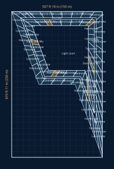
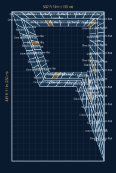

# P4-05 Port Homes Shops: plan

Footprint 507 ft 10 in (155 m) × 819 ft 11 in (250 m) · structural grid 32 ft 10 in (10 m)

## Levels

| Level | Floor above deck | Height | Floor area |
|---|---|---|---|
| Level 1 · Shop floor | 0 ft (0 mm) | 16 ft 5 in (5,000 mm) | 116,807 sq ft (10,852 m²) |
| Level 2 · Flat floor 1 | 16 ft 5 in (5,000 mm) | 10 ft 6 in (3,200 mm) | 116,846 sq ft (10,855 m²) |
| Level 3 · Flat floor 2 | 26 ft 11 in (8,200 mm) | 10 ft 6 in (3,200 mm) | 116,846 sq ft (10,855 m²) |

## Elements

| ID | Designation | Type | Name | Level(s) | Size / length | Area | Status |
|---|---|---|---|---|---|---|---|
| E001 | D5F6P4B4A1L1R1 | zone | Light court | L1 | 315 ft 11 in (96 m) × 302 ft 10 in (92 m) | 68,306 sq ft (6,346 m²) | proposed |
| E002 | D5F6P4B4A1L1R2 | zone | Corridor | L1 | 405 ft 2 in (124 m) × 9 ft 10 in (3,000 mm) | 3,875 sq ft (360 m²) | proposed |
| E003 | D5F6P4B4A1L1R3 | zone | Corridor | L1 | 27 ft 7 in (8,400 mm) × 397 ft 4 in (121 m) | 3,877 sq ft (360 m²) | proposed |
| E004 | D5F6P4B4A1L1R4 | zone | Corridor | L1 | 79 ft 5 in (24 m) × 230 ft 8 in (70 m) | 3,870 sq ft (360 m²) | proposed |
| E005 | D5F6P4B4A1L1R5 | zone | Corridor | L1 | 276 ft 7 in (84 m) × 187 ft 8 in (57 m) | 3,867 sq ft (359 m²) | proposed |
| E006 | D5F6P4B4A1L1R6 | zone | Corridor | L1 | 82 ft (25 m) × 193 ft 3 in (59 m) | 1,949 sq ft (181 m²) | proposed |
| E007 | D5F6P4B4A1L1R7, D5F6P4B4A1L2R1, D5F6P4B4A1L3R1 | core | Stairs and lifts | L1, L2, L3 | 47 ft 11 in (15 m) × 34 ft 5 in (10 m) | 899 sq ft (83 m²) | proposed |
| E008 | D5F6P4B4A1L1R8, D5F6P4B4A1L2R2, D5F6P4B4A1L3R2 | core | Stairs and lifts | L1, L2, L3 | 48 ft 7 in (15 m) × 42 ft (13 m) | 904 sq ft (84 m²) | proposed |
| E009 | D5F6P4B4A1L1R9, D5F6P4B4A1L2R3, D5F6P4B4A1L3R3 | core | Stairs and lifts | L1, L2, L3 | 34 ft 5 in (10 m) × 119 ft 1 in (36 m) | 904 sq ft (84 m²) | proposed |
| E010 | D5F6P4B4A1L1R10, D5F6P4B4A1L2R4, D5F6P4B4A1L3R4 | core | Stairs and lifts | L1, L2, L3 | 20 ft 4 in (6,200 mm) × 153 ft 7 in (47 m) | 910 sq ft (85 m²) | proposed |
| E011 | D5F6P4B4A1L1R11, D5F6P4B4A1L2R5, D5F6P4B4A1L3R5 | core | Stairs and lifts | L1, L2, L3 | 50 ft 2 in (15 m) × 34 ft 5 in (10 m) | 904 sq ft (84 m²) | proposed |
| E012 | D5F6P4B4A1L1R12, D5F6P4B4A1L2R6, D5F6P4B4A1L3R6 | core | Stairs and lifts | L1, L2, L3 | 48 ft 7 in (15 m) × 32 ft 6 in (9,900 mm) | 902 sq ft (84 m²) | proposed |
| E013 | D5F6P4B4A1L1R13 | room | Corner shop | L1 | 83 ft 8 in (26 m) × 34 ft 5 in (10 m) | 1,294 sq ft (120 m²) | proposed |
| E014 | D5F6P4B4A1L1R14 | room | Café | L1 | 71 ft 2 in (22 m) × 34 ft 5 in (10 m) | 1,074 sq ft (100 m²) | proposed |
| E015 | D5F6P4B4A1L1R15 | room | Toilets | L1 | 54 ft 6 in (17 m) × 34 ft 5 in (10 m) | 650 sq ft (60 m²) | proposed |
| E016 | D5F6P4B4A1L1R16 | room | Hairdresser | L1 | 85 ft (26 m) × 34 ft 5 in (10 m) | 1,938 sq ft (180 m²) | proposed |
| E017 | D5F6P4B4A1L1R17 | room | Laundrette | L1 | 74 ft 10 in (23 m) × 34 ft 5 in (10 m) | 1,933 sq ft (180 m²) | proposed |
| E018 | D5F6P4B4A1L1R18 | room | Takeaway | L1 | 65 ft (20 m) × 34 ft 5 in (10 m) | 1,938 sq ft (180 m²) | proposed |
| E019 | D5F6P4B4A1L1R19 | room | Hairdresser | L1 | 61 ft 4 in (19 m) × 34 ft 5 in (10 m) | 1,938 sq ft (180 m²) | proposed |
| E020 | D5F6P4B4A1L1R20 | room | Laundrette | L1 | 67 ft 11 in (21 m) × 34 ft 5 in (10 m) | 1,938 sq ft (180 m²) | proposed |
| E021 | D5F6P4B4A1L1R21 | room | Takeaway | L1 | 78 ft 1 in (24 m) × 34 ft 5 in (10 m) | 1,938 sq ft (180 m²) | proposed |
| E022 | D5F6P4B4A1L1R22 | room | Hairdresser | L1 | 71 ft 6 in (22 m) × 47 ft 3 in (14 m) | 1,933 sq ft (180 m²) | proposed |
| E023 | D5F6P4B4A1L1R23 | room | Laundrette | L1 | 34 ft 5 in (10 m) × 76 ft 9 in (23 m) | 1,938 sq ft (180 m²) | proposed |
| E024 | D5F6P4B4A1L1R24 | room | Takeaway | L1 | 34 ft 5 in (10 m) × 65 ft 3 in (20 m) | 1,938 sq ft (180 m²) | proposed |
| E025 | D5F6P4B4A1L1R25 | room | Hairdresser | L1 | 34 ft 5 in (10 m) × 71 ft 10 in (22 m) | 1,938 sq ft (180 m²) | proposed |
| E026 | D5F6P4B4A1L1R26 | room | Laundrette | L1 | 34 ft 5 in (10 m) × 89 ft 11 in (27 m) | 1,938 sq ft (180 m²) | proposed |
| E027 | D5F6P4B4A1L1R27 | room | Takeaway | L1 | 34 ft 5 in (10 m) × 107 ft 11 in (33 m) | 1,938 sq ft (180 m²) | proposed |
| E028 | D5F6P4B4A1L1R28 | room | Hairdresser | L1 | 34 ft 5 in (10 m) × 125 ft 8 in (38 m) | 1,933 sq ft (180 m²) | proposed |
| E029 | D5F6P4B4A1L1R29 | room | Laundrette | L1 | 34 ft 5 in (10 m) × 143 ft 8 in (44 m) | 1,938 sq ft (180 m²) | proposed |
| E030 | D5F6P4B4A1L1R30 | room | Takeaway | L1 | 34 ft 5 in (10 m) × 161 ft 9 in (49 m) | 1,938 sq ft (180 m²) | proposed |
| E031 | D5F6P4B4A1L1R31 | room | Hairdresser | L1 | 34 ft 5 in (10 m) × 179 ft 9 in (55 m) | 1,938 sq ft (180 m²) | proposed |
| E032 | D5F6P4B4A1L1R32 | room | Laundrette | L1 | 34 ft 5 in (10 m) × 197 ft 10 in (60 m) | 1,938 sq ft (180 m²) | proposed |
| E033 | D5F6P4B4A1L1R33 | room | Takeaway | L1 | 34 ft 5 in (10 m) × 215 ft 11 in (66 m) | 1,938 sq ft (180 m²) | proposed |
| E034 | D5F6P4B4A1L1R34 | room | Hairdresser | L1 | 34 ft 5 in (10 m) × 233 ft 11 in (71 m) | 1,938 sq ft (180 m²) | proposed |
| E035 | D5F6P4B4A1L1R35 | room | Laundrette | L1 | 44 ft 11 in (14 m) × 220 ft 2 in (67 m) | 1,932 sq ft (180 m²) | proposed |
| E036 | D5F6P4B4A1L1R36 | room | Takeaway | L1 | 43 ft (13 m) × 214 ft 7 in (65 m) | 1,954 sq ft (181 m²) | proposed |
| E037 | D5F6P4B4A1L1R37 | room | Hairdresser | L1 | 33 ft 6 in (10 m) × 189 ft 4 in (58 m) | 1,933 sq ft (180 m²) | proposed |
| E038 | D5F6P4B4A1L1R38 | room | Laundrette | L1 | 24 ft 3 in (7,400 mm) × 164 ft 4 in (50 m) | 1,953 sq ft (181 m²) | proposed |
| E039 | D5F6P4B4A1L1R39 | room | Takeaway | L1 | 23 ft 11 in (7,300 mm) × 139 ft 1 in (42 m) | 1,915 sq ft (178 m²) | proposed |
| E040 | D5F6P4B4A1L1R40 | room | Hairdresser | L1 | 33 ft 6 in (10 m) × 114 ft 2 in (35 m) | 1,936 sq ft (180 m²) | proposed |
| E041 | D5F6P4B4A1L1R41 | room | Laundrette | L1 | 56 ft 1 in (17 m) × 72 ft 2 in (22 m) | 1,931 sq ft (179 m²) | proposed |
| E042 | D5F6P4B4A1L1R42 | room | Takeaway | L1 | 80 ft 5 in (24 m) × 34 ft 5 in (10 m) | 1,944 sq ft (181 m²) | proposed |
| E043 | D5F6P4B4A1L1R43 | room | Hairdresser | L1 | 80 ft 1 in (24 m) × 34 ft 5 in (10 m) | 1,933 sq ft (180 m²) | proposed |
| E044 | D5F6P4B4A1L1R44 | room | Laundrette | L1 | 80 ft 1 in (24 m) × 34 ft 5 in (10 m) | 1,933 sq ft (180 m²) | proposed |
| E045 | D5F6P4B4A1L1R45 | room | Takeaway | L1 | 52 ft 2 in (16 m) × 73 ft 2 in (22 m) | 1,943 sq ft (181 m²) | proposed |
| E046 | D5F6P4B4A1L1R46 | room | Hairdresser | L1 | 48 ft 3 in (15 m) × 74 ft 6 in (23 m) | 1,938 sq ft (180 m²) | proposed |
| E047 | D5F6P4B4A1L1R47 | room | Laundrette | L1 | 51 ft 10 in (16 m) × 65 ft (20 m) | 1,937 sq ft (180 m²) | proposed |
| E048 | D5F6P4B4A1L1R48 | room | Takeaway | L1 | 55 ft 5 in (17 m) × 57 ft 5 in (17 m) | 1,932 sq ft (179 m²) | proposed |
| E049 | D5F6P4B4A1L1R49 | room | Hairdresser | L1 | 59 ft 1 in (18 m) × 60 ft (18 m) | 1,947 sq ft (181 m²) | proposed |
| E050 | D5F6P4B4A1L1R50 | room | Laundrette | L1 | 62 ft 8 in (19 m) × 69 ft 7 in (21 m) | 1,931 sq ft (179 m²) | proposed |
| E051 | D5F6P4B4A1L1R51 | room | Takeaway | L1 | 72 ft 10 in (22 m) × 97 ft 1 in (30 m) | 2,529 sq ft (235 m²) | proposed |
| E052 | D5F6P4B4A1L1R52 | room | Hairdresser | L1 | 99 ft 5 in (30 m) × 34 ft 5 in (10 m) | 1,944 sq ft (181 m²) | proposed |
| E053 | D5F6P4B4A1L1R53 | room | Laundrette | L1 | 79 ft 9 in (24 m) × 34 ft 5 in (10 m) | 1,690 sq ft (157 m²) | proposed |
| E054 | D5F6P4B4A1L1R54 | room | Takeaway | L1 | 68 ft 3 in (21 m) × 34 ft 5 in (10 m) | 1,938 sq ft (180 m²) | proposed |
| E055 | D5F6P4B4A1L1R55 | room | Hairdresser | L1 | 62 ft 8 in (19 m) × 34 ft 5 in (10 m) | 1,938 sq ft (180 m²) | proposed |
| E056 | D5F6P4B4A1L1R56 | room | Laundrette | L1 | 70 ft 6 in (22 m) × 34 ft 5 in (10 m) | 1,938 sq ft (180 m²) | proposed |
| E057 | D5F6P4B4A1L1R57 | room | Takeaway | L1 | 67 ft 7 in (21 m) × 34 ft 5 in (10 m) | 1,435 sq ft (133 m²) | proposed |
| E058 | D5F6P4B4A1L1R58 | room | Hairdresser | L1 | 34 ft 5 in (10 m) × 71 ft 10 in (22 m) | 1,944 sq ft (181 m²) | proposed |
| E059 | D5F6P4B4A1L1R59 | room | Laundrette | L1 | 34 ft 5 in (10 m) × 73 ft 6 in (22 m) | 1,938 sq ft (180 m²) | proposed |
| E060 | D5F6P4B4A1L1R60 | room | Takeaway | L1 | 34 ft 5 in (10 m) × 104 ft (32 m) | 1,938 sq ft (180 m²) | proposed |
| E061 | D5F6P4B4A1L1R61 | room | Hairdresser | L1 | 34 ft 5 in (10 m) × 116 ft 2 in (35 m) | 1,435 sq ft (133 m²) | proposed |
| E062 | D5F6P4B4A1L1R62 | room | Laundrette | L1 | 34 ft 5 in (10 m) × 171 ft 3 in (52 m) | 1,933 sq ft (180 m²) | proposed |
| E063 | D5F6P4B4A1L1R63 | room | Takeaway | L1 | 34 ft 5 in (10 m) × 202 ft 5 in (62 m) | 1,944 sq ft (181 m²) | proposed |
| E064 | D5F6P4B4A1L1R64 | room | Hairdresser | L1 | 34 ft 5 in (10 m) × 232 ft 7 in (71 m) | 1,933 sq ft (180 m²) | proposed |
| E065 | D5F6P4B4A1L1R65 | room | Laundrette | L1 | 40 ft (12 m) × 207 ft (63 m) | 1,419 sq ft (132 m²) | proposed |
| E066 | D5F6P4B4A1L1R66 | room | Takeaway | L1 | 31 ft 6 in (9,600 mm) × 134 ft 6 in (41 m) | 1,940 sq ft (180 m²) | proposed |
| E067 | D5F6P4B4A1L1R67 | room | Hairdresser | L1 | 68 ft 7 in (21 m) × 54 ft 9 in (17 m) | 1,939 sq ft (180 m²) | proposed |
| E068 | D5F6P4B4A1L1R68 | room | Laundrette | L1 | 80 ft 1 in (24 m) × 34 ft 5 in (10 m) | 1,933 sq ft (180 m²) | proposed |
| E069 | D5F6P4B4A1L1R69 | room | Takeaway | L1 | 65 ft 7 in (20 m) × 34 ft 5 in (10 m) | 1,435 sq ft (133 m²) | proposed |
| E070 | D5F6P4B4A1L1R70 | room | Hairdresser | L1 | 67 ft 11 in (21 m) × 51 ft 2 in (16 m) | 1,941 sq ft (180 m²) | proposed |
| E071 | D5F6P4B4A1L1R71 | room | Laundrette | L1 | 47 ft 7 in (14 m) × 76 ft 1 in (23 m) | 1,930 sq ft (179 m²) | proposed |
| E072 | D5F6P4B4A1L1R72 | room | Takeaway | L1 | 52 ft 2 in (16 m) × 63 ft 4 in (19 m) | 1,927 sq ft (179 m²) | proposed |
| E073 | D5F6P4B4A1L1R73 | room | Hairdresser | L1 | 51 ft 6 in (16 m) × 43 ft 8 in (13 m) | 1,430 sq ft (133 m²) | proposed |
| E074 | D5F6P4B4A1L1R74 | room | Laundrette | L1 | 62 ft 8 in (19 m) × 69 ft 11 in (21 m) | 1,934 sq ft (180 m²) | proposed |
| E075 | D5F6P4B4A1L1R75 | room | Takeaway | L1 | 64 ft 8 in (20 m) × 74 ft 10 in (23 m) | 1,680 sq ft (156 m²) | proposed |
| E076 | D5F6P4B4A1L2R7, D5F6P4B4A1L3R7 | zone | Corridor | L2, L3 | 405 ft 2 in (124 m) × 9 ft 10 in (3,000 mm) | 3,875 sq ft (360 m²) | proposed |
| E077 | D5F6P4B4A1L2R8, D5F6P4B4A1L3R8 | zone | Corridor | L2, L3 | 27 ft 7 in (8,400 mm) × 397 ft 4 in (121 m) | 3,877 sq ft (360 m²) | proposed |
| E078 | D5F6P4B4A1L2R9, D5F6P4B4A1L3R9 | zone | Corridor | L2, L3 | 79 ft 5 in (24 m) × 230 ft 8 in (70 m) | 3,870 sq ft (360 m²) | proposed |
| E079 | D5F6P4B4A1L2R10, D5F6P4B4A1L3R10 | zone | Corridor | L2, L3 | 276 ft 7 in (84 m) × 187 ft 8 in (57 m) | 3,867 sq ft (359 m²) | proposed |
| E080 | D5F6P4B4A1L2R11, D5F6P4B4A1L3R11 | zone | Corridor | L2, L3 | 82 ft (25 m) × 193 ft 3 in (59 m) | 1,949 sq ft (181 m²) | proposed |
| E081 | D5F6P4B4A1L2R12, D5F6P4B4A1L3R12 | room | One-bedroom flat | L2, L3 | 92 ft 2 in (28 m) × 34 ft 5 in (10 m) | 1,616 sq ft (150 m²) | proposed |
| E082 | D5F6P4B4A1L2R13, D5F6P4B4A1L3R13 | room | Studio flat | L2, L3 | 83 ft 8 in (26 m) × 34 ft 5 in (10 m) | 1,611 sq ft (150 m²) | proposed |
| E083 | D5F6P4B4A1L2R14, D5F6P4B4A1L3R14 | room | One-bedroom flat | L2, L3 | 75 ft 6 in (23 m) × 34 ft 5 in (10 m) | 1,616 sq ft (150 m²) | proposed |
| E084 | D5F6P4B4A1L2R15, D5F6P4B4A1L3R15 | room | Studio flat | L2, L3 | 66 ft 11 in (20 m) × 34 ft 5 in (10 m) | 1,616 sq ft (150 m²) | proposed |
| E085 | D5F6P4B4A1L2R16, D5F6P4B4A1L3R16 | room | One-bedroom flat | L2, L3 | 58 ft 5 in (18 m) × 34 ft 5 in (10 m) | 1,616 sq ft (150 m²) | proposed |
| E086 | D5F6P4B4A1L2R17, D5F6P4B4A1L3R17 | room | Studio flat | L2, L3 | 50 ft 10 in (16 m) × 34 ft 5 in (10 m) | 1,611 sq ft (150 m²) | proposed |
| E087 | D5F6P4B4A1L2R18, D5F6P4B4A1L3R18 | room | One-bedroom flat | L2, L3 | 52 ft 2 in (16 m) × 34 ft 5 in (10 m) | 1,616 sq ft (150 m²) | proposed |
| E088 | D5F6P4B4A1L2R19, D5F6P4B4A1L3R19 | room | Studio flat | L2, L3 | 60 ft 8 in (18 m) × 34 ft 5 in (10 m) | 1,616 sq ft (150 m²) | proposed |
| E089 | D5F6P4B4A1L2R20, D5F6P4B4A1L3R20 | room | One-bedroom flat | L2, L3 | 69 ft 3 in (21 m) × 34 ft 5 in (10 m) | 1,616 sq ft (150 m²) | proposed |
| E090 | D5F6P4B4A1L2R21, D5F6P4B4A1L3R21 | room | Studio flat | L2, L3 | 74 ft 6 in (23 m) × 36 ft 9 in (11 m) | 1,611 sq ft (150 m²) | proposed |
| E091 | D5F6P4B4A1L2R22, D5F6P4B4A1L3R22 | room | One-bedroom flat | L2, L3 | 34 ft 5 in (10 m) × 72 ft 10 in (22 m) | 1,616 sq ft (150 m²) | proposed |
| E092 | D5F6P4B4A1L2R23, D5F6P4B4A1L3R23 | room | Studio flat | L2, L3 | 34 ft 5 in (10 m) × 57 ft 9 in (18 m) | 1,611 sq ft (150 m²) | proposed |
| E093 | D5F6P4B4A1L2R24, D5F6P4B4A1L3R24 | room | One-bedroom flat | L2, L3 | 34 ft 5 in (10 m) × 54 ft 6 in (17 m) | 1,616 sq ft (150 m²) | proposed |
| E094 | D5F6P4B4A1L2R25, D5F6P4B4A1L3R25 | room | Studio flat | L2, L3 | 34 ft 5 in (10 m) × 65 ft 11 in (20 m) | 1,616 sq ft (150 m²) | proposed |
| E095 | D5F6P4B4A1L2R26, D5F6P4B4A1L3R26 | room | One-bedroom flat | L2, L3 | 34 ft 5 in (10 m) × 81 ft (25 m) | 1,616 sq ft (150 m²) | proposed |
| E096 | D5F6P4B4A1L2R27, D5F6P4B4A1L3R27 | room | Studio flat | L2, L3 | 34 ft 5 in (10 m) × 95 ft 10 in (29 m) | 1,611 sq ft (150 m²) | proposed |
| E097 | D5F6P4B4A1L2R28, D5F6P4B4A1L3R28 | room | One-bedroom flat | L2, L3 | 34 ft 5 in (10 m) × 110 ft 11 in (34 m) | 1,616 sq ft (150 m²) | proposed |
| E098 | D5F6P4B4A1L2R29, D5F6P4B4A1L3R29 | room | Studio flat | L2, L3 | 34 ft 5 in (10 m) × 126 ft (38 m) | 1,616 sq ft (150 m²) | proposed |
| E099 | D5F6P4B4A1L2R30, D5F6P4B4A1L3R30 | room | One-bedroom flat | L2, L3 | 34 ft 5 in (10 m) × 141 ft 1 in (43 m) | 1,616 sq ft (150 m²) | proposed |
| E100 | D5F6P4B4A1L2R31, D5F6P4B4A1L3R31 | room | Studio flat | L2, L3 | 34 ft 5 in (10 m) × 155 ft 10 in (47 m) | 1,611 sq ft (150 m²) | proposed |
| E101 | D5F6P4B4A1L2R32, D5F6P4B4A1L3R32 | room | One-bedroom flat | L2, L3 | 34 ft 5 in (10 m) × 170 ft 11 in (52 m) | 1,616 sq ft (150 m²) | proposed |
| E102 | D5F6P4B4A1L2R33, D5F6P4B4A1L3R33 | room | Studio flat | L2, L3 | 34 ft 5 in (10 m) × 186 ft (57 m) | 1,616 sq ft (150 m²) | proposed |
| E103 | D5F6P4B4A1L2R34, D5F6P4B4A1L3R34 | room | One-bedroom flat | L2, L3 | 34 ft 5 in (10 m) × 200 ft 9 in (61 m) | 1,611 sq ft (150 m²) | proposed |
| E104 | D5F6P4B4A1L2R35, D5F6P4B4A1L3R35 | room | Studio flat | L2, L3 | 34 ft 5 in (10 m) × 215 ft 11 in (66 m) | 1,616 sq ft (150 m²) | proposed |
| E105 | D5F6P4B4A1L2R36, D5F6P4B4A1L3R36 | room | One-bedroom flat | L2, L3 | 34 ft 5 in (10 m) × 231 ft (70 m) | 1,616 sq ft (150 m²) | proposed |
| E106 | D5F6P4B4A1L2R37, D5F6P4B4A1L3R37 | room | Studio flat | L2, L3 | 46 ft 7 in (14 m) × 224 ft 9 in (68 m) | 1,594 sq ft (148 m²) | proposed |
| E107 | D5F6P4B4A1L2R38, D5F6P4B4A1L3R38 | room | One-bedroom flat | L2, L3 | 39 ft 4 in (12 m) × 204 ft 9 in (62 m) | 1,634 sq ft (152 m²) | proposed |
| E108 | D5F6P4B4A1L2R39, D5F6P4B4A1L3R39 | room | Studio flat | L2, L3 | 31 ft 6 in (9,600 mm) × 184 ft 1 in (56 m) | 1,604 sq ft (149 m²) | proposed |
| E109 | D5F6P4B4A1L2R40, D5F6P4B4A1L3R40 | room | One-bedroom flat | L2, L3 | 23 ft 11 in (7,300 mm) × 163 ft 1 in (50 m) | 1,622 sq ft (151 m²) | proposed |
| E110 | D5F6P4B4A1L2R41, D5F6P4B4A1L3R41 | room | Studio flat | L2, L3 | 20 ft (6,100 mm) × 142 ft 1 in (43 m) | 1,603 sq ft (149 m²) | proposed |
| E111 | D5F6P4B4A1L2R42, D5F6P4B4A1L3R42 | room | One-bedroom flat | L2, L3 | 24 ft 3 in (7,400 mm) × 121 ft 5 in (37 m) | 1,616 sq ft (150 m²) | proposed |
| E112 | D5F6P4B4A1L2R43, D5F6P4B4A1L3R43 | room | Studio flat | L2, L3 | 31 ft 10 in (9,700 mm) × 100 ft 9 in (31 m) | 1,607 sq ft (149 m²) | proposed |
| E113 | D5F6P4B4A1L2R44, D5F6P4B4A1L3R44 | room | One-bedroom flat | L2, L3 | 51 ft 6 in (16 m) × 65 ft (20 m) | 1,616 sq ft (150 m²) | proposed |
| E114 | D5F6P4B4A1L2R45, D5F6P4B4A1L3R45 | room | Studio flat | L2, L3 | 70 ft 6 in (22 m) × 34 ft 5 in (10 m) | 1,605 sq ft (149 m²) | proposed |
| E115 | D5F6P4B4A1L2R46, D5F6P4B4A1L3R46 | room | One-bedroom flat | L2, L3 | 70 ft 10 in (22 m) × 34 ft 5 in (10 m) | 1,616 sq ft (150 m²) | proposed |
| E116 | D5F6P4B4A1L2R47, D5F6P4B4A1L3R47 | room | Studio flat | L2, L3 | 70 ft 10 in (22 m) × 34 ft 5 in (10 m) | 1,616 sq ft (150 m²) | proposed |
| E117 | D5F6P4B4A1L2R48, D5F6P4B4A1L3R48 | room | One-bedroom flat | L2, L3 | 67 ft 11 in (21 m) × 38 ft 9 in (12 m) | 1,619 sq ft (150 m²) | proposed |
| E118 | D5F6P4B4A1L2R49, D5F6P4B4A1L3R49 | room | Studio flat | L2, L3 | 42 ft (13 m) × 73 ft 6 in (22 m) | 1,610 sq ft (150 m²) | proposed |
| E119 | D5F6P4B4A1L2R50, D5F6P4B4A1L3R50 | room | One-bedroom flat | L2, L3 | 45 ft 3 in (14 m) × 65 ft 7 in (20 m) | 1,627 sq ft (151 m²) | proposed |
| E120 | D5F6P4B4A1L2R51, D5F6P4B4A1L3R51 | room | Studio flat | L2, L3 | 48 ft 3 in (15 m) × 57 ft 5 in (18 m) | 1,620 sq ft (150 m²) | proposed |
| E121 | D5F6P4B4A1L2R52, D5F6P4B4A1L3R52 | room | One-bedroom flat | L2, L3 | 50 ft 10 in (16 m) × 49 ft 3 in (15 m) | 1,604 sq ft (149 m²) | proposed |
| E122 | D5F6P4B4A1L2R53, D5F6P4B4A1L3R53 | room | Studio flat | L2, L3 | 54 ft 2 in (17 m) × 47 ft 11 in (15 m) | 1,616 sq ft (150 m²) | proposed |
| E123 | D5F6P4B4A1L2R54, D5F6P4B4A1L3R54 | room | One-bedroom flat | L2, L3 | 57 ft 1 in (17 m) × 54 ft 6 in (17 m) | 1,616 sq ft (150 m²) | proposed |
| E124 | D5F6P4B4A1L2R55, D5F6P4B4A1L3R55 | room | Studio flat | L2, L3 | 60 ft 4 in (18 m) × 63 ft (19 m) | 1,620 sq ft (151 m²) | proposed |
| E125 | D5F6P4B4A1L2R56, D5F6P4B4A1L3R56 | room | One-bedroom flat | L2, L3 | 70 ft 10 in (22 m) × 91 ft 10 in (28 m) | 2,321 sq ft (216 m²) | proposed |
| E126 | D5F6P4B4A1L2R57, D5F6P4B4A1L3R57 | room | Studio flat | L2, L3 | 91 ft 2 in (28 m) × 34 ft 5 in (10 m) | 1,622 sq ft (151 m²) | proposed |
| E127 | D5F6P4B4A1L2R58, D5F6P4B4A1L3R58 | room | One-bedroom flat | L2, L3 | 90 ft 3 in (28 m) × 34 ft 5 in (10 m) | 2,012 sq ft (187 m²) | proposed |
| E128 | D5F6P4B4A1L2R59, D5F6P4B4A1L3R59 | room | Studio flat | L2, L3 | 60 ft (18 m) × 34 ft 5 in (10 m) | 1,616 sq ft (150 m²) | proposed |
| E129 | D5F6P4B4A1L2R60, D5F6P4B4A1L3R60 | room | One-bedroom flat | L2, L3 | 52 ft 2 in (16 m) × 34 ft 5 in (10 m) | 1,611 sq ft (150 m²) | proposed |
| E130 | D5F6P4B4A1L2R61, D5F6P4B4A1L3R61 | room | Studio flat | L2, L3 | 55 ft 9 in (17 m) × 34 ft 5 in (10 m) | 1,616 sq ft (150 m²) | proposed |
| E131 | D5F6P4B4A1L2R62, D5F6P4B4A1L3R62 | room | One-bedroom flat | L2, L3 | 66 ft 11 in (20 m) × 34 ft 5 in (10 m) | 1,622 sq ft (151 m²) | proposed |
| E132 | D5F6P4B4A1L2R63, D5F6P4B4A1L3R63 | room | Studio flat | L2, L3 | 50 ft 10 in (16 m) × 34 ft 5 in (10 m) | 785 sq ft (73 m²) | proposed |
| E133 | D5F6P4B4A1L2R64, D5F6P4B4A1L3R64 | room | One-bedroom flat | L2, L3 | 34 ft 5 in (10 m) × 63 ft (19 m) | 1,616 sq ft (150 m²) | proposed |
| E134 | D5F6P4B4A1L2R65, D5F6P4B4A1L3R65 | room | Studio flat | L2, L3 | 34 ft 5 in (10 m) × 59 ft 9 in (18 m) | 1,616 sq ft (150 m²) | proposed |
| E135 | D5F6P4B4A1L2R66, D5F6P4B4A1L3R66 | room | One-bedroom flat | L2, L3 | 34 ft 5 in (10 m) × 82 ft (25 m) | 1,616 sq ft (150 m²) | proposed |
| E136 | D5F6P4B4A1L2R67, D5F6P4B4A1L3R67 | room | Studio flat | L2, L3 | 34 ft 5 in (10 m) × 107 ft 3 in (33 m) | 1,611 sq ft (150 m²) | proposed |
| E137 | D5F6P4B4A1L2R68, D5F6P4B4A1L3R68 | room | One-bedroom flat | L2, L3 | 34 ft 5 in (10 m) × 102 ft 8 in (31 m) | 797 sq ft (74 m²) | proposed |
| E138 | D5F6P4B4A1L2R69, D5F6P4B4A1L3R69 | room | Studio flat | L2, L3 | 34 ft 5 in (10 m) × 159 ft 5 in (49 m) | 1,616 sq ft (150 m²) | proposed |
| E139 | D5F6P4B4A1L2R70, D5F6P4B4A1L3R70 | room | One-bedroom flat | L2, L3 | 34 ft 5 in (10 m) × 185 ft (56 m) | 1,616 sq ft (150 m²) | proposed |
| E140 | D5F6P4B4A1L2R71, D5F6P4B4A1L3R71 | room | Studio flat | L2, L3 | 34 ft 5 in (10 m) × 210 ft 8 in (64 m) | 1,616 sq ft (150 m²) | proposed |
| E141 | D5F6P4B4A1L2R72, D5F6P4B4A1L3R72 | room | One-bedroom flat | L2, L3 | 37 ft 1 in (11 m) × 211 ft 11 in (65 m) | 1,612 sq ft (150 m²) | proposed |
| E142 | D5F6P4B4A1L2R73, D5F6P4B4A1L3R73 | room | Studio flat | L2, L3 | 29 ft 6 in (9,000 mm) × 178 ft 10 in (54 m) | 769 sq ft (71 m²) | proposed |
| E143 | D5F6P4B4A1L2R74, D5F6P4B4A1L3R74 | room | One-bedroom flat | L2, L3 | 26 ft 3 in (8,000 mm) × 131 ft 3 in (40 m) | 1,619 sq ft (150 m²) | proposed |
| E144 | D5F6P4B4A1L2R75, D5F6P4B4A1L3R75 | room | Studio flat | L2, L3 | 50 ft 10 in (16 m) × 68 ft 11 in (21 m) | 1,605 sq ft (149 m²) | proposed |
| E145 | D5F6P4B4A1L2R76, D5F6P4B4A1L3R76 | room | One-bedroom flat | L2, L3 | 70 ft 10 in (22 m) × 34 ft 5 in (10 m) | 1,616 sq ft (150 m²) | proposed |
| E146 | D5F6P4B4A1L2R77, D5F6P4B4A1L3R77 | room | Studio flat | L2, L3 | 70 ft 10 in (22 m) × 34 ft 5 in (10 m) | 1,616 sq ft (150 m²) | proposed |
| E147 | D5F6P4B4A1L2R78, D5F6P4B4A1L3R78 | room | One-bedroom flat | L2, L3 | 46 ft 11 in (14 m) × 34 ft 5 in (10 m) | 791 sq ft (74 m²) | proposed |
| E148 | D5F6P4B4A1L2R79, D5F6P4B4A1L3R79 | room | Studio flat | L2, L3 | 64 ft 4 in (20 m) × 43 ft 4 in (13 m) | 1,617 sq ft (150 m²) | proposed |
| E149 | D5F6P4B4A1L2R80, D5F6P4B4A1L3R80 | room | One-bedroom flat | L2, L3 | 43 ft 4 in (13 m) × 70 ft 6 in (22 m) | 1,619 sq ft (150 m²) | proposed |
| E150 | D5F6P4B4A1L2R81, D5F6P4B4A1L3R81 | room | Studio flat | L2, L3 | 47 ft 3 in (14 m) × 60 ft (18 m) | 1,620 sq ft (150 m²) | proposed |
| E151 | D5F6P4B4A1L2R82, D5F6P4B4A1L3R82 | room | One-bedroom flat | L2, L3 | 51 ft 2 in (16 m) × 49 ft 6 in (15 m) | 1,620 sq ft (151 m²) | proposed |
| E152 | D5F6P4B4A1L2R83, D5F6P4B4A1L3R83 | room | Studio flat | L2, L3 | 45 ft 7 in (14 m) × 23 ft 11 in (7,300 mm) | 783 sq ft (73 m²) | proposed |
| E153 | D5F6P4B4A1L2R84, D5F6P4B4A1L3R84 | room | One-bedroom flat | L2, L3 | 59 ft 1 in (18 m) × 60 ft (18 m) | 1,611 sq ft (150 m²) | proposed |
| E154 | D5F6P4B4A1L2R85, D5F6P4B4A1L3R85 | room | Studio flat | L2, L3 | 67 ft 7 in (21 m) × 82 ft 8 in (25 m) | 2,008 sq ft (187 m²) | proposed |

## Drawings

### Level 1 · Shop floor

### Level 2 · Flat floor 1

### Level 3 · Flat floor 2

