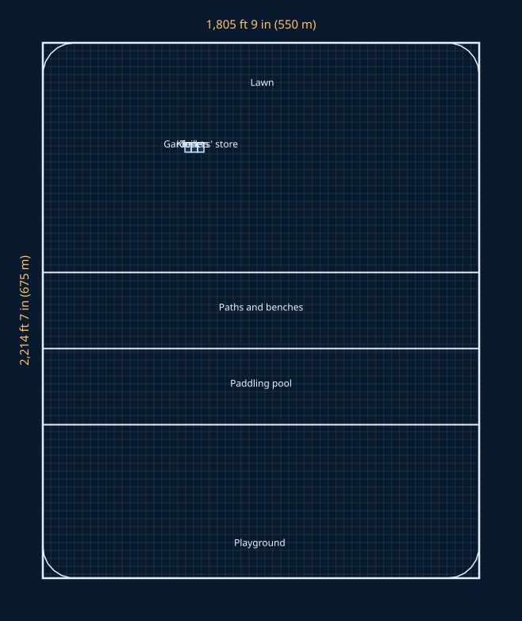

# P4-06 Port Homes Park: plan

Footprint 1,805 ft 9 in (550 m) × 2,214 ft 7 in (675 m) · structural grid 32 ft 10 in (10 m)

## Levels

| Level | Floor above deck | Height | Floor area |
|---|---|---|---|
| Level 1 · Ground | 0 ft (0 mm) | 13 ft 1 in (4,000 mm) | 3,100 sq ft (288 m²) |

## Elements

| ID | Designation | Type | Name | Level(s) | Size / length | Area | Status |
|---|---|---|---|---|---|---|---|
| E001 | D5F6P4B5A1R1 | zone | Lawn | L1 | 1,805 ft 1 in (550 m) × 949 ft 10 in (290 m) | 1,705,306 sq ft (158,428 m²) | proposed |
| E002 | D5F6P4B5A1R2 | room | Kiosk | L1 | 26 ft 3 in (8,000 mm) × 39 ft 4 in (12 m) | 1,033 sq ft (96 m²) | proposed |
| E003 | D5F6P4B5A1R3 | room | Toilets | L1 | 26 ft 3 in (8,000 mm) × 39 ft 4 in (12 m) | 1,033 sq ft (96 m²) | proposed |
| E004 | D5F6P4B5A1R4 | room | Gardeners' store | L1 | 26 ft 3 in (8,000 mm) × 39 ft 4 in (12 m) | 1,033 sq ft (96 m²) | proposed |
| E005 | D5F6P4B5A1R5 | zone | Paths and benches | L1 | 1,804 ft 6 in (550 m) × 315 ft (96 m) | 568,335 sq ft (52,800 m²) | proposed |
| E006 | D5F6P4B5A1R6 | zone | Paddling pool | L1 | 1,804 ft 9 in (550 m) × 315 ft (96 m) | 568,335 sq ft (52,800 m²) | proposed |
| E007 | D5F6P4B5A1R7 | zone | Playground | L1 | 1,804 ft 9 in (550 m) × 634 ft 10 in (194 m) | 1,136,979 sq ft (105,629 m²) | proposed |

## Drawings

### Level 1 · Ground

