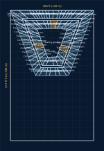
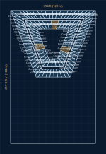

# P4-15 Port Homes Clinic: plan

Footprint 394 ft (120 m) × 617 ft 9 in (188 m) · structural grid 32 ft 10 in (10 m)

## Levels

| Level | Floor above deck | Height | Floor area |
|---|---|---|---|
| Level 1 · Ground floor | 0 ft (0 mm) | 15 ft 9 in (4,800 mm) | 61,019 sq ft (5,669 m²) |
| Level 2 · Upper floor | 15 ft 9 in (4,800 mm) | 13 ft 9 in (4,200 mm) | 61,015 sq ft (5,668 m²) |

## Elements

| ID | Designation | Type | Name | Level(s) | Size / length | Area | Status |
|---|---|---|---|---|---|---|---|
| E001 | D5F6P4B12A1L1R1 | zone | Healing garden | L1 | 146 ft (44 m) × 138 ft 5 in (42 m) | 12,900 sq ft (1,198 m²) | proposed |
| E002 | D5F6P4B12A1L1R2 | zone | Corridor | L1 | 284 ft 5 in (87 m) × 120 ft 5 in (37 m) | 3,886 sq ft (361 m²) | proposed |
| E003 | D5F6P4B12A1L1R3 | zone | Corridor | L1 | 215 ft 11 in (66 m) × 174 ft 3 in (53 m) | 3,901 sq ft (362 m²) | proposed |
| E004 | D5F6P4B12A1L1R4 | zone | Corridor | L1 | 35 ft 1 in (11 m) × 64 ft 4 in (20 m) | 606 sq ft (56 m²) | proposed |
| E005 | D5F6P4B12A1L1R5, D5F6P4B12A1L2R1 | core | Stairs and lifts | L1, L2 | 33 ft 6 in (10 m) × 37 ft 9 in (12 m) | 990 sq ft (92 m²) | proposed |
| E006 | D5F6P4B12A1L1R6, D5F6P4B12A1L2R2 | core | Stairs and lifts | L1, L2 | 45 ft 7 in (14 m) × 35 ft 5 in (11 m) | 993 sq ft (92 m²) | proposed |
| E007 | D5F6P4B12A1L1R7, D5F6P4B12A1L2R3 | core | Stairs and lifts | L1, L2 | 47 ft 11 in (15 m) × 29 ft 10 in (9,100 mm) | 994 sq ft (92 m²) | proposed |
| E008 | D5F6P4B12A1L1R8 | room | Entrance and reception | L1 | 83 ft 8 in (26 m) × 37 ft 9 in (12 m) | 1,294 sq ft (120 m²) | proposed |
| E009 | D5F6P4B12A1L1R9 | room | Waiting area | L1 | 79 ft 9 in (24 m) × 37 ft 9 in (12 m) | 1,615 sq ft (150 m²) | proposed |
| E010 | D5F6P4B12A1L1R10 | room | Triage room | L1 | 41 ft (12 m) × 37 ft 9 in (12 m) | 495 sq ft (46 m²) | proposed |
| E011 | D5F6P4B12A1L1R11 | room | Triage room | L1 | 36 ft 9 in (11 m) × 37 ft 9 in (12 m) | 495 sq ft (46 m²) | proposed |
| E012 | D5F6P4B12A1L1R12 | room | Treatment room | L1 | 32 ft 6 in (9,900 mm) × 37 ft 9 in (12 m) | 501 sq ft (47 m²) | proposed |
| E013 | D5F6P4B12A1L1R13 | room | Treatment room | L1 | 28 ft 3 in (8,600 mm) × 37 ft 9 in (12 m) | 501 sq ft (47 m²) | proposed |
| E014 | D5F6P4B12A1L1R14 | room | Treatment room | L1 | 23 ft 11 in (7,300 mm) × 37 ft 9 in (12 m) | 495 sq ft (46 m²) | proposed |
| E015 | D5F6P4B12A1L1R15 | room | Resuscitation bay | L1 | 19 ft 8 in (6,000 mm) × 37 ft 9 in (12 m) | 495 sq ft (46 m²) | proposed |
| E016 | D5F6P4B12A1L1R16 | room | Pharmacy | L1 | 20 ft (6,100 mm) × 37 ft 9 in (12 m) | 650 sq ft (60 m²) | proposed |
| E017 | D5F6P4B12A1L1R17 | room | Ambulance bay | L1 | 27 ft 11 in (8,500 mm) × 37 ft 9 in (12 m) | 860 sq ft (80 m²) | proposed |
| E018 | D5F6P4B12A1L1R18 | room | Baby clinic | L1 | 23 ft 11 in (7,300 mm) × 37 ft 9 in (12 m) | 495 sq ft (46 m²) | proposed |
| E019 | D5F6P4B12A1L1R19 | room | Toilets | L1 | 32 ft 10 in (10 m) × 37 ft 9 in (12 m) | 650 sq ft (60 m²) | proposed |
| E020 | D5F6P4B12A1L1R20 | room | Clean utility | L1 | 33 ft 10 in (10 m) × 37 ft 9 in (12 m) | 501 sq ft (47 m²) | proposed |
| E021 | D5F6P4B12A1L1R21 | room | Dirty utility | L1 | 38 ft 1 in (12 m) × 37 ft 9 in (12 m) | 495 sq ft (46 m²) | proposed |
| E022 | D5F6P4B12A1L1R22 | room | Consulting room | L1 | 44 ft 11 in (14 m) × 37 ft 9 in (12 m) | 582 sq ft (54 m²) | proposed |
| E023 | D5F6P4B12A1L1R23 | room | Treatment room | L1 | 61 ft 8 in (19 m) × 37 ft 9 in (12 m) | 966 sq ft (90 m²) | proposed |
| E024 | D5F6P4B12A1L1R24 | room | Consulting room | L1 | 58 ft 5 in (18 m) × 37 ft 9 in (12 m) | 588 sq ft (55 m²) | proposed |
| E025 | D5F6P4B12A1L1R25 | room | Treatment room | L1 | 74 ft 10 in (23 m) × 37 ft 9 in (12 m) | 959 sq ft (89 m²) | proposed |
| E026 | D5F6P4B12A1L1R26 | room | Consulting room | L1 | 58 ft 5 in (18 m) × 46 ft 11 in (14 m) | 591 sq ft (55 m²) | proposed |
| E027 | D5F6P4B12A1L1R27 | room | Treatment room | L1 | 61 ft 8 in (19 m) × 55 ft 5 in (17 m) | 968 sq ft (90 m²) | proposed |
| E028 | D5F6P4B12A1L1R28 | room | Consulting room | L1 | 55 ft 9 in (17 m) × 40 ft 4 in (12 m) | 578 sq ft (54 m²) | proposed |
| E029 | D5F6P4B12A1L1R29 | room | Treatment room | L1 | 57 ft 5 in (18 m) × 44 ft 7 in (14 m) | 965 sq ft (90 m²) | proposed |
| E030 | D5F6P4B12A1L1R30 | room | Consulting room | L1 | 51 ft 10 in (16 m) × 29 ft 10 in (9,100 mm) | 582 sq ft (54 m²) | proposed |
| E031 | D5F6P4B12A1L1R31 | room | Treatment room | L1 | 53 ft 6 in (16 m) × 34 ft 1 in (10 m) | 967 sq ft (90 m²) | proposed |
| E032 | D5F6P4B12A1L1R32 | room | Consulting room | L1 | 47 ft 7 in (14 m) × 19 ft 4 in (5,900 mm) | 582 sq ft (54 m²) | proposed |
| E033 | D5F6P4B12A1L1R33 | room | Treatment room | L1 | 49 ft 3 in (15 m) × 27 ft 7 in (8,400 mm) | 970 sq ft (90 m²) | proposed |
| E034 | D5F6P4B12A1L1R34 | room | Consulting room | L1 | 43 ft 8 in (13 m) × 20 ft 4 in (6,200 mm) | 577 sq ft (54 m²) | proposed |
| E035 | D5F6P4B12A1L1R35 | room | Treatment room | L1 | 45 ft 3 in (14 m) × 35 ft 5 in (11 m) | 972 sq ft (90 m²) | proposed |
| E036 | D5F6P4B12A1L1R36 | room | Consulting room | L1 | 39 ft 8 in (12 m) × 31 ft 2 in (9,500 mm) | 586 sq ft (54 m²) | proposed |
| E037 | D5F6P4B12A1L1R37 | room | Treatment room | L1 | 41 ft (12 m) × 45 ft 11 in (14 m) | 964 sq ft (90 m²) | proposed |
| E038 | D5F6P4B12A1L1R38 | room | Consulting room | L1 | 35 ft 9 in (11 m) × 41 ft 8 in (13 m) | 588 sq ft (55 m²) | proposed |
| E039 | D5F6P4B12A1L1R39 | room | Treatment room | L1 | 37 ft 5 in (11 m) × 56 ft 5 in (17 m) | 974 sq ft (91 m²) | proposed |
| E040 | D5F6P4B12A1L1R40 | room | Consulting room | L1 | 35 ft 9 in (11 m) × 43 ft 4 in (13 m) | 586 sq ft (54 m²) | proposed |
| E041 | D5F6P4B12A1L1R41 | room | Treatment room | L1 | 43 ft 4 in (13 m) × 37 ft 9 in (12 m) | 966 sq ft (90 m²) | proposed |
| E042 | D5F6P4B12A1L1R42 | room | Consulting room | L1 | 24 ft 11 in (7,600 mm) × 37 ft 9 in (12 m) | 582 sq ft (54 m²) | proposed |
| E043 | D5F6P4B12A1L1R43 | room | Treatment room | L1 | 30 ft 6 in (9,300 mm) × 37 ft 9 in (12 m) | 966 sq ft (90 m²) | proposed |
| E044 | D5F6P4B12A1L1R44 | room | Consulting room | L1 | 22 ft (6,700 mm) × 37 ft 9 in (12 m) | 582 sq ft (54 m²) | proposed |
| E045 | D5F6P4B12A1L1R45 | room | Treatment room | L1 | 40 ft 4 in (12 m) × 37 ft 9 in (12 m) | 972 sq ft (90 m²) | proposed |
| E046 | D5F6P4B12A1L1R46 | room | Consulting room | L1 | 38 ft 1 in (12 m) × 37 ft 9 in (12 m) | 576 sq ft (53 m²) | proposed |
| E047 | D5F6P4B12A1L1R47 | room | Treatment room | L1 | 36 ft 9 in (11 m) × 58 ft 1 in (18 m) | 975 sq ft (91 m²) | proposed |
| E048 | D5F6P4B12A1L1R48 | room | Consulting room | L1 | 34 ft 9 in (11 m) × 43 ft 4 in (13 m) | 580 sq ft (54 m²) | proposed |
| E049 | D5F6P4B12A1L1R49 | room | Treatment room | L1 | 40 ft 4 in (12 m) × 47 ft 7 in (14 m) | 964 sq ft (90 m²) | proposed |
| E050 | D5F6P4B12A1L1R50 | room | Consulting room | L1 | 39 ft 1 in (12 m) × 32 ft 10 in (10,000 mm) | 586 sq ft (54 m²) | proposed |
| E051 | D5F6P4B12A1L1R51 | room | Treatment room | L1 | 44 ft 3 in (14 m) × 37 ft 1 in (11 m) | 963 sq ft (89 m²) | proposed |
| E052 | D5F6P4B12A1L1R52 | room | Consulting room | L1 | 43 ft (13 m) × 22 ft 4 in (6,800 mm) | 584 sq ft (54 m²) | proposed |
| E053 | D5F6P4B12A1L1R53 | room | Treatment room | L1 | 48 ft 7 in (15 m) × 27 ft 3 in (8,300 mm) | 971 sq ft (90 m²) | proposed |
| E054 | D5F6P4B12A1L1R54 | room | Consulting room | L1 | 46 ft 11 in (14 m) × 17 ft 1 in (5,200 mm) | 574 sq ft (53 m²) | proposed |
| E055 | D5F6P4B12A1L1R55 | room | Treatment room | L1 | 52 ft 6 in (16 m) × 32 ft 6 in (9,900 mm) | 967 sq ft (90 m²) | proposed |
| E056 | D5F6P4B12A1L1R56 | room | Consulting room | L1 | 50 ft 10 in (16 m) × 28 ft 3 in (8,600 mm) | 581 sq ft (54 m²) | proposed |
| E057 | D5F6P4B12A1L1R57 | room | Treatment room | L1 | 56 ft 9 in (17 m) × 43 ft (13 m) | 965 sq ft (90 m²) | proposed |
| E058 | D5F6P4B12A1L1R58 | room | Consulting room | L1 | 55 ft 1 in (17 m) × 38 ft 9 in (12 m) | 580 sq ft (54 m²) | proposed |
| E059 | D5F6P4B12A1L1R59 | room | Treatment room | L1 | 60 ft 8 in (18 m) × 53 ft 6 in (16 m) | 962 sq ft (89 m²) | proposed |
| E060 | D5F6P4B12A1L1R60 | room | Consulting room | L1 | 60 ft 4 in (18 m) × 52 ft 6 in (16 m) | 695 sq ft (65 m²) | proposed |
| E061 | D5F6P4B12A1L1R61 | room | Treatment room | L1 | 73 ft 6 in (22 m) × 37 ft 9 in (12 m) | 966 sq ft (90 m²) | proposed |
| E062 | D5F6P4B12A1L1R62 | room | Consulting room | L1 | 52 ft 2 in (16 m) × 37 ft 9 in (12 m) | 582 sq ft (54 m²) | proposed |
| E063 | D5F6P4B12A1L1R63 | room | Treatment room | L1 | 51 ft 2 in (16 m) × 37 ft 9 in (12 m) | 972 sq ft (90 m²) | proposed |
| E064 | D5F6P4B12A1L1R64 | room | Consulting room | L1 | 29 ft 6 in (9,000 mm) × 37 ft 9 in (12 m) | 576 sq ft (53 m²) | proposed |
| E065 | D5F6P4B12A1L1R65 | room | Treatment room | L1 | 19 ft (5,800 mm) × 37 ft 9 in (12 m) | 458 sq ft (43 m²) | proposed |
| E066 | D5F6P4B12A1L1R66 | room | Consulting room | L1 | 30 ft 6 in (9,300 mm) × 37 ft 9 in (12 m) | 582 sq ft (54 m²) | proposed |
| E067 | D5F6P4B12A1L1R67 | room | Treatment room | L1 | 52 ft 2 in (16 m) × 37 ft 9 in (12 m) | 972 sq ft (90 m²) | proposed |
| E068 | D5F6P4B12A1L1R68 | room | Consulting room | L1 | 52 ft 10 in (16 m) × 37 ft 9 in (12 m) | 576 sq ft (53 m²) | proposed |
| E069 | D5F6P4B12A1L1R69 | room | Treatment room | L1 | 72 ft 2 in (22 m) × 39 ft 1 in (12 m) | 975 sq ft (91 m²) | proposed |
| E070 | D5F6P4B12A1L1R70 | room | Consulting room | L1 | 58 ft 9 in (18 m) × 48 ft 3 in (15 m) | 577 sq ft (54 m²) | proposed |
| E071 | D5F6P4B12A1L1R71 | room | Treatment room | L1 | 59 ft 5 in (18 m) × 49 ft 10 in (15 m) | 974 sq ft (90 m²) | proposed |
| E072 | D5F6P4B12A1L1R72 | room | Consulting room | L1 | 52 ft 6 in (16 m) × 31 ft 10 in (9,700 mm) | 572 sq ft (53 m²) | proposed |
| E073 | D5F6P4B12A1L1R73 | room | Treatment room | L1 | 52 ft 10 in (16 m) × 33 ft 6 in (10 m) | 972 sq ft (90 m²) | proposed |
| E074 | D5F6P4B12A1L1R74 | room | Consulting room | L1 | 48 ft 11 in (15 m) × 27 ft 7 in (8,400 mm) | 912 sq ft (85 m²) | proposed |
| E075 | D5F6P4B12A1L1R75 | room | Treatment room | L1 | 41 ft 8 in (13 m) × 44 ft 11 in (14 m) | 967 sq ft (90 m²) | proposed |
| E076 | D5F6P4B12A1L1R76 | room | Consulting room | L1 | 34 ft 9 in (11 m) × 44 ft (13 m) | 588 sq ft (55 m²) | proposed |
| E077 | D5F6P4B12A1L1R77 | room | Treatment room | L1 | 39 ft 4 in (12 m) × 47 ft 3 in (14 m) | 966 sq ft (90 m²) | proposed |
| E078 | D5F6P4B12A1L1R78 | room | Consulting room | L1 | 25 ft 7 in (7,800 mm) × 37 ft 9 in (12 m) | 582 sq ft (54 m²) | proposed |
| E079 | D5F6P4B12A1L1R79 | room | Treatment room | L1 | 35 ft 9 in (11 m) × 37 ft 9 in (12 m) | 966 sq ft (90 m²) | proposed |
| E080 | D5F6P4B12A1L1R80 | room | Consulting room | L1 | 35 ft 1 in (11 m) × 39 ft 8 in (12 m) | 584 sq ft (54 m²) | proposed |
| E081 | D5F6P4B12A1L1R81 | room | Treatment room | L1 | 37 ft 9 in (12 m) × 55 ft 5 in (17 m) | 973 sq ft (90 m²) | proposed |
| E082 | D5F6P4B12A1L1R82 | room | Consulting room | L1 | 37 ft 1 in (11 m) × 37 ft 9 in (12 m) | 583 sq ft (54 m²) | proposed |
| E083 | D5F6P4B12A1L1R83 | room | Treatment room | L1 | 43 ft 4 in (13 m) × 38 ft 1 in (12 m) | 918 sq ft (85 m²) | proposed |
| E084 | D5F6P4B12A1L1R84 | room | Consulting room | L1 | 46 ft 11 in (14 m) × 17 ft 5 in (5,300 mm) | 575 sq ft (53 m²) | proposed |
| E085 | D5F6P4B12A1L1R85 | room | Treatment room | L1 | 53 ft 10 in (16 m) × 35 ft 5 in (11 m) | 972 sq ft (90 m²) | proposed |
| E086 | D5F6P4B12A1L1R86 | room | Consulting room | L1 | 53 ft 2 in (16 m) × 33 ft 10 in (10 m) | 576 sq ft (53 m²) | proposed |
| E087 | D5F6P4B12A1L1R87 | room | Treatment room | L1 | 60 ft (18 m) × 51 ft 10 in (16 m) | 972 sq ft (90 m²) | proposed |
| E088 | D5F6P4B12A1L1R88 | room | Consulting room | L1 | 58 ft 1 in (18 m) × 46 ft 7 in (14 m) | 459 sq ft (43 m²) | proposed |
| E089 | D5F6P4B12A1L2R4 | zone | Corridor | L2 | 284 ft 5 in (87 m) × 120 ft 5 in (37 m) | 3,886 sq ft (361 m²) | proposed |
| E090 | D5F6P4B12A1L2R5 | zone | Corridor | L2 | 215 ft 11 in (66 m) × 174 ft 3 in (53 m) | 3,901 sq ft (362 m²) | proposed |
| E091 | D5F6P4B12A1L2R6 | zone | Corridor | L2 | 35 ft 1 in (11 m) × 64 ft 4 in (20 m) | 606 sq ft (56 m²) | proposed |
| E092 | D5F6P4B12A1L2R7 | room | Observation ward | L2 | 83 ft 8 in (26 m) × 37 ft 9 in (12 m) | 1,294 sq ft (120 m²) | proposed |
| E093 | D5F6P4B12A1L2R8 | room | Nurses' station | L2 | 54 ft 9 in (17 m) × 37 ft 9 in (12 m) | 495 sq ft (46 m²) | proposed |
| E094 | D5F6P4B12A1L2R9 | room | X-ray room | L2 | 50 ft 6 in (15 m) × 37 ft 9 in (12 m) | 501 sq ft (47 m²) | proposed |
| E095 | D5F6P4B12A1L2R10 | room | Staff room | L2 | 46 ft 3 in (14 m) × 37 ft 9 in (12 m) | 495 sq ft (46 m²) | proposed |
| E096 | D5F6P4B12A1L2R11 | room | Clinic manager's office | L2 | 42 ft 4 in (13 m) × 37 ft 9 in (12 m) | 501 sq ft (47 m²) | proposed |
| E097 | D5F6P4B12A1L2R12 | room | Staff toilets and showers | L2 | 43 ft 8 in (13 m) × 37 ft 9 in (12 m) | 755 sq ft (70 m²) | proposed |
| E098 | D5F6P4B12A1L2R13 | room | Consulting room | L2 | 33 ft 2 in (10 m) × 37 ft 9 in (12 m) | 576 sq ft (53 m²) | proposed |
| E099 | D5F6P4B12A1L2R14 | room | Consulting room | L2 | 28 ft 3 in (8,600 mm) × 37 ft 9 in (12 m) | 582 sq ft (54 m²) | proposed |
| E100 | D5F6P4B12A1L2R15 | room | Consulting room | L2 | 23 ft 4 in (7,100 mm) × 37 ft 9 in (12 m) | 588 sq ft (55 m²) | proposed |
| E101 | D5F6P4B12A1L2R16 | room | Consulting room | L2 | 18 ft 1 in (5,500 mm) × 37 ft 9 in (12 m) | 576 sq ft (53 m²) | proposed |
| E102 | D5F6P4B12A1L2R17 | room | Consulting room | L2 | 18 ft 1 in (5,500 mm) × 37 ft 9 in (12 m) | 582 sq ft (54 m²) | proposed |
| E103 | D5F6P4B12A1L2R18 | room | Consulting room | L2 | 22 ft 8 in (6,900 mm) × 37 ft 9 in (12 m) | 582 sq ft (54 m²) | proposed |
| E104 | D5F6P4B12A1L2R19 | room | Consulting room | L2 | 27 ft 7 in (8,400 mm) × 37 ft 9 in (12 m) | 582 sq ft (54 m²) | proposed |
| E105 | D5F6P4B12A1L2R20 | room | Consulting room | L2 | 32 ft 6 in (9,900 mm) × 37 ft 9 in (12 m) | 582 sq ft (54 m²) | proposed |
| E106 | D5F6P4B12A1L2R21 | room | Consulting room | L2 | 37 ft 5 in (11 m) × 37 ft 9 in (12 m) | 582 sq ft (54 m²) | proposed |
| E107 | D5F6P4B12A1L2R22 | room | Consulting room | L2 | 42 ft 4 in (13 m) × 37 ft 9 in (12 m) | 576 sq ft (53 m²) | proposed |
| E108 | D5F6P4B12A1L2R23 | room | Consulting room | L2 | 47 ft 7 in (14 m) × 37 ft 9 in (12 m) | 588 sq ft (55 m²) | proposed |
| E109 | D5F6P4B12A1L2R24 | room | Consulting room | L2 | 52 ft 2 in (16 m) × 37 ft 9 in (12 m) | 576 sq ft (53 m²) | proposed |
| E110 | D5F6P4B12A1L2R25 | room | Consulting room | L2 | 57 ft 5 in (18 m) × 37 ft 9 in (12 m) | 582 sq ft (54 m²) | proposed |
| E111 | D5F6P4B12A1L2R26 | room | Consulting room | L2 | 62 ft 8 in (19 m) × 37 ft 9 in (12 m) | 588 sq ft (55 m²) | proposed |
| E112 | D5F6P4B12A1L2R27 | room | Consulting room | L2 | 67 ft 3 in (20 m) × 37 ft 9 in (12 m) | 576 sq ft (53 m²) | proposed |
| E113 | D5F6P4B12A1L2R28 | room | Consulting room | L2 | 59 ft 1 in (18 m) × 49 ft 3 in (15 m) | 578 sq ft (54 m²) | proposed |
| E114 | D5F6P4B12A1L2R29 | room | Consulting room | L2 | 58 ft 1 in (18 m) × 46 ft 7 in (14 m) | 578 sq ft (54 m²) | proposed |
| E115 | D5F6P4B12A1L2R30 | room | Consulting room | L2 | 56 ft 5 in (17 m) × 42 ft 8 in (13 m) | 584 sq ft (54 m²) | proposed |
| E116 | D5F6P4B12A1L2R31 | room | Consulting room | L2 | 55 ft 1 in (17 m) × 38 ft 5 in (12 m) | 573 sq ft (53 m²) | proposed |
| E117 | D5F6P4B12A1L2R32 | room | Consulting room | L2 | 53 ft 6 in (16 m) × 34 ft 5 in (10 m) | 586 sq ft (54 m²) | proposed |
| E118 | D5F6P4B12A1L2R33 | room | Consulting room | L2 | 52 ft 2 in (16 m) × 30 ft 6 in (9,300 mm) | 583 sq ft (54 m²) | proposed |
| E119 | D5F6P4B12A1L2R34 | room | Consulting room | L2 | 50 ft 6 in (15 m) × 26 ft 7 in (8,100 mm) | 586 sq ft (54 m²) | proposed |
| E120 | D5F6P4B12A1L2R35 | room | Consulting room | L2 | 48 ft 11 in (15 m) × 22 ft 4 in (6,800 mm) | 577 sq ft (54 m²) | proposed |
| E121 | D5F6P4B12A1L2R36 | room | Consulting room | L2 | 47 ft 7 in (14 m) × 18 ft 4 in (5,600 mm) | 584 sq ft (54 m²) | proposed |
| E122 | D5F6P4B12A1L2R37 | room | Consulting room | L2 | 45 ft 11 in (14 m) × 16 ft 5 in (5,000 mm) | 583 sq ft (54 m²) | proposed |
| E123 | D5F6P4B12A1L2R38 | room | Consulting room | L2 | 44 ft 3 in (14 m) × 18 ft 4 in (5,600 mm) | 581 sq ft (54 m²) | proposed |
| E124 | D5F6P4B12A1L2R39 | room | Consulting room | L2 | 42 ft 8 in (13 m) × 22 ft 4 in (6,800 mm) | 575 sq ft (53 m²) | proposed |
| E125 | D5F6P4B12A1L2R40 | room | Consulting room | L2 | 41 ft 4 in (13 m) × 26 ft 7 in (8,100 mm) | 584 sq ft (54 m²) | proposed |
| E126 | D5F6P4B12A1L2R41 | room | Consulting room | L2 | 39 ft 8 in (12 m) × 30 ft 6 in (9,300 mm) | 582 sq ft (54 m²) | proposed |
| E127 | D5F6P4B12A1L2R42 | room | Consulting room | L2 | 38 ft 5 in (12 m) × 34 ft 5 in (10 m) | 585 sq ft (54 m²) | proposed |
| E128 | D5F6P4B12A1L2R43 | room | Consulting room | L2 | 36 ft 9 in (11 m) × 38 ft 5 in (12 m) | 578 sq ft (54 m²) | proposed |
| E129 | D5F6P4B12A1L2R44 | room | Consulting room | L2 | 35 ft 1 in (11 m) × 42 ft 8 in (13 m) | 581 sq ft (54 m²) | proposed |
| E130 | D5F6P4B12A1L2R45 | room | Consulting room | L2 | 33 ft 10 in (10 m) × 46 ft 7 in (14 m) | 587 sq ft (54 m²) | proposed |
| E131 | D5F6P4B12A1L2R46 | room | Consulting room | L2 | 32 ft 10 in (10 m) × 49 ft 3 in (15 m) | 581 sq ft (54 m²) | proposed |
| E132 | D5F6P4B12A1L2R47 | room | Consulting room | L2 | 38 ft 1 in (12 m) × 37 ft 9 in (12 m) | 582 sq ft (54 m²) | proposed |
| E133 | D5F6P4B12A1L2R48 | room | Consulting room | L2 | 31 ft 10 in (9,700 mm) × 37 ft 9 in (12 m) | 582 sq ft (54 m²) | proposed |
| E134 | D5F6P4B12A1L2R49 | room | Consulting room | L2 | 25 ft 7 in (7,800 mm) × 37 ft 9 in (12 m) | 582 sq ft (54 m²) | proposed |
| E135 | D5F6P4B12A1L2R50 | room | Consulting room | L2 | 19 ft 8 in (6,000 mm) × 37 ft 9 in (12 m) | 582 sq ft (54 m²) | proposed |
| E136 | D5F6P4B12A1L2R51 | room | Consulting room | L2 | 18 ft 4 in (5,600 mm) × 37 ft 9 in (12 m) | 576 sq ft (53 m²) | proposed |
| E137 | D5F6P4B12A1L2R52 | room | Consulting room | L2 | 23 ft 4 in (7,100 mm) × 37 ft 9 in (12 m) | 582 sq ft (54 m²) | proposed |
| E138 | D5F6P4B12A1L2R53 | room | Consulting room | L2 | 29 ft 6 in (9,000 mm) × 37 ft 9 in (12 m) | 588 sq ft (55 m²) | proposed |
| E139 | D5F6P4B12A1L2R54 | room | Consulting room | L2 | 35 ft 5 in (11 m) × 37 ft 9 in (12 m) | 582 sq ft (54 m²) | proposed |
| E140 | D5F6P4B12A1L2R55 | room | Consulting room | L2 | 35 ft 1 in (11 m) × 44 ft (13 m) | 575 sq ft (53 m²) | proposed |
| E141 | D5F6P4B12A1L2R56 | room | Consulting room | L2 | 33 ft 2 in (10 m) × 47 ft 11 in (15 m) | 584 sq ft (54 m²) | proposed |
| E142 | D5F6P4B12A1L2R57 | room | Consulting room | L2 | 34 ft 5 in (11 m) × 44 ft (13 m) | 579 sq ft (54 m²) | proposed |
| E143 | D5F6P4B12A1L2R58 | room | Consulting room | L2 | 36 ft 1 in (11 m) × 40 ft (12 m) | 583 sq ft (54 m²) | proposed |
| E144 | D5F6P4B12A1L2R59 | room | Consulting room | L2 | 37 ft 5 in (11 m) × 36 ft 1 in (11 m) | 579 sq ft (54 m²) | proposed |
| E145 | D5F6P4B12A1L2R60 | room | Consulting room | L2 | 39 ft 1 in (12 m) × 31 ft 10 in (9,700 mm) | 575 sq ft (53 m²) | proposed |
| E146 | D5F6P4B12A1L2R61 | room | Consulting room | L2 | 40 ft 8 in (12 m) × 27 ft 11 in (8,500 mm) | 582 sq ft (54 m²) | proposed |
| E147 | D5F6P4B12A1L2R62 | room | Consulting room | L2 | 42 ft 4 in (13 m) × 23 ft 11 in (7,300 mm) | 584 sq ft (54 m²) | proposed |
| E148 | D5F6P4B12A1L2R63 | room | Consulting room | L2 | 44 ft (13 m) × 20 ft (6,100 mm) | 580 sq ft (54 m²) | proposed |
| E149 | D5F6P4B12A1L2R64 | room | Consulting room | L2 | 45 ft 3 in (14 m) × 16 ft 5 in (5,000 mm) | 579 sq ft (54 m²) | proposed |
| E150 | D5F6P4B12A1L2R65 | room | Consulting room | L2 | 46 ft 11 in (14 m) × 16 ft 9 in (5,100 mm) | 584 sq ft (54 m²) | proposed |
| E151 | D5F6P4B12A1L2R66 | room | Consulting room | L2 | 48 ft 3 in (15 m) × 20 ft 8 in (6,300 mm) | 584 sq ft (54 m²) | proposed |
| E152 | D5F6P4B12A1L2R67 | room | Consulting room | L2 | 49 ft 10 in (15 m) × 24 ft 7 in (7,500 mm) | 587 sq ft (55 m²) | proposed |
| E153 | D5F6P4B12A1L2R68 | room | Consulting room | L2 | 51 ft 6 in (16 m) × 28 ft 7 in (8,700 mm) | 576 sq ft (54 m²) | proposed |
| E154 | D5F6P4B12A1L2R69 | room | Consulting room | L2 | 52 ft 10 in (16 m) × 32 ft 10 in (10 m) | 585 sq ft (54 m²) | proposed |
| E155 | D5F6P4B12A1L2R70 | room | Consulting room | L2 | 54 ft 6 in (17 m) × 36 ft 9 in (11 m) | 581 sq ft (54 m²) | proposed |
| E156 | D5F6P4B12A1L2R71 | room | Consulting room | L2 | 55 ft 9 in (17 m) × 40 ft 8 in (12 m) | 585 sq ft (54 m²) | proposed |
| E157 | D5F6P4B12A1L2R72 | room | Consulting room | L2 | 57 ft 5 in (18 m) × 44 ft 7 in (14 m) | 571 sq ft (53 m²) | proposed |
| E158 | D5F6P4B12A1L2R73 | room | Consulting room | L2 | 61 ft (19 m) × 54 ft 6 in (17 m) | 779 sq ft (72 m²) | proposed |
| E159 | D5F6P4B12A1L2R74 | room | Consulting room | L2 | 65 ft 11 in (20 m) × 37 ft 9 in (12 m) | 576 sq ft (53 m²) | proposed |
| E160 | D5F6P4B12A1L2R75 | room | Consulting room | L2 | 57 ft 9 in (18 m) × 37 ft 9 in (12 m) | 582 sq ft (54 m²) | proposed |
| E161 | D5F6P4B12A1L2R76 | room | Consulting room | L2 | 49 ft 3 in (15 m) × 37 ft 9 in (12 m) | 582 sq ft (54 m²) | proposed |
| E162 | D5F6P4B12A1L2R77 | room | Consulting room | L2 | 40 ft 8 in (12 m) × 37 ft 9 in (12 m) | 582 sq ft (54 m²) | proposed |
| E163 | D5F6P4B12A1L2R78 | room | Consulting room | L2 | 32 ft 2 in (9,800 mm) × 37 ft 9 in (12 m) | 576 sq ft (53 m²) | proposed |
| E164 | D5F6P4B12A1L2R79 | room | Consulting room | L2 | 25 ft 7 in (7,800 mm) × 37 ft 9 in (12 m) | 656 sq ft (61 m²) | proposed |
| E165 | D5F6P4B12A1L2R80 | room | Consulting room | L2 | 30 ft 6 in (9,300 mm) × 37 ft 9 in (12 m) | 582 sq ft (54 m²) | proposed |
| E166 | D5F6P4B12A1L2R81 | room | Consulting room | L2 | 39 ft 1 in (12 m) × 37 ft 9 in (12 m) | 582 sq ft (54 m²) | proposed |
| E167 | D5F6P4B12A1L2R82 | room | Consulting room | L2 | 47 ft 7 in (14 m) × 37 ft 9 in (12 m) | 582 sq ft (54 m²) | proposed |
| E168 | D5F6P4B12A1L2R83 | room | Consulting room | L2 | 55 ft 9 in (17 m) × 37 ft 9 in (12 m) | 582 sq ft (54 m²) | proposed |
| E169 | D5F6P4B12A1L2R84 | room | Consulting room | L2 | 64 ft (20 m) × 37 ft 9 in (12 m) | 582 sq ft (54 m²) | proposed |
| E170 | D5F6P4B12A1L2R85 | room | Consulting room | L2 | 58 ft 1 in (18 m) × 46 ft 7 in (14 m) | 580 sq ft (54 m²) | proposed |
| E171 | D5F6P4B12A1L2R86 | room | Consulting room | L2 | 57 ft 5 in (18 m) × 44 ft 3 in (14 m) | 582 sq ft (54 m²) | proposed |
| E172 | D5F6P4B12A1L2R87 | room | Consulting room | L2 | 54 ft 9 in (17 m) × 38 ft 1 in (12 m) | 585 sq ft (54 m²) | proposed |
| E173 | D5F6P4B12A1L2R88 | room | Consulting room | L2 | 52 ft 6 in (16 m) × 31 ft 10 in (9,700 mm) | 572 sq ft (53 m²) | proposed |
| E174 | D5F6P4B12A1L2R89 | room | Consulting room | L2 | 50 ft 2 in (15 m) × 25 ft 11 in (7,900 mm) | 580 sq ft (54 m²) | proposed |
| E175 | D5F6P4B12A1L2R90 | room | Consulting room | L2 | 47 ft 11 in (15 m) × 19 ft 8 in (6,000 mm) | 585 sq ft (54 m²) | proposed |
| E176 | D5F6P4B12A1L2R91 | room | Consulting room | L2 | 46 ft 7 in (14 m) × 21 ft 8 in (6,600 mm) | 722 sq ft (67 m²) | proposed |
| E177 | D5F6P4B12A1L2R92 | room | Consulting room | L2 | 38 ft 9 in (12 m) × 33 ft 6 in (10 m) | 580 sq ft (54 m²) | proposed |
| E178 | D5F6P4B12A1L2R93 | room | Consulting room | L2 | 36 ft 1 in (11 m) × 39 ft 8 in (12 m) | 580 sq ft (54 m²) | proposed |
| E179 | D5F6P4B12A1L2R94 | room | Consulting room | L2 | 33 ft 10 in (10 m) × 45 ft 7 in (14 m) | 575 sq ft (53 m²) | proposed |
| E180 | D5F6P4B12A1L2R95 | room | Consulting room | L2 | 34 ft 1 in (10 m) × 43 ft 8 in (13 m) | 586 sq ft (54 m²) | proposed |
| E181 | D5F6P4B12A1L2R96 | room | Consulting room | L2 | 29 ft 6 in (9,000 mm) × 37 ft 9 in (12 m) | 582 sq ft (54 m²) | proposed |
| E182 | D5F6P4B12A1L2R97 | room | Consulting room | L2 | 21 ft 4 in (6,500 mm) × 37 ft 9 in (12 m) | 582 sq ft (54 m²) | proposed |
| E183 | D5F6P4B12A1L2R98 | room | Consulting room | L2 | 25 ft 3 in (7,700 mm) × 37 ft 9 in (12 m) | 576 sq ft (53 m²) | proposed |
| E184 | D5F6P4B12A1L2R99 | room | Consulting room | L2 | 35 ft 1 in (11 m) × 39 ft 8 in (12 m) | 584 sq ft (54 m²) | proposed |
| E185 | D5F6P4B12A1L2R100 | room | Consulting room | L2 | 33 ft 2 in (10 m) × 48 ft 3 in (15 m) | 590 sq ft (55 m²) | proposed |
| E186 | D5F6P4B12A1L2R101 | room | Consulting room | L2 | 35 ft 1 in (11 m) × 41 ft 8 in (13 m) | 572 sq ft (53 m²) | proposed |
| E187 | D5F6P4B12A1L2R102 | room | Consulting room | L2 | 37 ft 9 in (12 m) × 35 ft 5 in (11 m) | 577 sq ft (54 m²) | proposed |
| E188 | D5F6P4B12A1L2R103 | room | Consulting room | L2 | 41 ft 8 in (13 m) × 32 ft 2 in (9,800 mm) | 721 sq ft (67 m²) | proposed |
| E189 | D5F6P4B12A1L2R104 | room | Consulting room | L2 | 46 ft 11 in (14 m) × 17 ft 5 in (5,300 mm) | 575 sq ft (53 m²) | proposed |
| E190 | D5F6P4B12A1L2R105 | room | Consulting room | L2 | 49 ft 3 in (15 m) × 23 ft 11 in (7,300 mm) | 589 sq ft (55 m²) | proposed |
| E191 | D5F6P4B12A1L2R106 | room | Consulting room | L2 | 51 ft 10 in (16 m) × 29 ft 10 in (9,100 mm) | 573 sq ft (53 m²) | proposed |
| E192 | D5F6P4B12A1L2R107 | room | Consulting room | L2 | 54 ft 2 in (16 m) × 36 ft 1 in (11 m) | 586 sq ft (54 m²) | proposed |
| E193 | D5F6P4B12A1L2R108 | room | Consulting room | L2 | 56 ft 9 in (17 m) × 42 ft (13 m) | 569 sq ft (53 m²) | proposed |
| E194 | D5F6P4B12A1L2R109 | room | Consulting room | L2 | 59 ft 5 in (18 m) × 50 ft 6 in (15 m) | 666 sq ft (62 m²) | proposed |

## Drawings

### Level 1 · Ground floor

### Level 2 · Upper floor

