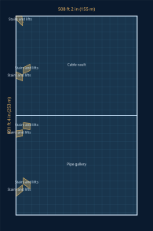
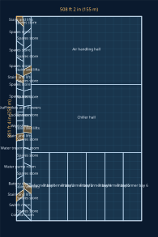
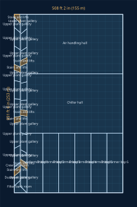

# P4-16 Port Homes Utility Plant: plan

Footprint 508 ft 2 in (155 m) × 831 ft 4 in (253 m) · structural grid 32 ft 10 in (10 m)

## Levels

| Level | Floor above deck | Height | Floor area |
|---|---|---|---|
| Level B1 · Pipe and cable basement | −16 ft 5 in (5,000 mm) | 16 ft 5 in (5,000 mm) | 422,501 sq ft (39,252 m²) |
| Level 1 · Plant floor | 0 ft (0 mm) | 26 ft 3 in (8,000 mm) | 414,851 sq ft (38,541 m²) |
| Level 2 · Upper plant deck | 26 ft 3 in (8,000 mm) | 19 ft 8 in (6,000 mm) | 414,851 sq ft (38,541 m²) |

## Elements

| ID | Designation | Type | Name | Level(s) | Size / length | Area | Status |
|---|---|---|---|---|---|---|---|
| E001 | D5F6P4B13A1L1R1, D5F6P4B13A1L2R1 | room | Transformer bay 1 | L1, L2 | 74 ft 10 in (23 m) × 277 ft 3 in (84 m) | 20,738 sq ft (1,927 m²) | proposed |
| E002 | D5F6P4B13A1L1R2, D5F6P4B13A1L2R2 | room | Transformer bay 2 | L1, L2 | 74 ft 10 in (23 m) × 277 ft 3 in (84 m) | 20,738 sq ft (1,927 m²) | proposed |
| E003 | D5F6P4B13A1L1R3, D5F6P4B13A1L2R3 | room | Transformer bay 3 | L1, L2 | 74 ft 10 in (23 m) × 277 ft 3 in (84 m) | 20,738 sq ft (1,927 m²) | proposed |
| E004 | D5F6P4B13A1L1R4, D5F6P4B13A1L2R4 | room | Transformer bay 4 | L1, L2 | 75 ft 2 in (23 m) × 277 ft 3 in (84 m) | 20,829 sq ft (1,935 m²) | proposed |
| E005 | D5F6P4B13A1L1R5, D5F6P4B13A1L2R5 | room | Transformer bay 5 | L1, L2 | 74 ft 10 in (23 m) × 277 ft 3 in (84 m) | 20,738 sq ft (1,927 m²) | proposed |
| E006 | D5F6P4B13A1L1R6, D5F6P4B13A1L2R6 | room | Transformer bay 6 | L1, L2 | 74 ft 10 in (23 m) × 277 ft 3 in (84 m) | 20,738 sq ft (1,927 m²) | proposed |
| E007 | D5F6P4B13A1L1R7, D5F6P4B13A1L2R7 | room | Chiller hall | L1, L2 | 449 ft 2 in (137 m) × 276 ft 11 in (84 m) | 124,370 sq ft (11,554 m²) | proposed |
| E008 | D5F6P4B13A1L1R8, D5F6P4B13A1L2R8 | room | Air handling hall | L1, L2 | 449 ft 2 in (137 m) × 277 ft 3 in (84 m) | 124,517 sq ft (11,568 m²) | proposed |
| E009 | D5F6P4B13A1LB1R1, D5F6P4B13A1L1R9, D5F6P4B13A1L2R9 | core | Stairs and lifts | LB1, L1, L2 | 27 ft 11 in (8,500 mm) × 47 ft 11 in (15 m) | 727 sq ft (68 m²) | proposed |
| E010 | D5F6P4B13A1LB1R2, D5F6P4B13A1L1R10, D5F6P4B13A1L2R10 | core | Stairs and lifts | LB1, L1, L2 | 27 ft 11 in (8,500 mm) × 31 ft 6 in (9,600 mm) | 732 sq ft (68 m²) | proposed |
| E011 | D5F6P4B13A1LB1R3, D5F6P4B13A1L1R11, D5F6P4B13A1L2R11 | core | Stairs and lifts | LB1, L1, L2 | 27 ft 11 in (8,500 mm) × 37 ft 5 in (11 m) | 727 sq ft (68 m²) | proposed |
| E012 | D5F6P4B13A1LB1R4, D5F6P4B13A1L1R12, D5F6P4B13A1L2R12 | core | Stairs and lifts | LB1, L1, L2 | 29 ft 2 in (8,900 mm) × 40 ft 8 in (12 m) | 732 sq ft (68 m²) | proposed |
| E013 | D5F6P4B13A1LB1R5, D5F6P4B13A1L1R13, D5F6P4B13A1L2R13 | core | Stairs and lifts | LB1, L1, L2 | 27 ft 11 in (8,500 mm) × 39 ft 8 in (12 m) | 727 sq ft (68 m²) | proposed |
| E014 | D5F6P4B13A1LB1R6, D5F6P4B13A1L1R14, D5F6P4B13A1L2R14 | core | Stairs and lifts | LB1, L1, L2 | 27 ft 11 in (8,500 mm) × 29 ft 2 in (8,900 mm) | 727 sq ft (68 m²) | proposed |
| E015 | D5F6P4B13A1LB1R7, D5F6P4B13A1L1R15, D5F6P4B13A1L2R15 | core | Stairs and lifts | LB1, L1, L2 | 27 ft 11 in (8,500 mm) × 45 ft 11 in (14 m) | 732 sq ft (68 m²) | proposed |
| E016 | D5F6P4B13A1L1R16 | room | Control room | L1 | 59 ft 1 in (18 m) × 42 ft 8 in (13 m) | 1,295 sq ft (120 m²) | proposed |
| E017 | D5F6P4B13A1L1R17 | room | Switch room | L1 | 27 ft 11 in (8,500 mm) × 84 ft 8 in (26 m) | 1,670 sq ft (155 m²) | proposed |
| E018 | D5F6P4B13A1L1R18 | room | Battery room | L1 | 27 ft 11 in (8,500 mm) × 80 ft 5 in (24 m) | 1,715 sq ft (159 m²) | proposed |
| E019 | D5F6P4B13A1L1R19 | room | Water pump room | L1 | 27 ft 11 in (8,500 mm) × 90 ft 11 in (28 m) | 2,146 sq ft (199 m²) | proposed |
| E020 | D5F6P4B13A1L1R20 | room | Water treatment room | L1 | 27 ft 11 in (8,500 mm) × 82 ft 4 in (25 m) | 2,059 sq ft (191 m²) | proposed |
| E021 | D5F6P4B13A1L1R21 | room | Workshop | L1 | 27 ft 11 in (8,500 mm) × 56 ft 5 in (17 m) | 1,500 sq ft (139 m²) | proposed |
| E022 | D5F6P4B13A1L1R22 | room | Locker room | L1 | 27 ft 11 in (8,500 mm) × 35 ft 9 in (11 m) | 965 sq ft (90 m²) | proposed |
| E023 | D5F6P4B13A1L1R23 | room | Staff toilets and showers | L1 | 27 ft 11 in (8,500 mm) × 29 ft 6 in (9,000 mm) | 750 sq ft (70 m²) | proposed |
| E024 | D5F6P4B13A1L1R24 | room | Spares store | L1 | 27 ft 11 in (8,500 mm) × 70 ft 10 in (22 m) | 1,812 sq ft (168 m²) | proposed |
| E025 | D5F6P4B13A1L1R25 | room | Spares store | L1 | 27 ft 11 in (8,500 mm) × 41 ft 4 in (13 m) | 892 sq ft (83 m²) | proposed |
| E026 | D5F6P4B13A1L1R26 | room | Spares store | L1 | 27 ft 11 in (8,500 mm) × 79 ft 5 in (24 m) | 1,812 sq ft (168 m²) | proposed |
| E027 | D5F6P4B13A1L1R27 | room | Spares store | L1 | 27 ft 11 in (8,500 mm) × 84 ft (26 m) | 1,812 sq ft (168 m²) | proposed |
| E028 | D5F6P4B13A1L1R28 | room | Spares store | L1 | 27 ft 11 in (8,500 mm) × 106 ft 8 in (32 m) | 2,296 sq ft (213 m²) | proposed |
| E029 | D5F6P4B13A1L1R29 | room | Spares store | L1 | 34 ft 1 in (10 m) × 73 ft 6 in (22 m) | 1,816 sq ft (169 m²) | proposed |
| E030 | D5F6P4B13A1L1R30 | room | Spares store | L1 | 27 ft 11 in (8,500 mm) × 87 ft 7 in (27 m) | 1,812 sq ft (168 m²) | proposed |
| E031 | D5F6P4B13A1L1R31 | room | Spares store | L1 | 27 ft 11 in (8,500 mm) × 99 ft 9 in (30 m) | 2,296 sq ft (213 m²) | proposed |
| E032 | D5F6P4B13A1L1R32 | room | Spares store | L1 | 27 ft 11 in (8,500 mm) × 75 ft 6 in (23 m) | 1,812 sq ft (168 m²) | proposed |
| E033 | D5F6P4B13A1L1R33 | room | Spares store | L1 | 27 ft 11 in (8,500 mm) × 70 ft 10 in (22 m) | 1,812 sq ft (168 m²) | proposed |
| E034 | D5F6P4B13A1L1R34 | room | Spares store | L1 | 27 ft 11 in (8,500 mm) × 85 ft 4 in (26 m) | 2,296 sq ft (213 m²) | proposed |
| E035 | D5F6P4B13A1L1R35 | room | Spares store | L1 | 27 ft 11 in (8,500 mm) × 71 ft 2 in (22 m) | 1,812 sq ft (168 m²) | proposed |
| E036 | D5F6P4B13A1L1R36 | room | Spares store | L1 | 27 ft 11 in (8,500 mm) × 75 ft 9 in (23 m) | 1,812 sq ft (168 m²) | proposed |
| E037 | D5F6P4B13A1L1R37 | room | Spares store | L1 | 27 ft 11 in (8,500 mm) × 98 ft 5 in (30 m) | 2,296 sq ft (213 m²) | proposed |
| E038 | D5F6P4B13A1L1R38 | room | Spares store | L1 | 27 ft 11 in (8,500 mm) × 87 ft 7 in (27 m) | 1,812 sq ft (168 m²) | proposed |
| E039 | D5F6P4B13A1L1R39 | room | Spares store | L1 | 27 ft 11 in (8,500 mm) × 67 ft 7 in (21 m) | 1,148 sq ft (107 m²) | proposed |
| E040 | D5F6P4B13A1L2R16 | room | Filter bank room | L2 | 59 ft 1 in (18 m) × 57 ft 5 in (18 m) | 1,720 sq ft (160 m²) | proposed |
| E041 | D5F6P4B13A1L2R17 | room | Ductwork gallery | L2 | 27 ft 11 in (8,500 mm) × 68 ft 11 in (21 m) | 1,244 sq ft (116 m²) | proposed |
| E042 | D5F6P4B13A1L2R18 | room | Crew rest room | L2 | 27 ft 11 in (8,500 mm) × 36 ft 1 in (11 m) | 435 sq ft (40 m²) | proposed |
| E043 | D5F6P4B13A1L2R19 | room | Upper plant gallery | L2 | 27 ft 11 in (8,500 mm) × 100 ft 1 in (30 m) | 2,315 sq ft (215 m²) | proposed |
| E044 | D5F6P4B13A1L2R20 | room | Upper plant gallery | L2 | 27 ft 11 in (8,500 mm) × 123 ft 8 in (38 m) | 3,170 sq ft (295 m²) | proposed |
| E045 | D5F6P4B13A1L2R21 | room | Upper plant gallery | L2 | 27 ft 11 in (8,500 mm) × 86 ft 3 in (26 m) | 2,319 sq ft (215 m²) | proposed |
| E046 | D5F6P4B13A1L2R22 | room | Upper plant gallery | L2 | 27 ft 11 in (8,500 mm) × 87 ft 7 in (27 m) | 2,319 sq ft (215 m²) | proposed |
| E047 | D5F6P4B13A1L2R23 | room | Upper plant gallery | L2 | 27 ft 11 in (8,500 mm) × 54 ft 9 in (17 m) | 1,281 sq ft (119 m²) | proposed |
| E048 | D5F6P4B13A1L2R24 | room | Upper plant gallery | L2 | 27 ft 11 in (8,500 mm) × 98 ft 5 in (30 m) | 2,324 sq ft (216 m²) | proposed |
| E049 | D5F6P4B13A1L2R25 | room | Upper plant gallery | L2 | 27 ft 11 in (8,500 mm) × 104 ft (32 m) | 2,315 sq ft (215 m²) | proposed |
| E050 | D5F6P4B13A1L2R26 | room | Upper plant gallery | L2 | 27 ft 11 in (8,500 mm) × 71 ft 6 in (22 m) | 1,281 sq ft (119 m²) | proposed |
| E051 | D5F6P4B13A1L2R27 | room | Upper plant gallery | L2 | 34 ft 1 in (10 m) × 91 ft 2 in (28 m) | 2,329 sq ft (216 m²) | proposed |
| E052 | D5F6P4B13A1L2R28 | room | Upper plant gallery | L2 | 27 ft 11 in (8,500 mm) × 103 ft 8 in (32 m) | 2,315 sq ft (215 m²) | proposed |
| E053 | D5F6P4B13A1L2R29 | room | Upper plant gallery | L2 | 27 ft 11 in (8,500 mm) × 62 ft (19 m) | 1,281 sq ft (119 m²) | proposed |
| E054 | D5F6P4B13A1L2R30 | room | Upper plant gallery | L2 | 27 ft 11 in (8,500 mm) × 93 ft 2 in (28 m) | 2,324 sq ft (216 m²) | proposed |
| E055 | D5F6P4B13A1L2R31 | room | Upper plant gallery | L2 | 27 ft 11 in (8,500 mm) × 87 ft 3 in (27 m) | 2,319 sq ft (215 m²) | proposed |
| E056 | D5F6P4B13A1L2R32 | room | Upper plant gallery | L2 | 27 ft 11 in (8,500 mm) × 47 ft 7 in (14 m) | 1,276 sq ft (119 m²) | proposed |
| E057 | D5F6P4B13A1L2R33 | room | Upper plant gallery | L2 | 27 ft 11 in (8,500 mm) × 90 ft 3 in (28 m) | 2,324 sq ft (216 m²) | proposed |
| E058 | D5F6P4B13A1L2R34 | room | Upper plant gallery | L2 | 27 ft 11 in (8,500 mm) × 95 ft 10 in (29 m) | 2,319 sq ft (215 m²) | proposed |
| E059 | D5F6P4B13A1L2R35 | room | Upper plant gallery | L2 | 27 ft 11 in (8,500 mm) × 63 ft (19 m) | 1,276 sq ft (119 m²) | proposed |
| E060 | D5F6P4B13A1L2R36 | room | Upper plant gallery | L2 | 27 ft 11 in (8,500 mm) × 130 ft 3 in (40 m) | 2,960 sq ft (275 m²) | proposed |
| E061 | D5F6P4B13A1LB1R8 | room | Cable vault | LB1 | 508 ft 2 in (155 m) × 415 ft 8 in (127 m) | 211,251 sq ft (19,626 m²) | proposed |
| E062 | D5F6P4B13A1LB1R9 | room | Pipe gallery | LB1 | 508 ft 2 in (155 m) × 415 ft 8 in (127 m) | 211,251 sq ft (19,626 m²) | proposed |

## Drawings

### Level B1 · Pipe and cable basement

### Level 1 · Plant floor

### Level 2 · Upper plant deck

