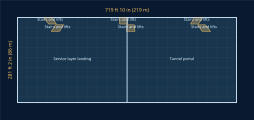
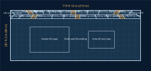
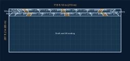

# P4-17 Port Homes Service Shaft: plan

Footprint 719 ft 10 in (219 m) × 281 ft 2 in (86 m) · structural grid 32 ft 10 in (10 m)

## Levels

| Level | Floor above deck | Height | Floor area |
|---|---|---|---|
| Level B1 · Service layer landing | −19 ft 8 in (6,000 mm) | 19 ft 8 in (6,000 mm) | 202,389 sq ft (18,803 m²) |
| Level 1 · Lift landing | 0 ft (0 mm) | 29 ft 6 in (9,000 mm) | 197,204 sq ft (18,321 m²) |
| Level 2 · Winding room | 29 ft 6 in (9,000 mm) | 19 ft 8 in (6,000 mm) | 197,204 sq ft (18,321 m²) |

## Elements

| ID | Designation | Type | Name | Level(s) | Size / length | Area | Status |
|---|---|---|---|---|---|---|---|
| E001 | D5F6P4B14A1L1R1, D5F6P4B14A1L2R1 | room | Shaft and lift landing | L1, L2 | 719 ft 10 in (219 m) × 235 ft 3 in (72 m) | 169,327 sq ft (15,731 m²) | proposed |
| E002 |  | fixture | Goods lift cage | L1 | 215 ft 11 in (66 m) × 141 ft 5 in (43 m) | 30,526 sq ft (2,836 m²) | proposed |
| E003 |  | fixture | Crew lift and stair | L1 | 144 ft (44 m) × 94 ft 2 in (29 m) | 13,562 sq ft (1,260 m²) | proposed |
| E004 | D5F6P4B14A1LB1R1, D5F6P4B14A1L1R2, D5F6P4B14A1L2R2 | core | Stairs and lifts | LB1, L1, L2 | 42 ft (13 m) × 21 ft 8 in (6,600 mm) | 568 sq ft (53 m²) | proposed |
| E005 | D5F6P4B14A1LB1R2, D5F6P4B14A1L1R3, D5F6P4B14A1L2R3 | core | Stairs and lifts | LB1, L1, L2 | 26 ft 11 in (8,200 mm) × 21 ft 8 in (6,600 mm) | 565 sq ft (52 m²) | proposed |
| E006 | D5F6P4B14A1LB1R3, D5F6P4B14A1L1R4, D5F6P4B14A1L2R4 | core | Stairs and lifts | LB1, L1, L2 | 40 ft 8 in (12 m) × 21 ft 8 in (6,600 mm) | 572 sq ft (53 m²) | proposed |
| E007 | D5F6P4B14A1LB1R4, D5F6P4B14A1L1R5, D5F6P4B14A1L2R5 | core | Stairs and lifts | LB1, L1, L2 | 42 ft (13 m) × 21 ft 8 in (6,600 mm) | 568 sq ft (53 m²) | proposed |
| E008 | D5F6P4B14A1LB1R5, D5F6P4B14A1L1R6, D5F6P4B14A1L2R6 | core | Stairs and lifts | LB1, L1, L2 | 26 ft 11 in (8,200 mm) × 21 ft 8 in (6,600 mm) | 565 sq ft (52 m²) | proposed |
| E009 | D5F6P4B14A1LB1R6, D5F6P4B14A1L1R7, D5F6P4B14A1L2R7 | core | Stairs and lifts | LB1, L1, L2 | 40 ft 8 in (12 m) × 21 ft 8 in (6,600 mm) | 572 sq ft (53 m²) | proposed |
| E010 | D5F6P4B14A1L1R8 | room | Lift control room | L1 | 22 ft 4 in (6,800 mm) × 45 ft 11 in (14 m) | 540 sq ft (50 m²) | proposed |
| E011 | D5F6P4B14A1L1R9 | room | Loading bay | L1 | 101 ft 8 in (31 m) × 21 ft 8 in (6,600 mm) | 1,787 sq ft (166 m²) | proposed |
| E012 | D5F6P4B14A1L1R10 | room | Crew check-in | L1 | 34 ft 1 in (10 m) × 21 ft 8 in (6,600 mm) | 430 sq ft (40 m²) | proposed |
| E013 | D5F6P4B14A1L1R11 | room | Tool store | L1 | 51 ft 10 in (16 m) × 21 ft 8 in (6,600 mm) | 853 sq ft (79 m²) | proposed |
| E014 | D5F6P4B14A1L1R12 | room | Staff toilets and showers | L1 | 44 ft 7 in (14 m) × 21 ft 8 in (6,600 mm) | 749 sq ft (70 m²) | proposed |
| E015 | D5F6P4B14A1L1R13 | room | Holding store | L1 | 70 ft 10 in (22 m) × 21 ft 8 in (6,600 mm) | 1,382 sq ft (128 m²) | proposed |
| E016 | D5F6P4B14A1L1R14 | room | Holding store | L1 | 60 ft 4 in (18 m) × 21 ft 8 in (6,600 mm) | 1,233 sq ft (115 m²) | proposed |
| E017 | D5F6P4B14A1L1R15 | room | Holding store | L1 | 65 ft 11 in (20 m) × 21 ft 8 in (6,600 mm) | 1,382 sq ft (128 m²) | proposed |
| E018 | D5F6P4B14A1L1R16 | room | Holding store | L1 | 69 ft 11 in (21 m) × 21 ft 8 in (6,600 mm) | 1,382 sq ft (128 m²) | proposed |
| E019 | D5F6P4B14A1L1R17 | room | Holding store | L1 | 97 ft 5 in (30 m) × 21 ft 8 in (6,600 mm) | 1,879 sq ft (175 m²) | proposed |
| E020 | D5F6P4B14A1L1R18 | room | Holding store | L1 | 80 ft 9 in (25 m) × 21 ft 8 in (6,600 mm) | 1,378 sq ft (128 m²) | proposed |
| E021 | D5F6P4B14A1L1R19 | room | Holding store | L1 | 64 ft (20 m) × 38 ft 9 in (12 m) | 1,385 sq ft (129 m²) | proposed |
| E022 | D5F6P4B14A1L1R20 | room | Holding store | L1 | 102 ft 4 in (31 m) × 22 ft 4 in (6,800 mm) | 1,886 sq ft (175 m²) | proposed |
| E023 | D5F6P4B14A1L1R21 | room | Holding store | L1 | 76 ft 9 in (23 m) × 21 ft 8 in (6,600 mm) | 1,382 sq ft (128 m²) | proposed |
| E024 | D5F6P4B14A1L1R22 | room | Holding store | L1 | 72 ft 10 in (22 m) × 21 ft 8 in (6,600 mm) | 1,382 sq ft (128 m²) | proposed |
| E025 | D5F6P4B14A1L1R23 | room | Holding store | L1 | 91 ft 2 in (28 m) × 21 ft 8 in (6,600 mm) | 1,883 sq ft (175 m²) | proposed |
| E026 | D5F6P4B14A1L1R24 | room | Holding store | L1 | 65 ft 11 in (20 m) × 21 ft 8 in (6,600 mm) | 1,382 sq ft (128 m²) | proposed |
| E027 | D5F6P4B14A1L1R25 | room | Holding store | L1 | 69 ft 11 in (21 m) × 21 ft 8 in (6,600 mm) | 1,382 sq ft (128 m²) | proposed |
| E028 | D5F6P4B14A1L1R26 | room | Holding store | L1 | 97 ft 5 in (30 m) × 21 ft 8 in (6,600 mm) | 1,879 sq ft (175 m²) | proposed |
| E029 | D5F6P4B14A1L1R27 | room | Holding store | L1 | 80 ft 9 in (25 m) × 21 ft 8 in (6,600 mm) | 1,378 sq ft (128 m²) | proposed |
| E030 | D5F6P4B14A1L1R28 | room | Holding store | L1 | 64 ft (20 m) × 21 ft 8 in (6,600 mm) | 945 sq ft (88 m²) | proposed |
| E031 | D5F6P4B14A1L2R8 | room | Winding machinery | L2 | 70 ft 3 in (21 m) × 45 ft 11 in (14 m) | 1,609 sq ft (149 m²) | proposed |
| E032 | D5F6P4B14A1L2R9 | room | Shaft ventilation fans | L2 | 50 ft 10 in (16 m) × 21 ft 8 in (6,600 mm) | 718 sq ft (67 m²) | proposed |
| E033 | D5F6P4B14A1L2R10 | room | Machine gallery | L2 | 84 ft 8 in (26 m) × 21 ft 8 in (6,600 mm) | 1,559 sq ft (145 m²) | proposed |
| E034 | D5F6P4B14A1L2R11 | room | Machine gallery | L2 | 80 ft 5 in (24 m) × 21 ft 8 in (6,600 mm) | 1,563 sq ft (145 m²) | proposed |
| E035 | D5F6P4B14A1L2R12 | room | Machine gallery | L2 | 74 ft 2 in (23 m) × 21 ft 8 in (6,600 mm) | 1,524 sq ft (142 m²) | proposed |
| E036 | D5F6P4B14A1L2R13 | room | Machine gallery | L2 | 74 ft 6 in (23 m) × 21 ft 8 in (6,600 mm) | 1,563 sq ft (145 m²) | proposed |
| E037 | D5F6P4B14A1L2R14 | room | Machine gallery | L2 | 79 ft 1 in (24 m) × 21 ft 8 in (6,600 mm) | 1,563 sq ft (145 m²) | proposed |
| E038 | D5F6P4B14A1L2R15 | room | Machine gallery | L2 | 81 ft 4 in (25 m) × 21 ft 8 in (6,600 mm) | 1,517 sq ft (141 m²) | proposed |
| E039 | D5F6P4B14A1L2R16 | room | Machine gallery | L2 | 89 ft 7 in (27 m) × 21 ft 8 in (6,600 mm) | 1,563 sq ft (145 m²) | proposed |
| E040 | D5F6P4B14A1L2R17 | room | Machine gallery | L2 | 55 ft 9 in (17 m) × 45 ft 11 in (14 m) | 1,563 sq ft (145 m²) | proposed |
| E041 | D5F6P4B14A1L2R18 | room | Machine gallery | L2 | 89 ft 3 in (27 m) × 21 ft 8 in (6,600 mm) | 1,524 sq ft (142 m²) | proposed |
| E042 | D5F6P4B14A1L2R19 | room | Machine gallery | L2 | 84 ft 8 in (26 m) × 21 ft 8 in (6,600 mm) | 1,559 sq ft (145 m²) | proposed |
| E043 | D5F6P4B14A1L2R20 | room | Machine gallery | L2 | 80 ft 5 in (24 m) × 21 ft 8 in (6,600 mm) | 1,563 sq ft (145 m²) | proposed |
| E044 | D5F6P4B14A1L2R21 | room | Machine gallery | L2 | 74 ft 2 in (23 m) × 21 ft 8 in (6,600 mm) | 1,524 sq ft (142 m²) | proposed |
| E045 | D5F6P4B14A1L2R22 | room | Machine gallery | L2 | 74 ft 6 in (23 m) × 21 ft 8 in (6,600 mm) | 1,563 sq ft (145 m²) | proposed |
| E046 | D5F6P4B14A1L2R23 | room | Machine gallery | L2 | 79 ft 1 in (24 m) × 21 ft 8 in (6,600 mm) | 1,563 sq ft (145 m²) | proposed |
| E047 | D5F6P4B14A1L2R24 | room | Machine gallery | L2 | 81 ft 4 in (25 m) × 21 ft 8 in (6,600 mm) | 1,517 sq ft (141 m²) | proposed |
| E048 | D5F6P4B14A1L2R25 | room | Machine gallery | L2 | 89 ft 7 in (27 m) × 21 ft 8 in (6,600 mm) | 1,563 sq ft (145 m²) | proposed |
| E049 | D5F6P4B14A1L2R26 | room | Machine gallery | L2 | 55 ft 9 in (17 m) × 21 ft 8 in (6,600 mm) | 760 sq ft (71 m²) | proposed |
| E050 | D5F6P4B14A1LB1R7 | room | Service layer landing | LB1 | 359 ft 11 in (110 m) × 281 ft 2 in (86 m) | 101,195 sq ft (9,401 m²) | proposed |
| E051 | D5F6P4B14A1LB1R8 | room | Tunnel portal | LB1 | 359 ft 11 in (110 m) × 281 ft 2 in (86 m) | 101,195 sq ft (9,401 m²) | proposed |

## Drawings

### Level B1 · Service layer landing

### Level 1 · Lift landing

### Level 2 · Winding room

