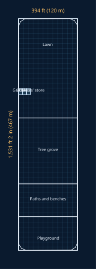

# P4-24 Neighbourhood Park 2: plan

Footprint 394 ft (120 m) × 1,531 ft 2 in (467 m) · structural grid 32 ft 10 in (10 m)

## Levels

| Level | Floor above deck | Height | Floor area |
|---|---|---|---|
| Level 1 · Ground | 0 ft (0 mm) | 13 ft 1 in (4,000 mm) | 3,100 sq ft (288 m²) |

## Elements

| ID | Designation | Type | Name | Level(s) | Size / length | Area | Status |
|---|---|---|---|---|---|---|---|
| E001 | D5F6P4B12A2R1 | zone | Lawn | L1 | 391 ft 9 in (119 m) × 656 ft 2 in (200 m) | 254,878 sq ft (23,679 m²) | proposed |
| E002 | D5F6P4B12A2R2 | room | Kiosk | L1 | 26 ft 3 in (8,000 mm) × 39 ft 4 in (12 m) | 1,033 sq ft (96 m²) | proposed |
| E003 | D5F6P4B12A2R3 | room | Toilets | L1 | 26 ft 3 in (8,000 mm) × 39 ft 4 in (12 m) | 1,033 sq ft (96 m²) | proposed |
| E004 | D5F6P4B12A2R4 | room | Gardeners' store | L1 | 26 ft 3 in (8,000 mm) × 39 ft 4 in (12 m) | 1,033 sq ft (96 m²) | proposed |
| E005 | D5F6P4B12A2R5 | zone | Tree grove | L1 | 391 ft 9 in (119 m) × 434 ft 9 in (132 m) | 170,005 sq ft (15,794 m²) | proposed |
| E006 | D5F6P4B12A2R6 | zone | Paths and benches | L1 | 391 ft 1 in (119 m) × 217 ft 2 in (66 m) | 84,938 sq ft (7,891 m²) | proposed |
| E007 | D5F6P4B12A2R7 | zone | Playground | L1 | 391 ft 5 in (119 m) × 221 ft 9 in (68 m) | 85,001 sq ft (7,897 m²) | proposed |

## Drawings

### Level 1 · Ground

