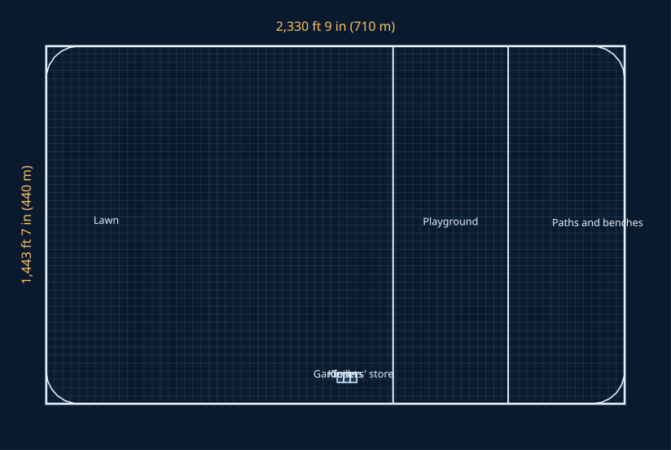

# P4-32 Neighbourhood Park 4: plan

Footprint 2,330 ft 9 in (710 m) × 1,443 ft 7 in (440 m) · structural grid 32 ft 10 in (10 m)

## Levels

| Level | Floor above deck | Height | Floor area |
|---|---|---|---|
| Level 1 · Ground | 0 ft (0 mm) | 13 ft 1 in (4,000 mm) | 3,100 sq ft (288 m²) |

## Elements

| ID | Designation | Type | Name | Level(s) | Size / length | Area | Status |
|---|---|---|---|---|---|---|---|
| E001 | D5F6P4B6A2R1 | zone | Lawn | L1 | 1,397 ft 4 in (426 m) × 1,442 ft 11 in (440 m) | 2,006,940 sq ft (186,451 m²) | proposed |
| E002 | D5F6P4B6A2R2 | room | Kiosk | L1 | 26 ft 3 in (8,000 mm) × 39 ft 4 in (12 m) | 1,033 sq ft (96 m²) | proposed |
| E003 | D5F6P4B6A2R3 | room | Toilets | L1 | 26 ft 3 in (8,000 mm) × 39 ft 4 in (12 m) | 1,033 sq ft (96 m²) | proposed |
| E004 | D5F6P4B6A2R4 | room | Gardeners' store | L1 | 26 ft 3 in (8,000 mm) × 39 ft 4 in (12 m) | 1,033 sq ft (96 m²) | proposed |
| E005 | D5F6P4B6A2R5 | zone | Playground | L1 | 463 ft 11 in (141 m) × 1,442 ft 7 in (440 m) | 669,079 sq ft (62,159 m²) | proposed |
| E006 | D5F6P4B6A2R6 | zone | Paths and benches | L1 | 469 ft 6 in (143 m) × 1,442 ft 7 in (440 m) | 668,790 sq ft (62,133 m²) | proposed |

## Drawings

### Level 1 · Ground

