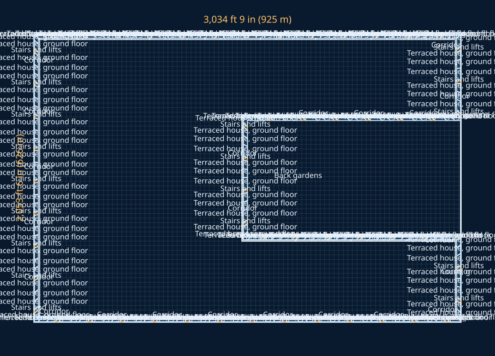
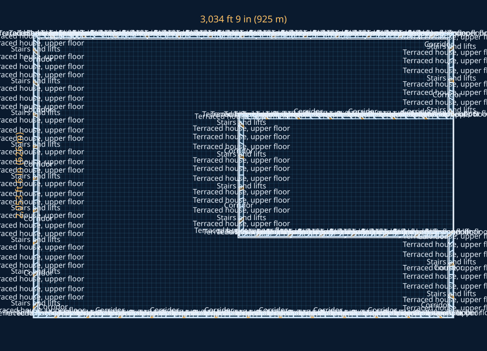

# P4-33 Terrace Row 4: plan

Footprint 3,034 ft 9 in (925 m) × 2,053 ft 6 in (626 m) · structural grid 32 ft 10 in (10 m)

## Levels

| Level | Floor above deck | Height | Floor area |
|---|---|---|---|
| Level 1 · Ground floor | 0 ft (0 mm) | 11 ft 2 in (3,400 mm) | 342,415 sq ft (31,811 m²) |
| Level 2 · Upper floor | 11 ft 2 in (3,400 mm) | 9 ft 10 in (3,000 mm) | 342,415 sq ft (31,811 m²) |

## Elements

| ID | Designation | Type | Name | Level(s) | Size / length | Area | Status |
|---|---|---|---|---|---|---|---|
| E001 | D5F6P4B7A4L1R1 | zone | Back gardens | L1 | 2,956 ft (901 m) × 1,974 ft 9 in (602 m) | 4,471,847 sq ft (415,448 m²) | proposed |
| E002 | D5F6P4B7A4L1R2, D5F6P4B7A4L2R1 | core | Stairs and lifts | L1, L2 | 53 ft 6 in (16 m) × 29 ft 6 in (9,000 mm) | 775 sq ft (72 m²) | proposed |
| E003 | D5F6P4B7A4L1R3, D5F6P4B7A4L2R2 | core | Stairs and lifts | L1, L2 | 48 ft 11 in (15 m) × 29 ft 6 in (9,000 mm) | 775 sq ft (72 m²) | proposed |
| E004 | D5F6P4B7A4L1R4, D5F6P4B7A4L2R3 | core | Stairs and lifts | L1, L2 | 44 ft 7 in (14 m) × 29 ft 6 in (9,000 mm) | 775 sq ft (72 m²) | proposed |
| E005 | D5F6P4B7A4L1R5, D5F6P4B7A4L2R4 | core | Stairs and lifts | L1, L2 | 40 ft (12 m) × 29 ft 6 in (9,000 mm) | 775 sq ft (72 m²) | proposed |
| E006 | D5F6P4B7A4L1R6, D5F6P4B7A4L2R5 | core | Stairs and lifts | L1, L2 | 35 ft 5 in (11 m) × 29 ft 6 in (9,000 mm) | 775 sq ft (72 m²) | proposed |
| E007 | D5F6P4B7A4L1R7, D5F6P4B7A4L2R6 | core | Stairs and lifts | L1, L2 | 31 ft 2 in (9,500 mm) × 29 ft 6 in (9,000 mm) | 780 sq ft (72 m²) | proposed |
| E008 | D5F6P4B7A4L1R8, D5F6P4B7A4L2R7 | core | Stairs and lifts | L1, L2 | 26 ft 7 in (8,100 mm) × 29 ft 6 in (9,000 mm) | 775 sq ft (72 m²) | proposed |
| E009 | D5F6P4B7A4L1R9, D5F6P4B7A4L2R8 | core | Stairs and lifts | L1, L2 | 30 ft 6 in (9,300 mm) × 29 ft 6 in (9,000 mm) | 775 sq ft (72 m²) | proposed |
| E010 | D5F6P4B7A4L1R10, D5F6P4B7A4L2R9 | core | Stairs and lifts | L1, L2 | 35 ft 1 in (11 m) × 29 ft 6 in (9,000 mm) | 775 sq ft (72 m²) | proposed |
| E011 | D5F6P4B7A4L1R11, D5F6P4B7A4L2R10 | core | Stairs and lifts | L1, L2 | 39 ft 8 in (12 m) × 29 ft 6 in (9,000 mm) | 780 sq ft (72 m²) | proposed |
| E012 | D5F6P4B7A4L1R12, D5F6P4B7A4L2R11 | core | Stairs and lifts | L1, L2 | 44 ft (13 m) × 29 ft 6 in (9,000 mm) | 775 sq ft (72 m²) | proposed |
| E013 | D5F6P4B7A4L1R13, D5F6P4B7A4L2R12 | core | Stairs and lifts | L1, L2 | 48 ft 7 in (15 m) × 29 ft 6 in (9,000 mm) | 775 sq ft (72 m²) | proposed |
| E014 | D5F6P4B7A4L1R14, D5F6P4B7A4L2R13 | core | Stairs and lifts | L1, L2 | 53 ft 2 in (16 m) × 29 ft 6 in (9,000 mm) | 775 sq ft (72 m²) | proposed |
| E015 | D5F6P4B7A4L1R15, D5F6P4B7A4L2R14 | core | Stairs and lifts | L1, L2 | 29 ft 6 in (9,000 mm) × 45 ft 11 in (14 m) | 775 sq ft (72 m²) | proposed |
| E016 | D5F6P4B7A4L1R16, D5F6P4B7A4L2R15 | core | Stairs and lifts | L1, L2 | 29 ft 6 in (9,000 mm) × 29 ft 6 in (9,000 mm) | 775 sq ft (72 m²) | proposed |
| E017 | D5F6P4B7A4L1R17, D5F6P4B7A4L2R16 | core | Stairs and lifts | L1, L2 | 29 ft 6 in (9,000 mm) × 52 ft 6 in (16 m) | 775 sq ft (72 m²) | proposed |
| E018 | D5F6P4B7A4L1R18, D5F6P4B7A4L2R17 | core | Stairs and lifts | L1, L2 | 55 ft 9 in (17 m) × 29 ft 6 in (9,000 mm) | 775 sq ft (72 m²) | proposed |
| E019 | D5F6P4B7A4L1R19, D5F6P4B7A4L2R18 | core | Stairs and lifts | L1, L2 | 55 ft 9 in (17 m) × 29 ft 6 in (9,000 mm) | 775 sq ft (72 m²) | proposed |
| E020 | D5F6P4B7A4L1R20, D5F6P4B7A4L2R19 | core | Stairs and lifts | L1, L2 | 55 ft 9 in (17 m) × 29 ft 6 in (9,000 mm) | 775 sq ft (72 m²) | proposed |
| E021 | D5F6P4B7A4L1R21, D5F6P4B7A4L2R20 | core | Stairs and lifts | L1, L2 | 55 ft 9 in (17 m) × 29 ft 6 in (9,000 mm) | 775 sq ft (72 m²) | proposed |
| E022 | D5F6P4B7A4L1R22, D5F6P4B7A4L2R21 | core | Stairs and lifts | L1, L2 | 55 ft 9 in (17 m) × 29 ft 6 in (9,000 mm) | 775 sq ft (72 m²) | proposed |
| E023 | D5F6P4B7A4L1R23, D5F6P4B7A4L2R22 | core | Stairs and lifts | L1, L2 | 55 ft 9 in (17 m) × 29 ft 6 in (9,000 mm) | 775 sq ft (72 m²) | proposed |
| E024 | D5F6P4B7A4L1R24, D5F6P4B7A4L2R23 | core | Stairs and lifts | L1, L2 | 29 ft 6 in (9,000 mm) × 51 ft 10 in (16 m) | 780 sq ft (72 m²) | proposed |
| E025 | D5F6P4B7A4L1R25, D5F6P4B7A4L2R24 | core | Stairs and lifts | L1, L2 | 29 ft 6 in (9,000 mm) × 35 ft 9 in (11 m) | 775 sq ft (72 m²) | proposed |
| E026 | D5F6P4B7A4L1R26, D5F6P4B7A4L2R25 | core | Stairs and lifts | L1, L2 | 29 ft 6 in (9,000 mm) × 32 ft 10 in (10 m) | 775 sq ft (72 m²) | proposed |
| E027 | D5F6P4B7A4L1R27, D5F6P4B7A4L2R26 | core | Stairs and lifts | L1, L2 | 29 ft 6 in (9,000 mm) × 48 ft 7 in (15 m) | 775 sq ft (72 m²) | proposed |
| E028 | D5F6P4B7A4L1R28, D5F6P4B7A4L2R27 | core | Stairs and lifts | L1, L2 | 55 ft 9 in (17 m) × 29 ft 6 in (9,000 mm) | 775 sq ft (72 m²) | proposed |
| E029 | D5F6P4B7A4L1R29, D5F6P4B7A4L2R28 | core | Stairs and lifts | L1, L2 | 55 ft 9 in (17 m) × 29 ft 6 in (9,000 mm) | 775 sq ft (72 m²) | proposed |
| E030 | D5F6P4B7A4L1R30, D5F6P4B7A4L2R29 | core | Stairs and lifts | L1, L2 | 55 ft 9 in (17 m) × 29 ft 6 in (9,000 mm) | 775 sq ft (72 m²) | proposed |
| E031 | D5F6P4B7A4L1R31, D5F6P4B7A4L2R30 | core | Stairs and lifts | L1, L2 | 55 ft 9 in (17 m) × 29 ft 6 in (9,000 mm) | 775 sq ft (72 m²) | proposed |
| E032 | D5F6P4B7A4L1R32, D5F6P4B7A4L2R31 | core | Stairs and lifts | L1, L2 | 55 ft 9 in (17 m) × 29 ft 6 in (9,000 mm) | 775 sq ft (72 m²) | proposed |
| E033 | D5F6P4B7A4L1R33, D5F6P4B7A4L2R32 | core | Stairs and lifts | L1, L2 | 55 ft 9 in (17 m) × 29 ft 6 in (9,000 mm) | 775 sq ft (72 m²) | proposed |
| E034 | D5F6P4B7A4L1R34, D5F6P4B7A4L2R33 | core | Stairs and lifts | L1, L2 | 54 ft 6 in (17 m) × 30 ft 6 in (9,300 mm) | 770 sq ft (72 m²) | proposed |
| E035 | D5F6P4B7A4L1R35, D5F6P4B7A4L2R34 | core | Stairs and lifts | L1, L2 | 29 ft 6 in (9,000 mm) × 33 ft 10 in (10 m) | 775 sq ft (72 m²) | proposed |
| E036 | D5F6P4B7A4L1R36, D5F6P4B7A4L2R35 | core | Stairs and lifts | L1, L2 | 29 ft 6 in (9,000 mm) × 42 ft (13 m) | 780 sq ft (72 m²) | proposed |
| E037 | D5F6P4B7A4L1R37, D5F6P4B7A4L2R36 | core | Stairs and lifts | L1, L2 | 54 ft 2 in (16 m) × 29 ft 6 in (9,000 mm) | 775 sq ft (72 m²) | proposed |
| E038 | D5F6P4B7A4L1R38, D5F6P4B7A4L2R37 | core | Stairs and lifts | L1, L2 | 49 ft 6 in (15 m) × 29 ft 6 in (9,000 mm) | 775 sq ft (72 m²) | proposed |
| E039 | D5F6P4B7A4L1R39, D5F6P4B7A4L2R38 | core | Stairs and lifts | L1, L2 | 44 ft 11 in (14 m) × 29 ft 6 in (9,000 mm) | 775 sq ft (72 m²) | proposed |
| E040 | D5F6P4B7A4L1R40, D5F6P4B7A4L2R39 | core | Stairs and lifts | L1, L2 | 40 ft 8 in (12 m) × 29 ft 6 in (9,000 mm) | 780 sq ft (72 m²) | proposed |
| E041 | D5F6P4B7A4L1R41, D5F6P4B7A4L2R40 | core | Stairs and lifts | L1, L2 | 36 ft 1 in (11 m) × 29 ft 6 in (9,000 mm) | 775 sq ft (72 m²) | proposed |
| E042 | D5F6P4B7A4L1R42, D5F6P4B7A4L2R41 | core | Stairs and lifts | L1, L2 | 31 ft 6 in (9,600 mm) × 29 ft 6 in (9,000 mm) | 775 sq ft (72 m²) | proposed |
| E043 | D5F6P4B7A4L1R43, D5F6P4B7A4L2R42 | core | Stairs and lifts | L1, L2 | 26 ft 11 in (8,200 mm) × 29 ft 6 in (9,000 mm) | 775 sq ft (72 m²) | proposed |
| E044 | D5F6P4B7A4L1R44, D5F6P4B7A4L2R43 | core | Stairs and lifts | L1, L2 | 30 ft 2 in (9,200 mm) × 29 ft 6 in (9,000 mm) | 780 sq ft (72 m²) | proposed |
| E045 | D5F6P4B7A4L1R45, D5F6P4B7A4L2R44 | core | Stairs and lifts | L1, L2 | 34 ft 5 in (10 m) × 29 ft 6 in (9,000 mm) | 775 sq ft (72 m²) | proposed |
| E046 | D5F6P4B7A4L1R46, D5F6P4B7A4L2R45 | core | Stairs and lifts | L1, L2 | 39 ft 1 in (12 m) × 29 ft 6 in (9,000 mm) | 775 sq ft (72 m²) | proposed |
| E047 | D5F6P4B7A4L1R47, D5F6P4B7A4L2R46 | core | Stairs and lifts | L1, L2 | 43 ft 8 in (13 m) × 29 ft 6 in (9,000 mm) | 775 sq ft (72 m²) | proposed |
| E048 | D5F6P4B7A4L1R48, D5F6P4B7A4L2R47 | core | Stairs and lifts | L1, L2 | 47 ft 11 in (15 m) × 29 ft 6 in (9,000 mm) | 770 sq ft (72 m²) | proposed |
| E049 | D5F6P4B7A4L1R49, D5F6P4B7A4L2R48 | core | Stairs and lifts | L1, L2 | 52 ft 6 in (16 m) × 29 ft 6 in (9,000 mm) | 770 sq ft (72 m²) | proposed |
| E050 | D5F6P4B7A4L1R50, D5F6P4B7A4L2R49 | core | Stairs and lifts | L1, L2 | 29 ft 6 in (9,000 mm) × 53 ft 10 in (16 m) | 780 sq ft (72 m²) | proposed |
| E051 | D5F6P4B7A4L1R51, D5F6P4B7A4L2R50 | core | Stairs and lifts | L1, L2 | 29 ft 6 in (9,000 mm) × 46 ft 11 in (14 m) | 775 sq ft (72 m²) | proposed |
| E052 | D5F6P4B7A4L1R52, D5F6P4B7A4L2R51 | core | Stairs and lifts | L1, L2 | 29 ft 6 in (9,000 mm) × 40 ft 4 in (12 m) | 775 sq ft (72 m²) | proposed |
| E053 | D5F6P4B7A4L1R53, D5F6P4B7A4L2R52 | core | Stairs and lifts | L1, L2 | 29 ft 6 in (9,000 mm) × 33 ft 10 in (10 m) | 780 sq ft (72 m²) | proposed |
| E054 | D5F6P4B7A4L1R54, D5F6P4B7A4L2R53 | core | Stairs and lifts | L1, L2 | 29 ft 6 in (9,000 mm) × 26 ft 11 in (8,200 mm) | 775 sq ft (72 m²) | proposed |
| E055 | D5F6P4B7A4L1R55, D5F6P4B7A4L2R54 | core | Stairs and lifts | L1, L2 | 29 ft 6 in (9,000 mm) × 32 ft 2 in (9,800 mm) | 775 sq ft (72 m²) | proposed |
| E056 | D5F6P4B7A4L1R56, D5F6P4B7A4L2R55 | core | Stairs and lifts | L1, L2 | 29 ft 6 in (9,000 mm) × 39 ft 1 in (12 m) | 775 sq ft (72 m²) | proposed |
| E057 | D5F6P4B7A4L1R57, D5F6P4B7A4L2R56 | core | Stairs and lifts | L1, L2 | 29 ft 6 in (9,000 mm) × 45 ft 7 in (14 m) | 775 sq ft (72 m²) | proposed |
| E058 | D5F6P4B7A4L1R58, D5F6P4B7A4L2R57 | core | Stairs and lifts | L1, L2 | 29 ft 6 in (9,000 mm) × 52 ft 2 in (16 m) | 770 sq ft (72 m²) | proposed |
| E059 | D5F6P4B7A4L1R59 | zone | Corridor | L1 | 402 ft 3 in (123 m) × 9 ft 10 in (3,000 mm) | 3,875 sq ft (360 m²) | proposed |
| E060 | D5F6P4B7A4L1R60 | zone | Corridor | L1 | 399 ft 7 in (122 m) × 9 ft 10 in (3,000 mm) | 3,875 sq ft (360 m²) | proposed |
| E061 | D5F6P4B7A4L1R61 | zone | Corridor | L1 | 397 ft (121 m) × 9 ft 10 in (3,000 mm) | 3,875 sq ft (360 m²) | proposed |
| E062 | D5F6P4B7A4L1R62 | zone | Corridor | L1 | 395 ft (120 m) × 9 ft 10 in (3,000 mm) | 3,875 sq ft (360 m²) | proposed |
| E063 | D5F6P4B7A4L1R63 | zone | Corridor | L1 | 395 ft 8 in (121 m) × 9 ft 10 in (3,000 mm) | 3,875 sq ft (360 m²) | proposed |
| E064 | D5F6P4B7A4L1R64 | zone | Corridor | L1 | 398 ft 4 in (121 m) × 9 ft 10 in (3,000 mm) | 3,875 sq ft (360 m²) | proposed |
| E065 | D5F6P4B7A4L1R65 | zone | Corridor | L1 | 400 ft 11 in (122 m) × 9 ft 10 in (3,000 mm) | 3,875 sq ft (360 m²) | proposed |
| E066 | D5F6P4B7A4L1R66 | zone | Corridor | L1 | 219 ft 2 in (67 m) × 190 ft 3 in (58 m) | 3,875 sq ft (360 m²) | proposed |
| E067 | D5F6P4B7A4L1R67 | zone | Corridor | L1 | 40 ft (12 m) × 370 ft 1 in (113 m) | 3,875 sq ft (360 m²) | proposed |
| E068 | D5F6P4B7A4L1R68 | zone | Corridor | L1 | 403 ft 7 in (123 m) × 9 ft 10 in (3,000 mm) | 3,875 sq ft (360 m²) | proposed |
| E069 | D5F6P4B7A4L1R69 | zone | Corridor | L1 | 403 ft 7 in (123 m) × 9 ft 10 in (3,000 mm) | 3,875 sq ft (360 m²) | proposed |
| E070 | D5F6P4B7A4L1R70 | zone | Corridor | L1 | 403 ft 7 in (123 m) × 9 ft 10 in (3,000 mm) | 3,875 sq ft (360 m²) | proposed |
| E071 | D5F6P4B7A4L1R71 | zone | Corridor | L1 | 315 ft 11 in (96 m) × 96 ft 5 in (29 m) | 3,875 sq ft (360 m²) | proposed |
| E072 | D5F6P4B7A4L1R72 | zone | Corridor | L1 | 9 ft 10 in (3,000 mm) × 398 ft (121 m) | 3,875 sq ft (360 m²) | proposed |
| E073 | D5F6P4B7A4L1R73 | zone | Corridor | L1 | 9 ft 10 in (3,000 mm) × 398 ft 7 in (122 m) | 3,875 sq ft (360 m²) | proposed |
| E074 | D5F6P4B7A4L1R74 | zone | Corridor | L1 | 388 ft 5 in (118 m) × 24 ft 7 in (7,500 mm) | 3,875 sq ft (360 m²) | proposed |
| E075 | D5F6P4B7A4L1R75 | zone | Corridor | L1 | 403 ft 7 in (123 m) × 9 ft 10 in (3,000 mm) | 3,875 sq ft (360 m²) | proposed |
| E076 | D5F6P4B7A4L1R76 | zone | Corridor | L1 | 403 ft 7 in (123 m) × 9 ft 10 in (3,000 mm) | 3,875 sq ft (360 m²) | proposed |
| E077 | D5F6P4B7A4L1R77 | zone | Corridor | L1 | 361 ft 3 in (110 m) × 51 ft 6 in (16 m) | 3,875 sq ft (360 m²) | proposed |
| E078 | D5F6P4B7A4L1R78 | zone | Corridor | L1 | 9 ft 10 in (3,000 mm) × 400 ft 11 in (122 m) | 3,875 sq ft (360 m²) | proposed |
| E079 | D5F6P4B7A4L1R79 | zone | Corridor | L1 | 291 ft 4 in (89 m) × 119 ft 1 in (36 m) | 3,875 sq ft (360 m²) | proposed |
| E080 | D5F6P4B7A4L1R80 | zone | Corridor | L1 | 400 ft 3 in (122 m) × 9 ft 10 in (3,000 mm) | 3,875 sq ft (360 m²) | proposed |
| E081 | D5F6P4B7A4L1R81 | zone | Corridor | L1 | 397 ft 8 in (121 m) × 9 ft 10 in (3,000 mm) | 3,875 sq ft (360 m²) | proposed |
| E082 | D5F6P4B7A4L1R82 | zone | Corridor | L1 | 395 ft (120 m) × 9 ft 10 in (3,000 mm) | 3,875 sq ft (360 m²) | proposed |
| E083 | D5F6P4B7A4L1R83 | zone | Corridor | L1 | 395 ft (120 m) × 9 ft 10 in (3,000 mm) | 3,875 sq ft (360 m²) | proposed |
| E084 | D5F6P4B7A4L1R84 | zone | Corridor | L1 | 397 ft 8 in (121 m) × 9 ft 10 in (3,000 mm) | 3,875 sq ft (360 m²) | proposed |
| E085 | D5F6P4B7A4L1R85 | zone | Corridor | L1 | 400 ft 3 in (122 m) × 9 ft 10 in (3,000 mm) | 3,875 sq ft (360 m²) | proposed |
| E086 | D5F6P4B7A4L1R86 | zone | Corridor | L1 | 330 ft 1 in (101 m) × 82 ft (25 m) | 3,875 sq ft (360 m²) | proposed |
| E087 | D5F6P4B7A4L1R87 | zone | Corridor | L1 | 9 ft 10 in (3,000 mm) × 400 ft 11 in (122 m) | 3,875 sq ft (360 m²) | proposed |
| E088 | D5F6P4B7A4L1R88 | zone | Corridor | L1 | 9 ft 10 in (3,000 mm) × 397 ft (121 m) | 3,875 sq ft (360 m²) | proposed |
| E089 | D5F6P4B7A4L1R89 | zone | Corridor | L1 | 9 ft 10 in (3,000 mm) × 395 ft 8 in (121 m) | 3,875 sq ft (360 m²) | proposed |
| E090 | D5F6P4B7A4L1R90 | zone | Corridor | L1 | 9 ft 10 in (3,000 mm) × 398 ft 4 in (121 m) | 3,875 sq ft (360 m²) | proposed |
| E091 | D5F6P4B7A4L1R91 | zone | Corridor | L1 | 9 ft 10 in (3,000 mm) × 345 ft 6 in (105 m) | 3,320 sq ft (308 m²) | proposed |
| E092 | D5F6P4B7A4L1R92 | room | Terraced house, ground floor | L1 | 89 ft 3 in (27 m) × 29 ft 6 in (9,000 mm) | 1,778 sq ft (165 m²) | proposed |
| E093 | D5F6P4B7A4L1R93 | room | Terraced house, ground floor | L1 | 69 ft 7 in (21 m) × 29 ft 6 in (9,000 mm) | 1,225 sq ft (114 m²) | proposed |
| E094 | D5F6P4B7A4L1R94 | room | Terraced house, ground floor | L1 | 86 ft 7 in (26 m) × 29 ft 6 in (9,000 mm) | 1,778 sq ft (165 m²) | proposed |
| E095 | D5F6P4B7A4L1R95 | room | Terraced house, ground floor | L1 | 85 ft 4 in (26 m) × 29 ft 6 in (9,000 mm) | 1,773 sq ft (165 m²) | proposed |
| E096 | D5F6P4B7A4L1R96 | room | Terraced house, ground floor | L1 | 106 ft 11 in (33 m) × 29 ft 6 in (9,000 mm) | 2,456 sq ft (228 m²) | proposed |
| E097 | D5F6P4B7A4L1R97 | room | Terraced house, ground floor | L1 | 82 ft (25 m) × 29 ft 6 in (9,000 mm) | 1,778 sq ft (165 m²) | proposed |
| E098 | D5F6P4B7A4L1R98 | room | Terraced house, ground floor | L1 | 81 ft (25 m) × 29 ft 6 in (9,000 mm) | 1,778 sq ft (165 m²) | proposed |
| E099 | D5F6P4B7A4L1R99 | room | Terraced house, ground floor | L1 | 102 ft 8 in (31 m) × 29 ft 6 in (9,000 mm) | 2,456 sq ft (228 m²) | proposed |
| E100 | D5F6P4B7A4L1R100 | room | Terraced house, ground floor | L1 | 77 ft 5 in (24 m) × 29 ft 6 in (9,000 mm) | 1,773 sq ft (165 m²) | proposed |
| E101 | D5F6P4B7A4L1R101 | room | Terraced house, ground floor | L1 | 76 ft 5 in (23 m) × 29 ft 6 in (9,000 mm) | 1,778 sq ft (165 m²) | proposed |
| E102 | D5F6P4B7A4L1R102 | room | Terraced house, ground floor | L1 | 98 ft 1 in (30 m) × 29 ft 6 in (9,000 mm) | 2,456 sq ft (228 m²) | proposed |
| E103 | D5F6P4B7A4L1R103 | room | Terraced house, ground floor | L1 | 73 ft 2 in (22 m) × 29 ft 6 in (9,000 mm) | 1,778 sq ft (165 m²) | proposed |
| E104 | D5F6P4B7A4L1R104 | room | Terraced house, ground floor | L1 | 71 ft 10 in (22 m) × 29 ft 6 in (9,000 mm) | 1,773 sq ft (165 m²) | proposed |
| E105 | D5F6P4B7A4L1R105 | room | Terraced house, ground floor | L1 | 93 ft 6 in (28 m) × 29 ft 6 in (9,000 mm) | 2,456 sq ft (228 m²) | proposed |
| E106 | D5F6P4B7A4L1R106 | room | Terraced house, ground floor | L1 | 68 ft 7 in (21 m) × 29 ft 6 in (9,000 mm) | 1,778 sq ft (165 m²) | proposed |
| E107 | D5F6P4B7A4L1R107 | room | Terraced house, ground floor | L1 | 67 ft 3 in (20 m) × 29 ft 6 in (9,000 mm) | 1,773 sq ft (165 m²) | proposed |
| E108 | D5F6P4B7A4L1R108 | room | Terraced house, ground floor | L1 | 88 ft 11 in (27 m) × 29 ft 6 in (9,000 mm) | 2,456 sq ft (228 m²) | proposed |
| E109 | D5F6P4B7A4L1R109 | room | Terraced house, ground floor | L1 | 64 ft (20 m) × 29 ft 6 in (9,000 mm) | 1,773 sq ft (165 m²) | proposed |
| E110 | D5F6P4B7A4L1R110 | room | Terraced house, ground floor | L1 | 63 ft (19 m) × 29 ft 6 in (9,000 mm) | 1,778 sq ft (165 m²) | proposed |
| E111 | D5F6P4B7A4L1R111 | room | Terraced house, ground floor | L1 | 84 ft 8 in (26 m) × 29 ft 6 in (9,000 mm) | 2,456 sq ft (228 m²) | proposed |
| E112 | D5F6P4B7A4L1R112 | room | Terraced house, ground floor | L1 | 60 ft 8 in (18 m) × 29 ft 6 in (9,000 mm) | 1,773 sq ft (165 m²) | proposed |
| E113 | D5F6P4B7A4L1R113 | room | Terraced house, ground floor | L1 | 62 ft (19 m) × 29 ft 6 in (9,000 mm) | 1,778 sq ft (165 m²) | proposed |
| E114 | D5F6P4B7A4L1R114 | room | Terraced house, ground floor | L1 | 86 ft 3 in (26 m) × 29 ft 6 in (9,000 mm) | 2,456 sq ft (228 m²) | proposed |
| E115 | D5F6P4B7A4L1R115 | room | Terraced house, ground floor | L1 | 65 ft 3 in (20 m) × 29 ft 6 in (9,000 mm) | 1,778 sq ft (165 m²) | proposed |
| E116 | D5F6P4B7A4L1R116 | room | Terraced house, ground floor | L1 | 66 ft 3 in (20 m) × 29 ft 6 in (9,000 mm) | 1,773 sq ft (165 m²) | proposed |
| E117 | D5F6P4B7A4L1R117 | room | Terraced house, ground floor | L1 | 90 ft 11 in (28 m) × 29 ft 6 in (9,000 mm) | 2,456 sq ft (228 m²) | proposed |
| E118 | D5F6P4B7A4L1R118 | room | Terraced house, ground floor | L1 | 69 ft 11 in (21 m) × 29 ft 6 in (9,000 mm) | 1,778 sq ft (165 m²) | proposed |
| E119 | D5F6P4B7A4L1R119 | room | Terraced house, ground floor | L1 | 70 ft 10 in (22 m) × 29 ft 6 in (9,000 mm) | 1,773 sq ft (165 m²) | proposed |
| E120 | D5F6P4B7A4L1R120 | room | Terraced house, ground floor | L1 | 95 ft 6 in (29 m) × 29 ft 6 in (9,000 mm) | 2,456 sq ft (228 m²) | proposed |
| E121 | D5F6P4B7A4L1R121 | room | Terraced house, ground floor | L1 | 74 ft 2 in (23 m) × 29 ft 6 in (9,000 mm) | 1,773 sq ft (165 m²) | proposed |
| E122 | D5F6P4B7A4L1R122 | room | Terraced house, ground floor | L1 | 75 ft 6 in (23 m) × 29 ft 6 in (9,000 mm) | 1,778 sq ft (165 m²) | proposed |
| E123 | D5F6P4B7A4L1R123 | room | Terraced house, ground floor | L1 | 99 ft 9 in (30 m) × 29 ft 6 in (9,000 mm) | 2,456 sq ft (228 m²) | proposed |
| E124 | D5F6P4B7A4L1R124 | room | Terraced house, ground floor | L1 | 78 ft 9 in (24 m) × 29 ft 6 in (9,000 mm) | 1,773 sq ft (165 m²) | proposed |
| E125 | D5F6P4B7A4L1R125 | room | Terraced house, ground floor | L1 | 80 ft 1 in (24 m) × 29 ft 6 in (9,000 mm) | 1,778 sq ft (165 m²) | proposed |
| E126 | D5F6P4B7A4L1R126 | room | Terraced house, ground floor | L1 | 104 ft 4 in (32 m) × 29 ft 6 in (9,000 mm) | 2,456 sq ft (228 m²) | proposed |
| E127 | D5F6P4B7A4L1R127 | room | Terraced house, ground floor | L1 | 83 ft 4 in (25 m) × 29 ft 6 in (9,000 mm) | 1,778 sq ft (165 m²) | proposed |
| E128 | D5F6P4B7A4L1R128 | room | Terraced house, ground floor | L1 | 84 ft 4 in (26 m) × 29 ft 6 in (9,000 mm) | 1,773 sq ft (165 m²) | proposed |
| E129 | D5F6P4B7A4L1R129 | room | Terraced house, ground floor | L1 | 108 ft 11 in (33 m) × 29 ft 6 in (9,000 mm) | 2,456 sq ft (228 m²) | proposed |
| E130 | D5F6P4B7A4L1R130 | room | Terraced house, ground floor | L1 | 87 ft 11 in (27 m) × 29 ft 6 in (9,000 mm) | 1,778 sq ft (165 m²) | proposed |
| E131 | D5F6P4B7A4L1R131 | room | Terraced house, ground floor | L1 | 88 ft 11 in (27 m) × 29 ft 6 in (9,000 mm) | 1,773 sq ft (165 m²) | proposed |
| E132 | D5F6P4B7A4L1R132 | room | Terraced house, ground floor | L1 | 30 ft 2 in (9,200 mm) × 107 ft 11 in (33 m) | 2,461 sq ft (229 m²) | proposed |
| E133 | D5F6P4B7A4L1R133 | room | Terraced house, ground floor | L1 | 29 ft 6 in (9,000 mm) × 75 ft 6 in (23 m) | 1,773 sq ft (165 m²) | proposed |
| E134 | D5F6P4B7A4L1R134 | room | Terraced house, ground floor | L1 | 29 ft 6 in (9,000 mm) × 69 ft 7 in (21 m) | 1,778 sq ft (165 m²) | proposed |
| E135 | D5F6P4B7A4L1R135 | room | Terraced house, ground floor | L1 | 29 ft 6 in (9,000 mm) × 87 ft 3 in (27 m) | 2,456 sq ft (228 m²) | proposed |
| E136 | D5F6P4B7A4L1R136 | room | Terraced house, ground floor | L1 | 29 ft 6 in (9,000 mm) × 67 ft 11 in (21 m) | 1,778 sq ft (165 m²) | proposed |
| E137 | D5F6P4B7A4L1R137 | room | Terraced house, ground floor | L1 | 29 ft 6 in (9,000 mm) × 73 ft 10 in (22 m) | 1,773 sq ft (165 m²) | proposed |
| E138 | D5F6P4B7A4L1R138 | room | Terraced house, ground floor | L1 | 29 ft 6 in (9,000 mm) × 104 ft (32 m) | 2,456 sq ft (228 m²) | proposed |
| E139 | D5F6P4B7A4L1R139 | room | Terraced house, ground floor | L1 | 71 ft 6 in (22 m) × 46 ft 11 in (14 m) | 1,783 sq ft (166 m²) | proposed |
| E140 | D5F6P4B7A4L1R140 | room | Terraced house, ground floor | L1 | 89 ft 7 in (27 m) × 29 ft 6 in (9,000 mm) | 1,773 sq ft (165 m²) | proposed |
| E141 | D5F6P4B7A4L1R141 | room | Terraced house, ground floor | L1 | 112 ft 6 in (34 m) × 29 ft 6 in (9,000 mm) | 2,451 sq ft (228 m²) | proposed |
| E142 | D5F6P4B7A4L1R142 | room | Terraced house, ground floor | L1 | 89 ft 11 in (27 m) × 29 ft 6 in (9,000 mm) | 1,783 sq ft (166 m²) | proposed |
| E143 | D5F6P4B7A4L1R143 | room | Terraced house, ground floor | L1 | 89 ft 7 in (27 m) × 29 ft 6 in (9,000 mm) | 1,773 sq ft (165 m²) | proposed |
| E144 | D5F6P4B7A4L1R144 | room | Terraced house, ground floor | L1 | 112 ft 6 in (34 m) × 29 ft 6 in (9,000 mm) | 2,451 sq ft (228 m²) | proposed |
| E145 | D5F6P4B7A4L1R145 | room | Terraced house, ground floor | L1 | 89 ft 11 in (27 m) × 29 ft 6 in (9,000 mm) | 1,783 sq ft (166 m²) | proposed |
| E146 | D5F6P4B7A4L1R146 | room | Terraced house, ground floor | L1 | 89 ft 7 in (27 m) × 29 ft 6 in (9,000 mm) | 1,773 sq ft (165 m²) | proposed |
| E147 | D5F6P4B7A4L1R147 | room | Terraced house, ground floor | L1 | 112 ft 10 in (34 m) × 29 ft 6 in (9,000 mm) | 2,461 sq ft (229 m²) | proposed |
| E148 | D5F6P4B7A4L1R148 | room | Terraced house, ground floor | L1 | 89 ft 7 in (27 m) × 29 ft 6 in (9,000 mm) | 1,773 sq ft (165 m²) | proposed |
| E149 | D5F6P4B7A4L1R149 | room | Terraced house, ground floor | L1 | 89 ft 7 in (27 m) × 29 ft 6 in (9,000 mm) | 1,773 sq ft (165 m²) | proposed |
| E150 | D5F6P4B7A4L1R150 | room | Terraced house, ground floor | L1 | 112 ft 10 in (34 m) × 29 ft 6 in (9,000 mm) | 2,461 sq ft (229 m²) | proposed |
| E151 | D5F6P4B7A4L1R151 | room | Terraced house, ground floor | L1 | 89 ft 7 in (27 m) × 29 ft 6 in (9,000 mm) | 1,773 sq ft (165 m²) | proposed |
| E152 | D5F6P4B7A4L1R152 | room | Terraced house, ground floor | L1 | 89 ft 7 in (27 m) × 29 ft 6 in (9,000 mm) | 1,773 sq ft (165 m²) | proposed |
| E153 | D5F6P4B7A4L1R153 | room | Terraced house, ground floor | L1 | 112 ft 10 in (34 m) × 29 ft 6 in (9,000 mm) | 2,461 sq ft (229 m²) | proposed |
| E154 | D5F6P4B7A4L1R154 | room | Terraced house, ground floor | L1 | 89 ft 7 in (27 m) × 29 ft 6 in (9,000 mm) | 1,773 sq ft (165 m²) | proposed |
| E155 | D5F6P4B7A4L1R155 | room | Terraced house, ground floor | L1 | 89 ft 11 in (27 m) × 29 ft 6 in (9,000 mm) | 1,783 sq ft (166 m²) | proposed |
| E156 | D5F6P4B7A4L1R156 | room | Terraced house, ground floor | L1 | 112 ft 6 in (34 m) × 29 ft 6 in (9,000 mm) | 2,451 sq ft (228 m²) | proposed |
| E157 | D5F6P4B7A4L1R157 | room | Terraced house, ground floor | L1 | 89 ft 7 in (27 m) × 29 ft 6 in (9,000 mm) | 1,773 sq ft (165 m²) | proposed |
| E158 | D5F6P4B7A4L1R158 | room | Terraced house, ground floor | L1 | 89 ft 11 in (27 m) × 29 ft 6 in (9,000 mm) | 1,783 sq ft (166 m²) | proposed |
| E159 | D5F6P4B7A4L1R159 | room | Terraced house, ground floor | L1 | 66 ft 7 in (20 m) × 73 ft 10 in (22 m) | 2,451 sq ft (228 m²) | proposed |
| E160 | D5F6P4B7A4L1R160 | room | Terraced house, ground floor | L1 | 29 ft 6 in (9,000 mm) × 82 ft 4 in (25 m) | 1,768 sq ft (164 m²) | proposed |
| E161 | D5F6P4B7A4L1R161 | room | Terraced house, ground floor | L1 | 29 ft 6 in (9,000 mm) × 78 ft 5 in (24 m) | 1,778 sq ft (165 m²) | proposed |
| E162 | D5F6P4B7A4L1R162 | room | Terraced house, ground floor | L1 | 29 ft 6 in (9,000 mm) × 96 ft 5 in (29 m) | 2,456 sq ft (228 m²) | proposed |
| E163 | D5F6P4B7A4L1R163 | room | Terraced house, ground floor | L1 | 29 ft 6 in (9,000 mm) × 66 ft 7 in (20 m) | 1,778 sq ft (165 m²) | proposed |
| E164 | D5F6P4B7A4L1R164 | room | Terraced house, ground floor | L1 | 29 ft 6 in (9,000 mm) × 62 ft 4 in (19 m) | 1,778 sq ft (165 m²) | proposed |
| E165 | D5F6P4B7A4L1R165 | room | Terraced house, ground floor | L1 | 29 ft 6 in (9,000 mm) × 85 ft 11 in (26 m) | 2,456 sq ft (228 m²) | proposed |
| E166 | D5F6P4B7A4L1R166 | room | Terraced house, ground floor | L1 | 29 ft 6 in (9,000 mm) × 69 ft 7 in (21 m) | 1,773 sq ft (165 m²) | proposed |
| E167 | D5F6P4B7A4L1R167 | room | Terraced house, ground floor | L1 | 29 ft 6 in (9,000 mm) × 73 ft 10 in (22 m) | 1,778 sq ft (165 m²) | proposed |
| E168 | D5F6P4B7A4L1R168 | room | Terraced house, ground floor | L1 | 29 ft 6 in (9,000 mm) × 101 ft 8 in (31 m) | 2,456 sq ft (228 m²) | proposed |
| E169 | D5F6P4B7A4L1R169 | room | Terraced house, ground floor | L1 | 29 ft 6 in (9,000 mm) × 85 ft 8 in (26 m) | 1,778 sq ft (165 m²) | proposed |
| E170 | D5F6P4B7A4L1R170 | room | Terraced house, ground floor | L1 | 60 ft 4 in (18 m) × 57 ft 9 in (18 m) | 1,773 sq ft (165 m²) | proposed |
| E171 | D5F6P4B7A4L1R171 | room | Terraced house, ground floor | L1 | 112 ft 10 in (34 m) × 29 ft 6 in (9,000 mm) | 2,461 sq ft (229 m²) | proposed |
| E172 | D5F6P4B7A4L1R172 | room | Terraced house, ground floor | L1 | 89 ft 7 in (27 m) × 29 ft 6 in (9,000 mm) | 1,773 sq ft (165 m²) | proposed |
| E173 | D5F6P4B7A4L1R173 | room | Terraced house, ground floor | L1 | 89 ft 7 in (27 m) × 29 ft 6 in (9,000 mm) | 1,773 sq ft (165 m²) | proposed |
| E174 | D5F6P4B7A4L1R174 | room | Terraced house, ground floor | L1 | 112 ft 10 in (34 m) × 29 ft 6 in (9,000 mm) | 2,461 sq ft (229 m²) | proposed |
| E175 | D5F6P4B7A4L1R175 | room | Terraced house, ground floor | L1 | 89 ft 7 in (27 m) × 29 ft 6 in (9,000 mm) | 1,773 sq ft (165 m²) | proposed |
| E176 | D5F6P4B7A4L1R176 | room | Terraced house, ground floor | L1 | 89 ft 11 in (27 m) × 29 ft 6 in (9,000 mm) | 1,783 sq ft (166 m²) | proposed |
| E177 | D5F6P4B7A4L1R177 | room | Terraced house, ground floor | L1 | 112 ft 6 in (34 m) × 29 ft 6 in (9,000 mm) | 2,451 sq ft (228 m²) | proposed |
| E178 | D5F6P4B7A4L1R178 | room | Terraced house, ground floor | L1 | 89 ft 7 in (27 m) × 29 ft 6 in (9,000 mm) | 1,773 sq ft (165 m²) | proposed |
| E179 | D5F6P4B7A4L1R179 | room | Terraced house, ground floor | L1 | 89 ft 11 in (27 m) × 29 ft 6 in (9,000 mm) | 1,783 sq ft (166 m²) | proposed |
| E180 | D5F6P4B7A4L1R180 | room | Terraced house, ground floor | L1 | 112 ft 6 in (34 m) × 29 ft 6 in (9,000 mm) | 2,451 sq ft (228 m²) | proposed |
| E181 | D5F6P4B7A4L1R181 | room | Terraced house, ground floor | L1 | 89 ft 7 in (27 m) × 29 ft 6 in (9,000 mm) | 1,773 sq ft (165 m²) | proposed |
| E182 | D5F6P4B7A4L1R182 | room | Terraced house, ground floor | L1 | 89 ft 11 in (27 m) × 29 ft 6 in (9,000 mm) | 1,783 sq ft (166 m²) | proposed |
| E183 | D5F6P4B7A4L1R183 | room | Terraced house, ground floor | L1 | 112 ft 6 in (34 m) × 29 ft 6 in (9,000 mm) | 2,451 sq ft (228 m²) | proposed |
| E184 | D5F6P4B7A4L1R184 | room | Terraced house, ground floor | L1 | 89 ft 11 in (27 m) × 29 ft 6 in (9,000 mm) | 1,783 sq ft (166 m²) | proposed |
| E185 | D5F6P4B7A4L1R185 | room | Terraced house, ground floor | L1 | 89 ft 7 in (27 m) × 29 ft 6 in (9,000 mm) | 1,773 sq ft (165 m²) | proposed |
| E186 | D5F6P4B7A4L1R186 | room | Terraced house, ground floor | L1 | 112 ft 6 in (34 m) × 29 ft 6 in (9,000 mm) | 2,451 sq ft (228 m²) | proposed |
| E187 | D5F6P4B7A4L1R187 | room | Terraced house, ground floor | L1 | 89 ft 11 in (27 m) × 29 ft 6 in (9,000 mm) | 1,783 sq ft (166 m²) | proposed |
| E188 | D5F6P4B7A4L1R188 | room | Terraced house, ground floor | L1 | 89 ft 7 in (27 m) × 29 ft 6 in (9,000 mm) | 1,773 sq ft (165 m²) | proposed |
| E189 | D5F6P4B7A4L1R189 | room | Terraced house, ground floor | L1 | 112 ft 10 in (34 m) × 29 ft 6 in (9,000 mm) | 2,461 sq ft (229 m²) | proposed |
| E190 | D5F6P4B7A4L1R190 | room | Terraced house, ground floor | L1 | 29 ft 6 in (9,000 mm) × 86 ft 3 in (26 m) | 1,773 sq ft (165 m²) | proposed |
| E191 | D5F6P4B7A4L1R191 | room | Terraced house, ground floor | L1 | 29 ft 6 in (9,000 mm) × 80 ft 9 in (25 m) | 1,783 sq ft (166 m²) | proposed |
| E192 | D5F6P4B7A4L1R192 | room | Terraced house, ground floor | L1 | 29 ft 6 in (9,000 mm) × 96 ft 2 in (29 m) | 2,451 sq ft (228 m²) | proposed |
| E193 | D5F6P4B7A4L1R193 | room | Terraced house, ground floor | L1 | 29 ft 6 in (9,000 mm) × 63 ft 4 in (19 m) | 1,778 sq ft (165 m²) | proposed |
| E194 | D5F6P4B7A4L1R194 | room | Terraced house, ground floor | L1 | 29 ft 6 in (9,000 mm) × 63 ft (19 m) | 1,773 sq ft (165 m²) | proposed |
| E195 | D5F6P4B7A4L1R195 | room | Terraced house, ground floor | L1 | 29 ft 6 in (9,000 mm) × 93 ft 2 in (28 m) | 2,456 sq ft (228 m²) | proposed |
| E196 | D5F6P4B7A4L1R196 | room | Terraced house, ground floor | L1 | 29 ft 6 in (9,000 mm) × 80 ft 1 in (24 m) | 1,773 sq ft (165 m²) | proposed |
| E197 | D5F6P4B7A4L1R197 | room | Terraced house, ground floor | L1 | 29 ft 6 in (9,000 mm) × 86 ft 3 in (26 m) | 1,778 sq ft (165 m²) | proposed |
| E198 | D5F6P4B7A4L1R198 | room | Terraced house, ground floor | L1 | 106 ft 4 in (32 m) × 35 ft 1 in (11 m) | 2,456 sq ft (228 m²) | proposed |
| E199 | D5F6P4B7A4L1R199 | room | Terraced house, ground floor | L1 | 86 ft 11 in (26 m) × 29 ft 6 in (9,000 mm) | 1,773 sq ft (165 m²) | proposed |
| E200 | D5F6P4B7A4L1R200 | room | Terraced house, ground floor | L1 | 85 ft 11 in (26 m) × 29 ft 6 in (9,000 mm) | 1,778 sq ft (165 m²) | proposed |
| E201 | D5F6P4B7A4L1R201 | room | Terraced house, ground floor | L1 | 107 ft 7 in (33 m) × 29 ft 6 in (9,000 mm) | 2,456 sq ft (228 m²) | proposed |
| E202 | D5F6P4B7A4L1R202 | room | Terraced house, ground floor | L1 | 82 ft 8 in (25 m) × 29 ft 6 in (9,000 mm) | 1,778 sq ft (165 m²) | proposed |
| E203 | D5F6P4B7A4L1R203 | room | Terraced house, ground floor | L1 | 81 ft 4 in (25 m) × 29 ft 6 in (9,000 mm) | 1,773 sq ft (165 m²) | proposed |
| E204 | D5F6P4B7A4L1R204 | room | Terraced house, ground floor | L1 | 103 ft (31 m) × 29 ft 6 in (9,000 mm) | 2,456 sq ft (228 m²) | proposed |
| E205 | D5F6P4B7A4L1R205 | room | Terraced house, ground floor | L1 | 78 ft 1 in (24 m) × 29 ft 6 in (9,000 mm) | 1,778 sq ft (165 m²) | proposed |
| E206 | D5F6P4B7A4L1R206 | room | Terraced house, ground floor | L1 | 76 ft 9 in (23 m) × 29 ft 6 in (9,000 mm) | 1,773 sq ft (165 m²) | proposed |
| E207 | D5F6P4B7A4L1R207 | room | Terraced house, ground floor | L1 | 98 ft 5 in (30 m) × 29 ft 6 in (9,000 mm) | 2,456 sq ft (228 m²) | proposed |
| E208 | D5F6P4B7A4L1R208 | room | Terraced house, ground floor | L1 | 73 ft 6 in (22 m) × 29 ft 6 in (9,000 mm) | 1,773 sq ft (165 m²) | proposed |
| E209 | D5F6P4B7A4L1R209 | room | Terraced house, ground floor | L1 | 72 ft 6 in (22 m) × 29 ft 6 in (9,000 mm) | 1,778 sq ft (165 m²) | proposed |
| E210 | D5F6P4B7A4L1R210 | room | Terraced house, ground floor | L1 | 94 ft 2 in (29 m) × 29 ft 6 in (9,000 mm) | 2,456 sq ft (228 m²) | proposed |
| E211 | D5F6P4B7A4L1R211 | room | Terraced house, ground floor | L1 | 68 ft 11 in (21 m) × 29 ft 6 in (9,000 mm) | 1,773 sq ft (165 m²) | proposed |
| E212 | D5F6P4B7A4L1R212 | room | Terraced house, ground floor | L1 | 67 ft 11 in (21 m) × 29 ft 6 in (9,000 mm) | 1,778 sq ft (165 m²) | proposed |
| E213 | D5F6P4B7A4L1R213 | room | Terraced house, ground floor | L1 | 89 ft 7 in (27 m) × 29 ft 6 in (9,000 mm) | 2,456 sq ft (228 m²) | proposed |
| E214 | D5F6P4B7A4L1R214 | room | Terraced house, ground floor | L1 | 64 ft 8 in (20 m) × 29 ft 6 in (9,000 mm) | 1,778 sq ft (165 m²) | proposed |
| E215 | D5F6P4B7A4L1R215 | room | Terraced house, ground floor | L1 | 63 ft 4 in (19 m) × 29 ft 6 in (9,000 mm) | 1,773 sq ft (165 m²) | proposed |
| E216 | D5F6P4B7A4L1R216 | room | Terraced house, ground floor | L1 | 85 ft (26 m) × 29 ft 6 in (9,000 mm) | 2,456 sq ft (228 m²) | proposed |
| E217 | D5F6P4B7A4L1R217 | room | Terraced house, ground floor | L1 | 60 ft 8 in (18 m) × 29 ft 6 in (9,000 mm) | 1,778 sq ft (165 m²) | proposed |
| E218 | D5F6P4B7A4L1R218 | room | Terraced house, ground floor | L1 | 61 ft 4 in (19 m) × 29 ft 6 in (9,000 mm) | 1,778 sq ft (165 m²) | proposed |
| E219 | D5F6P4B7A4L1R219 | room | Terraced house, ground floor | L1 | 85 ft 8 in (26 m) × 29 ft 6 in (9,000 mm) | 2,451 sq ft (228 m²) | proposed |
| E220 | D5F6P4B7A4L1R220 | room | Terraced house, ground floor | L1 | 64 ft 8 in (20 m) × 29 ft 6 in (9,000 mm) | 1,773 sq ft (165 m²) | proposed |
| E221 | D5F6P4B7A4L1R221 | room | Terraced house, ground floor | L1 | 65 ft 11 in (20 m) × 29 ft 6 in (9,000 mm) | 1,778 sq ft (165 m²) | proposed |
| E222 | D5F6P4B7A4L1R222 | room | Terraced house, ground floor | L1 | 90 ft 3 in (28 m) × 29 ft 6 in (9,000 mm) | 2,456 sq ft (228 m²) | proposed |
| E223 | D5F6P4B7A4L1R223 | room | Terraced house, ground floor | L1 | 69 ft 3 in (21 m) × 29 ft 6 in (9,000 mm) | 1,773 sq ft (165 m²) | proposed |
| E224 | D5F6P4B7A4L1R224 | room | Terraced house, ground floor | L1 | 70 ft 10 in (22 m) × 29 ft 6 in (9,000 mm) | 1,783 sq ft (166 m²) | proposed |
| E225 | D5F6P4B7A4L1R225 | room | Terraced house, ground floor | L1 | 94 ft 10 in (29 m) × 29 ft 6 in (9,000 mm) | 2,451 sq ft (228 m²) | proposed |
| E226 | D5F6P4B7A4L1R226 | room | Terraced house, ground floor | L1 | 73 ft 10 in (22 m) × 29 ft 6 in (9,000 mm) | 1,778 sq ft (165 m²) | proposed |
| E227 | D5F6P4B7A4L1R227 | room | Terraced house, ground floor | L1 | 75 ft 2 in (23 m) × 29 ft 6 in (9,000 mm) | 1,778 sq ft (165 m²) | proposed |
| E228 | D5F6P4B7A4L1R228 | room | Terraced house, ground floor | L1 | 99 ft 5 in (30 m) × 29 ft 6 in (9,000 mm) | 2,451 sq ft (228 m²) | proposed |
| E229 | D5F6P4B7A4L1R229 | room | Terraced house, ground floor | L1 | 78 ft 5 in (24 m) × 29 ft 6 in (9,000 mm) | 1,778 sq ft (165 m²) | proposed |
| E230 | D5F6P4B7A4L1R230 | room | Terraced house, ground floor | L1 | 79 ft 9 in (24 m) × 29 ft 6 in (9,000 mm) | 1,783 sq ft (166 m²) | proposed |
| E231 | D5F6P4B7A4L1R231 | room | Terraced house, ground floor | L1 | 104 ft (32 m) × 29 ft 6 in (9,000 mm) | 2,456 sq ft (228 m²) | proposed |
| E232 | D5F6P4B7A4L1R232 | room | Terraced house, ground floor | L1 | 82 ft 8 in (25 m) × 29 ft 6 in (9,000 mm) | 1,773 sq ft (165 m²) | proposed |
| E233 | D5F6P4B7A4L1R233 | room | Terraced house, ground floor | L1 | 84 ft 4 in (26 m) × 29 ft 6 in (9,000 mm) | 1,783 sq ft (166 m²) | proposed |
| E234 | D5F6P4B7A4L1R234 | room | Terraced house, ground floor | L1 | 108 ft 7 in (33 m) × 29 ft 6 in (9,000 mm) | 2,456 sq ft (228 m²) | proposed |
| E235 | D5F6P4B7A4L1R235 | room | Terraced house, ground floor | L1 | 87 ft 3 in (27 m) × 29 ft 6 in (9,000 mm) | 1,778 sq ft (165 m²) | proposed |
| E236 | D5F6P4B7A4L1R236 | room | Terraced house, ground floor | L1 | 88 ft 7 in (27 m) × 29 ft 6 in (9,000 mm) | 1,778 sq ft (165 m²) | proposed |
| E237 | D5F6P4B7A4L1R237 | room | Terraced house, ground floor | L1 | 54 ft 2 in (16 m) × 86 ft 11 in (26 m) | 2,451 sq ft (228 m²) | proposed |
| E238 | D5F6P4B7A4L1R238 | room | Terraced house, ground floor | L1 | 29 ft 6 in (9,000 mm) × 86 ft 3 in (26 m) | 1,778 sq ft (165 m²) | proposed |
| E239 | D5F6P4B7A4L1R239 | room | Terraced house, ground floor | L1 | 29 ft 6 in (9,000 mm) × 84 ft 4 in (26 m) | 1,773 sq ft (165 m²) | proposed |
| E240 | D5F6P4B7A4L1R240 | room | Terraced house, ground floor | L1 | 29 ft 6 in (9,000 mm) × 105 ft 4 in (32 m) | 2,456 sq ft (228 m²) | proposed |
| E241 | D5F6P4B7A4L1R241 | room | Terraced house, ground floor | L1 | 29 ft 6 in (9,000 mm) × 79 ft 9 in (24 m) | 1,778 sq ft (165 m²) | proposed |
| E242 | D5F6P4B7A4L1R242 | room | Terraced house, ground floor | L1 | 29 ft 6 in (9,000 mm) × 77 ft 9 in (24 m) | 1,773 sq ft (165 m²) | proposed |
| E243 | D5F6P4B7A4L1R243 | room | Terraced house, ground floor | L1 | 29 ft 6 in (9,000 mm) × 98 ft 9 in (30 m) | 2,456 sq ft (228 m²) | proposed |
| E244 | D5F6P4B7A4L1R244 | room | Terraced house, ground floor | L1 | 29 ft 6 in (9,000 mm) × 73 ft 2 in (22 m) | 1,778 sq ft (165 m²) | proposed |
| E245 | D5F6P4B7A4L1R245 | room | Terraced house, ground floor | L1 | 29 ft 6 in (9,000 mm) × 71 ft 2 in (22 m) | 1,773 sq ft (165 m²) | proposed |
| E246 | D5F6P4B7A4L1R246 | room | Terraced house, ground floor | L1 | 29 ft 6 in (9,000 mm) × 92 ft 2 in (28 m) | 2,456 sq ft (228 m²) | proposed |
| E247 | D5F6P4B7A4L1R247 | room | Terraced house, ground floor | L1 | 29 ft 6 in (9,000 mm) × 65 ft 11 in (20 m) | 1,773 sq ft (165 m²) | proposed |
| E248 | D5F6P4B7A4L1R248 | room | Terraced house, ground floor | L1 | 29 ft 6 in (9,000 mm) × 64 ft 4 in (20 m) | 1,778 sq ft (165 m²) | proposed |
| E249 | D5F6P4B7A4L1R249 | room | Terraced house, ground floor | L1 | 29 ft 6 in (9,000 mm) × 85 ft 4 in (26 m) | 2,456 sq ft (228 m²) | proposed |
| E250 | D5F6P4B7A4L1R250 | room | Terraced house, ground floor | L1 | 29 ft 6 in (9,000 mm) × 61 ft (19 m) | 1,773 sq ft (165 m²) | proposed |
| E251 | D5F6P4B7A4L1R251 | room | Terraced house, ground floor | L1 | 29 ft 6 in (9,000 mm) × 62 ft 8 in (19 m) | 1,778 sq ft (165 m²) | proposed |
| E252 | D5F6P4B7A4L1R252 | room | Terraced house, ground floor | L1 | 29 ft 6 in (9,000 mm) × 87 ft 7 in (27 m) | 2,456 sq ft (228 m²) | proposed |
| E253 | D5F6P4B7A4L1R253 | room | Terraced house, ground floor | L1 | 29 ft 6 in (9,000 mm) × 67 ft 3 in (20 m) | 1,773 sq ft (165 m²) | proposed |
| E254 | D5F6P4B7A4L1R254 | room | Terraced house, ground floor | L1 | 29 ft 6 in (9,000 mm) × 69 ft 3 in (21 m) | 1,778 sq ft (165 m²) | proposed |
| E255 | D5F6P4B7A4L1R255 | room | Terraced house, ground floor | L1 | 29 ft 6 in (9,000 mm) × 94 ft 6 in (29 m) | 2,461 sq ft (229 m²) | proposed |
| E256 | D5F6P4B7A4L1R256 | room | Terraced house, ground floor | L1 | 29 ft 6 in (9,000 mm) × 74 ft 2 in (23 m) | 1,773 sq ft (165 m²) | proposed |
| E257 | D5F6P4B7A4L1R257 | room | Terraced house, ground floor | L1 | 29 ft 6 in (9,000 mm) × 76 ft 1 in (23 m) | 1,778 sq ft (165 m²) | proposed |
| E258 | D5F6P4B7A4L1R258 | room | Terraced house, ground floor | L1 | 29 ft 6 in (9,000 mm) × 101 ft 1 in (31 m) | 2,456 sq ft (228 m²) | proposed |
| E259 | D5F6P4B7A4L1R259 | room | Terraced house, ground floor | L1 | 29 ft 6 in (9,000 mm) × 80 ft 9 in (25 m) | 1,773 sq ft (165 m²) | proposed |
| E260 | D5F6P4B7A4L1R260 | room | Terraced house, ground floor | L1 | 29 ft 6 in (9,000 mm) × 82 ft 8 in (25 m) | 1,778 sq ft (165 m²) | proposed |
| E261 | D5F6P4B7A4L1R261 | room | Terraced house, ground floor | L1 | 29 ft 6 in (9,000 mm) × 107 ft 7 in (33 m) | 2,456 sq ft (228 m²) | proposed |
| E262 | D5F6P4B7A4L1R262 | room | Terraced house, ground floor | L1 | 29 ft 6 in (9,000 mm) × 87 ft 7 in (27 m) | 1,778 sq ft (165 m²) | proposed |
| E263 | D5F6P4B7A4L1R263 | room | Terraced house, ground floor | L1 | 29 ft 6 in (9,000 mm) × 70 ft 6 in (22 m) | 1,230 sq ft (114 m²) | proposed |
| E264 | D5F6P4B7A4L2R58 | zone | Corridor | L2 | 402 ft 3 in (123 m) × 9 ft 10 in (3,000 mm) | 3,875 sq ft (360 m²) | proposed |
| E265 | D5F6P4B7A4L2R59 | zone | Corridor | L2 | 399 ft 7 in (122 m) × 9 ft 10 in (3,000 mm) | 3,875 sq ft (360 m²) | proposed |
| E266 | D5F6P4B7A4L2R60 | zone | Corridor | L2 | 397 ft (121 m) × 9 ft 10 in (3,000 mm) | 3,875 sq ft (360 m²) | proposed |
| E267 | D5F6P4B7A4L2R61 | zone | Corridor | L2 | 395 ft (120 m) × 9 ft 10 in (3,000 mm) | 3,875 sq ft (360 m²) | proposed |
| E268 | D5F6P4B7A4L2R62 | zone | Corridor | L2 | 395 ft 8 in (121 m) × 9 ft 10 in (3,000 mm) | 3,875 sq ft (360 m²) | proposed |
| E269 | D5F6P4B7A4L2R63 | zone | Corridor | L2 | 398 ft 4 in (121 m) × 9 ft 10 in (3,000 mm) | 3,875 sq ft (360 m²) | proposed |
| E270 | D5F6P4B7A4L2R64 | zone | Corridor | L2 | 400 ft 11 in (122 m) × 9 ft 10 in (3,000 mm) | 3,875 sq ft (360 m²) | proposed |
| E271 | D5F6P4B7A4L2R65 | zone | Corridor | L2 | 219 ft 2 in (67 m) × 190 ft 3 in (58 m) | 3,875 sq ft (360 m²) | proposed |
| E272 | D5F6P4B7A4L2R66 | zone | Corridor | L2 | 40 ft (12 m) × 370 ft 1 in (113 m) | 3,875 sq ft (360 m²) | proposed |
| E273 | D5F6P4B7A4L2R67 | zone | Corridor | L2 | 403 ft 7 in (123 m) × 9 ft 10 in (3,000 mm) | 3,875 sq ft (360 m²) | proposed |
| E274 | D5F6P4B7A4L2R68 | zone | Corridor | L2 | 403 ft 7 in (123 m) × 9 ft 10 in (3,000 mm) | 3,875 sq ft (360 m²) | proposed |
| E275 | D5F6P4B7A4L2R69 | zone | Corridor | L2 | 403 ft 7 in (123 m) × 9 ft 10 in (3,000 mm) | 3,875 sq ft (360 m²) | proposed |
| E276 | D5F6P4B7A4L2R70 | zone | Corridor | L2 | 315 ft 11 in (96 m) × 96 ft 5 in (29 m) | 3,875 sq ft (360 m²) | proposed |
| E277 | D5F6P4B7A4L2R71 | zone | Corridor | L2 | 9 ft 10 in (3,000 mm) × 398 ft (121 m) | 3,875 sq ft (360 m²) | proposed |
| E278 | D5F6P4B7A4L2R72 | zone | Corridor | L2 | 9 ft 10 in (3,000 mm) × 398 ft 7 in (122 m) | 3,875 sq ft (360 m²) | proposed |
| E279 | D5F6P4B7A4L2R73 | zone | Corridor | L2 | 388 ft 5 in (118 m) × 24 ft 7 in (7,500 mm) | 3,875 sq ft (360 m²) | proposed |
| E280 | D5F6P4B7A4L2R74 | zone | Corridor | L2 | 403 ft 7 in (123 m) × 9 ft 10 in (3,000 mm) | 3,875 sq ft (360 m²) | proposed |
| E281 | D5F6P4B7A4L2R75 | zone | Corridor | L2 | 403 ft 7 in (123 m) × 9 ft 10 in (3,000 mm) | 3,875 sq ft (360 m²) | proposed |
| E282 | D5F6P4B7A4L2R76 | zone | Corridor | L2 | 361 ft 3 in (110 m) × 51 ft 6 in (16 m) | 3,875 sq ft (360 m²) | proposed |
| E283 | D5F6P4B7A4L2R77 | zone | Corridor | L2 | 9 ft 10 in (3,000 mm) × 400 ft 11 in (122 m) | 3,875 sq ft (360 m²) | proposed |
| E284 | D5F6P4B7A4L2R78 | zone | Corridor | L2 | 291 ft 4 in (89 m) × 119 ft 1 in (36 m) | 3,875 sq ft (360 m²) | proposed |
| E285 | D5F6P4B7A4L2R79 | zone | Corridor | L2 | 400 ft 3 in (122 m) × 9 ft 10 in (3,000 mm) | 3,875 sq ft (360 m²) | proposed |
| E286 | D5F6P4B7A4L2R80 | zone | Corridor | L2 | 397 ft 8 in (121 m) × 9 ft 10 in (3,000 mm) | 3,875 sq ft (360 m²) | proposed |
| E287 | D5F6P4B7A4L2R81 | zone | Corridor | L2 | 395 ft (120 m) × 9 ft 10 in (3,000 mm) | 3,875 sq ft (360 m²) | proposed |
| E288 | D5F6P4B7A4L2R82 | zone | Corridor | L2 | 395 ft (120 m) × 9 ft 10 in (3,000 mm) | 3,875 sq ft (360 m²) | proposed |
| E289 | D5F6P4B7A4L2R83 | zone | Corridor | L2 | 397 ft 8 in (121 m) × 9 ft 10 in (3,000 mm) | 3,875 sq ft (360 m²) | proposed |
| E290 | D5F6P4B7A4L2R84 | zone | Corridor | L2 | 400 ft 3 in (122 m) × 9 ft 10 in (3,000 mm) | 3,875 sq ft (360 m²) | proposed |
| E291 | D5F6P4B7A4L2R85 | zone | Corridor | L2 | 330 ft 1 in (101 m) × 82 ft (25 m) | 3,875 sq ft (360 m²) | proposed |
| E292 | D5F6P4B7A4L2R86 | zone | Corridor | L2 | 9 ft 10 in (3,000 mm) × 400 ft 11 in (122 m) | 3,875 sq ft (360 m²) | proposed |
| E293 | D5F6P4B7A4L2R87 | zone | Corridor | L2 | 9 ft 10 in (3,000 mm) × 397 ft (121 m) | 3,875 sq ft (360 m²) | proposed |
| E294 | D5F6P4B7A4L2R88 | zone | Corridor | L2 | 9 ft 10 in (3,000 mm) × 395 ft 8 in (121 m) | 3,875 sq ft (360 m²) | proposed |
| E295 | D5F6P4B7A4L2R89 | zone | Corridor | L2 | 9 ft 10 in (3,000 mm) × 398 ft 4 in (121 m) | 3,875 sq ft (360 m²) | proposed |
| E296 | D5F6P4B7A4L2R90 | zone | Corridor | L2 | 9 ft 10 in (3,000 mm) × 345 ft 6 in (105 m) | 3,320 sq ft (308 m²) | proposed |
| E297 | D5F6P4B7A4L2R91 | room | Terraced house, upper floor | L2 | 89 ft 3 in (27 m) × 29 ft 6 in (9,000 mm) | 1,778 sq ft (165 m²) | proposed |
| E298 | D5F6P4B7A4L2R92 | room | Terraced house, upper floor | L2 | 69 ft 7 in (21 m) × 29 ft 6 in (9,000 mm) | 1,225 sq ft (114 m²) | proposed |
| E299 | D5F6P4B7A4L2R93 | room | Terraced house, upper floor | L2 | 86 ft 7 in (26 m) × 29 ft 6 in (9,000 mm) | 1,778 sq ft (165 m²) | proposed |
| E300 | D5F6P4B7A4L2R94 | room | Terraced house, upper floor | L2 | 85 ft 4 in (26 m) × 29 ft 6 in (9,000 mm) | 1,773 sq ft (165 m²) | proposed |
| E301 | D5F6P4B7A4L2R95 | room | Terraced house, upper floor | L2 | 106 ft 11 in (33 m) × 29 ft 6 in (9,000 mm) | 2,456 sq ft (228 m²) | proposed |
| E302 | D5F6P4B7A4L2R96 | room | Terraced house, upper floor | L2 | 82 ft (25 m) × 29 ft 6 in (9,000 mm) | 1,778 sq ft (165 m²) | proposed |
| E303 | D5F6P4B7A4L2R97 | room | Terraced house, upper floor | L2 | 81 ft (25 m) × 29 ft 6 in (9,000 mm) | 1,778 sq ft (165 m²) | proposed |
| E304 | D5F6P4B7A4L2R98 | room | Terraced house, upper floor | L2 | 102 ft 8 in (31 m) × 29 ft 6 in (9,000 mm) | 2,456 sq ft (228 m²) | proposed |
| E305 | D5F6P4B7A4L2R99 | room | Terraced house, upper floor | L2 | 77 ft 5 in (24 m) × 29 ft 6 in (9,000 mm) | 1,773 sq ft (165 m²) | proposed |
| E306 | D5F6P4B7A4L2R100 | room | Terraced house, upper floor | L2 | 76 ft 5 in (23 m) × 29 ft 6 in (9,000 mm) | 1,778 sq ft (165 m²) | proposed |
| E307 | D5F6P4B7A4L2R101 | room | Terraced house, upper floor | L2 | 98 ft 1 in (30 m) × 29 ft 6 in (9,000 mm) | 2,456 sq ft (228 m²) | proposed |
| E308 | D5F6P4B7A4L2R102 | room | Terraced house, upper floor | L2 | 73 ft 2 in (22 m) × 29 ft 6 in (9,000 mm) | 1,778 sq ft (165 m²) | proposed |
| E309 | D5F6P4B7A4L2R103 | room | Terraced house, upper floor | L2 | 71 ft 10 in (22 m) × 29 ft 6 in (9,000 mm) | 1,773 sq ft (165 m²) | proposed |
| E310 | D5F6P4B7A4L2R104 | room | Terraced house, upper floor | L2 | 93 ft 6 in (28 m) × 29 ft 6 in (9,000 mm) | 2,456 sq ft (228 m²) | proposed |
| E311 | D5F6P4B7A4L2R105 | room | Terraced house, upper floor | L2 | 68 ft 7 in (21 m) × 29 ft 6 in (9,000 mm) | 1,778 sq ft (165 m²) | proposed |
| E312 | D5F6P4B7A4L2R106 | room | Terraced house, upper floor | L2 | 67 ft 3 in (20 m) × 29 ft 6 in (9,000 mm) | 1,773 sq ft (165 m²) | proposed |
| E313 | D5F6P4B7A4L2R107 | room | Terraced house, upper floor | L2 | 88 ft 11 in (27 m) × 29 ft 6 in (9,000 mm) | 2,456 sq ft (228 m²) | proposed |
| E314 | D5F6P4B7A4L2R108 | room | Terraced house, upper floor | L2 | 64 ft (20 m) × 29 ft 6 in (9,000 mm) | 1,773 sq ft (165 m²) | proposed |
| E315 | D5F6P4B7A4L2R109 | room | Terraced house, upper floor | L2 | 63 ft (19 m) × 29 ft 6 in (9,000 mm) | 1,778 sq ft (165 m²) | proposed |
| E316 | D5F6P4B7A4L2R110 | room | Terraced house, upper floor | L2 | 84 ft 8 in (26 m) × 29 ft 6 in (9,000 mm) | 2,456 sq ft (228 m²) | proposed |
| E317 | D5F6P4B7A4L2R111 | room | Terraced house, upper floor | L2 | 60 ft 8 in (18 m) × 29 ft 6 in (9,000 mm) | 1,773 sq ft (165 m²) | proposed |
| E318 | D5F6P4B7A4L2R112 | room | Terraced house, upper floor | L2 | 62 ft (19 m) × 29 ft 6 in (9,000 mm) | 1,778 sq ft (165 m²) | proposed |
| E319 | D5F6P4B7A4L2R113 | room | Terraced house, upper floor | L2 | 86 ft 3 in (26 m) × 29 ft 6 in (9,000 mm) | 2,456 sq ft (228 m²) | proposed |
| E320 | D5F6P4B7A4L2R114 | room | Terraced house, upper floor | L2 | 65 ft 3 in (20 m) × 29 ft 6 in (9,000 mm) | 1,778 sq ft (165 m²) | proposed |
| E321 | D5F6P4B7A4L2R115 | room | Terraced house, upper floor | L2 | 66 ft 3 in (20 m) × 29 ft 6 in (9,000 mm) | 1,773 sq ft (165 m²) | proposed |
| E322 | D5F6P4B7A4L2R116 | room | Terraced house, upper floor | L2 | 90 ft 11 in (28 m) × 29 ft 6 in (9,000 mm) | 2,456 sq ft (228 m²) | proposed |
| E323 | D5F6P4B7A4L2R117 | room | Terraced house, upper floor | L2 | 69 ft 11 in (21 m) × 29 ft 6 in (9,000 mm) | 1,778 sq ft (165 m²) | proposed |
| E324 | D5F6P4B7A4L2R118 | room | Terraced house, upper floor | L2 | 70 ft 10 in (22 m) × 29 ft 6 in (9,000 mm) | 1,773 sq ft (165 m²) | proposed |
| E325 | D5F6P4B7A4L2R119 | room | Terraced house, upper floor | L2 | 95 ft 6 in (29 m) × 29 ft 6 in (9,000 mm) | 2,456 sq ft (228 m²) | proposed |
| E326 | D5F6P4B7A4L2R120 | room | Terraced house, upper floor | L2 | 74 ft 2 in (23 m) × 29 ft 6 in (9,000 mm) | 1,773 sq ft (165 m²) | proposed |
| E327 | D5F6P4B7A4L2R121 | room | Terraced house, upper floor | L2 | 75 ft 6 in (23 m) × 29 ft 6 in (9,000 mm) | 1,778 sq ft (165 m²) | proposed |
| E328 | D5F6P4B7A4L2R122 | room | Terraced house, upper floor | L2 | 99 ft 9 in (30 m) × 29 ft 6 in (9,000 mm) | 2,456 sq ft (228 m²) | proposed |
| E329 | D5F6P4B7A4L2R123 | room | Terraced house, upper floor | L2 | 78 ft 9 in (24 m) × 29 ft 6 in (9,000 mm) | 1,773 sq ft (165 m²) | proposed |
| E330 | D5F6P4B7A4L2R124 | room | Terraced house, upper floor | L2 | 80 ft 1 in (24 m) × 29 ft 6 in (9,000 mm) | 1,778 sq ft (165 m²) | proposed |
| E331 | D5F6P4B7A4L2R125 | room | Terraced house, upper floor | L2 | 104 ft 4 in (32 m) × 29 ft 6 in (9,000 mm) | 2,456 sq ft (228 m²) | proposed |
| E332 | D5F6P4B7A4L2R126 | room | Terraced house, upper floor | L2 | 83 ft 4 in (25 m) × 29 ft 6 in (9,000 mm) | 1,778 sq ft (165 m²) | proposed |
| E333 | D5F6P4B7A4L2R127 | room | Terraced house, upper floor | L2 | 84 ft 4 in (26 m) × 29 ft 6 in (9,000 mm) | 1,773 sq ft (165 m²) | proposed |
| E334 | D5F6P4B7A4L2R128 | room | Terraced house, upper floor | L2 | 108 ft 11 in (33 m) × 29 ft 6 in (9,000 mm) | 2,456 sq ft (228 m²) | proposed |
| E335 | D5F6P4B7A4L2R129 | room | Terraced house, upper floor | L2 | 87 ft 11 in (27 m) × 29 ft 6 in (9,000 mm) | 1,778 sq ft (165 m²) | proposed |
| E336 | D5F6P4B7A4L2R130 | room | Terraced house, upper floor | L2 | 88 ft 11 in (27 m) × 29 ft 6 in (9,000 mm) | 1,773 sq ft (165 m²) | proposed |
| E337 | D5F6P4B7A4L2R131 | room | Terraced house, upper floor | L2 | 30 ft 2 in (9,200 mm) × 107 ft 11 in (33 m) | 2,461 sq ft (229 m²) | proposed |
| E338 | D5F6P4B7A4L2R132 | room | Terraced house, upper floor | L2 | 29 ft 6 in (9,000 mm) × 75 ft 6 in (23 m) | 1,773 sq ft (165 m²) | proposed |
| E339 | D5F6P4B7A4L2R133 | room | Terraced house, upper floor | L2 | 29 ft 6 in (9,000 mm) × 69 ft 7 in (21 m) | 1,778 sq ft (165 m²) | proposed |
| E340 | D5F6P4B7A4L2R134 | room | Terraced house, upper floor | L2 | 29 ft 6 in (9,000 mm) × 87 ft 3 in (27 m) | 2,456 sq ft (228 m²) | proposed |
| E341 | D5F6P4B7A4L2R135 | room | Terraced house, upper floor | L2 | 29 ft 6 in (9,000 mm) × 67 ft 11 in (21 m) | 1,778 sq ft (165 m²) | proposed |
| E342 | D5F6P4B7A4L2R136 | room | Terraced house, upper floor | L2 | 29 ft 6 in (9,000 mm) × 73 ft 10 in (22 m) | 1,773 sq ft (165 m²) | proposed |
| E343 | D5F6P4B7A4L2R137 | room | Terraced house, upper floor | L2 | 29 ft 6 in (9,000 mm) × 104 ft (32 m) | 2,456 sq ft (228 m²) | proposed |
| E344 | D5F6P4B7A4L2R138 | room | Terraced house, upper floor | L2 | 71 ft 6 in (22 m) × 46 ft 11 in (14 m) | 1,783 sq ft (166 m²) | proposed |
| E345 | D5F6P4B7A4L2R139 | room | Terraced house, upper floor | L2 | 89 ft 7 in (27 m) × 29 ft 6 in (9,000 mm) | 1,773 sq ft (165 m²) | proposed |
| E346 | D5F6P4B7A4L2R140 | room | Terraced house, upper floor | L2 | 112 ft 6 in (34 m) × 29 ft 6 in (9,000 mm) | 2,451 sq ft (228 m²) | proposed |
| E347 | D5F6P4B7A4L2R141 | room | Terraced house, upper floor | L2 | 89 ft 11 in (27 m) × 29 ft 6 in (9,000 mm) | 1,783 sq ft (166 m²) | proposed |
| E348 | D5F6P4B7A4L2R142 | room | Terraced house, upper floor | L2 | 89 ft 7 in (27 m) × 29 ft 6 in (9,000 mm) | 1,773 sq ft (165 m²) | proposed |
| E349 | D5F6P4B7A4L2R143 | room | Terraced house, upper floor | L2 | 112 ft 6 in (34 m) × 29 ft 6 in (9,000 mm) | 2,451 sq ft (228 m²) | proposed |
| E350 | D5F6P4B7A4L2R144 | room | Terraced house, upper floor | L2 | 89 ft 11 in (27 m) × 29 ft 6 in (9,000 mm) | 1,783 sq ft (166 m²) | proposed |
| E351 | D5F6P4B7A4L2R145 | room | Terraced house, upper floor | L2 | 89 ft 7 in (27 m) × 29 ft 6 in (9,000 mm) | 1,773 sq ft (165 m²) | proposed |
| E352 | D5F6P4B7A4L2R146 | room | Terraced house, upper floor | L2 | 112 ft 10 in (34 m) × 29 ft 6 in (9,000 mm) | 2,461 sq ft (229 m²) | proposed |
| E353 | D5F6P4B7A4L2R147 | room | Terraced house, upper floor | L2 | 89 ft 7 in (27 m) × 29 ft 6 in (9,000 mm) | 1,773 sq ft (165 m²) | proposed |
| E354 | D5F6P4B7A4L2R148 | room | Terraced house, upper floor | L2 | 89 ft 7 in (27 m) × 29 ft 6 in (9,000 mm) | 1,773 sq ft (165 m²) | proposed |
| E355 | D5F6P4B7A4L2R149 | room | Terraced house, upper floor | L2 | 112 ft 10 in (34 m) × 29 ft 6 in (9,000 mm) | 2,461 sq ft (229 m²) | proposed |
| E356 | D5F6P4B7A4L2R150 | room | Terraced house, upper floor | L2 | 89 ft 7 in (27 m) × 29 ft 6 in (9,000 mm) | 1,773 sq ft (165 m²) | proposed |
| E357 | D5F6P4B7A4L2R151 | room | Terraced house, upper floor | L2 | 89 ft 7 in (27 m) × 29 ft 6 in (9,000 mm) | 1,773 sq ft (165 m²) | proposed |
| E358 | D5F6P4B7A4L2R152 | room | Terraced house, upper floor | L2 | 112 ft 10 in (34 m) × 29 ft 6 in (9,000 mm) | 2,461 sq ft (229 m²) | proposed |
| E359 | D5F6P4B7A4L2R153 | room | Terraced house, upper floor | L2 | 89 ft 7 in (27 m) × 29 ft 6 in (9,000 mm) | 1,773 sq ft (165 m²) | proposed |
| E360 | D5F6P4B7A4L2R154 | room | Terraced house, upper floor | L2 | 89 ft 11 in (27 m) × 29 ft 6 in (9,000 mm) | 1,783 sq ft (166 m²) | proposed |
| E361 | D5F6P4B7A4L2R155 | room | Terraced house, upper floor | L2 | 112 ft 6 in (34 m) × 29 ft 6 in (9,000 mm) | 2,451 sq ft (228 m²) | proposed |
| E362 | D5F6P4B7A4L2R156 | room | Terraced house, upper floor | L2 | 89 ft 7 in (27 m) × 29 ft 6 in (9,000 mm) | 1,773 sq ft (165 m²) | proposed |
| E363 | D5F6P4B7A4L2R157 | room | Terraced house, upper floor | L2 | 89 ft 11 in (27 m) × 29 ft 6 in (9,000 mm) | 1,783 sq ft (166 m²) | proposed |
| E364 | D5F6P4B7A4L2R158 | room | Terraced house, upper floor | L2 | 66 ft 7 in (20 m) × 73 ft 10 in (22 m) | 2,451 sq ft (228 m²) | proposed |
| E365 | D5F6P4B7A4L2R159 | room | Terraced house, upper floor | L2 | 29 ft 6 in (9,000 mm) × 82 ft 4 in (25 m) | 1,768 sq ft (164 m²) | proposed |
| E366 | D5F6P4B7A4L2R160 | room | Terraced house, upper floor | L2 | 29 ft 6 in (9,000 mm) × 78 ft 5 in (24 m) | 1,778 sq ft (165 m²) | proposed |
| E367 | D5F6P4B7A4L2R161 | room | Terraced house, upper floor | L2 | 29 ft 6 in (9,000 mm) × 96 ft 5 in (29 m) | 2,456 sq ft (228 m²) | proposed |
| E368 | D5F6P4B7A4L2R162 | room | Terraced house, upper floor | L2 | 29 ft 6 in (9,000 mm) × 66 ft 7 in (20 m) | 1,778 sq ft (165 m²) | proposed |
| E369 | D5F6P4B7A4L2R163 | room | Terraced house, upper floor | L2 | 29 ft 6 in (9,000 mm) × 62 ft 4 in (19 m) | 1,778 sq ft (165 m²) | proposed |
| E370 | D5F6P4B7A4L2R164 | room | Terraced house, upper floor | L2 | 29 ft 6 in (9,000 mm) × 85 ft 11 in (26 m) | 2,456 sq ft (228 m²) | proposed |
| E371 | D5F6P4B7A4L2R165 | room | Terraced house, upper floor | L2 | 29 ft 6 in (9,000 mm) × 69 ft 7 in (21 m) | 1,773 sq ft (165 m²) | proposed |
| E372 | D5F6P4B7A4L2R166 | room | Terraced house, upper floor | L2 | 29 ft 6 in (9,000 mm) × 73 ft 10 in (22 m) | 1,778 sq ft (165 m²) | proposed |
| E373 | D5F6P4B7A4L2R167 | room | Terraced house, upper floor | L2 | 29 ft 6 in (9,000 mm) × 101 ft 8 in (31 m) | 2,456 sq ft (228 m²) | proposed |
| E374 | D5F6P4B7A4L2R168 | room | Terraced house, upper floor | L2 | 29 ft 6 in (9,000 mm) × 85 ft 8 in (26 m) | 1,778 sq ft (165 m²) | proposed |
| E375 | D5F6P4B7A4L2R169 | room | Terraced house, upper floor | L2 | 60 ft 4 in (18 m) × 57 ft 9 in (18 m) | 1,773 sq ft (165 m²) | proposed |
| E376 | D5F6P4B7A4L2R170 | room | Terraced house, upper floor | L2 | 112 ft 10 in (34 m) × 29 ft 6 in (9,000 mm) | 2,461 sq ft (229 m²) | proposed |
| E377 | D5F6P4B7A4L2R171 | room | Terraced house, upper floor | L2 | 89 ft 7 in (27 m) × 29 ft 6 in (9,000 mm) | 1,773 sq ft (165 m²) | proposed |
| E378 | D5F6P4B7A4L2R172 | room | Terraced house, upper floor | L2 | 89 ft 7 in (27 m) × 29 ft 6 in (9,000 mm) | 1,773 sq ft (165 m²) | proposed |
| E379 | D5F6P4B7A4L2R173 | room | Terraced house, upper floor | L2 | 112 ft 10 in (34 m) × 29 ft 6 in (9,000 mm) | 2,461 sq ft (229 m²) | proposed |
| E380 | D5F6P4B7A4L2R174 | room | Terraced house, upper floor | L2 | 89 ft 7 in (27 m) × 29 ft 6 in (9,000 mm) | 1,773 sq ft (165 m²) | proposed |
| E381 | D5F6P4B7A4L2R175 | room | Terraced house, upper floor | L2 | 89 ft 11 in (27 m) × 29 ft 6 in (9,000 mm) | 1,783 sq ft (166 m²) | proposed |
| E382 | D5F6P4B7A4L2R176 | room | Terraced house, upper floor | L2 | 112 ft 6 in (34 m) × 29 ft 6 in (9,000 mm) | 2,451 sq ft (228 m²) | proposed |
| E383 | D5F6P4B7A4L2R177 | room | Terraced house, upper floor | L2 | 89 ft 7 in (27 m) × 29 ft 6 in (9,000 mm) | 1,773 sq ft (165 m²) | proposed |
| E384 | D5F6P4B7A4L2R178 | room | Terraced house, upper floor | L2 | 89 ft 11 in (27 m) × 29 ft 6 in (9,000 mm) | 1,783 sq ft (166 m²) | proposed |
| E385 | D5F6P4B7A4L2R179 | room | Terraced house, upper floor | L2 | 112 ft 6 in (34 m) × 29 ft 6 in (9,000 mm) | 2,451 sq ft (228 m²) | proposed |
| E386 | D5F6P4B7A4L2R180 | room | Terraced house, upper floor | L2 | 89 ft 7 in (27 m) × 29 ft 6 in (9,000 mm) | 1,773 sq ft (165 m²) | proposed |
| E387 | D5F6P4B7A4L2R181 | room | Terraced house, upper floor | L2 | 89 ft 11 in (27 m) × 29 ft 6 in (9,000 mm) | 1,783 sq ft (166 m²) | proposed |
| E388 | D5F6P4B7A4L2R182 | room | Terraced house, upper floor | L2 | 112 ft 6 in (34 m) × 29 ft 6 in (9,000 mm) | 2,451 sq ft (228 m²) | proposed |
| E389 | D5F6P4B7A4L2R183 | room | Terraced house, upper floor | L2 | 89 ft 11 in (27 m) × 29 ft 6 in (9,000 mm) | 1,783 sq ft (166 m²) | proposed |
| E390 | D5F6P4B7A4L2R184 | room | Terraced house, upper floor | L2 | 89 ft 7 in (27 m) × 29 ft 6 in (9,000 mm) | 1,773 sq ft (165 m²) | proposed |
| E391 | D5F6P4B7A4L2R185 | room | Terraced house, upper floor | L2 | 112 ft 6 in (34 m) × 29 ft 6 in (9,000 mm) | 2,451 sq ft (228 m²) | proposed |
| E392 | D5F6P4B7A4L2R186 | room | Terraced house, upper floor | L2 | 89 ft 11 in (27 m) × 29 ft 6 in (9,000 mm) | 1,783 sq ft (166 m²) | proposed |
| E393 | D5F6P4B7A4L2R187 | room | Terraced house, upper floor | L2 | 89 ft 7 in (27 m) × 29 ft 6 in (9,000 mm) | 1,773 sq ft (165 m²) | proposed |
| E394 | D5F6P4B7A4L2R188 | room | Terraced house, upper floor | L2 | 112 ft 10 in (34 m) × 29 ft 6 in (9,000 mm) | 2,461 sq ft (229 m²) | proposed |
| E395 | D5F6P4B7A4L2R189 | room | Terraced house, upper floor | L2 | 29 ft 6 in (9,000 mm) × 86 ft 3 in (26 m) | 1,773 sq ft (165 m²) | proposed |
| E396 | D5F6P4B7A4L2R190 | room | Terraced house, upper floor | L2 | 29 ft 6 in (9,000 mm) × 80 ft 9 in (25 m) | 1,783 sq ft (166 m²) | proposed |
| E397 | D5F6P4B7A4L2R191 | room | Terraced house, upper floor | L2 | 29 ft 6 in (9,000 mm) × 96 ft 2 in (29 m) | 2,451 sq ft (228 m²) | proposed |
| E398 | D5F6P4B7A4L2R192 | room | Terraced house, upper floor | L2 | 29 ft 6 in (9,000 mm) × 63 ft 4 in (19 m) | 1,778 sq ft (165 m²) | proposed |
| E399 | D5F6P4B7A4L2R193 | room | Terraced house, upper floor | L2 | 29 ft 6 in (9,000 mm) × 63 ft (19 m) | 1,773 sq ft (165 m²) | proposed |
| E400 | D5F6P4B7A4L2R194 | room | Terraced house, upper floor | L2 | 29 ft 6 in (9,000 mm) × 93 ft 2 in (28 m) | 2,456 sq ft (228 m²) | proposed |
| E401 | D5F6P4B7A4L2R195 | room | Terraced house, upper floor | L2 | 29 ft 6 in (9,000 mm) × 80 ft 1 in (24 m) | 1,773 sq ft (165 m²) | proposed |
| E402 | D5F6P4B7A4L2R196 | room | Terraced house, upper floor | L2 | 29 ft 6 in (9,000 mm) × 86 ft 3 in (26 m) | 1,778 sq ft (165 m²) | proposed |
| E403 | D5F6P4B7A4L2R197 | room | Terraced house, upper floor | L2 | 106 ft 4 in (32 m) × 35 ft 1 in (11 m) | 2,456 sq ft (228 m²) | proposed |
| E404 | D5F6P4B7A4L2R198 | room | Terraced house, upper floor | L2 | 86 ft 11 in (26 m) × 29 ft 6 in (9,000 mm) | 1,773 sq ft (165 m²) | proposed |
| E405 | D5F6P4B7A4L2R199 | room | Terraced house, upper floor | L2 | 85 ft 11 in (26 m) × 29 ft 6 in (9,000 mm) | 1,778 sq ft (165 m²) | proposed |
| E406 | D5F6P4B7A4L2R200 | room | Terraced house, upper floor | L2 | 107 ft 7 in (33 m) × 29 ft 6 in (9,000 mm) | 2,456 sq ft (228 m²) | proposed |
| E407 | D5F6P4B7A4L2R201 | room | Terraced house, upper floor | L2 | 82 ft 8 in (25 m) × 29 ft 6 in (9,000 mm) | 1,778 sq ft (165 m²) | proposed |
| E408 | D5F6P4B7A4L2R202 | room | Terraced house, upper floor | L2 | 81 ft 4 in (25 m) × 29 ft 6 in (9,000 mm) | 1,773 sq ft (165 m²) | proposed |
| E409 | D5F6P4B7A4L2R203 | room | Terraced house, upper floor | L2 | 103 ft (31 m) × 29 ft 6 in (9,000 mm) | 2,456 sq ft (228 m²) | proposed |
| E410 | D5F6P4B7A4L2R204 | room | Terraced house, upper floor | L2 | 78 ft 1 in (24 m) × 29 ft 6 in (9,000 mm) | 1,778 sq ft (165 m²) | proposed |
| E411 | D5F6P4B7A4L2R205 | room | Terraced house, upper floor | L2 | 76 ft 9 in (23 m) × 29 ft 6 in (9,000 mm) | 1,773 sq ft (165 m²) | proposed |
| E412 | D5F6P4B7A4L2R206 | room | Terraced house, upper floor | L2 | 98 ft 5 in (30 m) × 29 ft 6 in (9,000 mm) | 2,456 sq ft (228 m²) | proposed |
| E413 | D5F6P4B7A4L2R207 | room | Terraced house, upper floor | L2 | 73 ft 6 in (22 m) × 29 ft 6 in (9,000 mm) | 1,773 sq ft (165 m²) | proposed |
| E414 | D5F6P4B7A4L2R208 | room | Terraced house, upper floor | L2 | 72 ft 6 in (22 m) × 29 ft 6 in (9,000 mm) | 1,778 sq ft (165 m²) | proposed |
| E415 | D5F6P4B7A4L2R209 | room | Terraced house, upper floor | L2 | 94 ft 2 in (29 m) × 29 ft 6 in (9,000 mm) | 2,456 sq ft (228 m²) | proposed |
| E416 | D5F6P4B7A4L2R210 | room | Terraced house, upper floor | L2 | 68 ft 11 in (21 m) × 29 ft 6 in (9,000 mm) | 1,773 sq ft (165 m²) | proposed |
| E417 | D5F6P4B7A4L2R211 | room | Terraced house, upper floor | L2 | 67 ft 11 in (21 m) × 29 ft 6 in (9,000 mm) | 1,778 sq ft (165 m²) | proposed |
| E418 | D5F6P4B7A4L2R212 | room | Terraced house, upper floor | L2 | 89 ft 7 in (27 m) × 29 ft 6 in (9,000 mm) | 2,456 sq ft (228 m²) | proposed |
| E419 | D5F6P4B7A4L2R213 | room | Terraced house, upper floor | L2 | 64 ft 8 in (20 m) × 29 ft 6 in (9,000 mm) | 1,778 sq ft (165 m²) | proposed |
| E420 | D5F6P4B7A4L2R214 | room | Terraced house, upper floor | L2 | 63 ft 4 in (19 m) × 29 ft 6 in (9,000 mm) | 1,773 sq ft (165 m²) | proposed |
| E421 | D5F6P4B7A4L2R215 | room | Terraced house, upper floor | L2 | 85 ft (26 m) × 29 ft 6 in (9,000 mm) | 2,456 sq ft (228 m²) | proposed |
| E422 | D5F6P4B7A4L2R216 | room | Terraced house, upper floor | L2 | 60 ft 8 in (18 m) × 29 ft 6 in (9,000 mm) | 1,778 sq ft (165 m²) | proposed |
| E423 | D5F6P4B7A4L2R217 | room | Terraced house, upper floor | L2 | 61 ft 4 in (19 m) × 29 ft 6 in (9,000 mm) | 1,778 sq ft (165 m²) | proposed |
| E424 | D5F6P4B7A4L2R218 | room | Terraced house, upper floor | L2 | 85 ft 8 in (26 m) × 29 ft 6 in (9,000 mm) | 2,451 sq ft (228 m²) | proposed |
| E425 | D5F6P4B7A4L2R219 | room | Terraced house, upper floor | L2 | 64 ft 8 in (20 m) × 29 ft 6 in (9,000 mm) | 1,773 sq ft (165 m²) | proposed |
| E426 | D5F6P4B7A4L2R220 | room | Terraced house, upper floor | L2 | 65 ft 11 in (20 m) × 29 ft 6 in (9,000 mm) | 1,778 sq ft (165 m²) | proposed |
| E427 | D5F6P4B7A4L2R221 | room | Terraced house, upper floor | L2 | 90 ft 3 in (28 m) × 29 ft 6 in (9,000 mm) | 2,456 sq ft (228 m²) | proposed |
| E428 | D5F6P4B7A4L2R222 | room | Terraced house, upper floor | L2 | 69 ft 3 in (21 m) × 29 ft 6 in (9,000 mm) | 1,773 sq ft (165 m²) | proposed |
| E429 | D5F6P4B7A4L2R223 | room | Terraced house, upper floor | L2 | 70 ft 10 in (22 m) × 29 ft 6 in (9,000 mm) | 1,783 sq ft (166 m²) | proposed |
| E430 | D5F6P4B7A4L2R224 | room | Terraced house, upper floor | L2 | 94 ft 10 in (29 m) × 29 ft 6 in (9,000 mm) | 2,451 sq ft (228 m²) | proposed |
| E431 | D5F6P4B7A4L2R225 | room | Terraced house, upper floor | L2 | 73 ft 10 in (22 m) × 29 ft 6 in (9,000 mm) | 1,778 sq ft (165 m²) | proposed |
| E432 | D5F6P4B7A4L2R226 | room | Terraced house, upper floor | L2 | 75 ft 2 in (23 m) × 29 ft 6 in (9,000 mm) | 1,778 sq ft (165 m²) | proposed |
| E433 | D5F6P4B7A4L2R227 | room | Terraced house, upper floor | L2 | 99 ft 5 in (30 m) × 29 ft 6 in (9,000 mm) | 2,451 sq ft (228 m²) | proposed |
| E434 | D5F6P4B7A4L2R228 | room | Terraced house, upper floor | L2 | 78 ft 5 in (24 m) × 29 ft 6 in (9,000 mm) | 1,778 sq ft (165 m²) | proposed |
| E435 | D5F6P4B7A4L2R229 | room | Terraced house, upper floor | L2 | 79 ft 9 in (24 m) × 29 ft 6 in (9,000 mm) | 1,783 sq ft (166 m²) | proposed |
| E436 | D5F6P4B7A4L2R230 | room | Terraced house, upper floor | L2 | 104 ft (32 m) × 29 ft 6 in (9,000 mm) | 2,456 sq ft (228 m²) | proposed |
| E437 | D5F6P4B7A4L2R231 | room | Terraced house, upper floor | L2 | 82 ft 8 in (25 m) × 29 ft 6 in (9,000 mm) | 1,773 sq ft (165 m²) | proposed |
| E438 | D5F6P4B7A4L2R232 | room | Terraced house, upper floor | L2 | 84 ft 4 in (26 m) × 29 ft 6 in (9,000 mm) | 1,783 sq ft (166 m²) | proposed |
| E439 | D5F6P4B7A4L2R233 | room | Terraced house, upper floor | L2 | 108 ft 7 in (33 m) × 29 ft 6 in (9,000 mm) | 2,456 sq ft (228 m²) | proposed |
| E440 | D5F6P4B7A4L2R234 | room | Terraced house, upper floor | L2 | 87 ft 3 in (27 m) × 29 ft 6 in (9,000 mm) | 1,778 sq ft (165 m²) | proposed |
| E441 | D5F6P4B7A4L2R235 | room | Terraced house, upper floor | L2 | 88 ft 7 in (27 m) × 29 ft 6 in (9,000 mm) | 1,778 sq ft (165 m²) | proposed |
| E442 | D5F6P4B7A4L2R236 | room | Terraced house, upper floor | L2 | 54 ft 2 in (16 m) × 86 ft 11 in (26 m) | 2,451 sq ft (228 m²) | proposed |
| E443 | D5F6P4B7A4L2R237 | room | Terraced house, upper floor | L2 | 29 ft 6 in (9,000 mm) × 86 ft 3 in (26 m) | 1,778 sq ft (165 m²) | proposed |
| E444 | D5F6P4B7A4L2R238 | room | Terraced house, upper floor | L2 | 29 ft 6 in (9,000 mm) × 84 ft 4 in (26 m) | 1,773 sq ft (165 m²) | proposed |
| E445 | D5F6P4B7A4L2R239 | room | Terraced house, upper floor | L2 | 29 ft 6 in (9,000 mm) × 105 ft 4 in (32 m) | 2,456 sq ft (228 m²) | proposed |
| E446 | D5F6P4B7A4L2R240 | room | Terraced house, upper floor | L2 | 29 ft 6 in (9,000 mm) × 79 ft 9 in (24 m) | 1,778 sq ft (165 m²) | proposed |
| E447 | D5F6P4B7A4L2R241 | room | Terraced house, upper floor | L2 | 29 ft 6 in (9,000 mm) × 77 ft 9 in (24 m) | 1,773 sq ft (165 m²) | proposed |
| E448 | D5F6P4B7A4L2R242 | room | Terraced house, upper floor | L2 | 29 ft 6 in (9,000 mm) × 98 ft 9 in (30 m) | 2,456 sq ft (228 m²) | proposed |
| E449 | D5F6P4B7A4L2R243 | room | Terraced house, upper floor | L2 | 29 ft 6 in (9,000 mm) × 73 ft 2 in (22 m) | 1,778 sq ft (165 m²) | proposed |
| E450 | D5F6P4B7A4L2R244 | room | Terraced house, upper floor | L2 | 29 ft 6 in (9,000 mm) × 71 ft 2 in (22 m) | 1,773 sq ft (165 m²) | proposed |
| E451 | D5F6P4B7A4L2R245 | room | Terraced house, upper floor | L2 | 29 ft 6 in (9,000 mm) × 92 ft 2 in (28 m) | 2,456 sq ft (228 m²) | proposed |
| E452 | D5F6P4B7A4L2R246 | room | Terraced house, upper floor | L2 | 29 ft 6 in (9,000 mm) × 65 ft 11 in (20 m) | 1,773 sq ft (165 m²) | proposed |
| E453 | D5F6P4B7A4L2R247 | room | Terraced house, upper floor | L2 | 29 ft 6 in (9,000 mm) × 64 ft 4 in (20 m) | 1,778 sq ft (165 m²) | proposed |
| E454 | D5F6P4B7A4L2R248 | room | Terraced house, upper floor | L2 | 29 ft 6 in (9,000 mm) × 85 ft 4 in (26 m) | 2,456 sq ft (228 m²) | proposed |
| E455 | D5F6P4B7A4L2R249 | room | Terraced house, upper floor | L2 | 29 ft 6 in (9,000 mm) × 61 ft (19 m) | 1,773 sq ft (165 m²) | proposed |
| E456 | D5F6P4B7A4L2R250 | room | Terraced house, upper floor | L2 | 29 ft 6 in (9,000 mm) × 62 ft 8 in (19 m) | 1,778 sq ft (165 m²) | proposed |
| E457 | D5F6P4B7A4L2R251 | room | Terraced house, upper floor | L2 | 29 ft 6 in (9,000 mm) × 87 ft 7 in (27 m) | 2,456 sq ft (228 m²) | proposed |
| E458 | D5F6P4B7A4L2R252 | room | Terraced house, upper floor | L2 | 29 ft 6 in (9,000 mm) × 67 ft 3 in (20 m) | 1,773 sq ft (165 m²) | proposed |
| E459 | D5F6P4B7A4L2R253 | room | Terraced house, upper floor | L2 | 29 ft 6 in (9,000 mm) × 69 ft 3 in (21 m) | 1,778 sq ft (165 m²) | proposed |
| E460 | D5F6P4B7A4L2R254 | room | Terraced house, upper floor | L2 | 29 ft 6 in (9,000 mm) × 94 ft 6 in (29 m) | 2,461 sq ft (229 m²) | proposed |
| E461 | D5F6P4B7A4L2R255 | room | Terraced house, upper floor | L2 | 29 ft 6 in (9,000 mm) × 74 ft 2 in (23 m) | 1,773 sq ft (165 m²) | proposed |
| E462 | D5F6P4B7A4L2R256 | room | Terraced house, upper floor | L2 | 29 ft 6 in (9,000 mm) × 76 ft 1 in (23 m) | 1,778 sq ft (165 m²) | proposed |
| E463 | D5F6P4B7A4L2R257 | room | Terraced house, upper floor | L2 | 29 ft 6 in (9,000 mm) × 101 ft 1 in (31 m) | 2,456 sq ft (228 m²) | proposed |
| E464 | D5F6P4B7A4L2R258 | room | Terraced house, upper floor | L2 | 29 ft 6 in (9,000 mm) × 80 ft 9 in (25 m) | 1,773 sq ft (165 m²) | proposed |
| E465 | D5F6P4B7A4L2R259 | room | Terraced house, upper floor | L2 | 29 ft 6 in (9,000 mm) × 82 ft 8 in (25 m) | 1,778 sq ft (165 m²) | proposed |
| E466 | D5F6P4B7A4L2R260 | room | Terraced house, upper floor | L2 | 29 ft 6 in (9,000 mm) × 107 ft 7 in (33 m) | 2,456 sq ft (228 m²) | proposed |
| E467 | D5F6P4B7A4L2R261 | room | Terraced house, upper floor | L2 | 29 ft 6 in (9,000 mm) × 87 ft 7 in (27 m) | 1,778 sq ft (165 m²) | proposed |
| E468 | D5F6P4B7A4L2R262 | room | Terraced house, upper floor | L2 | 29 ft 6 in (9,000 mm) × 70 ft 6 in (22 m) | 1,230 sq ft (114 m²) | proposed |

## Drawings

### Level 1 · Ground floor

### Level 2 · Upper floor

