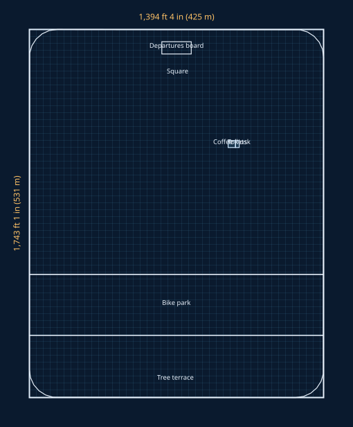

# P5-02 Station Square: plan

Footprint 1,394 ft 4 in (425 m) × 1,743 ft 1 in (531 m) · structural grid 32 ft 10 in (10 m)

## Levels

| Level | Floor above deck | Height | Floor area |
|---|---|---|---|
| Level 1 · Ground | 0 ft (0 mm) | 13 ft 1 in (4,000 mm) | 1,722 sq ft (160 m²) |

## Elements

| ID | Designation | Type | Name | Level(s) | Size / length | Area | Status |
|---|---|---|---|---|---|---|---|
| E001 | D5F6P5B1A1R1 | zone | Square | L1 | 1,394 ft (425 m) × 1,160 ft 1 in (354 m) | 1,607,783 sq ft (149,368 m²) | proposed |
| E002 | D5F6P5B1A1R2 | room | Coffee kiosk | L1 | 34 ft 9 in (11 m) × 32 ft 10 in (10 m) | 1,141 sq ft (106 m²) | proposed |
| E003 | D5F6P5B1A1R3 | room | Toilets | L1 | 17 ft 9 in (5,400 mm) × 32 ft 10 in (10 m) | 581 sq ft (54 m²) | proposed |
| E004 |  | fixture | Departures board | L1 | 139 ft 5 in (42 m) × 58 ft 1 in (18 m) | 8,097 sq ft (752 m²) | proposed |
| E005 | D5F6P5B1A1R4 | zone | Bike park | L1 | 1,393 ft 4 in (425 m) × 288 ft 5 in (88 m) | 401,734 sq ft (37,322 m²) | proposed |
| E006 | D5F6P5B1A1R5 | zone | Tree terrace | L1 | 1,393 ft 1 in (425 m) × 294 ft 7 in (90 m) | 401,874 sq ft (37,335 m²) | proposed |

## Drawings

### Level 1 · Ground

