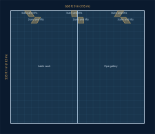
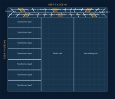
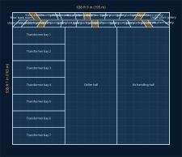

# P5-08 Station Utility Plant: plan

Footprint 638 ft 9 in (195 m) × 535 ft 1 in (163 m) · structural grid 32 ft 10 in (10 m)

## Levels

| Level | Floor above deck | Height | Floor area |
|---|---|---|---|
| Level B1 · Pipe and cable basement | −16 ft 5 in (5,000 mm) | 16 ft 5 in (5,000 mm) | 341,814 sq ft (31,756 m²) |
| Level 1 · Plant floor | 0 ft (0 mm) | 26 ft 3 in (8,000 mm) | 335,491 sq ft (31,168 m²) |
| Level 2 · Upper plant deck | 26 ft 3 in (8,000 mm) | 19 ft 8 in (6,000 mm) | 335,491 sq ft (31,168 m²) |

## Elements

| ID | Designation | Type | Name | Level(s) | Size / length | Area | Status |
|---|---|---|---|---|---|---|---|
| E001 | D5F6P5B6A1L1R1, D5F6P5B6A1L2R1 | room | Transformer bay 1 | L1, L2 | 212 ft 11 in (65 m) × 67 ft 11 in (21 m) | 14,461 sq ft (1,343 m²) | proposed |
| E002 | D5F6P5B6A1L1R2, D5F6P5B6A1L2R2 | room | Transformer bay 2 | L1, L2 | 212 ft 11 in (65 m) × 68 ft 3 in (21 m) | 14,530 sq ft (1,350 m²) | proposed |
| E003 | D5F6P5B6A1L1R3, D5F6P5B6A1L2R3 | room | Transformer bay 3 | L1, L2 | 212 ft 11 in (65 m) × 67 ft 11 in (21 m) | 14,461 sq ft (1,343 m²) | proposed |
| E004 | D5F6P5B6A1L1R4, D5F6P5B6A1L2R4 | room | Transformer bay 4 | L1, L2 | 212 ft 11 in (65 m) × 67 ft 11 in (21 m) | 14,461 sq ft (1,343 m²) | proposed |
| E005 | D5F6P5B6A1L1R5, D5F6P5B6A1L2R5 | room | Transformer bay 5 | L1, L2 | 212 ft 11 in (65 m) × 67 ft 11 in (21 m) | 14,461 sq ft (1,343 m²) | proposed |
| E006 | D5F6P5B6A1L1R6, D5F6P5B6A1L2R6 | room | Transformer bay 6 | L1, L2 | 212 ft 11 in (65 m) × 68 ft 3 in (21 m) | 14,530 sq ft (1,350 m²) | proposed |
| E007 | D5F6P5B6A1L1R7, D5F6P5B6A1L2R7 | room | Transformer bay 7 | L1, L2 | 212 ft 11 in (65 m) × 67 ft 11 in (21 m) | 14,461 sq ft (1,343 m²) | proposed |
| E008 | D5F6P5B6A1L1R8, D5F6P5B6A1L2R8 | room | Chiller hall | L1, L2 | 212 ft 11 in (65 m) × 476 ft 1 in (145 m) | 101,364 sq ft (9,417 m²) | proposed |
| E009 | D5F6P5B6A1L1R9, D5F6P5B6A1L2R9 | room | Air handling hall | L1, L2 | 212 ft 11 in (65 m) × 476 ft 1 in (145 m) | 101,364 sq ft (9,417 m²) | proposed |
| E010 | D5F6P5B6A1LB1R1, D5F6P5B6A1L1R10, D5F6P5B6A1L2R10 | core | Stairs and lifts | LB1, L1, L2 | 47 ft 3 in (14 m) × 27 ft 11 in (8,500 mm) | 732 sq ft (68 m²) | proposed |
| E011 | D5F6P5B6A1LB1R2, D5F6P5B6A1L1R11, D5F6P5B6A1L2R11 | core | Stairs and lifts | LB1, L1, L2 | 27 ft 11 in (8,500 mm) × 27 ft 11 in (8,500 mm) | 737 sq ft (68 m²) | proposed |
| E012 | D5F6P5B6A1LB1R3, D5F6P5B6A1L1R12, D5F6P5B6A1L2R12 | core | Stairs and lifts | LB1, L1, L2 | 44 ft 7 in (14 m) × 27 ft 11 in (8,500 mm) | 737 sq ft (68 m²) | proposed |
| E013 | D5F6P5B6A1LB1R4, D5F6P5B6A1L1R13, D5F6P5B6A1L2R13 | core | Stairs and lifts | LB1, L1, L2 | 47 ft 3 in (14 m) × 27 ft 11 in (8,500 mm) | 732 sq ft (68 m²) | proposed |
| E014 | D5F6P5B6A1LB1R5, D5F6P5B6A1L1R14, D5F6P5B6A1L2R14 | core | Stairs and lifts | LB1, L1, L2 | 27 ft 11 in (8,500 mm) × 27 ft 11 in (8,500 mm) | 737 sq ft (68 m²) | proposed |
| E015 | D5F6P5B6A1LB1R6, D5F6P5B6A1L1R15, D5F6P5B6A1L2R15 | core | Stairs and lifts | LB1, L1, L2 | 44 ft 7 in (14 m) × 27 ft 11 in (8,500 mm) | 737 sq ft (68 m²) | proposed |
| E016 | D5F6P5B6A1L1R16 | room | Control room | L1 | 42 ft 4 in (13 m) × 59 ft 1 in (18 m) | 1,290 sq ft (120 m²) | proposed |
| E017 | D5F6P5B6A1L1R17 | room | Switch room | L1 | 72 ft 2 in (22 m) × 27 ft 11 in (8,500 mm) | 1,331 sq ft (124 m²) | proposed |
| E018 | D5F6P5B6A1L1R18 | room | Battery room | L1 | 78 ft 5 in (24 m) × 27 ft 11 in (8,500 mm) | 1,715 sq ft (159 m²) | proposed |
| E019 | D5F6P5B6A1L1R19 | room | Water pump room | L1 | 87 ft 7 in (27 m) × 27 ft 11 in (8,500 mm) | 2,146 sq ft (199 m²) | proposed |
| E020 | D5F6P5B6A1L1R20 | room | Water treatment room | L1 | 54 ft 2 in (16 m) × 27 ft 11 in (8,500 mm) | 1,372 sq ft (128 m²) | proposed |
| E021 | D5F6P5B6A1L1R21 | room | Workshop | L1 | 56 ft 1 in (17 m) × 27 ft 11 in (8,500 mm) | 1,496 sq ft (139 m²) | proposed |
| E022 | D5F6P5B6A1L1R22 | room | Locker room | L1 | 41 ft (12 m) × 27 ft 11 in (8,500 mm) | 965 sq ft (90 m²) | proposed |
| E023 | D5F6P5B6A1L1R23 | room | Staff toilets and showers | L1 | 36 ft 1 in (11 m) × 27 ft 11 in (8,500 mm) | 750 sq ft (70 m²) | proposed |
| E024 | D5F6P5B6A1L1R24 | room | Spares store | L1 | 54 ft 9 in (17 m) × 27 ft 11 in (8,500 mm) | 1,185 sq ft (110 m²) | proposed |
| E025 | D5F6P5B6A1L1R25 | room | Spares store | L1 | 45 ft 7 in (14 m) × 27 ft 11 in (8,500 mm) | 833 sq ft (77 m²) | proposed |
| E026 | D5F6P5B6A1L1R26 | room | Spares store | L1 | 63 ft 8 in (19 m) × 27 ft 11 in (8,500 mm) | 1,180 sq ft (110 m²) | proposed |
| E027 | D5F6P5B6A1L1R27 | room | Spares store | L1 | 67 ft 11 in (21 m) × 27 ft 11 in (8,500 mm) | 1,189 sq ft (110 m²) | proposed |
| E028 | D5F6P5B6A1L1R28 | room | Spares store | L1 | 36 ft 5 in (11 m) × 59 ft 1 in (18 m) | 1,194 sq ft (111 m²) | proposed |
| E029 | D5F6P5B6A1L1R29 | room | Spares store | L1 | 85 ft (26 m) × 27 ft 11 in (8,500 mm) | 1,674 sq ft (156 m²) | proposed |
| E030 | D5F6P5B6A1L1R30 | room | Spares store | L1 | 60 ft 4 in (18 m) × 27 ft 11 in (8,500 mm) | 1,185 sq ft (110 m²) | proposed |
| E031 | D5F6P5B6A1L1R31 | room | Spares store | L1 | 56 ft 9 in (17 m) × 27 ft 11 in (8,500 mm) | 1,189 sq ft (111 m²) | proposed |
| E032 | D5F6P5B6A1L1R32 | room | Spares store | L1 | 52 ft 6 in (16 m) × 27 ft 11 in (8,500 mm) | 1,185 sq ft (110 m²) | proposed |
| E033 | D5F6P5B6A1L1R33 | room | Spares store | L1 | 65 ft 3 in (20 m) × 27 ft 11 in (8,500 mm) | 1,674 sq ft (156 m²) | proposed |
| E034 | D5F6P5B6A1L1R34 | room | Spares store | L1 | 44 ft 3 in (14 m) × 27 ft 11 in (8,500 mm) | 1,180 sq ft (110 m²) | proposed |
| E035 | D5F6P5B6A1L1R35 | room | Spares store | L1 | 48 ft 3 in (15 m) × 27 ft 11 in (8,500 mm) | 1,189 sq ft (111 m²) | proposed |
| E036 | D5F6P5B6A1L1R36 | room | Spares store | L1 | 52 ft 2 in (16 m) × 27 ft 11 in (8,500 mm) | 1,189 sq ft (110 m²) | proposed |
| E037 | D5F6P5B6A1L1R37 | room | Spares store | L1 | 74 ft 2 in (23 m) × 27 ft 11 in (8,500 mm) | 1,670 sq ft (155 m²) | proposed |
| E038 | D5F6P5B6A1L1R38 | room | Spares store | L1 | 63 ft 8 in (19 m) × 27 ft 11 in (8,500 mm) | 1,180 sq ft (110 m²) | proposed |
| E039 | D5F6P5B6A1L1R39 | room | Spares store | L1 | 77 ft 1 in (24 m) × 27 ft 11 in (8,500 mm) | 1,436 sq ft (133 m²) | proposed |
| E040 | D5F6P5B6A1L2R16 | room | Filter bank room | L2 | 87 ft 11 in (27 m) × 59 ft 1 in (18 m) | 2,621 sq ft (244 m²) | proposed |
| E041 | D5F6P5B6A1L2R17 | room | Ductwork gallery | L2 | 93 ft 2 in (28 m) × 27 ft 11 in (8,500 mm) | 2,146 sq ft (199 m²) | proposed |
| E042 | D5F6P5B6A1L2R18 | room | Crew rest room | L2 | 27 ft 3 in (8,300 mm) × 27 ft 11 in (8,500 mm) | 425 sq ft (40 m²) | proposed |
| E043 | D5F6P5B6A1L2R19 | room | Upper plant gallery | L2 | 69 ft 3 in (21 m) × 27 ft 11 in (8,500 mm) | 1,697 sq ft (158 m²) | proposed |
| E044 | D5F6P5B6A1L2R20 | room | Upper plant gallery | L2 | 38 ft 9 in (12 m) × 27 ft 11 in (8,500 mm) | 965 sq ft (90 m²) | proposed |
| E045 | D5F6P5B6A1L2R21 | room | Upper plant gallery | L2 | 63 ft 8 in (19 m) × 27 ft 11 in (8,500 mm) | 1,693 sq ft (157 m²) | proposed |
| E046 | D5F6P5B6A1L2R22 | room | Upper plant gallery | L2 | 68 ft 11 in (21 m) × 27 ft 11 in (8,500 mm) | 1,693 sq ft (157 m²) | proposed |
| E047 | D5F6P5B6A1L2R23 | room | Upper plant gallery | L2 | 80 ft 1 in (24 m) × 27 ft 11 in (8,500 mm) | 1,844 sq ft (171 m²) | proposed |
| E048 | D5F6P5B6A1L2R24 | room | Upper plant gallery | L2 | 83 ft (25 m) × 27 ft 11 in (8,500 mm) | 1,693 sq ft (157 m²) | proposed |
| E049 | D5F6P5B6A1L2R25 | room | Upper plant gallery | L2 | 59 ft 9 in (18 m) × 52 ft 10 in (16 m) | 1,702 sq ft (158 m²) | proposed |
| E050 | D5F6P5B6A1L2R26 | room | Upper plant gallery | L2 | 87 ft 11 in (27 m) × 28 ft 3 in (8,600 mm) | 1,844 sq ft (171 m²) | proposed |
| E051 | D5F6P5B6A1L2R27 | room | Upper plant gallery | L2 | 77 ft 9 in (24 m) × 27 ft 11 in (8,500 mm) | 1,697 sq ft (158 m²) | proposed |
| E052 | D5F6P5B6A1L2R28 | room | Upper plant gallery | L2 | 72 ft 2 in (22 m) × 27 ft 11 in (8,500 mm) | 1,693 sq ft (157 m²) | proposed |
| E053 | D5F6P5B6A1L2R29 | room | Upper plant gallery | L2 | 71 ft 10 in (22 m) × 27 ft 11 in (8,500 mm) | 1,844 sq ft (171 m²) | proposed |
| E054 | D5F6P5B6A1L2R30 | room | Upper plant gallery | L2 | 63 ft 8 in (19 m) × 27 ft 11 in (8,500 mm) | 1,693 sq ft (157 m²) | proposed |
| E055 | D5F6P5B6A1L2R31 | room | Upper plant gallery | L2 | 68 ft 11 in (21 m) × 27 ft 11 in (8,500 mm) | 1,693 sq ft (157 m²) | proposed |
| E056 | D5F6P5B6A1L2R32 | room | Upper plant gallery | L2 | 80 ft 1 in (24 m) × 27 ft 11 in (8,500 mm) | 1,844 sq ft (171 m²) | proposed |
| E057 | D5F6P5B6A1L2R33 | room | Upper plant gallery | L2 | 83 ft (25 m) × 27 ft 11 in (8,500 mm) | 1,693 sq ft (157 m²) | proposed |
| E058 | D5F6P5B6A1L2R34 | room | Upper plant gallery | L2 | 59 ft 9 in (18 m) × 27 ft 11 in (8,500 mm) | 924 sq ft (86 m²) | proposed |
| E059 | D5F6P5B6A1LB1R7 | room | Cable vault | LB1 | 319 ft 3 in (97 m) × 535 ft 1 in (163 m) | 170,819 sq ft (15,870 m²) | proposed |
| E060 | D5F6P5B6A1LB1R8 | room | Pipe gallery | LB1 | 319 ft 7 in (97 m) × 535 ft 1 in (163 m) | 170,995 sq ft (15,886 m²) | proposed |

## Drawings

### Level B1 · Pipe and cable basement

### Level 1 · Plant floor

### Level 2 · Upper plant deck

