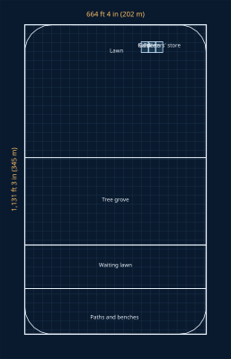

# P5-09 Station Garden 1: plan

Footprint 664 ft 4 in (202 m) × 1,131 ft 3 in (345 m) · structural grid 32 ft 10 in (10 m)

## Levels

| Level | Floor above deck | Height | Floor area |
|---|---|---|---|
| Level 1 · Ground | 0 ft (0 mm) | 13 ft 1 in (4,000 mm) | 3,100 sq ft (288 m²) |

## Elements

| ID | Designation | Type | Name | Level(s) | Size / length | Area | Status |
|---|---|---|---|---|---|---|---|
| E001 | D5F6P5B5A2R1 | zone | Lawn | L1 | 663 ft 9 in (202 m) × 485 ft 11 in (148 m) | 317,771 sq ft (29,522 m²) | proposed |
| E002 | D5F6P5B5A2R2 | room | Kiosk | L1 | 26 ft 3 in (8,000 mm) × 39 ft 4 in (12 m) | 1,033 sq ft (96 m²) | proposed |
| E003 | D5F6P5B5A2R3 | room | Toilets | L1 | 26 ft 3 in (8,000 mm) × 39 ft 4 in (12 m) | 1,033 sq ft (96 m²) | proposed |
| E004 | D5F6P5B5A2R4 | room | Gardeners' store | L1 | 26 ft 3 in (8,000 mm) × 39 ft 4 in (12 m) | 1,033 sq ft (96 m²) | proposed |
| E005 | D5F6P5B5A2R5 | zone | Tree grove | L1 | 663 ft 9 in (202 m) × 319 ft 3 in (97 m) | 211,770 sq ft (19,674 m²) | proposed |
| E006 | D5F6P5B5A2R6 | zone | Waiting lawn | L1 | 663 ft 9 in (202 m) × 159 ft 5 in (49 m) | 105,776 sq ft (9,827 m²) | proposed |
| E007 | D5F6P5B5A2R7 | zone | Paths and benches | L1 | 663 ft 5 in (202 m) × 166 ft 8 in (51 m) | 105,982 sq ft (9,846 m²) | proposed |

## Drawings

### Level 1 · Ground

