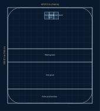

# P5-10 Station Garden 2: plan

Footprint 473 ft 5 in (144 m) × 535 ft 1 in (163 m) · structural grid 32 ft 10 in (10 m)

## Levels

| Level | Floor above deck | Height | Floor area |
|---|---|---|---|
| Level 1 · Ground | 0 ft (0 mm) | 13 ft 1 in (4,000 mm) | 3,100 sq ft (288 m²) |

## Elements

| ID | Designation | Type | Name | Level(s) | Size / length | Area | Status |
|---|---|---|---|---|---|---|---|
| E001 | D5F6P5B6A2R1 | zone | Lawn | L1 | 473 ft 1 in (144 m) × 230 ft (70 m) | 106,402 sq ft (9,885 m²) | proposed |
| E002 | D5F6P5B6A2R2 | room | Kiosk | L1 | 26 ft 3 in (8,000 mm) × 39 ft 4 in (12 m) | 1,033 sq ft (96 m²) | proposed |
| E003 | D5F6P5B6A2R3 | room | Toilets | L1 | 26 ft 3 in (8,000 mm) × 39 ft 4 in (12 m) | 1,033 sq ft (96 m²) | proposed |
| E004 | D5F6P5B6A2R4 | room | Gardeners' store | L1 | 26 ft 3 in (8,000 mm) × 39 ft 4 in (12 m) | 1,033 sq ft (96 m²) | proposed |
| E005 | D5F6P5B6A2R5 | zone | Waiting lawn | L1 | 472 ft 9 in (144 m) × 75 ft 2 in (23 m) | 35,520 sq ft (3,300 m²) | proposed |
| E006 | D5F6P5B6A2R6 | zone | Tree grove | L1 | 473 ft 1 in (144 m) × 149 ft 11 in (46 m) | 70,884 sq ft (6,585 m²) | proposed |
| E007 | D5F6P5B6A2R7 | zone | Paths and benches | L1 | 472 ft 9 in (144 m) × 80 ft 1 in (24 m) | 35,448 sq ft (3,293 m²) | proposed |

## Drawings

### Level 1 · Ground

