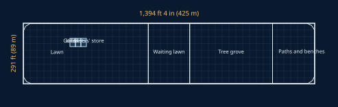

# P5-11 Station Garden 3: plan

Footprint 1,394 ft 4 in (425 m) × 291 ft (89 m) · structural grid 32 ft 10 in (10 m)

## Levels

| Level | Floor above deck | Height | Floor area |
|---|---|---|---|
| Level 1 · Ground | 0 ft (0 mm) | 13 ft 1 in (4,000 mm) | 3,100 sq ft (288 m²) |

## Elements

| ID | Designation | Type | Name | Level(s) | Size / length | Area | Status |
|---|---|---|---|---|---|---|---|
| E001 | D5F6P5B1A2R1 | zone | Lawn | L1 | 597 ft 9 in (182 m) × 289 ft 8 in (88 m) | 171,806 sq ft (15,961 m²) | proposed |
| E002 | D5F6P5B1A2R2 | room | Kiosk | L1 | 26 ft 3 in (8,000 mm) × 39 ft 4 in (12 m) | 1,033 sq ft (96 m²) | proposed |
| E003 | D5F6P5B1A2R3 | room | Toilets | L1 | 26 ft 3 in (8,000 mm) × 39 ft 4 in (12 m) | 1,033 sq ft (96 m²) | proposed |
| E004 | D5F6P5B1A2R4 | room | Gardeners' store | L1 | 26 ft 3 in (8,000 mm) × 39 ft 4 in (12 m) | 1,033 sq ft (96 m²) | proposed |
| E005 | D5F6P5B1A2R5 | zone | Waiting lawn | L1 | 198 ft 2 in (60 m) × 289 ft 1 in (88 m) | 57,277 sq ft (5,321 m²) | proposed |
| E006 | D5F6P5B1A2R6 | zone | Tree grove | L1 | 396 ft 4 in (121 m) × 289 ft 8 in (88 m) | 114,620 sq ft (10,649 m²) | proposed |
| E007 | D5F6P5B1A2R7 | zone | Paths and benches | L1 | 201 ft 5 in (61 m) × 289 ft 4 in (88 m) | 57,281 sq ft (5,322 m²) | proposed |

## Drawings

### Level 1 · Ground

