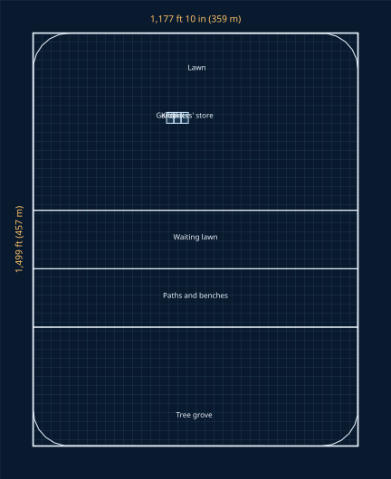

# P5-13 Station Garden 5: plan

Footprint 1,177 ft 10 in (359 m) × 1,499 ft (457 m) · structural grid 32 ft 10 in (10 m)

## Levels

| Level | Floor above deck | Height | Floor area |
|---|---|---|---|
| Level 1 · Ground | 0 ft (0 mm) | 13 ft 1 in (4,000 mm) | 3,100 sq ft (288 m²) |

## Elements

| ID | Designation | Type | Name | Level(s) | Size / length | Area | Status |
|---|---|---|---|---|---|---|---|
| E001 | D5F6P5B6A3R1 | zone | Lawn | L1 | 1,177 ft 2 in (359 m) × 643 ft 4 in (196 m) | 748,799 sq ft (69,566 m²) | proposed |
| E002 | D5F6P5B6A3R2 | room | Kiosk | L1 | 26 ft 3 in (8,000 mm) × 39 ft 4 in (12 m) | 1,033 sq ft (96 m²) | proposed |
| E003 | D5F6P5B6A3R3 | room | Toilets | L1 | 26 ft 3 in (8,000 mm) × 39 ft 4 in (12 m) | 1,033 sq ft (96 m²) | proposed |
| E004 | D5F6P5B6A3R4 | room | Gardeners' store | L1 | 26 ft 3 in (8,000 mm) × 39 ft 4 in (12 m) | 1,033 sq ft (96 m²) | proposed |
| E005 | D5F6P5B6A3R5 | zone | Waiting lawn | L1 | 1,176 ft 6 in (359 m) × 212 ft 3 in (65 m) | 249,738 sq ft (23,201 m²) | proposed |
| E006 | D5F6P5B6A3R6 | zone | Paths and benches | L1 | 1,176 ft 10 in (359 m) × 211 ft 11 in (65 m) | 249,352 sq ft (23,166 m²) | proposed |
| E007 | D5F6P5B6A3R7 | zone | Tree grove | L1 | 1,176 ft 10 in (359 m) × 431 ft 5 in (132 m) | 499,423 sq ft (46,398 m²) | proposed |

## Drawings

### Level 1 · Ground

