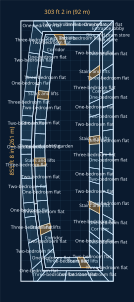
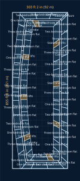

# P6-01 Starboard Towers 1: plan

Footprint 303 ft 2 in (92 m) × 855 ft 8 in (261 m) · structural grid 32 ft 10 in (10 m)

## Levels

| Level | Floor above deck | Height | Floor area |
|---|---|---|---|
| Level 1 · Ground floor | 0 ft (0 mm) | 14 ft 9 in (4,500 mm) | 125,931 sq ft (11,699 m²) |
| Level 2 · Flat floor 1 | 14 ft 9 in (4,500 mm) | 10 ft 6 in (3,200 mm) | 125,953 sq ft (11,701 m²) |
| Level 3 · Flat floor 2 | 25 ft 3 in (7,700 mm) | 10 ft 6 in (3,200 mm) | 125,953 sq ft (11,701 m²) |
| Level 4 · Flat floor 3 | 35 ft 9 in (11 m) | 10 ft 6 in (3,200 mm) | 125,953 sq ft (11,701 m²) |
| Level 5 · Flat floor 4 | 46 ft 3 in (14 m) | 10 ft 6 in (3,200 mm) | 125,953 sq ft (11,701 m²) |
| Level 6 · Flat floor 5 | 56 ft 9 in (17 m) | 10 ft 6 in (3,200 mm) | 125,953 sq ft (11,701 m²) |
| Level 7 · Flat floor 6 | 67 ft 3 in (20 m) | 10 ft 6 in (3,200 mm) | 125,953 sq ft (11,701 m²) |
| Level 8 · Flat floor 7 | 77 ft 9 in (24 m) | 10 ft 6 in (3,200 mm) | 125,953 sq ft (11,701 m²) |
| Level 9 · Flat floor 8 | 88 ft 3 in (27 m) | 10 ft 6 in (3,200 mm) | 125,953 sq ft (11,701 m²) |
| Level 10 · Flat floor 9 | 98 ft 9 in (30 m) | 10 ft 6 in (3,200 mm) | 125,953 sq ft (11,701 m²) |
| Level 11 · Flat floor 10 | 109 ft 3 in (33 m) | 10 ft 6 in (3,200 mm) | 125,953 sq ft (11,701 m²) |
| Level 12 · Flat floor 11 | 119 ft 9 in (36 m) | 10 ft 6 in (3,200 mm) | 125,953 sq ft (11,701 m²) |
| Level 13 · Flat floor 12 | 130 ft 3 in (40 m) | 10 ft 6 in (3,200 mm) | 125,953 sq ft (11,701 m²) |
| Level 14 · Flat floor 13 | 140 ft 9 in (43 m) | 10 ft 6 in (3,200 mm) | 125,953 sq ft (11,701 m²) |
| Level 15 · Flat floor 14 | 151 ft 3 in (46 m) | 10 ft 6 in (3,200 mm) | 125,953 sq ft (11,701 m²) |
| Level 16 · Flat floor 15 | 161 ft 9 in (49 m) | 10 ft 6 in (3,200 mm) | 125,953 sq ft (11,701 m²) |

## Elements

| ID | Designation | Type | Name | Level(s) | Size / length | Area | Status |
|---|---|---|---|---|---|---|---|
| E001 | D5F6P6B1A1L1R1 | zone | Lobby garden | L1 | 145 ft 8 in (44 m) × 698 ft 2 in (213 m) | 93,268 sq ft (8,665 m²) | proposed |
| E002 | D5F6P6B1A1L1R2 | zone | Corridor | L1 | 9 ft 10 in (3,000 mm) × 398 ft 7 in (122 m) | 3,875 sq ft (360 m²) | proposed |
| E003 | D5F6P6B1A1L1R3 | zone | Corridor | L1 | 19 ft 8 in (6,000 mm) × 388 ft 1 in (118 m) | 3,875 sq ft (360 m²) | proposed |
| E004 | D5F6P6B1A1L1R4 | zone | Corridor | L1 | 213 ft 11 in (65 m) × 220 ft 6 in (67 m) | 3,878 sq ft (360 m²) | proposed |
| E005 | D5F6P6B1A1L1R5 | zone | Corridor | L1 | 25 ft 3 in (7,700 mm) × 393 ft 8 in (120 m) | 3,864 sq ft (359 m²) | proposed |
| E006 | D5F6P6B1A1L1R6 | zone | Corridor | L1 | 218 ft 6 in (67 m) × 174 ft 6 in (53 m) | 3,521 sq ft (327 m²) | proposed |
| E007 | D5F6P6B1A1L1R7, D5F6P6B1A1L2R1, D5F6P6B1A1L3R1, D5F6P6B1A1L4R1, D5F6P6B1A1L5R1, D5F6P6B1A1L6R1, D5F6P6B1A1L7R1, D5F6P6B1A1L8R1, D5F6P6B1A1L9R1, D5F6P6B1A1L10R1, D5F6P6B1A1L11R1, D5F6P6B1A1L12R1, D5F6P6B1A1L13R1, D5F6P6B1A1L14R1, D5F6P6B1A1L15R1, D5F6P6B1A1L16R1 | core | Stairs and lifts | L1, L2, L3, L4, L5, L6, L7, L8, L9, L10, L11, L12, L13, L14, L15, L16 | 34 ft 5 in (10 m) × 50 ft 6 in (15 m) | 904 sq ft (84 m²) | proposed |
| E008 | D5F6P6B1A1L1R8, D5F6P6B1A1L2R2, D5F6P6B1A1L3R2, D5F6P6B1A1L4R2, D5F6P6B1A1L5R2, D5F6P6B1A1L6R2, D5F6P6B1A1L7R2, D5F6P6B1A1L8R2, D5F6P6B1A1L9R2, D5F6P6B1A1L10R2, D5F6P6B1A1L11R2, D5F6P6B1A1L12R2, D5F6P6B1A1L13R2, D5F6P6B1A1L14R2, D5F6P6B1A1L15R2, D5F6P6B1A1L16R2 | core | Stairs and lifts | L1, L2, L3, L4, L5, L6, L7, L8, L9, L10, L11, L12, L13, L14, L15, L16 | 34 ft 5 in (10 m) × 29 ft 6 in (9,000 mm) | 904 sq ft (84 m²) | proposed |
| E009 | D5F6P6B1A1L1R9, D5F6P6B1A1L2R3, D5F6P6B1A1L3R3, D5F6P6B1A1L4R3, D5F6P6B1A1L5R3, D5F6P6B1A1L6R3, D5F6P6B1A1L7R3, D5F6P6B1A1L8R3, D5F6P6B1A1L9R3, D5F6P6B1A1L10R3, D5F6P6B1A1L11R3, D5F6P6B1A1L12R3, D5F6P6B1A1L13R3, D5F6P6B1A1L14R3, D5F6P6B1A1L15R3, D5F6P6B1A1L16R3 | core | Stairs and lifts | L1, L2, L3, L4, L5, L6, L7, L8, L9, L10, L11, L12, L13, L14, L15, L16 | 34 ft 5 in (10 m) × 43 ft 4 in (13 m) | 899 sq ft (83 m²) | proposed |
| E010 | D5F6P6B1A1L1R10, D5F6P6B1A1L2R4, D5F6P6B1A1L3R4, D5F6P6B1A1L4R4, D5F6P6B1A1L5R4, D5F6P6B1A1L6R4, D5F6P6B1A1L7R4, D5F6P6B1A1L8R4, D5F6P6B1A1L9R4, D5F6P6B1A1L10R4, D5F6P6B1A1L11R4, D5F6P6B1A1L12R4, D5F6P6B1A1L13R4, D5F6P6B1A1L14R4, D5F6P6B1A1L15R4, D5F6P6B1A1L16R4 | core | Stairs and lifts | L1, L2, L3, L4, L5, L6, L7, L8, L9, L10, L11, L12, L13, L14, L15, L16 | 44 ft (13 m) × 34 ft 5 in (10 m) | 904 sq ft (84 m²) | proposed |
| E011 | D5F6P6B1A1L1R11, D5F6P6B1A1L2R5, D5F6P6B1A1L3R5, D5F6P6B1A1L4R5, D5F6P6B1A1L5R5, D5F6P6B1A1L6R5, D5F6P6B1A1L7R5, D5F6P6B1A1L8R5, D5F6P6B1A1L9R5, D5F6P6B1A1L10R5, D5F6P6B1A1L11R5, D5F6P6B1A1L12R5, D5F6P6B1A1L13R5, D5F6P6B1A1L14R5, D5F6P6B1A1L15R5, D5F6P6B1A1L16R5 | core | Stairs and lifts | L1, L2, L3, L4, L5, L6, L7, L8, L9, L10, L11, L12, L13, L14, L15, L16 | 36 ft 5 in (11 m) × 39 ft 1 in (12 m) | 898 sq ft (83 m²) | proposed |
| E012 | D5F6P6B1A1L1R12, D5F6P6B1A1L2R6, D5F6P6B1A1L3R6, D5F6P6B1A1L4R6, D5F6P6B1A1L5R6, D5F6P6B1A1L6R6, D5F6P6B1A1L7R6, D5F6P6B1A1L8R6, D5F6P6B1A1L9R6, D5F6P6B1A1L10R6, D5F6P6B1A1L11R6, D5F6P6B1A1L12R6, D5F6P6B1A1L13R6, D5F6P6B1A1L14R6, D5F6P6B1A1L15R6, D5F6P6B1A1L16R6 | core | Stairs and lifts | L1, L2, L3, L4, L5, L6, L7, L8, L9, L10, L11, L12, L13, L14, L15, L16 | 35 ft 5 in (11 m) × 26 ft 11 in (8,200 mm) | 905 sq ft (84 m²) | proposed |
| E013 | D5F6P6B1A1L1R13, D5F6P6B1A1L2R7, D5F6P6B1A1L3R7, D5F6P6B1A1L4R7, D5F6P6B1A1L5R7, D5F6P6B1A1L6R7, D5F6P6B1A1L7R7, D5F6P6B1A1L8R7, D5F6P6B1A1L9R7, D5F6P6B1A1L10R7, D5F6P6B1A1L11R7, D5F6P6B1A1L12R7, D5F6P6B1A1L13R7, D5F6P6B1A1L14R7, D5F6P6B1A1L15R7, D5F6P6B1A1L16R7 | core | Stairs and lifts | L1, L2, L3, L4, L5, L6, L7, L8, L9, L10, L11, L12, L13, L14, L15, L16 | 37 ft 1 in (11 m) × 29 ft 2 in (8,900 mm) | 903 sq ft (84 m²) | proposed |
| E014 | D5F6P6B1A1L1R14, D5F6P6B1A1L2R8, D5F6P6B1A1L3R8, D5F6P6B1A1L4R8, D5F6P6B1A1L5R8, D5F6P6B1A1L6R8, D5F6P6B1A1L7R8, D5F6P6B1A1L8R8, D5F6P6B1A1L9R8, D5F6P6B1A1L10R8, D5F6P6B1A1L11R8, D5F6P6B1A1L12R8, D5F6P6B1A1L13R8, D5F6P6B1A1L14R8, D5F6P6B1A1L15R8, D5F6P6B1A1L16R8 | core | Stairs and lifts | L1, L2, L3, L4, L5, L6, L7, L8, L9, L10, L11, L12, L13, L14, L15, L16 | 40 ft (12 m) × 34 ft 5 in (10 m) | 904 sq ft (84 m²) | proposed |
| E015 | D5F6P6B1A1L1R15 | room | Entrance lobby | L1 | 34 ft 5 in (10 m) × 58 ft 5 in (18 m) | 859 sq ft (80 m²) | proposed |
| E016 | D5F6P6B1A1L1R16 | room | Bike and pram store | L1 | 34 ft 5 in (10 m) × 50 ft 6 in (15 m) | 650 sq ft (60 m²) | proposed |
| E017 | D5F6P6B1A1L1R17 | room | Bin store | L1 | 34 ft 5 in (10 m) × 42 ft 4 in (13 m) | 413 sq ft (38 m²) | proposed |
| E018 | D5F6P6B1A1L1R18 | room | Two-bedroom flat | L1 | 34 ft 5 in (10 m) × 106 ft 4 in (32 m) | 2,746 sq ft (255 m²) | proposed |
| E019 | D5F6P6B1A1L1R19 | room | Three-bedroom flat | L1 | 34 ft 5 in (10 m) × 99 ft 5 in (30 m) | 2,741 sq ft (255 m²) | proposed |
| E020 | D5F6P6B1A1L1R20 | room | One-bedroom flat | L1 | 34 ft 5 in (10 m) × 61 ft 4 in (19 m) | 1,616 sq ft (150 m²) | proposed |
| E021 | D5F6P6B1A1L1R21 | room | Two-bedroom flat | L1 | 34 ft 5 in (10 m) × 88 ft 11 in (27 m) | 2,746 sq ft (255 m²) | proposed |
| E022 | D5F6P6B1A1L1R22 | room | Three-bedroom flat | L1 | 34 ft 5 in (10 m) × 83 ft (25 m) | 2,741 sq ft (255 m²) | proposed |
| E023 | D5F6P6B1A1L1R23 | room | One-bedroom flat | L1 | 34 ft 5 in (10 m) × 49 ft 10 in (15 m) | 1,616 sq ft (150 m²) | proposed |
| E024 | D5F6P6B1A1L1R24 | room | Two-bedroom flat | L1 | 34 ft 5 in (10 m) × 87 ft 11 in (27 m) | 2,746 sq ft (255 m²) | proposed |
| E025 | D5F6P6B1A1L1R25 | room | Three-bedroom flat | L1 | 34 ft 5 in (10 m) × 94 ft 6 in (29 m) | 2,746 sq ft (255 m²) | proposed |
| E026 | D5F6P6B1A1L1R26 | room | One-bedroom flat | L1 | 34 ft 5 in (10 m) × 66 ft 11 in (20 m) | 1,616 sq ft (150 m²) | proposed |
| E027 | D5F6P6B1A1L1R27 | room | Two-bedroom flat | L1 | 34 ft 5 in (10 m) × 105 ft (32 m) | 2,741 sq ft (255 m²) | proposed |
| E028 | D5F6P6B1A1L1R28 | room | Three-bedroom flat | L1 | 45 ft 3 in (14 m) × 98 ft 9 in (30 m) | 2,746 sq ft (255 m²) | proposed |
| E029 | D5F6P6B1A1L1R29 | room | One-bedroom flat | L1 | 71 ft 2 in (22 m) × 34 ft 5 in (10 m) | 1,616 sq ft (150 m²) | proposed |
| E030 | D5F6P6B1A1L1R30 | room | Two-bedroom flat | L1 | 90 ft 11 in (28 m) × 34 ft 5 in (10 m) | 2,741 sq ft (255 m²) | proposed |
| E031 | D5F6P6B1A1L1R31 | room | Three-bedroom flat | L1 | 95 ft 10 in (29 m) × 34 ft 5 in (10 m) | 2,746 sq ft (255 m²) | proposed |
| E032 | D5F6P6B1A1L1R32 | room | One-bedroom flat | L1 | 44 ft (13 m) × 68 ft 3 in (21 m) | 1,614 sq ft (150 m²) | proposed |
| E033 | D5F6P6B1A1L1R33 | room | Two-bedroom flat | L1 | 42 ft 8 in (13 m) × 101 ft 5 in (31 m) | 2,745 sq ft (255 m²) | proposed |
| E034 | D5F6P6B1A1L1R34 | room | Three-bedroom flat | L1 | 44 ft 3 in (14 m) × 89 ft 3 in (27 m) | 2,741 sq ft (255 m²) | proposed |
| E035 | D5F6P6B1A1L1R35 | room | One-bedroom flat | L1 | 38 ft 5 in (12 m) × 50 ft 6 in (15 m) | 1,611 sq ft (150 m²) | proposed |
| E036 | D5F6P6B1A1L1R36 | room | Two-bedroom flat | L1 | 40 ft 4 in (12 m) × 82 ft (25 m) | 2,740 sq ft (255 m²) | proposed |
| E037 | D5F6P6B1A1L1R37 | room | Three-bedroom flat | L1 | 36 ft 9 in (11 m) × 80 ft 9 in (25 m) | 2,743 sq ft (255 m²) | proposed |
| E038 | D5F6P6B1A1L1R38 | room | One-bedroom flat | L1 | 35 ft 5 in (11 m) × 47 ft 7 in (14 m) | 1,617 sq ft (150 m²) | proposed |
| E039 | D5F6P6B1A1L1R39 | room | Two-bedroom flat | L1 | 37 ft 9 in (12 m) × 81 ft 4 in (25 m) | 2,747 sq ft (255 m²) | proposed |
| E040 | D5F6P6B1A1L1R40 | room | Three-bedroom flat | L1 | 43 ft (13 m) × 82 ft (25 m) | 2,753 sq ft (256 m²) | proposed |
| E041 | D5F6P6B1A1L1R41 | room | One-bedroom flat | L1 | 39 ft 4 in (12 m) × 49 ft 10 in (15 m) | 1,614 sq ft (150 m²) | proposed |
| E042 | D5F6P6B1A1L1R42 | room | Two-bedroom flat | L1 | 42 ft 8 in (13 m) × 83 ft 8 in (26 m) | 2,737 sq ft (254 m²) | proposed |
| E043 | D5F6P6B1A1L1R43 | room | Three-bedroom flat | L1 | 44 ft (13 m) × 96 ft 9 in (29 m) | 2,745 sq ft (255 m²) | proposed |
| E044 | D5F6P6B1A1L1R44 | room | One-bedroom flat | L1 | 62 ft 8 in (19 m) × 43 ft 4 in (13 m) | 1,621 sq ft (151 m²) | proposed |
| E045 | D5F6P6B1A1L1R45 | room | Two-bedroom flat | L1 | 90 ft 7 in (28 m) × 34 ft 5 in (10 m) | 2,741 sq ft (255 m²) | proposed |
| E046 | D5F6P6B1A1L1R46 | room | Three-bedroom flat | L1 | 93 ft 6 in (28 m) × 34 ft 5 in (10 m) | 2,746 sq ft (255 m²) | proposed |
| E047 | D5F6P6B1A1L1R47 | room | One-bedroom flat | L1 | 63 ft (19 m) × 34 ft 5 in (10 m) | 1,147 sq ft (107 m²) | proposed |
| E048 | D5F6P6B1A1L1R48 | room | Two-bedroom flat | L1 | 34 ft 5 in (10 m) × 127 ft (39 m) | 3,340 sq ft (310 m²) | proposed |
| E049 | D5F6P6B1A1L1R49 | room | Three-bedroom flat | L1 | 34 ft 5 in (10 m) × 98 ft 9 in (30 m) | 2,741 sq ft (255 m²) | proposed |
| E050 | D5F6P6B1A1L1R50 | room | One-bedroom flat | L1 | 34 ft 5 in (10 m) × 60 ft (18 m) | 1,616 sq ft (150 m²) | proposed |
| E051 | D5F6P6B1A1L1R51 | room | Two-bedroom flat | L1 | 34 ft 5 in (10 m) × 75 ft 2 in (23 m) | 2,323 sq ft (216 m²) | proposed |
| E052 | D5F6P6B1A1L1R52 | room | Three-bedroom flat | L1 | 34 ft 5 in (10 m) × 83 ft 4 in (25 m) | 2,746 sq ft (255 m²) | proposed |
| E053 | D5F6P6B1A1L1R53 | room | One-bedroom flat | L1 | 34 ft 5 in (10 m) × 54 ft 6 in (17 m) | 1,616 sq ft (150 m²) | proposed |
| E054 | D5F6P6B1A1L1R54 | room | Two-bedroom flat | L1 | 34 ft 5 in (10 m) × 80 ft 5 in (24 m) | 2,323 sq ft (216 m²) | proposed |
| E055 | D5F6P6B1A1L1R55 | room | Three-bedroom flat | L1 | 34 ft 5 in (10 m) × 102 ft (31 m) | 2,746 sq ft (255 m²) | proposed |
| E056 | D5F6P6B1A1L1R56 | room | One-bedroom flat | L1 | 34 ft 5 in (10 m) × 75 ft 2 in (23 m) | 1,611 sq ft (150 m²) | proposed |
| E057 | D5F6P6B1A1L1R57 | room | Two-bedroom flat | L1 | 53 ft 10 in (16 m) × 75 ft 2 in (23 m) | 2,323 sq ft (216 m²) | proposed |
| E058 | D5F6P6B1A1L1R58 | room | Three-bedroom flat | L1 | 97 ft 1 in (30 m) × 34 ft 5 in (10 m) | 2,741 sq ft (255 m²) | proposed |
| E059 | D5F6P6B1A1L1R59 | room | One-bedroom flat | L1 | 46 ft 7 in (14 m) × 63 ft (19 m) | 1,621 sq ft (151 m²) | proposed |
| E060 | D5F6P6B1A1L1R60 | room | Two-bedroom flat | L1 | 41 ft (12 m) × 88 ft 11 in (27 m) | 2,321 sq ft (216 m²) | proposed |
| E061 | D5F6P6B1A1L1R61 | room | Three-bedroom flat | L1 | 42 ft 4 in (13 m) × 85 ft 11 in (26 m) | 2,748 sq ft (255 m²) | proposed |
| E062 | D5F6P6B1A1L1R62 | room | One-bedroom flat | L1 | 38 ft 5 in (12 m) × 49 ft 3 in (15 m) | 1,608 sq ft (149 m²) | proposed |
| E063 | D5F6P6B1A1L1R63 | room | Two-bedroom flat | L1 | 37 ft 1 in (11 m) × 68 ft 11 in (21 m) | 2,321 sq ft (216 m²) | proposed |
| E064 | D5F6P6B1A1L1R64 | room | Three-bedroom flat | L1 | 36 ft 1 in (11 m) × 80 ft 5 in (24 m) | 2,742 sq ft (255 m²) | proposed |
| E065 | D5F6P6B1A1L1R65 | room | One-bedroom flat | L1 | 36 ft 1 in (11 m) × 48 ft 11 in (15 m) | 1,625 sq ft (151 m²) | proposed |
| E066 | D5F6P6B1A1L1R66 | room | Two-bedroom flat | L1 | 41 ft 8 in (13 m) × 69 ft 7 in (21 m) | 2,325 sq ft (216 m²) | proposed |
| E067 | D5F6P6B1A1L1R67 | room | Three-bedroom flat | L1 | 42 ft 8 in (13 m) × 83 ft (25 m) | 2,736 sq ft (254 m²) | proposed |
| E068 | D5F6P6B1A1L1R68 | room | One-bedroom flat | L1 | 39 ft 1 in (12 m) × 53 ft 6 in (16 m) | 1,607 sq ft (149 m²) | proposed |
| E069 | D5F6P6B1A1L1R69 | room | Two-bedroom flat | L1 | 56 ft 1 in (17 m) × 65 ft 11 in (20 m) | 2,322 sq ft (216 m²) | proposed |
| E070 | D5F6P6B1A1L1R70 | room | Three-bedroom flat | L1 | 118 ft 1 in (36 m) × 34 ft 5 in (10 m) | 3,340 sq ft (310 m²) | proposed |
| E071 | D5F6P6B1A1L2R9, D5F6P6B1A1L3R9, D5F6P6B1A1L4R9, D5F6P6B1A1L5R9, D5F6P6B1A1L6R9, D5F6P6B1A1L7R9, D5F6P6B1A1L8R9, D5F6P6B1A1L9R9, D5F6P6B1A1L10R9, D5F6P6B1A1L11R9, D5F6P6B1A1L12R9, D5F6P6B1A1L13R9, D5F6P6B1A1L14R9, D5F6P6B1A1L15R9, D5F6P6B1A1L16R9 | zone | Corridor | L2, L3, L4, L5, L6, L7, L8, L9, L10, L11, L12, L13, L14, L15, L16 | 9 ft 10 in (3,000 mm) × 398 ft 7 in (122 m) | 3,875 sq ft (360 m²) | proposed |
| E072 | D5F6P6B1A1L2R10, D5F6P6B1A1L3R10, D5F6P6B1A1L4R10, D5F6P6B1A1L5R10, D5F6P6B1A1L6R10, D5F6P6B1A1L7R10, D5F6P6B1A1L8R10, D5F6P6B1A1L9R10, D5F6P6B1A1L10R10, D5F6P6B1A1L11R10, D5F6P6B1A1L12R10, D5F6P6B1A1L13R10, D5F6P6B1A1L14R10, D5F6P6B1A1L15R10, D5F6P6B1A1L16R10 | zone | Corridor | L2, L3, L4, L5, L6, L7, L8, L9, L10, L11, L12, L13, L14, L15, L16 | 19 ft 8 in (6,000 mm) × 388 ft 1 in (118 m) | 3,875 sq ft (360 m²) | proposed |
| E073 | D5F6P6B1A1L2R11, D5F6P6B1A1L3R11, D5F6P6B1A1L4R11, D5F6P6B1A1L5R11, D5F6P6B1A1L6R11, D5F6P6B1A1L7R11, D5F6P6B1A1L8R11, D5F6P6B1A1L9R11, D5F6P6B1A1L10R11, D5F6P6B1A1L11R11, D5F6P6B1A1L12R11, D5F6P6B1A1L13R11, D5F6P6B1A1L14R11, D5F6P6B1A1L15R11, D5F6P6B1A1L16R11 | zone | Corridor | L2, L3, L4, L5, L6, L7, L8, L9, L10, L11, L12, L13, L14, L15, L16 | 213 ft 11 in (65 m) × 220 ft 6 in (67 m) | 3,878 sq ft (360 m²) | proposed |
| E074 | D5F6P6B1A1L2R12, D5F6P6B1A1L3R12, D5F6P6B1A1L4R12, D5F6P6B1A1L5R12, D5F6P6B1A1L6R12, D5F6P6B1A1L7R12, D5F6P6B1A1L8R12, D5F6P6B1A1L9R12, D5F6P6B1A1L10R12, D5F6P6B1A1L11R12, D5F6P6B1A1L12R12, D5F6P6B1A1L13R12, D5F6P6B1A1L14R12, D5F6P6B1A1L15R12, D5F6P6B1A1L16R12 | zone | Corridor | L2, L3, L4, L5, L6, L7, L8, L9, L10, L11, L12, L13, L14, L15, L16 | 25 ft 3 in (7,700 mm) × 393 ft 8 in (120 m) | 3,864 sq ft (359 m²) | proposed |
| E075 | D5F6P6B1A1L2R13, D5F6P6B1A1L3R13, D5F6P6B1A1L4R13, D5F6P6B1A1L5R13, D5F6P6B1A1L6R13, D5F6P6B1A1L7R13, D5F6P6B1A1L8R13, D5F6P6B1A1L9R13, D5F6P6B1A1L10R13, D5F6P6B1A1L11R13, D5F6P6B1A1L12R13, D5F6P6B1A1L13R13, D5F6P6B1A1L14R13, D5F6P6B1A1L15R13, D5F6P6B1A1L16R13 | zone | Corridor | L2, L3, L4, L5, L6, L7, L8, L9, L10, L11, L12, L13, L14, L15, L16 | 218 ft 6 in (67 m) × 174 ft 6 in (53 m) | 3,521 sq ft (327 m²) | proposed |
| E076 | D5F6P6B1A1L2R14, D5F6P6B1A1L3R14, D5F6P6B1A1L4R14, D5F6P6B1A1L5R14, D5F6P6B1A1L6R14, D5F6P6B1A1L7R14, D5F6P6B1A1L8R14, D5F6P6B1A1L9R14, D5F6P6B1A1L10R14, D5F6P6B1A1L11R14, D5F6P6B1A1L12R14, D5F6P6B1A1L13R14, D5F6P6B1A1L14R14, D5F6P6B1A1L15R14, D5F6P6B1A1L16R14 | room | Cleaners' room | L2, L3, L4, L5, L6, L7, L8, L9, L10, L11, L12, L13, L14, L15, L16 | 34 ft 5 in (10 m) × 45 ft 11 in (14 m) | 413 sq ft (38 m²) | proposed |
| E077 | D5F6P6B1A1L2R15, D5F6P6B1A1L3R15, D5F6P6B1A1L4R15, D5F6P6B1A1L5R15, D5F6P6B1A1L6R15, D5F6P6B1A1L7R15, D5F6P6B1A1L8R15, D5F6P6B1A1L9R15, D5F6P6B1A1L10R15, D5F6P6B1A1L11R15, D5F6P6B1A1L12R15, D5F6P6B1A1L13R15, D5F6P6B1A1L14R15, D5F6P6B1A1L15R15, D5F6P6B1A1L16R15 | room | Two-bedroom flat | L2, L3, L4, L5, L6, L7, L8, L9, L10, L11, L12, L13, L14, L15, L16 | 34 ft 5 in (10 m) × 109 ft 11 in (34 m) | 2,746 sq ft (255 m²) | proposed |
| E078 | D5F6P6B1A1L2R16, D5F6P6B1A1L3R16, D5F6P6B1A1L4R16, D5F6P6B1A1L5R16, D5F6P6B1A1L6R16, D5F6P6B1A1L7R16, D5F6P6B1A1L8R16, D5F6P6B1A1L9R16, D5F6P6B1A1L10R16, D5F6P6B1A1L11R16, D5F6P6B1A1L12R16, D5F6P6B1A1L13R16, D5F6P6B1A1L14R16, D5F6P6B1A1L15R16, D5F6P6B1A1L16R16 | room | Three-bedroom flat | L2, L3, L4, L5, L6, L7, L8, L9, L10, L11, L12, L13, L14, L15, L16 | 34 ft 5 in (10 m) × 103 ft 4 in (32 m) | 2,746 sq ft (255 m²) | proposed |
| E079 | D5F6P6B1A1L2R17, D5F6P6B1A1L3R17, D5F6P6B1A1L4R17, D5F6P6B1A1L5R17, D5F6P6B1A1L6R17, D5F6P6B1A1L7R17, D5F6P6B1A1L8R17, D5F6P6B1A1L9R17, D5F6P6B1A1L10R17, D5F6P6B1A1L11R17, D5F6P6B1A1L12R17, D5F6P6B1A1L13R17, D5F6P6B1A1L14R17, D5F6P6B1A1L15R17, D5F6P6B1A1L16R17 | room | One-bedroom flat | L2, L3, L4, L5, L6, L7, L8, L9, L10, L11, L12, L13, L14, L15, L16 | 34 ft 5 in (10 m) × 65 ft (20 m) | 1,611 sq ft (150 m²) | proposed |
| E080 | D5F6P6B1A1L2R18, D5F6P6B1A1L3R18, D5F6P6B1A1L4R18, D5F6P6B1A1L5R18, D5F6P6B1A1L6R18, D5F6P6B1A1L7R18, D5F6P6B1A1L8R18, D5F6P6B1A1L9R18, D5F6P6B1A1L10R18, D5F6P6B1A1L11R18, D5F6P6B1A1L12R18, D5F6P6B1A1L13R18, D5F6P6B1A1L14R18, D5F6P6B1A1L15R18, D5F6P6B1A1L16R18 | room | Two-bedroom flat | L2, L3, L4, L5, L6, L7, L8, L9, L10, L11, L12, L13, L14, L15, L16 | 34 ft 5 in (10 m) × 92 ft 6 in (28 m) | 2,746 sq ft (255 m²) | proposed |
| E081 | D5F6P6B1A1L2R19, D5F6P6B1A1L3R19, D5F6P6B1A1L4R19, D5F6P6B1A1L5R19, D5F6P6B1A1L6R19, D5F6P6B1A1L7R19, D5F6P6B1A1L8R19, D5F6P6B1A1L9R19, D5F6P6B1A1L10R19, D5F6P6B1A1L11R19, D5F6P6B1A1L12R19, D5F6P6B1A1L13R19, D5F6P6B1A1L14R19, D5F6P6B1A1L15R19, D5F6P6B1A1L16R19 | room | Three-bedroom flat | L2, L3, L4, L5, L6, L7, L8, L9, L10, L11, L12, L13, L14, L15, L16 | 34 ft 5 in (10 m) × 85 ft 11 in (26 m) | 2,746 sq ft (255 m²) | proposed |
| E082 | D5F6P6B1A1L2R20, D5F6P6B1A1L3R20, D5F6P6B1A1L4R20, D5F6P6B1A1L5R20, D5F6P6B1A1L6R20, D5F6P6B1A1L7R20, D5F6P6B1A1L8R20, D5F6P6B1A1L9R20, D5F6P6B1A1L10R20, D5F6P6B1A1L11R20, D5F6P6B1A1L12R20, D5F6P6B1A1L13R20, D5F6P6B1A1L14R20, D5F6P6B1A1L15R20, D5F6P6B1A1L16R20 | room | One-bedroom flat | L2, L3, L4, L5, L6, L7, L8, L9, L10, L11, L12, L13, L14, L15, L16 | 34 ft 5 in (10 m) × 48 ft 11 in (15 m) | 1,616 sq ft (150 m²) | proposed |
| E083 | D5F6P6B1A1L2R21, D5F6P6B1A1L3R21, D5F6P6B1A1L4R21, D5F6P6B1A1L5R21, D5F6P6B1A1L6R21, D5F6P6B1A1L7R21, D5F6P6B1A1L8R21, D5F6P6B1A1L9R21, D5F6P6B1A1L10R21, D5F6P6B1A1L11R21, D5F6P6B1A1L12R21, D5F6P6B1A1L13R21, D5F6P6B1A1L14R21, D5F6P6B1A1L15R21, D5F6P6B1A1L16R21 | room | Two-bedroom flat | L2, L3, L4, L5, L6, L7, L8, L9, L10, L11, L12, L13, L14, L15, L16 | 34 ft 5 in (10 m) × 84 ft (26 m) | 2,741 sq ft (255 m²) | proposed |
| E084 | D5F6P6B1A1L2R22, D5F6P6B1A1L3R22, D5F6P6B1A1L4R22, D5F6P6B1A1L5R22, D5F6P6B1A1L6R22, D5F6P6B1A1L7R22, D5F6P6B1A1L8R22, D5F6P6B1A1L9R22, D5F6P6B1A1L10R22, D5F6P6B1A1L11R22, D5F6P6B1A1L12R22, D5F6P6B1A1L13R22, D5F6P6B1A1L14R22, D5F6P6B1A1L15R22, D5F6P6B1A1L16R22 | room | Three-bedroom flat | L2, L3, L4, L5, L6, L7, L8, L9, L10, L11, L12, L13, L14, L15, L16 | 34 ft 5 in (10 m) × 90 ft 11 in (28 m) | 2,746 sq ft (255 m²) | proposed |
| E085 | D5F6P6B1A1L2R23, D5F6P6B1A1L3R23, D5F6P6B1A1L4R23, D5F6P6B1A1L5R23, D5F6P6B1A1L6R23, D5F6P6B1A1L7R23, D5F6P6B1A1L8R23, D5F6P6B1A1L9R23, D5F6P6B1A1L10R23, D5F6P6B1A1L11R23, D5F6P6B1A1L12R23, D5F6P6B1A1L13R23, D5F6P6B1A1L14R23, D5F6P6B1A1L15R23, D5F6P6B1A1L16R23 | room | One-bedroom flat | L2, L3, L4, L5, L6, L7, L8, L9, L10, L11, L12, L13, L14, L15, L16 | 34 ft 5 in (10 m) × 63 ft 4 in (19 m) | 1,616 sq ft (150 m²) | proposed |
| E086 | D5F6P6B1A1L2R24, D5F6P6B1A1L3R24, D5F6P6B1A1L4R24, D5F6P6B1A1L5R24, D5F6P6B1A1L6R24, D5F6P6B1A1L7R24, D5F6P6B1A1L8R24, D5F6P6B1A1L9R24, D5F6P6B1A1L10R24, D5F6P6B1A1L11R24, D5F6P6B1A1L12R24, D5F6P6B1A1L13R24, D5F6P6B1A1L14R24, D5F6P6B1A1L15R24, D5F6P6B1A1L16R24 | room | Two-bedroom flat | L2, L3, L4, L5, L6, L7, L8, L9, L10, L11, L12, L13, L14, L15, L16 | 34 ft 5 in (10 m) × 101 ft 5 in (31 m) | 2,741 sq ft (255 m²) | proposed |
| E087 | D5F6P6B1A1L2R25, D5F6P6B1A1L3R25, D5F6P6B1A1L4R25, D5F6P6B1A1L5R25, D5F6P6B1A1L6R25, D5F6P6B1A1L7R25, D5F6P6B1A1L8R25, D5F6P6B1A1L9R25, D5F6P6B1A1L10R25, D5F6P6B1A1L11R25, D5F6P6B1A1L12R25, D5F6P6B1A1L13R25, D5F6P6B1A1L14R25, D5F6P6B1A1L15R25, D5F6P6B1A1L16R25 | room | Three-bedroom flat | L2, L3, L4, L5, L6, L7, L8, L9, L10, L11, L12, L13, L14, L15, L16 | 34 ft 5 in (10 m) × 108 ft 3 in (33 m) | 2,746 sq ft (255 m²) | proposed |
| E088 | D5F6P6B1A1L2R26, D5F6P6B1A1L3R26, D5F6P6B1A1L4R26, D5F6P6B1A1L5R26, D5F6P6B1A1L6R26, D5F6P6B1A1L7R26, D5F6P6B1A1L8R26, D5F6P6B1A1L9R26, D5F6P6B1A1L10R26, D5F6P6B1A1L11R26, D5F6P6B1A1L12R26, D5F6P6B1A1L13R26, D5F6P6B1A1L14R26, D5F6P6B1A1L15R26, D5F6P6B1A1L16R26 | room | One-bedroom flat | L2, L3, L4, L5, L6, L7, L8, L9, L10, L11, L12, L13, L14, L15, L16 | 47 ft 11 in (15 m) × 64 ft 4 in (20 m) | 1,616 sq ft (150 m²) | proposed |
| E089 | D5F6P6B1A1L2R27, D5F6P6B1A1L3R27, D5F6P6B1A1L4R27, D5F6P6B1A1L5R27, D5F6P6B1A1L6R27, D5F6P6B1A1L7R27, D5F6P6B1A1L8R27, D5F6P6B1A1L9R27, D5F6P6B1A1L10R27, D5F6P6B1A1L11R27, D5F6P6B1A1L12R27, D5F6P6B1A1L13R27, D5F6P6B1A1L14R27, D5F6P6B1A1L15R27, D5F6P6B1A1L16R27 | room | Two-bedroom flat | L2, L3, L4, L5, L6, L7, L8, L9, L10, L11, L12, L13, L14, L15, L16 | 98 ft 5 in (30 m) × 34 ft 5 in (10 m) | 2,746 sq ft (255 m²) | proposed |
| E090 | D5F6P6B1A1L2R28, D5F6P6B1A1L3R28, D5F6P6B1A1L4R28, D5F6P6B1A1L5R28, D5F6P6B1A1L6R28, D5F6P6B1A1L7R28, D5F6P6B1A1L8R28, D5F6P6B1A1L9R28, D5F6P6B1A1L10R28, D5F6P6B1A1L11R28, D5F6P6B1A1L12R28, D5F6P6B1A1L13R28, D5F6P6B1A1L14R28, D5F6P6B1A1L15R28, D5F6P6B1A1L16R28 | room | Three-bedroom flat | L2, L3, L4, L5, L6, L7, L8, L9, L10, L11, L12, L13, L14, L15, L16 | 90 ft 11 in (28 m) × 34 ft 5 in (10 m) | 2,746 sq ft (255 m²) | proposed |
| E091 | D5F6P6B1A1L2R29, D5F6P6B1A1L3R29, D5F6P6B1A1L4R29, D5F6P6B1A1L5R29, D5F6P6B1A1L6R29, D5F6P6B1A1L7R29, D5F6P6B1A1L8R29, D5F6P6B1A1L9R29, D5F6P6B1A1L10R29, D5F6P6B1A1L11R29, D5F6P6B1A1L12R29, D5F6P6B1A1L13R29, D5F6P6B1A1L14R29, D5F6P6B1A1L15R29, D5F6P6B1A1L16R29 | room | One-bedroom flat | L2, L3, L4, L5, L6, L7, L8, L9, L10, L11, L12, L13, L14, L15, L16 | 68 ft 3 in (21 m) × 34 ft 5 in (10 m) | 1,611 sq ft (150 m²) | proposed |
| E092 | D5F6P6B1A1L2R30, D5F6P6B1A1L3R30, D5F6P6B1A1L4R30, D5F6P6B1A1L5R30, D5F6P6B1A1L6R30, D5F6P6B1A1L7R30, D5F6P6B1A1L8R30, D5F6P6B1A1L9R30, D5F6P6B1A1L10R30, D5F6P6B1A1L11R30, D5F6P6B1A1L12R30, D5F6P6B1A1L13R30, D5F6P6B1A1L14R30, D5F6P6B1A1L15R30, D5F6P6B1A1L16R30 | room | Two-bedroom flat | L2, L3, L4, L5, L6, L7, L8, L9, L10, L11, L12, L13, L14, L15, L16 | 46 ft 7 in (14 m) × 101 ft 5 in (31 m) | 2,741 sq ft (255 m²) | proposed |
| E093 | D5F6P6B1A1L2R31, D5F6P6B1A1L3R31, D5F6P6B1A1L4R31, D5F6P6B1A1L5R31, D5F6P6B1A1L6R31, D5F6P6B1A1L7R31, D5F6P6B1A1L8R31, D5F6P6B1A1L9R31, D5F6P6B1A1L10R31, D5F6P6B1A1L11R31, D5F6P6B1A1L12R31, D5F6P6B1A1L13R31, D5F6P6B1A1L14R31, D5F6P6B1A1L15R31, D5F6P6B1A1L16R31 | room | Three-bedroom flat | L2, L3, L4, L5, L6, L7, L8, L9, L10, L11, L12, L13, L14, L15, L16 | 43 ft 4 in (13 m) × 96 ft 5 in (29 m) | 2,746 sq ft (255 m²) | proposed |
| E094 | D5F6P6B1A1L2R32, D5F6P6B1A1L3R32, D5F6P6B1A1L4R32, D5F6P6B1A1L5R32, D5F6P6B1A1L6R32, D5F6P6B1A1L7R32, D5F6P6B1A1L8R32, D5F6P6B1A1L9R32, D5F6P6B1A1L10R32, D5F6P6B1A1L11R32, D5F6P6B1A1L12R32, D5F6P6B1A1L13R32, D5F6P6B1A1L14R32, D5F6P6B1A1L15R32, D5F6P6B1A1L16R32 | room | One-bedroom flat | L2, L3, L4, L5, L6, L7, L8, L9, L10, L11, L12, L13, L14, L15, L16 | 40 ft 4 in (12 m) × 53 ft 10 in (16 m) | 1,613 sq ft (150 m²) | proposed |
| E095 | D5F6P6B1A1L2R33, D5F6P6B1A1L3R33, D5F6P6B1A1L4R33, D5F6P6B1A1L5R33, D5F6P6B1A1L6R33, D5F6P6B1A1L7R33, D5F6P6B1A1L8R33, D5F6P6B1A1L9R33, D5F6P6B1A1L10R33, D5F6P6B1A1L11R33, D5F6P6B1A1L12R33, D5F6P6B1A1L13R33, D5F6P6B1A1L14R33, D5F6P6B1A1L15R33, D5F6P6B1A1L16R33 | room | Two-bedroom flat | L2, L3, L4, L5, L6, L7, L8, L9, L10, L11, L12, L13, L14, L15, L16 | 41 ft 4 in (13 m) × 82 ft 8 in (25 m) | 2,745 sq ft (255 m²) | proposed |
| E096 | D5F6P6B1A1L2R34, D5F6P6B1A1L3R34, D5F6P6B1A1L4R34, D5F6P6B1A1L5R34, D5F6P6B1A1L6R34, D5F6P6B1A1L7R34, D5F6P6B1A1L8R34, D5F6P6B1A1L9R34, D5F6P6B1A1L10R34, D5F6P6B1A1L11R34, D5F6P6B1A1L12R34, D5F6P6B1A1L13R34, D5F6P6B1A1L14R34, D5F6P6B1A1L15R34, D5F6P6B1A1L16R34 | room | Three-bedroom flat | L2, L3, L4, L5, L6, L7, L8, L9, L10, L11, L12, L13, L14, L15, L16 | 38 ft 5 in (12 m) × 81 ft 4 in (25 m) | 2,748 sq ft (255 m²) | proposed |
| E097 | D5F6P6B1A1L2R35, D5F6P6B1A1L3R35, D5F6P6B1A1L4R35, D5F6P6B1A1L5R35, D5F6P6B1A1L6R35, D5F6P6B1A1L7R35, D5F6P6B1A1L8R35, D5F6P6B1A1L9R35, D5F6P6B1A1L10R35, D5F6P6B1A1L11R35, D5F6P6B1A1L12R35, D5F6P6B1A1L13R35, D5F6P6B1A1L14R35, D5F6P6B1A1L15R35, D5F6P6B1A1L16R35 | room | One-bedroom flat | L2, L3, L4, L5, L6, L7, L8, L9, L10, L11, L12, L13, L14, L15, L16 | 35 ft 9 in (11 m) × 47 ft 3 in (14 m) | 1,611 sq ft (150 m²) | proposed |
| E098 | D5F6P6B1A1L2R36, D5F6P6B1A1L3R36, D5F6P6B1A1L4R36, D5F6P6B1A1L5R36, D5F6P6B1A1L6R36, D5F6P6B1A1L7R36, D5F6P6B1A1L8R36, D5F6P6B1A1L9R36, D5F6P6B1A1L10R36, D5F6P6B1A1L11R36, D5F6P6B1A1L12R36, D5F6P6B1A1L13R36, D5F6P6B1A1L14R36, D5F6P6B1A1L15R36, D5F6P6B1A1L16R36 | room | Two-bedroom flat | L2, L3, L4, L5, L6, L7, L8, L9, L10, L11, L12, L13, L14, L15, L16 | 36 ft 9 in (11 m) × 80 ft 5 in (24 m) | 2,743 sq ft (255 m²) | proposed |
| E099 | D5F6P6B1A1L2R37, D5F6P6B1A1L3R37, D5F6P6B1A1L4R37, D5F6P6B1A1L5R37, D5F6P6B1A1L6R37, D5F6P6B1A1L7R37, D5F6P6B1A1L8R37, D5F6P6B1A1L9R37, D5F6P6B1A1L10R37, D5F6P6B1A1L11R37, D5F6P6B1A1L12R37, D5F6P6B1A1L13R37, D5F6P6B1A1L14R37, D5F6P6B1A1L15R37, D5F6P6B1A1L16R37 | room | Three-bedroom flat | L2, L3, L4, L5, L6, L7, L8, L9, L10, L11, L12, L13, L14, L15, L16 | 40 ft 4 in (12 m) × 81 ft 8 in (25 m) | 2,755 sq ft (256 m²) | proposed |
| E100 | D5F6P6B1A1L2R38, D5F6P6B1A1L3R38, D5F6P6B1A1L4R38, D5F6P6B1A1L5R38, D5F6P6B1A1L6R38, D5F6P6B1A1L7R38, D5F6P6B1A1L8R38, D5F6P6B1A1L9R38, D5F6P6B1A1L10R38, D5F6P6B1A1L11R38, D5F6P6B1A1L12R38, D5F6P6B1A1L13R38, D5F6P6B1A1L14R38, D5F6P6B1A1L15R38, D5F6P6B1A1L16R38 | room | One-bedroom flat | L2, L3, L4, L5, L6, L7, L8, L9, L10, L11, L12, L13, L14, L15, L16 | 39 ft 4 in (12 m) × 49 ft 6 in (15 m) | 1,619 sq ft (150 m²) | proposed |
| E101 | D5F6P6B1A1L2R39, D5F6P6B1A1L3R39, D5F6P6B1A1L4R39, D5F6P6B1A1L5R39, D5F6P6B1A1L6R39, D5F6P6B1A1L7R39, D5F6P6B1A1L8R39, D5F6P6B1A1L9R39, D5F6P6B1A1L10R39, D5F6P6B1A1L11R39, D5F6P6B1A1L12R39, D5F6P6B1A1L13R39, D5F6P6B1A1L14R39, D5F6P6B1A1L15R39, D5F6P6B1A1L16R39 | room | Two-bedroom flat | L2, L3, L4, L5, L6, L7, L8, L9, L10, L11, L12, L13, L14, L15, L16 | 43 ft (13 m) × 83 ft (25 m) | 2,749 sq ft (255 m²) | proposed |
| E102 | D5F6P6B1A1L2R40, D5F6P6B1A1L3R40, D5F6P6B1A1L4R40, D5F6P6B1A1L5R40, D5F6P6B1A1L6R40, D5F6P6B1A1L7R40, D5F6P6B1A1L8R40, D5F6P6B1A1L9R40, D5F6P6B1A1L10R40, D5F6P6B1A1L11R40, D5F6P6B1A1L12R40, D5F6P6B1A1L13R40, D5F6P6B1A1L14R40, D5F6P6B1A1L15R40, D5F6P6B1A1L16R40 | room | Three-bedroom flat | L2, L3, L4, L5, L6, L7, L8, L9, L10, L11, L12, L13, L14, L15, L16 | 43 ft 4 in (13 m) × 89 ft 7 in (27 m) | 2,745 sq ft (255 m²) | proposed |
| E103 | D5F6P6B1A1L2R41, D5F6P6B1A1L3R41, D5F6P6B1A1L4R41, D5F6P6B1A1L5R41, D5F6P6B1A1L6R41, D5F6P6B1A1L7R41, D5F6P6B1A1L8R41, D5F6P6B1A1L9R41, D5F6P6B1A1L10R41, D5F6P6B1A1L11R41, D5F6P6B1A1L12R41, D5F6P6B1A1L13R41, D5F6P6B1A1L14R41, D5F6P6B1A1L15R41, D5F6P6B1A1L16R41 | room | One-bedroom flat | L2, L3, L4, L5, L6, L7, L8, L9, L10, L11, L12, L13, L14, L15, L16 | 38 ft 5 in (12 m) × 70 ft 6 in (22 m) | 1,621 sq ft (151 m²) | proposed |
| E104 | D5F6P6B1A1L2R42, D5F6P6B1A1L3R42, D5F6P6B1A1L4R42, D5F6P6B1A1L5R42, D5F6P6B1A1L6R42, D5F6P6B1A1L7R42, D5F6P6B1A1L8R42, D5F6P6B1A1L9R42, D5F6P6B1A1L10R42, D5F6P6B1A1L11R42, D5F6P6B1A1L12R42, D5F6P6B1A1L13R42, D5F6P6B1A1L14R42, D5F6P6B1A1L15R42, D5F6P6B1A1L16R42 | room | Two-bedroom flat | L2, L3, L4, L5, L6, L7, L8, L9, L10, L11, L12, L13, L14, L15, L16 | 92 ft 10 in (28 m) × 40 ft 8 in (12 m) | 2,739 sq ft (254 m²) | proposed |
| E105 | D5F6P6B1A1L2R43, D5F6P6B1A1L3R43, D5F6P6B1A1L4R43, D5F6P6B1A1L5R43, D5F6P6B1A1L6R43, D5F6P6B1A1L7R43, D5F6P6B1A1L8R43, D5F6P6B1A1L9R43, D5F6P6B1A1L10R43, D5F6P6B1A1L11R43, D5F6P6B1A1L12R43, D5F6P6B1A1L13R43, D5F6P6B1A1L14R43, D5F6P6B1A1L15R43, D5F6P6B1A1L16R43 | room | Three-bedroom flat | L2, L3, L4, L5, L6, L7, L8, L9, L10, L11, L12, L13, L14, L15, L16 | 90 ft 11 in (28 m) × 34 ft 5 in (10 m) | 2,746 sq ft (255 m²) | proposed |
| E106 | D5F6P6B1A1L2R44, D5F6P6B1A1L3R44, D5F6P6B1A1L4R44, D5F6P6B1A1L5R44, D5F6P6B1A1L6R44, D5F6P6B1A1L7R44, D5F6P6B1A1L8R44, D5F6P6B1A1L9R44, D5F6P6B1A1L10R44, D5F6P6B1A1L11R44, D5F6P6B1A1L12R44, D5F6P6B1A1L13R44, D5F6P6B1A1L14R44, D5F6P6B1A1L15R44, D5F6P6B1A1L16R44 | room | One-bedroom flat | L2, L3, L4, L5, L6, L7, L8, L9, L10, L11, L12, L13, L14, L15, L16 | 100 ft 9 in (31 m) × 34 ft 5 in (10 m) | 2,656 sq ft (247 m²) | proposed |
| E107 | D5F6P6B1A1L2R45, D5F6P6B1A1L3R45, D5F6P6B1A1L4R45, D5F6P6B1A1L5R45, D5F6P6B1A1L6R45, D5F6P6B1A1L7R45, D5F6P6B1A1L8R45, D5F6P6B1A1L9R45, D5F6P6B1A1L10R45, D5F6P6B1A1L11R45, D5F6P6B1A1L12R45, D5F6P6B1A1L13R45, D5F6P6B1A1L14R45, D5F6P6B1A1L15R45, D5F6P6B1A1L16R45 | room | Two-bedroom flat | L2, L3, L4, L5, L6, L7, L8, L9, L10, L11, L12, L13, L14, L15, L16 | 34 ft 5 in (10 m) × 127 ft (39 m) | 3,340 sq ft (310 m²) | proposed |
| E108 | D5F6P6B1A1L2R46, D5F6P6B1A1L3R46, D5F6P6B1A1L4R46, D5F6P6B1A1L5R46, D5F6P6B1A1L6R46, D5F6P6B1A1L7R46, D5F6P6B1A1L8R46, D5F6P6B1A1L9R46, D5F6P6B1A1L10R46, D5F6P6B1A1L11R46, D5F6P6B1A1L12R46, D5F6P6B1A1L13R46, D5F6P6B1A1L14R46, D5F6P6B1A1L15R46, D5F6P6B1A1L16R46 | room | Three-bedroom flat | L2, L3, L4, L5, L6, L7, L8, L9, L10, L11, L12, L13, L14, L15, L16 | 34 ft 5 in (10 m) × 98 ft 9 in (30 m) | 2,741 sq ft (255 m²) | proposed |
| E109 | D5F6P6B1A1L2R47, D5F6P6B1A1L3R47, D5F6P6B1A1L4R47, D5F6P6B1A1L5R47, D5F6P6B1A1L6R47, D5F6P6B1A1L7R47, D5F6P6B1A1L8R47, D5F6P6B1A1L9R47, D5F6P6B1A1L10R47, D5F6P6B1A1L11R47, D5F6P6B1A1L12R47, D5F6P6B1A1L13R47, D5F6P6B1A1L14R47, D5F6P6B1A1L15R47, D5F6P6B1A1L16R47 | room | One-bedroom flat | L2, L3, L4, L5, L6, L7, L8, L9, L10, L11, L12, L13, L14, L15, L16 | 34 ft 5 in (10 m) × 60 ft (18 m) | 1,616 sq ft (150 m²) | proposed |
| E110 | D5F6P6B1A1L2R48, D5F6P6B1A1L3R48, D5F6P6B1A1L4R48, D5F6P6B1A1L5R48, D5F6P6B1A1L6R48, D5F6P6B1A1L7R48, D5F6P6B1A1L8R48, D5F6P6B1A1L9R48, D5F6P6B1A1L10R48, D5F6P6B1A1L11R48, D5F6P6B1A1L12R48, D5F6P6B1A1L13R48, D5F6P6B1A1L14R48, D5F6P6B1A1L15R48, D5F6P6B1A1L16R48 | room | Two-bedroom flat | L2, L3, L4, L5, L6, L7, L8, L9, L10, L11, L12, L13, L14, L15, L16 | 34 ft 5 in (10 m) × 75 ft 2 in (23 m) | 2,323 sq ft (216 m²) | proposed |
| E111 | D5F6P6B1A1L2R49, D5F6P6B1A1L3R49, D5F6P6B1A1L4R49, D5F6P6B1A1L5R49, D5F6P6B1A1L6R49, D5F6P6B1A1L7R49, D5F6P6B1A1L8R49, D5F6P6B1A1L9R49, D5F6P6B1A1L10R49, D5F6P6B1A1L11R49, D5F6P6B1A1L12R49, D5F6P6B1A1L13R49, D5F6P6B1A1L14R49, D5F6P6B1A1L15R49, D5F6P6B1A1L16R49 | room | Three-bedroom flat | L2, L3, L4, L5, L6, L7, L8, L9, L10, L11, L12, L13, L14, L15, L16 | 34 ft 5 in (10 m) × 83 ft 4 in (25 m) | 2,746 sq ft (255 m²) | proposed |
| E112 | D5F6P6B1A1L2R50, D5F6P6B1A1L3R50, D5F6P6B1A1L4R50, D5F6P6B1A1L5R50, D5F6P6B1A1L6R50, D5F6P6B1A1L7R50, D5F6P6B1A1L8R50, D5F6P6B1A1L9R50, D5F6P6B1A1L10R50, D5F6P6B1A1L11R50, D5F6P6B1A1L12R50, D5F6P6B1A1L13R50, D5F6P6B1A1L14R50, D5F6P6B1A1L15R50, D5F6P6B1A1L16R50 | room | One-bedroom flat | L2, L3, L4, L5, L6, L7, L8, L9, L10, L11, L12, L13, L14, L15, L16 | 34 ft 5 in (10 m) × 54 ft 6 in (17 m) | 1,616 sq ft (150 m²) | proposed |
| E113 | D5F6P6B1A1L2R51, D5F6P6B1A1L3R51, D5F6P6B1A1L4R51, D5F6P6B1A1L5R51, D5F6P6B1A1L6R51, D5F6P6B1A1L7R51, D5F6P6B1A1L8R51, D5F6P6B1A1L9R51, D5F6P6B1A1L10R51, D5F6P6B1A1L11R51, D5F6P6B1A1L12R51, D5F6P6B1A1L13R51, D5F6P6B1A1L14R51, D5F6P6B1A1L15R51, D5F6P6B1A1L16R51 | room | Two-bedroom flat | L2, L3, L4, L5, L6, L7, L8, L9, L10, L11, L12, L13, L14, L15, L16 | 34 ft 5 in (10 m) × 80 ft 5 in (24 m) | 2,323 sq ft (216 m²) | proposed |
| E114 | D5F6P6B1A1L2R52, D5F6P6B1A1L3R52, D5F6P6B1A1L4R52, D5F6P6B1A1L5R52, D5F6P6B1A1L6R52, D5F6P6B1A1L7R52, D5F6P6B1A1L8R52, D5F6P6B1A1L9R52, D5F6P6B1A1L10R52, D5F6P6B1A1L11R52, D5F6P6B1A1L12R52, D5F6P6B1A1L13R52, D5F6P6B1A1L14R52, D5F6P6B1A1L15R52, D5F6P6B1A1L16R52 | room | Three-bedroom flat | L2, L3, L4, L5, L6, L7, L8, L9, L10, L11, L12, L13, L14, L15, L16 | 34 ft 5 in (10 m) × 102 ft (31 m) | 2,746 sq ft (255 m²) | proposed |
| E115 | D5F6P6B1A1L2R53, D5F6P6B1A1L3R53, D5F6P6B1A1L4R53, D5F6P6B1A1L5R53, D5F6P6B1A1L6R53, D5F6P6B1A1L7R53, D5F6P6B1A1L8R53, D5F6P6B1A1L9R53, D5F6P6B1A1L10R53, D5F6P6B1A1L11R53, D5F6P6B1A1L12R53, D5F6P6B1A1L13R53, D5F6P6B1A1L14R53, D5F6P6B1A1L15R53, D5F6P6B1A1L16R53 | room | One-bedroom flat | L2, L3, L4, L5, L6, L7, L8, L9, L10, L11, L12, L13, L14, L15, L16 | 34 ft 5 in (10 m) × 75 ft 2 in (23 m) | 1,611 sq ft (150 m²) | proposed |
| E116 | D5F6P6B1A1L2R54, D5F6P6B1A1L3R54, D5F6P6B1A1L4R54, D5F6P6B1A1L5R54, D5F6P6B1A1L6R54, D5F6P6B1A1L7R54, D5F6P6B1A1L8R54, D5F6P6B1A1L9R54, D5F6P6B1A1L10R54, D5F6P6B1A1L11R54, D5F6P6B1A1L12R54, D5F6P6B1A1L13R54, D5F6P6B1A1L14R54, D5F6P6B1A1L15R54, D5F6P6B1A1L16R54 | room | Two-bedroom flat | L2, L3, L4, L5, L6, L7, L8, L9, L10, L11, L12, L13, L14, L15, L16 | 53 ft 10 in (16 m) × 75 ft 2 in (23 m) | 2,323 sq ft (216 m²) | proposed |
| E117 | D5F6P6B1A1L2R55, D5F6P6B1A1L3R55, D5F6P6B1A1L4R55, D5F6P6B1A1L5R55, D5F6P6B1A1L6R55, D5F6P6B1A1L7R55, D5F6P6B1A1L8R55, D5F6P6B1A1L9R55, D5F6P6B1A1L10R55, D5F6P6B1A1L11R55, D5F6P6B1A1L12R55, D5F6P6B1A1L13R55, D5F6P6B1A1L14R55, D5F6P6B1A1L15R55, D5F6P6B1A1L16R55 | room | Three-bedroom flat | L2, L3, L4, L5, L6, L7, L8, L9, L10, L11, L12, L13, L14, L15, L16 | 97 ft 1 in (30 m) × 34 ft 5 in (10 m) | 2,741 sq ft (255 m²) | proposed |
| E118 | D5F6P6B1A1L2R56, D5F6P6B1A1L3R56, D5F6P6B1A1L4R56, D5F6P6B1A1L5R56, D5F6P6B1A1L6R56, D5F6P6B1A1L7R56, D5F6P6B1A1L8R56, D5F6P6B1A1L9R56, D5F6P6B1A1L10R56, D5F6P6B1A1L11R56, D5F6P6B1A1L12R56, D5F6P6B1A1L13R56, D5F6P6B1A1L14R56, D5F6P6B1A1L15R56, D5F6P6B1A1L16R56 | room | One-bedroom flat | L2, L3, L4, L5, L6, L7, L8, L9, L10, L11, L12, L13, L14, L15, L16 | 46 ft 7 in (14 m) × 63 ft (19 m) | 1,621 sq ft (151 m²) | proposed |
| E119 | D5F6P6B1A1L2R57, D5F6P6B1A1L3R57, D5F6P6B1A1L4R57, D5F6P6B1A1L5R57, D5F6P6B1A1L6R57, D5F6P6B1A1L7R57, D5F6P6B1A1L8R57, D5F6P6B1A1L9R57, D5F6P6B1A1L10R57, D5F6P6B1A1L11R57, D5F6P6B1A1L12R57, D5F6P6B1A1L13R57, D5F6P6B1A1L14R57, D5F6P6B1A1L15R57, D5F6P6B1A1L16R57 | room | Two-bedroom flat | L2, L3, L4, L5, L6, L7, L8, L9, L10, L11, L12, L13, L14, L15, L16 | 41 ft (12 m) × 88 ft 11 in (27 m) | 2,321 sq ft (216 m²) | proposed |
| E120 | D5F6P6B1A1L2R58, D5F6P6B1A1L3R58, D5F6P6B1A1L4R58, D5F6P6B1A1L5R58, D5F6P6B1A1L6R58, D5F6P6B1A1L7R58, D5F6P6B1A1L8R58, D5F6P6B1A1L9R58, D5F6P6B1A1L10R58, D5F6P6B1A1L11R58, D5F6P6B1A1L12R58, D5F6P6B1A1L13R58, D5F6P6B1A1L14R58, D5F6P6B1A1L15R58, D5F6P6B1A1L16R58 | room | Three-bedroom flat | L2, L3, L4, L5, L6, L7, L8, L9, L10, L11, L12, L13, L14, L15, L16 | 42 ft 4 in (13 m) × 85 ft 11 in (26 m) | 2,748 sq ft (255 m²) | proposed |
| E121 | D5F6P6B1A1L2R59, D5F6P6B1A1L3R59, D5F6P6B1A1L4R59, D5F6P6B1A1L5R59, D5F6P6B1A1L6R59, D5F6P6B1A1L7R59, D5F6P6B1A1L8R59, D5F6P6B1A1L9R59, D5F6P6B1A1L10R59, D5F6P6B1A1L11R59, D5F6P6B1A1L12R59, D5F6P6B1A1L13R59, D5F6P6B1A1L14R59, D5F6P6B1A1L15R59, D5F6P6B1A1L16R59 | room | One-bedroom flat | L2, L3, L4, L5, L6, L7, L8, L9, L10, L11, L12, L13, L14, L15, L16 | 38 ft 5 in (12 m) × 49 ft 3 in (15 m) | 1,608 sq ft (149 m²) | proposed |
| E122 | D5F6P6B1A1L2R60, D5F6P6B1A1L3R60, D5F6P6B1A1L4R60, D5F6P6B1A1L5R60, D5F6P6B1A1L6R60, D5F6P6B1A1L7R60, D5F6P6B1A1L8R60, D5F6P6B1A1L9R60, D5F6P6B1A1L10R60, D5F6P6B1A1L11R60, D5F6P6B1A1L12R60, D5F6P6B1A1L13R60, D5F6P6B1A1L14R60, D5F6P6B1A1L15R60, D5F6P6B1A1L16R60 | room | Two-bedroom flat | L2, L3, L4, L5, L6, L7, L8, L9, L10, L11, L12, L13, L14, L15, L16 | 37 ft 1 in (11 m) × 68 ft 11 in (21 m) | 2,321 sq ft (216 m²) | proposed |
| E123 | D5F6P6B1A1L2R61, D5F6P6B1A1L3R61, D5F6P6B1A1L4R61, D5F6P6B1A1L5R61, D5F6P6B1A1L6R61, D5F6P6B1A1L7R61, D5F6P6B1A1L8R61, D5F6P6B1A1L9R61, D5F6P6B1A1L10R61, D5F6P6B1A1L11R61, D5F6P6B1A1L12R61, D5F6P6B1A1L13R61, D5F6P6B1A1L14R61, D5F6P6B1A1L15R61, D5F6P6B1A1L16R61 | room | Three-bedroom flat | L2, L3, L4, L5, L6, L7, L8, L9, L10, L11, L12, L13, L14, L15, L16 | 36 ft 1 in (11 m) × 80 ft 5 in (24 m) | 2,742 sq ft (255 m²) | proposed |
| E124 | D5F6P6B1A1L2R62, D5F6P6B1A1L3R62, D5F6P6B1A1L4R62, D5F6P6B1A1L5R62, D5F6P6B1A1L6R62, D5F6P6B1A1L7R62, D5F6P6B1A1L8R62, D5F6P6B1A1L9R62, D5F6P6B1A1L10R62, D5F6P6B1A1L11R62, D5F6P6B1A1L12R62, D5F6P6B1A1L13R62, D5F6P6B1A1L14R62, D5F6P6B1A1L15R62, D5F6P6B1A1L16R62 | room | One-bedroom flat | L2, L3, L4, L5, L6, L7, L8, L9, L10, L11, L12, L13, L14, L15, L16 | 36 ft 1 in (11 m) × 48 ft 11 in (15 m) | 1,625 sq ft (151 m²) | proposed |
| E125 | D5F6P6B1A1L2R63, D5F6P6B1A1L3R63, D5F6P6B1A1L4R63, D5F6P6B1A1L5R63, D5F6P6B1A1L6R63, D5F6P6B1A1L7R63, D5F6P6B1A1L8R63, D5F6P6B1A1L9R63, D5F6P6B1A1L10R63, D5F6P6B1A1L11R63, D5F6P6B1A1L12R63, D5F6P6B1A1L13R63, D5F6P6B1A1L14R63, D5F6P6B1A1L15R63, D5F6P6B1A1L16R63 | room | Two-bedroom flat | L2, L3, L4, L5, L6, L7, L8, L9, L10, L11, L12, L13, L14, L15, L16 | 41 ft 8 in (13 m) × 69 ft 7 in (21 m) | 2,325 sq ft (216 m²) | proposed |
| E126 | D5F6P6B1A1L2R64, D5F6P6B1A1L3R64, D5F6P6B1A1L4R64, D5F6P6B1A1L5R64, D5F6P6B1A1L6R64, D5F6P6B1A1L7R64, D5F6P6B1A1L8R64, D5F6P6B1A1L9R64, D5F6P6B1A1L10R64, D5F6P6B1A1L11R64, D5F6P6B1A1L12R64, D5F6P6B1A1L13R64, D5F6P6B1A1L14R64, D5F6P6B1A1L15R64, D5F6P6B1A1L16R64 | room | Three-bedroom flat | L2, L3, L4, L5, L6, L7, L8, L9, L10, L11, L12, L13, L14, L15, L16 | 42 ft 8 in (13 m) × 83 ft (25 m) | 2,736 sq ft (254 m²) | proposed |
| E127 | D5F6P6B1A1L2R65, D5F6P6B1A1L3R65, D5F6P6B1A1L4R65, D5F6P6B1A1L5R65, D5F6P6B1A1L6R65, D5F6P6B1A1L7R65, D5F6P6B1A1L8R65, D5F6P6B1A1L9R65, D5F6P6B1A1L10R65, D5F6P6B1A1L11R65, D5F6P6B1A1L12R65, D5F6P6B1A1L13R65, D5F6P6B1A1L14R65, D5F6P6B1A1L15R65, D5F6P6B1A1L16R65 | room | One-bedroom flat | L2, L3, L4, L5, L6, L7, L8, L9, L10, L11, L12, L13, L14, L15, L16 | 39 ft 1 in (12 m) × 53 ft 6 in (16 m) | 1,607 sq ft (149 m²) | proposed |
| E128 | D5F6P6B1A1L2R66, D5F6P6B1A1L3R66, D5F6P6B1A1L4R66, D5F6P6B1A1L5R66, D5F6P6B1A1L6R66, D5F6P6B1A1L7R66, D5F6P6B1A1L8R66, D5F6P6B1A1L9R66, D5F6P6B1A1L10R66, D5F6P6B1A1L11R66, D5F6P6B1A1L12R66, D5F6P6B1A1L13R66, D5F6P6B1A1L14R66, D5F6P6B1A1L15R66, D5F6P6B1A1L16R66 | room | Two-bedroom flat | L2, L3, L4, L5, L6, L7, L8, L9, L10, L11, L12, L13, L14, L15, L16 | 56 ft 1 in (17 m) × 65 ft 11 in (20 m) | 2,322 sq ft (216 m²) | proposed |
| E129 | D5F6P6B1A1L2R67, D5F6P6B1A1L3R67, D5F6P6B1A1L4R67, D5F6P6B1A1L5R67, D5F6P6B1A1L6R67, D5F6P6B1A1L7R67, D5F6P6B1A1L8R67, D5F6P6B1A1L9R67, D5F6P6B1A1L10R67, D5F6P6B1A1L11R67, D5F6P6B1A1L12R67, D5F6P6B1A1L13R67, D5F6P6B1A1L14R67, D5F6P6B1A1L15R67, D5F6P6B1A1L16R67 | room | Three-bedroom flat | L2, L3, L4, L5, L6, L7, L8, L9, L10, L11, L12, L13, L14, L15, L16 | 118 ft 1 in (36 m) × 34 ft 5 in (10 m) | 3,340 sq ft (310 m²) | proposed |

## Drawings

### Level 1 · Ground floor

### Level 2 · Flat floor 1

### Level 3 · Flat floor 2

### Level 4 · Flat floor 3

### Level 5 · Flat floor 4

### Level 6 · Flat floor 5

### Level 7 · Flat floor 6

### Level 8 · Flat floor 7

### Level 9 · Flat floor 8

### Level 10 · Flat floor 9

### Level 11 · Flat floor 10

### Level 12 · Flat floor 11

### Level 13 · Flat floor 12

### Level 14 · Flat floor 13

### Level 15 · Flat floor 14

### Level 16 · Flat floor 15

