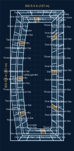
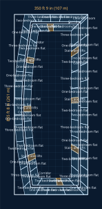

# P6-02 Starboard Towers 2: plan

Footprint 350 ft 9 in (107 m) × 855 ft 8 in (261 m) · structural grid 32 ft 10 in (10 m)

## Levels

| Level | Floor above deck | Height | Floor area |
|---|---|---|---|
| Level 1 · Ground floor | 0 ft (0 mm) | 14 ft 9 in (4,500 mm) | 131,692 sq ft (12,235 m²) |
| Level 2 · Flat floor 1 | 14 ft 9 in (4,500 mm) | 10 ft 6 in (3,200 mm) | 131,727 sq ft (12,238 m²) |
| Level 3 · Flat floor 2 | 25 ft 3 in (7,700 mm) | 10 ft 6 in (3,200 mm) | 131,727 sq ft (12,238 m²) |
| Level 4 · Flat floor 3 | 35 ft 9 in (11 m) | 10 ft 6 in (3,200 mm) | 131,727 sq ft (12,238 m²) |
| Level 5 · Flat floor 4 | 46 ft 3 in (14 m) | 10 ft 6 in (3,200 mm) | 131,727 sq ft (12,238 m²) |
| Level 6 · Flat floor 5 | 56 ft 9 in (17 m) | 10 ft 6 in (3,200 mm) | 131,727 sq ft (12,238 m²) |
| Level 7 · Flat floor 6 | 67 ft 3 in (20 m) | 10 ft 6 in (3,200 mm) | 131,727 sq ft (12,238 m²) |
| Level 8 · Flat floor 7 | 77 ft 9 in (24 m) | 10 ft 6 in (3,200 mm) | 131,727 sq ft (12,238 m²) |
| Level 9 · Flat floor 8 | 88 ft 3 in (27 m) | 10 ft 6 in (3,200 mm) | 131,727 sq ft (12,238 m²) |
| Level 10 · Flat floor 9 | 98 ft 9 in (30 m) | 10 ft 6 in (3,200 mm) | 131,727 sq ft (12,238 m²) |
| Level 11 · Flat floor 10 | 109 ft 3 in (33 m) | 10 ft 6 in (3,200 mm) | 131,727 sq ft (12,238 m²) |
| Level 12 · Flat floor 11 | 119 ft 9 in (36 m) | 10 ft 6 in (3,200 mm) | 131,727 sq ft (12,238 m²) |
| Level 13 · Flat floor 12 | 130 ft 3 in (40 m) | 10 ft 6 in (3,200 mm) | 131,727 sq ft (12,238 m²) |
| Level 14 · Flat floor 13 | 140 ft 9 in (43 m) | 10 ft 6 in (3,200 mm) | 131,727 sq ft (12,238 m²) |
| Level 15 · Flat floor 14 | 151 ft 3 in (46 m) | 10 ft 6 in (3,200 mm) | 131,727 sq ft (12,238 m²) |
| Level 16 · Flat floor 15 | 161 ft 9 in (49 m) | 10 ft 6 in (3,200 mm) | 131,727 sq ft (12,238 m²) |
| Level 17 · Flat floor 16 | 172 ft 3 in (52 m) | 10 ft 6 in (3,200 mm) | 131,727 sq ft (12,238 m²) |

## Elements

| ID | Designation | Type | Name | Level(s) | Size / length | Area | Status |
|---|---|---|---|---|---|---|---|
| E001 | D5F6P6B1A2L1R1 | zone | Lobby garden | L1 | 193 ft 3 in (59 m) × 698 ft 2 in (213 m) | 125,267 sq ft (11,638 m²) | proposed |
| E002 | D5F6P6B1A2L1R2 | zone | Corridor | L1 | 9 ft 10 in (3,000 mm) × 398 ft 7 in (122 m) | 3,875 sq ft (360 m²) | proposed |
| E003 | D5F6P6B1A2L1R3 | zone | Corridor | L1 | 20 ft (6,100 mm) × 388 ft 1 in (118 m) | 3,875 sq ft (360 m²) | proposed |
| E004 | D5F6P6B1A2L1R4 | zone | Corridor | L1 | 255 ft 11 in (78 m) × 179 ft 2 in (55 m) | 3,902 sq ft (363 m²) | proposed |
| E005 | D5F6P6B1A2L1R5 | zone | Corridor | L1 | 24 ft 11 in (7,600 mm) × 394 ft (120 m) | 3,883 sq ft (361 m²) | proposed |
| E006 | D5F6P6B1A2L1R6 | zone | Corridor | L1 | 220 ft 2 in (67 m) × 216 ft 6 in (66 m) | 3,893 sq ft (362 m²) | proposed |
| E007 | D5F6P6B1A2L1R7 | zone | Corridor | L1 | 56 ft 5 in (17 m) × 9 ft 10 in (3,000 mm) | 478 sq ft (44 m²) | proposed |
| E008 | D5F6P6B1A2L1R8, D5F6P6B1A2L2R1, D5F6P6B1A2L3R1, D5F6P6B1A2L4R1, D5F6P6B1A2L5R1, D5F6P6B1A2L6R1, D5F6P6B1A2L7R1, D5F6P6B1A2L8R1, D5F6P6B1A2L9R1, D5F6P6B1A2L10R1, D5F6P6B1A2L11R1, D5F6P6B1A2L12R1, D5F6P6B1A2L13R1, D5F6P6B1A2L14R1, D5F6P6B1A2L15R1, D5F6P6B1A2L16R1, D5F6P6B1A2L17R1 | core | Stairs and lifts | L1, L2, L3, L4, L5, L6, L7, L8, L9, L10, L11, L12, L13, L14, L15, L16, L17 | 34 ft 5 in (10 m) × 49 ft 10 in (15 m) | 904 sq ft (84 m²) | proposed |
| E009 | D5F6P6B1A2L1R9, D5F6P6B1A2L2R2, D5F6P6B1A2L3R2, D5F6P6B1A2L4R2, D5F6P6B1A2L5R2, D5F6P6B1A2L6R2, D5F6P6B1A2L7R2, D5F6P6B1A2L8R2, D5F6P6B1A2L9R2, D5F6P6B1A2L10R2, D5F6P6B1A2L11R2, D5F6P6B1A2L12R2, D5F6P6B1A2L13R2, D5F6P6B1A2L14R2, D5F6P6B1A2L15R2, D5F6P6B1A2L16R2, D5F6P6B1A2L17R2 | core | Stairs and lifts | L1, L2, L3, L4, L5, L6, L7, L8, L9, L10, L11, L12, L13, L14, L15, L16, L17 | 34 ft 5 in (10 m) × 27 ft 11 in (8,500 mm) | 899 sq ft (83 m²) | proposed |
| E010 | D5F6P6B1A2L1R10, D5F6P6B1A2L2R3, D5F6P6B1A2L3R3, D5F6P6B1A2L4R3, D5F6P6B1A2L5R3, D5F6P6B1A2L6R3, D5F6P6B1A2L7R3, D5F6P6B1A2L8R3, D5F6P6B1A2L9R3, D5F6P6B1A2L10R3, D5F6P6B1A2L11R3, D5F6P6B1A2L12R3, D5F6P6B1A2L13R3, D5F6P6B1A2L14R3, D5F6P6B1A2L15R3, D5F6P6B1A2L16R3, D5F6P6B1A2L17R3 | core | Stairs and lifts | L1, L2, L3, L4, L5, L6, L7, L8, L9, L10, L11, L12, L13, L14, L15, L16, L17 | 34 ft 5 in (10 m) × 46 ft 3 in (14 m) | 910 sq ft (85 m²) | proposed |
| E011 | D5F6P6B1A2L1R11, D5F6P6B1A2L2R4, D5F6P6B1A2L3R4, D5F6P6B1A2L4R4, D5F6P6B1A2L5R4, D5F6P6B1A2L6R4, D5F6P6B1A2L7R4, D5F6P6B1A2L8R4, D5F6P6B1A2L9R4, D5F6P6B1A2L10R4, D5F6P6B1A2L11R4, D5F6P6B1A2L12R4, D5F6P6B1A2L13R4, D5F6P6B1A2L14R4, D5F6P6B1A2L15R4, D5F6P6B1A2L16R4, D5F6P6B1A2L17R4 | core | Stairs and lifts | L1, L2, L3, L4, L5, L6, L7, L8, L9, L10, L11, L12, L13, L14, L15, L16, L17 | 35 ft 1 in (11 m) × 34 ft 5 in (10 m) | 904 sq ft (84 m²) | proposed |
| E012 | D5F6P6B1A2L1R12, D5F6P6B1A2L2R5, D5F6P6B1A2L3R5, D5F6P6B1A2L4R5, D5F6P6B1A2L5R5, D5F6P6B1A2L6R5, D5F6P6B1A2L7R5, D5F6P6B1A2L8R5, D5F6P6B1A2L9R5, D5F6P6B1A2L10R5, D5F6P6B1A2L11R5, D5F6P6B1A2L12R5, D5F6P6B1A2L13R5, D5F6P6B1A2L14R5, D5F6P6B1A2L15R5, D5F6P6B1A2L16R5, D5F6P6B1A2L17R5 | core | Stairs and lifts | L1, L2, L3, L4, L5, L6, L7, L8, L9, L10, L11, L12, L13, L14, L15, L16, L17 | 37 ft 1 in (11 m) × 38 ft 9 in (12 m) | 910 sq ft (85 m²) | proposed |
| E013 | D5F6P6B1A2L1R13, D5F6P6B1A2L2R6, D5F6P6B1A2L3R6, D5F6P6B1A2L4R6, D5F6P6B1A2L5R6, D5F6P6B1A2L6R6, D5F6P6B1A2L7R6, D5F6P6B1A2L8R6, D5F6P6B1A2L9R6, D5F6P6B1A2L10R6, D5F6P6B1A2L11R6, D5F6P6B1A2L12R6, D5F6P6B1A2L13R6, D5F6P6B1A2L14R6, D5F6P6B1A2L15R6, D5F6P6B1A2L16R6, D5F6P6B1A2L17R6 | core | Stairs and lifts | L1, L2, L3, L4, L5, L6, L7, L8, L9, L10, L11, L12, L13, L14, L15, L16, L17 | 35 ft 5 in (11 m) × 26 ft 11 in (8,200 mm) | 905 sq ft (84 m²) | proposed |
| E014 | D5F6P6B1A2L1R14, D5F6P6B1A2L2R7, D5F6P6B1A2L3R7, D5F6P6B1A2L4R7, D5F6P6B1A2L5R7, D5F6P6B1A2L6R7, D5F6P6B1A2L7R7, D5F6P6B1A2L8R7, D5F6P6B1A2L9R7, D5F6P6B1A2L10R7, D5F6P6B1A2L11R7, D5F6P6B1A2L12R7, D5F6P6B1A2L13R7, D5F6P6B1A2L14R7, D5F6P6B1A2L15R7, D5F6P6B1A2L16R7, D5F6P6B1A2L17R7 | core | Stairs and lifts | L1, L2, L3, L4, L5, L6, L7, L8, L9, L10, L11, L12, L13, L14, L15, L16, L17 | 37 ft 9 in (12 m) × 31 ft 10 in (9,700 mm) | 903 sq ft (84 m²) | proposed |
| E015 | D5F6P6B1A2L1R15, D5F6P6B1A2L2R8, D5F6P6B1A2L3R8, D5F6P6B1A2L4R8, D5F6P6B1A2L5R8, D5F6P6B1A2L6R8, D5F6P6B1A2L7R8, D5F6P6B1A2L8R8, D5F6P6B1A2L9R8, D5F6P6B1A2L10R8, D5F6P6B1A2L11R8, D5F6P6B1A2L12R8, D5F6P6B1A2L13R8, D5F6P6B1A2L14R8, D5F6P6B1A2L15R8, D5F6P6B1A2L16R8, D5F6P6B1A2L17R8 | core | Stairs and lifts | L1, L2, L3, L4, L5, L6, L7, L8, L9, L10, L11, L12, L13, L14, L15, L16, L17 | 30 ft 10 in (9,400 mm) × 34 ft 5 in (10 m) | 899 sq ft (83 m²) | proposed |
| E016 | D5F6P6B1A2L1R16 | room | Entrance lobby | L1 | 34 ft 5 in (10 m) × 58 ft 5 in (18 m) | 859 sq ft (80 m²) | proposed |
| E017 | D5F6P6B1A2L1R17 | room | Bike and pram store | L1 | 34 ft 5 in (10 m) × 50 ft 6 in (15 m) | 650 sq ft (60 m²) | proposed |
| E018 | D5F6P6B1A2L1R18 | room | Bin store | L1 | 34 ft 5 in (10 m) × 42 ft 4 in (13 m) | 413 sq ft (38 m²) | proposed |
| E019 | D5F6P6B1A2L1R19 | room | Two-bedroom flat | L1 | 34 ft 5 in (10 m) × 106 ft 4 in (32 m) | 2,746 sq ft (255 m²) | proposed |
| E020 | D5F6P6B1A2L1R20 | room | Three-bedroom flat | L1 | 34 ft 5 in (10 m) × 99 ft 5 in (30 m) | 2,741 sq ft (255 m²) | proposed |
| E021 | D5F6P6B1A2L1R21 | room | One-bedroom flat | L1 | 34 ft 5 in (10 m) × 61 ft 4 in (19 m) | 1,616 sq ft (150 m²) | proposed |
| E022 | D5F6P6B1A2L1R22 | room | Two-bedroom flat | L1 | 34 ft 5 in (10 m) × 88 ft 11 in (27 m) | 2,746 sq ft (255 m²) | proposed |
| E023 | D5F6P6B1A2L1R23 | room | Three-bedroom flat | L1 | 34 ft 5 in (10 m) × 83 ft (25 m) | 2,741 sq ft (255 m²) | proposed |
| E024 | D5F6P6B1A2L1R24 | room | One-bedroom flat | L1 | 34 ft 5 in (10 m) × 49 ft 10 in (15 m) | 1,616 sq ft (150 m²) | proposed |
| E025 | D5F6P6B1A2L1R25 | room | Two-bedroom flat | L1 | 34 ft 5 in (10 m) × 87 ft 11 in (27 m) | 2,746 sq ft (255 m²) | proposed |
| E026 | D5F6P6B1A2L1R26 | room | Three-bedroom flat | L1 | 34 ft 5 in (10 m) × 94 ft 6 in (29 m) | 2,746 sq ft (255 m²) | proposed |
| E027 | D5F6P6B1A2L1R27 | room | One-bedroom flat | L1 | 34 ft 5 in (10 m) × 66 ft 11 in (20 m) | 1,616 sq ft (150 m²) | proposed |
| E028 | D5F6P6B1A2L1R28 | room | Two-bedroom flat | L1 | 34 ft 5 in (10 m) × 105 ft (32 m) | 2,741 sq ft (255 m²) | proposed |
| E029 | D5F6P6B1A2L1R29 | room | Three-bedroom flat | L1 | 45 ft 7 in (14 m) × 98 ft 9 in (30 m) | 2,746 sq ft (255 m²) | proposed |
| E030 | D5F6P6B1A2L1R30 | room | One-bedroom flat | L1 | 72 ft 10 in (22 m) × 34 ft 5 in (10 m) | 1,616 sq ft (150 m²) | proposed |
| E031 | D5F6P6B1A2L1R31 | room | Two-bedroom flat | L1 | 90 ft 7 in (28 m) × 34 ft 5 in (10 m) | 2,741 sq ft (255 m²) | proposed |
| E032 | D5F6P6B1A2L1R32 | room | Three-bedroom flat | L1 | 89 ft 3 in (27 m) × 34 ft 5 in (10 m) | 2,746 sq ft (255 m²) | proposed |
| E033 | D5F6P6B1A2L1R33 | room | One-bedroom flat | L1 | 69 ft 11 in (21 m) × 34 ft 5 in (10 m) | 1,616 sq ft (150 m²) | proposed |
| E034 | D5F6P6B1A2L1R34 | room | Two-bedroom flat | L1 | 45 ft 11 in (14 m) × 103 ft 8 in (32 m) | 2,744 sq ft (255 m²) | proposed |
| E035 | D5F6P6B1A2L1R35 | room | Three-bedroom flat | L1 | 44 ft 11 in (14 m) × 95 ft 10 in (29 m) | 2,747 sq ft (255 m²) | proposed |
| E036 | D5F6P6B1A2L1R36 | room | One-bedroom flat | L1 | 41 ft (12 m) × 54 ft 2 in (16 m) | 1,614 sq ft (150 m²) | proposed |
| E037 | D5F6P6B1A2L1R37 | room | Two-bedroom flat | L1 | 42 ft (13 m) × 83 ft (25 m) | 2,737 sq ft (254 m²) | proposed |
| E038 | D5F6P6B1A2L1R38 | room | Three-bedroom flat | L1 | 38 ft 9 in (12 m) × 81 ft 4 in (25 m) | 2,746 sq ft (255 m²) | proposed |
| E039 | D5F6P6B1A2L1R39 | room | One-bedroom flat | L1 | 36 ft 1 in (11 m) × 47 ft 3 in (14 m) | 1,611 sq ft (150 m²) | proposed |
| E040 | D5F6P6B1A2L1R40 | room | Two-bedroom flat | L1 | 37 ft 1 in (11 m) × 80 ft 5 in (24 m) | 2,743 sq ft (255 m²) | proposed |
| E041 | D5F6P6B1A2L1R41 | room | Three-bedroom flat | L1 | 40 ft 4 in (12 m) × 82 ft (25 m) | 2,749 sq ft (255 m²) | proposed |
| E042 | D5F6P6B1A2L1R42 | room | One-bedroom flat | L1 | 38 ft 9 in (12 m) × 50 ft 2 in (15 m) | 1,606 sq ft (149 m²) | proposed |
| E043 | D5F6P6B1A2L1R43 | room | Two-bedroom flat | L1 | 45 ft 3 in (14 m) × 87 ft 11 in (27 m) | 2,740 sq ft (255 m²) | proposed |
| E044 | D5F6P6B1A2L1R44 | room | Three-bedroom flat | L1 | 44 ft 3 in (14 m) × 99 ft 1 in (30 m) | 2,737 sq ft (254 m²) | proposed |
| E045 | D5F6P6B1A2L1R45 | room | One-bedroom flat | L1 | 37 ft 5 in (11 m) × 76 ft 5 in (23 m) | 1,613 sq ft (150 m²) | proposed |
| E046 | D5F6P6B1A2L1R46 | room | Two-bedroom flat | L1 | 94 ft 10 in (29 m) × 40 ft 4 in (12 m) | 2,741 sq ft (255 m²) | proposed |
| E047 | D5F6P6B1A2L1R47 | room | Three-bedroom flat | L1 | 89 ft 3 in (27 m) × 34 ft 5 in (10 m) | 2,746 sq ft (255 m²) | proposed |
| E048 | D5F6P6B1A2L1R48 | room | One-bedroom flat | L1 | 59 ft 1 in (18 m) × 34 ft 5 in (10 m) | 1,611 sq ft (150 m²) | proposed |
| E049 | D5F6P6B1A2L1R49 | room | Two-bedroom flat | L1 | 96 ft 2 in (29 m) × 34 ft 5 in (10 m) | 2,413 sq ft (224 m²) | proposed |
| E050 | D5F6P6B1A2L1R50 | room | Three-bedroom flat | L1 | 34 ft 5 in (10 m) × 110 ft 3 in (34 m) | 2,741 sq ft (255 m²) | proposed |
| E051 | D5F6P6B1A2L1R51 | room | One-bedroom flat | L1 | 34 ft 5 in (10 m) × 48 ft 7 in (15 m) | 780 sq ft (72 m²) | proposed |
| E052 | D5F6P6B1A2L1R52 | room | Two-bedroom flat | L1 | 34 ft 5 in (10 m) × 98 ft 5 in (30 m) | 2,746 sq ft (255 m²) | proposed |
| E053 | D5F6P6B1A2L1R53 | room | Three-bedroom flat | L1 | 34 ft 5 in (10 m) × 90 ft 11 in (28 m) | 2,746 sq ft (255 m²) | proposed |
| E054 | D5F6P6B1A2L1R54 | room | One-bedroom flat | L1 | 34 ft 5 in (10 m) × 50 ft 2 in (15 m) | 1,554 sq ft (144 m²) | proposed |
| E055 | D5F6P6B1A2L1R55 | room | Two-bedroom flat | L1 | 34 ft 5 in (10 m) × 83 ft 8 in (26 m) | 2,752 sq ft (256 m²) | proposed |
| E056 | D5F6P6B1A2L1R56 | room | Three-bedroom flat | L1 | 34 ft 5 in (10 m) × 90 ft 3 in (28 m) | 2,741 sq ft (255 m²) | proposed |
| E057 | D5F6P6B1A2L1R57 | room | One-bedroom flat | L1 | 34 ft 5 in (10 m) × 61 ft 8 in (19 m) | 1,554 sq ft (144 m²) | proposed |
| E058 | D5F6P6B1A2L1R58 | room | Two-bedroom flat | L1 | 34 ft 5 in (10 m) × 104 ft 4 in (32 m) | 2,741 sq ft (255 m²) | proposed |
| E059 | D5F6P6B1A2L1R59 | room | Three-bedroom flat | L1 | 48 ft 3 in (15 m) × 94 ft 6 in (29 m) | 2,746 sq ft (255 m²) | proposed |
| E060 | D5F6P6B1A2L1R60 | room | One-bedroom flat | L1 | 65 ft 11 in (20 m) × 34 ft 5 in (10 m) | 1,554 sq ft (144 m²) | proposed |
| E061 | D5F6P6B1A2L1R61 | room | Two-bedroom flat | L1 | 93 ft 2 in (28 m) × 34 ft 5 in (10 m) | 2,746 sq ft (255 m²) | proposed |
| E062 | D5F6P6B1A2L1R62 | room | Three-bedroom flat | L1 | 56 ft 1 in (17 m) × 87 ft 11 in (27 m) | 2,741 sq ft (255 m²) | proposed |
| E063 | D5F6P6B1A2L1R63 | room | One-bedroom flat | L1 | 39 ft 1 in (12 m) × 63 ft 8 in (19 m) | 1,553 sq ft (144 m²) | proposed |
| E064 | D5F6P6B1A2L1R64 | room | Two-bedroom flat | L1 | 43 ft 8 in (13 m) × 85 ft 8 in (26 m) | 2,741 sq ft (255 m²) | proposed |
| E065 | D5F6P6B1A2L1R65 | room | Three-bedroom flat | L1 | 40 ft 8 in (12 m) × 82 ft (25 m) | 2,752 sq ft (256 m²) | proposed |
| E066 | D5F6P6B1A2L1R66 | room | One-bedroom flat | L1 | 36 ft 1 in (11 m) × 46 ft 7 in (14 m) | 1,556 sq ft (145 m²) | proposed |
| E067 | D5F6P6B1A2L1R67 | room | Two-bedroom flat | L1 | 37 ft 1 in (11 m) × 80 ft 9 in (25 m) | 2,749 sq ft (255 m²) | proposed |
| E068 | D5F6P6B1A2L1R68 | room | Three-bedroom flat | L1 | 40 ft 4 in (12 m) × 81 ft 8 in (25 m) | 2,737 sq ft (254 m²) | proposed |
| E069 | D5F6P6B1A2L1R69 | room | One-bedroom flat | L1 | 38 ft 5 in (12 m) × 48 ft 11 in (15 m) | 1,555 sq ft (144 m²) | proposed |
| E070 | D5F6P6B1A2L1R70 | room | Two-bedroom flat | L1 | 45 ft 3 in (14 m) × 93 ft 6 in (28 m) | 2,743 sq ft (255 m²) | proposed |
| E071 | D5F6P6B1A2L1R71 | room | Three-bedroom flat | L1 | 52 ft 6 in (16 m) × 93 ft 2 in (28 m) | 2,740 sq ft (255 m²) | proposed |
| E072 | D5F6P6B1A2L1R72 | room | One-bedroom flat | L1 | 62 ft (19 m) × 34 ft 5 in (10 m) | 1,554 sq ft (144 m²) | proposed |
| E073 | D5F6P6B1A2L1R73 | room | Two-bedroom flat | L1 | 119 ft 9 in (37 m) × 34 ft 5 in (10 m) | 3,526 sq ft (328 m²) | proposed |
| E074 | D5F6P6B1A2L2R9, D5F6P6B1A2L3R9, D5F6P6B1A2L4R9, D5F6P6B1A2L5R9, D5F6P6B1A2L6R9, D5F6P6B1A2L7R9, D5F6P6B1A2L8R9, D5F6P6B1A2L9R9, D5F6P6B1A2L10R9, D5F6P6B1A2L11R9, D5F6P6B1A2L12R9, D5F6P6B1A2L13R9, D5F6P6B1A2L14R9, D5F6P6B1A2L15R9, D5F6P6B1A2L16R9, D5F6P6B1A2L17R9 | zone | Corridor | L2, L3, L4, L5, L6, L7, L8, L9, L10, L11, L12, L13, L14, L15, L16, L17 | 9 ft 10 in (3,000 mm) × 398 ft 7 in (122 m) | 3,875 sq ft (360 m²) | proposed |
| E075 | D5F6P6B1A2L2R10, D5F6P6B1A2L3R10, D5F6P6B1A2L4R10, D5F6P6B1A2L5R10, D5F6P6B1A2L6R10, D5F6P6B1A2L7R10, D5F6P6B1A2L8R10, D5F6P6B1A2L9R10, D5F6P6B1A2L10R10, D5F6P6B1A2L11R10, D5F6P6B1A2L12R10, D5F6P6B1A2L13R10, D5F6P6B1A2L14R10, D5F6P6B1A2L15R10, D5F6P6B1A2L16R10, D5F6P6B1A2L17R10 | zone | Corridor | L2, L3, L4, L5, L6, L7, L8, L9, L10, L11, L12, L13, L14, L15, L16, L17 | 20 ft (6,100 mm) × 388 ft 1 in (118 m) | 3,875 sq ft (360 m²) | proposed |
| E076 | D5F6P6B1A2L2R11, D5F6P6B1A2L3R11, D5F6P6B1A2L4R11, D5F6P6B1A2L5R11, D5F6P6B1A2L6R11, D5F6P6B1A2L7R11, D5F6P6B1A2L8R11, D5F6P6B1A2L9R11, D5F6P6B1A2L10R11, D5F6P6B1A2L11R11, D5F6P6B1A2L12R11, D5F6P6B1A2L13R11, D5F6P6B1A2L14R11, D5F6P6B1A2L15R11, D5F6P6B1A2L16R11, D5F6P6B1A2L17R11 | zone | Corridor | L2, L3, L4, L5, L6, L7, L8, L9, L10, L11, L12, L13, L14, L15, L16, L17 | 255 ft 11 in (78 m) × 179 ft 2 in (55 m) | 3,902 sq ft (363 m²) | proposed |
| E077 | D5F6P6B1A2L2R12, D5F6P6B1A2L3R12, D5F6P6B1A2L4R12, D5F6P6B1A2L5R12, D5F6P6B1A2L6R12, D5F6P6B1A2L7R12, D5F6P6B1A2L8R12, D5F6P6B1A2L9R12, D5F6P6B1A2L10R12, D5F6P6B1A2L11R12, D5F6P6B1A2L12R12, D5F6P6B1A2L13R12, D5F6P6B1A2L14R12, D5F6P6B1A2L15R12, D5F6P6B1A2L16R12, D5F6P6B1A2L17R12 | zone | Corridor | L2, L3, L4, L5, L6, L7, L8, L9, L10, L11, L12, L13, L14, L15, L16, L17 | 24 ft 11 in (7,600 mm) × 394 ft (120 m) | 3,883 sq ft (361 m²) | proposed |
| E078 | D5F6P6B1A2L2R13, D5F6P6B1A2L3R13, D5F6P6B1A2L4R13, D5F6P6B1A2L5R13, D5F6P6B1A2L6R13, D5F6P6B1A2L7R13, D5F6P6B1A2L8R13, D5F6P6B1A2L9R13, D5F6P6B1A2L10R13, D5F6P6B1A2L11R13, D5F6P6B1A2L12R13, D5F6P6B1A2L13R13, D5F6P6B1A2L14R13, D5F6P6B1A2L15R13, D5F6P6B1A2L16R13, D5F6P6B1A2L17R13 | zone | Corridor | L2, L3, L4, L5, L6, L7, L8, L9, L10, L11, L12, L13, L14, L15, L16, L17 | 220 ft 2 in (67 m) × 216 ft 6 in (66 m) | 3,893 sq ft (362 m²) | proposed |
| E079 | D5F6P6B1A2L2R14, D5F6P6B1A2L3R14, D5F6P6B1A2L4R14, D5F6P6B1A2L5R14, D5F6P6B1A2L6R14, D5F6P6B1A2L7R14, D5F6P6B1A2L8R14, D5F6P6B1A2L9R14, D5F6P6B1A2L10R14, D5F6P6B1A2L11R14, D5F6P6B1A2L12R14, D5F6P6B1A2L13R14, D5F6P6B1A2L14R14, D5F6P6B1A2L15R14, D5F6P6B1A2L16R14, D5F6P6B1A2L17R14 | zone | Corridor | L2, L3, L4, L5, L6, L7, L8, L9, L10, L11, L12, L13, L14, L15, L16, L17 | 56 ft 5 in (17 m) × 9 ft 10 in (3,000 mm) | 478 sq ft (44 m²) | proposed |
| E080 | D5F6P6B1A2L2R15, D5F6P6B1A2L3R15, D5F6P6B1A2L4R15, D5F6P6B1A2L5R15, D5F6P6B1A2L6R15, D5F6P6B1A2L7R15, D5F6P6B1A2L8R15, D5F6P6B1A2L9R15, D5F6P6B1A2L10R15, D5F6P6B1A2L11R15, D5F6P6B1A2L12R15, D5F6P6B1A2L13R15, D5F6P6B1A2L14R15, D5F6P6B1A2L15R15, D5F6P6B1A2L16R15, D5F6P6B1A2L17R15 | room | Cleaners' room | L2, L3, L4, L5, L6, L7, L8, L9, L10, L11, L12, L13, L14, L15, L16, L17 | 34 ft 5 in (10 m) × 45 ft 11 in (14 m) | 413 sq ft (38 m²) | proposed |
| E081 | D5F6P6B1A2L2R16, D5F6P6B1A2L3R16, D5F6P6B1A2L4R16, D5F6P6B1A2L5R16, D5F6P6B1A2L6R16, D5F6P6B1A2L7R16, D5F6P6B1A2L8R16, D5F6P6B1A2L9R16, D5F6P6B1A2L10R16, D5F6P6B1A2L11R16, D5F6P6B1A2L12R16, D5F6P6B1A2L13R16, D5F6P6B1A2L14R16, D5F6P6B1A2L15R16, D5F6P6B1A2L16R16, D5F6P6B1A2L17R16 | room | Two-bedroom flat | L2, L3, L4, L5, L6, L7, L8, L9, L10, L11, L12, L13, L14, L15, L16, L17 | 34 ft 5 in (10 m) × 109 ft 11 in (34 m) | 2,746 sq ft (255 m²) | proposed |
| E082 | D5F6P6B1A2L2R17, D5F6P6B1A2L3R17, D5F6P6B1A2L4R17, D5F6P6B1A2L5R17, D5F6P6B1A2L6R17, D5F6P6B1A2L7R17, D5F6P6B1A2L8R17, D5F6P6B1A2L9R17, D5F6P6B1A2L10R17, D5F6P6B1A2L11R17, D5F6P6B1A2L12R17, D5F6P6B1A2L13R17, D5F6P6B1A2L14R17, D5F6P6B1A2L15R17, D5F6P6B1A2L16R17, D5F6P6B1A2L17R17 | room | Three-bedroom flat | L2, L3, L4, L5, L6, L7, L8, L9, L10, L11, L12, L13, L14, L15, L16, L17 | 34 ft 5 in (10 m) × 103 ft 4 in (32 m) | 2,746 sq ft (255 m²) | proposed |
| E083 | D5F6P6B1A2L2R18, D5F6P6B1A2L3R18, D5F6P6B1A2L4R18, D5F6P6B1A2L5R18, D5F6P6B1A2L6R18, D5F6P6B1A2L7R18, D5F6P6B1A2L8R18, D5F6P6B1A2L9R18, D5F6P6B1A2L10R18, D5F6P6B1A2L11R18, D5F6P6B1A2L12R18, D5F6P6B1A2L13R18, D5F6P6B1A2L14R18, D5F6P6B1A2L15R18, D5F6P6B1A2L16R18, D5F6P6B1A2L17R18 | room | One-bedroom flat | L2, L3, L4, L5, L6, L7, L8, L9, L10, L11, L12, L13, L14, L15, L16, L17 | 34 ft 5 in (10 m) × 65 ft (20 m) | 1,611 sq ft (150 m²) | proposed |
| E084 | D5F6P6B1A2L2R19, D5F6P6B1A2L3R19, D5F6P6B1A2L4R19, D5F6P6B1A2L5R19, D5F6P6B1A2L6R19, D5F6P6B1A2L7R19, D5F6P6B1A2L8R19, D5F6P6B1A2L9R19, D5F6P6B1A2L10R19, D5F6P6B1A2L11R19, D5F6P6B1A2L12R19, D5F6P6B1A2L13R19, D5F6P6B1A2L14R19, D5F6P6B1A2L15R19, D5F6P6B1A2L16R19, D5F6P6B1A2L17R19 | room | Two-bedroom flat | L2, L3, L4, L5, L6, L7, L8, L9, L10, L11, L12, L13, L14, L15, L16, L17 | 34 ft 5 in (10 m) × 92 ft 6 in (28 m) | 2,746 sq ft (255 m²) | proposed |
| E085 | D5F6P6B1A2L2R20, D5F6P6B1A2L3R20, D5F6P6B1A2L4R20, D5F6P6B1A2L5R20, D5F6P6B1A2L6R20, D5F6P6B1A2L7R20, D5F6P6B1A2L8R20, D5F6P6B1A2L9R20, D5F6P6B1A2L10R20, D5F6P6B1A2L11R20, D5F6P6B1A2L12R20, D5F6P6B1A2L13R20, D5F6P6B1A2L14R20, D5F6P6B1A2L15R20, D5F6P6B1A2L16R20, D5F6P6B1A2L17R20 | room | Three-bedroom flat | L2, L3, L4, L5, L6, L7, L8, L9, L10, L11, L12, L13, L14, L15, L16, L17 | 34 ft 5 in (10 m) × 85 ft 11 in (26 m) | 2,746 sq ft (255 m²) | proposed |
| E086 | D5F6P6B1A2L2R21, D5F6P6B1A2L3R21, D5F6P6B1A2L4R21, D5F6P6B1A2L5R21, D5F6P6B1A2L6R21, D5F6P6B1A2L7R21, D5F6P6B1A2L8R21, D5F6P6B1A2L9R21, D5F6P6B1A2L10R21, D5F6P6B1A2L11R21, D5F6P6B1A2L12R21, D5F6P6B1A2L13R21, D5F6P6B1A2L14R21, D5F6P6B1A2L15R21, D5F6P6B1A2L16R21, D5F6P6B1A2L17R21 | room | One-bedroom flat | L2, L3, L4, L5, L6, L7, L8, L9, L10, L11, L12, L13, L14, L15, L16, L17 | 34 ft 5 in (10 m) × 48 ft 11 in (15 m) | 1,616 sq ft (150 m²) | proposed |
| E087 | D5F6P6B1A2L2R22, D5F6P6B1A2L3R22, D5F6P6B1A2L4R22, D5F6P6B1A2L5R22, D5F6P6B1A2L6R22, D5F6P6B1A2L7R22, D5F6P6B1A2L8R22, D5F6P6B1A2L9R22, D5F6P6B1A2L10R22, D5F6P6B1A2L11R22, D5F6P6B1A2L12R22, D5F6P6B1A2L13R22, D5F6P6B1A2L14R22, D5F6P6B1A2L15R22, D5F6P6B1A2L16R22, D5F6P6B1A2L17R22 | room | Two-bedroom flat | L2, L3, L4, L5, L6, L7, L8, L9, L10, L11, L12, L13, L14, L15, L16, L17 | 34 ft 5 in (10 m) × 84 ft (26 m) | 2,741 sq ft (255 m²) | proposed |
| E088 | D5F6P6B1A2L2R23, D5F6P6B1A2L3R23, D5F6P6B1A2L4R23, D5F6P6B1A2L5R23, D5F6P6B1A2L6R23, D5F6P6B1A2L7R23, D5F6P6B1A2L8R23, D5F6P6B1A2L9R23, D5F6P6B1A2L10R23, D5F6P6B1A2L11R23, D5F6P6B1A2L12R23, D5F6P6B1A2L13R23, D5F6P6B1A2L14R23, D5F6P6B1A2L15R23, D5F6P6B1A2L16R23, D5F6P6B1A2L17R23 | room | Three-bedroom flat | L2, L3, L4, L5, L6, L7, L8, L9, L10, L11, L12, L13, L14, L15, L16, L17 | 34 ft 5 in (10 m) × 90 ft 11 in (28 m) | 2,746 sq ft (255 m²) | proposed |
| E089 | D5F6P6B1A2L2R24, D5F6P6B1A2L3R24, D5F6P6B1A2L4R24, D5F6P6B1A2L5R24, D5F6P6B1A2L6R24, D5F6P6B1A2L7R24, D5F6P6B1A2L8R24, D5F6P6B1A2L9R24, D5F6P6B1A2L10R24, D5F6P6B1A2L11R24, D5F6P6B1A2L12R24, D5F6P6B1A2L13R24, D5F6P6B1A2L14R24, D5F6P6B1A2L15R24, D5F6P6B1A2L16R24, D5F6P6B1A2L17R24 | room | One-bedroom flat | L2, L3, L4, L5, L6, L7, L8, L9, L10, L11, L12, L13, L14, L15, L16, L17 | 34 ft 5 in (10 m) × 63 ft 4 in (19 m) | 1,616 sq ft (150 m²) | proposed |
| E090 | D5F6P6B1A2L2R25, D5F6P6B1A2L3R25, D5F6P6B1A2L4R25, D5F6P6B1A2L5R25, D5F6P6B1A2L6R25, D5F6P6B1A2L7R25, D5F6P6B1A2L8R25, D5F6P6B1A2L9R25, D5F6P6B1A2L10R25, D5F6P6B1A2L11R25, D5F6P6B1A2L12R25, D5F6P6B1A2L13R25, D5F6P6B1A2L14R25, D5F6P6B1A2L15R25, D5F6P6B1A2L16R25, D5F6P6B1A2L17R25 | room | Two-bedroom flat | L2, L3, L4, L5, L6, L7, L8, L9, L10, L11, L12, L13, L14, L15, L16, L17 | 34 ft 5 in (10 m) × 101 ft 5 in (31 m) | 2,741 sq ft (255 m²) | proposed |
| E091 | D5F6P6B1A2L2R26, D5F6P6B1A2L3R26, D5F6P6B1A2L4R26, D5F6P6B1A2L5R26, D5F6P6B1A2L6R26, D5F6P6B1A2L7R26, D5F6P6B1A2L8R26, D5F6P6B1A2L9R26, D5F6P6B1A2L10R26, D5F6P6B1A2L11R26, D5F6P6B1A2L12R26, D5F6P6B1A2L13R26, D5F6P6B1A2L14R26, D5F6P6B1A2L15R26, D5F6P6B1A2L16R26, D5F6P6B1A2L17R26 | room | Three-bedroom flat | L2, L3, L4, L5, L6, L7, L8, L9, L10, L11, L12, L13, L14, L15, L16, L17 | 34 ft 5 in (10 m) × 108 ft 3 in (33 m) | 2,746 sq ft (255 m²) | proposed |
| E092 | D5F6P6B1A2L2R27, D5F6P6B1A2L3R27, D5F6P6B1A2L4R27, D5F6P6B1A2L5R27, D5F6P6B1A2L6R27, D5F6P6B1A2L7R27, D5F6P6B1A2L8R27, D5F6P6B1A2L9R27, D5F6P6B1A2L10R27, D5F6P6B1A2L11R27, D5F6P6B1A2L12R27, D5F6P6B1A2L13R27, D5F6P6B1A2L14R27, D5F6P6B1A2L15R27, D5F6P6B1A2L16R27, D5F6P6B1A2L17R27 | room | One-bedroom flat | L2, L3, L4, L5, L6, L7, L8, L9, L10, L11, L12, L13, L14, L15, L16, L17 | 48 ft 3 in (15 m) × 64 ft 4 in (20 m) | 1,616 sq ft (150 m²) | proposed |
| E093 | D5F6P6B1A2L2R28, D5F6P6B1A2L3R28, D5F6P6B1A2L4R28, D5F6P6B1A2L5R28, D5F6P6B1A2L6R28, D5F6P6B1A2L7R28, D5F6P6B1A2L8R28, D5F6P6B1A2L9R28, D5F6P6B1A2L10R28, D5F6P6B1A2L11R28, D5F6P6B1A2L12R28, D5F6P6B1A2L13R28, D5F6P6B1A2L14R28, D5F6P6B1A2L15R28, D5F6P6B1A2L16R28, D5F6P6B1A2L17R28 | room | Two-bedroom flat | L2, L3, L4, L5, L6, L7, L8, L9, L10, L11, L12, L13, L14, L15, L16, L17 | 101 ft 1 in (31 m) × 34 ft 5 in (10 m) | 2,746 sq ft (255 m²) | proposed |
| E094 | D5F6P6B1A2L2R29, D5F6P6B1A2L3R29, D5F6P6B1A2L4R29, D5F6P6B1A2L5R29, D5F6P6B1A2L6R29, D5F6P6B1A2L7R29, D5F6P6B1A2L8R29, D5F6P6B1A2L9R29, D5F6P6B1A2L10R29, D5F6P6B1A2L11R29, D5F6P6B1A2L12R29, D5F6P6B1A2L13R29, D5F6P6B1A2L14R29, D5F6P6B1A2L15R29, D5F6P6B1A2L16R29, D5F6P6B1A2L17R29 | room | Three-bedroom flat | L2, L3, L4, L5, L6, L7, L8, L9, L10, L11, L12, L13, L14, L15, L16, L17 | 89 ft 3 in (27 m) × 34 ft 5 in (10 m) | 2,746 sq ft (255 m²) | proposed |
| E095 | D5F6P6B1A2L2R30, D5F6P6B1A2L3R30, D5F6P6B1A2L4R30, D5F6P6B1A2L5R30, D5F6P6B1A2L6R30, D5F6P6B1A2L7R30, D5F6P6B1A2L8R30, D5F6P6B1A2L9R30, D5F6P6B1A2L10R30, D5F6P6B1A2L11R30, D5F6P6B1A2L12R30, D5F6P6B1A2L13R30, D5F6P6B1A2L14R30, D5F6P6B1A2L15R30, D5F6P6B1A2L16R30, D5F6P6B1A2L17R30 | room | One-bedroom flat | L2, L3, L4, L5, L6, L7, L8, L9, L10, L11, L12, L13, L14, L15, L16, L17 | 59 ft 5 in (18 m) × 34 ft 5 in (10 m) | 1,616 sq ft (150 m²) | proposed |
| E096 | D5F6P6B1A2L2R31, D5F6P6B1A2L3R31, D5F6P6B1A2L4R31, D5F6P6B1A2L5R31, D5F6P6B1A2L6R31, D5F6P6B1A2L7R31, D5F6P6B1A2L8R31, D5F6P6B1A2L9R31, D5F6P6B1A2L10R31, D5F6P6B1A2L11R31, D5F6P6B1A2L12R31, D5F6P6B1A2L13R31, D5F6P6B1A2L14R31, D5F6P6B1A2L15R31, D5F6P6B1A2L16R31, D5F6P6B1A2L17R31 | room | Two-bedroom flat | L2, L3, L4, L5, L6, L7, L8, L9, L10, L11, L12, L13, L14, L15, L16, L17 | 76 ft 9 in (23 m) × 63 ft 8 in (19 m) | 2,742 sq ft (255 m²) | proposed |
| E097 | D5F6P6B1A2L2R32, D5F6P6B1A2L3R32, D5F6P6B1A2L4R32, D5F6P6B1A2L5R32, D5F6P6B1A2L6R32, D5F6P6B1A2L7R32, D5F6P6B1A2L8R32, D5F6P6B1A2L9R32, D5F6P6B1A2L10R32, D5F6P6B1A2L11R32, D5F6P6B1A2L12R32, D5F6P6B1A2L13R32, D5F6P6B1A2L14R32, D5F6P6B1A2L15R32, D5F6P6B1A2L16R32, D5F6P6B1A2L17R32 | room | Three-bedroom flat | L2, L3, L4, L5, L6, L7, L8, L9, L10, L11, L12, L13, L14, L15, L16, L17 | 44 ft (13 m) × 102 ft 4 in (31 m) | 2,753 sq ft (256 m²) | proposed |
| E098 | D5F6P6B1A2L2R33, D5F6P6B1A2L3R33, D5F6P6B1A2L4R33, D5F6P6B1A2L5R33, D5F6P6B1A2L6R33, D5F6P6B1A2L7R33, D5F6P6B1A2L8R33, D5F6P6B1A2L9R33, D5F6P6B1A2L10R33, D5F6P6B1A2L11R33, D5F6P6B1A2L12R33, D5F6P6B1A2L13R33, D5F6P6B1A2L14R33, D5F6P6B1A2L15R33, D5F6P6B1A2L16R33, D5F6P6B1A2L17R33 | room | One-bedroom flat | L2, L3, L4, L5, L6, L7, L8, L9, L10, L11, L12, L13, L14, L15, L16, L17 | 40 ft (12 m) × 60 ft 8 in (18 m) | 1,617 sq ft (150 m²) | proposed |
| E099 | D5F6P6B1A2L2R34, D5F6P6B1A2L3R34, D5F6P6B1A2L4R34, D5F6P6B1A2L5R34, D5F6P6B1A2L6R34, D5F6P6B1A2L7R34, D5F6P6B1A2L8R34, D5F6P6B1A2L9R34, D5F6P6B1A2L10R34, D5F6P6B1A2L11R34, D5F6P6B1A2L12R34, D5F6P6B1A2L13R34, D5F6P6B1A2L14R34, D5F6P6B1A2L15R34, D5F6P6B1A2L16R34, D5F6P6B1A2L17R34 | room | Two-bedroom flat | L2, L3, L4, L5, L6, L7, L8, L9, L10, L11, L12, L13, L14, L15, L16, L17 | 44 ft 3 in (14 m) × 86 ft 3 in (26 m) | 2,746 sq ft (255 m²) | proposed |
| E100 | D5F6P6B1A2L2R35, D5F6P6B1A2L3R35, D5F6P6B1A2L4R35, D5F6P6B1A2L5R35, D5F6P6B1A2L6R35, D5F6P6B1A2L7R35, D5F6P6B1A2L8R35, D5F6P6B1A2L9R35, D5F6P6B1A2L10R35, D5F6P6B1A2L11R35, D5F6P6B1A2L12R35, D5F6P6B1A2L13R35, D5F6P6B1A2L14R35, D5F6P6B1A2L15R35, D5F6P6B1A2L16R35, D5F6P6B1A2L17R35 | room | Three-bedroom flat | L2, L3, L4, L5, L6, L7, L8, L9, L10, L11, L12, L13, L14, L15, L16, L17 | 41 ft 4 in (13 m) × 82 ft (25 m) | 2,739 sq ft (254 m²) | proposed |
| E101 | D5F6P6B1A2L2R36, D5F6P6B1A2L3R36, D5F6P6B1A2L4R36, D5F6P6B1A2L5R36, D5F6P6B1A2L6R36, D5F6P6B1A2L7R36, D5F6P6B1A2L8R36, D5F6P6B1A2L9R36, D5F6P6B1A2L10R36, D5F6P6B1A2L11R36, D5F6P6B1A2L12R36, D5F6P6B1A2L13R36, D5F6P6B1A2L14R36, D5F6P6B1A2L15R36, D5F6P6B1A2L16R36, D5F6P6B1A2L17R36 | room | One-bedroom flat | L2, L3, L4, L5, L6, L7, L8, L9, L10, L11, L12, L13, L14, L15, L16, L17 | 36 ft 1 in (11 m) × 48 ft 3 in (15 m) | 1,613 sq ft (150 m²) | proposed |
| E102 | D5F6P6B1A2L2R37, D5F6P6B1A2L3R37, D5F6P6B1A2L4R37, D5F6P6B1A2L5R37, D5F6P6B1A2L6R37, D5F6P6B1A2L7R37, D5F6P6B1A2L8R37, D5F6P6B1A2L9R37, D5F6P6B1A2L10R37, D5F6P6B1A2L11R37, D5F6P6B1A2L12R37, D5F6P6B1A2L13R37, D5F6P6B1A2L14R37, D5F6P6B1A2L15R37, D5F6P6B1A2L16R37, D5F6P6B1A2L17R37 | room | Two-bedroom flat | L2, L3, L4, L5, L6, L7, L8, L9, L10, L11, L12, L13, L14, L15, L16, L17 | 36 ft 5 in (11 m) × 80 ft 5 in (24 m) | 2,742 sq ft (255 m²) | proposed |
| E103 | D5F6P6B1A2L2R38, D5F6P6B1A2L3R38, D5F6P6B1A2L4R38, D5F6P6B1A2L5R38, D5F6P6B1A2L6R38, D5F6P6B1A2L7R38, D5F6P6B1A2L8R38, D5F6P6B1A2L9R38, D5F6P6B1A2L10R38, D5F6P6B1A2L11R38, D5F6P6B1A2L12R38, D5F6P6B1A2L13R38, D5F6P6B1A2L14R38, D5F6P6B1A2L15R38, D5F6P6B1A2L16R38, D5F6P6B1A2L17R38 | room | Three-bedroom flat | L2, L3, L4, L5, L6, L7, L8, L9, L10, L11, L12, L13, L14, L15, L16, L17 | 37 ft 9 in (12 m) × 81 ft 4 in (25 m) | 2,752 sq ft (256 m²) | proposed |
| E104 | D5F6P6B1A2L2R39, D5F6P6B1A2L3R39, D5F6P6B1A2L4R39, D5F6P6B1A2L5R39, D5F6P6B1A2L6R39, D5F6P6B1A2L7R39, D5F6P6B1A2L8R39, D5F6P6B1A2L9R39, D5F6P6B1A2L10R39, D5F6P6B1A2L11R39, D5F6P6B1A2L12R39, D5F6P6B1A2L13R39, D5F6P6B1A2L14R39, D5F6P6B1A2L15R39, D5F6P6B1A2L16R39, D5F6P6B1A2L17R39 | room | One-bedroom flat | L2, L3, L4, L5, L6, L7, L8, L9, L10, L11, L12, L13, L14, L15, L16, L17 | 39 ft 1 in (12 m) × 49 ft 6 in (15 m) | 1,618 sq ft (150 m²) | proposed |
| E105 | D5F6P6B1A2L2R40, D5F6P6B1A2L3R40, D5F6P6B1A2L4R40, D5F6P6B1A2L5R40, D5F6P6B1A2L6R40, D5F6P6B1A2L7R40, D5F6P6B1A2L8R40, D5F6P6B1A2L9R40, D5F6P6B1A2L10R40, D5F6P6B1A2L11R40, D5F6P6B1A2L12R40, D5F6P6B1A2L13R40, D5F6P6B1A2L14R40, D5F6P6B1A2L15R40, D5F6P6B1A2L16R40, D5F6P6B1A2L17R40 | room | Two-bedroom flat | L2, L3, L4, L5, L6, L7, L8, L9, L10, L11, L12, L13, L14, L15, L16, L17 | 43 ft 4 in (13 m) × 85 ft (26 m) | 2,751 sq ft (256 m²) | proposed |
| E106 | D5F6P6B1A2L2R41, D5F6P6B1A2L3R41, D5F6P6B1A2L4R41, D5F6P6B1A2L5R41, D5F6P6B1A2L6R41, D5F6P6B1A2L7R41, D5F6P6B1A2L8R41, D5F6P6B1A2L9R41, D5F6P6B1A2L10R41, D5F6P6B1A2L11R41, D5F6P6B1A2L12R41, D5F6P6B1A2L13R41, D5F6P6B1A2L14R41, D5F6P6B1A2L15R41, D5F6P6B1A2L16R41, D5F6P6B1A2L17R41 | room | Three-bedroom flat | L2, L3, L4, L5, L6, L7, L8, L9, L10, L11, L12, L13, L14, L15, L16, L17 | 45 ft 3 in (14 m) × 92 ft 10 in (28 m) | 2,738 sq ft (254 m²) | proposed |
| E107 | D5F6P6B1A2L2R42, D5F6P6B1A2L3R42, D5F6P6B1A2L4R42, D5F6P6B1A2L5R42, D5F6P6B1A2L6R42, D5F6P6B1A2L7R42, D5F6P6B1A2L8R42, D5F6P6B1A2L9R42, D5F6P6B1A2L10R42, D5F6P6B1A2L11R42, D5F6P6B1A2L12R42, D5F6P6B1A2L13R42, D5F6P6B1A2L14R42, D5F6P6B1A2L15R42, D5F6P6B1A2L16R42, D5F6P6B1A2L17R42 | room | One-bedroom flat | L2, L3, L4, L5, L6, L7, L8, L9, L10, L11, L12, L13, L14, L15, L16, L17 | 38 ft 9 in (12 m) × 69 ft 7 in (21 m) | 1,610 sq ft (150 m²) | proposed |
| E108 | D5F6P6B1A2L2R43, D5F6P6B1A2L3R43, D5F6P6B1A2L4R43, D5F6P6B1A2L5R43, D5F6P6B1A2L6R43, D5F6P6B1A2L7R43, D5F6P6B1A2L8R43, D5F6P6B1A2L9R43, D5F6P6B1A2L10R43, D5F6P6B1A2L11R43, D5F6P6B1A2L12R43, D5F6P6B1A2L13R43, D5F6P6B1A2L14R43, D5F6P6B1A2L15R43, D5F6P6B1A2L16R43, D5F6P6B1A2L17R43 | room | Two-bedroom flat | L2, L3, L4, L5, L6, L7, L8, L9, L10, L11, L12, L13, L14, L15, L16, L17 | 63 ft 8 in (19 m) × 80 ft 5 in (24 m) | 2,737 sq ft (254 m²) | proposed |
| E109 | D5F6P6B1A2L2R44, D5F6P6B1A2L3R44, D5F6P6B1A2L4R44, D5F6P6B1A2L5R44, D5F6P6B1A2L6R44, D5F6P6B1A2L7R44, D5F6P6B1A2L8R44, D5F6P6B1A2L9R44, D5F6P6B1A2L10R44, D5F6P6B1A2L11R44, D5F6P6B1A2L12R44, D5F6P6B1A2L13R44, D5F6P6B1A2L14R44, D5F6P6B1A2L15R44, D5F6P6B1A2L16R44, D5F6P6B1A2L17R44 | room | Three-bedroom flat | L2, L3, L4, L5, L6, L7, L8, L9, L10, L11, L12, L13, L14, L15, L16, L17 | 92 ft 6 in (28 m) × 34 ft 5 in (10 m) | 2,746 sq ft (255 m²) | proposed |
| E110 | D5F6P6B1A2L2R45, D5F6P6B1A2L3R45, D5F6P6B1A2L4R45, D5F6P6B1A2L5R45, D5F6P6B1A2L6R45, D5F6P6B1A2L7R45, D5F6P6B1A2L8R45, D5F6P6B1A2L9R45, D5F6P6B1A2L10R45, D5F6P6B1A2L11R45, D5F6P6B1A2L12R45, D5F6P6B1A2L13R45, D5F6P6B1A2L14R45, D5F6P6B1A2L15R45, D5F6P6B1A2L16R45, D5F6P6B1A2L17R45 | room | One-bedroom flat | L2, L3, L4, L5, L6, L7, L8, L9, L10, L11, L12, L13, L14, L15, L16, L17 | 52 ft 2 in (16 m) × 34 ft 5 in (10 m) | 1,611 sq ft (150 m²) | proposed |
| E111 | D5F6P6B1A2L2R46, D5F6P6B1A2L3R46, D5F6P6B1A2L4R46, D5F6P6B1A2L5R46, D5F6P6B1A2L6R46, D5F6P6B1A2L7R46, D5F6P6B1A2L8R46, D5F6P6B1A2L9R46, D5F6P6B1A2L10R46, D5F6P6B1A2L11R46, D5F6P6B1A2L12R46, D5F6P6B1A2L13R46, D5F6P6B1A2L14R46, D5F6P6B1A2L15R46, D5F6P6B1A2L16R46, D5F6P6B1A2L17R46 | room | Two-bedroom flat | L2, L3, L4, L5, L6, L7, L8, L9, L10, L11, L12, L13, L14, L15, L16, L17 | 134 ft 10 in (41 m) × 34 ft 5 in (10 m) | 3,922 sq ft (364 m²) | proposed |
| E112 | D5F6P6B1A2L2R47, D5F6P6B1A2L3R47, D5F6P6B1A2L4R47, D5F6P6B1A2L5R47, D5F6P6B1A2L6R47, D5F6P6B1A2L7R47, D5F6P6B1A2L8R47, D5F6P6B1A2L9R47, D5F6P6B1A2L10R47, D5F6P6B1A2L11R47, D5F6P6B1A2L12R47, D5F6P6B1A2L13R47, D5F6P6B1A2L14R47, D5F6P6B1A2L15R47, D5F6P6B1A2L16R47, D5F6P6B1A2L17R47 | room | Three-bedroom flat | L2, L3, L4, L5, L6, L7, L8, L9, L10, L11, L12, L13, L14, L15, L16, L17 | 34 ft 5 in (10 m) × 110 ft 3 in (34 m) | 2,741 sq ft (255 m²) | proposed |
| E113 | D5F6P6B1A2L2R48, D5F6P6B1A2L3R48, D5F6P6B1A2L4R48, D5F6P6B1A2L5R48, D5F6P6B1A2L6R48, D5F6P6B1A2L7R48, D5F6P6B1A2L8R48, D5F6P6B1A2L9R48, D5F6P6B1A2L10R48, D5F6P6B1A2L11R48, D5F6P6B1A2L12R48, D5F6P6B1A2L13R48, D5F6P6B1A2L14R48, D5F6P6B1A2L15R48, D5F6P6B1A2L16R48, D5F6P6B1A2L17R48 | room | One-bedroom flat | L2, L3, L4, L5, L6, L7, L8, L9, L10, L11, L12, L13, L14, L15, L16, L17 | 34 ft 5 in (10 m) × 48 ft 7 in (15 m) | 780 sq ft (72 m²) | proposed |
| E114 | D5F6P6B1A2L2R49, D5F6P6B1A2L3R49, D5F6P6B1A2L4R49, D5F6P6B1A2L5R49, D5F6P6B1A2L6R49, D5F6P6B1A2L7R49, D5F6P6B1A2L8R49, D5F6P6B1A2L9R49, D5F6P6B1A2L10R49, D5F6P6B1A2L11R49, D5F6P6B1A2L12R49, D5F6P6B1A2L13R49, D5F6P6B1A2L14R49, D5F6P6B1A2L15R49, D5F6P6B1A2L16R49, D5F6P6B1A2L17R49 | room | Two-bedroom flat | L2, L3, L4, L5, L6, L7, L8, L9, L10, L11, L12, L13, L14, L15, L16, L17 | 34 ft 5 in (10 m) × 98 ft 5 in (30 m) | 2,746 sq ft (255 m²) | proposed |
| E115 | D5F6P6B1A2L2R50, D5F6P6B1A2L3R50, D5F6P6B1A2L4R50, D5F6P6B1A2L5R50, D5F6P6B1A2L6R50, D5F6P6B1A2L7R50, D5F6P6B1A2L8R50, D5F6P6B1A2L9R50, D5F6P6B1A2L10R50, D5F6P6B1A2L11R50, D5F6P6B1A2L12R50, D5F6P6B1A2L13R50, D5F6P6B1A2L14R50, D5F6P6B1A2L15R50, D5F6P6B1A2L16R50, D5F6P6B1A2L17R50 | room | Three-bedroom flat | L2, L3, L4, L5, L6, L7, L8, L9, L10, L11, L12, L13, L14, L15, L16, L17 | 34 ft 5 in (10 m) × 90 ft 11 in (28 m) | 2,746 sq ft (255 m²) | proposed |
| E116 | D5F6P6B1A2L2R51, D5F6P6B1A2L3R51, D5F6P6B1A2L4R51, D5F6P6B1A2L5R51, D5F6P6B1A2L6R51, D5F6P6B1A2L7R51, D5F6P6B1A2L8R51, D5F6P6B1A2L9R51, D5F6P6B1A2L10R51, D5F6P6B1A2L11R51, D5F6P6B1A2L12R51, D5F6P6B1A2L13R51, D5F6P6B1A2L14R51, D5F6P6B1A2L15R51, D5F6P6B1A2L16R51, D5F6P6B1A2L17R51 | room | One-bedroom flat | L2, L3, L4, L5, L6, L7, L8, L9, L10, L11, L12, L13, L14, L15, L16, L17 | 34 ft 5 in (10 m) × 50 ft 2 in (15 m) | 1,554 sq ft (144 m²) | proposed |
| E117 | D5F6P6B1A2L2R52, D5F6P6B1A2L3R52, D5F6P6B1A2L4R52, D5F6P6B1A2L5R52, D5F6P6B1A2L6R52, D5F6P6B1A2L7R52, D5F6P6B1A2L8R52, D5F6P6B1A2L9R52, D5F6P6B1A2L10R52, D5F6P6B1A2L11R52, D5F6P6B1A2L12R52, D5F6P6B1A2L13R52, D5F6P6B1A2L14R52, D5F6P6B1A2L15R52, D5F6P6B1A2L16R52, D5F6P6B1A2L17R52 | room | Two-bedroom flat | L2, L3, L4, L5, L6, L7, L8, L9, L10, L11, L12, L13, L14, L15, L16, L17 | 34 ft 5 in (10 m) × 83 ft 8 in (26 m) | 2,752 sq ft (256 m²) | proposed |
| E118 | D5F6P6B1A2L2R53, D5F6P6B1A2L3R53, D5F6P6B1A2L4R53, D5F6P6B1A2L5R53, D5F6P6B1A2L6R53, D5F6P6B1A2L7R53, D5F6P6B1A2L8R53, D5F6P6B1A2L9R53, D5F6P6B1A2L10R53, D5F6P6B1A2L11R53, D5F6P6B1A2L12R53, D5F6P6B1A2L13R53, D5F6P6B1A2L14R53, D5F6P6B1A2L15R53, D5F6P6B1A2L16R53, D5F6P6B1A2L17R53 | room | Three-bedroom flat | L2, L3, L4, L5, L6, L7, L8, L9, L10, L11, L12, L13, L14, L15, L16, L17 | 34 ft 5 in (10 m) × 90 ft 3 in (28 m) | 2,741 sq ft (255 m²) | proposed |
| E119 | D5F6P6B1A2L2R54, D5F6P6B1A2L3R54, D5F6P6B1A2L4R54, D5F6P6B1A2L5R54, D5F6P6B1A2L6R54, D5F6P6B1A2L7R54, D5F6P6B1A2L8R54, D5F6P6B1A2L9R54, D5F6P6B1A2L10R54, D5F6P6B1A2L11R54, D5F6P6B1A2L12R54, D5F6P6B1A2L13R54, D5F6P6B1A2L14R54, D5F6P6B1A2L15R54, D5F6P6B1A2L16R54, D5F6P6B1A2L17R54 | room | One-bedroom flat | L2, L3, L4, L5, L6, L7, L8, L9, L10, L11, L12, L13, L14, L15, L16, L17 | 34 ft 5 in (10 m) × 61 ft 8 in (19 m) | 1,554 sq ft (144 m²) | proposed |
| E120 | D5F6P6B1A2L2R55, D5F6P6B1A2L3R55, D5F6P6B1A2L4R55, D5F6P6B1A2L5R55, D5F6P6B1A2L6R55, D5F6P6B1A2L7R55, D5F6P6B1A2L8R55, D5F6P6B1A2L9R55, D5F6P6B1A2L10R55, D5F6P6B1A2L11R55, D5F6P6B1A2L12R55, D5F6P6B1A2L13R55, D5F6P6B1A2L14R55, D5F6P6B1A2L15R55, D5F6P6B1A2L16R55, D5F6P6B1A2L17R55 | room | Two-bedroom flat | L2, L3, L4, L5, L6, L7, L8, L9, L10, L11, L12, L13, L14, L15, L16, L17 | 34 ft 5 in (10 m) × 104 ft 4 in (32 m) | 2,741 sq ft (255 m²) | proposed |
| E121 | D5F6P6B1A2L2R56, D5F6P6B1A2L3R56, D5F6P6B1A2L4R56, D5F6P6B1A2L5R56, D5F6P6B1A2L6R56, D5F6P6B1A2L7R56, D5F6P6B1A2L8R56, D5F6P6B1A2L9R56, D5F6P6B1A2L10R56, D5F6P6B1A2L11R56, D5F6P6B1A2L12R56, D5F6P6B1A2L13R56, D5F6P6B1A2L14R56, D5F6P6B1A2L15R56, D5F6P6B1A2L16R56, D5F6P6B1A2L17R56 | room | Three-bedroom flat | L2, L3, L4, L5, L6, L7, L8, L9, L10, L11, L12, L13, L14, L15, L16, L17 | 48 ft 3 in (15 m) × 94 ft 6 in (29 m) | 2,746 sq ft (255 m²) | proposed |
| E122 | D5F6P6B1A2L2R57, D5F6P6B1A2L3R57, D5F6P6B1A2L4R57, D5F6P6B1A2L5R57, D5F6P6B1A2L6R57, D5F6P6B1A2L7R57, D5F6P6B1A2L8R57, D5F6P6B1A2L9R57, D5F6P6B1A2L10R57, D5F6P6B1A2L11R57, D5F6P6B1A2L12R57, D5F6P6B1A2L13R57, D5F6P6B1A2L14R57, D5F6P6B1A2L15R57, D5F6P6B1A2L16R57, D5F6P6B1A2L17R57 | room | One-bedroom flat | L2, L3, L4, L5, L6, L7, L8, L9, L10, L11, L12, L13, L14, L15, L16, L17 | 65 ft 11 in (20 m) × 34 ft 5 in (10 m) | 1,554 sq ft (144 m²) | proposed |
| E123 | D5F6P6B1A2L2R58, D5F6P6B1A2L3R58, D5F6P6B1A2L4R58, D5F6P6B1A2L5R58, D5F6P6B1A2L6R58, D5F6P6B1A2L7R58, D5F6P6B1A2L8R58, D5F6P6B1A2L9R58, D5F6P6B1A2L10R58, D5F6P6B1A2L11R58, D5F6P6B1A2L12R58, D5F6P6B1A2L13R58, D5F6P6B1A2L14R58, D5F6P6B1A2L15R58, D5F6P6B1A2L16R58, D5F6P6B1A2L17R58 | room | Two-bedroom flat | L2, L3, L4, L5, L6, L7, L8, L9, L10, L11, L12, L13, L14, L15, L16, L17 | 93 ft 2 in (28 m) × 34 ft 5 in (10 m) | 2,746 sq ft (255 m²) | proposed |
| E124 | D5F6P6B1A2L2R59, D5F6P6B1A2L3R59, D5F6P6B1A2L4R59, D5F6P6B1A2L5R59, D5F6P6B1A2L6R59, D5F6P6B1A2L7R59, D5F6P6B1A2L8R59, D5F6P6B1A2L9R59, D5F6P6B1A2L10R59, D5F6P6B1A2L11R59, D5F6P6B1A2L12R59, D5F6P6B1A2L13R59, D5F6P6B1A2L14R59, D5F6P6B1A2L15R59, D5F6P6B1A2L16R59, D5F6P6B1A2L17R59 | room | Three-bedroom flat | L2, L3, L4, L5, L6, L7, L8, L9, L10, L11, L12, L13, L14, L15, L16, L17 | 56 ft 1 in (17 m) × 87 ft 11 in (27 m) | 2,741 sq ft (255 m²) | proposed |
| E125 | D5F6P6B1A2L2R60, D5F6P6B1A2L3R60, D5F6P6B1A2L4R60, D5F6P6B1A2L5R60, D5F6P6B1A2L6R60, D5F6P6B1A2L7R60, D5F6P6B1A2L8R60, D5F6P6B1A2L9R60, D5F6P6B1A2L10R60, D5F6P6B1A2L11R60, D5F6P6B1A2L12R60, D5F6P6B1A2L13R60, D5F6P6B1A2L14R60, D5F6P6B1A2L15R60, D5F6P6B1A2L16R60, D5F6P6B1A2L17R60 | room | One-bedroom flat | L2, L3, L4, L5, L6, L7, L8, L9, L10, L11, L12, L13, L14, L15, L16, L17 | 39 ft 1 in (12 m) × 63 ft 8 in (19 m) | 1,553 sq ft (144 m²) | proposed |
| E126 | D5F6P6B1A2L2R61, D5F6P6B1A2L3R61, D5F6P6B1A2L4R61, D5F6P6B1A2L5R61, D5F6P6B1A2L6R61, D5F6P6B1A2L7R61, D5F6P6B1A2L8R61, D5F6P6B1A2L9R61, D5F6P6B1A2L10R61, D5F6P6B1A2L11R61, D5F6P6B1A2L12R61, D5F6P6B1A2L13R61, D5F6P6B1A2L14R61, D5F6P6B1A2L15R61, D5F6P6B1A2L16R61, D5F6P6B1A2L17R61 | room | Two-bedroom flat | L2, L3, L4, L5, L6, L7, L8, L9, L10, L11, L12, L13, L14, L15, L16, L17 | 43 ft 8 in (13 m) × 85 ft 8 in (26 m) | 2,741 sq ft (255 m²) | proposed |
| E127 | D5F6P6B1A2L2R62, D5F6P6B1A2L3R62, D5F6P6B1A2L4R62, D5F6P6B1A2L5R62, D5F6P6B1A2L6R62, D5F6P6B1A2L7R62, D5F6P6B1A2L8R62, D5F6P6B1A2L9R62, D5F6P6B1A2L10R62, D5F6P6B1A2L11R62, D5F6P6B1A2L12R62, D5F6P6B1A2L13R62, D5F6P6B1A2L14R62, D5F6P6B1A2L15R62, D5F6P6B1A2L16R62, D5F6P6B1A2L17R62 | room | Three-bedroom flat | L2, L3, L4, L5, L6, L7, L8, L9, L10, L11, L12, L13, L14, L15, L16, L17 | 40 ft 8 in (12 m) × 82 ft (25 m) | 2,752 sq ft (256 m²) | proposed |
| E128 | D5F6P6B1A2L2R63, D5F6P6B1A2L3R63, D5F6P6B1A2L4R63, D5F6P6B1A2L5R63, D5F6P6B1A2L6R63, D5F6P6B1A2L7R63, D5F6P6B1A2L8R63, D5F6P6B1A2L9R63, D5F6P6B1A2L10R63, D5F6P6B1A2L11R63, D5F6P6B1A2L12R63, D5F6P6B1A2L13R63, D5F6P6B1A2L14R63, D5F6P6B1A2L15R63, D5F6P6B1A2L16R63, D5F6P6B1A2L17R63 | room | One-bedroom flat | L2, L3, L4, L5, L6, L7, L8, L9, L10, L11, L12, L13, L14, L15, L16, L17 | 36 ft 1 in (11 m) × 46 ft 7 in (14 m) | 1,556 sq ft (145 m²) | proposed |
| E129 | D5F6P6B1A2L2R64, D5F6P6B1A2L3R64, D5F6P6B1A2L4R64, D5F6P6B1A2L5R64, D5F6P6B1A2L6R64, D5F6P6B1A2L7R64, D5F6P6B1A2L8R64, D5F6P6B1A2L9R64, D5F6P6B1A2L10R64, D5F6P6B1A2L11R64, D5F6P6B1A2L12R64, D5F6P6B1A2L13R64, D5F6P6B1A2L14R64, D5F6P6B1A2L15R64, D5F6P6B1A2L16R64, D5F6P6B1A2L17R64 | room | Two-bedroom flat | L2, L3, L4, L5, L6, L7, L8, L9, L10, L11, L12, L13, L14, L15, L16, L17 | 37 ft 1 in (11 m) × 80 ft 9 in (25 m) | 2,749 sq ft (255 m²) | proposed |
| E130 | D5F6P6B1A2L2R65, D5F6P6B1A2L3R65, D5F6P6B1A2L4R65, D5F6P6B1A2L5R65, D5F6P6B1A2L6R65, D5F6P6B1A2L7R65, D5F6P6B1A2L8R65, D5F6P6B1A2L9R65, D5F6P6B1A2L10R65, D5F6P6B1A2L11R65, D5F6P6B1A2L12R65, D5F6P6B1A2L13R65, D5F6P6B1A2L14R65, D5F6P6B1A2L15R65, D5F6P6B1A2L16R65, D5F6P6B1A2L17R65 | room | Three-bedroom flat | L2, L3, L4, L5, L6, L7, L8, L9, L10, L11, L12, L13, L14, L15, L16, L17 | 40 ft 4 in (12 m) × 81 ft 8 in (25 m) | 2,737 sq ft (254 m²) | proposed |
| E131 | D5F6P6B1A2L2R66, D5F6P6B1A2L3R66, D5F6P6B1A2L4R66, D5F6P6B1A2L5R66, D5F6P6B1A2L6R66, D5F6P6B1A2L7R66, D5F6P6B1A2L8R66, D5F6P6B1A2L9R66, D5F6P6B1A2L10R66, D5F6P6B1A2L11R66, D5F6P6B1A2L12R66, D5F6P6B1A2L13R66, D5F6P6B1A2L14R66, D5F6P6B1A2L15R66, D5F6P6B1A2L16R66, D5F6P6B1A2L17R66 | room | One-bedroom flat | L2, L3, L4, L5, L6, L7, L8, L9, L10, L11, L12, L13, L14, L15, L16, L17 | 38 ft 5 in (12 m) × 48 ft 11 in (15 m) | 1,555 sq ft (144 m²) | proposed |
| E132 | D5F6P6B1A2L2R67, D5F6P6B1A2L3R67, D5F6P6B1A2L4R67, D5F6P6B1A2L5R67, D5F6P6B1A2L6R67, D5F6P6B1A2L7R67, D5F6P6B1A2L8R67, D5F6P6B1A2L9R67, D5F6P6B1A2L10R67, D5F6P6B1A2L11R67, D5F6P6B1A2L12R67, D5F6P6B1A2L13R67, D5F6P6B1A2L14R67, D5F6P6B1A2L15R67, D5F6P6B1A2L16R67, D5F6P6B1A2L17R67 | room | Two-bedroom flat | L2, L3, L4, L5, L6, L7, L8, L9, L10, L11, L12, L13, L14, L15, L16, L17 | 45 ft 3 in (14 m) × 93 ft 6 in (28 m) | 2,743 sq ft (255 m²) | proposed |
| E133 | D5F6P6B1A2L2R68, D5F6P6B1A2L3R68, D5F6P6B1A2L4R68, D5F6P6B1A2L5R68, D5F6P6B1A2L6R68, D5F6P6B1A2L7R68, D5F6P6B1A2L8R68, D5F6P6B1A2L9R68, D5F6P6B1A2L10R68, D5F6P6B1A2L11R68, D5F6P6B1A2L12R68, D5F6P6B1A2L13R68, D5F6P6B1A2L14R68, D5F6P6B1A2L15R68, D5F6P6B1A2L16R68, D5F6P6B1A2L17R68 | room | Three-bedroom flat | L2, L3, L4, L5, L6, L7, L8, L9, L10, L11, L12, L13, L14, L15, L16, L17 | 52 ft 6 in (16 m) × 93 ft 2 in (28 m) | 2,740 sq ft (255 m²) | proposed |
| E134 | D5F6P6B1A2L2R69, D5F6P6B1A2L3R69, D5F6P6B1A2L4R69, D5F6P6B1A2L5R69, D5F6P6B1A2L6R69, D5F6P6B1A2L7R69, D5F6P6B1A2L8R69, D5F6P6B1A2L9R69, D5F6P6B1A2L10R69, D5F6P6B1A2L11R69, D5F6P6B1A2L12R69, D5F6P6B1A2L13R69, D5F6P6B1A2L14R69, D5F6P6B1A2L15R69, D5F6P6B1A2L16R69, D5F6P6B1A2L17R69 | room | One-bedroom flat | L2, L3, L4, L5, L6, L7, L8, L9, L10, L11, L12, L13, L14, L15, L16, L17 | 62 ft (19 m) × 34 ft 5 in (10 m) | 1,554 sq ft (144 m²) | proposed |
| E135 | D5F6P6B1A2L2R70, D5F6P6B1A2L3R70, D5F6P6B1A2L4R70, D5F6P6B1A2L5R70, D5F6P6B1A2L6R70, D5F6P6B1A2L7R70, D5F6P6B1A2L8R70, D5F6P6B1A2L9R70, D5F6P6B1A2L10R70, D5F6P6B1A2L11R70, D5F6P6B1A2L12R70, D5F6P6B1A2L13R70, D5F6P6B1A2L14R70, D5F6P6B1A2L15R70, D5F6P6B1A2L16R70, D5F6P6B1A2L17R70 | room | Two-bedroom flat | L2, L3, L4, L5, L6, L7, L8, L9, L10, L11, L12, L13, L14, L15, L16, L17 | 119 ft 9 in (37 m) × 34 ft 5 in (10 m) | 3,526 sq ft (328 m²) | proposed |

## Drawings

### Level 1 · Ground floor

### Level 2 · Flat floor 1

### Level 3 · Flat floor 2

### Level 4 · Flat floor 3

### Level 5 · Flat floor 4

### Level 6 · Flat floor 5

### Level 7 · Flat floor 6

### Level 8 · Flat floor 7

### Level 9 · Flat floor 8

### Level 10 · Flat floor 9

### Level 11 · Flat floor 10

### Level 12 · Flat floor 11

### Level 13 · Flat floor 12

### Level 14 · Flat floor 13

### Level 15 · Flat floor 14

### Level 16 · Flat floor 15

### Level 17 · Flat floor 16

