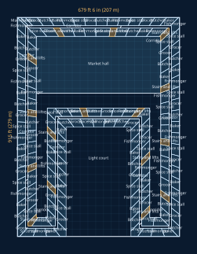

# P6-05 Starboard Homes Market: plan

Footprint 679 ft 6 in (207 m) × 915 ft (279 m) · structural grid 32 ft 10 in (10 m)

## Levels

| Level | Floor above deck | Height | Floor area |
|---|---|---|---|
| Level 1 · Market floor | 0 ft (0 mm) | 19 ft 8 in (6,000 mm) | 370,897 sq ft (34,457 m²) |

## Elements

| ID | Designation | Type | Name | Level(s) | Size / length | Area | Status |
|---|---|---|---|---|---|---|---|
| E001 | D5F6P6B4A1R1 | room | Market hall | L1 | 522 ft (159 m) × 238 ft 2 in (73 m) | 124,330 sq ft (11,551 m²) | proposed |
| E002 | D5F6P6B4A1R2 | zone | Light court | L1 | 522 ft (159 m) × 519 ft 4 in (158 m) | 74,681 sq ft (6,938 m²) | proposed |
| E003 | D5F6P6B4A1R3 | zone | Corridor | L1 | 400 ft 3 in (122 m) × 9 ft 10 in (3,000 mm) | 3,875 sq ft (360 m²) | proposed |
| E004 | D5F6P6B4A1R4 | zone | Corridor | L1 | 213 ft 7 in (65 m) × 194 ft 3 in (59 m) | 3,875 sq ft (360 m²) | proposed |
| E005 | D5F6P6B4A1R5 | zone | Corridor | L1 | 9 ft 10 in (3,000 mm) × 398 ft 4 in (121 m) | 3,875 sq ft (360 m²) | proposed |
| E006 | D5F6P6B4A1R6 | zone | Corridor | L1 | 134 ft 10 in (41 m) × 262 ft 10 in (80 m) | 3,875 sq ft (360 m²) | proposed |
| E007 | D5F6P6B4A1R7 | zone | Corridor | L1 | 9 ft 10 in (3,000 mm) × 403 ft 7 in (123 m) | 3,875 sq ft (360 m²) | proposed |
| E008 | D5F6P6B4A1R8 | zone | Corridor | L1 | 352 ft 4 in (107 m) × 60 ft 8 in (18 m) | 3,875 sq ft (360 m²) | proposed |
| E009 | D5F6P6B4A1R9 | zone | Corridor | L1 | 17 ft 5 in (5,300 mm) × 395 ft 8 in (121 m) | 3,875 sq ft (360 m²) | proposed |
| E010 | D5F6P6B4A1R10 | zone | Corridor | L1 | 134 ft 10 in (41 m) × 204 ft 9 in (62 m) | 3,875 sq ft (360 m²) | proposed |
| E011 | D5F6P6B4A1R11 | zone | Corridor | L1 | 9 ft 10 in (3,000 mm) × 398 ft 4 in (121 m) | 3,875 sq ft (360 m²) | proposed |
| E012 | D5F6P6B4A1R12 | zone | Corridor | L1 | 9 ft 10 in (3,000 mm) × 252 ft 4 in (77 m) | 2,415 sq ft (224 m²) | proposed |
| E013 | D5F6P6B4A1R13 | core | Stairs and lifts | L1 | 46 ft 7 in (14 m) × 34 ft 5 in (10 m) | 904 sq ft (84 m²) | proposed |
| E014 | D5F6P6B4A1R14 | core | Stairs and lifts | L1 | 33 ft 6 in (10 m) × 34 ft 5 in (10 m) | 904 sq ft (84 m²) | proposed |
| E015 | D5F6P6B4A1R15 | core | Stairs and lifts | L1 | 39 ft 4 in (12 m) × 54 ft 6 in (17 m) | 904 sq ft (84 m²) | proposed |
| E016 | D5F6P6B4A1R16 | core | Stairs and lifts | L1 | 34 ft 5 in (10 m) × 40 ft 4 in (12 m) | 904 sq ft (84 m²) | proposed |
| E017 | D5F6P6B4A1R17 | core | Stairs and lifts | L1 | 34 ft 5 in (10 m) × 31 ft 10 in (9,700 mm) | 904 sq ft (84 m²) | proposed |
| E018 | D5F6P6B4A1R18 | core | Stairs and lifts | L1 | 34 ft 5 in (10 m) × 51 ft 6 in (16 m) | 904 sq ft (84 m²) | proposed |
| E019 | D5F6P6B4A1R19 | core | Stairs and lifts | L1 | 34 ft 5 in (10 m) × 60 ft 8 in (18 m) | 904 sq ft (84 m²) | proposed |
| E020 | D5F6P6B4A1R20 | core | Stairs and lifts | L1 | 34 ft 5 in (10 m) × 60 ft 8 in (18 m) | 904 sq ft (84 m²) | proposed |
| E021 | D5F6P6B4A1R21 | core | Stairs and lifts | L1 | 55 ft 1 in (17 m) × 34 ft 5 in (10 m) | 904 sq ft (84 m²) | proposed |
| E022 | D5F6P6B4A1R22 | core | Stairs and lifts | L1 | 36 ft 9 in (11 m) × 34 ft 5 in (10 m) | 904 sq ft (84 m²) | proposed |
| E023 | D5F6P6B4A1R23 | core | Stairs and lifts | L1 | 34 ft 5 in (10 m) × 60 ft 8 in (18 m) | 904 sq ft (84 m²) | proposed |
| E024 | D5F6P6B4A1R24 | core | Stairs and lifts | L1 | 34 ft 5 in (10 m) × 60 ft 8 in (18 m) | 904 sq ft (84 m²) | proposed |
| E025 | D5F6P6B4A1R25 | core | Stairs and lifts | L1 | 40 ft 8 in (12 m) × 48 ft 11 in (15 m) | 904 sq ft (84 m²) | proposed |
| E026 | D5F6P6B4A1R26 | core | Stairs and lifts | L1 | 34 ft 5 in (10 m) × 41 ft (12 m) | 904 sq ft (84 m²) | proposed |
| E027 | D5F6P6B4A1R27 | core | Stairs and lifts | L1 | 34 ft 5 in (10 m) × 31 ft 2 in (9,500 mm) | 904 sq ft (84 m²) | proposed |
| E028 | D5F6P6B4A1R28 | core | Stairs and lifts | L1 | 34 ft 5 in (10 m) × 50 ft 10 in (16 m) | 904 sq ft (84 m²) | proposed |
| E029 | D5F6P6B4A1R29 | room | Market office | L1 | 46 ft 3 in (14 m) × 34 ft 5 in (10 m) | 429 sq ft (40 m²) | proposed |
| E030 | D5F6P6B4A1R30 | room | Toilets | L1 | 50 ft 10 in (16 m) × 34 ft 5 in (10 m) | 644 sq ft (60 m²) | proposed |
| E031 | D5F6P6B4A1R31 | room | Grocer | L1 | 75 ft 6 in (23 m) × 34 ft 5 in (10 m) | 1,616 sq ft (150 m²) | proposed |
| E032 | D5F6P6B4A1R32 | room | Butcher | L1 | 70 ft 6 in (22 m) × 34 ft 5 in (10 m) | 1,616 sq ft (150 m²) | proposed |
| E033 | D5F6P6B4A1R33 | room | Baker | L1 | 65 ft 7 in (20 m) × 34 ft 5 in (10 m) | 1,616 sq ft (150 m²) | proposed |
| E034 | D5F6P6B4A1R34 | room | Fishmonger | L1 | 60 ft 4 in (18 m) × 34 ft 5 in (10 m) | 1,611 sq ft (150 m²) | proposed |
| E035 | D5F6P6B4A1R35 | room | Spice stall | L1 | 55 ft 5 in (17 m) × 34 ft 5 in (10 m) | 1,616 sq ft (150 m²) | proposed |
| E036 | D5F6P6B4A1R36 | room | Grocer | L1 | 50 ft 6 in (15 m) × 34 ft 5 in (10 m) | 1,616 sq ft (150 m²) | proposed |
| E037 | D5F6P6B4A1R37 | room | Butcher | L1 | 49 ft 6 in (15 m) × 34 ft 5 in (10 m) | 1,616 sq ft (150 m²) | proposed |
| E038 | D5F6P6B4A1R38 | room | Baker | L1 | 53 ft 2 in (16 m) × 34 ft 5 in (10 m) | 1,611 sq ft (150 m²) | proposed |
| E039 | D5F6P6B4A1R39 | room | Fishmonger | L1 | 58 ft 5 in (18 m) × 34 ft 5 in (10 m) | 1,616 sq ft (150 m²) | proposed |
| E040 | D5F6P6B4A1R40 | room | Spice stall | L1 | 63 ft 4 in (19 m) × 34 ft 5 in (10 m) | 1,611 sq ft (150 m²) | proposed |
| E041 | D5F6P6B4A1R41 | room | Grocer | L1 | 68 ft 7 in (21 m) × 34 ft 5 in (10 m) | 1,622 sq ft (151 m²) | proposed |
| E042 | D5F6P6B4A1R42 | room | Butcher | L1 | 73 ft 2 in (22 m) × 34 ft 5 in (10 m) | 1,611 sq ft (150 m²) | proposed |
| E043 | D5F6P6B4A1R43 | room | Baker | L1 | 78 ft 5 in (24 m) × 34 ft 5 in (10 m) | 1,616 sq ft (150 m²) | proposed |
| E044 | D5F6P6B4A1R44 | room | Fishmonger | L1 | 38 ft 9 in (12 m) × 75 ft 2 in (23 m) | 1,611 sq ft (150 m²) | proposed |
| E045 | D5F6P6B4A1R45 | room | Spice stall | L1 | 34 ft 5 in (10 m) × 76 ft 1 in (23 m) | 1,616 sq ft (150 m²) | proposed |
| E046 | D5F6P6B4A1R46 | room | Grocer | L1 | 34 ft 5 in (10 m) × 72 ft 6 in (22 m) | 1,616 sq ft (150 m²) | proposed |
| E047 | D5F6P6B4A1R47 | room | Butcher | L1 | 34 ft 5 in (10 m) × 68 ft 11 in (21 m) | 1,616 sq ft (150 m²) | proposed |
| E048 | D5F6P6B4A1R48 | room | Baker | L1 | 34 ft 5 in (10 m) × 65 ft (20 m) | 1,611 sq ft (150 m²) | proposed |
| E049 | D5F6P6B4A1R49 | room | Fishmonger | L1 | 34 ft 5 in (10 m) × 61 ft 8 in (19 m) | 1,622 sq ft (151 m²) | proposed |
| E050 | D5F6P6B4A1R50 | room | Spice stall | L1 | 34 ft 5 in (10 m) × 57 ft 9 in (18 m) | 1,611 sq ft (150 m²) | proposed |
| E051 | D5F6P6B4A1R51 | room | Grocer | L1 | 34 ft 5 in (10 m) × 54 ft 2 in (16 m) | 1,611 sq ft (150 m²) | proposed |
| E052 | D5F6P6B4A1R52 | room | Butcher | L1 | 34 ft 5 in (10 m) × 50 ft 6 in (15 m) | 1,616 sq ft (150 m²) | proposed |
| E053 | D5F6P6B4A1R53 | room | Baker | L1 | 34 ft 5 in (10 m) × 48 ft 7 in (15 m) | 1,616 sq ft (150 m²) | proposed |
| E054 | D5F6P6B4A1R54 | room | Fishmonger | L1 | 34 ft 5 in (10 m) × 50 ft 6 in (15 m) | 1,616 sq ft (150 m²) | proposed |
| E055 | D5F6P6B4A1R55 | room | Spice stall | L1 | 34 ft 5 in (10 m) × 54 ft 2 in (16 m) | 1,611 sq ft (150 m²) | proposed |
| E056 | D5F6P6B4A1R56 | room | Grocer | L1 | 34 ft 5 in (10 m) × 58 ft 1 in (18 m) | 1,616 sq ft (150 m²) | proposed |
| E057 | D5F6P6B4A1R57 | room | Butcher | L1 | 34 ft 5 in (10 m) × 61 ft 8 in (19 m) | 1,616 sq ft (150 m²) | proposed |
| E058 | D5F6P6B4A1R58 | room | Baker | L1 | 34 ft 5 in (10 m) × 65 ft 3 in (20 m) | 1,616 sq ft (150 m²) | proposed |
| E059 | D5F6P6B4A1R59 | room | Fishmonger | L1 | 34 ft 5 in (10 m) × 68 ft 11 in (21 m) | 1,611 sq ft (150 m²) | proposed |
| E060 | D5F6P6B4A1R60 | room | Spice stall | L1 | 34 ft 5 in (10 m) × 72 ft 6 in (22 m) | 1,611 sq ft (150 m²) | proposed |
| E061 | D5F6P6B4A1R61 | room | Grocer | L1 | 34 ft 5 in (10 m) × 76 ft 5 in (23 m) | 1,622 sq ft (151 m²) | proposed |
| E062 | D5F6P6B4A1R62 | room | Butcher | L1 | 38 ft 9 in (12 m) × 74 ft 2 in (23 m) | 1,611 sq ft (150 m²) | proposed |
| E063 | D5F6P6B4A1R63 | room | Baker | L1 | 69 ft 7 in (21 m) × 34 ft 5 in (10 m) | 1,616 sq ft (150 m²) | proposed |
| E064 | D5F6P6B4A1R64 | room | Fishmonger | L1 | 56 ft 5 in (17 m) × 34 ft 5 in (10 m) | 1,616 sq ft (150 m²) | proposed |
| E065 | D5F6P6B4A1R65 | room | Spice stall | L1 | 62 ft 4 in (19 m) × 34 ft 5 in (10 m) | 1,616 sq ft (150 m²) | proposed |
| E066 | D5F6P6B4A1R66 | room | Grocer | L1 | 52 ft 10 in (16 m) × 58 ft 1 in (18 m) | 1,611 sq ft (150 m²) | proposed |
| E067 | D5F6P6B4A1R67 | room | Butcher | L1 | 34 ft 5 in (10 m) × 81 ft 4 in (25 m) | 1,616 sq ft (150 m²) | proposed |
| E068 | D5F6P6B4A1R68 | room | Baker | L1 | 34 ft 5 in (10 m) × 81 ft 4 in (25 m) | 1,616 sq ft (150 m²) | proposed |
| E069 | D5F6P6B4A1R69 | room | Fishmonger | L1 | 34 ft 5 in (10 m) × 81 ft 4 in (25 m) | 1,616 sq ft (150 m²) | proposed |
| E070 | D5F6P6B4A1R70 | room | Spice stall | L1 | 34 ft 5 in (10 m) × 81 ft 4 in (25 m) | 1,616 sq ft (150 m²) | proposed |
| E071 | D5F6P6B4A1R71 | room | Grocer | L1 | 34 ft 5 in (10 m) × 81 ft (25 m) | 1,605 sq ft (149 m²) | proposed |
| E072 | D5F6P6B4A1R72 | room | Butcher | L1 | 34 ft 5 in (10 m) × 81 ft 4 in (25 m) | 1,616 sq ft (150 m²) | proposed |
| E073 | D5F6P6B4A1R73 | room | Baker | L1 | 34 ft 5 in (10 m) × 81 ft 4 in (25 m) | 1,616 sq ft (150 m²) | proposed |
| E074 | D5F6P6B4A1R74 | room | Fishmonger | L1 | 34 ft 5 in (10 m) × 81 ft 4 in (25 m) | 1,616 sq ft (150 m²) | proposed |
| E075 | D5F6P6B4A1R75 | room | Spice stall | L1 | 34 ft 5 in (10 m) × 81 ft 4 in (25 m) | 1,616 sq ft (150 m²) | proposed |
| E076 | D5F6P6B4A1R76 | room | Grocer | L1 | 65 ft 7 in (20 m) × 46 ft 3 in (14 m) | 1,616 sq ft (150 m²) | proposed |
| E077 | D5F6P6B4A1R77 | room | Butcher | L1 | 67 ft 11 in (21 m) × 34 ft 5 in (10 m) | 1,611 sq ft (150 m²) | proposed |
| E078 | D5F6P6B4A1R78 | room | Baker | L1 | 57 ft 5 in (18 m) × 34 ft 5 in (10 m) | 1,611 sq ft (150 m²) | proposed |
| E079 | D5F6P6B4A1R79 | room | Fishmonger | L1 | 52 ft 2 in (16 m) × 34 ft 5 in (10 m) | 1,616 sq ft (150 m²) | proposed |
| E080 | D5F6P6B4A1R80 | room | Spice stall | L1 | 57 ft 1 in (17 m) × 34 ft 5 in (10 m) | 1,616 sq ft (150 m²) | proposed |
| E081 | D5F6P6B4A1R81 | room | Grocer | L1 | 67 ft 7 in (21 m) × 34 ft 5 in (10 m) | 1,616 sq ft (150 m²) | proposed |
| E082 | D5F6P6B4A1R82 | room | Butcher | L1 | 67 ft 3 in (20 m) × 44 ft 3 in (14 m) | 1,616 sq ft (150 m²) | proposed |
| E083 | D5F6P6B4A1R83 | room | Baker | L1 | 34 ft 5 in (10 m) × 81 ft 4 in (25 m) | 1,616 sq ft (150 m²) | proposed |
| E084 | D5F6P6B4A1R84 | room | Fishmonger | L1 | 34 ft 5 in (10 m) × 81 ft 4 in (25 m) | 1,616 sq ft (150 m²) | proposed |
| E085 | D5F6P6B4A1R85 | room | Spice stall | L1 | 34 ft 5 in (10 m) × 81 ft (25 m) | 1,605 sq ft (149 m²) | proposed |
| E086 | D5F6P6B4A1R86 | room | Grocer | L1 | 34 ft 5 in (10 m) × 81 ft 4 in (25 m) | 1,616 sq ft (150 m²) | proposed |
| E087 | D5F6P6B4A1R87 | room | Butcher | L1 | 34 ft 5 in (10 m) × 81 ft 4 in (25 m) | 1,616 sq ft (150 m²) | proposed |
| E088 | D5F6P6B4A1R88 | room | Baker | L1 | 34 ft 5 in (10 m) × 81 ft 4 in (25 m) | 1,616 sq ft (150 m²) | proposed |
| E089 | D5F6P6B4A1R89 | room | Fishmonger | L1 | 34 ft 5 in (10 m) × 81 ft 4 in (25 m) | 1,616 sq ft (150 m²) | proposed |
| E090 | D5F6P6B4A1R90 | room | Spice stall | L1 | 34 ft 5 in (10 m) × 81 ft 4 in (25 m) | 1,616 sq ft (150 m²) | proposed |
| E091 | D5F6P6B4A1R91 | room | Grocer | L1 | 34 ft 5 in (10 m) × 81 ft 4 in (25 m) | 1,616 sq ft (150 m²) | proposed |
| E092 | D5F6P6B4A1R92 | room | Butcher | L1 | 51 ft 2 in (16 m) × 60 ft (18 m) | 1,605 sq ft (149 m²) | proposed |
| E093 | D5F6P6B4A1R93 | room | Baker | L1 | 63 ft 4 in (19 m) × 34 ft 5 in (10 m) | 1,616 sq ft (150 m²) | proposed |
| E094 | D5F6P6B4A1R94 | room | Fishmonger | L1 | 56 ft 5 in (17 m) × 34 ft 5 in (10 m) | 1,616 sq ft (150 m²) | proposed |
| E095 | D5F6P6B4A1R95 | room | Spice stall | L1 | 68 ft 7 in (21 m) × 34 ft 5 in (10 m) | 1,616 sq ft (150 m²) | proposed |
| E096 | D5F6P6B4A1R96 | room | Grocer | L1 | 40 ft 4 in (12 m) × 72 ft 2 in (22 m) | 1,611 sq ft (150 m²) | proposed |
| E097 | D5F6P6B4A1R97 | room | Butcher | L1 | 34 ft 5 in (10 m) × 76 ft 5 in (23 m) | 1,616 sq ft (150 m²) | proposed |
| E098 | D5F6P6B4A1R98 | room | Baker | L1 | 34 ft 5 in (10 m) × 72 ft 10 in (22 m) | 1,616 sq ft (150 m²) | proposed |
| E099 | D5F6P6B4A1R99 | room | Fishmonger | L1 | 34 ft 5 in (10 m) × 69 ft 3 in (21 m) | 1,616 sq ft (150 m²) | proposed |
| E100 | D5F6P6B4A1R100 | room | Spice stall | L1 | 34 ft 5 in (10 m) × 65 ft 3 in (20 m) | 1,611 sq ft (150 m²) | proposed |
| E101 | D5F6P6B4A1R101 | room | Grocer | L1 | 34 ft 5 in (10 m) × 61 ft 8 in (19 m) | 1,616 sq ft (150 m²) | proposed |
| E102 | D5F6P6B4A1R102 | room | Butcher | L1 | 34 ft 5 in (10 m) × 58 ft 1 in (18 m) | 1,616 sq ft (150 m²) | proposed |
| E103 | D5F6P6B4A1R103 | room | Baker | L1 | 34 ft 5 in (10 m) × 54 ft 6 in (17 m) | 1,616 sq ft (150 m²) | proposed |
| E104 | D5F6P6B4A1R104 | room | Fishmonger | L1 | 34 ft 5 in (10 m) × 50 ft 6 in (15 m) | 1,611 sq ft (150 m²) | proposed |
| E105 | D5F6P6B4A1R105 | room | Spice stall | L1 | 34 ft 5 in (10 m) × 48 ft 11 in (15 m) | 1,622 sq ft (151 m²) | proposed |
| E106 | D5F6P6B4A1R106 | room | Grocer | L1 | 34 ft 5 in (10 m) × 50 ft 2 in (15 m) | 1,611 sq ft (150 m²) | proposed |
| E107 | D5F6P6B4A1R107 | room | Butcher | L1 | 34 ft 5 in (10 m) × 53 ft 10 in (16 m) | 1,611 sq ft (150 m²) | proposed |
| E108 | D5F6P6B4A1R108 | room | Baker | L1 | 34 ft 5 in (10 m) × 57 ft 9 in (18 m) | 1,616 sq ft (150 m²) | proposed |
| E109 | D5F6P6B4A1R109 | room | Fishmonger | L1 | 34 ft 5 in (10 m) × 61 ft 4 in (19 m) | 1,616 sq ft (150 m²) | proposed |
| E110 | D5F6P6B4A1R110 | room | Spice stall | L1 | 34 ft 5 in (10 m) × 65 ft (20 m) | 1,616 sq ft (150 m²) | proposed |
| E111 | D5F6P6B4A1R111 | room | Grocer | L1 | 34 ft 5 in (10 m) × 68 ft 7 in (21 m) | 1,611 sq ft (150 m²) | proposed |
| E112 | D5F6P6B4A1R112 | room | Butcher | L1 | 34 ft 5 in (10 m) × 72 ft 6 in (22 m) | 1,616 sq ft (150 m²) | proposed |
| E113 | D5F6P6B4A1R113 | room | Baker | L1 | 34 ft 5 in (10 m) × 76 ft 1 in (23 m) | 1,616 sq ft (150 m²) | proposed |
| E114 | D5F6P6B4A1R114 | room | Fishmonger | L1 | 34 ft 5 in (10 m) × 77 ft 1 in (24 m) | 1,531 sq ft (142 m²) | proposed |
| E115 | D5F6P6B4A1R115 | room | Spice stall | L1 | 78 ft 5 in (24 m) × 34 ft 5 in (10 m) | 1,616 sq ft (150 m²) | proposed |
| E116 | D5F6P6B4A1R116 | room | Grocer | L1 | 78 ft 1 in (24 m) × 34 ft 5 in (10 m) | 1,820 sq ft (169 m²) | proposed |
| E117 | D5F6P6B4A1R117 | room | Butcher | L1 | 62 ft 8 in (19 m) × 34 ft 5 in (10 m) | 1,611 sq ft (150 m²) | proposed |
| E118 | D5F6P6B4A1R118 | room | Baker | L1 | 57 ft 1 in (17 m) × 34 ft 5 in (10 m) | 1,616 sq ft (150 m²) | proposed |
| E119 | D5F6P6B4A1R119 | room | Fishmonger | L1 | 51 ft 2 in (16 m) × 34 ft 5 in (10 m) | 1,616 sq ft (150 m²) | proposed |
| E120 | D5F6P6B4A1R120 | room | Spice stall | L1 | 62 ft 4 in (19 m) × 34 ft 5 in (10 m) | 2,029 sq ft (188 m²) | proposed |
| E121 | D5F6P6B4A1R121 | room | Grocer | L1 | 58 ft 9 in (18 m) × 34 ft 5 in (10 m) | 1,616 sq ft (150 m²) | proposed |
| E122 | D5F6P6B4A1R122 | room | Butcher | L1 | 64 ft 8 in (20 m) × 34 ft 5 in (10 m) | 1,616 sq ft (150 m²) | proposed |
| E123 | D5F6P6B4A1R123 | room | Baker | L1 | 70 ft 3 in (21 m) × 34 ft 5 in (10 m) | 1,611 sq ft (150 m²) | proposed |
| E124 | D5F6P6B4A1R124 | room | Fishmonger | L1 | 88 ft 11 in (27 m) × 34 ft 5 in (10 m) | 2,029 sq ft (188 m²) | proposed |
| E125 | D5F6P6B4A1R125 | room | Spice stall | L1 | 34 ft 5 in (10 m) × 77 ft 5 in (24 m) | 1,616 sq ft (150 m²) | proposed |
| E126 | D5F6P6B4A1R126 | room | Grocer | L1 | 34 ft 5 in (10 m) × 73 ft 6 in (22 m) | 1,616 sq ft (150 m²) | proposed |
| E127 | D5F6P6B4A1R127 | room | Butcher | L1 | 34 ft 5 in (10 m) × 69 ft 3 in (21 m) | 1,611 sq ft (150 m²) | proposed |
| E128 | D5F6P6B4A1R128 | room | Baker | L1 | 34 ft 5 in (10 m) × 76 ft 9 in (23 m) | 2,029 sq ft (188 m²) | proposed |
| E129 | D5F6P6B4A1R129 | room | Fishmonger | L1 | 34 ft 5 in (10 m) × 57 ft 9 in (18 m) | 1,616 sq ft (150 m²) | proposed |
| E130 | D5F6P6B4A1R130 | room | Spice stall | L1 | 34 ft 5 in (10 m) × 53 ft 10 in (16 m) | 1,616 sq ft (150 m²) | proposed |
| E131 | D5F6P6B4A1R131 | room | Grocer | L1 | 34 ft 5 in (10 m) × 49 ft 6 in (15 m) | 1,611 sq ft (150 m²) | proposed |
| E132 | D5F6P6B4A1R132 | room | Butcher | L1 | 34 ft 5 in (10 m) × 61 ft 4 in (19 m) | 2,029 sq ft (188 m²) | proposed |
| E133 | D5F6P6B4A1R133 | room | Baker | L1 | 34 ft 5 in (10 m) × 55 ft 9 in (17 m) | 1,616 sq ft (150 m²) | proposed |
| E134 | D5F6P6B4A1R134 | room | Fishmonger | L1 | 34 ft 5 in (10 m) × 59 ft 9 in (18 m) | 1,616 sq ft (150 m²) | proposed |
| E135 | D5F6P6B4A1R135 | room | Spice stall | L1 | 34 ft 5 in (10 m) × 63 ft 8 in (19 m) | 1,611 sq ft (150 m²) | proposed |
| E136 | D5F6P6B4A1R136 | room | Grocer | L1 | 34 ft 5 in (10 m) × 80 ft 5 in (24 m) | 2,029 sq ft (188 m²) | proposed |
| E137 | D5F6P6B4A1R137 | room | Butcher | L1 | 34 ft 5 in (10 m) × 75 ft 6 in (23 m) | 1,616 sq ft (150 m²) | proposed |
| E138 | D5F6P6B4A1R138 | room | Baker | L1 | 34 ft 5 in (10 m) × 79 ft 5 in (24 m) | 1,616 sq ft (150 m²) | proposed |
| E139 | D5F6P6B4A1R139 | room | Fishmonger | L1 | 66 ft 7 in (20 m) × 34 ft 5 in (10 m) | 1,611 sq ft (150 m²) | proposed |
| E140 | D5F6P6B4A1R140 | room | Spice stall | L1 | 53 ft 10 in (16 m) × 59 ft 5 in (18 m) | 2,029 sq ft (188 m²) | proposed |
| E141 | D5F6P6B4A1R141 | room | Grocer | L1 | 34 ft 5 in (10 m) × 81 ft 4 in (25 m) | 1,616 sq ft (150 m²) | proposed |
| E142 | D5F6P6B4A1R142 | room | Butcher | L1 | 34 ft 5 in (10 m) × 81 ft 4 in (25 m) | 1,616 sq ft (150 m²) | proposed |
| E143 | D5F6P6B4A1R143 | room | Baker | L1 | 34 ft 5 in (10 m) × 81 ft 4 in (25 m) | 1,616 sq ft (150 m²) | proposed |
| E144 | D5F6P6B4A1R144 | room | Fishmonger | L1 | 34 ft 5 in (10 m) × 93 ft 2 in (28 m) | 2,023 sq ft (188 m²) | proposed |
| E145 | D5F6P6B4A1R145 | room | Spice stall | L1 | 34 ft 5 in (10 m) × 81 ft 4 in (25 m) | 1,616 sq ft (150 m²) | proposed |
| E146 | D5F6P6B4A1R146 | room | Grocer | L1 | 34 ft 5 in (10 m) × 81 ft 4 in (25 m) | 1,616 sq ft (150 m²) | proposed |
| E147 | D5F6P6B4A1R147 | room | Butcher | L1 | 34 ft 5 in (10 m) × 81 ft 4 in (25 m) | 1,616 sq ft (150 m²) | proposed |
| E148 | D5F6P6B4A1R148 | room | Baker | L1 | 51 ft 10 in (16 m) × 74 ft 2 in (23 m) | 2,023 sq ft (188 m²) | proposed |
| E149 | D5F6P6B4A1R149 | room | Fishmonger | L1 | 69 ft 3 in (21 m) × 34 ft 5 in (10 m) | 1,611 sq ft (150 m²) | proposed |
| E150 | D5F6P6B4A1R150 | room | Spice stall | L1 | 61 ft 4 in (19 m) × 34 ft 5 in (10 m) | 1,622 sq ft (151 m²) | proposed |
| E151 | D5F6P6B4A1R151 | room | Grocer | L1 | 52 ft 10 in (16 m) × 34 ft 5 in (10 m) | 1,611 sq ft (150 m²) | proposed |
| E152 | D5F6P6B4A1R152 | room | Butcher | L1 | 64 ft (20 m) × 34 ft 5 in (10 m) | 2,029 sq ft (188 m²) | proposed |
| E153 | D5F6P6B4A1R153 | room | Baker | L1 | 63 ft 8 in (19 m) × 34 ft 5 in (10 m) | 1,611 sq ft (150 m²) | proposed |
| E154 | D5F6P6B4A1R154 | room | Fishmonger | L1 | 72 ft 2 in (22 m) × 34 ft 5 in (10 m) | 1,622 sq ft (151 m²) | proposed |
| E155 | D5F6P6B4A1R155 | room | Spice stall | L1 | 62 ft (19 m) × 51 ft 2 in (16 m) | 1,616 sq ft (150 m²) | proposed |
| E156 | D5F6P6B4A1R156 | room | Grocer | L1 | 34 ft 5 in (10 m) × 93 ft 2 in (28 m) | 2,023 sq ft (188 m²) | proposed |
| E157 | D5F6P6B4A1R157 | room | Butcher | L1 | 34 ft 5 in (10 m) × 81 ft 4 in (25 m) | 1,616 sq ft (150 m²) | proposed |
| E158 | D5F6P6B4A1R158 | room | Baker | L1 | 34 ft 5 in (10 m) × 81 ft 4 in (25 m) | 1,616 sq ft (150 m²) | proposed |
| E159 | D5F6P6B4A1R159 | room | Fishmonger | L1 | 34 ft 5 in (10 m) × 81 ft 4 in (25 m) | 1,616 sq ft (150 m²) | proposed |
| E160 | D5F6P6B4A1R160 | room | Spice stall | L1 | 34 ft 5 in (10 m) × 93 ft 2 in (28 m) | 2,023 sq ft (188 m²) | proposed |
| E161 | D5F6P6B4A1R161 | room | Grocer | L1 | 34 ft 5 in (10 m) × 81 ft 4 in (25 m) | 1,616 sq ft (150 m²) | proposed |
| E162 | D5F6P6B4A1R162 | room | Butcher | L1 | 34 ft 5 in (10 m) × 81 ft 4 in (25 m) | 1,616 sq ft (150 m²) | proposed |
| E163 | D5F6P6B4A1R163 | room | Baker | L1 | 40 ft 8 in (12 m) × 70 ft 6 in (21 m) | 1,611 sq ft (150 m²) | proposed |
| E164 | D5F6P6B4A1R164 | room | Fishmonger | L1 | 84 ft (26 m) × 34 ft 5 in (10 m) | 2,029 sq ft (188 m²) | proposed |
| E165 | D5F6P6B4A1R165 | room | Spice stall | L1 | 34 ft 5 in (10 m) × 78 ft 1 in (24 m) | 1,616 sq ft (150 m²) | proposed |
| E166 | D5F6P6B4A1R166 | room | Grocer | L1 | 34 ft 5 in (10 m) × 73 ft 10 in (22 m) | 1,611 sq ft (150 m²) | proposed |
| E167 | D5F6P6B4A1R167 | room | Butcher | L1 | 34 ft 5 in (10 m) × 69 ft 11 in (21 m) | 1,616 sq ft (150 m²) | proposed |
| E168 | D5F6P6B4A1R168 | room | Baker | L1 | 34 ft 5 in (10 m) × 77 ft 5 in (24 m) | 2,029 sq ft (188 m²) | proposed |
| E169 | D5F6P6B4A1R169 | room | Fishmonger | L1 | 34 ft 5 in (10 m) × 58 ft 5 in (18 m) | 1,616 sq ft (150 m²) | proposed |
| E170 | D5F6P6B4A1R170 | room | Spice stall | L1 | 34 ft 5 in (10 m) × 54 ft 2 in (16 m) | 1,611 sq ft (150 m²) | proposed |
| E171 | D5F6P6B4A1R171 | room | Grocer | L1 | 34 ft 5 in (10 m) × 50 ft 2 in (15 m) | 1,616 sq ft (150 m²) | proposed |
| E172 | D5F6P6B4A1R172 | room | Butcher | L1 | 34 ft 5 in (10 m) × 61 ft 4 in (19 m) | 2,029 sq ft (188 m²) | proposed |
| E173 | D5F6P6B4A1R173 | room | Baker | L1 | 34 ft 5 in (10 m) × 55 ft 1 in (17 m) | 1,616 sq ft (150 m²) | proposed |
| E174 | D5F6P6B4A1R174 | room | Fishmonger | L1 | 34 ft 5 in (10 m) × 59 ft 1 in (18 m) | 1,611 sq ft (150 m²) | proposed |
| E175 | D5F6P6B4A1R175 | room | Spice stall | L1 | 34 ft 5 in (10 m) × 63 ft 4 in (19 m) | 1,616 sq ft (150 m²) | proposed |
| E176 | D5F6P6B4A1R176 | room | Grocer | L1 | 34 ft 5 in (10 m) × 79 ft 9 in (24 m) | 2,029 sq ft (188 m²) | proposed |
| E177 | D5F6P6B4A1R177 | room | Butcher | L1 | 34 ft 5 in (10 m) × 74 ft 10 in (23 m) | 1,616 sq ft (150 m²) | proposed |
| E178 | D5F6P6B4A1R178 | room | Baker | L1 | 34 ft 5 in (10 m) × 85 ft (26 m) | 1,820 sq ft (169 m²) | proposed |

## Drawings

### Level 1 · Market floor

