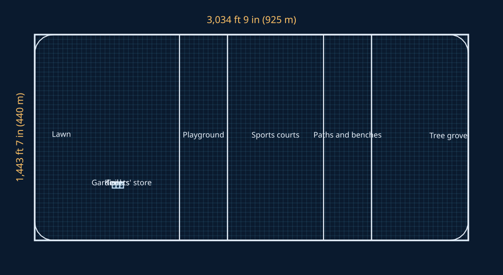

# P6-06 Starboard Green: plan

Footprint 3,034 ft 9 in (925 m) × 1,443 ft 7 in (440 m) · structural grid 32 ft 10 in (10 m)

## Levels

| Level | Floor above deck | Height | Floor area |
|---|---|---|---|
| Level 1 · Ground | 0 ft (0 mm) | 13 ft 1 in (4,000 mm) | 3,100 sq ft (288 m²) |

## Elements

| ID | Designation | Type | Name | Level(s) | Size / length | Area | Status |
|---|---|---|---|---|---|---|---|
| E001 | D5F6P6B5A1R1 | zone | Lawn | L1 | 1,013 ft 5 in (309 m) × 1,442 ft 7 in (440 m) | 1,453,325 sq ft (135,018 m²) | proposed |
| E002 | D5F6P6B5A1R2 | room | Kiosk | L1 | 26 ft 3 in (8,000 mm) × 39 ft 4 in (12 m) | 1,033 sq ft (96 m²) | proposed |
| E003 | D5F6P6B5A1R3 | room | Toilets | L1 | 26 ft 3 in (8,000 mm) × 39 ft 4 in (12 m) | 1,033 sq ft (96 m²) | proposed |
| E004 | D5F6P6B5A1R4 | room | Gardeners' store | L1 | 26 ft 3 in (8,000 mm) × 39 ft 4 in (12 m) | 1,033 sq ft (96 m²) | proposed |
| E005 | D5F6P6B5A1R5 | zone | Playground | L1 | 335 ft 11 in (102 m) × 1,442 ft 7 in (440 m) | 484,538 sq ft (45,015 m²) | proposed |
| E006 | D5F6P6B5A1R6 | zone | Sports courts | L1 | 671 ft 11 in (205 m) × 1,442 ft 7 in (440 m) | 969,076 sq ft (90,030 m²) | proposed |
| E007 | D5F6P6B5A1R7 | zone | Paths and benches | L1 | 335 ft 11 in (102 m) × 1,442 ft 3 in (440 m) | 484,538 sq ft (45,015 m²) | proposed |
| E008 | D5F6P6B5A1R8 | zone | Tree grove | L1 | 677 ft 6 in (206 m) × 1,442 ft 7 in (440 m) | 968,787 sq ft (90,003 m²) | proposed |

## Drawings

### Level 1 · Ground

