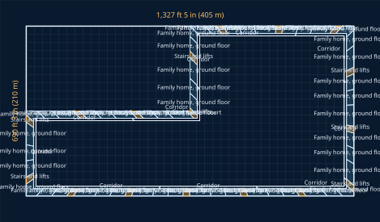
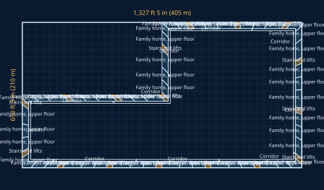

# P6-11 Family Courts 2: plan

Footprint 1,327 ft 5 in (405 m) × 690 ft 3 in (210 m) · structural grid 32 ft 10 in (10 m)

## Levels

| Level | Floor above deck | Height | Floor area |
|---|---|---|---|
| Level 1 · Ground floor | 0 ft (0 mm) | 11 ft 2 in (3,400 mm) | 102,513 sq ft (9,524 m²) |
| Level 2 · Upper floor | 11 ft 2 in (3,400 mm) | 9 ft 10 in (3,000 mm) | 102,513 sq ft (9,524 m²) |

## Elements

| ID | Designation | Type | Name | Level(s) | Size / length | Area | Status |
|---|---|---|---|---|---|---|---|
| E001 | D5F6P6B9A1L1R1 | zone | Shared garden court | L1 | 1,248 ft 8 in (381 m) × 611 ft 7 in (186 m) | 534,556 sq ft (49,662 m²) | proposed |
| E002 | D5F6P6B9A1L1R2, D5F6P6B9A1L2R1 | core | Stairs and lifts | L1, L2 | 44 ft 11 in (14 m) × 29 ft 6 in (9,000 mm) | 770 sq ft (72 m²) | proposed |
| E003 | D5F6P6B9A1L1R3, D5F6P6B9A1L2R2 | core | Stairs and lifts | L1, L2 | 28 ft 10 in (8,800 mm) × 29 ft 6 in (9,000 mm) | 775 sq ft (72 m²) | proposed |
| E004 | D5F6P6B9A1L1R4, D5F6P6B9A1L2R3 | core | Stairs and lifts | L1, L2 | 50 ft 2 in (15 m) × 29 ft 6 in (9,000 mm) | 770 sq ft (72 m²) | proposed |
| E005 | D5F6P6B9A1L1R5, D5F6P6B9A1L2R4 | core | Stairs and lifts | L1, L2 | 29 ft 6 in (9,000 mm) × 40 ft 4 in (12 m) | 770 sq ft (72 m²) | proposed |
| E006 | D5F6P6B9A1L1R6, D5F6P6B9A1L2R5 | core | Stairs and lifts | L1, L2 | 29 ft 6 in (9,000 mm) × 32 ft 6 in (9,900 mm) | 770 sq ft (72 m²) | proposed |
| E007 | D5F6P6B9A1L1R7, D5F6P6B9A1L2R6 | core | Stairs and lifts | L1, L2 | 29 ft 6 in (9,000 mm) × 53 ft 6 in (16 m) | 780 sq ft (72 m²) | proposed |
| E008 | D5F6P6B9A1L1R8, D5F6P6B9A1L2R7 | core | Stairs and lifts | L1, L2 | 46 ft 7 in (14 m) × 29 ft 6 in (9,000 mm) | 775 sq ft (72 m²) | proposed |
| E009 | D5F6P6B9A1L1R9, D5F6P6B9A1L2R8 | core | Stairs and lifts | L1, L2 | 36 ft 1 in (11 m) × 29 ft 6 in (9,000 mm) | 775 sq ft (72 m²) | proposed |
| E010 | D5F6P6B9A1L1R10, D5F6P6B9A1L2R9 | core | Stairs and lifts | L1, L2 | 26 ft 11 in (8,200 mm) × 29 ft 6 in (9,000 mm) | 775 sq ft (72 m²) | proposed |
| E011 | D5F6P6B9A1L1R11, D5F6P6B9A1L2R10 | core | Stairs and lifts | L1, L2 | 37 ft 5 in (11 m) × 29 ft 6 in (9,000 mm) | 775 sq ft (72 m²) | proposed |
| E012 | D5F6P6B9A1L1R12, D5F6P6B9A1L2R11 | core | Stairs and lifts | L1, L2 | 47 ft 11 in (15 m) × 29 ft 6 in (9,000 mm) | 775 sq ft (72 m²) | proposed |
| E013 | D5F6P6B9A1L1R13, D5F6P6B9A1L2R12 | core | Stairs and lifts | L1, L2 | 29 ft 6 in (9,000 mm) × 44 ft 11 in (14 m) | 770 sq ft (72 m²) | proposed |
| E014 | D5F6P6B9A1L1R14, D5F6P6B9A1L2R13 | core | Stairs and lifts | L1, L2 | 29 ft 6 in (9,000 mm) × 50 ft 6 in (15 m) | 775 sq ft (72 m²) | proposed |
| E015 | D5F6P6B9A1L1R15, D5F6P6B9A1L2R14 | core | Stairs and lifts | L1, L2 | 55 ft 9 in (17 m) × 29 ft 6 in (9,000 mm) | 775 sq ft (72 m²) | proposed |
| E016 | D5F6P6B9A1L1R16, D5F6P6B9A1L2R15 | core | Stairs and lifts | L1, L2 | 55 ft 9 in (17 m) × 29 ft 6 in (9,000 mm) | 775 sq ft (72 m²) | proposed |
| E017 | D5F6P6B9A1L1R17, D5F6P6B9A1L2R16 | core | Stairs and lifts | L1, L2 | 43 ft 4 in (13 m) × 42 ft (13 m) | 775 sq ft (72 m²) | proposed |
| E018 | D5F6P6B9A1L1R18, D5F6P6B9A1L2R17 | core | Stairs and lifts | L1, L2 | 29 ft 6 in (9,000 mm) × 55 ft 9 in (17 m) | 775 sq ft (72 m²) | proposed |
| E019 | D5F6P6B9A1L1R19 | zone | Corridor | L1 | 400 ft 3 in (122 m) × 9 ft 10 in (3,000 mm) | 3,875 sq ft (360 m²) | proposed |
| E020 | D5F6P6B9A1L1R20 | zone | Corridor | L1 | 207 ft 8 in (63 m) × 199 ft 6 in (61 m) | 3,875 sq ft (360 m²) | proposed |
| E021 | D5F6P6B9A1L1R21 | zone | Corridor | L1 | 9 ft 10 in (3,000 mm) × 399 ft 11 in (122 m) | 3,875 sq ft (360 m²) | proposed |
| E022 | D5F6P6B9A1L1R22 | zone | Corridor | L1 | 365 ft 6 in (111 m) × 44 ft 3 in (14 m) | 3,875 sq ft (360 m²) | proposed |
| E023 | D5F6P6B9A1L1R23 | zone | Corridor | L1 | 396 ft 8 in (121 m) × 9 ft 10 in (3,000 mm) | 3,875 sq ft (360 m²) | proposed |
| E024 | D5F6P6B9A1L1R24 | zone | Corridor | L1 | 398 ft 7 in (122 m) × 9 ft 10 in (3,000 mm) | 3,875 sq ft (360 m²) | proposed |
| E025 | D5F6P6B9A1L1R25 | zone | Corridor | L1 | 121 ft 5 in (37 m) × 286 ft 1 in (87 m) | 3,875 sq ft (360 m²) | proposed |
| E026 | D5F6P6B9A1L1R26 | zone | Corridor | L1 | 403 ft 7 in (123 m) × 9 ft 10 in (3,000 mm) | 3,875 sq ft (360 m²) | proposed |
| E027 | D5F6P6B9A1L1R27 | zone | Corridor | L1 | 274 ft 11 in (84 m) × 138 ft 5 in (42 m) | 3,875 sq ft (360 m²) | proposed |
| E028 | D5F6P6B9A1L1R28 | zone | Corridor | L1 | 9 ft 10 in (3,000 mm) × 226 ft 5 in (69 m) | 2,131 sq ft (198 m²) | proposed |
| E029 | D5F6P6B9A1L1R29 | room | Family home, ground floor | L1 | 86 ft 11 in (26 m) × 29 ft 6 in (9,000 mm) | 1,778 sq ft (165 m²) | proposed |
| E030 | D5F6P6B9A1L1R30 | room | Family home, ground floor | L1 | 64 ft (20 m) × 29 ft 6 in (9,000 mm) | 1,240 sq ft (115 m²) | proposed |
| E031 | D5F6P6B9A1L1R31 | room | Family home, ground floor | L1 | 75 ft 2 in (23 m) × 29 ft 6 in (9,000 mm) | 1,778 sq ft (165 m²) | proposed |
| E032 | D5F6P6B9A1L1R32 | room | Family home, ground floor | L1 | 69 ft 7 in (21 m) × 29 ft 6 in (9,000 mm) | 1,778 sq ft (165 m²) | proposed |
| E033 | D5F6P6B9A1L1R33 | room | Family home, ground floor | L1 | 87 ft 11 in (27 m) × 29 ft 6 in (9,000 mm) | 2,475 sq ft (230 m²) | proposed |
| E034 | D5F6P6B9A1L1R34 | room | Family home, ground floor | L1 | 66 ft 7 in (20 m) × 29 ft 6 in (9,000 mm) | 1,773 sq ft (165 m²) | proposed |
| E035 | D5F6P6B9A1L1R35 | room | Family home, ground floor | L1 | 72 ft 6 in (22 m) × 29 ft 6 in (9,000 mm) | 1,778 sq ft (165 m²) | proposed |
| E036 | D5F6P6B9A1L1R36 | room | Family home, ground floor | L1 | 103 ft (31 m) × 29 ft 6 in (9,000 mm) | 2,480 sq ft (230 m²) | proposed |
| E037 | D5F6P6B9A1L1R37 | room | Family home, ground floor | L1 | 72 ft 6 in (22 m) × 44 ft (13 m) | 1,778 sq ft (165 m²) | proposed |
| E038 | D5F6P6B9A1L1R38 | room | Family home, ground floor | L1 | 29 ft 6 in (9,000 mm) × 85 ft 8 in (26 m) | 1,778 sq ft (165 m²) | proposed |
| E039 | D5F6P6B9A1L1R39 | room | Family home, ground floor | L1 | 29 ft 6 in (9,000 mm) × 103 ft (31 m) | 2,480 sq ft (230 m²) | proposed |
| E040 | D5F6P6B9A1L1R40 | room | Family home, ground floor | L1 | 29 ft 6 in (9,000 mm) × 70 ft 6 in (22 m) | 1,778 sq ft (165 m²) | proposed |
| E041 | D5F6P6B9A1L1R41 | room | Family home, ground floor | L1 | 29 ft 6 in (9,000 mm) × 65 ft (20 m) | 1,778 sq ft (165 m²) | proposed |
| E042 | D5F6P6B9A1L1R42 | room | Family home, ground floor | L1 | 29 ft 6 in (9,000 mm) × 87 ft 7 in (27 m) | 2,480 sq ft (230 m²) | proposed |
| E043 | D5F6P6B9A1L1R43 | room | Family home, ground floor | L1 | 29 ft 6 in (9,000 mm) × 70 ft 6 in (22 m) | 1,778 sq ft (165 m²) | proposed |
| E044 | D5F6P6B9A1L1R44 | room | Family home, ground floor | L1 | 29 ft 6 in (9,000 mm) × 75 ft 9 in (23 m) | 1,773 sq ft (165 m²) | proposed |
| E045 | D5F6P6B9A1L1R45 | room | Family home, ground floor | L1 | 29 ft 6 in (9,000 mm) × 106 ft (32 m) | 2,475 sq ft (230 m²) | proposed |
| E046 | D5F6P6B9A1L1R46 | room | Family home, ground floor | L1 | 74 ft 2 in (23 m) × 43 ft 4 in (13 m) | 1,773 sq ft (165 m²) | proposed |
| E047 | D5F6P6B9A1L1R47 | room | Family home, ground floor | L1 | 86 ft 3 in (26 m) × 29 ft 6 in (9,000 mm) | 1,778 sq ft (165 m²) | proposed |
| E048 | D5F6P6B9A1L1R48 | room | Family home, ground floor | L1 | 106 ft 8 in (32 m) × 29 ft 6 in (9,000 mm) | 2,475 sq ft (230 m²) | proposed |
| E049 | D5F6P6B9A1L1R49 | room | Family home, ground floor | L1 | 78 ft 5 in (24 m) × 29 ft 6 in (9,000 mm) | 1,778 sq ft (165 m²) | proposed |
| E050 | D5F6P6B9A1L1R50 | room | Family home, ground floor | L1 | 75 ft 9 in (23 m) × 29 ft 6 in (9,000 mm) | 1,778 sq ft (165 m²) | proposed |
| E051 | D5F6P6B9A1L1R51 | room | Family home, ground floor | L1 | 96 ft 5 in (29 m) × 29 ft 6 in (9,000 mm) | 2,480 sq ft (230 m²) | proposed |
| E052 | D5F6P6B9A1L1R52 | room | Family home, ground floor | L1 | 67 ft 11 in (21 m) × 29 ft 6 in (9,000 mm) | 1,773 sq ft (165 m²) | proposed |
| E053 | D5F6P6B9A1L1R53 | room | Family home, ground floor | L1 | 65 ft 3 in (20 m) × 29 ft 6 in (9,000 mm) | 1,778 sq ft (165 m²) | proposed |
| E054 | D5F6P6B9A1L1R54 | room | Family home, ground floor | L1 | 85 ft 8 in (26 m) × 29 ft 6 in (9,000 mm) | 2,475 sq ft (230 m²) | proposed |
| E055 | D5F6P6B9A1L1R55 | room | Family home, ground floor | L1 | 62 ft 8 in (19 m) × 29 ft 6 in (9,000 mm) | 1,773 sq ft (165 m²) | proposed |
| E056 | D5F6P6B9A1L1R56 | room | Family home, ground floor | L1 | 65 ft 7 in (20 m) × 29 ft 6 in (9,000 mm) | 1,778 sq ft (165 m²) | proposed |
| E057 | D5F6P6B9A1L1R57 | room | Family home, ground floor | L1 | 92 ft 6 in (28 m) × 29 ft 6 in (9,000 mm) | 2,475 sq ft (230 m²) | proposed |
| E058 | D5F6P6B9A1L1R58 | room | Family home, ground floor | L1 | 73 ft 6 in (22 m) × 29 ft 6 in (9,000 mm) | 1,783 sq ft (166 m²) | proposed |
| E059 | D5F6P6B9A1L1R59 | room | Family home, ground floor | L1 | 75 ft 9 in (23 m) × 29 ft 6 in (9,000 mm) | 1,773 sq ft (165 m²) | proposed |
| E060 | D5F6P6B9A1L1R60 | room | Family home, ground floor | L1 | 103 ft (31 m) × 29 ft 6 in (9,000 mm) | 2,480 sq ft (230 m²) | proposed |
| E061 | D5F6P6B9A1L1R61 | room | Family home, ground floor | L1 | 83 ft 8 in (26 m) × 29 ft 6 in (9,000 mm) | 1,773 sq ft (165 m²) | proposed |
| E062 | D5F6P6B9A1L1R62 | room | Family home, ground floor | L1 | 86 ft 7 in (26 m) × 29 ft 6 in (9,000 mm) | 1,778 sq ft (165 m²) | proposed |
| E063 | D5F6P6B9A1L1R63 | room | Family home, ground floor | L1 | 68 ft 7 in (21 m) × 69 ft 7 in (21 m) | 2,480 sq ft (230 m²) | proposed |
| E064 | D5F6P6B9A1L1R64 | room | Family home, ground floor | L1 | 29 ft 6 in (9,000 mm) × 70 ft 10 in (22 m) | 1,778 sq ft (165 m²) | proposed |
| E065 | D5F6P6B9A1L1R65 | room | Family home, ground floor | L1 | 29 ft 6 in (9,000 mm) × 65 ft 7 in (20 m) | 1,773 sq ft (165 m²) | proposed |
| E066 | D5F6P6B9A1L1R66 | room | Family home, ground floor | L1 | 29 ft 6 in (9,000 mm) × 98 ft 1 in (30 m) | 2,480 sq ft (230 m²) | proposed |
| E067 | D5F6P6B9A1L1R67 | room | Family home, ground floor | L1 | 74 ft 10 in (23 m) × 43 ft (13 m) | 1,778 sq ft (165 m²) | proposed |
| E068 | D5F6P6B9A1L1R68 | room | Family home, ground floor | L1 | 89 ft 7 in (27 m) × 29 ft 6 in (9,000 mm) | 1,773 sq ft (165 m²) | proposed |
| E069 | D5F6P6B9A1L1R69 | room | Family home, ground floor | L1 | 113 ft 6 in (35 m) × 29 ft 6 in (9,000 mm) | 2,480 sq ft (230 m²) | proposed |
| E070 | D5F6P6B9A1L1R70 | room | Family home, ground floor | L1 | 89 ft 7 in (27 m) × 29 ft 6 in (9,000 mm) | 1,773 sq ft (165 m²) | proposed |
| E071 | D5F6P6B9A1L1R71 | room | Family home, ground floor | L1 | 89 ft 7 in (27 m) × 29 ft 6 in (9,000 mm) | 1,773 sq ft (165 m²) | proposed |
| E072 | D5F6P6B9A1L1R72 | room | Family home, ground floor | L1 | 113 ft 6 in (35 m) × 29 ft 6 in (9,000 mm) | 2,480 sq ft (230 m²) | proposed |
| E073 | D5F6P6B9A1L1R73 | room | Family home, ground floor | L1 | 89 ft 7 in (27 m) × 29 ft 6 in (9,000 mm) | 1,773 sq ft (165 m²) | proposed |
| E074 | D5F6P6B9A1L1R74 | room | Family home, ground floor | L1 | 89 ft 11 in (27 m) × 29 ft 6 in (9,000 mm) | 1,783 sq ft (166 m²) | proposed |
| E075 | D5F6P6B9A1L1R75 | room | Family home, ground floor | L1 | 113 ft 2 in (34 m) × 29 ft 6 in (9,000 mm) | 2,470 sq ft (230 m²) | proposed |
| E076 | D5F6P6B9A1L1R76 | room | Family home, ground floor | L1 | 29 ft 6 in (9,000 mm) × 89 ft 11 in (27 m) | 1,783 sq ft (166 m²) | proposed |
| E077 | D5F6P6B9A1L1R77 | room | Family home, ground floor | L1 | 29 ft 6 in (9,000 mm) × 89 ft 7 in (27 m) | 1,773 sq ft (165 m²) | proposed |
| E078 | D5F6P6B9A1L1R78 | room | Family home, ground floor | L1 | 29 ft 6 in (9,000 mm) × 113 ft 6 in (35 m) | 2,480 sq ft (230 m²) | proposed |
| E079 | D5F6P6B9A1L1R79 | room | Family home, ground floor | L1 | 29 ft 6 in (9,000 mm) × 89 ft 7 in (27 m) | 1,773 sq ft (165 m²) | proposed |
| E080 | D5F6P6B9A1L1R80 | room | Family home, ground floor | L1 | 29 ft 6 in (9,000 mm) × 71 ft 6 in (22 m) | 1,240 sq ft (115 m²) | proposed |
| E081 | D5F6P6B9A1L2R18 | zone | Corridor | L2 | 400 ft 3 in (122 m) × 9 ft 10 in (3,000 mm) | 3,875 sq ft (360 m²) | proposed |
| E082 | D5F6P6B9A1L2R19 | zone | Corridor | L2 | 207 ft 8 in (63 m) × 199 ft 6 in (61 m) | 3,875 sq ft (360 m²) | proposed |
| E083 | D5F6P6B9A1L2R20 | zone | Corridor | L2 | 9 ft 10 in (3,000 mm) × 399 ft 11 in (122 m) | 3,875 sq ft (360 m²) | proposed |
| E084 | D5F6P6B9A1L2R21 | zone | Corridor | L2 | 365 ft 6 in (111 m) × 44 ft 3 in (14 m) | 3,875 sq ft (360 m²) | proposed |
| E085 | D5F6P6B9A1L2R22 | zone | Corridor | L2 | 396 ft 8 in (121 m) × 9 ft 10 in (3,000 mm) | 3,875 sq ft (360 m²) | proposed |
| E086 | D5F6P6B9A1L2R23 | zone | Corridor | L2 | 398 ft 7 in (122 m) × 9 ft 10 in (3,000 mm) | 3,875 sq ft (360 m²) | proposed |
| E087 | D5F6P6B9A1L2R24 | zone | Corridor | L2 | 121 ft 5 in (37 m) × 286 ft 1 in (87 m) | 3,875 sq ft (360 m²) | proposed |
| E088 | D5F6P6B9A1L2R25 | zone | Corridor | L2 | 403 ft 7 in (123 m) × 9 ft 10 in (3,000 mm) | 3,875 sq ft (360 m²) | proposed |
| E089 | D5F6P6B9A1L2R26 | zone | Corridor | L2 | 274 ft 11 in (84 m) × 138 ft 5 in (42 m) | 3,875 sq ft (360 m²) | proposed |
| E090 | D5F6P6B9A1L2R27 | zone | Corridor | L2 | 9 ft 10 in (3,000 mm) × 226 ft 5 in (69 m) | 2,131 sq ft (198 m²) | proposed |
| E091 | D5F6P6B9A1L2R28 | room | Family home, upper floor | L2 | 86 ft 11 in (26 m) × 29 ft 6 in (9,000 mm) | 1,778 sq ft (165 m²) | proposed |
| E092 | D5F6P6B9A1L2R29 | room | Family home, upper floor | L2 | 64 ft (20 m) × 29 ft 6 in (9,000 mm) | 1,240 sq ft (115 m²) | proposed |
| E093 | D5F6P6B9A1L2R30 | room | Family home, upper floor | L2 | 75 ft 2 in (23 m) × 29 ft 6 in (9,000 mm) | 1,778 sq ft (165 m²) | proposed |
| E094 | D5F6P6B9A1L2R31 | room | Family home, upper floor | L2 | 69 ft 7 in (21 m) × 29 ft 6 in (9,000 mm) | 1,778 sq ft (165 m²) | proposed |
| E095 | D5F6P6B9A1L2R32 | room | Family home, upper floor | L2 | 87 ft 11 in (27 m) × 29 ft 6 in (9,000 mm) | 2,475 sq ft (230 m²) | proposed |
| E096 | D5F6P6B9A1L2R33 | room | Family home, upper floor | L2 | 66 ft 7 in (20 m) × 29 ft 6 in (9,000 mm) | 1,773 sq ft (165 m²) | proposed |
| E097 | D5F6P6B9A1L2R34 | room | Family home, upper floor | L2 | 72 ft 6 in (22 m) × 29 ft 6 in (9,000 mm) | 1,778 sq ft (165 m²) | proposed |
| E098 | D5F6P6B9A1L2R35 | room | Family home, upper floor | L2 | 103 ft (31 m) × 29 ft 6 in (9,000 mm) | 2,480 sq ft (230 m²) | proposed |
| E099 | D5F6P6B9A1L2R36 | room | Family home, upper floor | L2 | 72 ft 6 in (22 m) × 44 ft (13 m) | 1,778 sq ft (165 m²) | proposed |
| E100 | D5F6P6B9A1L2R37 | room | Family home, upper floor | L2 | 29 ft 6 in (9,000 mm) × 85 ft 8 in (26 m) | 1,778 sq ft (165 m²) | proposed |
| E101 | D5F6P6B9A1L2R38 | room | Family home, upper floor | L2 | 29 ft 6 in (9,000 mm) × 103 ft (31 m) | 2,480 sq ft (230 m²) | proposed |
| E102 | D5F6P6B9A1L2R39 | room | Family home, upper floor | L2 | 29 ft 6 in (9,000 mm) × 70 ft 6 in (22 m) | 1,778 sq ft (165 m²) | proposed |
| E103 | D5F6P6B9A1L2R40 | room | Family home, upper floor | L2 | 29 ft 6 in (9,000 mm) × 65 ft (20 m) | 1,778 sq ft (165 m²) | proposed |
| E104 | D5F6P6B9A1L2R41 | room | Family home, upper floor | L2 | 29 ft 6 in (9,000 mm) × 87 ft 7 in (27 m) | 2,480 sq ft (230 m²) | proposed |
| E105 | D5F6P6B9A1L2R42 | room | Family home, upper floor | L2 | 29 ft 6 in (9,000 mm) × 70 ft 6 in (22 m) | 1,778 sq ft (165 m²) | proposed |
| E106 | D5F6P6B9A1L2R43 | room | Family home, upper floor | L2 | 29 ft 6 in (9,000 mm) × 75 ft 9 in (23 m) | 1,773 sq ft (165 m²) | proposed |
| E107 | D5F6P6B9A1L2R44 | room | Family home, upper floor | L2 | 29 ft 6 in (9,000 mm) × 106 ft (32 m) | 2,475 sq ft (230 m²) | proposed |
| E108 | D5F6P6B9A1L2R45 | room | Family home, upper floor | L2 | 74 ft 2 in (23 m) × 43 ft 4 in (13 m) | 1,773 sq ft (165 m²) | proposed |
| E109 | D5F6P6B9A1L2R46 | room | Family home, upper floor | L2 | 86 ft 3 in (26 m) × 29 ft 6 in (9,000 mm) | 1,778 sq ft (165 m²) | proposed |
| E110 | D5F6P6B9A1L2R47 | room | Family home, upper floor | L2 | 106 ft 8 in (32 m) × 29 ft 6 in (9,000 mm) | 2,475 sq ft (230 m²) | proposed |
| E111 | D5F6P6B9A1L2R48 | room | Family home, upper floor | L2 | 78 ft 5 in (24 m) × 29 ft 6 in (9,000 mm) | 1,778 sq ft (165 m²) | proposed |
| E112 | D5F6P6B9A1L2R49 | room | Family home, upper floor | L2 | 75 ft 9 in (23 m) × 29 ft 6 in (9,000 mm) | 1,778 sq ft (165 m²) | proposed |
| E113 | D5F6P6B9A1L2R50 | room | Family home, upper floor | L2 | 96 ft 5 in (29 m) × 29 ft 6 in (9,000 mm) | 2,480 sq ft (230 m²) | proposed |
| E114 | D5F6P6B9A1L2R51 | room | Family home, upper floor | L2 | 67 ft 11 in (21 m) × 29 ft 6 in (9,000 mm) | 1,773 sq ft (165 m²) | proposed |
| E115 | D5F6P6B9A1L2R52 | room | Family home, upper floor | L2 | 65 ft 3 in (20 m) × 29 ft 6 in (9,000 mm) | 1,778 sq ft (165 m²) | proposed |
| E116 | D5F6P6B9A1L2R53 | room | Family home, upper floor | L2 | 85 ft 8 in (26 m) × 29 ft 6 in (9,000 mm) | 2,475 sq ft (230 m²) | proposed |
| E117 | D5F6P6B9A1L2R54 | room | Family home, upper floor | L2 | 62 ft 8 in (19 m) × 29 ft 6 in (9,000 mm) | 1,773 sq ft (165 m²) | proposed |
| E118 | D5F6P6B9A1L2R55 | room | Family home, upper floor | L2 | 65 ft 7 in (20 m) × 29 ft 6 in (9,000 mm) | 1,778 sq ft (165 m²) | proposed |
| E119 | D5F6P6B9A1L2R56 | room | Family home, upper floor | L2 | 92 ft 6 in (28 m) × 29 ft 6 in (9,000 mm) | 2,475 sq ft (230 m²) | proposed |
| E120 | D5F6P6B9A1L2R57 | room | Family home, upper floor | L2 | 73 ft 6 in (22 m) × 29 ft 6 in (9,000 mm) | 1,783 sq ft (166 m²) | proposed |
| E121 | D5F6P6B9A1L2R58 | room | Family home, upper floor | L2 | 75 ft 9 in (23 m) × 29 ft 6 in (9,000 mm) | 1,773 sq ft (165 m²) | proposed |
| E122 | D5F6P6B9A1L2R59 | room | Family home, upper floor | L2 | 103 ft (31 m) × 29 ft 6 in (9,000 mm) | 2,480 sq ft (230 m²) | proposed |
| E123 | D5F6P6B9A1L2R60 | room | Family home, upper floor | L2 | 83 ft 8 in (26 m) × 29 ft 6 in (9,000 mm) | 1,773 sq ft (165 m²) | proposed |
| E124 | D5F6P6B9A1L2R61 | room | Family home, upper floor | L2 | 86 ft 7 in (26 m) × 29 ft 6 in (9,000 mm) | 1,778 sq ft (165 m²) | proposed |
| E125 | D5F6P6B9A1L2R62 | room | Family home, upper floor | L2 | 68 ft 7 in (21 m) × 69 ft 7 in (21 m) | 2,480 sq ft (230 m²) | proposed |
| E126 | D5F6P6B9A1L2R63 | room | Family home, upper floor | L2 | 29 ft 6 in (9,000 mm) × 70 ft 10 in (22 m) | 1,778 sq ft (165 m²) | proposed |
| E127 | D5F6P6B9A1L2R64 | room | Family home, upper floor | L2 | 29 ft 6 in (9,000 mm) × 65 ft 7 in (20 m) | 1,773 sq ft (165 m²) | proposed |
| E128 | D5F6P6B9A1L2R65 | room | Family home, upper floor | L2 | 29 ft 6 in (9,000 mm) × 98 ft 1 in (30 m) | 2,480 sq ft (230 m²) | proposed |
| E129 | D5F6P6B9A1L2R66 | room | Family home, upper floor | L2 | 74 ft 10 in (23 m) × 43 ft (13 m) | 1,778 sq ft (165 m²) | proposed |
| E130 | D5F6P6B9A1L2R67 | room | Family home, upper floor | L2 | 89 ft 7 in (27 m) × 29 ft 6 in (9,000 mm) | 1,773 sq ft (165 m²) | proposed |
| E131 | D5F6P6B9A1L2R68 | room | Family home, upper floor | L2 | 113 ft 6 in (35 m) × 29 ft 6 in (9,000 mm) | 2,480 sq ft (230 m²) | proposed |
| E132 | D5F6P6B9A1L2R69 | room | Family home, upper floor | L2 | 89 ft 7 in (27 m) × 29 ft 6 in (9,000 mm) | 1,773 sq ft (165 m²) | proposed |
| E133 | D5F6P6B9A1L2R70 | room | Family home, upper floor | L2 | 89 ft 7 in (27 m) × 29 ft 6 in (9,000 mm) | 1,773 sq ft (165 m²) | proposed |
| E134 | D5F6P6B9A1L2R71 | room | Family home, upper floor | L2 | 113 ft 6 in (35 m) × 29 ft 6 in (9,000 mm) | 2,480 sq ft (230 m²) | proposed |
| E135 | D5F6P6B9A1L2R72 | room | Family home, upper floor | L2 | 89 ft 7 in (27 m) × 29 ft 6 in (9,000 mm) | 1,773 sq ft (165 m²) | proposed |
| E136 | D5F6P6B9A1L2R73 | room | Family home, upper floor | L2 | 89 ft 11 in (27 m) × 29 ft 6 in (9,000 mm) | 1,783 sq ft (166 m²) | proposed |
| E137 | D5F6P6B9A1L2R74 | room | Family home, upper floor | L2 | 113 ft 2 in (34 m) × 29 ft 6 in (9,000 mm) | 2,470 sq ft (230 m²) | proposed |
| E138 | D5F6P6B9A1L2R75 | room | Family home, upper floor | L2 | 29 ft 6 in (9,000 mm) × 89 ft 11 in (27 m) | 1,783 sq ft (166 m²) | proposed |
| E139 | D5F6P6B9A1L2R76 | room | Family home, upper floor | L2 | 29 ft 6 in (9,000 mm) × 89 ft 7 in (27 m) | 1,773 sq ft (165 m²) | proposed |
| E140 | D5F6P6B9A1L2R77 | room | Family home, upper floor | L2 | 29 ft 6 in (9,000 mm) × 113 ft 6 in (35 m) | 2,480 sq ft (230 m²) | proposed |
| E141 | D5F6P6B9A1L2R78 | room | Family home, upper floor | L2 | 29 ft 6 in (9,000 mm) × 89 ft 7 in (27 m) | 1,773 sq ft (165 m²) | proposed |
| E142 | D5F6P6B9A1L2R79 | room | Family home, upper floor | L2 | 29 ft 6 in (9,000 mm) × 71 ft 6 in (22 m) | 1,240 sq ft (115 m²) | proposed |

## Drawings

### Level 1 · Ground floor

### Level 2 · Upper floor

