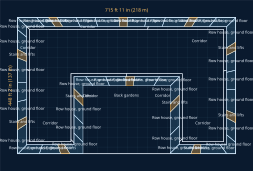
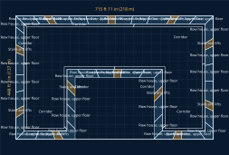

# P6-14 Row Houses 2: plan

Footprint 715 ft 11 in (218 m) × 448 ft 2 in (137 m) · structural grid 32 ft 10 in (10 m)

## Levels

| Level | Floor above deck | Height | Floor area |
|---|---|---|---|
| Level 1 · Ground floor | 0 ft (0 mm) | 11 ft 2 in (3,400 mm) | 69,198 sq ft (6,429 m²) |
| Level 2 · Upper floor | 11 ft 2 in (3,400 mm) | 9 ft 10 in (3,000 mm) | 69,198 sq ft (6,429 m²) |

## Elements

| ID | Designation | Type | Name | Level(s) | Size / length | Area | Status |
|---|---|---|---|---|---|---|---|
| E001 | D5F6P6B11A1L1R1 | zone | Back gardens | L1 | 637 ft 2 in (194 m) × 369 ft 5 in (113 m) | 153,549 sq ft (14,265 m²) | proposed |
| E002 | D5F6P6B11A1L1R2, D5F6P6B11A1L2R1 | core | Stairs and lifts | L1, L2 | 46 ft 3 in (14 m) × 29 ft 6 in (9,000 mm) | 775 sq ft (72 m²) | proposed |
| E003 | D5F6P6B11A1L1R3, D5F6P6B11A1L2R2 | core | Stairs and lifts | L1, L2 | 27 ft 3 in (8,300 mm) × 29 ft 6 in (9,000 mm) | 770 sq ft (72 m²) | proposed |
| E004 | D5F6P6B11A1L1R4, D5F6P6B11A1L2R3 | core | Stairs and lifts | L1, L2 | 44 ft 3 in (14 m) × 29 ft 6 in (9,000 mm) | 775 sq ft (72 m²) | proposed |
| E005 | D5F6P6B11A1L1R5, D5F6P6B11A1L2R4 | core | Stairs and lifts | L1, L2 | 29 ft 6 in (9,000 mm) × 43 ft 4 in (13 m) | 775 sq ft (72 m²) | proposed |
| E006 | D5F6P6B11A1L1R6, D5F6P6B11A1L2R5 | core | Stairs and lifts | L1, L2 | 29 ft 6 in (9,000 mm) × 40 ft 8 in (12 m) | 780 sq ft (72 m²) | proposed |
| E007 | D5F6P6B11A1L1R7, D5F6P6B11A1L2R6 | core | Stairs and lifts | L1, L2 | 32 ft 10 in (10 m) × 29 ft 6 in (9,000 mm) | 775 sq ft (72 m²) | proposed |
| E008 | D5F6P6B11A1L1R8, D5F6P6B11A1L2R7 | core | Stairs and lifts | L1, L2 | 29 ft 6 in (9,000 mm) × 55 ft 9 in (17 m) | 775 sq ft (72 m²) | proposed |
| E009 | D5F6P6B11A1L1R9, D5F6P6B11A1L2R8 | core | Stairs and lifts | L1, L2 | 28 ft 7 in (8,700 mm) × 29 ft 6 in (9,000 mm) | 770 sq ft (72 m²) | proposed |
| E010 | D5F6P6B11A1L1R10, D5F6P6B11A1L2R9 | core | Stairs and lifts | L1, L2 | 29 ft 6 in (9,000 mm) × 55 ft 9 in (17 m) | 775 sq ft (72 m²) | proposed |
| E011 | D5F6P6B11A1L1R11, D5F6P6B11A1L2R10 | core | Stairs and lifts | L1, L2 | 39 ft 8 in (12 m) × 29 ft 6 in (9,000 mm) | 775 sq ft (72 m²) | proposed |
| E012 | D5F6P6B11A1L1R12, D5F6P6B11A1L2R11 | core | Stairs and lifts | L1, L2 | 29 ft 6 in (9,000 mm) × 43 ft 8 in (13 m) | 775 sq ft (72 m²) | proposed |
| E013 | D5F6P6B11A1L1R13, D5F6P6B11A1L2R12 | core | Stairs and lifts | L1, L2 | 29 ft 6 in (9,000 mm) × 40 ft (12 m) | 770 sq ft (72 m²) | proposed |
| E014 | D5F6P6B11A1L1R14 | zone | Corridor | L1 | 399 ft 7 in (122 m) × 9 ft 10 in (3,000 mm) | 3,875 sq ft (360 m²) | proposed |
| E015 | D5F6P6B11A1L1R15 | zone | Corridor | L1 | 259 ft 2 in (79 m) × 146 ft 8 in (45 m) | 3,875 sq ft (360 m²) | proposed |
| E016 | D5F6P6B11A1L1R16 | zone | Corridor | L1 | 155 ft 6 in (47 m) × 245 ft 1 in (75 m) | 3,875 sq ft (360 m²) | proposed |
| E017 | D5F6P6B11A1L1R17 | zone | Corridor | L1 | 183 ft 9 in (56 m) × 224 ft 9 in (68 m) | 3,875 sq ft (360 m²) | proposed |
| E018 | D5F6P6B11A1L1R18 | zone | Corridor | L1 | 181 ft 5 in (55 m) × 227 ft (69 m) | 3,875 sq ft (360 m²) | proposed |
| E019 | D5F6P6B11A1L1R19 | zone | Corridor | L1 | 155 ft 10 in (48 m) × 247 ft 1 in (75 m) | 3,875 sq ft (360 m²) | proposed |
| E020 | D5F6P6B11A1L1R20 | zone | Corridor | L1 | 9 ft 10 in (3,000 mm) × 144 ft 8 in (44 m) | 1,363 sq ft (127 m²) | proposed |
| E021 | D5F6P6B11A1L1R21 | room | Row house, ground floor | L1 | 86 ft 11 in (26 m) × 29 ft 6 in (9,000 mm) | 1,773 sq ft (165 m²) | proposed |
| E022 | D5F6P6B11A1L1R22 | room | Row house, ground floor | L1 | 60 ft 4 in (18 m) × 29 ft 6 in (9,000 mm) | 1,109 sq ft (103 m²) | proposed |
| E023 | D5F6P6B11A1L1R23 | room | Row house, ground floor | L1 | 76 ft 5 in (23 m) × 29 ft 6 in (9,000 mm) | 1,778 sq ft (165 m²) | proposed |
| E024 | D5F6P6B11A1L1R24 | room | Row house, ground floor | L1 | 71 ft 2 in (22 m) × 29 ft 6 in (9,000 mm) | 1,773 sq ft (165 m²) | proposed |
| E025 | D5F6P6B11A1L1R25 | room | Row house, ground floor | L1 | 80 ft 5 in (24 m) × 29 ft 6 in (9,000 mm) | 2,218 sq ft (206 m²) | proposed |
| E026 | D5F6P6B11A1L1R26 | room | Row house, ground floor | L1 | 63 ft (19 m) × 29 ft 6 in (9,000 mm) | 1,778 sq ft (165 m²) | proposed |
| E027 | D5F6P6B11A1L1R27 | room | Row house, ground floor | L1 | 67 ft 11 in (21 m) × 29 ft 6 in (9,000 mm) | 1,773 sq ft (165 m²) | proposed |
| E028 | D5F6P6B11A1L1R28 | room | Row house, ground floor | L1 | 88 ft 11 in (27 m) × 29 ft 6 in (9,000 mm) | 2,218 sq ft (206 m²) | proposed |
| E029 | D5F6P6B11A1L1R29 | room | Row house, ground floor | L1 | 81 ft 8 in (25 m) × 29 ft 6 in (9,000 mm) | 1,773 sq ft (165 m²) | proposed |
| E030 | D5F6P6B11A1L1R30 | room | Row house, ground floor | L1 | 86 ft 3 in (26 m) × 30 ft 2 in (9,200 mm) | 1,778 sq ft (165 m²) | proposed |
| E031 | D5F6P6B11A1L1R31 | room | Row house, ground floor | L1 | 29 ft 6 in (9,000 mm) × 99 ft 1 in (30 m) | 2,214 sq ft (206 m²) | proposed |
| E032 | D5F6P6B11A1L1R32 | room | Row house, ground floor | L1 | 29 ft 6 in (9,000 mm) × 71 ft 2 in (22 m) | 1,778 sq ft (165 m²) | proposed |
| E033 | D5F6P6B11A1L1R33 | room | Row house, ground floor | L1 | 29 ft 6 in (9,000 mm) × 64 ft 8 in (20 m) | 1,778 sq ft (165 m²) | proposed |
| E034 | D5F6P6B11A1L1R34 | room | Row house, ground floor | L1 | 29 ft 6 in (9,000 mm) × 82 ft (25 m) | 2,209 sq ft (205 m²) | proposed |
| E035 | D5F6P6B11A1L1R35 | room | Row house, ground floor | L1 | 29 ft 6 in (9,000 mm) × 80 ft 5 in (24 m) | 1,773 sq ft (165 m²) | proposed |
| E036 | D5F6P6B11A1L1R36 | room | Row house, ground floor | L1 | 50 ft 10 in (16 m) × 62 ft (19 m) | 1,778 sq ft (165 m²) | proposed |
| E037 | D5F6P6B11A1L1R37 | room | Row house, ground floor | L1 | 86 ft 11 in (26 m) × 29 ft 6 in (9,000 mm) | 2,214 sq ft (206 m²) | proposed |
| E038 | D5F6P6B11A1L1R38 | room | Row house, ground floor | L1 | 78 ft 9 in (24 m) × 31 ft 2 in (9,500 mm) | 1,778 sq ft (165 m²) | proposed |
| E039 | D5F6P6B11A1L1R39 | room | Row house, ground floor | L1 | 29 ft 6 in (9,000 mm) × 89 ft 7 in (27 m) | 1,773 sq ft (165 m²) | proposed |
| E040 | D5F6P6B11A1L1R40 | room | Row house, ground floor | L1 | 29 ft 6 in (9,000 mm) × 104 ft 8 in (32 m) | 2,218 sq ft (206 m²) | proposed |
| E041 | D5F6P6B11A1L1R41 | room | Row house, ground floor | L1 | 29 ft 6 in (9,000 mm) × 89 ft 7 in (27 m) | 1,773 sq ft (165 m²) | proposed |
| E042 | D5F6P6B11A1L1R42 | room | Row house, ground floor | L1 | 83 ft (25 m) × 30 ft 6 in (9,300 mm) | 1,773 sq ft (165 m²) | proposed |
| E043 | D5F6P6B11A1L1R43 | room | Row house, ground floor | L1 | 86 ft 7 in (26 m) × 29 ft 6 in (9,000 mm) | 2,218 sq ft (206 m²) | proposed |
| E044 | D5F6P6B11A1L1R44 | room | Row house, ground floor | L1 | 66 ft 3 in (20 m) × 29 ft 6 in (9,000 mm) | 1,778 sq ft (165 m²) | proposed |
| E045 | D5F6P6B11A1L1R45 | room | Row house, ground floor | L1 | 77 ft 5 in (24 m) × 29 ft 6 in (9,000 mm) | 1,773 sq ft (165 m²) | proposed |
| E046 | D5F6P6B11A1L1R46 | room | Row house, ground floor | L1 | 61 ft 8 in (19 m) × 69 ft 3 in (21 m) | 2,218 sq ft (206 m²) | proposed |
| E047 | D5F6P6B11A1L1R47 | room | Row house, ground floor | L1 | 29 ft 6 in (9,000 mm) × 89 ft 7 in (27 m) | 1,773 sq ft (165 m²) | proposed |
| E048 | D5F6P6B11A1L1R48 | room | Row house, ground floor | L1 | 29 ft 6 in (9,000 mm) × 89 ft 11 in (27 m) | 1,783 sq ft (166 m²) | proposed |
| E049 | D5F6P6B11A1L1R49 | room | Row house, ground floor | L1 | 60 ft 8 in (18 m) × 67 ft 3 in (20 m) | 2,209 sq ft (205 m²) | proposed |
| E050 | D5F6P6B11A1L1R50 | room | Row house, ground floor | L1 | 69 ft 7 in (21 m) × 29 ft 6 in (9,000 mm) | 1,773 sq ft (165 m²) | proposed |
| E051 | D5F6P6B11A1L1R51 | room | Row house, ground floor | L1 | 79 ft 9 in (24 m) × 29 ft 6 in (9,000 mm) | 1,783 sq ft (166 m²) | proposed |
| E052 | D5F6P6B11A1L1R52 | room | Row house, ground floor | L1 | 30 ft 10 in (9,400 mm) × 97 ft 9 in (30 m) | 2,214 sq ft (206 m²) | proposed |
| E053 | D5F6P6B11A1L1R53 | room | Row house, ground floor | L1 | 29 ft 6 in (9,000 mm) × 71 ft 2 in (22 m) | 1,773 sq ft (165 m²) | proposed |
| E054 | D5F6P6B11A1L1R54 | room | Row house, ground floor | L1 | 29 ft 6 in (9,000 mm) × 64 ft 4 in (20 m) | 1,778 sq ft (165 m²) | proposed |
| E055 | D5F6P6B11A1L1R55 | room | Row house, ground floor | L1 | 29 ft 6 in (9,000 mm) × 81 ft 8 in (25 m) | 2,214 sq ft (206 m²) | proposed |
| E056 | D5F6P6B11A1L1R56 | room | Row house, ground floor | L1 | 29 ft 6 in (9,000 mm) × 80 ft 5 in (25 m) | 1,783 sq ft (166 m²) | proposed |
| E057 | D5F6P6B11A1L1R57 | room | Row house, ground floor | L1 | 29 ft 6 in (9,000 mm) × 64 ft 4 in (20 m) | 1,104 sq ft (103 m²) | proposed |
| E058 | D5F6P6B11A1L2R13 | zone | Corridor | L2 | 399 ft 7 in (122 m) × 9 ft 10 in (3,000 mm) | 3,875 sq ft (360 m²) | proposed |
| E059 | D5F6P6B11A1L2R14 | zone | Corridor | L2 | 259 ft 2 in (79 m) × 146 ft 8 in (45 m) | 3,875 sq ft (360 m²) | proposed |
| E060 | D5F6P6B11A1L2R15 | zone | Corridor | L2 | 155 ft 6 in (47 m) × 245 ft 1 in (75 m) | 3,875 sq ft (360 m²) | proposed |
| E061 | D5F6P6B11A1L2R16 | zone | Corridor | L2 | 183 ft 9 in (56 m) × 224 ft 9 in (68 m) | 3,875 sq ft (360 m²) | proposed |
| E062 | D5F6P6B11A1L2R17 | zone | Corridor | L2 | 181 ft 5 in (55 m) × 227 ft (69 m) | 3,875 sq ft (360 m²) | proposed |
| E063 | D5F6P6B11A1L2R18 | zone | Corridor | L2 | 155 ft 10 in (48 m) × 247 ft 1 in (75 m) | 3,875 sq ft (360 m²) | proposed |
| E064 | D5F6P6B11A1L2R19 | zone | Corridor | L2 | 9 ft 10 in (3,000 mm) × 144 ft 8 in (44 m) | 1,363 sq ft (127 m²) | proposed |
| E065 | D5F6P6B11A1L2R20 | room | Row house, upper floor | L2 | 86 ft 11 in (26 m) × 29 ft 6 in (9,000 mm) | 1,773 sq ft (165 m²) | proposed |
| E066 | D5F6P6B11A1L2R21 | room | Row house, upper floor | L2 | 60 ft 4 in (18 m) × 29 ft 6 in (9,000 mm) | 1,109 sq ft (103 m²) | proposed |
| E067 | D5F6P6B11A1L2R22 | room | Row house, upper floor | L2 | 76 ft 5 in (23 m) × 29 ft 6 in (9,000 mm) | 1,778 sq ft (165 m²) | proposed |
| E068 | D5F6P6B11A1L2R23 | room | Row house, upper floor | L2 | 71 ft 2 in (22 m) × 29 ft 6 in (9,000 mm) | 1,773 sq ft (165 m²) | proposed |
| E069 | D5F6P6B11A1L2R24 | room | Row house, upper floor | L2 | 80 ft 5 in (24 m) × 29 ft 6 in (9,000 mm) | 2,218 sq ft (206 m²) | proposed |
| E070 | D5F6P6B11A1L2R25 | room | Row house, upper floor | L2 | 63 ft (19 m) × 29 ft 6 in (9,000 mm) | 1,778 sq ft (165 m²) | proposed |
| E071 | D5F6P6B11A1L2R26 | room | Row house, upper floor | L2 | 67 ft 11 in (21 m) × 29 ft 6 in (9,000 mm) | 1,773 sq ft (165 m²) | proposed |
| E072 | D5F6P6B11A1L2R27 | room | Row house, upper floor | L2 | 88 ft 11 in (27 m) × 29 ft 6 in (9,000 mm) | 2,218 sq ft (206 m²) | proposed |
| E073 | D5F6P6B11A1L2R28 | room | Row house, upper floor | L2 | 81 ft 8 in (25 m) × 29 ft 6 in (9,000 mm) | 1,773 sq ft (165 m²) | proposed |
| E074 | D5F6P6B11A1L2R29 | room | Row house, upper floor | L2 | 86 ft 3 in (26 m) × 30 ft 2 in (9,200 mm) | 1,778 sq ft (165 m²) | proposed |
| E075 | D5F6P6B11A1L2R30 | room | Row house, upper floor | L2 | 29 ft 6 in (9,000 mm) × 99 ft 1 in (30 m) | 2,214 sq ft (206 m²) | proposed |
| E076 | D5F6P6B11A1L2R31 | room | Row house, upper floor | L2 | 29 ft 6 in (9,000 mm) × 71 ft 2 in (22 m) | 1,778 sq ft (165 m²) | proposed |
| E077 | D5F6P6B11A1L2R32 | room | Row house, upper floor | L2 | 29 ft 6 in (9,000 mm) × 64 ft 8 in (20 m) | 1,778 sq ft (165 m²) | proposed |
| E078 | D5F6P6B11A1L2R33 | room | Row house, upper floor | L2 | 29 ft 6 in (9,000 mm) × 82 ft (25 m) | 2,209 sq ft (205 m²) | proposed |
| E079 | D5F6P6B11A1L2R34 | room | Row house, upper floor | L2 | 29 ft 6 in (9,000 mm) × 80 ft 5 in (24 m) | 1,773 sq ft (165 m²) | proposed |
| E080 | D5F6P6B11A1L2R35 | room | Row house, upper floor | L2 | 50 ft 10 in (16 m) × 62 ft (19 m) | 1,778 sq ft (165 m²) | proposed |
| E081 | D5F6P6B11A1L2R36 | room | Row house, upper floor | L2 | 86 ft 11 in (26 m) × 29 ft 6 in (9,000 mm) | 2,214 sq ft (206 m²) | proposed |
| E082 | D5F6P6B11A1L2R37 | room | Row house, upper floor | L2 | 78 ft 9 in (24 m) × 31 ft 2 in (9,500 mm) | 1,778 sq ft (165 m²) | proposed |
| E083 | D5F6P6B11A1L2R38 | room | Row house, upper floor | L2 | 29 ft 6 in (9,000 mm) × 89 ft 7 in (27 m) | 1,773 sq ft (165 m²) | proposed |
| E084 | D5F6P6B11A1L2R39 | room | Row house, upper floor | L2 | 29 ft 6 in (9,000 mm) × 104 ft 8 in (32 m) | 2,218 sq ft (206 m²) | proposed |
| E085 | D5F6P6B11A1L2R40 | room | Row house, upper floor | L2 | 29 ft 6 in (9,000 mm) × 89 ft 7 in (27 m) | 1,773 sq ft (165 m²) | proposed |
| E086 | D5F6P6B11A1L2R41 | room | Row house, upper floor | L2 | 83 ft (25 m) × 30 ft 6 in (9,300 mm) | 1,773 sq ft (165 m²) | proposed |
| E087 | D5F6P6B11A1L2R42 | room | Row house, upper floor | L2 | 86 ft 7 in (26 m) × 29 ft 6 in (9,000 mm) | 2,218 sq ft (206 m²) | proposed |
| E088 | D5F6P6B11A1L2R43 | room | Row house, upper floor | L2 | 66 ft 3 in (20 m) × 29 ft 6 in (9,000 mm) | 1,778 sq ft (165 m²) | proposed |
| E089 | D5F6P6B11A1L2R44 | room | Row house, upper floor | L2 | 77 ft 5 in (24 m) × 29 ft 6 in (9,000 mm) | 1,773 sq ft (165 m²) | proposed |
| E090 | D5F6P6B11A1L2R45 | room | Row house, upper floor | L2 | 61 ft 8 in (19 m) × 69 ft 3 in (21 m) | 2,218 sq ft (206 m²) | proposed |
| E091 | D5F6P6B11A1L2R46 | room | Row house, upper floor | L2 | 29 ft 6 in (9,000 mm) × 89 ft 7 in (27 m) | 1,773 sq ft (165 m²) | proposed |
| E092 | D5F6P6B11A1L2R47 | room | Row house, upper floor | L2 | 29 ft 6 in (9,000 mm) × 89 ft 11 in (27 m) | 1,783 sq ft (166 m²) | proposed |
| E093 | D5F6P6B11A1L2R48 | room | Row house, upper floor | L2 | 60 ft 8 in (18 m) × 67 ft 3 in (20 m) | 2,209 sq ft (205 m²) | proposed |
| E094 | D5F6P6B11A1L2R49 | room | Row house, upper floor | L2 | 69 ft 7 in (21 m) × 29 ft 6 in (9,000 mm) | 1,773 sq ft (165 m²) | proposed |
| E095 | D5F6P6B11A1L2R50 | room | Row house, upper floor | L2 | 79 ft 9 in (24 m) × 29 ft 6 in (9,000 mm) | 1,783 sq ft (166 m²) | proposed |
| E096 | D5F6P6B11A1L2R51 | room | Row house, upper floor | L2 | 30 ft 10 in (9,400 mm) × 97 ft 9 in (30 m) | 2,214 sq ft (206 m²) | proposed |
| E097 | D5F6P6B11A1L2R52 | room | Row house, upper floor | L2 | 29 ft 6 in (9,000 mm) × 71 ft 2 in (22 m) | 1,773 sq ft (165 m²) | proposed |
| E098 | D5F6P6B11A1L2R53 | room | Row house, upper floor | L2 | 29 ft 6 in (9,000 mm) × 64 ft 4 in (20 m) | 1,778 sq ft (165 m²) | proposed |
| E099 | D5F6P6B11A1L2R54 | room | Row house, upper floor | L2 | 29 ft 6 in (9,000 mm) × 81 ft 8 in (25 m) | 2,214 sq ft (206 m²) | proposed |
| E100 | D5F6P6B11A1L2R55 | room | Row house, upper floor | L2 | 29 ft 6 in (9,000 mm) × 80 ft 5 in (25 m) | 1,783 sq ft (166 m²) | proposed |
| E101 | D5F6P6B11A1L2R56 | room | Row house, upper floor | L2 | 29 ft 6 in (9,000 mm) × 64 ft 4 in (20 m) | 1,104 sq ft (103 m²) | proposed |

## Drawings

### Level 1 · Ground floor

### Level 2 · Upper floor

