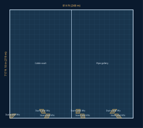
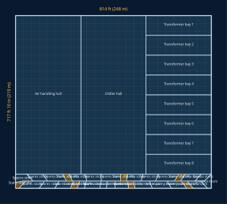
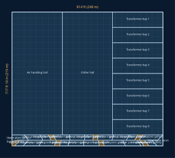

# P6-16 Starboard Homes Utility Plant: plan

Footprint 814 ft (248 m) × 717 ft 10 in (219 m) · structural grid 32 ft 10 in (10 m)

## Levels

| Level | Floor above deck | Height | Floor area |
|---|---|---|---|
| Level B1 · Pipe and cable basement | −16 ft 5 in (5,000 mm) | 16 ft 5 in (5,000 mm) | 584,311 sq ft (54,284 m²) |
| Level 1 · Plant floor | 0 ft (0 mm) | 26 ft 3 in (8,000 mm) | 576,700 sq ft (53,577 m²) |
| Level 2 · Upper plant deck | 26 ft 3 in (8,000 mm) | 19 ft 8 in (6,000 mm) | 576,700 sq ft (53,577 m²) |

## Elements

| ID | Designation | Type | Name | Level(s) | Size / length | Area | Status |
|---|---|---|---|---|---|---|---|
| E001 | D5F6P6B13A1L1R1, D5F6P6B13A1L2R1 | room | Transformer bay 1 | L1, L2 | 271 ft 4 in (83 m) × 82 ft 4 in (25 m) | 22,343 sq ft (2,076 m²) | proposed |
| E002 | D5F6P6B13A1L1R2, D5F6P6B13A1L2R2 | room | Transformer bay 2 | L1, L2 | 271 ft 4 in (83 m) × 82 ft 4 in (25 m) | 22,343 sq ft (2,076 m²) | proposed |
| E003 | D5F6P6B13A1L1R3, D5F6P6B13A1L2R3 | room | Transformer bay 3 | L1, L2 | 271 ft 4 in (83 m) × 82 ft 4 in (25 m) | 22,343 sq ft (2,076 m²) | proposed |
| E004 | D5F6P6B13A1L1R4, D5F6P6B13A1L2R4 | room | Transformer bay 4 | L1, L2 | 271 ft 4 in (83 m) × 82 ft 4 in (25 m) | 22,343 sq ft (2,076 m²) | proposed |
| E005 | D5F6P6B13A1L1R5, D5F6P6B13A1L2R5 | room | Transformer bay 5 | L1, L2 | 271 ft 4 in (83 m) × 82 ft 4 in (25 m) | 22,343 sq ft (2,076 m²) | proposed |
| E006 | D5F6P6B13A1L1R6, D5F6P6B13A1L2R6 | room | Transformer bay 6 | L1, L2 | 271 ft 4 in (83 m) × 82 ft 4 in (25 m) | 22,343 sq ft (2,076 m²) | proposed |
| E007 | D5F6P6B13A1L1R7, D5F6P6B13A1L2R7 | room | Transformer bay 7 | L1, L2 | 271 ft 4 in (83 m) × 82 ft 4 in (25 m) | 22,343 sq ft (2,076 m²) | proposed |
| E008 | D5F6P6B13A1L1R8, D5F6P6B13A1L2R8 | room | Transformer bay 8 | L1, L2 | 271 ft 4 in (83 m) × 82 ft 4 in (25 m) | 22,343 sq ft (2,076 m²) | proposed |
| E009 | D5F6P6B13A1L1R9, D5F6P6B13A1L2R9 | room | Chiller hall | L1, L2 | 271 ft 4 in (83 m) × 658 ft 10 in (201 m) | 178,747 sq ft (16,606 m²) | proposed |
| E010 | D5F6P6B13A1L1R10, D5F6P6B13A1L2R10 | room | Air handling hall | L1, L2 | 271 ft 4 in (83 m) × 658 ft 10 in (201 m) | 178,747 sq ft (16,606 m²) | proposed |
| E011 | D5F6P6B13A1LB1R1, D5F6P6B13A1L1R11, D5F6P6B13A1L2R11 | core | Stairs and lifts | LB1, L1, L2 | 48 ft 3 in (15 m) × 27 ft 11 in (8,500 mm) | 732 sq ft (68 m²) | proposed |
| E012 | D5F6P6B13A1LB1R2, D5F6P6B13A1L1R12, D5F6P6B13A1L2R12 | core | Stairs and lifts | LB1, L1, L2 | 31 ft 6 in (9,600 mm) × 27 ft 11 in (8,500 mm) | 732 sq ft (68 m²) | proposed |
| E013 | D5F6P6B13A1LB1R3, D5F6P6B13A1L1R13, D5F6P6B13A1L2R13 | core | Stairs and lifts | LB1, L1, L2 | 37 ft 9 in (12 m) × 27 ft 11 in (8,500 mm) | 732 sq ft (68 m²) | proposed |
| E014 | D5F6P6B13A1LB1R4, D5F6P6B13A1L1R14, D5F6P6B13A1L2R14 | core | Stairs and lifts | LB1, L1, L2 | 40 ft 8 in (12 m) × 29 ft 2 in (8,900 mm) | 732 sq ft (68 m²) | proposed |
| E015 | D5F6P6B13A1LB1R5, D5F6P6B13A1L1R15, D5F6P6B13A1L2R15 | core | Stairs and lifts | LB1, L1, L2 | 40 ft (12 m) × 27 ft 11 in (8,500 mm) | 732 sq ft (68 m²) | proposed |
| E016 | D5F6P6B13A1LB1R6, D5F6P6B13A1L1R16, D5F6P6B13A1L2R16 | core | Stairs and lifts | LB1, L1, L2 | 29 ft 2 in (8,900 mm) × 27 ft 11 in (8,500 mm) | 732 sq ft (68 m²) | proposed |
| E017 | D5F6P6B13A1LB1R7, D5F6P6B13A1L1R17, D5F6P6B13A1L2R17 | core | Stairs and lifts | LB1, L1, L2 | 45 ft 11 in (14 m) × 27 ft 11 in (8,500 mm) | 732 sq ft (68 m²) | proposed |
| E018 | D5F6P6B13A1L1R18 | room | Control room | L1 | 42 ft 8 in (13 m) × 59 ft 1 in (18 m) | 1,295 sq ft (120 m²) | proposed |
| E019 | D5F6P6B13A1L1R19 | room | Switch room | L1 | 82 ft 4 in (25 m) × 27 ft 11 in (8,500 mm) | 1,601 sq ft (149 m²) | proposed |
| E020 | D5F6P6B13A1L1R20 | room | Battery room | L1 | 80 ft 1 in (24 m) × 27 ft 11 in (8,500 mm) | 1,711 sq ft (159 m²) | proposed |
| E021 | D5F6P6B13A1L1R21 | room | Water pump room | L1 | 90 ft 7 in (28 m) × 27 ft 11 in (8,500 mm) | 2,141 sq ft (199 m²) | proposed |
| E022 | D5F6P6B13A1L1R22 | room | Water treatment room | L1 | 77 ft 9 in (24 m) × 27 ft 11 in (8,500 mm) | 1,926 sq ft (179 m²) | proposed |
| E023 | D5F6P6B13A1L1R23 | room | Workshop | L1 | 56 ft 1 in (17 m) × 27 ft 11 in (8,500 mm) | 1,496 sq ft (139 m²) | proposed |
| E024 | D5F6P6B13A1L1R24 | room | Locker room | L1 | 36 ft 1 in (11 m) × 27 ft 11 in (8,500 mm) | 970 sq ft (90 m²) | proposed |
| E025 | D5F6P6B13A1L1R25 | room | Staff toilets and showers | L1 | 29 ft 6 in (9,000 mm) × 27 ft 11 in (8,500 mm) | 746 sq ft (69 m²) | proposed |
| E026 | D5F6P6B13A1L1R26 | room | Spares store | L1 | 68 ft 11 in (21 m) × 27 ft 11 in (8,500 mm) | 1,752 sq ft (163 m²) | proposed |
| E027 | D5F6P6B13A1L1R27 | room | Spares store | L1 | 38 ft 9 in (12 m) × 27 ft 11 in (8,500 mm) | 814 sq ft (76 m²) | proposed |
| E028 | D5F6P6B13A1L1R28 | room | Spares store | L1 | 77 ft 5 in (24 m) × 27 ft 11 in (8,500 mm) | 1,752 sq ft (163 m²) | proposed |
| E029 | D5F6P6B13A1L1R29 | room | Spares store | L1 | 81 ft 8 in (25 m) × 27 ft 11 in (8,500 mm) | 1,748 sq ft (162 m²) | proposed |
| E030 | D5F6P6B13A1L1R30 | room | Spares store | L1 | 106 ft (32 m) × 27 ft 11 in (8,500 mm) | 2,278 sq ft (212 m²) | proposed |
| E031 | D5F6P6B13A1L1R31 | room | Spares store | L1 | 71 ft 2 in (22 m) × 34 ft 1 in (10 m) | 1,757 sq ft (163 m²) | proposed |
| E032 | D5F6P6B13A1L1R32 | room | Spares store | L1 | 85 ft 4 in (26 m) × 27 ft 11 in (8,500 mm) | 1,752 sq ft (163 m²) | proposed |
| E033 | D5F6P6B13A1L1R33 | room | Spares store | L1 | 99 ft 1 in (30 m) × 27 ft 11 in (8,500 mm) | 2,274 sq ft (211 m²) | proposed |
| E034 | D5F6P6B13A1L1R34 | room | Spares store | L1 | 73 ft 2 in (22 m) × 27 ft 11 in (8,500 mm) | 1,752 sq ft (163 m²) | proposed |
| E035 | D5F6P6B13A1L1R35 | room | Spares store | L1 | 68 ft 7 in (21 m) × 27 ft 11 in (8,500 mm) | 1,752 sq ft (163 m²) | proposed |
| E036 | D5F6P6B13A1L1R36 | room | Spares store | L1 | 84 ft 4 in (26 m) × 27 ft 11 in (8,500 mm) | 2,274 sq ft (211 m²) | proposed |
| E037 | D5F6P6B13A1L1R37 | room | Spares store | L1 | 68 ft 11 in (21 m) × 27 ft 11 in (8,500 mm) | 1,752 sq ft (163 m²) | proposed |
| E038 | D5F6P6B13A1L1R38 | room | Spares store | L1 | 73 ft 6 in (22 m) × 27 ft 11 in (8,500 mm) | 1,752 sq ft (163 m²) | proposed |
| E039 | D5F6P6B13A1L1R39 | room | Spares store | L1 | 97 ft 5 in (30 m) × 27 ft 11 in (8,500 mm) | 2,274 sq ft (211 m²) | proposed |
| E040 | D5F6P6B13A1L1R40 | room | Spares store | L1 | 85 ft 8 in (26 m) × 27 ft 11 in (8,500 mm) | 1,752 sq ft (163 m²) | proposed |
| E041 | D5F6P6B13A1L1R41 | room | Spares store | L1 | 67 ft 3 in (20 m) × 27 ft 11 in (8,500 mm) | 1,139 sq ft (106 m²) | proposed |
| E042 | D5F6P6B13A1L2R18 | room | Filter bank room | L2 | 57 ft 5 in (18 m) × 59 ft 1 in (18 m) | 1,720 sq ft (160 m²) | proposed |
| E043 | D5F6P6B13A1L2R19 | room | Ductwork gallery | L2 | 66 ft 7 in (20 m) × 27 ft 11 in (8,500 mm) | 1,176 sq ft (109 m²) | proposed |
| E044 | D5F6P6B13A1L2R20 | room | Crew rest room | L2 | 35 ft 9 in (11 m) × 27 ft 11 in (8,500 mm) | 425 sq ft (40 m²) | proposed |
| E045 | D5F6P6B13A1L2R21 | room | Upper plant gallery | L2 | 98 ft 1 in (30 m) × 27 ft 11 in (8,500 mm) | 2,260 sq ft (210 m²) | proposed |
| E046 | D5F6P6B13A1L2R22 | room | Upper plant gallery | L2 | 121 ft 1 in (37 m) × 27 ft 11 in (8,500 mm) | 3,092 sq ft (287 m²) | proposed |
| E047 | D5F6P6B13A1L2R23 | room | Upper plant gallery | L2 | 84 ft (26 m) × 27 ft 11 in (8,500 mm) | 2,260 sq ft (210 m²) | proposed |
| E048 | D5F6P6B13A1L2R24 | room | Upper plant gallery | L2 | 85 ft 4 in (26 m) × 27 ft 11 in (8,500 mm) | 2,255 sq ft (210 m²) | proposed |
| E049 | D5F6P6B13A1L2R25 | room | Upper plant gallery | L2 | 54 ft 2 in (16 m) × 27 ft 11 in (8,500 mm) | 1,263 sq ft (117 m²) | proposed |
| E050 | D5F6P6B13A1L2R26 | room | Upper plant gallery | L2 | 96 ft 2 in (29 m) × 27 ft 11 in (8,500 mm) | 2,255 sq ft (210 m²) | proposed |
| E051 | D5F6P6B13A1L2R27 | room | Upper plant gallery | L2 | 102 ft (31 m) × 27 ft 11 in (8,500 mm) | 2,260 sq ft (210 m²) | proposed |
| E052 | D5F6P6B13A1L2R28 | room | Upper plant gallery | L2 | 70 ft 10 in (22 m) × 27 ft 11 in (8,500 mm) | 1,263 sq ft (117 m²) | proposed |
| E053 | D5F6P6B13A1L2R29 | room | Upper plant gallery | L2 | 88 ft 11 in (27 m) × 34 ft 1 in (10 m) | 2,264 sq ft (210 m²) | proposed |
| E054 | D5F6P6B13A1L2R30 | room | Upper plant gallery | L2 | 101 ft 8 in (31 m) × 27 ft 11 in (8,500 mm) | 2,260 sq ft (210 m²) | proposed |
| E055 | D5F6P6B13A1L2R31 | room | Upper plant gallery | L2 | 61 ft 4 in (19 m) × 27 ft 11 in (8,500 mm) | 1,258 sq ft (117 m²) | proposed |
| E056 | D5F6P6B13A1L2R32 | room | Upper plant gallery | L2 | 90 ft 11 in (28 m) × 27 ft 11 in (8,500 mm) | 2,260 sq ft (210 m²) | proposed |
| E057 | D5F6P6B13A1L2R33 | room | Upper plant gallery | L2 | 85 ft (26 m) × 27 ft 11 in (8,500 mm) | 2,260 sq ft (210 m²) | proposed |
| E058 | D5F6P6B13A1L2R34 | room | Upper plant gallery | L2 | 46 ft 7 in (14 m) × 27 ft 11 in (8,500 mm) | 1,258 sq ft (117 m²) | proposed |
| E059 | D5F6P6B13A1L2R35 | room | Upper plant gallery | L2 | 87 ft 11 in (27 m) × 27 ft 11 in (8,500 mm) | 2,260 sq ft (210 m²) | proposed |
| E060 | D5F6P6B13A1L2R36 | room | Upper plant gallery | L2 | 93 ft 10 in (29 m) × 27 ft 11 in (8,500 mm) | 2,260 sq ft (210 m²) | proposed |
| E061 | D5F6P6B13A1L2R37 | room | Upper plant gallery | L2 | 62 ft 4 in (19 m) × 27 ft 11 in (8,500 mm) | 1,258 sq ft (117 m²) | proposed |
| E062 | D5F6P6B13A1L2R38 | room | Upper plant gallery | L2 | 127 ft 11 in (39 m) × 27 ft 11 in (8,500 mm) | 2,891 sq ft (269 m²) | proposed |
| E063 | D5F6P6B13A1LB1R8 | room | Cable vault | LB1 | 406 ft 10 in (124 m) × 717 ft 10 in (219 m) | 292,038 sq ft (27,131 m²) | proposed |
| E064 | D5F6P6B13A1LB1R9 | room | Pipe gallery | LB1 | 407 ft 2 in (124 m) × 717 ft 10 in (219 m) | 292,273 sq ft (27,153 m²) | proposed |

## Drawings

### Level B1 · Pipe and cable basement

### Level 1 · Plant floor

### Level 2 · Upper plant deck

