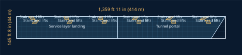
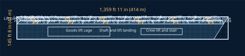
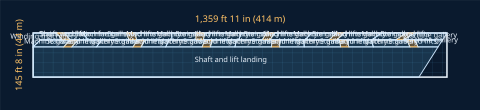

# P6-17 Starboard Homes Service Shaft: plan

Footprint 1,359 ft 11 in (414 m) × 145 ft 8 in (44 m) · structural grid 32 ft 10 in (10 m)

## Levels

| Level | Floor above deck | Height | Floor area |
|---|---|---|---|
| Level B1 · Service layer landing | −19 ft 8 in (6,000 mm) | 19 ft 8 in (6,000 mm) | 191,382 sq ft (17,780 m²) |
| Level 1 · Lift landing | 0 ft (0 mm) | 29 ft 6 in (9,000 mm) | 181,152 sq ft (16,830 m²) |
| Level 2 · Winding room | 29 ft 6 in (9,000 mm) | 19 ft 8 in (6,000 mm) | 181,148 sq ft (16,829 m²) |

## Elements

| ID | Designation | Type | Name | Level(s) | Size / length | Area | Status |
|---|---|---|---|---|---|---|---|
| E001 | D5F6P6B14A1L1R1, D5F6P6B14A1L2R1 | room | Shaft and lift landing | L1, L2 | 1,330 ft 9 in (406 m) × 99 ft 9 in (30 m) | 129,580 sq ft (12,038 m²) | proposed |
| E002 |  | fixture | Goods lift cage | L1 | 399 ft 3 in (122 m) × 59 ft 9 in (18 m) | 23,841 sq ft (2,215 m²) | proposed |
| E003 |  | fixture | Crew lift and stair | L1 | 266 ft 1 in (81 m) × 40 ft (12 m) | 10,650 sq ft (989 m²) | proposed |
| E004 | D5F6P6B14A1LB1R1, D5F6P6B14A1L1R2, D5F6P6B14A1L2R2 | core | Stairs and lifts | LB1, L1, L2 | 44 ft (13 m) × 21 ft 8 in (6,600 mm) | 568 sq ft (53 m²) | proposed |
| E005 | D5F6P6B14A1LB1R2, D5F6P6B14A1L1R3, D5F6P6B14A1L2R3 | core | Stairs and lifts | LB1, L1, L2 | 33 ft 6 in (10 m) × 21 ft 8 in (6,600 mm) | 565 sq ft (52 m²) | proposed |
| E006 | D5F6P6B14A1LB1R3, D5F6P6B14A1L1R4, D5F6P6B14A1L2R4 | core | Stairs and lifts | LB1, L1, L2 | 29 ft 2 in (8,900 mm) × 21 ft 8 in (6,600 mm) | 568 sq ft (53 m²) | proposed |
| E007 | D5F6P6B14A1LB1R4, D5F6P6B14A1L1R5, D5F6P6B14A1L2R5 | core | Stairs and lifts | LB1, L1, L2 | 39 ft 8 in (12 m) × 21 ft 8 in (6,600 mm) | 568 sq ft (53 m²) | proposed |
| E008 | D5F6P6B14A1LB1R5, D5F6P6B14A1L1R6, D5F6P6B14A1L2R6 | core | Stairs and lifts | LB1, L1, L2 | 49 ft 10 in (15 m) × 21 ft 8 in (6,600 mm) | 568 sq ft (53 m²) | proposed |
| E009 | D5F6P6B14A1LB1R6, D5F6P6B14A1L1R7, D5F6P6B14A1L2R7 | core | Stairs and lifts | LB1, L1, L2 | 60 ft 4 in (18 m) × 21 ft 8 in (6,600 mm) | 568 sq ft (53 m²) | proposed |
| E010 | D5F6P6B14A1LB1R7, D5F6P6B14A1L1R8, D5F6P6B14A1L2R8 | core | Stairs and lifts | LB1, L1, L2 | 36 ft 1 in (11 m) × 21 ft 8 in (6,600 mm) | 568 sq ft (53 m²) | proposed |
| E011 | D5F6P6B14A1LB1R8, D5F6P6B14A1L1R9, D5F6P6B14A1L2R9 | core | Stairs and lifts | LB1, L1, L2 | 30 ft 6 in (9,300 mm) × 21 ft 8 in (6,600 mm) | 572 sq ft (53 m²) | proposed |
| E012 | D5F6P6B14A1LB1R9, D5F6P6B14A1L1R10, D5F6P6B14A1L2R10 | core | Stairs and lifts | LB1, L1, L2 | 27 ft 11 in (8,500 mm) × 21 ft 8 in (6,600 mm) | 568 sq ft (53 m²) | proposed |
| E013 | D5F6P6B14A1LB1R10, D5F6P6B14A1L1R11, D5F6P6B14A1L2R11 | core | Stairs and lifts | LB1, L1, L2 | 33 ft 10 in (10 m) × 21 ft 8 in (6,600 mm) | 568 sq ft (53 m²) | proposed |
| E014 | D5F6P6B14A1LB1R11, D5F6P6B14A1L1R12, D5F6P6B14A1L2R12 | core | Stairs and lifts | LB1, L1, L2 | 39 ft 4 in (12 m) × 21 ft 8 in (6,600 mm) | 568 sq ft (53 m²) | proposed |
| E015 | D5F6P6B14A1LB1R12, D5F6P6B14A1L1R13, D5F6P6B14A1L2R13 | core | Stairs and lifts | LB1, L1, L2 | 45 ft 3 in (14 m) × 21 ft 8 in (6,600 mm) | 568 sq ft (53 m²) | proposed |
| E016 | D5F6P6B14A1L1R14 | room | Lift control room | L1 | 22 ft 4 in (6,800 mm) × 45 ft 11 in (14 m) | 540 sq ft (50 m²) | proposed |
| E017 | D5F6P6B14A1L1R15 | room | Loading bay | L1 | 94 ft 6 in (29 m) × 21 ft 8 in (6,600 mm) | 1,613 sq ft (150 m²) | proposed |
| E018 | D5F6P6B14A1L1R16 | room | Crew check-in | L1 | 36 ft 5 in (11 m) × 21 ft 8 in (6,600 mm) | 430 sq ft (40 m²) | proposed |
| E019 | D5F6P6B14A1L1R17 | room | Tool store | L1 | 54 ft 9 in (17 m) × 21 ft 8 in (6,600 mm) | 856 sq ft (80 m²) | proposed |
| E020 | D5F6P6B14A1L1R18 | room | Staff toilets and showers | L1 | 48 ft 3 in (15 m) × 21 ft 8 in (6,600 mm) | 749 sq ft (70 m²) | proposed |
| E021 | D5F6P6B14A1L1R19 | room | Holding store | L1 | 114 ft 10 in (35 m) × 21 ft 8 in (6,600 mm) | 2,263 sq ft (210 m²) | proposed |
| E022 | D5F6P6B14A1L1R20 | room | Holding store | L1 | 136 ft 2 in (42 m) × 21 ft 8 in (6,600 mm) | 2,867 sq ft (266 m²) | proposed |
| E023 | D5F6P6B14A1L1R21 | room | Holding store | L1 | 67 ft 7 in (21 m) × 21 ft 8 in (6,600 mm) | 1,431 sq ft (133 m²) | proposed |
| E024 | D5F6P6B14A1L1R22 | room | Holding store | L1 | 138 ft 9 in (42 m) × 21 ft 8 in (6,600 mm) | 2,859 sq ft (266 m²) | proposed |
| E025 | D5F6P6B14A1L1R23 | room | Holding store | L1 | 77 ft 9 in (24 m) × 21 ft 8 in (6,600 mm) | 1,439 sq ft (134 m²) | proposed |
| E026 | D5F6P6B14A1L1R24 | room | Holding store | L1 | 149 ft 3 in (46 m) × 21 ft 8 in (6,600 mm) | 2,859 sq ft (266 m²) | proposed |
| E027 | D5F6P6B14A1L1R25 | room | Holding store | L1 | 87 ft 11 in (27 m) × 21 ft 8 in (6,600 mm) | 1,435 sq ft (133 m²) | proposed |
| E028 | D5F6P6B14A1L1R26 | room | Holding store | L1 | 159 ft 5 in (49 m) × 21 ft 8 in (6,600 mm) | 2,859 sq ft (266 m²) | proposed |
| E029 | D5F6P6B14A1L1R27 | room | Holding store | L1 | 98 ft 5 in (30 m) × 21 ft 8 in (6,600 mm) | 1,439 sq ft (134 m²) | proposed |
| E030 | D5F6P6B14A1L1R28 | room | Holding store | L1 | 141 ft 9 in (43 m) × 44 ft 3 in (14 m) | 2,868 sq ft (266 m²) | proposed |
| E031 | D5F6P6B14A1L1R29 | room | Holding store | L1 | 77 ft 5 in (24 m) × 22 ft (6,700 mm) | 1,436 sq ft (133 m²) | proposed |
| E032 | D5F6P6B14A1L1R30 | room | Holding store | L1 | 140 ft 1 in (43 m) × 21 ft 8 in (6,600 mm) | 2,863 sq ft (266 m²) | proposed |
| E033 | D5F6P6B14A1L1R31 | room | Holding store | L1 | 71 ft 6 in (22 m) × 21 ft 8 in (6,600 mm) | 1,431 sq ft (133 m²) | proposed |
| E034 | D5F6P6B14A1L1R32 | room | Holding store | L1 | 134 ft 2 in (41 m) × 21 ft 8 in (6,600 mm) | 2,859 sq ft (266 m²) | proposed |
| E035 | D5F6P6B14A1L1R33 | room | Holding store | L1 | 67 ft 3 in (20 m) × 21 ft 8 in (6,600 mm) | 1,435 sq ft (133 m²) | proposed |
| E036 | D5F6P6B14A1L1R34 | room | Holding store | L1 | 135 ft 10 in (41 m) × 21 ft 8 in (6,600 mm) | 2,863 sq ft (266 m²) | proposed |
| E037 | D5F6P6B14A1L1R35 | room | Holding store | L1 | 72 ft 6 in (22 m) × 21 ft 8 in (6,600 mm) | 1,435 sq ft (133 m²) | proposed |
| E038 | D5F6P6B14A1L1R36 | room | Holding store | L1 | 141 ft 9 in (43 m) × 21 ft 8 in (6,600 mm) | 2,863 sq ft (266 m²) | proposed |
| E039 | D5F6P6B14A1L1R37 | room | Holding store | L1 | 78 ft 1 in (24 m) × 21 ft 8 in (6,600 mm) | 1,431 sq ft (133 m²) | proposed |
| E040 | D5F6P6B14A1L1R38 | room | Holding store | L1 | 147 ft 4 in (45 m) × 21 ft 8 in (6,600 mm) | 2,863 sq ft (266 m²) | proposed |
| E041 | D5F6P6B14A1L1R39 | room | Holding store | L1 | 84 ft (26 m) × 21 ft 8 in (6,600 mm) | 1,435 sq ft (133 m²) | proposed |
| E042 | D5F6P6B14A1L1R40 | room | Holding store | L1 | 119 ft 9 in (36 m) × 21 ft 8 in (6,600 mm) | 2,149 sq ft (200 m²) | proposed |
| E043 | D5F6P6B14A1L2R14 | room | Winding machinery | L2 | 95 ft 2 in (29 m) × 45 ft 11 in (14 m) | 2,153 sq ft (200 m²) | proposed |
| E044 | D5F6P6B14A1L2R15 | room | Shaft ventilation fans | L2 | 75 ft 2 in (23 m) × 21 ft 8 in (6,600 mm) | 1,286 sq ft (119 m²) | proposed |
| E045 | D5F6P6B14A1L2R16 | room | Machine gallery | L2 | 150 ft 3 in (46 m) × 21 ft 8 in (6,600 mm) | 3,012 sq ft (280 m²) | proposed |
| E046 | D5F6P6B14A1L2R17 | room | Machine gallery | L2 | 122 ft 8 in (37 m) × 21 ft 8 in (6,600 mm) | 2,568 sq ft (239 m²) | proposed |
| E047 | D5F6P6B14A1L2R18 | room | Machine gallery | L2 | 81 ft 8 in (25 m) × 21 ft 8 in (6,600 mm) | 1,730 sq ft (161 m²) | proposed |
| E048 | D5F6P6B14A1L2R19 | room | Machine gallery | L2 | 125 ft (38 m) × 21 ft 8 in (6,600 mm) | 2,568 sq ft (239 m²) | proposed |
| E049 | D5F6P6B14A1L2R20 | room | Machine gallery | L2 | 90 ft 11 in (28 m) × 21 ft 8 in (6,600 mm) | 1,730 sq ft (161 m²) | proposed |
| E050 | D5F6P6B14A1L2R21 | room | Machine gallery | L2 | 135 ft 2 in (41 m) × 21 ft 8 in (6,600 mm) | 2,565 sq ft (238 m²) | proposed |
| E051 | D5F6P6B14A1L2R22 | room | Machine gallery | L2 | 101 ft 1 in (31 m) × 21 ft 8 in (6,600 mm) | 1,730 sq ft (161 m²) | proposed |
| E052 | D5F6P6B14A1L2R23 | room | Machine gallery | L2 | 145 ft 8 in (44 m) × 21 ft 8 in (6,600 mm) | 2,568 sq ft (239 m²) | proposed |
| E053 | D5F6P6B14A1L2R24 | room | Machine gallery | L2 | 111 ft 7 in (34 m) × 21 ft 8 in (6,600 mm) | 1,730 sq ft (161 m²) | proposed |
| E054 | D5F6P6B14A1L2R25 | room | Machine gallery | L2 | 141 ft 9 in (43 m) × 23 ft (7,000 mm) | 2,570 sq ft (239 m²) | proposed |
| E055 | D5F6P6B14A1L2R26 | room | Machine gallery | L2 | 91 ft 2 in (28 m) × 23 ft 7 in (7,200 mm) | 1,730 sq ft (161 m²) | proposed |
| E056 | D5F6P6B14A1L2R27 | room | Machine gallery | L2 | 126 ft 8 in (39 m) × 21 ft 8 in (6,600 mm) | 2,568 sq ft (239 m²) | proposed |
| E057 | D5F6P6B14A1L2R28 | room | Machine gallery | L2 | 85 ft 4 in (26 m) × 21 ft 8 in (6,600 mm) | 1,726 sq ft (160 m²) | proposed |
| E058 | D5F6P6B14A1L2R29 | room | Machine gallery | L2 | 120 ft 9 in (37 m) × 21 ft 8 in (6,600 mm) | 2,565 sq ft (238 m²) | proposed |
| E059 | D5F6P6B14A1L2R30 | room | Machine gallery | L2 | 81 ft (25 m) × 21 ft 8 in (6,600 mm) | 1,730 sq ft (161 m²) | proposed |
| E060 | D5F6P6B14A1L2R31 | room | Machine gallery | L2 | 122 ft 1 in (37 m) × 21 ft 8 in (6,600 mm) | 2,568 sq ft (239 m²) | proposed |
| E061 | D5F6P6B14A1L2R32 | room | Machine gallery | L2 | 85 ft 11 in (26 m) × 21 ft 8 in (6,600 mm) | 1,730 sq ft (161 m²) | proposed |
| E062 | D5F6P6B14A1L2R33 | room | Machine gallery | L2 | 127 ft 11 in (39 m) × 21 ft 8 in (6,600 mm) | 2,568 sq ft (239 m²) | proposed |
| E063 | D5F6P6B14A1L2R34 | room | Machine gallery | L2 | 91 ft 6 in (28 m) × 21 ft 8 in (6,600 mm) | 1,726 sq ft (160 m²) | proposed |
| E064 | D5F6P6B14A1L2R35 | room | Machine gallery | L2 | 133 ft 6 in (41 m) × 21 ft 8 in (6,600 mm) | 2,568 sq ft (239 m²) | proposed |
| E065 | D5F6P6B14A1L2R36 | room | Machine gallery | L2 | 97 ft 5 in (30 m) × 21 ft 8 in (6,600 mm) | 1,730 sq ft (161 m²) | proposed |
| E066 | D5F6P6B14A1L2R37 | room | Machine gallery | L2 | 119 ft 9 in (36 m) × 21 ft 8 in (6,600 mm) | 2,149 sq ft (200 m²) | proposed |
| E067 | D5F6P6B14A1LB1R13 | room | Service layer landing | LB1 | 656 ft 10 in (200 m) × 145 ft 8 in (44 m) | 95,679 sq ft (8,889 m²) | proposed |
| E068 | D5F6P6B14A1LB1R14 | room | Tunnel portal | LB1 | 703 ft 1 in (214 m) × 145 ft 8 in (44 m) | 95,703 sq ft (8,891 m²) | proposed |

## Drawings

### Level B1 · Service layer landing

### Level 1 · Lift landing

### Level 2 · Winding room

