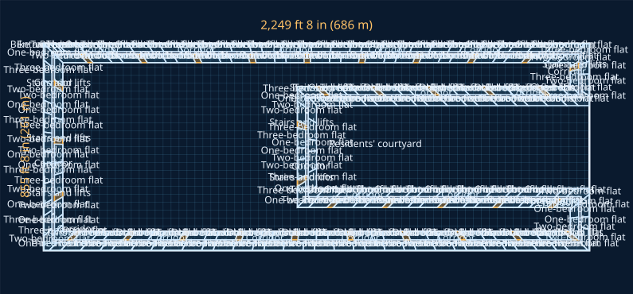
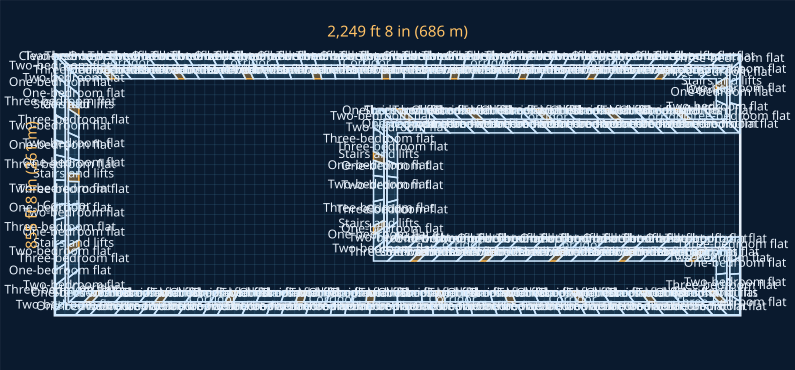

# P6-18 Apartment Block 1: plan

Footprint 2,249 ft 8 in (686 m) × 855 ft 8 in (261 m) · structural grid 32 ft 10 in (10 m)

## Levels

| Level | Floor above deck | Height | Floor area |
|---|---|---|---|
| Level 1 · Ground floor | 0 ft (0 mm) | 14 ft 9 in (4,500 mm) | 529,572 sq ft (49,199 m²) |
| Level 2 · Flat floor 1 | 14 ft 9 in (4,500 mm) | 10 ft 6 in (3,200 mm) | 529,572 sq ft (49,199 m²) |
| Level 3 · Flat floor 2 | 25 ft 3 in (7,700 mm) | 10 ft 6 in (3,200 mm) | 529,572 sq ft (49,199 m²) |
| Level 4 · Flat floor 3 | 35 ft 9 in (11 m) | 10 ft 6 in (3,200 mm) | 529,572 sq ft (49,199 m²) |
| Level 5 · Flat floor 4 | 46 ft 3 in (14 m) | 10 ft 6 in (3,200 mm) | 529,572 sq ft (49,199 m²) |

## Elements

| ID | Designation | Type | Name | Level(s) | Size / length | Area | Status |
|---|---|---|---|---|---|---|---|
| E001 | D5F6P6B1A3L1R1 | zone | Residents' courtyard | L1 | 2,092 ft 2 in (638 m) × 698 ft 2 in (213 m) | 898,559 sq ft (83,479 m²) | proposed |
| E002 | D5F6P6B1A3L1R2 | zone | Corridor | L1 | 401 ft 11 in (122 m) × 9 ft 10 in (3,000 mm) | 3,875 sq ft (360 m²) | proposed |
| E003 | D5F6P6B1A3L1R3 | zone | Corridor | L1 | 398 ft 4 in (121 m) × 9 ft 10 in (3,000 mm) | 3,875 sq ft (360 m²) | proposed |
| E004 | D5F6P6B1A3L1R4 | zone | Corridor | L1 | 395 ft 4 in (121 m) × 9 ft 10 in (3,000 mm) | 3,875 sq ft (360 m²) | proposed |
| E005 | D5F6P6B1A3L1R5 | zone | Corridor | L1 | 396 ft 4 in (121 m) × 9 ft 10 in (3,000 mm) | 3,875 sq ft (360 m²) | proposed |
| E006 | D5F6P6B1A3L1R6 | zone | Corridor | L1 | 399 ft 11 in (122 m) × 9 ft 10 in (3,000 mm) | 3,875 sq ft (360 m²) | proposed |
| E007 | D5F6P6B1A3L1R7 | zone | Corridor | L1 | 211 ft 3 in (64 m) × 187 ft 8 in (57 m) | 3,875 sq ft (360 m²) | proposed |
| E008 | D5F6P6B1A3L1R8 | zone | Corridor | L1 | 403 ft 7 in (123 m) × 9 ft 10 in (3,000 mm) | 3,875 sq ft (360 m²) | proposed |
| E009 | D5F6P6B1A3L1R9 | zone | Corridor | L1 | 403 ft 7 in (123 m) × 9 ft 10 in (3,000 mm) | 3,875 sq ft (360 m²) | proposed |
| E010 | D5F6P6B1A3L1R10 | zone | Corridor | L1 | 334 ft (102 m) × 77 ft 9 in (24 m) | 3,875 sq ft (360 m²) | proposed |
| E011 | D5F6P6B1A3L1R11 | zone | Corridor | L1 | 52 ft 2 in (16 m) × 359 ft 7 in (110 m) | 3,875 sq ft (360 m²) | proposed |
| E012 | D5F6P6B1A3L1R12 | zone | Corridor | L1 | 403 ft 7 in (123 m) × 9 ft 10 in (3,000 mm) | 3,875 sq ft (360 m²) | proposed |
| E013 | D5F6P6B1A3L1R13 | zone | Corridor | L1 | 403 ft 7 in (123 m) × 9 ft 10 in (3,000 mm) | 3,875 sq ft (360 m²) | proposed |
| E014 | D5F6P6B1A3L1R14 | zone | Corridor | L1 | 305 ft 1 in (93 m) × 104 ft (32 m) | 3,875 sq ft (360 m²) | proposed |
| E015 | D5F6P6B1A3L1R15 | zone | Corridor | L1 | 322 ft 6 in (98 m) × 85 ft 4 in (26 m) | 3,875 sq ft (360 m²) | proposed |
| E016 | D5F6P6B1A3L1R16 | zone | Corridor | L1 | 398 ft 11 in (122 m) × 9 ft 10 in (3,000 mm) | 3,875 sq ft (360 m²) | proposed |
| E017 | D5F6P6B1A3L1R17 | zone | Corridor | L1 | 395 ft 4 in (120 m) × 9 ft 10 in (3,000 mm) | 3,875 sq ft (360 m²) | proposed |
| E018 | D5F6P6B1A3L1R18 | zone | Corridor | L1 | 395 ft 8 in (121 m) × 9 ft 10 in (3,000 mm) | 3,875 sq ft (360 m²) | proposed |
| E019 | D5F6P6B1A3L1R19 | zone | Corridor | L1 | 399 ft 3 in (122 m) × 9 ft 10 in (3,000 mm) | 3,875 sq ft (360 m²) | proposed |
| E020 | D5F6P6B1A3L1R20 | zone | Corridor | L1 | 290 ft 8 in (89 m) × 120 ft 1 in (37 m) | 3,875 sq ft (360 m²) | proposed |
| E021 | D5F6P6B1A3L1R21 | zone | Corridor | L1 | 9 ft 10 in (3,000 mm) × 398 ft 11 in (122 m) | 3,875 sq ft (360 m²) | proposed |
| E022 | D5F6P6B1A3L1R22 | zone | Corridor | L1 | 9 ft 10 in (3,000 mm) × 278 ft 3 in (85 m) | 2,674 sq ft (248 m²) | proposed |
| E023 | D5F6P6B1A3L1R23, D5F6P6B1A3L2R1, D5F6P6B1A3L3R1, D5F6P6B1A3L4R1, D5F6P6B1A3L5R1 | core | Stairs and lifts | L1, L2, L3, L4, L5 | 57 ft 1 in (17 m) × 34 ft 5 in (10 m) | 904 sq ft (84 m²) | proposed |
| E024 | D5F6P6B1A3L1R24, D5F6P6B1A3L2R2, D5F6P6B1A3L3R2, D5F6P6B1A3L4R2, D5F6P6B1A3L5R2 | core | Stairs and lifts | L1, L2, L3, L4, L5 | 49 ft 6 in (15 m) × 34 ft 5 in (10 m) | 899 sq ft (83 m²) | proposed |
| E025 | D5F6P6B1A3L1R25, D5F6P6B1A3L2R3, D5F6P6B1A3L3R3, D5F6P6B1A3L4R3, D5F6P6B1A3L5R3 | core | Stairs and lifts | L1, L2, L3, L4, L5 | 42 ft 4 in (13 m) × 34 ft 5 in (10 m) | 910 sq ft (85 m²) | proposed |
| E026 | D5F6P6B1A3L1R26, D5F6P6B1A3L2R4, D5F6P6B1A3L3R4, D5F6P6B1A3L4R4, D5F6P6B1A3L5R4 | core | Stairs and lifts | L1, L2, L3, L4, L5 | 35 ft 1 in (11 m) × 34 ft 5 in (10 m) | 910 sq ft (85 m²) | proposed |
| E027 | D5F6P6B1A3L1R27, D5F6P6B1A3L2R5, D5F6P6B1A3L3R5, D5F6P6B1A3L4R5, D5F6P6B1A3L5R5 | core | Stairs and lifts | L1, L2, L3, L4, L5 | 27 ft 7 in (8,400 mm) × 34 ft 5 in (10 m) | 904 sq ft (84 m²) | proposed |
| E028 | D5F6P6B1A3L1R28, D5F6P6B1A3L2R6, D5F6P6B1A3L3R6, D5F6P6B1A3L4R6, D5F6P6B1A3L5R6 | core | Stairs and lifts | L1, L2, L3, L4, L5 | 32 ft 2 in (9,800 mm) × 34 ft 5 in (10 m) | 899 sq ft (83 m²) | proposed |
| E029 | D5F6P6B1A3L1R29, D5F6P6B1A3L2R7, D5F6P6B1A3L3R7, D5F6P6B1A3L4R7, D5F6P6B1A3L5R7 | core | Stairs and lifts | L1, L2, L3, L4, L5 | 39 ft 8 in (12 m) × 34 ft 5 in (10 m) | 904 sq ft (84 m²) | proposed |
| E030 | D5F6P6B1A3L1R30, D5F6P6B1A3L2R8, D5F6P6B1A3L3R8, D5F6P6B1A3L4R8, D5F6P6B1A3L5R8 | core | Stairs and lifts | L1, L2, L3, L4, L5 | 47 ft 3 in (14 m) × 34 ft 5 in (10 m) | 910 sq ft (85 m²) | proposed |
| E031 | D5F6P6B1A3L1R31, D5F6P6B1A3L2R9, D5F6P6B1A3L3R9, D5F6P6B1A3L4R9, D5F6P6B1A3L5R9 | core | Stairs and lifts | L1, L2, L3, L4, L5 | 54 ft 6 in (17 m) × 34 ft 5 in (10 m) | 904 sq ft (84 m²) | proposed |
| E032 | D5F6P6B1A3L1R32, D5F6P6B1A3L2R10, D5F6P6B1A3L3R10, D5F6P6B1A3L4R10, D5F6P6B1A3L5R10 | core | Stairs and lifts | L1, L2, L3, L4, L5 | 34 ft 5 in (10 m) × 42 ft (13 m) | 904 sq ft (84 m²) | proposed |
| E033 | D5F6P6B1A3L1R33, D5F6P6B1A3L2R11, D5F6P6B1A3L3R11, D5F6P6B1A3L4R11, D5F6P6B1A3L5R11 | core | Stairs and lifts | L1, L2, L3, L4, L5 | 60 ft 8 in (18 m) × 34 ft 5 in (10 m) | 904 sq ft (84 m²) | proposed |
| E034 | D5F6P6B1A3L1R34, D5F6P6B1A3L2R12, D5F6P6B1A3L3R12, D5F6P6B1A3L4R12, D5F6P6B1A3L5R12 | core | Stairs and lifts | L1, L2, L3, L4, L5 | 60 ft 8 in (18 m) × 34 ft 5 in (10 m) | 904 sq ft (84 m²) | proposed |
| E035 | D5F6P6B1A3L1R35, D5F6P6B1A3L2R13, D5F6P6B1A3L3R13, D5F6P6B1A3L4R13, D5F6P6B1A3L5R13 | core | Stairs and lifts | L1, L2, L3, L4, L5 | 60 ft 8 in (18 m) × 34 ft 5 in (10 m) | 904 sq ft (84 m²) | proposed |
| E036 | D5F6P6B1A3L1R36, D5F6P6B1A3L2R14, D5F6P6B1A3L3R14, D5F6P6B1A3L4R14, D5F6P6B1A3L5R14 | core | Stairs and lifts | L1, L2, L3, L4, L5 | 60 ft 8 in (18 m) × 34 ft 5 in (10 m) | 904 sq ft (84 m²) | proposed |
| E037 | D5F6P6B1A3L1R37, D5F6P6B1A3L2R15, D5F6P6B1A3L3R15, D5F6P6B1A3L4R15, D5F6P6B1A3L5R15 | core | Stairs and lifts | L1, L2, L3, L4, L5 | 60 ft 8 in (18 m) × 34 ft 5 in (10 m) | 904 sq ft (84 m²) | proposed |
| E038 | D5F6P6B1A3L1R38, D5F6P6B1A3L2R16, D5F6P6B1A3L3R16, D5F6P6B1A3L4R16, D5F6P6B1A3L5R16 | core | Stairs and lifts | L1, L2, L3, L4, L5 | 34 ft 5 in (10 m) × 39 ft 4 in (12 m) | 904 sq ft (84 m²) | proposed |
| E039 | D5F6P6B1A3L1R39, D5F6P6B1A3L2R17, D5F6P6B1A3L3R17, D5F6P6B1A3L4R17, D5F6P6B1A3L5R17 | core | Stairs and lifts | L1, L2, L3, L4, L5 | 34 ft 5 in (10 m) × 46 ft 11 in (14 m) | 904 sq ft (84 m²) | proposed |
| E040 | D5F6P6B1A3L1R40, D5F6P6B1A3L2R18, D5F6P6B1A3L3R18, D5F6P6B1A3L4R18, D5F6P6B1A3L5R18 | core | Stairs and lifts | L1, L2, L3, L4, L5 | 60 ft 8 in (18 m) × 34 ft 5 in (10 m) | 904 sq ft (84 m²) | proposed |
| E041 | D5F6P6B1A3L1R41, D5F6P6B1A3L2R19, D5F6P6B1A3L3R19, D5F6P6B1A3L4R19, D5F6P6B1A3L5R19 | core | Stairs and lifts | L1, L2, L3, L4, L5 | 60 ft 8 in (18 m) × 34 ft 5 in (10 m) | 904 sq ft (84 m²) | proposed |
| E042 | D5F6P6B1A3L1R42, D5F6P6B1A3L2R20, D5F6P6B1A3L3R20, D5F6P6B1A3L4R20, D5F6P6B1A3L5R20 | core | Stairs and lifts | L1, L2, L3, L4, L5 | 60 ft 8 in (18 m) × 34 ft 5 in (10 m) | 904 sq ft (84 m²) | proposed |
| E043 | D5F6P6B1A3L1R43, D5F6P6B1A3L2R21, D5F6P6B1A3L3R21, D5F6P6B1A3L4R21, D5F6P6B1A3L5R21 | core | Stairs and lifts | L1, L2, L3, L4, L5 | 60 ft 8 in (18 m) × 34 ft 5 in (10 m) | 904 sq ft (84 m²) | proposed |
| E044 | D5F6P6B1A3L1R44, D5F6P6B1A3L2R22, D5F6P6B1A3L3R22, D5F6P6B1A3L4R22, D5F6P6B1A3L5R22 | core | Stairs and lifts | L1, L2, L3, L4, L5 | 60 ft 8 in (18 m) × 34 ft 5 in (10 m) | 904 sq ft (84 m²) | proposed |
| E045 | D5F6P6B1A3L1R45, D5F6P6B1A3L2R23, D5F6P6B1A3L3R23, D5F6P6B1A3L4R23, D5F6P6B1A3L5R23 | core | Stairs and lifts | L1, L2, L3, L4, L5 | 60 ft (18 m) × 34 ft 5 in (10 m) | 899 sq ft (83 m²) | proposed |
| E046 | D5F6P6B1A3L1R46, D5F6P6B1A3L2R24, D5F6P6B1A3L3R24, D5F6P6B1A3L4R24, D5F6P6B1A3L5R24 | core | Stairs and lifts | L1, L2, L3, L4, L5 | 52 ft 10 in (16 m) × 34 ft 5 in (10 m) | 904 sq ft (84 m²) | proposed |
| E047 | D5F6P6B1A3L1R47, D5F6P6B1A3L2R25, D5F6P6B1A3L3R25, D5F6P6B1A3L4R25, D5F6P6B1A3L5R25 | core | Stairs and lifts | L1, L2, L3, L4, L5 | 45 ft 7 in (14 m) × 34 ft 5 in (10 m) | 904 sq ft (84 m²) | proposed |
| E048 | D5F6P6B1A3L1R48, D5F6P6B1A3L2R26, D5F6P6B1A3L3R26, D5F6P6B1A3L4R26, D5F6P6B1A3L5R26 | core | Stairs and lifts | L1, L2, L3, L4, L5 | 38 ft 5 in (12 m) × 34 ft 5 in (10 m) | 910 sq ft (85 m²) | proposed |
| E049 | D5F6P6B1A3L1R49, D5F6P6B1A3L2R27, D5F6P6B1A3L3R27, D5F6P6B1A3L4R27, D5F6P6B1A3L5R27 | core | Stairs and lifts | L1, L2, L3, L4, L5 | 30 ft 10 in (9,400 mm) × 34 ft 5 in (10 m) | 904 sq ft (84 m²) | proposed |
| E050 | D5F6P6B1A3L1R50, D5F6P6B1A3L2R28, D5F6P6B1A3L3R28, D5F6P6B1A3L4R28, D5F6P6B1A3L5R28 | core | Stairs and lifts | L1, L2, L3, L4, L5 | 29 ft 2 in (8,900 mm) × 34 ft 5 in (10 m) | 904 sq ft (84 m²) | proposed |
| E051 | D5F6P6B1A3L1R51, D5F6P6B1A3L2R29, D5F6P6B1A3L3R29, D5F6P6B1A3L4R29, D5F6P6B1A3L5R29 | core | Stairs and lifts | L1, L2, L3, L4, L5 | 36 ft 5 in (11 m) × 34 ft 5 in (10 m) | 904 sq ft (84 m²) | proposed |
| E052 | D5F6P6B1A3L1R52, D5F6P6B1A3L2R30, D5F6P6B1A3L3R30, D5F6P6B1A3L4R30, D5F6P6B1A3L5R30 | core | Stairs and lifts | L1, L2, L3, L4, L5 | 43 ft 8 in (13 m) × 34 ft 5 in (10 m) | 899 sq ft (83 m²) | proposed |
| E053 | D5F6P6B1A3L1R53, D5F6P6B1A3L2R31, D5F6P6B1A3L3R31, D5F6P6B1A3L4R31, D5F6P6B1A3L5R31 | core | Stairs and lifts | L1, L2, L3, L4, L5 | 51 ft 2 in (16 m) × 34 ft 5 in (10 m) | 904 sq ft (84 m²) | proposed |
| E054 | D5F6P6B1A3L1R54, D5F6P6B1A3L2R32, D5F6P6B1A3L3R32, D5F6P6B1A3L4R32, D5F6P6B1A3L5R32 | core | Stairs and lifts | L1, L2, L3, L4, L5 | 58 ft 9 in (18 m) × 34 ft 5 in (10 m) | 910 sq ft (85 m²) | proposed |
| E055 | D5F6P6B1A3L1R55, D5F6P6B1A3L2R33, D5F6P6B1A3L3R33, D5F6P6B1A3L4R33, D5F6P6B1A3L5R33 | core | Stairs and lifts | L1, L2, L3, L4, L5 | 34 ft 5 in (10 m) × 45 ft 3 in (14 m) | 899 sq ft (83 m²) | proposed |
| E056 | D5F6P6B1A3L1R56, D5F6P6B1A3L2R34, D5F6P6B1A3L3R34, D5F6P6B1A3L4R34, D5F6P6B1A3L5R34 | core | Stairs and lifts | L1, L2, L3, L4, L5 | 34 ft 5 in (10 m) × 28 ft 7 in (8,700 mm) | 904 sq ft (84 m²) | proposed |
| E057 | D5F6P6B1A3L1R57, D5F6P6B1A3L2R35, D5F6P6B1A3L3R35, D5F6P6B1A3L4R35, D5F6P6B1A3L5R35 | core | Stairs and lifts | L1, L2, L3, L4, L5 | 34 ft 5 in (10 m) × 50 ft 2 in (15 m) | 904 sq ft (84 m²) | proposed |
| E058 | D5F6P6B1A3L1R58 | room | Entrance lobby | L1 | 59 ft 1 in (18 m) × 34 ft 5 in (10 m) | 859 sq ft (80 m²) | proposed |
| E059 | D5F6P6B1A3L1R59 | room | Bike and pram store | L1 | 52 ft 2 in (16 m) × 34 ft 5 in (10 m) | 644 sq ft (60 m²) | proposed |
| E060 | D5F6P6B1A3L1R60 | room | Bin store | L1 | 44 ft 11 in (14 m) × 34 ft 5 in (10 m) | 418 sq ft (39 m²) | proposed |
| E061 | D5F6P6B1A3L1R61 | room | Two-bedroom flat | L1 | 111 ft 3 in (34 m) × 34 ft 5 in (10 m) | 2,746 sq ft (255 m²) | proposed |
| E062 | D5F6P6B1A3L1R62 | room | Three-bedroom flat | L1 | 108 ft 11 in (33 m) × 34 ft 5 in (10 m) | 2,746 sq ft (255 m²) | proposed |
| E063 | D5F6P6B1A3L1R63 | room | One-bedroom flat | L1 | 73 ft 10 in (22 m) × 34 ft 5 in (10 m) | 1,611 sq ft (150 m²) | proposed |
| E064 | D5F6P6B1A3L1R64 | room | Two-bedroom flat | L1 | 104 ft 8 in (32 m) × 34 ft 5 in (10 m) | 2,746 sq ft (255 m²) | proposed |
| E065 | D5F6P6B1A3L1R65 | room | Three-bedroom flat | L1 | 102 ft (31 m) × 34 ft 5 in (10 m) | 2,741 sq ft (255 m²) | proposed |
| E066 | D5F6P6B1A3L1R66 | room | One-bedroom flat | L1 | 67 ft 7 in (21 m) × 34 ft 5 in (10 m) | 1,616 sq ft (150 m²) | proposed |
| E067 | D5F6P6B1A3L1R67 | room | Two-bedroom flat | L1 | 98 ft 5 in (30 m) × 34 ft 5 in (10 m) | 2,746 sq ft (255 m²) | proposed |
| E068 | D5F6P6B1A3L1R68 | room | Three-bedroom flat | L1 | 95 ft 10 in (29 m) × 34 ft 5 in (10 m) | 2,746 sq ft (255 m²) | proposed |
| E069 | D5F6P6B1A3L1R69 | room | One-bedroom flat | L1 | 61 ft (19 m) × 34 ft 5 in (10 m) | 1,616 sq ft (150 m²) | proposed |
| E070 | D5F6P6B1A3L1R70 | room | Two-bedroom flat | L1 | 91 ft 10 in (28 m) × 34 ft 5 in (10 m) | 2,741 sq ft (255 m²) | proposed |
| E071 | D5F6P6B1A3L1R71 | room | Three-bedroom flat | L1 | 89 ft 7 in (27 m) × 34 ft 5 in (10 m) | 2,746 sq ft (255 m²) | proposed |
| E072 | D5F6P6B1A3L1R72 | room | One-bedroom flat | L1 | 54 ft 9 in (17 m) × 34 ft 5 in (10 m) | 1,616 sq ft (150 m²) | proposed |
| E073 | D5F6P6B1A3L1R73 | room | Two-bedroom flat | L1 | 85 ft 8 in (26 m) × 34 ft 5 in (10 m) | 2,746 sq ft (255 m²) | proposed |
| E074 | D5F6P6B1A3L1R74 | room | Three-bedroom flat | L1 | 83 ft (25 m) × 34 ft 5 in (10 m) | 2,741 sq ft (255 m²) | proposed |
| E075 | D5F6P6B1A3L1R75 | room | One-bedroom flat | L1 | 48 ft 3 in (15 m) × 34 ft 5 in (10 m) | 1,611 sq ft (150 m²) | proposed |
| E076 | D5F6P6B1A3L1R76 | room | Two-bedroom flat | L1 | 81 ft (25 m) × 34 ft 5 in (10 m) | 2,752 sq ft (256 m²) | proposed |
| E077 | D5F6P6B1A3L1R77 | room | Three-bedroom flat | L1 | 82 ft 8 in (25 m) × 34 ft 5 in (10 m) | 2,746 sq ft (255 m²) | proposed |
| E078 | D5F6P6B1A3L1R78 | room | One-bedroom flat | L1 | 51 ft 10 in (16 m) × 34 ft 5 in (10 m) | 1,611 sq ft (150 m²) | proposed |
| E079 | D5F6P6B1A3L1R79 | room | Two-bedroom flat | L1 | 86 ft 7 in (26 m) × 34 ft 5 in (10 m) | 2,741 sq ft (255 m²) | proposed |
| E080 | D5F6P6B1A3L1R80 | room | Three-bedroom flat | L1 | 89 ft 3 in (27 m) × 34 ft 5 in (10 m) | 2,746 sq ft (255 m²) | proposed |
| E081 | D5F6P6B1A3L1R81 | room | One-bedroom flat | L1 | 58 ft 5 in (18 m) × 34 ft 5 in (10 m) | 1,616 sq ft (150 m²) | proposed |
| E082 | D5F6P6B1A3L1R82 | room | Two-bedroom flat | L1 | 93 ft 2 in (28 m) × 34 ft 5 in (10 m) | 2,746 sq ft (255 m²) | proposed |
| E083 | D5F6P6B1A3L1R83 | room | Three-bedroom flat | L1 | 95 ft 6 in (29 m) × 34 ft 5 in (10 m) | 2,741 sq ft (255 m²) | proposed |
| E084 | D5F6P6B1A3L1R84 | room | One-bedroom flat | L1 | 64 ft 8 in (20 m) × 34 ft 5 in (10 m) | 1,616 sq ft (150 m²) | proposed |
| E085 | D5F6P6B1A3L1R85 | room | Two-bedroom flat | L1 | 99 ft 5 in (30 m) × 34 ft 5 in (10 m) | 2,746 sq ft (255 m²) | proposed |
| E086 | D5F6P6B1A3L1R86 | room | Three-bedroom flat | L1 | 102 ft (31 m) × 34 ft 5 in (10 m) | 2,746 sq ft (255 m²) | proposed |
| E087 | D5F6P6B1A3L1R87 | room | One-bedroom flat | L1 | 71 ft 2 in (22 m) × 34 ft 5 in (10 m) | 1,616 sq ft (150 m²) | proposed |
| E088 | D5F6P6B1A3L1R88 | room | Two-bedroom flat | L1 | 105 ft 8 in (32 m) × 34 ft 5 in (10 m) | 2,741 sq ft (255 m²) | proposed |
| E089 | D5F6P6B1A3L1R89 | room | Three-bedroom flat | L1 | 108 ft 3 in (33 m) × 34 ft 5 in (10 m) | 2,746 sq ft (255 m²) | proposed |
| E090 | D5F6P6B1A3L1R90 | room | One-bedroom flat | L1 | 77 ft 5 in (24 m) × 34 ft 5 in (10 m) | 1,611 sq ft (150 m²) | proposed |
| E091 | D5F6P6B1A3L1R91 | room | Two-bedroom flat | L1 | 112 ft 6 in (34 m) × 34 ft 5 in (10 m) | 2,746 sq ft (255 m²) | proposed |
| E092 | D5F6P6B1A3L1R92 | room | Three-bedroom flat | L1 | 51 ft 10 in (16 m) × 86 ft 11 in (26 m) | 2,746 sq ft (255 m²) | proposed |
| E093 | D5F6P6B1A3L1R93 | room | One-bedroom flat | L1 | 34 ft 5 in (10 m) × 54 ft 9 in (17 m) | 1,616 sq ft (150 m²) | proposed |
| E094 | D5F6P6B1A3L1R94 | room | Two-bedroom flat | L1 | 34 ft 5 in (10 m) × 91 ft 10 in (28 m) | 2,741 sq ft (255 m²) | proposed |
| E095 | D5F6P6B1A3L1R95 | room | Three-bedroom flat | L1 | 80 ft 9 in (25 m) × 62 ft 8 in (19 m) | 2,746 sq ft (255 m²) | proposed |
| E096 | D5F6P6B1A3L1R96 | room | One-bedroom flat | L1 | 81 ft 4 in (25 m) × 34 ft 5 in (10 m) | 1,616 sq ft (150 m²) | proposed |
| E097 | D5F6P6B1A3L1R97 | room | Two-bedroom flat | L1 | 114 ft 2 in (35 m) × 34 ft 5 in (10 m) | 2,746 sq ft (255 m²) | proposed |
| E098 | D5F6P6B1A3L1R98 | room | Three-bedroom flat | L1 | 114 ft 2 in (35 m) × 34 ft 5 in (10 m) | 2,746 sq ft (255 m²) | proposed |
| E099 | D5F6P6B1A3L1R99 | room | One-bedroom flat | L1 | 81 ft 4 in (25 m) × 34 ft 5 in (10 m) | 1,616 sq ft (150 m²) | proposed |
| E100 | D5F6P6B1A3L1R100 | room | Two-bedroom flat | L1 | 113 ft 10 in (35 m) × 34 ft 5 in (10 m) | 2,735 sq ft (254 m²) | proposed |
| E101 | D5F6P6B1A3L1R101 | room | Three-bedroom flat | L1 | 114 ft 2 in (35 m) × 34 ft 5 in (10 m) | 2,746 sq ft (255 m²) | proposed |
| E102 | D5F6P6B1A3L1R102 | room | One-bedroom flat | L1 | 81 ft 4 in (25 m) × 34 ft 5 in (10 m) | 1,616 sq ft (150 m²) | proposed |
| E103 | D5F6P6B1A3L1R103 | room | Two-bedroom flat | L1 | 114 ft 2 in (35 m) × 34 ft 5 in (10 m) | 2,746 sq ft (255 m²) | proposed |
| E104 | D5F6P6B1A3L1R104 | room | Three-bedroom flat | L1 | 114 ft 2 in (35 m) × 34 ft 5 in (10 m) | 2,746 sq ft (255 m²) | proposed |
| E105 | D5F6P6B1A3L1R105 | room | One-bedroom flat | L1 | 81 ft 4 in (25 m) × 34 ft 5 in (10 m) | 1,616 sq ft (150 m²) | proposed |
| E106 | D5F6P6B1A3L1R106 | room | Two-bedroom flat | L1 | 114 ft 2 in (35 m) × 34 ft 5 in (10 m) | 2,746 sq ft (255 m²) | proposed |
| E107 | D5F6P6B1A3L1R107 | room | Three-bedroom flat | L1 | 113 ft 10 in (35 m) × 34 ft 5 in (10 m) | 2,735 sq ft (254 m²) | proposed |
| E108 | D5F6P6B1A3L1R108 | room | One-bedroom flat | L1 | 81 ft 4 in (25 m) × 34 ft 5 in (10 m) | 1,616 sq ft (150 m²) | proposed |
| E109 | D5F6P6B1A3L1R109 | room | Two-bedroom flat | L1 | 114 ft 2 in (35 m) × 34 ft 5 in (10 m) | 2,746 sq ft (255 m²) | proposed |
| E110 | D5F6P6B1A3L1R110 | room | Three-bedroom flat | L1 | 114 ft 2 in (35 m) × 34 ft 5 in (10 m) | 2,746 sq ft (255 m²) | proposed |
| E111 | D5F6P6B1A3L1R111 | room | One-bedroom flat | L1 | 81 ft 4 in (25 m) × 34 ft 5 in (10 m) | 1,616 sq ft (150 m²) | proposed |
| E112 | D5F6P6B1A3L1R112 | room | Two-bedroom flat | L1 | 35 ft 1 in (11 m) × 106 ft 4 in (32 m) | 2,746 sq ft (255 m²) | proposed |
| E113 | D5F6P6B1A3L1R113 | room | Three-bedroom flat | L1 | 34 ft 5 in (10 m) × 92 ft 2 in (28 m) | 2,741 sq ft (255 m²) | proposed |
| E114 | D5F6P6B1A3L1R114 | room | One-bedroom flat | L1 | 34 ft 5 in (10 m) × 51 ft 2 in (16 m) | 1,616 sq ft (150 m²) | proposed |
| E115 | D5F6P6B1A3L1R115 | room | Two-bedroom flat | L1 | 34 ft 5 in (10 m) × 90 ft 3 in (28 m) | 2,746 sq ft (255 m²) | proposed |
| E116 | D5F6P6B1A3L1R116 | room | Three-bedroom flat | L1 | 34 ft 5 in (10 m) × 104 ft 8 in (32 m) | 2,741 sq ft (255 m²) | proposed |
| E117 | D5F6P6B1A3L1R117 | room | One-bedroom flat | L1 | 69 ft 7 in (21 m) × 45 ft 3 in (14 m) | 1,616 sq ft (150 m²) | proposed |
| E118 | D5F6P6B1A3L1R118 | room | Two-bedroom flat | L1 | 114 ft 2 in (35 m) × 34 ft 5 in (10 m) | 2,746 sq ft (255 m²) | proposed |
| E119 | D5F6P6B1A3L1R119 | room | Three-bedroom flat | L1 | 114 ft 2 in (35 m) × 34 ft 5 in (10 m) | 2,746 sq ft (255 m²) | proposed |
| E120 | D5F6P6B1A3L1R120 | room | One-bedroom flat | L1 | 81 ft 4 in (25 m) × 34 ft 5 in (10 m) | 1,616 sq ft (150 m²) | proposed |
| E121 | D5F6P6B1A3L1R121 | room | Two-bedroom flat | L1 | 113 ft 10 in (35 m) × 34 ft 5 in (10 m) | 2,735 sq ft (254 m²) | proposed |
| E122 | D5F6P6B1A3L1R122 | room | Three-bedroom flat | L1 | 114 ft 2 in (35 m) × 34 ft 5 in (10 m) | 2,746 sq ft (255 m²) | proposed |
| E123 | D5F6P6B1A3L1R123 | room | One-bedroom flat | L1 | 81 ft 4 in (25 m) × 34 ft 5 in (10 m) | 1,616 sq ft (150 m²) | proposed |
| E124 | D5F6P6B1A3L1R124 | room | Two-bedroom flat | L1 | 114 ft 2 in (35 m) × 34 ft 5 in (10 m) | 2,746 sq ft (255 m²) | proposed |
| E125 | D5F6P6B1A3L1R125 | room | Three-bedroom flat | L1 | 114 ft 2 in (35 m) × 34 ft 5 in (10 m) | 2,746 sq ft (255 m²) | proposed |
| E126 | D5F6P6B1A3L1R126 | room | One-bedroom flat | L1 | 81 ft 4 in (25 m) × 34 ft 5 in (10 m) | 1,616 sq ft (150 m²) | proposed |
| E127 | D5F6P6B1A3L1R127 | room | Two-bedroom flat | L1 | 114 ft 2 in (35 m) × 34 ft 5 in (10 m) | 2,746 sq ft (255 m²) | proposed |
| E128 | D5F6P6B1A3L1R128 | room | Three-bedroom flat | L1 | 113 ft 10 in (35 m) × 34 ft 5 in (10 m) | 2,735 sq ft (254 m²) | proposed |
| E129 | D5F6P6B1A3L1R129 | room | One-bedroom flat | L1 | 81 ft 4 in (25 m) × 34 ft 5 in (10 m) | 1,616 sq ft (150 m²) | proposed |
| E130 | D5F6P6B1A3L1R130 | room | Two-bedroom flat | L1 | 114 ft 2 in (35 m) × 34 ft 5 in (10 m) | 2,746 sq ft (255 m²) | proposed |
| E131 | D5F6P6B1A3L1R131 | room | Three-bedroom flat | L1 | 114 ft 2 in (35 m) × 34 ft 5 in (10 m) | 2,746 sq ft (255 m²) | proposed |
| E132 | D5F6P6B1A3L1R132 | room | One-bedroom flat | L1 | 81 ft 4 in (25 m) × 34 ft 5 in (10 m) | 1,616 sq ft (150 m²) | proposed |
| E133 | D5F6P6B1A3L1R133 | room | Two-bedroom flat | L1 | 93 ft 2 in (28 m) × 52 ft 2 in (16 m) | 2,746 sq ft (255 m²) | proposed |
| E134 | D5F6P6B1A3L1R134 | room | Three-bedroom flat | L1 | 34 ft 5 in (10 m) × 95 ft 2 in (29 m) | 2,741 sq ft (255 m²) | proposed |
| E135 | D5F6P6B1A3L1R135 | room | One-bedroom flat | L1 | 34 ft 5 in (10 m) × 54 ft 2 in (16 m) | 1,616 sq ft (150 m²) | proposed |
| E136 | D5F6P6B1A3L1R136 | room | Two-bedroom flat | L1 | 39 ft 1 in (12 m) × 97 ft 9 in (30 m) | 2,741 sq ft (255 m²) | proposed |
| E137 | D5F6P6B1A3L1R137 | room | Three-bedroom flat | L1 | 112 ft 10 in (34 m) × 34 ft 5 in (10 m) | 2,746 sq ft (255 m²) | proposed |
| E138 | D5F6P6B1A3L1R138 | room | One-bedroom flat | L1 | 78 ft 1 in (24 m) × 34 ft 5 in (10 m) | 1,616 sq ft (150 m²) | proposed |
| E139 | D5F6P6B1A3L1R139 | room | Two-bedroom flat | L1 | 108 ft 11 in (33 m) × 34 ft 5 in (10 m) | 2,746 sq ft (255 m²) | proposed |
| E140 | D5F6P6B1A3L1R140 | room | Three-bedroom flat | L1 | 106 ft 4 in (32 m) × 34 ft 5 in (10 m) | 2,741 sq ft (255 m²) | proposed |
| E141 | D5F6P6B1A3L1R141 | room | One-bedroom flat | L1 | 71 ft 10 in (22 m) × 34 ft 5 in (10 m) | 1,622 sq ft (151 m²) | proposed |
| E142 | D5F6P6B1A3L1R142 | room | Two-bedroom flat | L1 | 102 ft 4 in (31 m) × 34 ft 5 in (10 m) | 2,741 sq ft (255 m²) | proposed |
| E143 | D5F6P6B1A3L1R143 | room | Three-bedroom flat | L1 | 100 ft 1 in (30 m) × 34 ft 5 in (10 m) | 2,746 sq ft (255 m²) | proposed |
| E144 | D5F6P6B1A3L1R144 | room | One-bedroom flat | L1 | 65 ft (20 m) × 34 ft 5 in (10 m) | 1,611 sq ft (150 m²) | proposed |
| E145 | D5F6P6B1A3L1R145 | room | Two-bedroom flat | L1 | 95 ft 10 in (29 m) × 34 ft 5 in (10 m) | 2,741 sq ft (255 m²) | proposed |
| E146 | D5F6P6B1A3L1R146 | room | Three-bedroom flat | L1 | 93 ft 6 in (28 m) × 34 ft 5 in (10 m) | 2,746 sq ft (255 m²) | proposed |
| E147 | D5F6P6B1A3L1R147 | room | One-bedroom flat | L1 | 58 ft 9 in (18 m) × 34 ft 5 in (10 m) | 1,616 sq ft (150 m²) | proposed |
| E148 | D5F6P6B1A3L1R148 | room | Two-bedroom flat | L1 | 89 ft 7 in (27 m) × 34 ft 5 in (10 m) | 2,746 sq ft (255 m²) | proposed |
| E149 | D5F6P6B1A3L1R149 | room | Three-bedroom flat | L1 | 86 ft 11 in (26 m) × 34 ft 5 in (10 m) | 2,741 sq ft (255 m²) | proposed |
| E150 | D5F6P6B1A3L1R150 | room | One-bedroom flat | L1 | 52 ft 6 in (16 m) × 34 ft 5 in (10 m) | 1,622 sq ft (151 m²) | proposed |
| E151 | D5F6P6B1A3L1R151 | room | Two-bedroom flat | L1 | 83 ft (25 m) × 34 ft 5 in (10 m) | 2,741 sq ft (255 m²) | proposed |
| E152 | D5F6P6B1A3L1R152 | room | Three-bedroom flat | L1 | 81 ft (25 m) × 34 ft 5 in (10 m) | 2,746 sq ft (255 m²) | proposed |
| E153 | D5F6P6B1A3L1R153 | room | One-bedroom flat | L1 | 47 ft 11 in (15 m) × 34 ft 5 in (10 m) | 1,616 sq ft (150 m²) | proposed |
| E154 | D5F6P6B1A3L1R154 | room | Two-bedroom flat | L1 | 82 ft 8 in (25 m) × 34 ft 5 in (10 m) | 2,746 sq ft (255 m²) | proposed |
| E155 | D5F6P6B1A3L1R155 | room | Three-bedroom flat | L1 | 85 ft (26 m) × 34 ft 5 in (10 m) | 2,741 sq ft (255 m²) | proposed |
| E156 | D5F6P6B1A3L1R156 | room | One-bedroom flat | L1 | 54 ft 2 in (16 m) × 34 ft 5 in (10 m) | 1,616 sq ft (150 m²) | proposed |
| E157 | D5F6P6B1A3L1R157 | room | Two-bedroom flat | L1 | 88 ft 11 in (27 m) × 34 ft 5 in (10 m) | 2,746 sq ft (255 m²) | proposed |
| E158 | D5F6P6B1A3L1R158 | room | Three-bedroom flat | L1 | 91 ft 6 in (28 m) × 34 ft 5 in (10 m) | 2,746 sq ft (255 m²) | proposed |
| E159 | D5F6P6B1A3L1R159 | room | One-bedroom flat | L1 | 60 ft 8 in (18 m) × 34 ft 5 in (10 m) | 1,611 sq ft (150 m²) | proposed |
| E160 | D5F6P6B1A3L1R160 | room | Two-bedroom flat | L1 | 95 ft 6 in (29 m) × 34 ft 5 in (10 m) | 2,741 sq ft (255 m²) | proposed |
| E161 | D5F6P6B1A3L1R161 | room | Three-bedroom flat | L1 | 98 ft 1 in (30 m) × 34 ft 5 in (10 m) | 2,746 sq ft (255 m²) | proposed |
| E162 | D5F6P6B1A3L1R162 | room | One-bedroom flat | L1 | 67 ft 3 in (20 m) × 34 ft 5 in (10 m) | 1,616 sq ft (150 m²) | proposed |
| E163 | D5F6P6B1A3L1R163 | room | Two-bedroom flat | L1 | 102 ft (31 m) × 34 ft 5 in (10 m) | 2,746 sq ft (255 m²) | proposed |
| E164 | D5F6P6B1A3L1R164 | room | Three-bedroom flat | L1 | 104 ft 4 in (32 m) × 34 ft 5 in (10 m) | 2,741 sq ft (255 m²) | proposed |
| E165 | D5F6P6B1A3L1R165 | room | One-bedroom flat | L1 | 73 ft 6 in (22 m) × 34 ft 5 in (10 m) | 1,616 sq ft (150 m²) | proposed |
| E166 | D5F6P6B1A3L1R166 | room | Two-bedroom flat | L1 | 108 ft 3 in (33 m) × 34 ft 5 in (10 m) | 2,746 sq ft (255 m²) | proposed |
| E167 | D5F6P6B1A3L1R167 | room | Three-bedroom flat | L1 | 110 ft 11 in (34 m) × 34 ft 5 in (10 m) | 2,746 sq ft (255 m²) | proposed |
| E168 | D5F6P6B1A3L1R168 | room | One-bedroom flat | L1 | 80 ft 1 in (24 m) × 34 ft 5 in (10 m) | 1,616 sq ft (150 m²) | proposed |
| E169 | D5F6P6B1A3L1R169 | room | Two-bedroom flat | L1 | 55 ft 9 in (17 m) × 89 ft 11 in (27 m) | 2,741 sq ft (255 m²) | proposed |
| E170 | D5F6P6B1A3L1R170 | room | Three-bedroom flat | L1 | 34 ft 5 in (10 m) × 106 ft (32 m) | 2,746 sq ft (255 m²) | proposed |
| E171 | D5F6P6B1A3L1R171 | room | One-bedroom flat | L1 | 34 ft 5 in (10 m) × 67 ft 11 in (21 m) | 1,616 sq ft (150 m²) | proposed |
| E172 | D5F6P6B1A3L1R172 | room | Two-bedroom flat | L1 | 34 ft 5 in (10 m) × 95 ft 2 in (29 m) | 2,741 sq ft (255 m²) | proposed |
| E173 | D5F6P6B1A3L1R173 | room | Three-bedroom flat | L1 | 34 ft 5 in (10 m) × 88 ft 7 in (27 m) | 2,746 sq ft (255 m²) | proposed |
| E174 | D5F6P6B1A3L1R174 | room | One-bedroom flat | L1 | 34 ft 5 in (10 m) × 50 ft 6 in (15 m) | 1,616 sq ft (150 m²) | proposed |
| E175 | D5F6P6B1A3L1R175 | room | Two-bedroom flat | L1 | 34 ft 5 in (10 m) × 83 ft (25 m) | 2,746 sq ft (255 m²) | proposed |
| E176 | D5F6P6B1A3L1R176 | room | Three-bedroom flat | L1 | 34 ft 5 in (10 m) × 87 ft 11 in (27 m) | 2,741 sq ft (255 m²) | proposed |
| E177 | D5F6P6B1A3L1R177 | room | One-bedroom flat | L1 | 34 ft 5 in (10 m) × 60 ft 8 in (18 m) | 1,616 sq ft (150 m²) | proposed |
| E178 | D5F6P6B1A3L1R178 | room | Two-bedroom flat | L1 | 34 ft 5 in (10 m) × 98 ft 9 in (30 m) | 2,746 sq ft (255 m²) | proposed |
| E179 | D5F6P6B1A3L1R179 | room | Three-bedroom flat | L1 | 34 ft 5 in (10 m) × 105 ft 4 in (32 m) | 2,741 sq ft (255 m²) | proposed |
| E180 | D5F6P6B1A3L1R180 | room | One-bedroom flat | L1 | 34 ft 5 in (10 m) × 96 ft 9 in (30 m) | 2,238 sq ft (208 m²) | proposed |
| E181 | D5F6P6B1A3L1R181 | room | Two-bedroom flat | L1 | 133 ft 6 in (41 m) × 34 ft 5 in (10 m) | 3,470 sq ft (322 m²) | proposed |
| E182 | D5F6P6B1A3L1R182 | room | Three-bedroom flat | L1 | 108 ft 11 in (33 m) × 34 ft 5 in (10 m) | 2,746 sq ft (255 m²) | proposed |
| E183 | D5F6P6B1A3L1R183 | room | One-bedroom flat | L1 | 73 ft 10 in (22 m) × 34 ft 5 in (10 m) | 1,611 sq ft (150 m²) | proposed |
| E184 | D5F6P6B1A3L1R184 | room | Two-bedroom flat | L1 | 100 ft 1 in (30 m) × 34 ft 5 in (10 m) | 2,583 sq ft (240 m²) | proposed |
| E185 | D5F6P6B1A3L1R185 | room | Three-bedroom flat | L1 | 101 ft 5 in (31 m) × 34 ft 5 in (10 m) | 2,746 sq ft (255 m²) | proposed |
| E186 | D5F6P6B1A3L1R186 | room | One-bedroom flat | L1 | 66 ft 7 in (20 m) × 34 ft 5 in (10 m) | 1,616 sq ft (150 m²) | proposed |
| E187 | D5F6P6B1A3L1R187 | room | Two-bedroom flat | L1 | 92 ft 6 in (28 m) × 34 ft 5 in (10 m) | 2,577 sq ft (239 m²) | proposed |
| E188 | D5F6P6B1A3L1R188 | room | Three-bedroom flat | L1 | 93 ft 10 in (29 m) × 34 ft 5 in (10 m) | 2,741 sq ft (255 m²) | proposed |
| E189 | D5F6P6B1A3L1R189 | room | One-bedroom flat | L1 | 59 ft 5 in (18 m) × 34 ft 5 in (10 m) | 1,622 sq ft (151 m²) | proposed |
| E190 | D5F6P6B1A3L1R190 | room | Two-bedroom flat | L1 | 85 ft (26 m) × 34 ft 5 in (10 m) | 2,571 sq ft (239 m²) | proposed |
| E191 | D5F6P6B1A3L1R191 | room | Three-bedroom flat | L1 | 86 ft 7 in (26 m) × 34 ft 5 in (10 m) | 2,746 sq ft (255 m²) | proposed |
| E192 | D5F6P6B1A3L1R192 | room | One-bedroom flat | L1 | 51 ft 6 in (16 m) × 34 ft 5 in (10 m) | 1,611 sq ft (150 m²) | proposed |
| E193 | D5F6P6B1A3L1R193 | room | Two-bedroom flat | L1 | 77 ft 9 in (24 m) × 34 ft 5 in (10 m) | 2,583 sq ft (240 m²) | proposed |
| E194 | D5F6P6B1A3L1R194 | room | Three-bedroom flat | L1 | 81 ft (25 m) × 34 ft 5 in (10 m) | 2,741 sq ft (255 m²) | proposed |
| E195 | D5F6P6B1A3L1R195 | room | One-bedroom flat | L1 | 49 ft 6 in (15 m) × 34 ft 5 in (10 m) | 1,616 sq ft (150 m²) | proposed |
| E196 | D5F6P6B1A3L1R196 | room | Two-bedroom flat | L1 | 79 ft 5 in (24 m) × 34 ft 5 in (10 m) | 2,583 sq ft (240 m²) | proposed |
| E197 | D5F6P6B1A3L1R197 | room | Three-bedroom flat | L1 | 87 ft 7 in (27 m) × 34 ft 5 in (10 m) | 2,746 sq ft (255 m²) | proposed |
| E198 | D5F6P6B1A3L1R198 | room | One-bedroom flat | L1 | 56 ft 9 in (17 m) × 34 ft 5 in (10 m) | 1,616 sq ft (150 m²) | proposed |
| E199 | D5F6P6B1A3L1R199 | room | Two-bedroom flat | L1 | 86 ft 7 in (26 m) × 34 ft 5 in (10 m) | 2,577 sq ft (239 m²) | proposed |
| E200 | D5F6P6B1A3L1R200 | room | Three-bedroom flat | L1 | 94 ft 10 in (29 m) × 34 ft 5 in (10 m) | 2,746 sq ft (255 m²) | proposed |
| E201 | D5F6P6B1A3L1R201 | room | One-bedroom flat | L1 | 64 ft (20 m) × 34 ft 5 in (10 m) | 1,611 sq ft (150 m²) | proposed |
| E202 | D5F6P6B1A3L1R202 | room | Two-bedroom flat | L1 | 94 ft 2 in (29 m) × 34 ft 5 in (10 m) | 2,583 sq ft (240 m²) | proposed |
| E203 | D5F6P6B1A3L1R203 | room | Three-bedroom flat | L1 | 102 ft (31 m) × 34 ft 5 in (10 m) | 2,741 sq ft (255 m²) | proposed |
| E204 | D5F6P6B1A3L1R204 | room | One-bedroom flat | L1 | 71 ft 2 in (22 m) × 34 ft 5 in (10 m) | 1,611 sq ft (150 m²) | proposed |
| E205 | D5F6P6B1A3L1R205 | room | Two-bedroom flat | L1 | 101 ft 5 in (31 m) × 34 ft 5 in (10 m) | 2,583 sq ft (240 m²) | proposed |
| E206 | D5F6P6B1A3L1R206 | room | Three-bedroom flat | L1 | 109 ft 11 in (34 m) × 34 ft 5 in (10 m) | 2,746 sq ft (255 m²) | proposed |
| E207 | D5F6P6B1A3L1R207 | room | One-bedroom flat | L1 | 79 ft 1 in (24 m) × 34 ft 5 in (10 m) | 1,616 sq ft (150 m²) | proposed |
| E208 | D5F6P6B1A3L1R208 | room | Two-bedroom flat | L1 | 85 ft 4 in (26 m) × 51 ft 6 in (16 m) | 2,577 sq ft (239 m²) | proposed |
| E209 | D5F6P6B1A3L1R209 | room | Three-bedroom flat | L1 | 34 ft 5 in (10 m) × 100 ft 5 in (31 m) | 2,746 sq ft (255 m²) | proposed |
| E210 | D5F6P6B1A3L1R210 | room | One-bedroom flat | L1 | 76 ft 9 in (23 m) × 37 ft 9 in (12 m) | 1,611 sq ft (150 m²) | proposed |
| E211 | D5F6P6B1A3L1R211 | room | Two-bedroom flat | L1 | 109 ft 3 in (33 m) × 34 ft 5 in (10 m) | 2,577 sq ft (239 m²) | proposed |
| E212 | D5F6P6B1A3L1R212 | room | Three-bedroom flat | L1 | 114 ft 2 in (35 m) × 34 ft 5 in (10 m) | 2,746 sq ft (255 m²) | proposed |
| E213 | D5F6P6B1A3L1R213 | room | One-bedroom flat | L1 | 81 ft 4 in (25 m) × 34 ft 5 in (10 m) | 1,616 sq ft (150 m²) | proposed |
| E214 | D5F6P6B1A3L1R214 | room | Two-bedroom flat | L1 | 109 ft 3 in (33 m) × 34 ft 5 in (10 m) | 2,577 sq ft (239 m²) | proposed |
| E215 | D5F6P6B1A3L1R215 | room | Three-bedroom flat | L1 | 114 ft 2 in (35 m) × 34 ft 5 in (10 m) | 2,746 sq ft (255 m²) | proposed |
| E216 | D5F6P6B1A3L1R216 | room | One-bedroom flat | L1 | 81 ft 4 in (25 m) × 34 ft 5 in (10 m) | 1,616 sq ft (150 m²) | proposed |
| E217 | D5F6P6B1A3L1R217 | room | Two-bedroom flat | L1 | 109 ft 3 in (33 m) × 34 ft 5 in (10 m) | 2,577 sq ft (239 m²) | proposed |
| E218 | D5F6P6B1A3L1R218 | room | Three-bedroom flat | L1 | 114 ft 2 in (35 m) × 34 ft 5 in (10 m) | 2,746 sq ft (255 m²) | proposed |
| E219 | D5F6P6B1A3L1R219 | room | One-bedroom flat | L1 | 81 ft 4 in (25 m) × 34 ft 5 in (10 m) | 1,616 sq ft (150 m²) | proposed |
| E220 | D5F6P6B1A3L1R220 | room | Two-bedroom flat | L1 | 109 ft 3 in (33 m) × 34 ft 5 in (10 m) | 2,577 sq ft (239 m²) | proposed |
| E221 | D5F6P6B1A3L1R221 | room | Three-bedroom flat | L1 | 114 ft 2 in (35 m) × 34 ft 5 in (10 m) | 2,746 sq ft (255 m²) | proposed |
| E222 | D5F6P6B1A3L1R222 | room | One-bedroom flat | L1 | 81 ft 4 in (25 m) × 34 ft 5 in (10 m) | 1,616 sq ft (150 m²) | proposed |
| E223 | D5F6P6B1A3L1R223 | room | Two-bedroom flat | L1 | 109 ft 3 in (33 m) × 34 ft 5 in (10 m) | 2,577 sq ft (239 m²) | proposed |
| E224 | D5F6P6B1A3L1R224 | room | Three-bedroom flat | L1 | 105 ft 4 in (32 m) × 42 ft 8 in (13 m) | 2,746 sq ft (255 m²) | proposed |
| E225 | D5F6P6B1A3L1R225 | room | One-bedroom flat | L1 | 34 ft 5 in (10 m) × 76 ft 5 in (23 m) | 1,611 sq ft (150 m²) | proposed |
| E226 | D5F6P6B1A3L1R226 | room | Two-bedroom flat | L1 | 34 ft 5 in (10 m) × 95 ft 10 in (29 m) | 2,588 sq ft (240 m²) | proposed |
| E227 | D5F6P6B1A3L1R227 | room | Three-bedroom flat | L1 | 34 ft 5 in (10 m) × 85 ft 4 in (26 m) | 2,741 sq ft (255 m²) | proposed |
| E228 | D5F6P6B1A3L1R228 | room | One-bedroom flat | L1 | 34 ft 5 in (10 m) × 50 ft 10 in (16 m) | 1,616 sq ft (150 m²) | proposed |
| E229 | D5F6P6B1A3L1R229 | room | Two-bedroom flat | L1 | 34 ft 5 in (10 m) × 87 ft 11 in (27 m) | 2,577 sq ft (239 m²) | proposed |
| E230 | D5F6P6B1A3L1R230 | room | Three-bedroom flat | L1 | 34 ft 5 in (10 m) × 108 ft 3 in (33 m) | 2,746 sq ft (255 m²) | proposed |
| E231 | D5F6P6B1A3L1R231 | room | One-bedroom flat | L1 | 80 ft 5 in (24 m) × 35 ft 5 in (11 m) | 1,616 sq ft (150 m²) | proposed |
| E232 | D5F6P6B1A3L1R232 | room | Two-bedroom flat | L1 | 109 ft 3 in (33 m) × 34 ft 5 in (10 m) | 2,577 sq ft (239 m²) | proposed |
| E233 | D5F6P6B1A3L1R233 | room | Three-bedroom flat | L1 | 114 ft 2 in (35 m) × 34 ft 5 in (10 m) | 2,746 sq ft (255 m²) | proposed |
| E234 | D5F6P6B1A3L1R234 | room | One-bedroom flat | L1 | 81 ft 4 in (25 m) × 34 ft 5 in (10 m) | 1,616 sq ft (150 m²) | proposed |
| E235 | D5F6P6B1A3L1R235 | room | Two-bedroom flat | L1 | 109 ft 3 in (33 m) × 34 ft 5 in (10 m) | 2,577 sq ft (239 m²) | proposed |
| E236 | D5F6P6B1A3L1R236 | room | Three-bedroom flat | L1 | 114 ft 2 in (35 m) × 34 ft 5 in (10 m) | 2,746 sq ft (255 m²) | proposed |
| E237 | D5F6P6B1A3L1R237 | room | One-bedroom flat | L1 | 81 ft 4 in (25 m) × 34 ft 5 in (10 m) | 1,616 sq ft (150 m²) | proposed |
| E238 | D5F6P6B1A3L1R238 | room | Two-bedroom flat | L1 | 109 ft 3 in (33 m) × 34 ft 5 in (10 m) | 2,577 sq ft (239 m²) | proposed |
| E239 | D5F6P6B1A3L1R239 | room | Three-bedroom flat | L1 | 114 ft 2 in (35 m) × 34 ft 5 in (10 m) | 2,746 sq ft (255 m²) | proposed |
| E240 | D5F6P6B1A3L1R240 | room | One-bedroom flat | L1 | 81 ft 4 in (25 m) × 34 ft 5 in (10 m) | 1,616 sq ft (150 m²) | proposed |
| E241 | D5F6P6B1A3L1R241 | room | Two-bedroom flat | L1 | 109 ft 3 in (33 m) × 34 ft 5 in (10 m) | 2,577 sq ft (239 m²) | proposed |
| E242 | D5F6P6B1A3L1R242 | room | Three-bedroom flat | L1 | 114 ft 2 in (35 m) × 34 ft 5 in (10 m) | 2,746 sq ft (255 m²) | proposed |
| E243 | D5F6P6B1A3L1R243 | room | One-bedroom flat | L1 | 81 ft 4 in (25 m) × 34 ft 5 in (10 m) | 1,616 sq ft (150 m²) | proposed |
| E244 | D5F6P6B1A3L1R244 | room | Two-bedroom flat | L1 | 109 ft 3 in (33 m) × 34 ft 5 in (10 m) | 2,577 sq ft (239 m²) | proposed |
| E245 | D5F6P6B1A3L1R245 | room | Three-bedroom flat | L1 | 101 ft 8 in (31 m) × 43 ft 8 in (13 m) | 2,741 sq ft (255 m²) | proposed |
| E246 | D5F6P6B1A3L1R246 | room | One-bedroom flat | L1 | 34 ft 5 in (10 m) × 63 ft (19 m) | 1,616 sq ft (150 m²) | proposed |
| E247 | D5F6P6B1A3L1R247 | room | Two-bedroom flat | L1 | 34 ft 9 in (11 m) × 93 ft 10 in (29 m) | 2,583 sq ft (240 m²) | proposed |
| E248 | D5F6P6B1A3L1R248 | room | Three-bedroom flat | L1 | 111 ft 11 in (34 m) × 34 ft 5 in (10 m) | 2,746 sq ft (255 m²) | proposed |
| E249 | D5F6P6B1A3L1R249 | room | One-bedroom flat | L1 | 77 ft 1 in (24 m) × 34 ft 5 in (10 m) | 1,616 sq ft (150 m²) | proposed |
| E250 | D5F6P6B1A3L1R250 | room | Two-bedroom flat | L1 | 103 ft (31 m) × 34 ft 5 in (10 m) | 2,577 sq ft (239 m²) | proposed |
| E251 | D5F6P6B1A3L1R251 | room | Three-bedroom flat | L1 | 104 ft 8 in (32 m) × 34 ft 5 in (10 m) | 2,746 sq ft (255 m²) | proposed |
| E252 | D5F6P6B1A3L1R252 | room | One-bedroom flat | L1 | 69 ft 11 in (21 m) × 34 ft 5 in (10 m) | 1,616 sq ft (150 m²) | proposed |
| E253 | D5F6P6B1A3L1R253 | room | Two-bedroom flat | L1 | 95 ft 10 in (29 m) × 34 ft 5 in (10 m) | 2,577 sq ft (239 m²) | proposed |
| E254 | D5F6P6B1A3L1R254 | room | Three-bedroom flat | L1 | 97 ft 5 in (30 m) × 34 ft 5 in (10 m) | 2,746 sq ft (255 m²) | proposed |
| E255 | D5F6P6B1A3L1R255 | room | One-bedroom flat | L1 | 62 ft 4 in (19 m) × 34 ft 5 in (10 m) | 1,611 sq ft (150 m²) | proposed |
| E256 | D5F6P6B1A3L1R256 | room | Two-bedroom flat | L1 | 88 ft 7 in (27 m) × 34 ft 5 in (10 m) | 2,583 sq ft (240 m²) | proposed |
| E257 | D5F6P6B1A3L1R257 | room | Three-bedroom flat | L1 | 89 ft 7 in (27 m) × 34 ft 5 in (10 m) | 2,735 sq ft (254 m²) | proposed |
| E258 | D5F6P6B1A3L1R258 | room | One-bedroom flat | L1 | 55 ft 1 in (17 m) × 34 ft 5 in (10 m) | 1,622 sq ft (151 m²) | proposed |
| E259 | D5F6P6B1A3L1R259 | room | Two-bedroom flat | L1 | 81 ft (25 m) × 34 ft 5 in (10 m) | 2,577 sq ft (239 m²) | proposed |
| E260 | D5F6P6B1A3L1R260 | room | Three-bedroom flat | L1 | 82 ft 4 in (25 m) × 34 ft 5 in (10 m) | 2,746 sq ft (255 m²) | proposed |
| E261 | D5F6P6B1A3L1R261 | room | One-bedroom flat | L1 | 47 ft 7 in (14 m) × 34 ft 5 in (10 m) | 1,616 sq ft (150 m²) | proposed |
| E262 | D5F6P6B1A3L1R262 | room | Two-bedroom flat | L1 | 76 ft 1 in (23 m) × 34 ft 5 in (10 m) | 2,577 sq ft (239 m²) | proposed |
| E263 | D5F6P6B1A3L1R263 | room | Three-bedroom flat | L1 | 84 ft 4 in (26 m) × 34 ft 5 in (10 m) | 2,746 sq ft (255 m²) | proposed |
| E264 | D5F6P6B1A3L1R264 | room | One-bedroom flat | L1 | 53 ft 6 in (16 m) × 34 ft 5 in (10 m) | 1,611 sq ft (150 m²) | proposed |
| E265 | D5F6P6B1A3L1R265 | room | Two-bedroom flat | L1 | 83 ft 8 in (26 m) × 34 ft 5 in (10 m) | 2,583 sq ft (240 m²) | proposed |
| E266 | D5F6P6B1A3L1R266 | room | Three-bedroom flat | L1 | 91 ft 6 in (28 m) × 34 ft 5 in (10 m) | 2,746 sq ft (255 m²) | proposed |
| E267 | D5F6P6B1A3L1R267 | room | One-bedroom flat | L1 | 60 ft 8 in (18 m) × 34 ft 5 in (10 m) | 1,611 sq ft (150 m²) | proposed |
| E268 | D5F6P6B1A3L1R268 | room | Two-bedroom flat | L1 | 90 ft 11 in (28 m) × 34 ft 5 in (10 m) | 2,583 sq ft (240 m²) | proposed |
| E269 | D5F6P6B1A3L1R269 | room | Three-bedroom flat | L1 | 99 ft 1 in (30 m) × 34 ft 5 in (10 m) | 2,746 sq ft (255 m²) | proposed |
| E270 | D5F6P6B1A3L1R270 | room | One-bedroom flat | L1 | 68 ft 3 in (21 m) × 34 ft 5 in (10 m) | 1,616 sq ft (150 m²) | proposed |
| E271 | D5F6P6B1A3L1R271 | room | Two-bedroom flat | L1 | 98 ft 1 in (30 m) × 34 ft 5 in (10 m) | 2,577 sq ft (239 m²) | proposed |
| E272 | D5F6P6B1A3L1R272 | room | Three-bedroom flat | L1 | 106 ft 4 in (32 m) × 34 ft 5 in (10 m) | 2,746 sq ft (255 m²) | proposed |
| E273 | D5F6P6B1A3L1R273 | room | One-bedroom flat | L1 | 75 ft 6 in (23 m) × 34 ft 5 in (10 m) | 1,611 sq ft (150 m²) | proposed |
| E274 | D5F6P6B1A3L1R274 | room | Two-bedroom flat | L1 | 105 ft 8 in (32 m) × 34 ft 5 in (10 m) | 2,583 sq ft (240 m²) | proposed |
| E275 | D5F6P6B1A3L1R275 | room | Three-bedroom flat | L1 | 84 ft 8 in (26 m) × 61 ft 8 in (19 m) | 2,741 sq ft (255 m²) | proposed |
| E276 | D5F6P6B1A3L1R276 | room | One-bedroom flat | L1 | 34 ft 5 in (10 m) × 76 ft 5 in (23 m) | 1,616 sq ft (150 m²) | proposed |
| E277 | D5F6P6B1A3L1R277 | room | Two-bedroom flat | L1 | 34 ft 5 in (10 m) × 98 ft 9 in (30 m) | 2,583 sq ft (240 m²) | proposed |
| E278 | D5F6P6B1A3L1R278 | room | Three-bedroom flat | L1 | 34 ft 5 in (10 m) × 93 ft 10 in (29 m) | 2,746 sq ft (255 m²) | proposed |
| E279 | D5F6P6B1A3L1R279 | room | One-bedroom flat | L1 | 34 ft 5 in (10 m) × 54 ft 9 in (17 m) | 1,611 sq ft (150 m²) | proposed |
| E280 | D5F6P6B1A3L1R280 | room | Two-bedroom flat | L1 | 34 ft 5 in (10 m) × 78 ft 5 in (24 m) | 2,583 sq ft (240 m²) | proposed |
| E281 | D5F6P6B1A3L1R281 | room | Three-bedroom flat | L1 | 34 ft 5 in (10 m) × 86 ft 11 in (26 m) | 2,746 sq ft (255 m²) | proposed |
| E282 | D5F6P6B1A3L1R282 | room | One-bedroom flat | L1 | 34 ft 5 in (10 m) × 60 ft (18 m) | 1,616 sq ft (150 m²) | proposed |
| E283 | D5F6P6B1A3L1R283 | room | Two-bedroom flat | L1 | 34 ft 5 in (10 m) × 93 ft 10 in (29 m) | 2,577 sq ft (239 m²) | proposed |
| E284 | D5F6P6B1A3L1R284 | room | Three-bedroom flat | L1 | 34 ft 5 in (10 m) × 130 ft 7 in (40 m) | 3,470 sq ft (322 m²) | proposed |
| E285 | D5F6P6B1A3L2R36, D5F6P6B1A3L3R36, D5F6P6B1A3L4R36, D5F6P6B1A3L5R36 | zone | Corridor | L2, L3, L4, L5 | 401 ft 11 in (122 m) × 9 ft 10 in (3,000 mm) | 3,875 sq ft (360 m²) | proposed |
| E286 | D5F6P6B1A3L2R37, D5F6P6B1A3L3R37, D5F6P6B1A3L4R37, D5F6P6B1A3L5R37 | zone | Corridor | L2, L3, L4, L5 | 398 ft 4 in (121 m) × 9 ft 10 in (3,000 mm) | 3,875 sq ft (360 m²) | proposed |
| E287 | D5F6P6B1A3L2R38, D5F6P6B1A3L3R38, D5F6P6B1A3L4R38, D5F6P6B1A3L5R38 | zone | Corridor | L2, L3, L4, L5 | 395 ft 4 in (121 m) × 9 ft 10 in (3,000 mm) | 3,875 sq ft (360 m²) | proposed |
| E288 | D5F6P6B1A3L2R39, D5F6P6B1A3L3R39, D5F6P6B1A3L4R39, D5F6P6B1A3L5R39 | zone | Corridor | L2, L3, L4, L5 | 396 ft 4 in (121 m) × 9 ft 10 in (3,000 mm) | 3,875 sq ft (360 m²) | proposed |
| E289 | D5F6P6B1A3L2R40, D5F6P6B1A3L3R40, D5F6P6B1A3L4R40, D5F6P6B1A3L5R40 | zone | Corridor | L2, L3, L4, L5 | 399 ft 11 in (122 m) × 9 ft 10 in (3,000 mm) | 3,875 sq ft (360 m²) | proposed |
| E290 | D5F6P6B1A3L2R41, D5F6P6B1A3L3R41, D5F6P6B1A3L4R41, D5F6P6B1A3L5R41 | zone | Corridor | L2, L3, L4, L5 | 211 ft 3 in (64 m) × 187 ft 8 in (57 m) | 3,875 sq ft (360 m²) | proposed |
| E291 | D5F6P6B1A3L2R42, D5F6P6B1A3L3R42, D5F6P6B1A3L4R42, D5F6P6B1A3L5R42 | zone | Corridor | L2, L3, L4, L5 | 403 ft 7 in (123 m) × 9 ft 10 in (3,000 mm) | 3,875 sq ft (360 m²) | proposed |
| E292 | D5F6P6B1A3L2R43, D5F6P6B1A3L3R43, D5F6P6B1A3L4R43, D5F6P6B1A3L5R43 | zone | Corridor | L2, L3, L4, L5 | 403 ft 7 in (123 m) × 9 ft 10 in (3,000 mm) | 3,875 sq ft (360 m²) | proposed |
| E293 | D5F6P6B1A3L2R44, D5F6P6B1A3L3R44, D5F6P6B1A3L4R44, D5F6P6B1A3L5R44 | zone | Corridor | L2, L3, L4, L5 | 334 ft (102 m) × 77 ft 9 in (24 m) | 3,875 sq ft (360 m²) | proposed |
| E294 | D5F6P6B1A3L2R45, D5F6P6B1A3L3R45, D5F6P6B1A3L4R45, D5F6P6B1A3L5R45 | zone | Corridor | L2, L3, L4, L5 | 52 ft 2 in (16 m) × 359 ft 7 in (110 m) | 3,875 sq ft (360 m²) | proposed |
| E295 | D5F6P6B1A3L2R46, D5F6P6B1A3L3R46, D5F6P6B1A3L4R46, D5F6P6B1A3L5R46 | zone | Corridor | L2, L3, L4, L5 | 403 ft 7 in (123 m) × 9 ft 10 in (3,000 mm) | 3,875 sq ft (360 m²) | proposed |
| E296 | D5F6P6B1A3L2R47, D5F6P6B1A3L3R47, D5F6P6B1A3L4R47, D5F6P6B1A3L5R47 | zone | Corridor | L2, L3, L4, L5 | 403 ft 7 in (123 m) × 9 ft 10 in (3,000 mm) | 3,875 sq ft (360 m²) | proposed |
| E297 | D5F6P6B1A3L2R48, D5F6P6B1A3L3R48, D5F6P6B1A3L4R48, D5F6P6B1A3L5R48 | zone | Corridor | L2, L3, L4, L5 | 305 ft 1 in (93 m) × 104 ft (32 m) | 3,875 sq ft (360 m²) | proposed |
| E298 | D5F6P6B1A3L2R49, D5F6P6B1A3L3R49, D5F6P6B1A3L4R49, D5F6P6B1A3L5R49 | zone | Corridor | L2, L3, L4, L5 | 322 ft 6 in (98 m) × 85 ft 4 in (26 m) | 3,875 sq ft (360 m²) | proposed |
| E299 | D5F6P6B1A3L2R50, D5F6P6B1A3L3R50, D5F6P6B1A3L4R50, D5F6P6B1A3L5R50 | zone | Corridor | L2, L3, L4, L5 | 398 ft 11 in (122 m) × 9 ft 10 in (3,000 mm) | 3,875 sq ft (360 m²) | proposed |
| E300 | D5F6P6B1A3L2R51, D5F6P6B1A3L3R51, D5F6P6B1A3L4R51, D5F6P6B1A3L5R51 | zone | Corridor | L2, L3, L4, L5 | 395 ft 4 in (120 m) × 9 ft 10 in (3,000 mm) | 3,875 sq ft (360 m²) | proposed |
| E301 | D5F6P6B1A3L2R52, D5F6P6B1A3L3R52, D5F6P6B1A3L4R52, D5F6P6B1A3L5R52 | zone | Corridor | L2, L3, L4, L5 | 395 ft 8 in (121 m) × 9 ft 10 in (3,000 mm) | 3,875 sq ft (360 m²) | proposed |
| E302 | D5F6P6B1A3L2R53, D5F6P6B1A3L3R53, D5F6P6B1A3L4R53, D5F6P6B1A3L5R53 | zone | Corridor | L2, L3, L4, L5 | 399 ft 3 in (122 m) × 9 ft 10 in (3,000 mm) | 3,875 sq ft (360 m²) | proposed |
| E303 | D5F6P6B1A3L2R54, D5F6P6B1A3L3R54, D5F6P6B1A3L4R54, D5F6P6B1A3L5R54 | zone | Corridor | L2, L3, L4, L5 | 290 ft 8 in (89 m) × 120 ft 1 in (37 m) | 3,875 sq ft (360 m²) | proposed |
| E304 | D5F6P6B1A3L2R55, D5F6P6B1A3L3R55, D5F6P6B1A3L4R55, D5F6P6B1A3L5R55 | zone | Corridor | L2, L3, L4, L5 | 9 ft 10 in (3,000 mm) × 398 ft 11 in (122 m) | 3,875 sq ft (360 m²) | proposed |
| E305 | D5F6P6B1A3L2R56, D5F6P6B1A3L3R56, D5F6P6B1A3L4R56, D5F6P6B1A3L5R56 | zone | Corridor | L2, L3, L4, L5 | 9 ft 10 in (3,000 mm) × 278 ft 3 in (85 m) | 2,674 sq ft (248 m²) | proposed |
| E306 | D5F6P6B1A3L2R57, D5F6P6B1A3L3R57, D5F6P6B1A3L4R57, D5F6P6B1A3L5R57 | room | Cleaners' room | L2, L3, L4, L5 | 46 ft 3 in (14 m) × 34 ft 5 in (10 m) | 413 sq ft (38 m²) | proposed |
| E307 | D5F6P6B1A3L2R58, D5F6P6B1A3L3R58, D5F6P6B1A3L4R58, D5F6P6B1A3L5R58 | room | Two-bedroom flat | L2, L3, L4, L5 | 112 ft 6 in (34 m) × 34 ft 5 in (10 m) | 2,746 sq ft (255 m²) | proposed |
| E308 | D5F6P6B1A3L2R59, D5F6P6B1A3L3R59, D5F6P6B1A3L4R59, D5F6P6B1A3L5R59 | room | Three-bedroom flat | L2, L3, L4, L5 | 109 ft 11 in (34 m) × 34 ft 5 in (10 m) | 2,746 sq ft (255 m²) | proposed |
| E309 | D5F6P6B1A3L2R60, D5F6P6B1A3L3R60, D5F6P6B1A3L4R60, D5F6P6B1A3L5R60 | room | One-bedroom flat | L2, L3, L4, L5 | 75 ft 2 in (23 m) × 34 ft 5 in (10 m) | 1,616 sq ft (150 m²) | proposed |
| E310 | D5F6P6B1A3L2R61, D5F6P6B1A3L3R61, D5F6P6B1A3L4R61, D5F6P6B1A3L5R61 | room | Two-bedroom flat | L2, L3, L4, L5 | 106 ft (32 m) × 34 ft 5 in (10 m) | 2,741 sq ft (255 m²) | proposed |
| E311 | D5F6P6B1A3L2R62, D5F6P6B1A3L3R62, D5F6P6B1A3L4R62, D5F6P6B1A3L5R62 | room | Three-bedroom flat | L2, L3, L4, L5 | 103 ft 8 in (32 m) × 34 ft 5 in (10 m) | 2,746 sq ft (255 m²) | proposed |
| E312 | D5F6P6B1A3L2R63, D5F6P6B1A3L3R63, D5F6P6B1A3L4R63, D5F6P6B1A3L5R63 | room | One-bedroom flat | L2, L3, L4, L5 | 68 ft 11 in (21 m) × 34 ft 5 in (10 m) | 1,616 sq ft (150 m²) | proposed |
| E313 | D5F6P6B1A3L2R64, D5F6P6B1A3L3R64, D5F6P6B1A3L4R64, D5F6P6B1A3L5R64 | room | Two-bedroom flat | L2, L3, L4, L5 | 99 ft 9 in (30 m) × 34 ft 5 in (10 m) | 2,746 sq ft (255 m²) | proposed |
| E314 | D5F6P6B1A3L2R65, D5F6P6B1A3L3R65, D5F6P6B1A3L4R65, D5F6P6B1A3L5R65 | room | Three-bedroom flat | L2, L3, L4, L5 | 97 ft 1 in (30 m) × 34 ft 5 in (10 m) | 2,741 sq ft (255 m²) | proposed |
| E315 | D5F6P6B1A3L2R66, D5F6P6B1A3L3R66, D5F6P6B1A3L4R66, D5F6P6B1A3L5R66 | room | One-bedroom flat | L2, L3, L4, L5 | 62 ft 8 in (19 m) × 34 ft 5 in (10 m) | 1,616 sq ft (150 m²) | proposed |
| E316 | D5F6P6B1A3L2R67, D5F6P6B1A3L3R67, D5F6P6B1A3L4R67, D5F6P6B1A3L5R67 | room | Two-bedroom flat | L2, L3, L4, L5 | 93 ft 6 in (28 m) × 34 ft 5 in (10 m) | 2,746 sq ft (255 m²) | proposed |
| E317 | D5F6P6B1A3L2R68, D5F6P6B1A3L3R68, D5F6P6B1A3L4R68, D5F6P6B1A3L5R68 | room | Three-bedroom flat | L2, L3, L4, L5 | 90 ft 11 in (28 m) × 34 ft 5 in (10 m) | 2,746 sq ft (255 m²) | proposed |
| E318 | D5F6P6B1A3L2R69, D5F6P6B1A3L3R69, D5F6P6B1A3L4R69, D5F6P6B1A3L5R69 | room | One-bedroom flat | L2, L3, L4, L5 | 55 ft 9 in (17 m) × 34 ft 5 in (10 m) | 1,611 sq ft (150 m²) | proposed |
| E319 | D5F6P6B1A3L2R70, D5F6P6B1A3L3R70, D5F6P6B1A3L4R70, D5F6P6B1A3L5R70 | room | Two-bedroom flat | L2, L3, L4, L5 | 86 ft 7 in (26 m) × 34 ft 5 in (10 m) | 2,741 sq ft (255 m²) | proposed |
| E320 | D5F6P6B1A3L2R71, D5F6P6B1A3L3R71, D5F6P6B1A3L4R71, D5F6P6B1A3L5R71 | room | Three-bedroom flat | L2, L3, L4, L5 | 84 ft 8 in (26 m) × 34 ft 5 in (10 m) | 2,752 sq ft (256 m²) | proposed |
| E321 | D5F6P6B1A3L2R72, D5F6P6B1A3L3R72, D5F6P6B1A3L4R72, D5F6P6B1A3L5R72 | room | One-bedroom flat | L2, L3, L4, L5 | 49 ft 6 in (15 m) × 34 ft 5 in (10 m) | 1,611 sq ft (150 m²) | proposed |
| E322 | D5F6P6B1A3L2R73, D5F6P6B1A3L3R73, D5F6P6B1A3L4R73, D5F6P6B1A3L5R73 | room | Two-bedroom flat | L2, L3, L4, L5 | 81 ft (25 m) × 34 ft 5 in (10 m) | 2,746 sq ft (255 m²) | proposed |
| E323 | D5F6P6B1A3L2R74, D5F6P6B1A3L3R74, D5F6P6B1A3L4R74, D5F6P6B1A3L5R74 | room | Three-bedroom flat | L2, L3, L4, L5 | 81 ft 4 in (25 m) × 34 ft 5 in (10 m) | 2,741 sq ft (255 m²) | proposed |
| E324 | D5F6P6B1A3L2R75, D5F6P6B1A3L3R75, D5F6P6B1A3L4R75, D5F6P6B1A3L5R75 | room | One-bedroom flat | L2, L3, L4, L5 | 50 ft 6 in (15 m) × 34 ft 5 in (10 m) | 1,616 sq ft (150 m²) | proposed |
| E325 | D5F6P6B1A3L2R76, D5F6P6B1A3L3R76, D5F6P6B1A3L4R76, D5F6P6B1A3L5R76 | room | Two-bedroom flat | L2, L3, L4, L5 | 85 ft 4 in (26 m) × 34 ft 5 in (10 m) | 2,746 sq ft (255 m²) | proposed |
| E326 | D5F6P6B1A3L2R77, D5F6P6B1A3L3R77, D5F6P6B1A3L4R77, D5F6P6B1A3L5R77 | room | Three-bedroom flat | L2, L3, L4, L5 | 87 ft 11 in (27 m) × 34 ft 5 in (10 m) | 2,746 sq ft (255 m²) | proposed |
| E327 | D5F6P6B1A3L2R78, D5F6P6B1A3L3R78, D5F6P6B1A3L4R78, D5F6P6B1A3L5R78 | room | One-bedroom flat | L2, L3, L4, L5 | 57 ft 1 in (17 m) × 34 ft 5 in (10 m) | 1,616 sq ft (150 m²) | proposed |
| E328 | D5F6P6B1A3L2R79, D5F6P6B1A3L3R79, D5F6P6B1A3L4R79, D5F6P6B1A3L5R79 | room | Two-bedroom flat | L2, L3, L4, L5 | 91 ft 6 in (28 m) × 34 ft 5 in (10 m) | 2,741 sq ft (255 m²) | proposed |
| E329 | D5F6P6B1A3L2R80, D5F6P6B1A3L3R80, D5F6P6B1A3L4R80, D5F6P6B1A3L5R80 | room | Three-bedroom flat | L2, L3, L4, L5 | 94 ft 2 in (29 m) × 34 ft 5 in (10 m) | 2,746 sq ft (255 m²) | proposed |
| E330 | D5F6P6B1A3L2R81, D5F6P6B1A3L3R81, D5F6P6B1A3L4R81, D5F6P6B1A3L5R81 | room | One-bedroom flat | L2, L3, L4, L5 | 63 ft 4 in (19 m) × 34 ft 5 in (10 m) | 1,616 sq ft (150 m²) | proposed |
| E331 | D5F6P6B1A3L2R82, D5F6P6B1A3L3R82, D5F6P6B1A3L4R82, D5F6P6B1A3L5R82 | room | Two-bedroom flat | L2, L3, L4, L5 | 98 ft 1 in (30 m) × 34 ft 5 in (10 m) | 2,746 sq ft (255 m²) | proposed |
| E332 | D5F6P6B1A3L2R83, D5F6P6B1A3L3R83, D5F6P6B1A3L4R83, D5F6P6B1A3L5R83 | room | Three-bedroom flat | L2, L3, L4, L5 | 100 ft 5 in (31 m) × 34 ft 5 in (10 m) | 2,741 sq ft (255 m²) | proposed |
| E333 | D5F6P6B1A3L2R84, D5F6P6B1A3L3R84, D5F6P6B1A3L4R84, D5F6P6B1A3L5R84 | room | One-bedroom flat | L2, L3, L4, L5 | 69 ft 7 in (21 m) × 34 ft 5 in (10 m) | 1,611 sq ft (150 m²) | proposed |
| E334 | D5F6P6B1A3L2R85, D5F6P6B1A3L3R85, D5F6P6B1A3L4R85, D5F6P6B1A3L5R85 | room | Two-bedroom flat | L2, L3, L4, L5 | 104 ft 8 in (32 m) × 34 ft 5 in (10 m) | 2,746 sq ft (255 m²) | proposed |
| E335 | D5F6P6B1A3L2R86, D5F6P6B1A3L3R86, D5F6P6B1A3L4R86, D5F6P6B1A3L5R86 | room | Three-bedroom flat | L2, L3, L4, L5 | 107 ft 3 in (33 m) × 34 ft 5 in (10 m) | 2,752 sq ft (256 m²) | proposed |
| E336 | D5F6P6B1A3L2R87, D5F6P6B1A3L3R87, D5F6P6B1A3L4R87, D5F6P6B1A3L5R87 | room | One-bedroom flat | L2, L3, L4, L5 | 76 ft 1 in (23 m) × 34 ft 5 in (10 m) | 1,611 sq ft (150 m²) | proposed |
| E337 | D5F6P6B1A3L2R88, D5F6P6B1A3L3R88, D5F6P6B1A3L4R88, D5F6P6B1A3L5R88 | room | Two-bedroom flat | L2, L3, L4, L5 | 110 ft 11 in (34 m) × 34 ft 5 in (10 m) | 2,741 sq ft (255 m²) | proposed |
| E338 | D5F6P6B1A3L2R89, D5F6P6B1A3L3R89, D5F6P6B1A3L4R89, D5F6P6B1A3L5R89 | room | Three-bedroom flat | L2, L3, L4, L5 | 94 ft 10 in (29 m) × 49 ft 10 in (15 m) | 2,746 sq ft (255 m²) | proposed |
| E339 | D5F6P6B1A3L2R90, D5F6P6B1A3L3R90, D5F6P6B1A3L4R90, D5F6P6B1A3L5R90 | room | One-bedroom flat | L2, L3, L4, L5 | 34 ft 5 in (10 m) × 68 ft 3 in (21 m) | 1,616 sq ft (150 m²) | proposed |
| E340 | D5F6P6B1A3L2R91, D5F6P6B1A3L3R91, D5F6P6B1A3L4R91, D5F6P6B1A3L5R91 | room | Two-bedroom flat | L2, L3, L4, L5 | 34 ft 5 in (10 m) × 91 ft 10 in (28 m) | 2,741 sq ft (255 m²) | proposed |
| E341 | D5F6P6B1A3L2R92, D5F6P6B1A3L3R92, D5F6P6B1A3L4R92, D5F6P6B1A3L5R92 | room | Three-bedroom flat | L2, L3, L4, L5 | 37 ft 1 in (11 m) × 99 ft 9 in (30 m) | 2,752 sq ft (256 m²) | proposed |
| E342 | D5F6P6B1A3L2R93, D5F6P6B1A3L3R93, D5F6P6B1A3L4R93, D5F6P6B1A3L5R93 | room | One-bedroom flat | L2, L3, L4, L5 | 81 ft 4 in (25 m) × 34 ft 5 in (10 m) | 1,616 sq ft (150 m²) | proposed |
| E343 | D5F6P6B1A3L2R94, D5F6P6B1A3L3R94, D5F6P6B1A3L4R94, D5F6P6B1A3L5R94 | room | Two-bedroom flat | L2, L3, L4, L5 | 113 ft 10 in (35 m) × 34 ft 5 in (10 m) | 2,735 sq ft (254 m²) | proposed |
| E344 | D5F6P6B1A3L2R95, D5F6P6B1A3L3R95, D5F6P6B1A3L4R95, D5F6P6B1A3L5R95 | room | Three-bedroom flat | L2, L3, L4, L5 | 114 ft 2 in (35 m) × 34 ft 5 in (10 m) | 2,746 sq ft (255 m²) | proposed |
| E345 | D5F6P6B1A3L2R96, D5F6P6B1A3L3R96, D5F6P6B1A3L4R96, D5F6P6B1A3L5R96 | room | One-bedroom flat | L2, L3, L4, L5 | 81 ft 4 in (25 m) × 34 ft 5 in (10 m) | 1,616 sq ft (150 m²) | proposed |
| E346 | D5F6P6B1A3L2R97, D5F6P6B1A3L3R97, D5F6P6B1A3L4R97, D5F6P6B1A3L5R97 | room | Two-bedroom flat | L2, L3, L4, L5 | 114 ft 2 in (35 m) × 34 ft 5 in (10 m) | 2,746 sq ft (255 m²) | proposed |
| E347 | D5F6P6B1A3L2R98, D5F6P6B1A3L3R98, D5F6P6B1A3L4R98, D5F6P6B1A3L5R98 | room | Three-bedroom flat | L2, L3, L4, L5 | 114 ft 2 in (35 m) × 34 ft 5 in (10 m) | 2,746 sq ft (255 m²) | proposed |
| E348 | D5F6P6B1A3L2R99, D5F6P6B1A3L3R99, D5F6P6B1A3L4R99, D5F6P6B1A3L5R99 | room | One-bedroom flat | L2, L3, L4, L5 | 81 ft 4 in (25 m) × 34 ft 5 in (10 m) | 1,616 sq ft (150 m²) | proposed |
| E349 | D5F6P6B1A3L2R100, D5F6P6B1A3L3R100, D5F6P6B1A3L4R100, D5F6P6B1A3L5R100 | room | Two-bedroom flat | L2, L3, L4, L5 | 114 ft 2 in (35 m) × 34 ft 5 in (10 m) | 2,746 sq ft (255 m²) | proposed |
| E350 | D5F6P6B1A3L2R101, D5F6P6B1A3L3R101, D5F6P6B1A3L4R101, D5F6P6B1A3L5R101 | room | Three-bedroom flat | L2, L3, L4, L5 | 113 ft 10 in (35 m) × 34 ft 5 in (10 m) | 2,735 sq ft (254 m²) | proposed |
| E351 | D5F6P6B1A3L2R102, D5F6P6B1A3L3R102, D5F6P6B1A3L4R102, D5F6P6B1A3L5R102 | room | One-bedroom flat | L2, L3, L4, L5 | 81 ft 4 in (25 m) × 34 ft 5 in (10 m) | 1,616 sq ft (150 m²) | proposed |
| E352 | D5F6P6B1A3L2R103, D5F6P6B1A3L3R103, D5F6P6B1A3L4R103, D5F6P6B1A3L5R103 | room | Two-bedroom flat | L2, L3, L4, L5 | 114 ft 2 in (35 m) × 34 ft 5 in (10 m) | 2,746 sq ft (255 m²) | proposed |
| E353 | D5F6P6B1A3L2R104, D5F6P6B1A3L3R104, D5F6P6B1A3L4R104, D5F6P6B1A3L5R104 | room | Three-bedroom flat | L2, L3, L4, L5 | 114 ft 2 in (35 m) × 34 ft 5 in (10 m) | 2,746 sq ft (255 m²) | proposed |
| E354 | D5F6P6B1A3L2R105, D5F6P6B1A3L3R105, D5F6P6B1A3L4R105, D5F6P6B1A3L5R105 | room | One-bedroom flat | L2, L3, L4, L5 | 81 ft 4 in (25 m) × 34 ft 5 in (10 m) | 1,616 sq ft (150 m²) | proposed |
| E355 | D5F6P6B1A3L2R106, D5F6P6B1A3L3R106, D5F6P6B1A3L4R106, D5F6P6B1A3L5R106 | room | Two-bedroom flat | L2, L3, L4, L5 | 114 ft 2 in (35 m) × 34 ft 5 in (10 m) | 2,746 sq ft (255 m²) | proposed |
| E356 | D5F6P6B1A3L2R107, D5F6P6B1A3L3R107, D5F6P6B1A3L4R107, D5F6P6B1A3L5R107 | room | Three-bedroom flat | L2, L3, L4, L5 | 114 ft 2 in (35 m) × 34 ft 5 in (10 m) | 2,746 sq ft (255 m²) | proposed |
| E357 | D5F6P6B1A3L2R108, D5F6P6B1A3L3R108, D5F6P6B1A3L4R108, D5F6P6B1A3L5R108 | room | One-bedroom flat | L2, L3, L4, L5 | 81 ft (25 m) × 34 ft 5 in (10 m) | 1,605 sq ft (149 m²) | proposed |
| E358 | D5F6P6B1A3L2R109, D5F6P6B1A3L3R109, D5F6P6B1A3L4R109, D5F6P6B1A3L5R109 | room | Two-bedroom flat | L2, L3, L4, L5 | 79 ft 1 in (24 m) × 66 ft 7 in (20 m) | 2,752 sq ft (256 m²) | proposed |
| E359 | D5F6P6B1A3L2R110, D5F6P6B1A3L3R110, D5F6P6B1A3L4R110, D5F6P6B1A3L5R110 | room | Three-bedroom flat | L2, L3, L4, L5 | 34 ft 5 in (10 m) × 100 ft 5 in (31 m) | 2,741 sq ft (255 m²) | proposed |
| E360 | D5F6P6B1A3L2R111, D5F6P6B1A3L3R111, D5F6P6B1A3L4R111, D5F6P6B1A3L5R111 | room | One-bedroom flat | L2, L3, L4, L5 | 34 ft 5 in (10 m) × 56 ft 1 in (17 m) | 1,616 sq ft (150 m²) | proposed |
| E361 | D5F6P6B1A3L2R112, D5F6P6B1A3L3R112, D5F6P6B1A3L4R112, D5F6P6B1A3L5R112 | room | Two-bedroom flat | L2, L3, L4, L5 | 34 ft 5 in (10 m) × 86 ft 11 in (26 m) | 2,746 sq ft (255 m²) | proposed |
| E362 | D5F6P6B1A3L2R113, D5F6P6B1A3L3R113, D5F6P6B1A3L4R113, D5F6P6B1A3L5R113 | room | Three-bedroom flat | L2, L3, L4, L5 | 34 ft 5 in (10 m) × 96 ft 5 in (29 m) | 2,741 sq ft (255 m²) | proposed |
| E363 | D5F6P6B1A3L2R114, D5F6P6B1A3L3R114, D5F6P6B1A3L4R114, D5F6P6B1A3L5R114 | room | One-bedroom flat | L2, L3, L4, L5 | 34 ft 5 in (10 m) × 75 ft 6 in (23 m) | 1,616 sq ft (150 m²) | proposed |
| E364 | D5F6P6B1A3L2R115, D5F6P6B1A3L3R115, D5F6P6B1A3L4R115, D5F6P6B1A3L5R115 | room | Two-bedroom flat | L2, L3, L4, L5 | 105 ft 4 in (32 m) × 42 ft 4 in (13 m) | 2,741 sq ft (255 m²) | proposed |
| E365 | D5F6P6B1A3L2R116, D5F6P6B1A3L3R116, D5F6P6B1A3L4R116, D5F6P6B1A3L5R116 | room | Three-bedroom flat | L2, L3, L4, L5 | 114 ft 2 in (35 m) × 34 ft 5 in (10 m) | 2,746 sq ft (255 m²) | proposed |
| E366 | D5F6P6B1A3L2R117, D5F6P6B1A3L3R117, D5F6P6B1A3L4R117, D5F6P6B1A3L5R117 | room | One-bedroom flat | L2, L3, L4, L5 | 81 ft 4 in (25 m) × 34 ft 5 in (10 m) | 1,616 sq ft (150 m²) | proposed |
| E367 | D5F6P6B1A3L2R118, D5F6P6B1A3L3R118, D5F6P6B1A3L4R118, D5F6P6B1A3L5R118 | room | Two-bedroom flat | L2, L3, L4, L5 | 114 ft 2 in (35 m) × 34 ft 5 in (10 m) | 2,746 sq ft (255 m²) | proposed |
| E368 | D5F6P6B1A3L2R119, D5F6P6B1A3L3R119, D5F6P6B1A3L4R119, D5F6P6B1A3L5R119 | room | Three-bedroom flat | L2, L3, L4, L5 | 114 ft 2 in (35 m) × 34 ft 5 in (10 m) | 2,746 sq ft (255 m²) | proposed |
| E369 | D5F6P6B1A3L2R120, D5F6P6B1A3L3R120, D5F6P6B1A3L4R120, D5F6P6B1A3L5R120 | room | One-bedroom flat | L2, L3, L4, L5 | 81 ft 4 in (25 m) × 34 ft 5 in (10 m) | 1,616 sq ft (150 m²) | proposed |
| E370 | D5F6P6B1A3L2R121, D5F6P6B1A3L3R121, D5F6P6B1A3L4R121, D5F6P6B1A3L5R121 | room | Two-bedroom flat | L2, L3, L4, L5 | 114 ft 2 in (35 m) × 34 ft 5 in (10 m) | 2,746 sq ft (255 m²) | proposed |
| E371 | D5F6P6B1A3L2R122, D5F6P6B1A3L3R122, D5F6P6B1A3L4R122, D5F6P6B1A3L5R122 | room | Three-bedroom flat | L2, L3, L4, L5 | 113 ft 10 in (35 m) × 34 ft 5 in (10 m) | 2,735 sq ft (254 m²) | proposed |
| E372 | D5F6P6B1A3L2R123, D5F6P6B1A3L3R123, D5F6P6B1A3L4R123, D5F6P6B1A3L5R123 | room | One-bedroom flat | L2, L3, L4, L5 | 81 ft 4 in (25 m) × 34 ft 5 in (10 m) | 1,616 sq ft (150 m²) | proposed |
| E373 | D5F6P6B1A3L2R124, D5F6P6B1A3L3R124, D5F6P6B1A3L4R124, D5F6P6B1A3L5R124 | room | Two-bedroom flat | L2, L3, L4, L5 | 114 ft 2 in (35 m) × 34 ft 5 in (10 m) | 2,746 sq ft (255 m²) | proposed |
| E374 | D5F6P6B1A3L2R125, D5F6P6B1A3L3R125, D5F6P6B1A3L4R125, D5F6P6B1A3L5R125 | room | Three-bedroom flat | L2, L3, L4, L5 | 114 ft 2 in (35 m) × 34 ft 5 in (10 m) | 2,746 sq ft (255 m²) | proposed |
| E375 | D5F6P6B1A3L2R126, D5F6P6B1A3L3R126, D5F6P6B1A3L4R126, D5F6P6B1A3L5R126 | room | One-bedroom flat | L2, L3, L4, L5 | 81 ft 4 in (25 m) × 34 ft 5 in (10 m) | 1,616 sq ft (150 m²) | proposed |
| E376 | D5F6P6B1A3L2R127, D5F6P6B1A3L3R127, D5F6P6B1A3L4R127, D5F6P6B1A3L5R127 | room | Two-bedroom flat | L2, L3, L4, L5 | 114 ft 2 in (35 m) × 34 ft 5 in (10 m) | 2,746 sq ft (255 m²) | proposed |
| E377 | D5F6P6B1A3L2R128, D5F6P6B1A3L3R128, D5F6P6B1A3L4R128, D5F6P6B1A3L5R128 | room | Three-bedroom flat | L2, L3, L4, L5 | 114 ft 2 in (35 m) × 34 ft 5 in (10 m) | 2,746 sq ft (255 m²) | proposed |
| E378 | D5F6P6B1A3L2R129, D5F6P6B1A3L3R129, D5F6P6B1A3L4R129, D5F6P6B1A3L5R129 | room | One-bedroom flat | L2, L3, L4, L5 | 81 ft (25 m) × 34 ft 5 in (10 m) | 1,605 sq ft (149 m²) | proposed |
| E379 | D5F6P6B1A3L2R130, D5F6P6B1A3L3R130, D5F6P6B1A3L4R130, D5F6P6B1A3L5R130 | room | Two-bedroom flat | L2, L3, L4, L5 | 114 ft 2 in (35 m) × 34 ft 5 in (10 m) | 2,746 sq ft (255 m²) | proposed |
| E380 | D5F6P6B1A3L2R131, D5F6P6B1A3L3R131, D5F6P6B1A3L4R131, D5F6P6B1A3L5R131 | room | Three-bedroom flat | L2, L3, L4, L5 | 57 ft 5 in (18 m) × 82 ft 4 in (25 m) | 2,746 sq ft (255 m²) | proposed |
| E381 | D5F6P6B1A3L2R132, D5F6P6B1A3L3R132, D5F6P6B1A3L4R132, D5F6P6B1A3L5R132 | room | One-bedroom flat | L2, L3, L4, L5 | 34 ft 5 in (10 m) × 56 ft 5 in (17 m) | 1,616 sq ft (150 m²) | proposed |
| E382 | D5F6P6B1A3L2R133, D5F6P6B1A3L3R133, D5F6P6B1A3L4R133, D5F6P6B1A3L5R133 | room | Two-bedroom flat | L2, L3, L4, L5 | 34 ft 5 in (10 m) × 91 ft 10 in (28 m) | 2,741 sq ft (255 m²) | proposed |
| E383 | D5F6P6B1A3L2R134, D5F6P6B1A3L3R134, D5F6P6B1A3L4R134, D5F6P6B1A3L5R134 | room | Three-bedroom flat | L2, L3, L4, L5 | 74 ft 6 in (23 m) × 67 ft 7 in (21 m) | 2,752 sq ft (256 m²) | proposed |
| E384 | D5F6P6B1A3L2R135, D5F6P6B1A3L3R135, D5F6P6B1A3L4R135, D5F6P6B1A3L5R135 | room | One-bedroom flat | L2, L3, L4, L5 | 79 ft 1 in (24 m) × 34 ft 5 in (10 m) | 1,611 sq ft (150 m²) | proposed |
| E385 | D5F6P6B1A3L2R136, D5F6P6B1A3L3R136, D5F6P6B1A3L4R136, D5F6P6B1A3L5R136 | room | Two-bedroom flat | L2, L3, L4, L5 | 110 ft 3 in (34 m) × 34 ft 5 in (10 m) | 2,746 sq ft (255 m²) | proposed |
| E386 | D5F6P6B1A3L2R137, D5F6P6B1A3L3R137, D5F6P6B1A3L4R137, D5F6P6B1A3L5R137 | room | Three-bedroom flat | L2, L3, L4, L5 | 107 ft 11 in (33 m) × 34 ft 5 in (10 m) | 2,746 sq ft (255 m²) | proposed |
| E387 | D5F6P6B1A3L2R138, D5F6P6B1A3L3R138, D5F6P6B1A3L4R138, D5F6P6B1A3L5R138 | room | One-bedroom flat | L2, L3, L4, L5 | 72 ft 10 in (22 m) × 34 ft 5 in (10 m) | 1,611 sq ft (150 m²) | proposed |
| E388 | D5F6P6B1A3L2R139, D5F6P6B1A3L3R139, D5F6P6B1A3L4R139, D5F6P6B1A3L5R139 | room | Two-bedroom flat | L2, L3, L4, L5 | 103 ft 8 in (32 m) × 34 ft 5 in (10 m) | 2,746 sq ft (255 m²) | proposed |
| E389 | D5F6P6B1A3L2R140, D5F6P6B1A3L3R140, D5F6P6B1A3L4R140, D5F6P6B1A3L5R140 | room | Three-bedroom flat | L2, L3, L4, L5 | 101 ft 1 in (31 m) × 34 ft 5 in (10 m) | 2,741 sq ft (255 m²) | proposed |
| E390 | D5F6P6B1A3L2R141, D5F6P6B1A3L3R141, D5F6P6B1A3L4R141, D5F6P6B1A3L5R141 | room | One-bedroom flat | L2, L3, L4, L5 | 66 ft 7 in (20 m) × 34 ft 5 in (10 m) | 1,616 sq ft (150 m²) | proposed |
| E391 | D5F6P6B1A3L2R142, D5F6P6B1A3L3R142, D5F6P6B1A3L4R142, D5F6P6B1A3L5R142 | room | Two-bedroom flat | L2, L3, L4, L5 | 97 ft 5 in (30 m) × 34 ft 5 in (10 m) | 2,746 sq ft (255 m²) | proposed |
| E392 | D5F6P6B1A3L2R143, D5F6P6B1A3L3R143, D5F6P6B1A3L4R143, D5F6P6B1A3L5R143 | room | Three-bedroom flat | L2, L3, L4, L5 | 94 ft 10 in (29 m) × 34 ft 5 in (10 m) | 2,746 sq ft (255 m²) | proposed |
| E393 | D5F6P6B1A3L2R144, D5F6P6B1A3L3R144, D5F6P6B1A3L4R144, D5F6P6B1A3L5R144 | room | One-bedroom flat | L2, L3, L4, L5 | 60 ft (18 m) × 34 ft 5 in (10 m) | 1,616 sq ft (150 m²) | proposed |
| E394 | D5F6P6B1A3L2R145, D5F6P6B1A3L3R145, D5F6P6B1A3L4R145, D5F6P6B1A3L5R145 | room | Two-bedroom flat | L2, L3, L4, L5 | 90 ft 11 in (28 m) × 34 ft 5 in (10 m) | 2,741 sq ft (255 m²) | proposed |
| E395 | D5F6P6B1A3L2R146, D5F6P6B1A3L3R146, D5F6P6B1A3L4R146, D5F6P6B1A3L5R146 | room | Three-bedroom flat | L2, L3, L4, L5 | 88 ft 7 in (27 m) × 34 ft 5 in (10 m) | 2,746 sq ft (255 m²) | proposed |
| E396 | D5F6P6B1A3L2R147, D5F6P6B1A3L3R147, D5F6P6B1A3L4R147, D5F6P6B1A3L5R147 | room | One-bedroom flat | L2, L3, L4, L5 | 53 ft 10 in (16 m) × 34 ft 5 in (10 m) | 1,616 sq ft (150 m²) | proposed |
| E397 | D5F6P6B1A3L2R148, D5F6P6B1A3L3R148, D5F6P6B1A3L4R148, D5F6P6B1A3L5R148 | room | Two-bedroom flat | L2, L3, L4, L5 | 84 ft 8 in (26 m) × 34 ft 5 in (10 m) | 2,746 sq ft (255 m²) | proposed |
| E398 | D5F6P6B1A3L2R149, D5F6P6B1A3L3R149, D5F6P6B1A3L4R149, D5F6P6B1A3L5R149 | room | Three-bedroom flat | L2, L3, L4, L5 | 82 ft (25 m) × 34 ft 5 in (10 m) | 2,741 sq ft (255 m²) | proposed |
| E399 | D5F6P6B1A3L2R150, D5F6P6B1A3L3R150, D5F6P6B1A3L4R150, D5F6P6B1A3L5R150 | room | One-bedroom flat | L2, L3, L4, L5 | 47 ft 7 in (14 m) × 34 ft 5 in (10 m) | 1,611 sq ft (150 m²) | proposed |
| E400 | D5F6P6B1A3L2R151, D5F6P6B1A3L3R151, D5F6P6B1A3L4R151, D5F6P6B1A3L5R151 | room | Two-bedroom flat | L2, L3, L4, L5 | 81 ft 4 in (25 m) × 34 ft 5 in (10 m) | 2,752 sq ft (256 m²) | proposed |
| E401 | D5F6P6B1A3L2R152, D5F6P6B1A3L3R152, D5F6P6B1A3L4R152, D5F6P6B1A3L5R152 | room | Three-bedroom flat | L2, L3, L4, L5 | 83 ft 8 in (26 m) × 34 ft 5 in (10 m) | 2,746 sq ft (255 m²) | proposed |
| E402 | D5F6P6B1A3L2R153, D5F6P6B1A3L3R153, D5F6P6B1A3L4R153, D5F6P6B1A3L5R153 | room | One-bedroom flat | L2, L3, L4, L5 | 52 ft 10 in (16 m) × 34 ft 5 in (10 m) | 1,611 sq ft (150 m²) | proposed |
| E403 | D5F6P6B1A3L2R154, D5F6P6B1A3L3R154, D5F6P6B1A3L4R154, D5F6P6B1A3L5R154 | room | Two-bedroom flat | L2, L3, L4, L5 | 87 ft 7 in (27 m) × 34 ft 5 in (10 m) | 2,741 sq ft (255 m²) | proposed |
| E404 | D5F6P6B1A3L2R155, D5F6P6B1A3L3R155, D5F6P6B1A3L4R155, D5F6P6B1A3L5R155 | room | Three-bedroom flat | L2, L3, L4, L5 | 90 ft 3 in (28 m) × 34 ft 5 in (10 m) | 2,746 sq ft (255 m²) | proposed |
| E405 | D5F6P6B1A3L2R156, D5F6P6B1A3L3R156, D5F6P6B1A3L4R156, D5F6P6B1A3L5R156 | room | One-bedroom flat | L2, L3, L4, L5 | 59 ft 5 in (18 m) × 34 ft 5 in (10 m) | 1,616 sq ft (150 m²) | proposed |
| E406 | D5F6P6B1A3L2R157, D5F6P6B1A3L3R157, D5F6P6B1A3L4R157, D5F6P6B1A3L5R157 | room | Two-bedroom flat | L2, L3, L4, L5 | 94 ft 2 in (29 m) × 34 ft 5 in (10 m) | 2,746 sq ft (255 m²) | proposed |
| E407 | D5F6P6B1A3L2R158, D5F6P6B1A3L3R158, D5F6P6B1A3L4R158, D5F6P6B1A3L5R158 | room | Three-bedroom flat | L2, L3, L4, L5 | 96 ft 5 in (29 m) × 34 ft 5 in (10 m) | 2,741 sq ft (255 m²) | proposed |
| E408 | D5F6P6B1A3L2R159, D5F6P6B1A3L3R159, D5F6P6B1A3L4R159, D5F6P6B1A3L5R159 | room | One-bedroom flat | L2, L3, L4, L5 | 65 ft 11 in (20 m) × 34 ft 5 in (10 m) | 1,622 sq ft (151 m²) | proposed |
| E409 | D5F6P6B1A3L2R160, D5F6P6B1A3L3R160, D5F6P6B1A3L4R160, D5F6P6B1A3L5R160 | room | Two-bedroom flat | L2, L3, L4, L5 | 100 ft 5 in (31 m) × 34 ft 5 in (10 m) | 2,741 sq ft (255 m²) | proposed |
| E410 | D5F6P6B1A3L2R161, D5F6P6B1A3L3R161, D5F6P6B1A3L4R161, D5F6P6B1A3L5R161 | room | Three-bedroom flat | L2, L3, L4, L5 | 103 ft (31 m) × 34 ft 5 in (10 m) | 2,746 sq ft (255 m²) | proposed |
| E411 | D5F6P6B1A3L2R162, D5F6P6B1A3L3R162, D5F6P6B1A3L4R162, D5F6P6B1A3L5R162 | room | One-bedroom flat | L2, L3, L4, L5 | 72 ft 2 in (22 m) × 34 ft 5 in (10 m) | 1,616 sq ft (150 m²) | proposed |
| E412 | D5F6P6B1A3L2R163, D5F6P6B1A3L3R163, D5F6P6B1A3L4R163, D5F6P6B1A3L5R163 | room | Two-bedroom flat | L2, L3, L4, L5 | 106 ft 11 in (33 m) × 34 ft 5 in (10 m) | 2,746 sq ft (255 m²) | proposed |
| E413 | D5F6P6B1A3L2R164, D5F6P6B1A3L3R164, D5F6P6B1A3L4R164, D5F6P6B1A3L5R164 | room | Three-bedroom flat | L2, L3, L4, L5 | 109 ft 3 in (33 m) × 34 ft 5 in (10 m) | 2,741 sq ft (255 m²) | proposed |
| E414 | D5F6P6B1A3L2R165, D5F6P6B1A3L3R165, D5F6P6B1A3L4R165, D5F6P6B1A3L5R165 | room | One-bedroom flat | L2, L3, L4, L5 | 78 ft 5 in (24 m) × 34 ft 5 in (10 m) | 1,611 sq ft (150 m²) | proposed |
| E415 | D5F6P6B1A3L2R166, D5F6P6B1A3L3R166, D5F6P6B1A3L4R166, D5F6P6B1A3L5R166 | room | Two-bedroom flat | L2, L3, L4, L5 | 99 ft 1 in (30 m) × 47 ft 11 in (15 m) | 2,746 sq ft (255 m²) | proposed |
| E416 | D5F6P6B1A3L2R167, D5F6P6B1A3L3R167, D5F6P6B1A3L4R167, D5F6P6B1A3L5R167 | room | Three-bedroom flat | L2, L3, L4, L5 | 34 ft 5 in (10 m) × 109 ft 7 in (33 m) | 2,746 sq ft (255 m²) | proposed |
| E417 | D5F6P6B1A3L2R168, D5F6P6B1A3L3R168, D5F6P6B1A3L4R168, D5F6P6B1A3L5R168 | room | One-bedroom flat | L2, L3, L4, L5 | 34 ft 5 in (10 m) × 71 ft 6 in (22 m) | 1,616 sq ft (150 m²) | proposed |
| E418 | D5F6P6B1A3L2R169, D5F6P6B1A3L3R169, D5F6P6B1A3L4R169, D5F6P6B1A3L5R169 | room | Two-bedroom flat | L2, L3, L4, L5 | 34 ft 5 in (10 m) × 99 ft 1 in (30 m) | 2,746 sq ft (255 m²) | proposed |
| E419 | D5F6P6B1A3L2R170, D5F6P6B1A3L3R170, D5F6P6B1A3L4R170, D5F6P6B1A3L5R170 | room | Three-bedroom flat | L2, L3, L4, L5 | 34 ft 5 in (10 m) × 92 ft 2 in (28 m) | 2,741 sq ft (255 m²) | proposed |
| E420 | D5F6P6B1A3L2R171, D5F6P6B1A3L3R171, D5F6P6B1A3L4R171, D5F6P6B1A3L5R171 | room | One-bedroom flat | L2, L3, L4, L5 | 34 ft 5 in (10 m) × 54 ft 2 in (16 m) | 1,616 sq ft (150 m²) | proposed |
| E421 | D5F6P6B1A3L2R172, D5F6P6B1A3L3R172, D5F6P6B1A3L4R172, D5F6P6B1A3L5R172 | room | Two-bedroom flat | L2, L3, L4, L5 | 34 ft 5 in (10 m) × 83 ft (25 m) | 2,746 sq ft (255 m²) | proposed |
| E422 | D5F6P6B1A3L2R173, D5F6P6B1A3L3R173, D5F6P6B1A3L4R173, D5F6P6B1A3L5R173 | room | Three-bedroom flat | L2, L3, L4, L5 | 34 ft 5 in (10 m) × 84 ft 4 in (26 m) | 2,741 sq ft (255 m²) | proposed |
| E423 | D5F6P6B1A3L2R174, D5F6P6B1A3L3R174, D5F6P6B1A3L4R174, D5F6P6B1A3L5R174 | room | One-bedroom flat | L2, L3, L4, L5 | 34 ft 5 in (10 m) × 57 ft 1 in (17 m) | 1,616 sq ft (150 m²) | proposed |
| E424 | D5F6P6B1A3L2R175, D5F6P6B1A3L3R175, D5F6P6B1A3L4R175, D5F6P6B1A3L5R175 | room | Two-bedroom flat | L2, L3, L4, L5 | 34 ft 5 in (10 m) × 95 ft 2 in (29 m) | 2,746 sq ft (255 m²) | proposed |
| E425 | D5F6P6B1A3L2R176, D5F6P6B1A3L3R176, D5F6P6B1A3L4R176, D5F6P6B1A3L5R176 | room | Three-bedroom flat | L2, L3, L4, L5 | 34 ft 5 in (10 m) × 101 ft 8 in (31 m) | 2,746 sq ft (255 m²) | proposed |
| E426 | D5F6P6B1A3L2R177, D5F6P6B1A3L3R177, D5F6P6B1A3L4R177, D5F6P6B1A3L5R177 | room | One-bedroom flat | L2, L3, L4, L5 | 34 ft 5 in (10 m) × 74 ft 2 in (23 m) | 1,616 sq ft (150 m²) | proposed |
| E427 | D5F6P6B1A3L2R178, D5F6P6B1A3L3R178, D5F6P6B1A3L4R178, D5F6P6B1A3L5R178 | room | Two-bedroom flat | L2, L3, L4, L5 | 34 ft 5 in (10 m) × 93 ft 6 in (28 m) | 2,125 sq ft (197 m²) | proposed |
| E428 | D5F6P6B1A3L2R179, D5F6P6B1A3L3R179, D5F6P6B1A3L4R179, D5F6P6B1A3L5R179 | room | Three-bedroom flat | L2, L3, L4, L5 | 133 ft 6 in (41 m) × 34 ft 5 in (10 m) | 3,470 sq ft (322 m²) | proposed |
| E429 | D5F6P6B1A3L2R180, D5F6P6B1A3L3R180, D5F6P6B1A3L4R180, D5F6P6B1A3L5R180 | room | One-bedroom flat | L2, L3, L4, L5 | 76 ft 5 in (23 m) × 34 ft 5 in (10 m) | 1,611 sq ft (150 m²) | proposed |
| E430 | D5F6P6B1A3L2R181, D5F6P6B1A3L3R181, D5F6P6B1A3L4R181, D5F6P6B1A3L5R181 | room | Two-bedroom flat | L2, L3, L4, L5 | 107 ft 3 in (33 m) × 34 ft 5 in (10 m) | 2,746 sq ft (255 m²) | proposed |
| E431 | D5F6P6B1A3L2R182, D5F6P6B1A3L3R182, D5F6P6B1A3L4R182, D5F6P6B1A3L5R182 | room | Three-bedroom flat | L2, L3, L4, L5 | 100 ft 1 in (30 m) × 34 ft 5 in (10 m) | 2,583 sq ft (240 m²) | proposed |
| E432 | D5F6P6B1A3L2R183, D5F6P6B1A3L3R183, D5F6P6B1A3L4R183, D5F6P6B1A3L5R183 | room | One-bedroom flat | L2, L3, L4, L5 | 69 ft 3 in (21 m) × 34 ft 5 in (10 m) | 1,622 sq ft (151 m²) | proposed |
| E433 | D5F6P6B1A3L2R184, D5F6P6B1A3L3R184, D5F6P6B1A3L4R184, D5F6P6B1A3L5R184 | room | Two-bedroom flat | L2, L3, L4, L5 | 99 ft 9 in (30 m) × 34 ft 5 in (10 m) | 2,741 sq ft (255 m²) | proposed |
| E434 | D5F6P6B1A3L2R185, D5F6P6B1A3L3R185, D5F6P6B1A3L4R185, D5F6P6B1A3L5R185 | room | Three-bedroom flat | L2, L3, L4, L5 | 92 ft 6 in (28 m) × 34 ft 5 in (10 m) | 2,577 sq ft (239 m²) | proposed |
| E435 | D5F6P6B1A3L2R186, D5F6P6B1A3L3R186, D5F6P6B1A3L4R186, D5F6P6B1A3L5R186 | room | One-bedroom flat | L2, L3, L4, L5 | 61 ft 8 in (19 m) × 34 ft 5 in (10 m) | 1,616 sq ft (150 m²) | proposed |
| E436 | D5F6P6B1A3L2R187, D5F6P6B1A3L3R187, D5F6P6B1A3L4R187, D5F6P6B1A3L5R187 | room | Two-bedroom flat | L2, L3, L4, L5 | 92 ft 6 in (28 m) × 34 ft 5 in (10 m) | 2,746 sq ft (255 m²) | proposed |
| E437 | D5F6P6B1A3L2R188, D5F6P6B1A3L3R188, D5F6P6B1A3L4R188, D5F6P6B1A3L5R188 | room | Three-bedroom flat | L2, L3, L4, L5 | 85 ft (26 m) × 34 ft 5 in (10 m) | 2,571 sq ft (239 m²) | proposed |
| E438 | D5F6P6B1A3L2R189, D5F6P6B1A3L3R189, D5F6P6B1A3L4R189, D5F6P6B1A3L5R189 | room | One-bedroom flat | L2, L3, L4, L5 | 54 ft 2 in (16 m) × 34 ft 5 in (10 m) | 1,611 sq ft (150 m²) | proposed |
| E439 | D5F6P6B1A3L2R190, D5F6P6B1A3L3R190, D5F6P6B1A3L4R190, D5F6P6B1A3L5R190 | room | Two-bedroom flat | L2, L3, L4, L5 | 85 ft (26 m) × 34 ft 5 in (10 m) | 2,746 sq ft (255 m²) | proposed |
| E440 | D5F6P6B1A3L2R191, D5F6P6B1A3L3R191, D5F6P6B1A3L4R191, D5F6P6B1A3L5R191 | room | Three-bedroom flat | L2, L3, L4, L5 | 77 ft 9 in (24 m) × 34 ft 5 in (10 m) | 2,583 sq ft (240 m²) | proposed |
| E441 | D5F6P6B1A3L2R192, D5F6P6B1A3L3R192, D5F6P6B1A3L4R192, D5F6P6B1A3L5R192 | room | One-bedroom flat | L2, L3, L4, L5 | 47 ft 7 in (14 m) × 34 ft 5 in (10 m) | 1,611 sq ft (150 m²) | proposed |
| E442 | D5F6P6B1A3L2R193, D5F6P6B1A3L3R193, D5F6P6B1A3L4R193, D5F6P6B1A3L5R193 | room | Two-bedroom flat | L2, L3, L4, L5 | 81 ft 8 in (25 m) × 34 ft 5 in (10 m) | 2,746 sq ft (255 m²) | proposed |
| E443 | D5F6P6B1A3L2R194, D5F6P6B1A3L3R194, D5F6P6B1A3L4R194, D5F6P6B1A3L5R194 | room | Three-bedroom flat | L2, L3, L4, L5 | 79 ft 5 in (24 m) × 34 ft 5 in (10 m) | 2,583 sq ft (240 m²) | proposed |
| E444 | D5F6P6B1A3L2R195, D5F6P6B1A3L3R195, D5F6P6B1A3L4R195, D5F6P6B1A3L5R195 | room | One-bedroom flat | L2, L3, L4, L5 | 54 ft 2 in (16 m) × 34 ft 5 in (10 m) | 1,616 sq ft (150 m²) | proposed |
| E445 | D5F6P6B1A3L2R196, D5F6P6B1A3L3R196, D5F6P6B1A3L4R196, D5F6P6B1A3L5R196 | room | Two-bedroom flat | L2, L3, L4, L5 | 88 ft 11 in (27 m) × 34 ft 5 in (10 m) | 2,746 sq ft (255 m²) | proposed |
| E446 | D5F6P6B1A3L2R197, D5F6P6B1A3L3R197, D5F6P6B1A3L4R197, D5F6P6B1A3L5R197 | room | Three-bedroom flat | L2, L3, L4, L5 | 86 ft 7 in (26 m) × 34 ft 5 in (10 m) | 2,577 sq ft (239 m²) | proposed |
| E447 | D5F6P6B1A3L2R198, D5F6P6B1A3L3R198, D5F6P6B1A3L4R198, D5F6P6B1A3L5R198 | room | One-bedroom flat | L2, L3, L4, L5 | 61 ft 8 in (19 m) × 34 ft 5 in (10 m) | 1,616 sq ft (150 m²) | proposed |
| E448 | D5F6P6B1A3L2R199, D5F6P6B1A3L3R199, D5F6P6B1A3L4R199, D5F6P6B1A3L5R199 | room | Two-bedroom flat | L2, L3, L4, L5 | 96 ft 5 in (29 m) × 34 ft 5 in (10 m) | 2,741 sq ft (255 m²) | proposed |
| E449 | D5F6P6B1A3L2R200, D5F6P6B1A3L3R200, D5F6P6B1A3L4R200, D5F6P6B1A3L5R200 | room | Three-bedroom flat | L2, L3, L4, L5 | 94 ft 2 in (29 m) × 34 ft 5 in (10 m) | 2,583 sq ft (240 m²) | proposed |
| E450 | D5F6P6B1A3L2R201, D5F6P6B1A3L3R201, D5F6P6B1A3L4R201, D5F6P6B1A3L5R201 | room | One-bedroom flat | L2, L3, L4, L5 | 68 ft 11 in (21 m) × 34 ft 5 in (10 m) | 1,611 sq ft (150 m²) | proposed |
| E451 | D5F6P6B1A3L2R202, D5F6P6B1A3L3R202, D5F6P6B1A3L4R202, D5F6P6B1A3L5R202 | room | Two-bedroom flat | L2, L3, L4, L5 | 103 ft 8 in (32 m) × 34 ft 5 in (10 m) | 2,741 sq ft (255 m²) | proposed |
| E452 | D5F6P6B1A3L2R203, D5F6P6B1A3L3R203, D5F6P6B1A3L4R203, D5F6P6B1A3L5R203 | room | Three-bedroom flat | L2, L3, L4, L5 | 101 ft 5 in (31 m) × 34 ft 5 in (10 m) | 2,583 sq ft (240 m²) | proposed |
| E453 | D5F6P6B1A3L2R204, D5F6P6B1A3L3R204, D5F6P6B1A3L4R204, D5F6P6B1A3L5R204 | room | One-bedroom flat | L2, L3, L4, L5 | 76 ft 5 in (23 m) × 34 ft 5 in (10 m) | 1,616 sq ft (150 m²) | proposed |
| E454 | D5F6P6B1A3L2R205, D5F6P6B1A3L3R205, D5F6P6B1A3L4R205, D5F6P6B1A3L5R205 | room | Two-bedroom flat | L2, L3, L4, L5 | 111 ft 3 in (34 m) × 34 ft 5 in (10 m) | 2,746 sq ft (255 m²) | proposed |
| E455 | D5F6P6B1A3L2R206, D5F6P6B1A3L3R206, D5F6P6B1A3L4R206, D5F6P6B1A3L5R206 | room | Three-bedroom flat | L2, L3, L4, L5 | 85 ft 4 in (26 m) × 51 ft 6 in (16 m) | 2,577 sq ft (239 m²) | proposed |
| E456 | D5F6P6B1A3L2R207, D5F6P6B1A3L3R207, D5F6P6B1A3L4R207, D5F6P6B1A3L5R207 | room | One-bedroom flat | L2, L3, L4, L5 | 34 ft 5 in (10 m) × 59 ft 1 in (18 m) | 1,616 sq ft (150 m²) | proposed |
| E457 | D5F6P6B1A3L2R208, D5F6P6B1A3L3R208, D5F6P6B1A3L4R208, D5F6P6B1A3L5R208 | room | Two-bedroom flat | L2, L3, L4, L5 | 76 ft 9 in (23 m) × 62 ft (19 m) | 2,741 sq ft (255 m²) | proposed |
| E458 | D5F6P6B1A3L2R209, D5F6P6B1A3L3R209, D5F6P6B1A3L4R209, D5F6P6B1A3L5R209 | room | Three-bedroom flat | L2, L3, L4, L5 | 109 ft 3 in (33 m) × 34 ft 5 in (10 m) | 2,577 sq ft (239 m²) | proposed |
| E459 | D5F6P6B1A3L2R210, D5F6P6B1A3L3R210, D5F6P6B1A3L4R210, D5F6P6B1A3L5R210 | room | One-bedroom flat | L2, L3, L4, L5 | 81 ft 4 in (25 m) × 34 ft 5 in (10 m) | 1,616 sq ft (150 m²) | proposed |
| E460 | D5F6P6B1A3L2R211, D5F6P6B1A3L3R211, D5F6P6B1A3L4R211, D5F6P6B1A3L5R211 | room | Two-bedroom flat | L2, L3, L4, L5 | 114 ft 2 in (35 m) × 34 ft 5 in (10 m) | 2,746 sq ft (255 m²) | proposed |
| E461 | D5F6P6B1A3L2R212, D5F6P6B1A3L3R212, D5F6P6B1A3L4R212, D5F6P6B1A3L5R212 | room | Three-bedroom flat | L2, L3, L4, L5 | 109 ft 3 in (33 m) × 34 ft 5 in (10 m) | 2,577 sq ft (239 m²) | proposed |
| E462 | D5F6P6B1A3L2R213, D5F6P6B1A3L3R213, D5F6P6B1A3L4R213, D5F6P6B1A3L5R213 | room | One-bedroom flat | L2, L3, L4, L5 | 81 ft 4 in (25 m) × 34 ft 5 in (10 m) | 1,616 sq ft (150 m²) | proposed |
| E463 | D5F6P6B1A3L2R214, D5F6P6B1A3L3R214, D5F6P6B1A3L4R214, D5F6P6B1A3L5R214 | room | Two-bedroom flat | L2, L3, L4, L5 | 114 ft 2 in (35 m) × 34 ft 5 in (10 m) | 2,746 sq ft (255 m²) | proposed |
| E464 | D5F6P6B1A3L2R215, D5F6P6B1A3L3R215, D5F6P6B1A3L4R215, D5F6P6B1A3L5R215 | room | Three-bedroom flat | L2, L3, L4, L5 | 109 ft 3 in (33 m) × 34 ft 5 in (10 m) | 2,577 sq ft (239 m²) | proposed |
| E465 | D5F6P6B1A3L2R216, D5F6P6B1A3L3R216, D5F6P6B1A3L4R216, D5F6P6B1A3L5R216 | room | One-bedroom flat | L2, L3, L4, L5 | 81 ft 4 in (25 m) × 34 ft 5 in (10 m) | 1,616 sq ft (150 m²) | proposed |
| E466 | D5F6P6B1A3L2R217, D5F6P6B1A3L3R217, D5F6P6B1A3L4R217, D5F6P6B1A3L5R217 | room | Two-bedroom flat | L2, L3, L4, L5 | 114 ft 2 in (35 m) × 34 ft 5 in (10 m) | 2,746 sq ft (255 m²) | proposed |
| E467 | D5F6P6B1A3L2R218, D5F6P6B1A3L3R218, D5F6P6B1A3L4R218, D5F6P6B1A3L5R218 | room | Three-bedroom flat | L2, L3, L4, L5 | 109 ft 3 in (33 m) × 34 ft 5 in (10 m) | 2,577 sq ft (239 m²) | proposed |
| E468 | D5F6P6B1A3L2R219, D5F6P6B1A3L3R219, D5F6P6B1A3L4R219, D5F6P6B1A3L5R219 | room | One-bedroom flat | L2, L3, L4, L5 | 81 ft 4 in (25 m) × 34 ft 5 in (10 m) | 1,616 sq ft (150 m²) | proposed |
| E469 | D5F6P6B1A3L2R220, D5F6P6B1A3L3R220, D5F6P6B1A3L4R220, D5F6P6B1A3L5R220 | room | Two-bedroom flat | L2, L3, L4, L5 | 114 ft 2 in (35 m) × 34 ft 5 in (10 m) | 2,746 sq ft (255 m²) | proposed |
| E470 | D5F6P6B1A3L2R221, D5F6P6B1A3L3R221, D5F6P6B1A3L4R221, D5F6P6B1A3L5R221 | room | Three-bedroom flat | L2, L3, L4, L5 | 109 ft 3 in (33 m) × 34 ft 5 in (10 m) | 2,577 sq ft (239 m²) | proposed |
| E471 | D5F6P6B1A3L2R222, D5F6P6B1A3L3R222, D5F6P6B1A3L4R222, D5F6P6B1A3L5R222 | room | One-bedroom flat | L2, L3, L4, L5 | 81 ft 4 in (25 m) × 34 ft 5 in (10 m) | 1,616 sq ft (150 m²) | proposed |
| E472 | D5F6P6B1A3L2R223, D5F6P6B1A3L3R223, D5F6P6B1A3L4R223, D5F6P6B1A3L5R223 | room | Two-bedroom flat | L2, L3, L4, L5 | 58 ft 5 in (18 m) × 85 ft 11 in (26 m) | 2,741 sq ft (255 m²) | proposed |
| E473 | D5F6P6B1A3L2R224, D5F6P6B1A3L3R224, D5F6P6B1A3L4R224, D5F6P6B1A3L5R224 | room | Three-bedroom flat | L2, L3, L4, L5 | 34 ft 5 in (10 m) × 95 ft 10 in (29 m) | 2,588 sq ft (240 m²) | proposed |
| E474 | D5F6P6B1A3L2R225, D5F6P6B1A3L3R225, D5F6P6B1A3L4R225, D5F6P6B1A3L5R225 | room | One-bedroom flat | L2, L3, L4, L5 | 34 ft 5 in (10 m) × 54 ft 6 in (17 m) | 1,611 sq ft (150 m²) | proposed |
| E475 | D5F6P6B1A3L2R226, D5F6P6B1A3L3R226, D5F6P6B1A3L4R226, D5F6P6B1A3L5R226 | room | Two-bedroom flat | L2, L3, L4, L5 | 34 ft 5 in (10 m) × 85 ft 8 in (26 m) | 2,746 sq ft (255 m²) | proposed |
| E476 | D5F6P6B1A3L2R227, D5F6P6B1A3L3R227, D5F6P6B1A3L4R227, D5F6P6B1A3L5R227 | room | Three-bedroom flat | L2, L3, L4, L5 | 34 ft 5 in (10 m) × 87 ft 11 in (27 m) | 2,577 sq ft (239 m²) | proposed |
| E477 | D5F6P6B1A3L2R228, D5F6P6B1A3L3R228, D5F6P6B1A3L4R228, D5F6P6B1A3L5R228 | room | One-bedroom flat | L2, L3, L4, L5 | 34 ft 5 in (10 m) × 72 ft 10 in (22 m) | 1,616 sq ft (150 m²) | proposed |
| E478 | D5F6P6B1A3L2R229, D5F6P6B1A3L3R229, D5F6P6B1A3L4R229, D5F6P6B1A3L5R229 | room | Two-bedroom flat | L2, L3, L4, L5 | 80 ft 5 in (24 m) × 65 ft 7 in (20 m) | 2,746 sq ft (255 m²) | proposed |
| E479 | D5F6P6B1A3L2R230, D5F6P6B1A3L3R230, D5F6P6B1A3L4R230, D5F6P6B1A3L5R230 | room | Three-bedroom flat | L2, L3, L4, L5 | 109 ft 3 in (33 m) × 34 ft 5 in (10 m) | 2,577 sq ft (239 m²) | proposed |
| E480 | D5F6P6B1A3L2R231, D5F6P6B1A3L3R231, D5F6P6B1A3L4R231, D5F6P6B1A3L5R231 | room | One-bedroom flat | L2, L3, L4, L5 | 81 ft 4 in (25 m) × 34 ft 5 in (10 m) | 1,616 sq ft (150 m²) | proposed |
| E481 | D5F6P6B1A3L2R232, D5F6P6B1A3L3R232, D5F6P6B1A3L4R232, D5F6P6B1A3L5R232 | room | Two-bedroom flat | L2, L3, L4, L5 | 114 ft 2 in (35 m) × 34 ft 5 in (10 m) | 2,746 sq ft (255 m²) | proposed |
| E482 | D5F6P6B1A3L2R233, D5F6P6B1A3L3R233, D5F6P6B1A3L4R233, D5F6P6B1A3L5R233 | room | Three-bedroom flat | L2, L3, L4, L5 | 109 ft 3 in (33 m) × 34 ft 5 in (10 m) | 2,577 sq ft (239 m²) | proposed |
| E483 | D5F6P6B1A3L2R234, D5F6P6B1A3L3R234, D5F6P6B1A3L4R234, D5F6P6B1A3L5R234 | room | One-bedroom flat | L2, L3, L4, L5 | 81 ft 4 in (25 m) × 34 ft 5 in (10 m) | 1,616 sq ft (150 m²) | proposed |
| E484 | D5F6P6B1A3L2R235, D5F6P6B1A3L3R235, D5F6P6B1A3L4R235, D5F6P6B1A3L5R235 | room | Two-bedroom flat | L2, L3, L4, L5 | 114 ft 2 in (35 m) × 34 ft 5 in (10 m) | 2,746 sq ft (255 m²) | proposed |
| E485 | D5F6P6B1A3L2R236, D5F6P6B1A3L3R236, D5F6P6B1A3L4R236, D5F6P6B1A3L5R236 | room | Three-bedroom flat | L2, L3, L4, L5 | 109 ft 3 in (33 m) × 34 ft 5 in (10 m) | 2,577 sq ft (239 m²) | proposed |
| E486 | D5F6P6B1A3L2R237, D5F6P6B1A3L3R237, D5F6P6B1A3L4R237, D5F6P6B1A3L5R237 | room | One-bedroom flat | L2, L3, L4, L5 | 81 ft 4 in (25 m) × 34 ft 5 in (10 m) | 1,616 sq ft (150 m²) | proposed |
| E487 | D5F6P6B1A3L2R238, D5F6P6B1A3L3R238, D5F6P6B1A3L4R238, D5F6P6B1A3L5R238 | room | Two-bedroom flat | L2, L3, L4, L5 | 114 ft 2 in (35 m) × 34 ft 5 in (10 m) | 2,746 sq ft (255 m²) | proposed |
| E488 | D5F6P6B1A3L2R239, D5F6P6B1A3L3R239, D5F6P6B1A3L4R239, D5F6P6B1A3L5R239 | room | Three-bedroom flat | L2, L3, L4, L5 | 109 ft 3 in (33 m) × 34 ft 5 in (10 m) | 2,577 sq ft (239 m²) | proposed |
| E489 | D5F6P6B1A3L2R240, D5F6P6B1A3L3R240, D5F6P6B1A3L4R240, D5F6P6B1A3L5R240 | room | One-bedroom flat | L2, L3, L4, L5 | 81 ft 4 in (25 m) × 34 ft 5 in (10 m) | 1,616 sq ft (150 m²) | proposed |
| E490 | D5F6P6B1A3L2R241, D5F6P6B1A3L3R241, D5F6P6B1A3L4R241, D5F6P6B1A3L5R241 | room | Two-bedroom flat | L2, L3, L4, L5 | 114 ft 2 in (35 m) × 34 ft 5 in (10 m) | 2,746 sq ft (255 m²) | proposed |
| E491 | D5F6P6B1A3L2R242, D5F6P6B1A3L3R242, D5F6P6B1A3L4R242, D5F6P6B1A3L5R242 | room | Three-bedroom flat | L2, L3, L4, L5 | 109 ft 3 in (33 m) × 34 ft 5 in (10 m) | 2,577 sq ft (239 m²) | proposed |
| E492 | D5F6P6B1A3L2R243, D5F6P6B1A3L3R243, D5F6P6B1A3L4R243, D5F6P6B1A3L5R243 | room | One-bedroom flat | L2, L3, L4, L5 | 81 ft 4 in (25 m) × 34 ft 5 in (10 m) | 1,616 sq ft (150 m²) | proposed |
| E493 | D5F6P6B1A3L2R244, D5F6P6B1A3L3R244, D5F6P6B1A3L4R244, D5F6P6B1A3L5R244 | room | Two-bedroom flat | L2, L3, L4, L5 | 54 ft 9 in (17 m) × 78 ft 5 in (24 m) | 2,741 sq ft (255 m²) | proposed |
| E494 | D5F6P6B1A3L2R245, D5F6P6B1A3L3R245, D5F6P6B1A3L4R245, D5F6P6B1A3L5R245 | room | Three-bedroom flat | L2, L3, L4, L5 | 34 ft 9 in (11 m) × 93 ft 10 in (29 m) | 2,583 sq ft (240 m²) | proposed |
| E495 | D5F6P6B1A3L2R246, D5F6P6B1A3L3R246, D5F6P6B1A3L4R246, D5F6P6B1A3L5R246 | room | One-bedroom flat | L2, L3, L4, L5 | 79 ft 9 in (24 m) × 34 ft 5 in (10 m) | 1,616 sq ft (150 m²) | proposed |
| E496 | D5F6P6B1A3L2R247, D5F6P6B1A3L3R247, D5F6P6B1A3L4R247, D5F6P6B1A3L5R247 | room | Two-bedroom flat | L2, L3, L4, L5 | 110 ft 7 in (34 m) × 34 ft 5 in (10 m) | 2,746 sq ft (255 m²) | proposed |
| E497 | D5F6P6B1A3L2R248, D5F6P6B1A3L3R248, D5F6P6B1A3L4R248, D5F6P6B1A3L5R248 | room | Three-bedroom flat | L2, L3, L4, L5 | 103 ft (31 m) × 34 ft 5 in (10 m) | 2,577 sq ft (239 m²) | proposed |
| E498 | D5F6P6B1A3L2R249, D5F6P6B1A3L3R249, D5F6P6B1A3L4R249, D5F6P6B1A3L5R249 | room | One-bedroom flat | L2, L3, L4, L5 | 72 ft 6 in (22 m) × 34 ft 5 in (10 m) | 1,616 sq ft (150 m²) | proposed |
| E499 | D5F6P6B1A3L2R250, D5F6P6B1A3L3R250, D5F6P6B1A3L4R250, D5F6P6B1A3L5R250 | room | Two-bedroom flat | L2, L3, L4, L5 | 103 ft 4 in (32 m) × 34 ft 5 in (10 m) | 2,746 sq ft (255 m²) | proposed |
| E500 | D5F6P6B1A3L2R251, D5F6P6B1A3L3R251, D5F6P6B1A3L4R251, D5F6P6B1A3L5R251 | room | Three-bedroom flat | L2, L3, L4, L5 | 95 ft 10 in (29 m) × 34 ft 5 in (10 m) | 2,577 sq ft (239 m²) | proposed |
| E501 | D5F6P6B1A3L2R252, D5F6P6B1A3L3R252, D5F6P6B1A3L4R252, D5F6P6B1A3L5R252 | room | One-bedroom flat | L2, L3, L4, L5 | 65 ft (20 m) × 34 ft 5 in (10 m) | 1,616 sq ft (150 m²) | proposed |
| E502 | D5F6P6B1A3L2R253, D5F6P6B1A3L3R253, D5F6P6B1A3L4R253, D5F6P6B1A3L5R253 | room | Two-bedroom flat | L2, L3, L4, L5 | 95 ft 6 in (29 m) × 34 ft 5 in (10 m) | 2,741 sq ft (255 m²) | proposed |
| E503 | D5F6P6B1A3L2R254, D5F6P6B1A3L3R254, D5F6P6B1A3L4R254, D5F6P6B1A3L5R254 | room | Three-bedroom flat | L2, L3, L4, L5 | 88 ft 7 in (27 m) × 34 ft 5 in (10 m) | 2,583 sq ft (240 m²) | proposed |
| E504 | D5F6P6B1A3L2R255, D5F6P6B1A3L3R255, D5F6P6B1A3L4R255, D5F6P6B1A3L5R255 | room | One-bedroom flat | L2, L3, L4, L5 | 57 ft 5 in (18 m) × 34 ft 5 in (10 m) | 1,611 sq ft (150 m²) | proposed |
| E505 | D5F6P6B1A3L2R256, D5F6P6B1A3L3R256, D5F6P6B1A3L4R256, D5F6P6B1A3L5R256 | room | Two-bedroom flat | L2, L3, L4, L5 | 88 ft 3 in (27 m) × 34 ft 5 in (10 m) | 2,746 sq ft (255 m²) | proposed |
| E506 | D5F6P6B1A3L2R257, D5F6P6B1A3L3R257, D5F6P6B1A3L4R257, D5F6P6B1A3L5R257 | room | Three-bedroom flat | L2, L3, L4, L5 | 81 ft (25 m) × 34 ft 5 in (10 m) | 2,577 sq ft (239 m²) | proposed |
| E507 | D5F6P6B1A3L2R258, D5F6P6B1A3L3R258, D5F6P6B1A3L4R258, D5F6P6B1A3L5R258 | room | One-bedroom flat | L2, L3, L4, L5 | 50 ft 2 in (15 m) × 34 ft 5 in (10 m) | 1,616 sq ft (150 m²) | proposed |
| E508 | D5F6P6B1A3L2R259, D5F6P6B1A3L3R259, D5F6P6B1A3L4R259, D5F6P6B1A3L5R259 | room | Two-bedroom flat | L2, L3, L4, L5 | 81 ft (25 m) × 34 ft 5 in (10 m) | 2,746 sq ft (255 m²) | proposed |
| E509 | D5F6P6B1A3L2R260, D5F6P6B1A3L3R260, D5F6P6B1A3L4R260, D5F6P6B1A3L5R260 | room | Three-bedroom flat | L2, L3, L4, L5 | 76 ft 1 in (23 m) × 34 ft 5 in (10 m) | 2,577 sq ft (239 m²) | proposed |
| E510 | D5F6P6B1A3L2R261, D5F6P6B1A3L3R261, D5F6P6B1A3L4R261, D5F6P6B1A3L5R261 | room | One-bedroom flat | L2, L3, L4, L5 | 50 ft 10 in (16 m) × 34 ft 5 in (10 m) | 1,611 sq ft (150 m²) | proposed |
| E511 | D5F6P6B1A3L2R262, D5F6P6B1A3L3R262, D5F6P6B1A3L4R262, D5F6P6B1A3L5R262 | room | Two-bedroom flat | L2, L3, L4, L5 | 85 ft 11 in (26 m) × 34 ft 5 in (10 m) | 2,746 sq ft (255 m²) | proposed |
| E512 | D5F6P6B1A3L2R263, D5F6P6B1A3L3R263, D5F6P6B1A3L4R263, D5F6P6B1A3L5R263 | room | Three-bedroom flat | L2, L3, L4, L5 | 83 ft 8 in (26 m) × 34 ft 5 in (10 m) | 2,583 sq ft (240 m²) | proposed |
| E513 | D5F6P6B1A3L2R264, D5F6P6B1A3L3R264, D5F6P6B1A3L4R264, D5F6P6B1A3L5R264 | room | One-bedroom flat | L2, L3, L4, L5 | 58 ft 1 in (18 m) × 34 ft 5 in (10 m) | 1,611 sq ft (150 m²) | proposed |
| E514 | D5F6P6B1A3L2R265, D5F6P6B1A3L3R265, D5F6P6B1A3L4R265, D5F6P6B1A3L5R265 | room | Two-bedroom flat | L2, L3, L4, L5 | 93 ft 2 in (28 m) × 34 ft 5 in (10 m) | 2,746 sq ft (255 m²) | proposed |
| E515 | D5F6P6B1A3L2R266, D5F6P6B1A3L3R266, D5F6P6B1A3L4R266, D5F6P6B1A3L5R266 | room | Three-bedroom flat | L2, L3, L4, L5 | 90 ft 11 in (28 m) × 34 ft 5 in (10 m) | 2,583 sq ft (240 m²) | proposed |
| E516 | D5F6P6B1A3L2R267, D5F6P6B1A3L3R267, D5F6P6B1A3L4R267, D5F6P6B1A3L5R267 | room | One-bedroom flat | L2, L3, L4, L5 | 65 ft 7 in (20 m) × 34 ft 5 in (10 m) | 1,616 sq ft (150 m²) | proposed |
| E517 | D5F6P6B1A3L2R268, D5F6P6B1A3L3R268, D5F6P6B1A3L4R268, D5F6P6B1A3L5R268 | room | Two-bedroom flat | L2, L3, L4, L5 | 100 ft 5 in (31 m) × 34 ft 5 in (10 m) | 2,746 sq ft (255 m²) | proposed |
| E518 | D5F6P6B1A3L2R269, D5F6P6B1A3L3R269, D5F6P6B1A3L4R269, D5F6P6B1A3L5R269 | room | Three-bedroom flat | L2, L3, L4, L5 | 98 ft 1 in (30 m) × 34 ft 5 in (10 m) | 2,577 sq ft (239 m²) | proposed |
| E519 | D5F6P6B1A3L2R270, D5F6P6B1A3L3R270, D5F6P6B1A3L4R270, D5F6P6B1A3L5R270 | room | One-bedroom flat | L2, L3, L4, L5 | 73 ft 2 in (22 m) × 34 ft 5 in (10 m) | 1,622 sq ft (151 m²) | proposed |
| E520 | D5F6P6B1A3L2R271, D5F6P6B1A3L3R271, D5F6P6B1A3L4R271, D5F6P6B1A3L5R271 | room | Two-bedroom flat | L2, L3, L4, L5 | 107 ft 7 in (33 m) × 34 ft 5 in (10 m) | 2,735 sq ft (254 m²) | proposed |
| E521 | D5F6P6B1A3L2R272, D5F6P6B1A3L3R272, D5F6P6B1A3L4R272, D5F6P6B1A3L5R272 | room | Three-bedroom flat | L2, L3, L4, L5 | 105 ft 8 in (32 m) × 34 ft 5 in (10 m) | 2,583 sq ft (240 m²) | proposed |
| E522 | D5F6P6B1A3L2R273, D5F6P6B1A3L3R273, D5F6P6B1A3L4R273, D5F6P6B1A3L5R273 | room | One-bedroom flat | L2, L3, L4, L5 | 80 ft 5 in (24 m) × 34 ft 5 in (10 m) | 1,611 sq ft (150 m²) | proposed |
| E523 | D5F6P6B1A3L2R274, D5F6P6B1A3L3R274, D5F6P6B1A3L4R274, D5F6P6B1A3L5R274 | room | Two-bedroom flat | L2, L3, L4, L5 | 38 ft 9 in (12 m) × 106 ft 4 in (32 m) | 2,746 sq ft (255 m²) | proposed |
| E524 | D5F6P6B1A3L2R275, D5F6P6B1A3L3R275, D5F6P6B1A3L4R275, D5F6P6B1A3L5R275 | room | Three-bedroom flat | L2, L3, L4, L5 | 34 ft 5 in (10 m) × 98 ft 9 in (30 m) | 2,583 sq ft (240 m²) | proposed |
| E525 | D5F6P6B1A3L2R276, D5F6P6B1A3L3R276, D5F6P6B1A3L4R276, D5F6P6B1A3L5R276 | room | One-bedroom flat | L2, L3, L4, L5 | 34 ft 5 in (10 m) × 62 ft 8 in (19 m) | 1,616 sq ft (150 m²) | proposed |
| E526 | D5F6P6B1A3L2R277, D5F6P6B1A3L3R277, D5F6P6B1A3L4R277, D5F6P6B1A3L5R277 | room | Two-bedroom flat | L2, L3, L4, L5 | 34 ft 5 in (10 m) × 89 ft 3 in (27 m) | 2,741 sq ft (255 m²) | proposed |
| E527 | D5F6P6B1A3L2R278, D5F6P6B1A3L3R278, D5F6P6B1A3L4R278, D5F6P6B1A3L5R278 | room | Three-bedroom flat | L2, L3, L4, L5 | 34 ft 5 in (10 m) × 78 ft 5 in (24 m) | 2,583 sq ft (240 m²) | proposed |
| E528 | D5F6P6B1A3L2R279, D5F6P6B1A3L3R279, D5F6P6B1A3L4R279, D5F6P6B1A3L5R279 | room | One-bedroom flat | L2, L3, L4, L5 | 34 ft 5 in (10 m) × 52 ft 10 in (16 m) | 1,616 sq ft (150 m²) | proposed |
| E529 | D5F6P6B1A3L2R280, D5F6P6B1A3L3R280, D5F6P6B1A3L4R280, D5F6P6B1A3L5R280 | room | Two-bedroom flat | L2, L3, L4, L5 | 34 ft 5 in (10 m) × 91 ft 6 in (28 m) | 2,746 sq ft (255 m²) | proposed |
| E530 | D5F6P6B1A3L2R281, D5F6P6B1A3L3R281, D5F6P6B1A3L4R281, D5F6P6B1A3L5R281 | room | Three-bedroom flat | L2, L3, L4, L5 | 34 ft 5 in (10 m) × 93 ft 10 in (29 m) | 2,577 sq ft (239 m²) | proposed |
| E531 | D5F6P6B1A3L2R282, D5F6P6B1A3L3R282, D5F6P6B1A3L4R282, D5F6P6B1A3L5R282 | room | One-bedroom flat | L2, L3, L4, L5 | 34 ft 5 in (10 m) × 74 ft 2 in (23 m) | 1,616 sq ft (150 m²) | proposed |
| E532 | D5F6P6B1A3L2R283, D5F6P6B1A3L3R283, D5F6P6B1A3L4R283, D5F6P6B1A3L5R283 | room | Two-bedroom flat | L2, L3, L4, L5 | 34 ft 5 in (10 m) × 85 ft 8 in (26 m) | 1,854 sq ft (172 m²) | proposed |

## Drawings

### Level 1 · Ground floor

### Level 2 · Flat floor 1

### Level 3 · Flat floor 2

### Level 4 · Flat floor 3

### Level 5 · Flat floor 4

