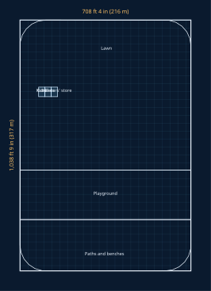

# P6-20 Neighbourhood Park 1: plan

Footprint 708 ft 4 in (216 m) × 1,038 ft 9 in (317 m) · structural grid 32 ft 10 in (10 m)

## Levels

| Level | Floor above deck | Height | Floor area |
|---|---|---|---|
| Level 1 · Ground | 0 ft (0 mm) | 13 ft 1 in (4,000 mm) | 3,100 sq ft (288 m²) |

## Elements

| ID | Designation | Type | Name | Level(s) | Size / length | Area | Status |
|---|---|---|---|---|---|---|---|
| E001 | D5F6P6B3A2R1 | zone | Lawn | L1 | 708 ft (216 m) × 621 ft 9 in (190 m) | 434,575 sq ft (40,373 m²) | proposed |
| E002 | D5F6P6B3A2R2 | room | Kiosk | L1 | 26 ft 3 in (8,000 mm) × 39 ft 4 in (12 m) | 1,033 sq ft (96 m²) | proposed |
| E003 | D5F6P6B3A2R3 | room | Toilets | L1 | 26 ft 3 in (8,000 mm) × 39 ft 4 in (12 m) | 1,033 sq ft (96 m²) | proposed |
| E004 | D5F6P6B3A2R4 | room | Gardeners' store | L1 | 26 ft 3 in (8,000 mm) × 39 ft 4 in (12 m) | 1,033 sq ft (96 m²) | proposed |
| E005 | D5F6P6B3A2R5 | zone | Playground | L1 | 707 ft 8 in (216 m) × 204 ft 9 in (62 m) | 144,812 sq ft (13,453 m²) | proposed |
| E006 | D5F6P6B3A2R6 | zone | Paths and benches | L1 | 707 ft 4 in (216 m) × 212 ft 3 in (65 m) | 144,950 sq ft (13,466 m²) | proposed |

## Drawings

### Level 1 · Ground

