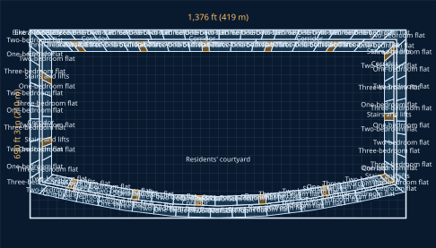
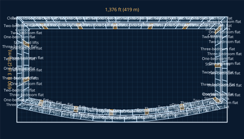

# P6-22 Apartment Block 2: plan

Footprint 1,376 ft (419 m) × 690 ft 3 in (210 m) · structural grid 32 ft 10 in (10 m)

## Levels

| Level | Floor above deck | Height | Floor area |
|---|---|---|---|
| Level 1 · Ground floor | 0 ft (0 mm) | 14 ft 9 in (4,500 mm) | 238,147 sq ft (22,125 m²) |
| Level 2 · Flat floor 1 | 14 ft 9 in (4,500 mm) | 10 ft 6 in (3,200 mm) | 238,172 sq ft (22,127 m²) |
| Level 3 · Flat floor 2 | 25 ft 3 in (7,700 mm) | 10 ft 6 in (3,200 mm) | 238,172 sq ft (22,127 m²) |
| Level 4 · Flat floor 3 | 35 ft 9 in (11 m) | 10 ft 6 in (3,200 mm) | 238,172 sq ft (22,127 m²) |
| Level 5 · Flat floor 4 | 46 ft 3 in (14 m) | 10 ft 6 in (3,200 mm) | 238,172 sq ft (22,127 m²) |
| Level 6 · Flat floor 5 | 56 ft 9 in (17 m) | 10 ft 6 in (3,200 mm) | 238,172 sq ft (22,127 m²) |

## Elements

| ID | Designation | Type | Name | Level(s) | Size / length | Area | Status |
|---|---|---|---|---|---|---|---|
| E001 | D5F6P6B9A2L1R1 | zone | Residents' courtyard | L1 | 1,218 ft 6 in (371 m) × 532 ft 10 in (162 m) | 612,621 sq ft (56,914 m²) | proposed |
| E002 | D5F6P6B9A2L1R2 | zone | Corridor | L1 | 400 ft 7 in (122 m) × 9 ft 10 in (3,000 mm) | 3,875 sq ft (360 m²) | proposed |
| E003 | D5F6P6B9A2L1R3 | zone | Corridor | L1 | 396 ft 8 in (121 m) × 9 ft 10 in (3,000 mm) | 3,875 sq ft (360 m²) | proposed |
| E004 | D5F6P6B9A2L1R4 | zone | Corridor | L1 | 398 ft 7 in (122 m) × 9 ft 10 in (3,000 mm) | 3,875 sq ft (360 m²) | proposed |
| E005 | D5F6P6B9A2L1R5 | zone | Corridor | L1 | 125 ft (38 m) × 282 ft 10 in (86 m) | 3,875 sq ft (360 m²) | proposed |
| E006 | D5F6P6B9A2L1R6 | zone | Corridor | L1 | 151 ft 7 in (46 m) × 281 ft 2 in (86 m) | 3,861 sq ft (359 m²) | proposed |
| E007 | D5F6P6B9A2L1R7 | zone | Corridor | L1 | 390 ft 9 in (119 m) × 62 ft 8 in (19 m) | 3,878 sq ft (360 m²) | proposed |
| E008 | D5F6P6B9A2L1R8 | zone | Corridor | L1 | 393 ft 4 in (120 m) × 30 ft 10 in (9,400 mm) | 3,880 sq ft (360 m²) | proposed |
| E009 | D5F6P6B9A2L1R9 | zone | Corridor | L1 | 375 ft (114 m) × 94 ft 10 in (29 m) | 3,862 sq ft (359 m²) | proposed |
| E010 | D5F6P6B9A2L1R10 | zone | Corridor | L1 | 9 ft 10 in (3,000 mm) × 400 ft 7 in (122 m) | 3,875 sq ft (360 m²) | proposed |
| E011 | D5F6P6B9A2L1R11 | zone | Corridor | L1 | 9 ft 10 in (3,000 mm) × 118 ft 9 in (36 m) | 1,090 sq ft (101 m²) | proposed |
| E012 | D5F6P6B9A2L1R12, D5F6P6B9A2L2R1, D5F6P6B9A2L3R1, D5F6P6B9A2L4R1, D5F6P6B9A2L5R1, D5F6P6B9A2L6R1 | core | Stairs and lifts | L1, L2, L3, L4, L5, L6 | 54 ft 2 in (16 m) × 34 ft 5 in (10 m) | 904 sq ft (84 m²) | proposed |
| E013 | D5F6P6B9A2L1R13, D5F6P6B9A2L2R2, D5F6P6B9A2L3R2, D5F6P6B9A2L4R2, D5F6P6B9A2L5R2, D5F6P6B9A2L6R2 | core | Stairs and lifts | L1, L2, L3, L4, L5, L6 | 41 ft 8 in (13 m) × 34 ft 5 in (10 m) | 904 sq ft (84 m²) | proposed |
| E014 | D5F6P6B9A2L1R14, D5F6P6B9A2L2R3, D5F6P6B9A2L3R3, D5F6P6B9A2L4R3, D5F6P6B9A2L5R3, D5F6P6B9A2L6R3 | core | Stairs and lifts | L1, L2, L3, L4, L5, L6 | 28 ft 7 in (8,700 mm) × 34 ft 5 in (10 m) | 899 sq ft (83 m²) | proposed |
| E015 | D5F6P6B9A2L1R15, D5F6P6B9A2L2R4, D5F6P6B9A2L3R4, D5F6P6B9A2L4R4, D5F6P6B9A2L5R4, D5F6P6B9A2L6R4 | core | Stairs and lifts | L1, L2, L3, L4, L5, L6 | 36 ft 5 in (11 m) × 34 ft 5 in (10 m) | 904 sq ft (84 m²) | proposed |
| E016 | D5F6P6B9A2L1R16, D5F6P6B9A2L2R5, D5F6P6B9A2L3R5, D5F6P6B9A2L4R5, D5F6P6B9A2L5R5, D5F6P6B9A2L6R5 | core | Stairs and lifts | L1, L2, L3, L4, L5, L6 | 49 ft 3 in (15 m) × 34 ft 5 in (10 m) | 904 sq ft (84 m²) | proposed |
| E017 | D5F6P6B9A2L1R17, D5F6P6B9A2L2R6, D5F6P6B9A2L3R6, D5F6P6B9A2L4R6, D5F6P6B9A2L5R6, D5F6P6B9A2L6R6 | core | Stairs and lifts | L1, L2, L3, L4, L5, L6 | 34 ft 5 in (10 m) × 57 ft 5 in (17 m) | 904 sq ft (84 m²) | proposed |
| E018 | D5F6P6B9A2L1R18, D5F6P6B9A2L2R7, D5F6P6B9A2L3R7, D5F6P6B9A2L4R7, D5F6P6B9A2L5R7, D5F6P6B9A2L6R7 | core | Stairs and lifts | L1, L2, L3, L4, L5, L6 | 34 ft 5 in (10 m) × 27 ft 11 in (8,500 mm) | 904 sq ft (84 m²) | proposed |
| E019 | D5F6P6B9A2L1R19, D5F6P6B9A2L2R8, D5F6P6B9A2L3R8, D5F6P6B9A2L4R8, D5F6P6B9A2L5R8, D5F6P6B9A2L6R8 | core | Stairs and lifts | L1, L2, L3, L4, L5, L6 | 51 ft 10 in (16 m) × 38 ft 1 in (12 m) | 902 sq ft (84 m²) | proposed |
| E020 | D5F6P6B9A2L1R20, D5F6P6B9A2L2R9, D5F6P6B9A2L3R9, D5F6P6B9A2L4R9, D5F6P6B9A2L5R9, D5F6P6B9A2L6R9 | core | Stairs and lifts | L1, L2, L3, L4, L5, L6 | 31 ft 6 in (9,600 mm) × 38 ft 9 in (12 m) | 910 sq ft (85 m²) | proposed |
| E021 | D5F6P6B9A2L1R21, D5F6P6B9A2L2R10, D5F6P6B9A2L3R10, D5F6P6B9A2L4R10, D5F6P6B9A2L5R10, D5F6P6B9A2L6R10 | core | Stairs and lifts | L1, L2, L3, L4, L5, L6 | 28 ft 10 in (8,800 mm) × 36 ft 1 in (11 m) | 898 sq ft (83 m²) | proposed |
| E022 | D5F6P6B9A2L1R22, D5F6P6B9A2L2R11, D5F6P6B9A2L3R11, D5F6P6B9A2L4R11, D5F6P6B9A2L5R11, D5F6P6B9A2L6R11 | core | Stairs and lifts | L1, L2, L3, L4, L5, L6 | 27 ft 7 in (8,400 mm) × 35 ft 5 in (11 m) | 905 sq ft (84 m²) | proposed |
| E023 | D5F6P6B9A2L1R23, D5F6P6B9A2L2R12, D5F6P6B9A2L3R12, D5F6P6B9A2L4R12, D5F6P6B9A2L5R12, D5F6P6B9A2L6R12 | core | Stairs and lifts | L1, L2, L3, L4, L5, L6 | 30 ft 6 in (9,300 mm) × 37 ft 5 in (11 m) | 899 sq ft (84 m²) | proposed |
| E024 | D5F6P6B9A2L1R24, D5F6P6B9A2L2R13, D5F6P6B9A2L3R13, D5F6P6B9A2L4R13, D5F6P6B9A2L5R13, D5F6P6B9A2L6R13 | core | Stairs and lifts | L1, L2, L3, L4, L5, L6 | 38 ft 5 in (12 m) × 38 ft 1 in (12 m) | 907 sq ft (84 m²) | proposed |
| E025 | D5F6P6B9A2L1R25, D5F6P6B9A2L2R14, D5F6P6B9A2L3R14, D5F6P6B9A2L4R14, D5F6P6B9A2L5R14, D5F6P6B9A2L6R14 | core | Stairs and lifts | L1, L2, L3, L4, L5, L6 | 34 ft 5 in (10 m) × 36 ft 9 in (11 m) | 904 sq ft (84 m²) | proposed |
| E026 | D5F6P6B9A2L1R26, D5F6P6B9A2L2R15, D5F6P6B9A2L3R15, D5F6P6B9A2L4R15, D5F6P6B9A2L5R15, D5F6P6B9A2L6R15 | core | Stairs and lifts | L1, L2, L3, L4, L5, L6 | 34 ft 5 in (10 m) × 45 ft 11 in (14 m) | 904 sq ft (84 m²) | proposed |
| E027 | D5F6P6B9A2L1R27 | room | Entrance lobby | L1 | 58 ft 9 in (18 m) × 34 ft 5 in (10 m) | 859 sq ft (80 m²) | proposed |
| E028 | D5F6P6B9A2L1R28 | room | Bike and pram store | L1 | 51 ft 6 in (16 m) × 34 ft 5 in (10 m) | 650 sq ft (60 m²) | proposed |
| E029 | D5F6P6B9A2L1R29 | room | Bin store | L1 | 44 ft (13 m) × 34 ft 5 in (10 m) | 413 sq ft (38 m²) | proposed |
| E030 | D5F6P6B9A2L1R30 | room | Two-bedroom flat | L1 | 109 ft 3 in (33 m) × 34 ft 5 in (10 m) | 2,746 sq ft (255 m²) | proposed |
| E031 | D5F6P6B9A2L1R31 | room | Three-bedroom flat | L1 | 105 ft (32 m) × 34 ft 5 in (10 m) | 2,746 sq ft (255 m²) | proposed |
| E032 | D5F6P6B9A2L1R32 | room | One-bedroom flat | L1 | 68 ft 11 in (21 m) × 34 ft 5 in (10 m) | 1,611 sq ft (150 m²) | proposed |
| E033 | D5F6P6B9A2L1R33 | room | Two-bedroom flat | L1 | 98 ft 9 in (30 m) × 34 ft 5 in (10 m) | 2,746 sq ft (255 m²) | proposed |
| E034 | D5F6P6B9A2L1R34 | room | Three-bedroom flat | L1 | 94 ft 6 in (29 m) × 34 ft 5 in (10 m) | 2,741 sq ft (255 m²) | proposed |
| E035 | D5F6P6B9A2L1R35 | room | One-bedroom flat | L1 | 58 ft 9 in (18 m) × 34 ft 5 in (10 m) | 1,622 sq ft (151 m²) | proposed |
| E036 | D5F6P6B9A2L1R36 | room | Two-bedroom flat | L1 | 87 ft 11 in (27 m) × 34 ft 5 in (10 m) | 2,741 sq ft (255 m²) | proposed |
| E037 | D5F6P6B9A2L1R37 | room | Three-bedroom flat | L1 | 84 ft (26 m) × 34 ft 5 in (10 m) | 2,746 sq ft (255 m²) | proposed |
| E038 | D5F6P6B9A2L1R38 | room | One-bedroom flat | L1 | 48 ft 3 in (15 m) × 34 ft 5 in (10 m) | 1,616 sq ft (150 m²) | proposed |
| E039 | D5F6P6B9A2L1R39 | room | Two-bedroom flat | L1 | 82 ft (25 m) × 34 ft 5 in (10 m) | 2,746 sq ft (255 m²) | proposed |
| E040 | D5F6P6B9A2L1R40 | room | Three-bedroom flat | L1 | 85 ft 11 in (26 m) × 34 ft 5 in (10 m) | 2,741 sq ft (255 m²) | proposed |
| E041 | D5F6P6B9A2L1R41 | room | One-bedroom flat | L1 | 56 ft 5 in (17 m) × 34 ft 5 in (10 m) | 1,611 sq ft (150 m²) | proposed |
| E042 | D5F6P6B9A2L1R42 | room | Two-bedroom flat | L1 | 92 ft 6 in (28 m) × 34 ft 5 in (10 m) | 2,746 sq ft (255 m²) | proposed |
| E043 | D5F6P6B9A2L1R43 | room | Three-bedroom flat | L1 | 96 ft 5 in (29 m) × 34 ft 5 in (10 m) | 2,746 sq ft (255 m²) | proposed |
| E044 | D5F6P6B9A2L1R44 | room | One-bedroom flat | L1 | 66 ft 11 in (20 m) × 34 ft 5 in (10 m) | 1,616 sq ft (150 m²) | proposed |
| E045 | D5F6P6B9A2L1R45 | room | Two-bedroom flat | L1 | 103 ft (31 m) × 34 ft 5 in (10 m) | 2,741 sq ft (255 m²) | proposed |
| E046 | D5F6P6B9A2L1R46 | room | Three-bedroom flat | L1 | 107 ft 3 in (33 m) × 34 ft 5 in (10 m) | 2,746 sq ft (255 m²) | proposed |
| E047 | D5F6P6B9A2L1R47 | room | One-bedroom flat | L1 | 77 ft 9 in (24 m) × 34 ft 5 in (10 m) | 1,616 sq ft (150 m²) | proposed |
| E048 | D5F6P6B9A2L1R48 | room | Two-bedroom flat | L1 | 81 ft 8 in (25 m) × 64 ft (20 m) | 2,746 sq ft (255 m²) | proposed |
| E049 | D5F6P6B9A2L1R49 | room | Three-bedroom flat | L1 | 34 ft 5 in (10 m) × 106 ft 4 in (32 m) | 2,746 sq ft (255 m²) | proposed |
| E050 | D5F6P6B9A2L1R50 | room | One-bedroom flat | L1 | 34 ft 5 in (10 m) × 66 ft 3 in (20 m) | 1,611 sq ft (150 m²) | proposed |
| E051 | D5F6P6B9A2L1R51 | room | Two-bedroom flat | L1 | 34 ft 5 in (10 m) × 92 ft 2 in (28 m) | 2,746 sq ft (255 m²) | proposed |
| E052 | D5F6P6B9A2L1R52 | room | Three-bedroom flat | L1 | 34 ft 5 in (10 m) × 84 ft (26 m) | 2,741 sq ft (255 m²) | proposed |
| E053 | D5F6P6B9A2L1R53 | room | One-bedroom flat | L1 | 34 ft 5 in (10 m) × 50 ft 2 in (15 m) | 1,616 sq ft (150 m²) | proposed |
| E054 | D5F6P6B9A2L1R54 | room | Two-bedroom flat | L1 | 34 ft 5 in (10 m) × 89 ft 11 in (27 m) | 2,746 sq ft (255 m²) | proposed |
| E055 | D5F6P6B9A2L1R55 | room | Three-bedroom flat | L1 | 34 ft 5 in (10 m) × 98 ft 9 in (30 m) | 2,746 sq ft (255 m²) | proposed |
| E056 | D5F6P6B9A2L1R56 | room | One-bedroom flat | L1 | 41 ft 8 in (13 m) × 66 ft 7 in (20 m) | 1,621 sq ft (151 m²) | proposed |
| E057 | D5F6P6B9A2L1R57 | room | Two-bedroom flat | L1 | 104 ft (32 m) × 46 ft 3 in (14 m) | 2,735 sq ft (254 m²) | proposed |
| E058 | D5F6P6B9A2L1R58 | room | Three-bedroom flat | L1 | 90 ft 11 in (28 m) × 48 ft 11 in (15 m) | 2,735 sq ft (254 m²) | proposed |
| E059 | D5F6P6B9A2L1R59 | room | One-bedroom flat | L1 | 52 ft 6 in (16 m) × 42 ft 4 in (13 m) | 1,619 sq ft (150 m²) | proposed |
| E060 | D5F6P6B9A2L1R60 | room | Two-bedroom flat | L1 | 84 ft 4 in (26 m) × 48 ft 3 in (15 m) | 2,747 sq ft (255 m²) | proposed |
| E061 | D5F6P6B9A2L1R61 | room | Three-bedroom flat | L1 | 84 ft (26 m) × 45 ft 11 in (14 m) | 2,743 sq ft (255 m²) | proposed |
| E062 | D5F6P6B9A2L1R62 | room | One-bedroom flat | L1 | 50 ft 10 in (16 m) × 39 ft 8 in (12 m) | 1,609 sq ft (149 m²) | proposed |
| E063 | D5F6P6B9A2L1R63 | room | Two-bedroom flat | L1 | 82 ft 8 in (25 m) × 44 ft (13 m) | 2,750 sq ft (255 m²) | proposed |
| E064 | D5F6P6B9A2L1R64 | room | Three-bedroom flat | L1 | 81 ft 8 in (25 m) × 38 ft 9 in (12 m) | 2,746 sq ft (255 m²) | proposed |
| E065 | D5F6P6B9A2L1R65 | room | One-bedroom flat | L1 | 48 ft 3 in (15 m) × 36 ft 5 in (11 m) | 1,619 sq ft (150 m²) | proposed |
| E066 | D5F6P6B9A2L1R66 | room | Two-bedroom flat | L1 | 80 ft 5 in (24 m) × 36 ft 9 in (11 m) | 2,742 sq ft (255 m²) | proposed |
| E067 | D5F6P6B9A2L1R67 | room | Three-bedroom flat | L1 | 81 ft (25 m) × 37 ft 9 in (12 m) | 2,751 sq ft (256 m²) | proposed |
| E068 | D5F6P6B9A2L1R68 | room | One-bedroom flat | L1 | 48 ft 11 in (15 m) × 36 ft 9 in (11 m) | 1,615 sq ft (150 m²) | proposed |
| E069 | D5F6P6B9A2L1R69 | room | Two-bedroom flat | L1 | 82 ft 4 in (25 m) × 42 ft 8 in (13 m) | 2,747 sq ft (255 m²) | proposed |
| E070 | D5F6P6B9A2L1R70 | room | Three-bedroom flat | L1 | 83 ft 4 in (25 m) × 43 ft 8 in (13 m) | 2,738 sq ft (254 m²) | proposed |
| E071 | D5F6P6B9A2L1R71 | room | One-bedroom flat | L1 | 51 ft 2 in (16 m) × 40 ft 8 in (12 m) | 1,610 sq ft (150 m²) | proposed |
| E072 | D5F6P6B9A2L1R72 | room | Two-bedroom flat | L1 | 84 ft (26 m) × 48 ft 3 in (15 m) | 2,742 sq ft (255 m²) | proposed |
| E073 | D5F6P6B9A2L1R73 | room | Three-bedroom flat | L1 | 85 ft (26 m) × 48 ft 3 in (15 m) | 2,752 sq ft (256 m²) | proposed |
| E074 | D5F6P6B9A2L1R74 | room | One-bedroom flat | L1 | 57 ft 1 in (17 m) × 42 ft 8 in (13 m) | 1,617 sq ft (150 m²) | proposed |
| E075 | D5F6P6B9A2L1R75 | room | Two-bedroom flat | L1 | 99 ft 9 in (30 m) × 47 ft 3 in (14 m) | 2,740 sq ft (255 m²) | proposed |
| E076 | D5F6P6B9A2L1R76 | room | Three-bedroom flat | L1 | 63 ft 4 in (19 m) × 80 ft 1 in (24 m) | 2,749 sq ft (255 m²) | proposed |
| E077 | D5F6P6B9A2L1R77 | room | One-bedroom flat | L1 | 34 ft 5 in (10 m) × 66 ft 11 in (20 m) | 1,616 sq ft (150 m²) | proposed |
| E078 | D5F6P6B9A2L1R78 | room | Two-bedroom flat | L1 | 34 ft 5 in (10 m) × 92 ft 10 in (28 m) | 2,746 sq ft (255 m²) | proposed |
| E079 | D5F6P6B9A2L1R79 | room | Three-bedroom flat | L1 | 34 ft 5 in (10 m) × 84 ft 4 in (26 m) | 2,746 sq ft (255 m²) | proposed |
| E080 | D5F6P6B9A2L1R80 | room | One-bedroom flat | L1 | 34 ft 5 in (10 m) × 49 ft 10 in (15 m) | 1,616 sq ft (150 m²) | proposed |
| E081 | D5F6P6B9A2L1R81 | room | Two-bedroom flat | L1 | 34 ft 5 in (10 m) × 89 ft 7 in (27 m) | 2,741 sq ft (255 m²) | proposed |
| E082 | D5F6P6B9A2L1R82 | room | Three-bedroom flat | L1 | 34 ft 5 in (10 m) × 98 ft 5 in (30 m) | 2,746 sq ft (255 m²) | proposed |
| E083 | D5F6P6B9A2L1R83 | room | One-bedroom flat | L1 | 34 ft 5 in (10 m) × 72 ft 6 in (22 m) | 1,616 sq ft (150 m²) | proposed |
| E084 | D5F6P6B9A2L1R84 | room | Two-bedroom flat | L1 | 34 ft 5 in (10 m) × 86 ft 11 in (26 m) | 1,916 sq ft (178 m²) | proposed |
| E085 | D5F6P6B9A2L1R85 | room | Three-bedroom flat | L1 | 111 ft 11 in (34 m) × 34 ft 5 in (10 m) | 2,746 sq ft (255 m²) | proposed |
| E086 | D5F6P6B9A2L1R86 | room | One-bedroom flat | L1 | 52 ft 6 in (16 m) × 34 ft 5 in (10 m) | 802 sq ft (75 m²) | proposed |
| E087 | D5F6P6B9A2L1R87 | room | Two-bedroom flat | L1 | 104 ft 8 in (32 m) × 34 ft 5 in (10 m) | 2,741 sq ft (255 m²) | proposed |
| E088 | D5F6P6B9A2L1R88 | room | Three-bedroom flat | L1 | 100 ft 9 in (31 m) × 34 ft 5 in (10 m) | 2,752 sq ft (256 m²) | proposed |
| E089 | D5F6P6B9A2L1R89 | room | One-bedroom flat | L1 | 64 ft (20 m) × 34 ft 5 in (10 m) | 1,605 sq ft (149 m²) | proposed |
| E090 | D5F6P6B9A2L1R90 | room | Two-bedroom flat | L1 | 92 ft 2 in (28 m) × 34 ft 5 in (10 m) | 2,746 sq ft (255 m²) | proposed |
| E091 | D5F6P6B9A2L1R91 | room | Three-bedroom flat | L1 | 87 ft 7 in (27 m) × 34 ft 5 in (10 m) | 2,741 sq ft (255 m²) | proposed |
| E092 | D5F6P6B9A2L1R92 | room | One-bedroom flat | L1 | 51 ft 6 in (16 m) × 34 ft 5 in (10 m) | 1,616 sq ft (150 m²) | proposed |
| E093 | D5F6P6B9A2L1R93 | room | Two-bedroom flat | L1 | 81 ft 8 in (25 m) × 34 ft 5 in (10 m) | 2,746 sq ft (255 m²) | proposed |
| E094 | D5F6P6B9A2L1R94 | room | Three-bedroom flat | L1 | 84 ft 4 in (26 m) × 34 ft 5 in (10 m) | 2,746 sq ft (255 m²) | proposed |
| E095 | D5F6P6B9A2L1R95 | room | One-bedroom flat | L1 | 54 ft 9 in (17 m) × 34 ft 5 in (10 m) | 1,605 sq ft (149 m²) | proposed |
| E096 | D5F6P6B9A2L1R96 | room | Two-bedroom flat | L1 | 92 ft 10 in (28 m) × 34 ft 5 in (10 m) | 2,746 sq ft (255 m²) | proposed |
| E097 | D5F6P6B9A2L1R97 | room | Three-bedroom flat | L1 | 97 ft 1 in (30 m) × 34 ft 5 in (10 m) | 2,741 sq ft (255 m²) | proposed |
| E098 | D5F6P6B9A2L1R98 | room | One-bedroom flat | L1 | 67 ft 11 in (21 m) × 34 ft 5 in (10 m) | 1,616 sq ft (150 m²) | proposed |
| E099 | D5F6P6B9A2L1R99 | room | Two-bedroom flat | L1 | 105 ft 4 in (32 m) × 34 ft 5 in (10 m) | 2,741 sq ft (255 m²) | proposed |
| E100 | D5F6P6B9A2L1R100 | room | Three-bedroom flat | L1 | 109 ft 11 in (34 m) × 34 ft 5 in (10 m) | 2,746 sq ft (255 m²) | proposed |
| E101 | D5F6P6B9A2L1R101 | room | One-bedroom flat | L1 | 68 ft 7 in (21 m) × 45 ft 3 in (14 m) | 1,611 sq ft (150 m²) | proposed |
| E102 | D5F6P6B9A2L1R102 | room | Two-bedroom flat | L1 | 34 ft 5 in (10 m) × 104 ft (32 m) | 2,741 sq ft (255 m²) | proposed |
| E103 | D5F6P6B9A2L1R103 | room | Three-bedroom flat | L1 | 34 ft 5 in (10 m) × 93 ft 10 in (29 m) | 2,746 sq ft (255 m²) | proposed |
| E104 | D5F6P6B9A2L1R104 | room | One-bedroom flat | L1 | 34 ft 5 in (10 m) × 52 ft 6 in (16 m) | 1,605 sq ft (149 m²) | proposed |
| E105 | D5F6P6B9A2L1R105 | room | Two-bedroom flat | L1 | 34 ft 5 in (10 m) × 85 ft 4 in (26 m) | 2,746 sq ft (255 m²) | proposed |
| E106 | D5F6P6B9A2L1R106 | room | Three-bedroom flat | L1 | 34 ft 5 in (10 m) × 95 ft 10 in (29 m) | 2,752 sq ft (256 m²) | proposed |
| E107 | D5F6P6B9A2L1R107 | room | One-bedroom flat | L1 | 34 ft 5 in (10 m) × 70 ft 6 in (22 m) | 1,605 sq ft (149 m²) | proposed |
| E108 | D5F6P6B9A2L1R108 | room | Two-bedroom flat | L1 | 99 ft 1 in (30 m) × 47 ft 3 in (14 m) | 2,732 sq ft (254 m²) | proposed |
| E109 | D5F6P6B9A2L1R109 | room | Three-bedroom flat | L1 | 87 ft 7 in (27 m) × 48 ft 3 in (15 m) | 2,744 sq ft (255 m²) | proposed |
| E110 | D5F6P6B9A2L1R110 | room | One-bedroom flat | L1 | 51 ft 10 in (16 m) × 42 ft 4 in (13 m) | 1,605 sq ft (149 m²) | proposed |
| E111 | D5F6P6B9A2L1R111 | room | Two-bedroom flat | L1 | 83 ft 8 in (26 m) × 46 ft 3 in (14 m) | 2,736 sq ft (254 m²) | proposed |
| E112 | D5F6P6B9A2L1R112 | room | Three-bedroom flat | L1 | 83 ft (25 m) × 44 ft (13 m) | 2,733 sq ft (254 m²) | proposed |
| E113 | D5F6P6B9A2L1R113 | room | One-bedroom flat | L1 | 49 ft 10 in (15 m) × 39 ft 8 in (12 m) | 1,608 sq ft (149 m²) | proposed |
| E114 | D5F6P6B9A2L1R114 | room | Two-bedroom flat | L1 | 81 ft 4 in (25 m) × 38 ft 1 in (12 m) | 2,747 sq ft (255 m²) | proposed |
| E115 | D5F6P6B9A2L1R115 | room | Three-bedroom flat | L1 | 80 ft 5 in (24 m) × 37 ft 5 in (11 m) | 2,748 sq ft (255 m²) | proposed |
| E116 | D5F6P6B9A2L1R116 | room | One-bedroom flat | L1 | 47 ft 3 in (14 m) × 36 ft 5 in (11 m) | 1,606 sq ft (149 m²) | proposed |
| E117 | D5F6P6B9A2L1R117 | room | Two-bedroom flat | L1 | 81 ft 8 in (25 m) × 38 ft 1 in (12 m) | 2,748 sq ft (255 m²) | proposed |
| E118 | D5F6P6B9A2L1R118 | room | Three-bedroom flat | L1 | 82 ft 4 in (25 m) × 43 ft 8 in (13 m) | 2,731 sq ft (254 m²) | proposed |
| E119 | D5F6P6B9A2L1R119 | room | One-bedroom flat | L1 | 50 ft 6 in (15 m) × 39 ft 8 in (12 m) | 1,607 sq ft (149 m²) | proposed |
| E120 | D5F6P6B9A2L1R120 | room | Two-bedroom flat | L1 | 84 ft (26 m) × 47 ft 3 in (14 m) | 2,744 sq ft (255 m²) | proposed |
| E121 | D5F6P6B9A2L1R121 | room | Three-bedroom flat | L1 | 84 ft 4 in (26 m) × 48 ft 3 in (15 m) | 2,747 sq ft (255 m²) | proposed |
| E122 | D5F6P6B9A2L1R122 | room | One-bedroom flat | L1 | 53 ft 10 in (16 m) × 42 ft (13 m) | 1,603 sq ft (149 m²) | proposed |
| E123 | D5F6P6B9A2L1R123 | room | Two-bedroom flat | L1 | 102 ft (31 m) × 46 ft 11 in (14 m) | 2,744 sq ft (255 m²) | proposed |
| E124 | D5F6P6B9A2L1R124 | room | Three-bedroom flat | L1 | 39 ft 4 in (12 m) × 98 ft 5 in (30 m) | 2,744 sq ft (255 m²) | proposed |
| E125 | D5F6P6B9A2L1R125 | room | One-bedroom flat | L1 | 34 ft 5 in (10 m) × 62 ft (19 m) | 1,611 sq ft (150 m²) | proposed |
| E126 | D5F6P6B9A2L1R126 | room | Two-bedroom flat | L1 | 34 ft 5 in (10 m) × 84 ft 8 in (26 m) | 2,741 sq ft (255 m²) | proposed |
| E127 | D5F6P6B9A2L1R127 | room | Three-bedroom flat | L1 | 34 ft 5 in (10 m) × 86 ft 3 in (26 m) | 2,746 sq ft (255 m²) | proposed |
| E128 | D5F6P6B9A2L1R128 | room | One-bedroom flat | L1 | 34 ft 5 in (10 m) × 61 ft 8 in (19 m) | 1,611 sq ft (150 m²) | proposed |
| E129 | D5F6P6B9A2L1R129 | room | Two-bedroom flat | L1 | 34 ft 5 in (10 m) × 130 ft 11 in (40 m) | 3,549 sq ft (330 m²) | proposed |
| E130 | D5F6P6B9A2L2R16, D5F6P6B9A2L3R16, D5F6P6B9A2L4R16, D5F6P6B9A2L5R16, D5F6P6B9A2L6R16 | zone | Corridor | L2, L3, L4, L5, L6 | 400 ft 7 in (122 m) × 9 ft 10 in (3,000 mm) | 3,875 sq ft (360 m²) | proposed |
| E131 | D5F6P6B9A2L2R17, D5F6P6B9A2L3R17, D5F6P6B9A2L4R17, D5F6P6B9A2L5R17, D5F6P6B9A2L6R17 | zone | Corridor | L2, L3, L4, L5, L6 | 396 ft 8 in (121 m) × 9 ft 10 in (3,000 mm) | 3,875 sq ft (360 m²) | proposed |
| E132 | D5F6P6B9A2L2R18, D5F6P6B9A2L3R18, D5F6P6B9A2L4R18, D5F6P6B9A2L5R18, D5F6P6B9A2L6R18 | zone | Corridor | L2, L3, L4, L5, L6 | 398 ft 7 in (122 m) × 9 ft 10 in (3,000 mm) | 3,875 sq ft (360 m²) | proposed |
| E133 | D5F6P6B9A2L2R19, D5F6P6B9A2L3R19, D5F6P6B9A2L4R19, D5F6P6B9A2L5R19, D5F6P6B9A2L6R19 | zone | Corridor | L2, L3, L4, L5, L6 | 125 ft (38 m) × 282 ft 10 in (86 m) | 3,875 sq ft (360 m²) | proposed |
| E134 | D5F6P6B9A2L2R20, D5F6P6B9A2L3R20, D5F6P6B9A2L4R20, D5F6P6B9A2L5R20, D5F6P6B9A2L6R20 | zone | Corridor | L2, L3, L4, L5, L6 | 151 ft 7 in (46 m) × 281 ft 2 in (86 m) | 3,861 sq ft (359 m²) | proposed |
| E135 | D5F6P6B9A2L2R21, D5F6P6B9A2L3R21, D5F6P6B9A2L4R21, D5F6P6B9A2L5R21, D5F6P6B9A2L6R21 | zone | Corridor | L2, L3, L4, L5, L6 | 390 ft 9 in (119 m) × 62 ft 8 in (19 m) | 3,878 sq ft (360 m²) | proposed |
| E136 | D5F6P6B9A2L2R22, D5F6P6B9A2L3R22, D5F6P6B9A2L4R22, D5F6P6B9A2L5R22, D5F6P6B9A2L6R22 | zone | Corridor | L2, L3, L4, L5, L6 | 393 ft 4 in (120 m) × 30 ft 10 in (9,400 mm) | 3,880 sq ft (360 m²) | proposed |
| E137 | D5F6P6B9A2L2R23, D5F6P6B9A2L3R23, D5F6P6B9A2L4R23, D5F6P6B9A2L5R23, D5F6P6B9A2L6R23 | zone | Corridor | L2, L3, L4, L5, L6 | 375 ft (114 m) × 94 ft 10 in (29 m) | 3,862 sq ft (359 m²) | proposed |
| E138 | D5F6P6B9A2L2R24, D5F6P6B9A2L3R24, D5F6P6B9A2L4R24, D5F6P6B9A2L5R24, D5F6P6B9A2L6R24 | zone | Corridor | L2, L3, L4, L5, L6 | 9 ft 10 in (3,000 mm) × 400 ft 7 in (122 m) | 3,875 sq ft (360 m²) | proposed |
| E139 | D5F6P6B9A2L2R25, D5F6P6B9A2L3R25, D5F6P6B9A2L4R25, D5F6P6B9A2L5R25, D5F6P6B9A2L6R25 | zone | Corridor | L2, L3, L4, L5, L6 | 9 ft 10 in (3,000 mm) × 118 ft 9 in (36 m) | 1,090 sq ft (101 m²) | proposed |
| E140 | D5F6P6B9A2L2R26, D5F6P6B9A2L3R26, D5F6P6B9A2L4R26, D5F6P6B9A2L5R26, D5F6P6B9A2L6R26 | room | Cleaners' room | L2, L3, L4, L5, L6 | 46 ft 3 in (14 m) × 34 ft 5 in (10 m) | 418 sq ft (39 m²) | proposed |
| E141 | D5F6P6B9A2L2R27, D5F6P6B9A2L3R27, D5F6P6B9A2L4R27, D5F6P6B9A2L5R27, D5F6P6B9A2L6R27 | room | Two-bedroom flat | L2, L3, L4, L5, L6 | 111 ft 3 in (34 m) × 34 ft 5 in (10 m) | 2,741 sq ft (255 m²) | proposed |
| E142 | D5F6P6B9A2L2R28, D5F6P6B9A2L3R28, D5F6P6B9A2L4R28, D5F6P6B9A2L5R28, D5F6P6B9A2L6R28 | room | Three-bedroom flat | L2, L3, L4, L5, L6 | 107 ft 3 in (33 m) × 34 ft 5 in (10 m) | 2,746 sq ft (255 m²) | proposed |
| E143 | D5F6P6B9A2L2R29, D5F6P6B9A2L3R29, D5F6P6B9A2L4R29, D5F6P6B9A2L5R29, D5F6P6B9A2L6R29 | room | One-bedroom flat | L2, L3, L4, L5, L6 | 71 ft 2 in (22 m) × 34 ft 5 in (10 m) | 1,611 sq ft (150 m²) | proposed |
| E144 | D5F6P6B9A2L2R30, D5F6P6B9A2L3R30, D5F6P6B9A2L4R30, D5F6P6B9A2L5R30, D5F6P6B9A2L6R30 | room | Two-bedroom flat | L2, L3, L4, L5, L6 | 101 ft 1 in (31 m) × 34 ft 5 in (10 m) | 2,746 sq ft (255 m²) | proposed |
| E145 | D5F6P6B9A2L2R31, D5F6P6B9A2L3R31, D5F6P6B9A2L4R31, D5F6P6B9A2L5R31, D5F6P6B9A2L6R31 | room | Three-bedroom flat | L2, L3, L4, L5, L6 | 96 ft 9 in (30 m) × 34 ft 5 in (10 m) | 2,746 sq ft (255 m²) | proposed |
| E146 | D5F6P6B9A2L2R32, D5F6P6B9A2L3R32, D5F6P6B9A2L4R32, D5F6P6B9A2L5R32, D5F6P6B9A2L6R32 | room | One-bedroom flat | L2, L3, L4, L5, L6 | 60 ft 8 in (18 m) × 34 ft 5 in (10 m) | 1,616 sq ft (150 m²) | proposed |
| E147 | D5F6P6B9A2L2R33, D5F6P6B9A2L3R33, D5F6P6B9A2L4R33, D5F6P6B9A2L5R33, D5F6P6B9A2L6R33 | room | Two-bedroom flat | L2, L3, L4, L5, L6 | 90 ft 3 in (28 m) × 34 ft 5 in (10 m) | 2,741 sq ft (255 m²) | proposed |
| E148 | D5F6P6B9A2L2R34, D5F6P6B9A2L3R34, D5F6P6B9A2L4R34, D5F6P6B9A2L5R34, D5F6P6B9A2L6R34 | room | Three-bedroom flat | L2, L3, L4, L5, L6 | 86 ft 3 in (26 m) × 34 ft 5 in (10 m) | 2,746 sq ft (255 m²) | proposed |
| E149 | D5F6P6B9A2L2R35, D5F6P6B9A2L3R35, D5F6P6B9A2L4R35, D5F6P6B9A2L5R35, D5F6P6B9A2L6R35 | room | One-bedroom flat | L2, L3, L4, L5, L6 | 50 ft 2 in (15 m) × 34 ft 5 in (10 m) | 1,616 sq ft (150 m²) | proposed |
| E150 | D5F6P6B9A2L2R36, D5F6P6B9A2L3R36, D5F6P6B9A2L4R36, D5F6P6B9A2L5R36, D5F6P6B9A2L6R36 | room | Two-bedroom flat | L2, L3, L4, L5, L6 | 81 ft 8 in (25 m) × 34 ft 5 in (10 m) | 2,746 sq ft (255 m²) | proposed |
| E151 | D5F6P6B9A2L2R37, D5F6P6B9A2L3R37, D5F6P6B9A2L4R37, D5F6P6B9A2L5R37, D5F6P6B9A2L6R37 | room | Three-bedroom flat | L2, L3, L4, L5, L6 | 83 ft 8 in (26 m) × 34 ft 5 in (10 m) | 2,741 sq ft (255 m²) | proposed |
| E152 | D5F6P6B9A2L2R38, D5F6P6B9A2L3R38, D5F6P6B9A2L4R38, D5F6P6B9A2L5R38, D5F6P6B9A2L6R38 | room | One-bedroom flat | L2, L3, L4, L5, L6 | 54 ft 6 in (17 m) × 34 ft 5 in (10 m) | 1,622 sq ft (151 m²) | proposed |
| E153 | D5F6P6B9A2L2R39, D5F6P6B9A2L3R39, D5F6P6B9A2L4R39, D5F6P6B9A2L5R39, D5F6P6B9A2L6R39 | room | Two-bedroom flat | L2, L3, L4, L5, L6 | 90 ft 3 in (28 m) × 34 ft 5 in (10 m) | 2,741 sq ft (255 m²) | proposed |
| E154 | D5F6P6B9A2L2R40, D5F6P6B9A2L3R40, D5F6P6B9A2L4R40, D5F6P6B9A2L5R40, D5F6P6B9A2L6R40 | room | Three-bedroom flat | L2, L3, L4, L5, L6 | 94 ft 6 in (29 m) × 34 ft 5 in (10 m) | 2,746 sq ft (255 m²) | proposed |
| E155 | D5F6P6B9A2L2R41, D5F6P6B9A2L3R41, D5F6P6B9A2L4R41, D5F6P6B9A2L5R41, D5F6P6B9A2L6R41 | room | One-bedroom flat | L2, L3, L4, L5, L6 | 64 ft 8 in (20 m) × 34 ft 5 in (10 m) | 1,611 sq ft (150 m²) | proposed |
| E156 | D5F6P6B9A2L2R42, D5F6P6B9A2L3R42, D5F6P6B9A2L4R42, D5F6P6B9A2L5R42, D5F6P6B9A2L6R42 | room | Two-bedroom flat | L2, L3, L4, L5, L6 | 100 ft 9 in (31 m) × 34 ft 5 in (10 m) | 2,746 sq ft (255 m²) | proposed |
| E157 | D5F6P6B9A2L2R43, D5F6P6B9A2L3R43, D5F6P6B9A2L4R43, D5F6P6B9A2L5R43, D5F6P6B9A2L6R43 | room | Three-bedroom flat | L2, L3, L4, L5, L6 | 104 ft 8 in (32 m) × 34 ft 5 in (10 m) | 2,741 sq ft (255 m²) | proposed |
| E158 | D5F6P6B9A2L2R44, D5F6P6B9A2L3R44, D5F6P6B9A2L4R44, D5F6P6B9A2L5R44, D5F6P6B9A2L6R44 | room | One-bedroom flat | L2, L3, L4, L5, L6 | 75 ft 6 in (23 m) × 34 ft 5 in (10 m) | 1,616 sq ft (150 m²) | proposed |
| E159 | D5F6P6B9A2L2R45, D5F6P6B9A2L3R45, D5F6P6B9A2L4R45, D5F6P6B9A2L5R45, D5F6P6B9A2L6R45 | room | Two-bedroom flat | L2, L3, L4, L5, L6 | 111 ft 7 in (34 m) × 34 ft 5 in (10 m) | 2,746 sq ft (255 m²) | proposed |
| E160 | D5F6P6B9A2L2R46, D5F6P6B9A2L3R46, D5F6P6B9A2L4R46, D5F6P6B9A2L5R46, D5F6P6B9A2L6R46 | room | Three-bedroom flat | L2, L3, L4, L5, L6 | 46 ft 7 in (14 m) × 98 ft 1 in (30 m) | 2,746 sq ft (255 m²) | proposed |
| E161 | D5F6P6B9A2L2R47, D5F6P6B9A2L3R47, D5F6P6B9A2L4R47, D5F6P6B9A2L5R47, D5F6P6B9A2L6R47 | room | One-bedroom flat | L2, L3, L4, L5, L6 | 34 ft 5 in (10 m) × 71 ft 6 in (22 m) | 1,616 sq ft (150 m²) | proposed |
| E162 | D5F6P6B9A2L2R48, D5F6P6B9A2L3R48, D5F6P6B9A2L4R48, D5F6P6B9A2L5R48, D5F6P6B9A2L6R48 | room | Two-bedroom flat | L2, L3, L4, L5, L6 | 34 ft 5 in (10 m) × 97 ft 1 in (30 m) | 2,741 sq ft (255 m²) | proposed |
| E163 | D5F6P6B9A2L2R49, D5F6P6B9A2L3R49, D5F6P6B9A2L4R49, D5F6P6B9A2L5R49, D5F6P6B9A2L6R49 | room | Three-bedroom flat | L2, L3, L4, L5, L6 | 34 ft 5 in (10 m) × 88 ft 3 in (27 m) | 2,746 sq ft (255 m²) | proposed |
| E164 | D5F6P6B9A2L2R50, D5F6P6B9A2L3R50, D5F6P6B9A2L4R50, D5F6P6B9A2L5R50, D5F6P6B9A2L6R50 | room | One-bedroom flat | L2, L3, L4, L5, L6 | 34 ft 5 in (10 m) × 49 ft 3 in (15 m) | 1,611 sq ft (150 m²) | proposed |
| E165 | D5F6P6B9A2L2R51, D5F6P6B9A2L3R51, D5F6P6B9A2L4R51, D5F6P6B9A2L5R51, D5F6P6B9A2L6R51 | room | Two-bedroom flat | L2, L3, L4, L5, L6 | 34 ft 5 in (10 m) × 85 ft 4 in (26 m) | 2,752 sq ft (256 m²) | proposed |
| E166 | D5F6P6B9A2L2R52, D5F6P6B9A2L3R52, D5F6P6B9A2L4R52, D5F6P6B9A2L5R52, D5F6P6B9A2L6R52 | room | Three-bedroom flat | L2, L3, L4, L5, L6 | 34 ft 5 in (10 m) × 93 ft 10 in (29 m) | 2,741 sq ft (255 m²) | proposed |
| E167 | D5F6P6B9A2L2R53, D5F6P6B9A2L3R53, D5F6P6B9A2L4R53, D5F6P6B9A2L5R53, D5F6P6B9A2L6R53 | room | One-bedroom flat | L2, L3, L4, L5, L6 | 34 ft 5 in (10 m) × 68 ft 3 in (21 m) | 1,616 sq ft (150 m²) | proposed |
| E168 | D5F6P6B9A2L2R54, D5F6P6B9A2L3R54, D5F6P6B9A2L4R54, D5F6P6B9A2L5R54, D5F6P6B9A2L6R54 | room | Two-bedroom flat | L2, L3, L4, L5, L6 | 73 ft 6 in (22 m) × 71 ft 10 in (22 m) | 2,748 sq ft (255 m²) | proposed |
| E169 | D5F6P6B9A2L2R55, D5F6P6B9A2L3R55, D5F6P6B9A2L4R55, D5F6P6B9A2L5R55, D5F6P6B9A2L6R55 | room | Three-bedroom flat | L2, L3, L4, L5, L6 | 98 ft 1 in (30 m) × 47 ft 7 in (14 m) | 2,741 sq ft (255 m²) | proposed |
| E170 | D5F6P6B9A2L2R56, D5F6P6B9A2L3R56, D5F6P6B9A2L4R56, D5F6P6B9A2L5R56, D5F6P6B9A2L6R56 | room | One-bedroom flat | L2, L3, L4, L5, L6 | 55 ft 9 in (17 m) × 42 ft 8 in (13 m) | 1,607 sq ft (149 m²) | proposed |
| E171 | D5F6P6B9A2L2R57, D5F6P6B9A2L3R57, D5F6P6B9A2L4R57, D5F6P6B9A2L5R57, D5F6P6B9A2L6R57 | room | Two-bedroom flat | L2, L3, L4, L5, L6 | 84 ft 8 in (26 m) × 47 ft 11 in (15 m) | 2,738 sq ft (254 m²) | proposed |
| E172 | D5F6P6B9A2L2R58, D5F6P6B9A2L3R58, D5F6P6B9A2L4R58, D5F6P6B9A2L5R58, D5F6P6B9A2L6R58 | room | Three-bedroom flat | L2, L3, L4, L5, L6 | 84 ft (26 m) × 48 ft 3 in (15 m) | 2,742 sq ft (255 m²) | proposed |
| E173 | D5F6P6B9A2L2R59, D5F6P6B9A2L3R59, D5F6P6B9A2L4R59, D5F6P6B9A2L5R59, D5F6P6B9A2L6R59 | room | One-bedroom flat | L2, L3, L4, L5, L6 | 51 ft 6 in (16 m) × 40 ft (12 m) | 1,619 sq ft (150 m²) | proposed |
| E174 | D5F6P6B9A2L2R60, D5F6P6B9A2L3R60, D5F6P6B9A2L4R60, D5F6P6B9A2L5R60, D5F6P6B9A2L6R60 | room | Two-bedroom flat | L2, L3, L4, L5, L6 | 83 ft (25 m) × 44 ft (13 m) | 2,749 sq ft (255 m²) | proposed |
| E175 | D5F6P6B9A2L2R61, D5F6P6B9A2L3R61, D5F6P6B9A2L4R61, D5F6P6B9A2L5R61, D5F6P6B9A2L6R61 | room | Three-bedroom flat | L2, L3, L4, L5, L6 | 82 ft (25 m) × 42 ft (13 m) | 2,752 sq ft (256 m²) | proposed |
| E176 | D5F6P6B9A2L2R62, D5F6P6B9A2L3R62, D5F6P6B9A2L4R62, D5F6P6B9A2L5R62, D5F6P6B9A2L6R62 | room | One-bedroom flat | L2, L3, L4, L5, L6 | 48 ft 11 in (15 m) × 36 ft 5 in (11 m) | 1,620 sq ft (151 m²) | proposed |
| E177 | D5F6P6B9A2L2R63, D5F6P6B9A2L3R63, D5F6P6B9A2L4R63, D5F6P6B9A2L5R63, D5F6P6B9A2L6R63 | room | Two-bedroom flat | L2, L3, L4, L5, L6 | 80 ft 5 in (24 m) × 38 ft 1 in (12 m) | 2,744 sq ft (255 m²) | proposed |
| E178 | D5F6P6B9A2L2R64, D5F6P6B9A2L3R64, D5F6P6B9A2L4R64, D5F6P6B9A2L5R64, D5F6P6B9A2L6R64 | room | Three-bedroom flat | L2, L3, L4, L5, L6 | 80 ft 1 in (24 m) × 37 ft 5 in (11 m) | 2,742 sq ft (255 m²) | proposed |
| E179 | D5F6P6B9A2L2R65, D5F6P6B9A2L3R65, D5F6P6B9A2L4R65, D5F6P6B9A2L5R65, D5F6P6B9A2L6R65 | room | One-bedroom flat | L2, L3, L4, L5, L6 | 48 ft 3 in (15 m) × 36 ft 5 in (11 m) | 1,613 sq ft (150 m²) | proposed |
| E180 | D5F6P6B9A2L2R66, D5F6P6B9A2L3R66, D5F6P6B9A2L4R66, D5F6P6B9A2L5R66, D5F6P6B9A2L6R66 | room | Two-bedroom flat | L2, L3, L4, L5, L6 | 82 ft (25 m) × 39 ft 4 in (12 m) | 2,754 sq ft (256 m²) | proposed |
| E181 | D5F6P6B9A2L2R67, D5F6P6B9A2L3R67, D5F6P6B9A2L4R67, D5F6P6B9A2L5R67, D5F6P6B9A2L6R67 | room | Three-bedroom flat | L2, L3, L4, L5, L6 | 82 ft 8 in (25 m) × 44 ft (13 m) | 2,746 sq ft (255 m²) | proposed |
| E182 | D5F6P6B9A2L2R68, D5F6P6B9A2L3R68, D5F6P6B9A2L4R68, D5F6P6B9A2L5R68, D5F6P6B9A2L6R68 | room | One-bedroom flat | L2, L3, L4, L5, L6 | 51 ft 2 in (16 m) × 39 ft 8 in (12 m) | 1,615 sq ft (150 m²) | proposed |
| E183 | D5F6P6B9A2L2R69, D5F6P6B9A2L3R69, D5F6P6B9A2L4R69, D5F6P6B9A2L5R69, D5F6P6B9A2L6R69 | room | Two-bedroom flat | L2, L3, L4, L5, L6 | 84 ft (26 m) × 46 ft 11 in (14 m) | 2,751 sq ft (256 m²) | proposed |
| E184 | D5F6P6B9A2L2R70, D5F6P6B9A2L3R70, D5F6P6B9A2L4R70, D5F6P6B9A2L5R70, D5F6P6B9A2L6R70 | room | Three-bedroom flat | L2, L3, L4, L5, L6 | 84 ft 8 in (26 m) × 48 ft 3 in (15 m) | 2,752 sq ft (256 m²) | proposed |
| E185 | D5F6P6B9A2L2R71, D5F6P6B9A2L3R71, D5F6P6B9A2L4R71, D5F6P6B9A2L5R71, D5F6P6B9A2L6R71 | room | One-bedroom flat | L2, L3, L4, L5, L6 | 53 ft 2 in (16 m) × 42 ft 4 in (13 m) | 1,614 sq ft (150 m²) | proposed |
| E186 | D5F6P6B9A2L2R72, D5F6P6B9A2L3R72, D5F6P6B9A2L4R72, D5F6P6B9A2L5R72, D5F6P6B9A2L6R72 | room | Two-bedroom flat | L2, L3, L4, L5, L6 | 92 ft 6 in (28 m) × 48 ft 11 in (15 m) | 2,750 sq ft (255 m²) | proposed |
| E187 | D5F6P6B9A2L2R73, D5F6P6B9A2L3R73, D5F6P6B9A2L4R73, D5F6P6B9A2L5R73, D5F6P6B9A2L6R73 | room | Three-bedroom flat | L2, L3, L4, L5, L6 | 102 ft 4 in (31 m) × 48 ft 7 in (15 m) | 2,745 sq ft (255 m²) | proposed |
| E188 | D5F6P6B9A2L2R74, D5F6P6B9A2L3R74, D5F6P6B9A2L4R74, D5F6P6B9A2L5R74, D5F6P6B9A2L6R74 | room | One-bedroom flat | L2, L3, L4, L5, L6 | 34 ft 5 in (10 m) × 71 ft 6 in (22 m) | 1,611 sq ft (150 m²) | proposed |
| E189 | D5F6P6B9A2L2R75, D5F6P6B9A2L3R75, D5F6P6B9A2L4R75, D5F6P6B9A2L5R75, D5F6P6B9A2L6R75 | room | Two-bedroom flat | L2, L3, L4, L5, L6 | 34 ft 5 in (10 m) × 97 ft 9 in (30 m) | 2,752 sq ft (256 m²) | proposed |
| E190 | D5F6P6B9A2L2R76, D5F6P6B9A2L3R76, D5F6P6B9A2L4R76, D5F6P6B9A2L5R76, D5F6P6B9A2L6R76 | room | Three-bedroom flat | L2, L3, L4, L5, L6 | 34 ft 5 in (10 m) × 88 ft 7 in (27 m) | 2,741 sq ft (255 m²) | proposed |
| E191 | D5F6P6B9A2L2R77, D5F6P6B9A2L3R77, D5F6P6B9A2L4R77, D5F6P6B9A2L5R77, D5F6P6B9A2L6R77 | room | One-bedroom flat | L2, L3, L4, L5, L6 | 34 ft 5 in (10 m) × 49 ft 6 in (15 m) | 1,616 sq ft (150 m²) | proposed |
| E192 | D5F6P6B9A2L2R78, D5F6P6B9A2L3R78, D5F6P6B9A2L4R78, D5F6P6B9A2L5R78, D5F6P6B9A2L6R78 | room | Two-bedroom flat | L2, L3, L4, L5, L6 | 34 ft 5 in (10 m) × 84 ft 8 in (26 m) | 2,741 sq ft (255 m²) | proposed |
| E193 | D5F6P6B9A2L2R79, D5F6P6B9A2L3R79, D5F6P6B9A2L4R79, D5F6P6B9A2L5R79, D5F6P6B9A2L6R79 | room | Three-bedroom flat | L2, L3, L4, L5, L6 | 34 ft 5 in (10 m) × 93 ft 6 in (28 m) | 2,746 sq ft (255 m²) | proposed |
| E194 | D5F6P6B9A2L2R80, D5F6P6B9A2L3R80, D5F6P6B9A2L4R80, D5F6P6B9A2L5R80, D5F6P6B9A2L6R80 | room | One-bedroom flat | L2, L3, L4, L5, L6 | 34 ft 5 in (10 m) × 67 ft 7 in (21 m) | 1,616 sq ft (150 m²) | proposed |
| E195 | D5F6P6B9A2L2R81, D5F6P6B9A2L3R81, D5F6P6B9A2L4R81, D5F6P6B9A2L5R81, D5F6P6B9A2L6R81 | room | Two-bedroom flat | L2, L3, L4, L5, L6 | 34 ft 5 in (10 m) × 128 ft 3 in (39 m) | 3,425 sq ft (318 m²) | proposed |
| E196 | D5F6P6B9A2L2R82, D5F6P6B9A2L3R82, D5F6P6B9A2L4R82, D5F6P6B9A2L5R82, D5F6P6B9A2L6R82 | room | Three-bedroom flat | L2, L3, L4, L5, L6 | 111 ft 11 in (34 m) × 34 ft 5 in (10 m) | 2,746 sq ft (255 m²) | proposed |
| E197 | D5F6P6B9A2L2R83, D5F6P6B9A2L3R83, D5F6P6B9A2L4R83, D5F6P6B9A2L5R83, D5F6P6B9A2L6R83 | room | One-bedroom flat | L2, L3, L4, L5, L6 | 52 ft 6 in (16 m) × 34 ft 5 in (10 m) | 802 sq ft (75 m²) | proposed |
| E198 | D5F6P6B9A2L2R84, D5F6P6B9A2L3R84, D5F6P6B9A2L4R84, D5F6P6B9A2L5R84, D5F6P6B9A2L6R84 | room | Two-bedroom flat | L2, L3, L4, L5, L6 | 104 ft 8 in (32 m) × 34 ft 5 in (10 m) | 2,741 sq ft (255 m²) | proposed |
| E199 | D5F6P6B9A2L2R85, D5F6P6B9A2L3R85, D5F6P6B9A2L4R85, D5F6P6B9A2L5R85, D5F6P6B9A2L6R85 | room | Three-bedroom flat | L2, L3, L4, L5, L6 | 100 ft 9 in (31 m) × 34 ft 5 in (10 m) | 2,752 sq ft (256 m²) | proposed |
| E200 | D5F6P6B9A2L2R86, D5F6P6B9A2L3R86, D5F6P6B9A2L4R86, D5F6P6B9A2L5R86, D5F6P6B9A2L6R86 | room | One-bedroom flat | L2, L3, L4, L5, L6 | 64 ft (20 m) × 34 ft 5 in (10 m) | 1,605 sq ft (149 m²) | proposed |
| E201 | D5F6P6B9A2L2R87, D5F6P6B9A2L3R87, D5F6P6B9A2L4R87, D5F6P6B9A2L5R87, D5F6P6B9A2L6R87 | room | Two-bedroom flat | L2, L3, L4, L5, L6 | 92 ft 2 in (28 m) × 34 ft 5 in (10 m) | 2,746 sq ft (255 m²) | proposed |
| E202 | D5F6P6B9A2L2R88, D5F6P6B9A2L3R88, D5F6P6B9A2L4R88, D5F6P6B9A2L5R88, D5F6P6B9A2L6R88 | room | Three-bedroom flat | L2, L3, L4, L5, L6 | 87 ft 7 in (27 m) × 34 ft 5 in (10 m) | 2,741 sq ft (255 m²) | proposed |
| E203 | D5F6P6B9A2L2R89, D5F6P6B9A2L3R89, D5F6P6B9A2L4R89, D5F6P6B9A2L5R89, D5F6P6B9A2L6R89 | room | One-bedroom flat | L2, L3, L4, L5, L6 | 51 ft 6 in (16 m) × 34 ft 5 in (10 m) | 1,616 sq ft (150 m²) | proposed |
| E204 | D5F6P6B9A2L2R90, D5F6P6B9A2L3R90, D5F6P6B9A2L4R90, D5F6P6B9A2L5R90, D5F6P6B9A2L6R90 | room | Two-bedroom flat | L2, L3, L4, L5, L6 | 81 ft 8 in (25 m) × 34 ft 5 in (10 m) | 2,746 sq ft (255 m²) | proposed |
| E205 | D5F6P6B9A2L2R91, D5F6P6B9A2L3R91, D5F6P6B9A2L4R91, D5F6P6B9A2L5R91, D5F6P6B9A2L6R91 | room | Three-bedroom flat | L2, L3, L4, L5, L6 | 84 ft 4 in (26 m) × 34 ft 5 in (10 m) | 2,746 sq ft (255 m²) | proposed |
| E206 | D5F6P6B9A2L2R92, D5F6P6B9A2L3R92, D5F6P6B9A2L4R92, D5F6P6B9A2L5R92, D5F6P6B9A2L6R92 | room | One-bedroom flat | L2, L3, L4, L5, L6 | 54 ft 9 in (17 m) × 34 ft 5 in (10 m) | 1,605 sq ft (149 m²) | proposed |
| E207 | D5F6P6B9A2L2R93, D5F6P6B9A2L3R93, D5F6P6B9A2L4R93, D5F6P6B9A2L5R93, D5F6P6B9A2L6R93 | room | Two-bedroom flat | L2, L3, L4, L5, L6 | 92 ft 10 in (28 m) × 34 ft 5 in (10 m) | 2,746 sq ft (255 m²) | proposed |
| E208 | D5F6P6B9A2L2R94, D5F6P6B9A2L3R94, D5F6P6B9A2L4R94, D5F6P6B9A2L5R94, D5F6P6B9A2L6R94 | room | Three-bedroom flat | L2, L3, L4, L5, L6 | 97 ft 1 in (30 m) × 34 ft 5 in (10 m) | 2,741 sq ft (255 m²) | proposed |
| E209 | D5F6P6B9A2L2R95, D5F6P6B9A2L3R95, D5F6P6B9A2L4R95, D5F6P6B9A2L5R95, D5F6P6B9A2L6R95 | room | One-bedroom flat | L2, L3, L4, L5, L6 | 67 ft 11 in (21 m) × 34 ft 5 in (10 m) | 1,616 sq ft (150 m²) | proposed |
| E210 | D5F6P6B9A2L2R96, D5F6P6B9A2L3R96, D5F6P6B9A2L4R96, D5F6P6B9A2L5R96, D5F6P6B9A2L6R96 | room | Two-bedroom flat | L2, L3, L4, L5, L6 | 105 ft 4 in (32 m) × 34 ft 5 in (10 m) | 2,741 sq ft (255 m²) | proposed |
| E211 | D5F6P6B9A2L2R97, D5F6P6B9A2L3R97, D5F6P6B9A2L4R97, D5F6P6B9A2L5R97, D5F6P6B9A2L6R97 | room | Three-bedroom flat | L2, L3, L4, L5, L6 | 109 ft 11 in (34 m) × 34 ft 5 in (10 m) | 2,746 sq ft (255 m²) | proposed |
| E212 | D5F6P6B9A2L2R98, D5F6P6B9A2L3R98, D5F6P6B9A2L4R98, D5F6P6B9A2L5R98, D5F6P6B9A2L6R98 | room | One-bedroom flat | L2, L3, L4, L5, L6 | 68 ft 7 in (21 m) × 45 ft 3 in (14 m) | 1,611 sq ft (150 m²) | proposed |
| E213 | D5F6P6B9A2L2R99, D5F6P6B9A2L3R99, D5F6P6B9A2L4R99, D5F6P6B9A2L5R99, D5F6P6B9A2L6R99 | room | Two-bedroom flat | L2, L3, L4, L5, L6 | 34 ft 5 in (10 m) × 104 ft (32 m) | 2,741 sq ft (255 m²) | proposed |
| E214 | D5F6P6B9A2L2R100, D5F6P6B9A2L3R100, D5F6P6B9A2L4R100, D5F6P6B9A2L5R100, D5F6P6B9A2L6R100 | room | Three-bedroom flat | L2, L3, L4, L5, L6 | 34 ft 5 in (10 m) × 93 ft 10 in (29 m) | 2,746 sq ft (255 m²) | proposed |
| E215 | D5F6P6B9A2L2R101, D5F6P6B9A2L3R101, D5F6P6B9A2L4R101, D5F6P6B9A2L5R101, D5F6P6B9A2L6R101 | room | One-bedroom flat | L2, L3, L4, L5, L6 | 34 ft 5 in (10 m) × 52 ft 6 in (16 m) | 1,605 sq ft (149 m²) | proposed |
| E216 | D5F6P6B9A2L2R102, D5F6P6B9A2L3R102, D5F6P6B9A2L4R102, D5F6P6B9A2L5R102, D5F6P6B9A2L6R102 | room | Two-bedroom flat | L2, L3, L4, L5, L6 | 34 ft 5 in (10 m) × 85 ft 4 in (26 m) | 2,746 sq ft (255 m²) | proposed |
| E217 | D5F6P6B9A2L2R103, D5F6P6B9A2L3R103, D5F6P6B9A2L4R103, D5F6P6B9A2L5R103, D5F6P6B9A2L6R103 | room | Three-bedroom flat | L2, L3, L4, L5, L6 | 34 ft 5 in (10 m) × 95 ft 10 in (29 m) | 2,752 sq ft (256 m²) | proposed |
| E218 | D5F6P6B9A2L2R104, D5F6P6B9A2L3R104, D5F6P6B9A2L4R104, D5F6P6B9A2L5R104, D5F6P6B9A2L6R104 | room | One-bedroom flat | L2, L3, L4, L5, L6 | 34 ft 5 in (10 m) × 70 ft 6 in (22 m) | 1,605 sq ft (149 m²) | proposed |
| E219 | D5F6P6B9A2L2R105, D5F6P6B9A2L3R105, D5F6P6B9A2L4R105, D5F6P6B9A2L5R105, D5F6P6B9A2L6R105 | room | Two-bedroom flat | L2, L3, L4, L5, L6 | 99 ft 1 in (30 m) × 47 ft 3 in (14 m) | 2,732 sq ft (254 m²) | proposed |
| E220 | D5F6P6B9A2L2R106, D5F6P6B9A2L3R106, D5F6P6B9A2L4R106, D5F6P6B9A2L5R106, D5F6P6B9A2L6R106 | room | Three-bedroom flat | L2, L3, L4, L5, L6 | 87 ft 7 in (27 m) × 48 ft 3 in (15 m) | 2,744 sq ft (255 m²) | proposed |
| E221 | D5F6P6B9A2L2R107, D5F6P6B9A2L3R107, D5F6P6B9A2L4R107, D5F6P6B9A2L5R107, D5F6P6B9A2L6R107 | room | One-bedroom flat | L2, L3, L4, L5, L6 | 51 ft 10 in (16 m) × 42 ft 4 in (13 m) | 1,605 sq ft (149 m²) | proposed |
| E222 | D5F6P6B9A2L2R108, D5F6P6B9A2L3R108, D5F6P6B9A2L4R108, D5F6P6B9A2L5R108, D5F6P6B9A2L6R108 | room | Two-bedroom flat | L2, L3, L4, L5, L6 | 83 ft 8 in (26 m) × 46 ft 3 in (14 m) | 2,736 sq ft (254 m²) | proposed |
| E223 | D5F6P6B9A2L2R109, D5F6P6B9A2L3R109, D5F6P6B9A2L4R109, D5F6P6B9A2L5R109, D5F6P6B9A2L6R109 | room | Three-bedroom flat | L2, L3, L4, L5, L6 | 83 ft (25 m) × 44 ft (13 m) | 2,733 sq ft (254 m²) | proposed |
| E224 | D5F6P6B9A2L2R110, D5F6P6B9A2L3R110, D5F6P6B9A2L4R110, D5F6P6B9A2L5R110, D5F6P6B9A2L6R110 | room | One-bedroom flat | L2, L3, L4, L5, L6 | 49 ft 10 in (15 m) × 39 ft 8 in (12 m) | 1,608 sq ft (149 m²) | proposed |
| E225 | D5F6P6B9A2L2R111, D5F6P6B9A2L3R111, D5F6P6B9A2L4R111, D5F6P6B9A2L5R111, D5F6P6B9A2L6R111 | room | Two-bedroom flat | L2, L3, L4, L5, L6 | 81 ft 4 in (25 m) × 38 ft 1 in (12 m) | 2,747 sq ft (255 m²) | proposed |
| E226 | D5F6P6B9A2L2R112, D5F6P6B9A2L3R112, D5F6P6B9A2L4R112, D5F6P6B9A2L5R112, D5F6P6B9A2L6R112 | room | Three-bedroom flat | L2, L3, L4, L5, L6 | 80 ft 5 in (24 m) × 37 ft 5 in (11 m) | 2,748 sq ft (255 m²) | proposed |
| E227 | D5F6P6B9A2L2R113, D5F6P6B9A2L3R113, D5F6P6B9A2L4R113, D5F6P6B9A2L5R113, D5F6P6B9A2L6R113 | room | One-bedroom flat | L2, L3, L4, L5, L6 | 47 ft 3 in (14 m) × 36 ft 5 in (11 m) | 1,606 sq ft (149 m²) | proposed |
| E228 | D5F6P6B9A2L2R114, D5F6P6B9A2L3R114, D5F6P6B9A2L4R114, D5F6P6B9A2L5R114, D5F6P6B9A2L6R114 | room | Two-bedroom flat | L2, L3, L4, L5, L6 | 81 ft 8 in (25 m) × 38 ft 1 in (12 m) | 2,748 sq ft (255 m²) | proposed |
| E229 | D5F6P6B9A2L2R115, D5F6P6B9A2L3R115, D5F6P6B9A2L4R115, D5F6P6B9A2L5R115, D5F6P6B9A2L6R115 | room | Three-bedroom flat | L2, L3, L4, L5, L6 | 82 ft 4 in (25 m) × 43 ft 8 in (13 m) | 2,731 sq ft (254 m²) | proposed |
| E230 | D5F6P6B9A2L2R116, D5F6P6B9A2L3R116, D5F6P6B9A2L4R116, D5F6P6B9A2L5R116, D5F6P6B9A2L6R116 | room | One-bedroom flat | L2, L3, L4, L5, L6 | 50 ft 6 in (15 m) × 39 ft 8 in (12 m) | 1,607 sq ft (149 m²) | proposed |
| E231 | D5F6P6B9A2L2R117, D5F6P6B9A2L3R117, D5F6P6B9A2L4R117, D5F6P6B9A2L5R117, D5F6P6B9A2L6R117 | room | Two-bedroom flat | L2, L3, L4, L5, L6 | 84 ft (26 m) × 47 ft 3 in (14 m) | 2,744 sq ft (255 m²) | proposed |
| E232 | D5F6P6B9A2L2R118, D5F6P6B9A2L3R118, D5F6P6B9A2L4R118, D5F6P6B9A2L5R118, D5F6P6B9A2L6R118 | room | Three-bedroom flat | L2, L3, L4, L5, L6 | 84 ft 4 in (26 m) × 48 ft 3 in (15 m) | 2,747 sq ft (255 m²) | proposed |
| E233 | D5F6P6B9A2L2R119, D5F6P6B9A2L3R119, D5F6P6B9A2L4R119, D5F6P6B9A2L5R119, D5F6P6B9A2L6R119 | room | One-bedroom flat | L2, L3, L4, L5, L6 | 53 ft 10 in (16 m) × 42 ft (13 m) | 1,603 sq ft (149 m²) | proposed |
| E234 | D5F6P6B9A2L2R120, D5F6P6B9A2L3R120, D5F6P6B9A2L4R120, D5F6P6B9A2L5R120, D5F6P6B9A2L6R120 | room | Two-bedroom flat | L2, L3, L4, L5, L6 | 102 ft (31 m) × 46 ft 11 in (14 m) | 2,744 sq ft (255 m²) | proposed |
| E235 | D5F6P6B9A2L2R121, D5F6P6B9A2L3R121, D5F6P6B9A2L4R121, D5F6P6B9A2L5R121, D5F6P6B9A2L6R121 | room | Three-bedroom flat | L2, L3, L4, L5, L6 | 39 ft 4 in (12 m) × 98 ft 5 in (30 m) | 2,744 sq ft (255 m²) | proposed |
| E236 | D5F6P6B9A2L2R122, D5F6P6B9A2L3R122, D5F6P6B9A2L4R122, D5F6P6B9A2L5R122, D5F6P6B9A2L6R122 | room | One-bedroom flat | L2, L3, L4, L5, L6 | 34 ft 5 in (10 m) × 62 ft (19 m) | 1,611 sq ft (150 m²) | proposed |
| E237 | D5F6P6B9A2L2R123, D5F6P6B9A2L3R123, D5F6P6B9A2L4R123, D5F6P6B9A2L5R123, D5F6P6B9A2L6R123 | room | Two-bedroom flat | L2, L3, L4, L5, L6 | 34 ft 5 in (10 m) × 84 ft 8 in (26 m) | 2,741 sq ft (255 m²) | proposed |
| E238 | D5F6P6B9A2L2R124, D5F6P6B9A2L3R124, D5F6P6B9A2L4R124, D5F6P6B9A2L5R124, D5F6P6B9A2L6R124 | room | Three-bedroom flat | L2, L3, L4, L5, L6 | 34 ft 5 in (10 m) × 86 ft 3 in (26 m) | 2,746 sq ft (255 m²) | proposed |
| E239 | D5F6P6B9A2L2R125, D5F6P6B9A2L3R125, D5F6P6B9A2L4R125, D5F6P6B9A2L5R125, D5F6P6B9A2L6R125 | room | One-bedroom flat | L2, L3, L4, L5, L6 | 34 ft 5 in (10 m) × 61 ft 8 in (19 m) | 1,611 sq ft (150 m²) | proposed |
| E240 | D5F6P6B9A2L2R126, D5F6P6B9A2L3R126, D5F6P6B9A2L4R126, D5F6P6B9A2L5R126, D5F6P6B9A2L6R126 | room | Two-bedroom flat | L2, L3, L4, L5, L6 | 34 ft 5 in (10 m) × 130 ft 11 in (40 m) | 3,549 sq ft (330 m²) | proposed |

## Drawings

### Level 1 · Ground floor

### Level 2 · Flat floor 1

### Level 3 · Flat floor 2

### Level 4 · Flat floor 3

### Level 5 · Flat floor 4

### Level 6 · Flat floor 5

