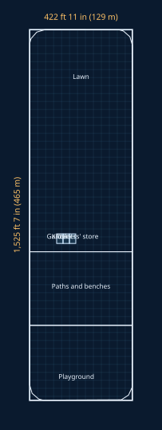

# P6-24 Neighbourhood Park 2: plan

Footprint 422 ft 11 in (129 m) × 1,525 ft 7 in (465 m) · structural grid 32 ft 10 in (10 m)

## Levels

| Level | Floor above deck | Height | Floor area |
|---|---|---|---|
| Level 1 · Ground | 0 ft (0 mm) | 13 ft 1 in (4,000 mm) | 3,100 sq ft (288 m²) |

## Elements

| ID | Designation | Type | Name | Level(s) | Size / length | Area | Status |
|---|---|---|---|---|---|---|---|
| E001 | D5F6P6B12A2R1 | zone | Lawn | L1 | 422 ft 7 in (129 m) × 914 ft 1 in (279 m) | 383,901 sq ft (35,666 m²) | proposed |
| E002 | D5F6P6B12A2R2 | room | Kiosk | L1 | 26 ft 3 in (8,000 mm) × 39 ft 4 in (12 m) | 1,033 sq ft (96 m²) | proposed |
| E003 | D5F6P6B12A2R3 | room | Toilets | L1 | 26 ft 3 in (8,000 mm) × 39 ft 4 in (12 m) | 1,033 sq ft (96 m²) | proposed |
| E004 | D5F6P6B12A2R4 | room | Gardeners' store | L1 | 26 ft 3 in (8,000 mm) × 39 ft 4 in (12 m) | 1,033 sq ft (96 m²) | proposed |
| E005 | D5F6P6B12A2R5 | zone | Paths and benches | L1 | 422 ft 7 in (129 m) × 302 ft 10 in (92 m) | 127,865 sq ft (11,879 m²) | proposed |
| E006 | D5F6P6B12A2R6 | zone | Playground | L1 | 422 ft 3 in (129 m) × 308 ft 1 in (94 m) | 127,966 sq ft (11,888 m²) | proposed |

## Drawings

### Level 1 · Ground

