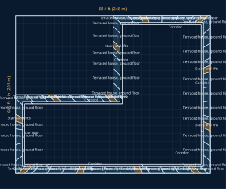
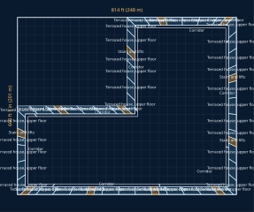

# P6-25 Terrace Row 2: plan

Footprint 814 ft (248 m) × 660 ft 1 in (201 m) · structural grid 32 ft 10 in (10 m)

## Levels

| Level | Floor above deck | Height | Floor area |
|---|---|---|---|
| Level 1 · Ground floor | 0 ft (0 mm) | 11 ft 2 in (3,400 mm) | 74,260 sq ft (6,899 m²) |
| Level 2 · Upper floor | 11 ft 2 in (3,400 mm) | 9 ft 10 in (3,000 mm) | 74,260 sq ft (6,899 m²) |

## Elements

| ID | Designation | Type | Name | Level(s) | Size / length | Area | Status |
|---|---|---|---|---|---|---|---|
| E001 | D5F6P6B13A2L1R1 | zone | Back gardens | L1 | 735 ft 3 in (224 m) × 581 ft 4 in (177 m) | 293,167 sq ft (27,236 m²) | proposed |
| E002 | D5F6P6B13A2L1R2, D5F6P6B13A2L2R1 | core | Stairs and lifts | L1, L2 | 37 ft 5 in (11 m) × 29 ft 6 in (9,000 mm) | 780 sq ft (72 m²) | proposed |
| E003 | D5F6P6B13A2L1R3, D5F6P6B13A2L2R2 | core | Stairs and lifts | L1, L2 | 52 ft 2 in (16 m) × 29 ft 6 in (9,000 mm) | 780 sq ft (72 m²) | proposed |
| E004 | D5F6P6B13A2L1R4, D5F6P6B13A2L2R3 | core | Stairs and lifts | L1, L2 | 29 ft 6 in (9,000 mm) × 36 ft 1 in (11 m) | 775 sq ft (72 m²) | proposed |
| E005 | D5F6P6B13A2L1R5, D5F6P6B13A2L2R4 | core | Stairs and lifts | L1, L2 | 29 ft 6 in (9,000 mm) × 38 ft 9 in (12 m) | 775 sq ft (72 m²) | proposed |
| E006 | D5F6P6B13A2L1R6, D5F6P6B13A2L2R5 | core | Stairs and lifts | L1, L2 | 51 ft 10 in (16 m) × 29 ft 6 in (9,000 mm) | 775 sq ft (72 m²) | proposed |
| E007 | D5F6P6B13A2L1R7, D5F6P6B13A2L2R6 | core | Stairs and lifts | L1, L2 | 34 ft 1 in (10 m) × 29 ft 6 in (9,000 mm) | 775 sq ft (72 m²) | proposed |
| E008 | D5F6P6B13A2L1R8, D5F6P6B13A2L2R7 | core | Stairs and lifts | L1, L2 | 36 ft 1 in (11 m) × 29 ft 6 in (9,000 mm) | 775 sq ft (72 m²) | proposed |
| E009 | D5F6P6B13A2L1R9, D5F6P6B13A2L2R8 | core | Stairs and lifts | L1, L2 | 54 ft 2 in (16 m) × 29 ft 6 in (9,000 mm) | 775 sq ft (72 m²) | proposed |
| E010 | D5F6P6B13A2L1R10, D5F6P6B13A2L2R9 | core | Stairs and lifts | L1, L2 | 29 ft 6 in (9,000 mm) × 38 ft 1 in (12 m) | 770 sq ft (72 m²) | proposed |
| E011 | D5F6P6B13A2L1R11, D5F6P6B13A2L2R10 | core | Stairs and lifts | L1, L2 | 55 ft 9 in (17 m) × 29 ft 6 in (9,000 mm) | 775 sq ft (72 m²) | proposed |
| E012 | D5F6P6B13A2L1R12, D5F6P6B13A2L2R11 | core | Stairs and lifts | L1, L2 | 55 ft 9 in (17 m) × 29 ft 6 in (9,000 mm) | 775 sq ft (72 m²) | proposed |
| E013 | D5F6P6B13A2L1R13, D5F6P6B13A2L2R12 | core | Stairs and lifts | L1, L2 | 29 ft 6 in (9,000 mm) × 55 ft 9 in (17 m) | 775 sq ft (72 m²) | proposed |
| E014 | D5F6P6B13A2L1R14 | zone | Corridor | L1 | 348 ft 1 in (106 m) × 64 ft 4 in (20 m) | 3,875 sq ft (360 m²) | proposed |
| E015 | D5F6P6B13A2L1R15 | zone | Corridor | L1 | 9 ft 10 in (3,000 mm) × 400 ft 3 in (122 m) | 3,875 sq ft (360 m²) | proposed |
| E016 | D5F6P6B13A2L1R16 | zone | Corridor | L1 | 258 ft 2 in (79 m) × 149 ft 7 in (46 m) | 3,875 sq ft (360 m²) | proposed |
| E017 | D5F6P6B13A2L1R17 | zone | Corridor | L1 | 398 ft 11 in (122 m) × 9 ft 10 in (3,000 mm) | 3,875 sq ft (360 m²) | proposed |
| E018 | D5F6P6B13A2L1R18 | zone | Corridor | L1 | 108 ft 3 in (33 m) × 271 ft (83 m) | 3,875 sq ft (360 m²) | proposed |
| E019 | D5F6P6B13A2L1R19 | zone | Corridor | L1 | 383 ft 10 in (117 m) × 29 ft 6 in (9,000 mm) | 3,875 sq ft (360 m²) | proposed |
| E020 | D5F6P6B13A2L1R20 | zone | Corridor | L1 | 9 ft 10 in (3,000 mm) × 320 ft 3 in (98 m) | 3,055 sq ft (284 m²) | proposed |
| E021 | D5F6P6B13A2L1R21 | room | Terraced house, ground floor | L1 | 85 ft (26 m) × 29 ft 6 in (9,000 mm) | 1,778 sq ft (165 m²) | proposed |
| E022 | D5F6P6B13A2L1R22 | room | Terraced house, ground floor | L1 | 61 ft (19 m) × 29 ft 6 in (9,000 mm) | 1,313 sq ft (122 m²) | proposed |
| E023 | D5F6P6B13A2L1R23 | room | Terraced house, ground floor | L1 | 64 ft 8 in (20 m) × 29 ft 6 in (9,000 mm) | 1,773 sq ft (165 m²) | proposed |
| E024 | D5F6P6B13A2L1R24 | room | Terraced house, ground floor | L1 | 65 ft 3 in (20 m) × 29 ft 6 in (9,000 mm) | 1,778 sq ft (165 m²) | proposed |
| E025 | D5F6P6B13A2L1R25 | room | Terraced house, ground floor | L1 | 74 ft 10 in (23 m) × 29 ft 6 in (9,000 mm) | 1,778 sq ft (165 m²) | proposed |
| E026 | D5F6P6B13A2L1R26 | room | Terraced house, ground floor | L1 | 50 ft 6 in (15 m) × 29 ft 6 in (9,000 mm) | 857 sq ft (80 m²) | proposed |
| E027 | D5F6P6B13A2L1R27 | room | Terraced house, ground floor | L1 | 39 ft 4 in (12 m) × 76 ft 9 in (23 m) | 1,778 sq ft (165 m²) | proposed |
| E028 | D5F6P6B13A2L1R28 | room | Terraced house, ground floor | L1 | 29 ft 6 in (9,000 mm) × 82 ft (25 m) | 1,773 sq ft (165 m²) | proposed |
| E029 | D5F6P6B13A2L1R29 | room | Terraced house, ground floor | L1 | 29 ft 6 in (9,000 mm) × 76 ft 5 in (23 m) | 1,773 sq ft (165 m²) | proposed |
| E030 | D5F6P6B13A2L1R30 | room | Terraced house, ground floor | L1 | 29 ft 6 in (9,000 mm) × 41 ft 8 in (13 m) | 862 sq ft (80 m²) | proposed |
| E031 | D5F6P6B13A2L1R31 | room | Terraced house, ground floor | L1 | 29 ft 6 in (9,000 mm) × 65 ft 11 in (20 m) | 1,778 sq ft (165 m²) | proposed |
| E032 | D5F6P6B13A2L1R32 | room | Terraced house, ground floor | L1 | 29 ft 6 in (9,000 mm) × 63 ft (19 m) | 1,773 sq ft (165 m²) | proposed |
| E033 | D5F6P6B13A2L1R33 | room | Terraced house, ground floor | L1 | 29 ft 6 in (9,000 mm) × 65 ft 11 in (20 m) | 1,778 sq ft (165 m²) | proposed |
| E034 | D5F6P6B13A2L1R34 | room | Terraced house, ground floor | L1 | 29 ft 6 in (9,000 mm) × 39 ft 1 in (12 m) | 862 sq ft (80 m²) | proposed |
| E035 | D5F6P6B13A2L1R35 | room | Terraced house, ground floor | L1 | 29 ft 6 in (9,000 mm) × 76 ft 9 in (23 m) | 1,778 sq ft (165 m²) | proposed |
| E036 | D5F6P6B13A2L1R36 | room | Terraced house, ground floor | L1 | 29 ft 6 in (9,000 mm) × 82 ft 4 in (25 m) | 1,778 sq ft (165 m²) | proposed |
| E037 | D5F6P6B13A2L1R37 | room | Terraced house, ground floor | L1 | 40 ft (12 m) × 76 ft 5 in (23 m) | 1,773 sq ft (165 m²) | proposed |
| E038 | D5F6P6B13A2L1R38 | room | Terraced house, ground floor | L1 | 56 ft 9 in (17 m) × 29 ft 6 in (9,000 mm) | 857 sq ft (80 m²) | proposed |
| E039 | D5F6P6B13A2L1R39 | room | Terraced house, ground floor | L1 | 82 ft 8 in (25 m) × 29 ft 6 in (9,000 mm) | 1,783 sq ft (166 m²) | proposed |
| E040 | D5F6P6B13A2L1R40 | room | Terraced house, ground floor | L1 | 77 ft 9 in (24 m) × 29 ft 6 in (9,000 mm) | 1,773 sq ft (165 m²) | proposed |
| E041 | D5F6P6B13A2L1R41 | room | Terraced house, ground floor | L1 | 73 ft 2 in (22 m) × 29 ft 6 in (9,000 mm) | 1,773 sq ft (165 m²) | proposed |
| E042 | D5F6P6B13A2L1R42 | room | Terraced house, ground floor | L1 | 39 ft 1 in (12 m) × 29 ft 6 in (9,000 mm) | 862 sq ft (80 m²) | proposed |
| E043 | D5F6P6B13A2L1R43 | room | Terraced house, ground floor | L1 | 64 ft 8 in (20 m) × 29 ft 6 in (9,000 mm) | 1,773 sq ft (165 m²) | proposed |
| E044 | D5F6P6B13A2L1R44 | room | Terraced house, ground floor | L1 | 62 ft 8 in (19 m) × 29 ft 6 in (9,000 mm) | 1,783 sq ft (166 m²) | proposed |
| E045 | D5F6P6B13A2L1R45 | room | Terraced house, ground floor | L1 | 64 ft 8 in (20 m) × 29 ft 6 in (9,000 mm) | 1,773 sq ft (165 m²) | proposed |
| E046 | D5F6P6B13A2L1R46 | room | Terraced house, ground floor | L1 | 37 ft 1 in (11 m) × 29 ft 6 in (9,000 mm) | 862 sq ft (80 m²) | proposed |
| E047 | D5F6P6B13A2L1R47 | room | Terraced house, ground floor | L1 | 73 ft 2 in (22 m) × 29 ft 6 in (9,000 mm) | 1,773 sq ft (165 m²) | proposed |
| E048 | D5F6P6B13A2L1R48 | room | Terraced house, ground floor | L1 | 78 ft 1 in (24 m) × 29 ft 6 in (9,000 mm) | 1,783 sq ft (166 m²) | proposed |
| E049 | D5F6P6B13A2L1R49 | room | Terraced house, ground floor | L1 | 82 ft 4 in (25 m) × 29 ft 6 in (9,000 mm) | 1,773 sq ft (165 m²) | proposed |
| E050 | D5F6P6B13A2L1R50 | room | Terraced house, ground floor | L1 | 54 ft 9 in (17 m) × 29 ft 6 in (9,000 mm) | 857 sq ft (80 m²) | proposed |
| E051 | D5F6P6B13A2L1R51 | room | Terraced house, ground floor | L1 | 40 ft (12 m) × 74 ft 2 in (23 m) | 1,778 sq ft (165 m²) | proposed |
| E052 | D5F6P6B13A2L1R52 | room | Terraced house, ground floor | L1 | 29 ft 6 in (9,000 mm) × 74 ft 2 in (23 m) | 1,778 sq ft (165 m²) | proposed |
| E053 | D5F6P6B13A2L1R53 | room | Terraced house, ground floor | L1 | 29 ft 6 in (9,000 mm) × 65 ft 11 in (20 m) | 1,773 sq ft (165 m²) | proposed |
| E054 | D5F6P6B13A2L1R54 | room | Terraced house, ground floor | L1 | 29 ft 6 in (9,000 mm) × 36 ft 1 in (11 m) | 867 sq ft (81 m²) | proposed |
| E055 | D5F6P6B13A2L1R55 | room | Terraced house, ground floor | L1 | 29 ft 6 in (9,000 mm) × 80 ft 9 in (25 m) | 1,778 sq ft (165 m²) | proposed |
| E056 | D5F6P6B13A2L1R56 | room | Terraced house, ground floor | L1 | 74 ft 6 in (23 m) × 43 ft 4 in (13 m) | 1,778 sq ft (165 m²) | proposed |
| E057 | D5F6P6B13A2L1R57 | room | Terraced house, ground floor | L1 | 89 ft 7 in (27 m) × 29 ft 6 in (9,000 mm) | 1,773 sq ft (165 m²) | proposed |
| E058 | D5F6P6B13A2L1R58 | room | Terraced house, ground floor | L1 | 58 ft 9 in (18 m) × 29 ft 6 in (9,000 mm) | 862 sq ft (80 m²) | proposed |
| E059 | D5F6P6B13A2L1R59 | room | Terraced house, ground floor | L1 | 89 ft 7 in (27 m) × 29 ft 6 in (9,000 mm) | 1,773 sq ft (165 m²) | proposed |
| E060 | D5F6P6B13A2L1R60 | room | Terraced house, ground floor | L1 | 89 ft 11 in (27 m) × 29 ft 6 in (9,000 mm) | 1,783 sq ft (166 m²) | proposed |
| E061 | D5F6P6B13A2L1R61 | room | Terraced house, ground floor | L1 | 89 ft 7 in (27 m) × 29 ft 6 in (9,000 mm) | 1,773 sq ft (165 m²) | proposed |
| E062 | D5F6P6B13A2L1R62 | room | Terraced house, ground floor | L1 | 58 ft 9 in (18 m) × 29 ft 6 in (9,000 mm) | 862 sq ft (80 m²) | proposed |
| E063 | D5F6P6B13A2L1R63 | room | Terraced house, ground floor | L1 | 40 ft (12 m) × 79 ft 1 in (24 m) | 1,773 sq ft (165 m²) | proposed |
| E064 | D5F6P6B13A2L1R64 | room | Terraced house, ground floor | L1 | 29 ft 6 in (9,000 mm) × 89 ft 7 in (27 m) | 1,773 sq ft (165 m²) | proposed |
| E065 | D5F6P6B13A2L1R65 | room | Terraced house, ground floor | L1 | 29 ft 6 in (9,000 mm) × 89 ft 11 in (27 m) | 1,783 sq ft (166 m²) | proposed |
| E066 | D5F6P6B13A2L1R66 | room | Terraced house, ground floor | L1 | 29 ft 6 in (9,000 mm) × 58 ft 9 in (18 m) | 862 sq ft (80 m²) | proposed |
| E067 | D5F6P6B13A2L1R67 | room | Terraced house, ground floor | L1 | 29 ft 6 in (9,000 mm) × 89 ft 7 in (27 m) | 1,773 sq ft (165 m²) | proposed |
| E068 | D5F6P6B13A2L1R68 | room | Terraced house, ground floor | L1 | 29 ft 6 in (9,000 mm) × 74 ft 2 in (23 m) | 1,318 sq ft (122 m²) | proposed |
| E069 | D5F6P6B13A2L2R13 | zone | Corridor | L2 | 348 ft 1 in (106 m) × 64 ft 4 in (20 m) | 3,875 sq ft (360 m²) | proposed |
| E070 | D5F6P6B13A2L2R14 | zone | Corridor | L2 | 9 ft 10 in (3,000 mm) × 400 ft 3 in (122 m) | 3,875 sq ft (360 m²) | proposed |
| E071 | D5F6P6B13A2L2R15 | zone | Corridor | L2 | 258 ft 2 in (79 m) × 149 ft 7 in (46 m) | 3,875 sq ft (360 m²) | proposed |
| E072 | D5F6P6B13A2L2R16 | zone | Corridor | L2 | 398 ft 11 in (122 m) × 9 ft 10 in (3,000 mm) | 3,875 sq ft (360 m²) | proposed |
| E073 | D5F6P6B13A2L2R17 | zone | Corridor | L2 | 108 ft 3 in (33 m) × 271 ft (83 m) | 3,875 sq ft (360 m²) | proposed |
| E074 | D5F6P6B13A2L2R18 | zone | Corridor | L2 | 383 ft 10 in (117 m) × 29 ft 6 in (9,000 mm) | 3,875 sq ft (360 m²) | proposed |
| E075 | D5F6P6B13A2L2R19 | zone | Corridor | L2 | 9 ft 10 in (3,000 mm) × 320 ft 3 in (98 m) | 3,055 sq ft (284 m²) | proposed |
| E076 | D5F6P6B13A2L2R20 | room | Terraced house, upper floor | L2 | 85 ft (26 m) × 29 ft 6 in (9,000 mm) | 1,778 sq ft (165 m²) | proposed |
| E077 | D5F6P6B13A2L2R21 | room | Terraced house, upper floor | L2 | 61 ft (19 m) × 29 ft 6 in (9,000 mm) | 1,313 sq ft (122 m²) | proposed |
| E078 | D5F6P6B13A2L2R22 | room | Terraced house, upper floor | L2 | 64 ft 8 in (20 m) × 29 ft 6 in (9,000 mm) | 1,773 sq ft (165 m²) | proposed |
| E079 | D5F6P6B13A2L2R23 | room | Terraced house, upper floor | L2 | 65 ft 3 in (20 m) × 29 ft 6 in (9,000 mm) | 1,778 sq ft (165 m²) | proposed |
| E080 | D5F6P6B13A2L2R24 | room | Terraced house, upper floor | L2 | 74 ft 10 in (23 m) × 29 ft 6 in (9,000 mm) | 1,778 sq ft (165 m²) | proposed |
| E081 | D5F6P6B13A2L2R25 | room | Terraced house, upper floor | L2 | 50 ft 6 in (15 m) × 29 ft 6 in (9,000 mm) | 857 sq ft (80 m²) | proposed |
| E082 | D5F6P6B13A2L2R26 | room | Terraced house, upper floor | L2 | 39 ft 4 in (12 m) × 76 ft 9 in (23 m) | 1,778 sq ft (165 m²) | proposed |
| E083 | D5F6P6B13A2L2R27 | room | Terraced house, upper floor | L2 | 29 ft 6 in (9,000 mm) × 82 ft (25 m) | 1,773 sq ft (165 m²) | proposed |
| E084 | D5F6P6B13A2L2R28 | room | Terraced house, upper floor | L2 | 29 ft 6 in (9,000 mm) × 76 ft 5 in (23 m) | 1,773 sq ft (165 m²) | proposed |
| E085 | D5F6P6B13A2L2R29 | room | Terraced house, upper floor | L2 | 29 ft 6 in (9,000 mm) × 41 ft 8 in (13 m) | 862 sq ft (80 m²) | proposed |
| E086 | D5F6P6B13A2L2R30 | room | Terraced house, upper floor | L2 | 29 ft 6 in (9,000 mm) × 65 ft 11 in (20 m) | 1,778 sq ft (165 m²) | proposed |
| E087 | D5F6P6B13A2L2R31 | room | Terraced house, upper floor | L2 | 29 ft 6 in (9,000 mm) × 63 ft (19 m) | 1,773 sq ft (165 m²) | proposed |
| E088 | D5F6P6B13A2L2R32 | room | Terraced house, upper floor | L2 | 29 ft 6 in (9,000 mm) × 65 ft 11 in (20 m) | 1,778 sq ft (165 m²) | proposed |
| E089 | D5F6P6B13A2L2R33 | room | Terraced house, upper floor | L2 | 29 ft 6 in (9,000 mm) × 39 ft 1 in (12 m) | 862 sq ft (80 m²) | proposed |
| E090 | D5F6P6B13A2L2R34 | room | Terraced house, upper floor | L2 | 29 ft 6 in (9,000 mm) × 76 ft 9 in (23 m) | 1,778 sq ft (165 m²) | proposed |
| E091 | D5F6P6B13A2L2R35 | room | Terraced house, upper floor | L2 | 29 ft 6 in (9,000 mm) × 82 ft 4 in (25 m) | 1,778 sq ft (165 m²) | proposed |
| E092 | D5F6P6B13A2L2R36 | room | Terraced house, upper floor | L2 | 40 ft (12 m) × 76 ft 5 in (23 m) | 1,773 sq ft (165 m²) | proposed |
| E093 | D5F6P6B13A2L2R37 | room | Terraced house, upper floor | L2 | 56 ft 9 in (17 m) × 29 ft 6 in (9,000 mm) | 857 sq ft (80 m²) | proposed |
| E094 | D5F6P6B13A2L2R38 | room | Terraced house, upper floor | L2 | 82 ft 8 in (25 m) × 29 ft 6 in (9,000 mm) | 1,783 sq ft (166 m²) | proposed |
| E095 | D5F6P6B13A2L2R39 | room | Terraced house, upper floor | L2 | 77 ft 9 in (24 m) × 29 ft 6 in (9,000 mm) | 1,773 sq ft (165 m²) | proposed |
| E096 | D5F6P6B13A2L2R40 | room | Terraced house, upper floor | L2 | 73 ft 2 in (22 m) × 29 ft 6 in (9,000 mm) | 1,773 sq ft (165 m²) | proposed |
| E097 | D5F6P6B13A2L2R41 | room | Terraced house, upper floor | L2 | 39 ft 1 in (12 m) × 29 ft 6 in (9,000 mm) | 862 sq ft (80 m²) | proposed |
| E098 | D5F6P6B13A2L2R42 | room | Terraced house, upper floor | L2 | 64 ft 8 in (20 m) × 29 ft 6 in (9,000 mm) | 1,773 sq ft (165 m²) | proposed |
| E099 | D5F6P6B13A2L2R43 | room | Terraced house, upper floor | L2 | 62 ft 8 in (19 m) × 29 ft 6 in (9,000 mm) | 1,783 sq ft (166 m²) | proposed |
| E100 | D5F6P6B13A2L2R44 | room | Terraced house, upper floor | L2 | 64 ft 8 in (20 m) × 29 ft 6 in (9,000 mm) | 1,773 sq ft (165 m²) | proposed |
| E101 | D5F6P6B13A2L2R45 | room | Terraced house, upper floor | L2 | 37 ft 1 in (11 m) × 29 ft 6 in (9,000 mm) | 862 sq ft (80 m²) | proposed |
| E102 | D5F6P6B13A2L2R46 | room | Terraced house, upper floor | L2 | 73 ft 2 in (22 m) × 29 ft 6 in (9,000 mm) | 1,773 sq ft (165 m²) | proposed |
| E103 | D5F6P6B13A2L2R47 | room | Terraced house, upper floor | L2 | 78 ft 1 in (24 m) × 29 ft 6 in (9,000 mm) | 1,783 sq ft (166 m²) | proposed |
| E104 | D5F6P6B13A2L2R48 | room | Terraced house, upper floor | L2 | 82 ft 4 in (25 m) × 29 ft 6 in (9,000 mm) | 1,773 sq ft (165 m²) | proposed |
| E105 | D5F6P6B13A2L2R49 | room | Terraced house, upper floor | L2 | 54 ft 9 in (17 m) × 29 ft 6 in (9,000 mm) | 857 sq ft (80 m²) | proposed |
| E106 | D5F6P6B13A2L2R50 | room | Terraced house, upper floor | L2 | 40 ft (12 m) × 74 ft 2 in (23 m) | 1,778 sq ft (165 m²) | proposed |
| E107 | D5F6P6B13A2L2R51 | room | Terraced house, upper floor | L2 | 29 ft 6 in (9,000 mm) × 74 ft 2 in (23 m) | 1,778 sq ft (165 m²) | proposed |
| E108 | D5F6P6B13A2L2R52 | room | Terraced house, upper floor | L2 | 29 ft 6 in (9,000 mm) × 65 ft 11 in (20 m) | 1,773 sq ft (165 m²) | proposed |
| E109 | D5F6P6B13A2L2R53 | room | Terraced house, upper floor | L2 | 29 ft 6 in (9,000 mm) × 36 ft 1 in (11 m) | 867 sq ft (81 m²) | proposed |
| E110 | D5F6P6B13A2L2R54 | room | Terraced house, upper floor | L2 | 29 ft 6 in (9,000 mm) × 80 ft 9 in (25 m) | 1,778 sq ft (165 m²) | proposed |
| E111 | D5F6P6B13A2L2R55 | room | Terraced house, upper floor | L2 | 74 ft 6 in (23 m) × 43 ft 4 in (13 m) | 1,778 sq ft (165 m²) | proposed |
| E112 | D5F6P6B13A2L2R56 | room | Terraced house, upper floor | L2 | 89 ft 7 in (27 m) × 29 ft 6 in (9,000 mm) | 1,773 sq ft (165 m²) | proposed |
| E113 | D5F6P6B13A2L2R57 | room | Terraced house, upper floor | L2 | 58 ft 9 in (18 m) × 29 ft 6 in (9,000 mm) | 862 sq ft (80 m²) | proposed |
| E114 | D5F6P6B13A2L2R58 | room | Terraced house, upper floor | L2 | 89 ft 7 in (27 m) × 29 ft 6 in (9,000 mm) | 1,773 sq ft (165 m²) | proposed |
| E115 | D5F6P6B13A2L2R59 | room | Terraced house, upper floor | L2 | 89 ft 11 in (27 m) × 29 ft 6 in (9,000 mm) | 1,783 sq ft (166 m²) | proposed |
| E116 | D5F6P6B13A2L2R60 | room | Terraced house, upper floor | L2 | 89 ft 7 in (27 m) × 29 ft 6 in (9,000 mm) | 1,773 sq ft (165 m²) | proposed |
| E117 | D5F6P6B13A2L2R61 | room | Terraced house, upper floor | L2 | 58 ft 9 in (18 m) × 29 ft 6 in (9,000 mm) | 862 sq ft (80 m²) | proposed |
| E118 | D5F6P6B13A2L2R62 | room | Terraced house, upper floor | L2 | 40 ft (12 m) × 79 ft 1 in (24 m) | 1,773 sq ft (165 m²) | proposed |
| E119 | D5F6P6B13A2L2R63 | room | Terraced house, upper floor | L2 | 29 ft 6 in (9,000 mm) × 89 ft 7 in (27 m) | 1,773 sq ft (165 m²) | proposed |
| E120 | D5F6P6B13A2L2R64 | room | Terraced house, upper floor | L2 | 29 ft 6 in (9,000 mm) × 89 ft 11 in (27 m) | 1,783 sq ft (166 m²) | proposed |
| E121 | D5F6P6B13A2L2R65 | room | Terraced house, upper floor | L2 | 29 ft 6 in (9,000 mm) × 58 ft 9 in (18 m) | 862 sq ft (80 m²) | proposed |
| E122 | D5F6P6B13A2L2R66 | room | Terraced house, upper floor | L2 | 29 ft 6 in (9,000 mm) × 89 ft 7 in (27 m) | 1,773 sq ft (165 m²) | proposed |
| E123 | D5F6P6B13A2L2R67 | room | Terraced house, upper floor | L2 | 29 ft 6 in (9,000 mm) × 74 ft 2 in (23 m) | 1,318 sq ft (122 m²) | proposed |

## Drawings

### Level 1 · Ground floor

### Level 2 · Upper floor

