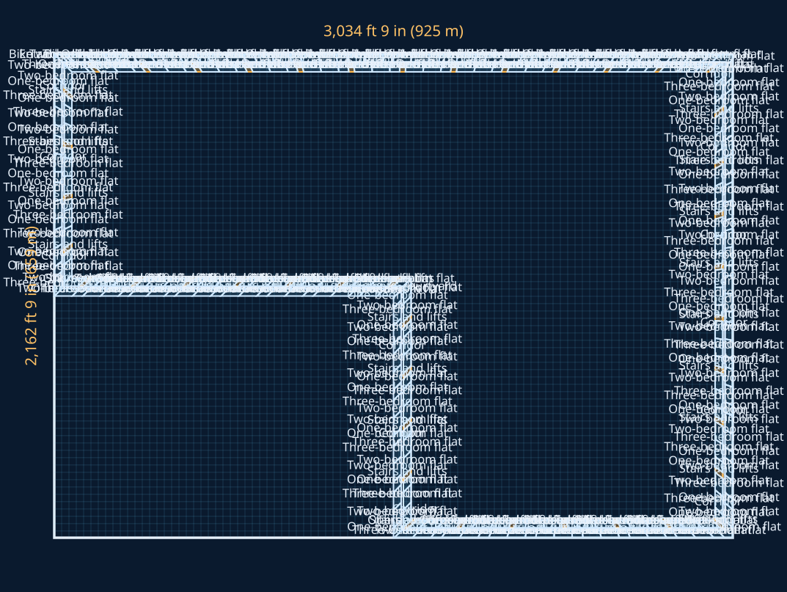
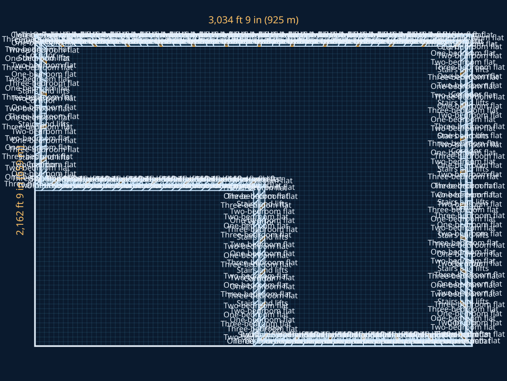

# P6-26 Apartment Block 3: plan

Footprint 3,034 ft 9 in (925 m) × 2,162 ft 9 in (659 m) · structural grid 32 ft 10 in (10 m)

## Levels

| Level | Floor above deck | Height | Floor area |
|---|---|---|---|
| Level 1 · Ground floor | 0 ft (0 mm) | 14 ft 9 in (4,500 mm) | 655,607 sq ft (60,908 m²) |
| Level 2 · Flat floor 1 | 14 ft 9 in (4,500 mm) | 10 ft 6 in (3,200 mm) | 655,607 sq ft (60,908 m²) |
| Level 3 · Flat floor 2 | 25 ft 3 in (7,700 mm) | 10 ft 6 in (3,200 mm) | 655,607 sq ft (60,908 m²) |
| Level 4 · Flat floor 3 | 35 ft 9 in (11 m) | 10 ft 6 in (3,200 mm) | 655,607 sq ft (60,908 m²) |
| Level 5 · Flat floor 4 | 46 ft 3 in (14 m) | 10 ft 6 in (3,200 mm) | 655,607 sq ft (60,908 m²) |
| Level 6 · Flat floor 5 | 56 ft 9 in (17 m) | 10 ft 6 in (3,200 mm) | 655,607 sq ft (60,908 m²) |

## Elements

| ID | Designation | Type | Name | Level(s) | Size / length | Area | Status |
|---|---|---|---|---|---|---|---|
| E001 | D5F6P6B1A4L1R1 | zone | Residents' courtyard | L1 | 2,877 ft 4 in (877 m) × 2,005 ft 3 in (611 m) | 4,128,847 sq ft (383,582 m²) | proposed |
| E002 | D5F6P6B1A4L1R2 | zone | Corridor | L1 | 402 ft 3 in (123 m) × 9 ft 10 in (3,000 mm) | 3,875 sq ft (360 m²) | proposed |
| E003 | D5F6P6B1A4L1R3 | zone | Corridor | L1 | 399 ft 7 in (122 m) × 9 ft 10 in (3,000 mm) | 3,875 sq ft (360 m²) | proposed |
| E004 | D5F6P6B1A4L1R4 | zone | Corridor | L1 | 397 ft (121 m) × 9 ft 10 in (3,000 mm) | 3,875 sq ft (360 m²) | proposed |
| E005 | D5F6P6B1A4L1R5 | zone | Corridor | L1 | 395 ft (120 m) × 9 ft 10 in (3,000 mm) | 3,875 sq ft (360 m²) | proposed |
| E006 | D5F6P6B1A4L1R6 | zone | Corridor | L1 | 395 ft 8 in (121 m) × 9 ft 10 in (3,000 mm) | 3,875 sq ft (360 m²) | proposed |
| E007 | D5F6P6B1A4L1R7 | zone | Corridor | L1 | 398 ft 4 in (121 m) × 9 ft 10 in (3,000 mm) | 3,875 sq ft (360 m²) | proposed |
| E008 | D5F6P6B1A4L1R8 | zone | Corridor | L1 | 400 ft 11 in (122 m) × 9 ft 10 in (3,000 mm) | 3,875 sq ft (360 m²) | proposed |
| E009 | D5F6P6B1A4L1R9 | zone | Corridor | L1 | 209 ft 4 in (64 m) × 202 ft 5 in (62 m) | 3,875 sq ft (360 m²) | proposed |
| E010 | D5F6P6B1A4L1R10 | zone | Corridor | L1 | 9 ft 10 in (3,000 mm) × 399 ft 11 in (122 m) | 3,875 sq ft (360 m²) | proposed |
| E011 | D5F6P6B1A4L1R11 | zone | Corridor | L1 | 9 ft 10 in (3,000 mm) × 396 ft 4 in (121 m) | 3,875 sq ft (360 m²) | proposed |
| E012 | D5F6P6B1A4L1R12 | zone | Corridor | L1 | 9 ft 10 in (3,000 mm) × 395 ft 8 in (121 m) | 3,875 sq ft (360 m²) | proposed |
| E013 | D5F6P6B1A4L1R13 | zone | Corridor | L1 | 9 ft 10 in (3,000 mm) × 398 ft 7 in (122 m) | 3,875 sq ft (360 m²) | proposed |
| E014 | D5F6P6B1A4L1R14 | zone | Corridor | L1 | 87 ft 3 in (27 m) × 323 ft 10 in (99 m) | 3,875 sq ft (360 m²) | proposed |
| E015 | D5F6P6B1A4L1R15 | zone | Corridor | L1 | 399 ft 7 in (122 m) × 9 ft 10 in (3,000 mm) | 3,875 sq ft (360 m²) | proposed |
| E016 | D5F6P6B1A4L1R16 | zone | Corridor | L1 | 396 ft 4 in (121 m) × 9 ft 10 in (3,000 mm) | 3,875 sq ft (360 m²) | proposed |
| E017 | D5F6P6B1A4L1R17 | zone | Corridor | L1 | 398 ft 4 in (121 m) × 9 ft 10 in (3,000 mm) | 3,875 sq ft (360 m²) | proposed |
| E018 | D5F6P6B1A4L1R18 | zone | Corridor | L1 | 188 ft (57 m) × 224 ft 1 in (68 m) | 3,875 sq ft (360 m²) | proposed |
| E019 | D5F6P6B1A4L1R19 | zone | Corridor | L1 | 9 ft 10 in (3,000 mm) × 403 ft 7 in (123 m) | 3,875 sq ft (360 m²) | proposed |
| E020 | D5F6P6B1A4L1R20 | zone | Corridor | L1 | 9 ft 10 in (3,000 mm) × 403 ft 7 in (123 m) | 3,875 sq ft (360 m²) | proposed |
| E021 | D5F6P6B1A4L1R21 | zone | Corridor | L1 | 323 ft 10 in (99 m) × 89 ft 7 in (27 m) | 3,875 sq ft (360 m²) | proposed |
| E022 | D5F6P6B1A4L1R22 | zone | Corridor | L1 | 403 ft 7 in (123 m) × 9 ft 10 in (3,000 mm) | 3,875 sq ft (360 m²) | proposed |
| E023 | D5F6P6B1A4L1R23 | zone | Corridor | L1 | 403 ft 7 in (123 m) × 9 ft 10 in (3,000 mm) | 3,875 sq ft (360 m²) | proposed |
| E024 | D5F6P6B1A4L1R24 | zone | Corridor | L1 | 403 ft 7 in (123 m) × 9 ft 10 in (3,000 mm) | 3,875 sq ft (360 m²) | proposed |
| E025 | D5F6P6B1A4L1R25 | zone | Corridor | L1 | 32 ft 2 in (9,800 mm) × 377 ft 7 in (115 m) | 3,875 sq ft (360 m²) | proposed |
| E026 | D5F6P6B1A4L1R26 | zone | Corridor | L1 | 9 ft 10 in (3,000 mm) × 397 ft 8 in (121 m) | 3,875 sq ft (360 m²) | proposed |
| E027 | D5F6P6B1A4L1R27 | zone | Corridor | L1 | 9 ft 10 in (3,000 mm) × 245 ft 1 in (75 m) | 2,338 sq ft (217 m²) | proposed |
| E028 | D5F6P6B1A4L1R28, D5F6P6B1A4L2R1, D5F6P6B1A4L3R1, D5F6P6B1A4L4R1, D5F6P6B1A4L5R1, D5F6P6B1A4L6R1 | core | Stairs and lifts | L1, L2, L3, L4, L5, L6 | 57 ft 9 in (18 m) × 34 ft 5 in (10 m) | 904 sq ft (84 m²) | proposed |
| E029 | D5F6P6B1A4L1R29, D5F6P6B1A4L2R2, D5F6P6B1A4L3R2, D5F6P6B1A4L4R2, D5F6P6B1A4L5R2, D5F6P6B1A4L6R2 | core | Stairs and lifts | L1, L2, L3, L4, L5, L6 | 52 ft 6 in (16 m) × 34 ft 5 in (10 m) | 904 sq ft (84 m²) | proposed |
| E030 | D5F6P6B1A4L1R30, D5F6P6B1A4L2R3, D5F6P6B1A4L3R3, D5F6P6B1A4L4R3, D5F6P6B1A4L5R3, D5F6P6B1A4L6R3 | core | Stairs and lifts | L1, L2, L3, L4, L5, L6 | 47 ft 3 in (14 m) × 34 ft 5 in (10 m) | 904 sq ft (84 m²) | proposed |
| E031 | D5F6P6B1A4L1R31, D5F6P6B1A4L2R4, D5F6P6B1A4L3R4, D5F6P6B1A4L4R4, D5F6P6B1A4L5R4, D5F6P6B1A4L6R4 | core | Stairs and lifts | L1, L2, L3, L4, L5, L6 | 41 ft 8 in (13 m) × 34 ft 5 in (10 m) | 904 sq ft (84 m²) | proposed |
| E032 | D5F6P6B1A4L1R32, D5F6P6B1A4L2R5, D5F6P6B1A4L3R5, D5F6P6B1A4L4R5, D5F6P6B1A4L5R5, D5F6P6B1A4L6R5 | core | Stairs and lifts | L1, L2, L3, L4, L5, L6 | 36 ft 1 in (11 m) × 34 ft 5 in (10 m) | 904 sq ft (84 m²) | proposed |
| E033 | D5F6P6B1A4L1R33, D5F6P6B1A4L2R6, D5F6P6B1A4L3R6, D5F6P6B1A4L4R6, D5F6P6B1A4L5R6, D5F6P6B1A4L6R6 | core | Stairs and lifts | L1, L2, L3, L4, L5, L6 | 30 ft 10 in (9,400 mm) × 34 ft 5 in (10 m) | 904 sq ft (84 m²) | proposed |
| E034 | D5F6P6B1A4L1R34, D5F6P6B1A4L2R7, D5F6P6B1A4L3R7, D5F6P6B1A4L4R7, D5F6P6B1A4L5R7, D5F6P6B1A4L6R7 | core | Stairs and lifts | L1, L2, L3, L4, L5, L6 | 27 ft 3 in (8,300 mm) × 34 ft 5 in (10 m) | 904 sq ft (84 m²) | proposed |
| E035 | D5F6P6B1A4L1R35, D5F6P6B1A4L2R8, D5F6P6B1A4L3R8, D5F6P6B1A4L4R8, D5F6P6B1A4L5R8, D5F6P6B1A4L6R8 | core | Stairs and lifts | L1, L2, L3, L4, L5, L6 | 32 ft 6 in (9,900 mm) × 34 ft 5 in (10 m) | 904 sq ft (84 m²) | proposed |
| E036 | D5F6P6B1A4L1R36, D5F6P6B1A4L2R9, D5F6P6B1A4L3R9, D5F6P6B1A4L4R9, D5F6P6B1A4L5R9, D5F6P6B1A4L6R9 | core | Stairs and lifts | L1, L2, L3, L4, L5, L6 | 38 ft 5 in (12 m) × 34 ft 5 in (10 m) | 910 sq ft (85 m²) | proposed |
| E037 | D5F6P6B1A4L1R37, D5F6P6B1A4L2R10, D5F6P6B1A4L3R10, D5F6P6B1A4L4R10, D5F6P6B1A4L5R10, D5F6P6B1A4L6R10 | core | Stairs and lifts | L1, L2, L3, L4, L5, L6 | 43 ft 8 in (13 m) × 34 ft 5 in (10 m) | 904 sq ft (84 m²) | proposed |
| E038 | D5F6P6B1A4L1R38, D5F6P6B1A4L2R11, D5F6P6B1A4L3R11, D5F6P6B1A4L4R11, D5F6P6B1A4L5R11, D5F6P6B1A4L6R11 | core | Stairs and lifts | L1, L2, L3, L4, L5, L6 | 48 ft 11 in (15 m) × 34 ft 5 in (10 m) | 904 sq ft (84 m²) | proposed |
| E039 | D5F6P6B1A4L1R39, D5F6P6B1A4L2R12, D5F6P6B1A4L3R12, D5F6P6B1A4L4R12, D5F6P6B1A4L5R12, D5F6P6B1A4L6R12 | core | Stairs and lifts | L1, L2, L3, L4, L5, L6 | 54 ft 6 in (17 m) × 34 ft 5 in (10 m) | 904 sq ft (84 m²) | proposed |
| E040 | D5F6P6B1A4L1R40, D5F6P6B1A4L2R13, D5F6P6B1A4L3R13, D5F6P6B1A4L4R13, D5F6P6B1A4L5R13, D5F6P6B1A4L6R13 | core | Stairs and lifts | L1, L2, L3, L4, L5, L6 | 60 ft (18 m) × 34 ft 5 in (10 m) | 904 sq ft (84 m²) | proposed |
| E041 | D5F6P6B1A4L1R41, D5F6P6B1A4L2R14, D5F6P6B1A4L3R14, D5F6P6B1A4L4R14, D5F6P6B1A4L5R14, D5F6P6B1A4L6R14 | core | Stairs and lifts | L1, L2, L3, L4, L5, L6 | 34 ft 5 in (10 m) × 54 ft 2 in (16 m) | 904 sq ft (84 m²) | proposed |
| E042 | D5F6P6B1A4L1R42, D5F6P6B1A4L2R15, D5F6P6B1A4L3R15, D5F6P6B1A4L4R15, D5F6P6B1A4L5R15, D5F6P6B1A4L6R15 | core | Stairs and lifts | L1, L2, L3, L4, L5, L6 | 34 ft 5 in (10 m) × 46 ft 3 in (14 m) | 904 sq ft (84 m²) | proposed |
| E043 | D5F6P6B1A4L1R43, D5F6P6B1A4L2R16, D5F6P6B1A4L3R16, D5F6P6B1A4L4R16, D5F6P6B1A4L5R16, D5F6P6B1A4L6R16 | core | Stairs and lifts | L1, L2, L3, L4, L5, L6 | 34 ft 5 in (10 m) × 38 ft 9 in (12 m) | 910 sq ft (85 m²) | proposed |
| E044 | D5F6P6B1A4L1R44, D5F6P6B1A4L2R17, D5F6P6B1A4L3R17, D5F6P6B1A4L4R17, D5F6P6B1A4L5R17, D5F6P6B1A4L6R17 | core | Stairs and lifts | L1, L2, L3, L4, L5, L6 | 34 ft 5 in (10 m) × 30 ft 10 in (9,400 mm) | 910 sq ft (85 m²) | proposed |
| E045 | D5F6P6B1A4L1R45, D5F6P6B1A4L2R18, D5F6P6B1A4L3R18, D5F6P6B1A4L4R18, D5F6P6B1A4L5R18, D5F6P6B1A4L6R18 | core | Stairs and lifts | L1, L2, L3, L4, L5, L6 | 34 ft 5 in (10 m) × 29 ft 6 in (9,000 mm) | 904 sq ft (84 m²) | proposed |
| E046 | D5F6P6B1A4L1R46, D5F6P6B1A4L2R19, D5F6P6B1A4L3R19, D5F6P6B1A4L4R19, D5F6P6B1A4L5R19, D5F6P6B1A4L6R19 | core | Stairs and lifts | L1, L2, L3, L4, L5, L6 | 34 ft 5 in (10 m) × 37 ft 5 in (11 m) | 904 sq ft (84 m²) | proposed |
| E047 | D5F6P6B1A4L1R47, D5F6P6B1A4L2R20, D5F6P6B1A4L3R20, D5F6P6B1A4L4R20, D5F6P6B1A4L5R20, D5F6P6B1A4L6R20 | core | Stairs and lifts | L1, L2, L3, L4, L5, L6 | 34 ft 5 in (10 m) × 45 ft 3 in (14 m) | 904 sq ft (84 m²) | proposed |
| E048 | D5F6P6B1A4L1R48, D5F6P6B1A4L2R21, D5F6P6B1A4L3R21, D5F6P6B1A4L4R21, D5F6P6B1A4L5R21, D5F6P6B1A4L6R21 | core | Stairs and lifts | L1, L2, L3, L4, L5, L6 | 34 ft 5 in (10 m) × 52 ft 10 in (16 m) | 899 sq ft (83 m²) | proposed |
| E049 | D5F6P6B1A4L1R49, D5F6P6B1A4L2R22, D5F6P6B1A4L3R22, D5F6P6B1A4L4R22, D5F6P6B1A4L5R22, D5F6P6B1A4L6R22 | core | Stairs and lifts | L1, L2, L3, L4, L5, L6 | 47 ft 3 in (14 m) × 47 ft 3 in (14 m) | 904 sq ft (84 m²) | proposed |
| E050 | D5F6P6B1A4L1R50, D5F6P6B1A4L2R23, D5F6P6B1A4L3R23, D5F6P6B1A4L4R23, D5F6P6B1A4L5R23, D5F6P6B1A4L6R23 | core | Stairs and lifts | L1, L2, L3, L4, L5, L6 | 49 ft 6 in (15 m) × 34 ft 5 in (10 m) | 904 sq ft (84 m²) | proposed |
| E051 | D5F6P6B1A4L1R51, D5F6P6B1A4L2R24, D5F6P6B1A4L3R24, D5F6P6B1A4L4R24, D5F6P6B1A4L5R24, D5F6P6B1A4L6R24 | core | Stairs and lifts | L1, L2, L3, L4, L5, L6 | 37 ft 9 in (12 m) × 34 ft 5 in (10 m) | 904 sq ft (84 m²) | proposed |
| E052 | D5F6P6B1A4L1R52, D5F6P6B1A4L2R25, D5F6P6B1A4L3R25, D5F6P6B1A4L4R25, D5F6P6B1A4L5R25, D5F6P6B1A4L6R25 | core | Stairs and lifts | L1, L2, L3, L4, L5, L6 | 26 ft 11 in (8,200 mm) × 34 ft 5 in (10 m) | 904 sq ft (84 m²) | proposed |
| E053 | D5F6P6B1A4L1R53, D5F6P6B1A4L2R26, D5F6P6B1A4L3R26, D5F6P6B1A4L4R26, D5F6P6B1A4L5R26, D5F6P6B1A4L6R26 | core | Stairs and lifts | L1, L2, L3, L4, L5, L6 | 37 ft 5 in (11 m) × 34 ft 5 in (10 m) | 904 sq ft (84 m²) | proposed |
| E054 | D5F6P6B1A4L1R54, D5F6P6B1A4L2R27, D5F6P6B1A4L3R27, D5F6P6B1A4L4R27, D5F6P6B1A4L5R27, D5F6P6B1A4L6R27 | core | Stairs and lifts | L1, L2, L3, L4, L5, L6 | 48 ft 7 in (15 m) × 34 ft 5 in (10 m) | 904 sq ft (84 m²) | proposed |
| E055 | D5F6P6B1A4L1R55, D5F6P6B1A4L2R28, D5F6P6B1A4L3R28, D5F6P6B1A4L4R28, D5F6P6B1A4L5R28, D5F6P6B1A4L6R28 | core | Stairs and lifts | L1, L2, L3, L4, L5, L6 | 59 ft 5 in (18 m) × 35 ft 1 in (11 m) | 904 sq ft (84 m²) | proposed |
| E056 | D5F6P6B1A4L1R56, D5F6P6B1A4L2R29, D5F6P6B1A4L3R29, D5F6P6B1A4L4R29, D5F6P6B1A4L5R29, D5F6P6B1A4L6R29 | core | Stairs and lifts | L1, L2, L3, L4, L5, L6 | 34 ft 5 in (10 m) × 60 ft 8 in (18 m) | 904 sq ft (84 m²) | proposed |
| E057 | D5F6P6B1A4L1R57, D5F6P6B1A4L2R30, D5F6P6B1A4L3R30, D5F6P6B1A4L4R30, D5F6P6B1A4L5R30, D5F6P6B1A4L6R30 | core | Stairs and lifts | L1, L2, L3, L4, L5, L6 | 34 ft 5 in (10 m) × 60 ft 8 in (18 m) | 904 sq ft (84 m²) | proposed |
| E058 | D5F6P6B1A4L1R58, D5F6P6B1A4L2R31, D5F6P6B1A4L3R31, D5F6P6B1A4L4R31, D5F6P6B1A4L5R31, D5F6P6B1A4L6R31 | core | Stairs and lifts | L1, L2, L3, L4, L5, L6 | 34 ft 5 in (10 m) × 60 ft 8 in (18 m) | 904 sq ft (84 m²) | proposed |
| E059 | D5F6P6B1A4L1R59, D5F6P6B1A4L2R32, D5F6P6B1A4L3R32, D5F6P6B1A4L4R32, D5F6P6B1A4L5R32, D5F6P6B1A4L6R32 | core | Stairs and lifts | L1, L2, L3, L4, L5, L6 | 34 ft 5 in (10 m) × 60 ft 8 in (18 m) | 904 sq ft (84 m²) | proposed |
| E060 | D5F6P6B1A4L1R60, D5F6P6B1A4L2R33, D5F6P6B1A4L3R33, D5F6P6B1A4L4R33, D5F6P6B1A4L5R33, D5F6P6B1A4L6R33 | core | Stairs and lifts | L1, L2, L3, L4, L5, L6 | 60 ft 8 in (18 m) × 34 ft 5 in (10 m) | 904 sq ft (84 m²) | proposed |
| E061 | D5F6P6B1A4L1R61, D5F6P6B1A4L2R34, D5F6P6B1A4L3R34, D5F6P6B1A4L4R34, D5F6P6B1A4L5R34, D5F6P6B1A4L6R34 | core | Stairs and lifts | L1, L2, L3, L4, L5, L6 | 60 ft 8 in (18 m) × 34 ft 5 in (10 m) | 904 sq ft (84 m²) | proposed |
| E062 | D5F6P6B1A4L1R62, D5F6P6B1A4L2R35, D5F6P6B1A4L3R35, D5F6P6B1A4L4R35, D5F6P6B1A4L5R35, D5F6P6B1A4L6R35 | core | Stairs and lifts | L1, L2, L3, L4, L5, L6 | 60 ft 8 in (18 m) × 34 ft 5 in (10 m) | 904 sq ft (84 m²) | proposed |
| E063 | D5F6P6B1A4L1R63, D5F6P6B1A4L2R36, D5F6P6B1A4L3R36, D5F6P6B1A4L4R36, D5F6P6B1A4L5R36, D5F6P6B1A4L6R36 | core | Stairs and lifts | L1, L2, L3, L4, L5, L6 | 60 ft 8 in (18 m) × 34 ft 5 in (10 m) | 904 sq ft (84 m²) | proposed |
| E064 | D5F6P6B1A4L1R64, D5F6P6B1A4L2R37, D5F6P6B1A4L3R37, D5F6P6B1A4L4R37, D5F6P6B1A4L5R37, D5F6P6B1A4L6R37 | core | Stairs and lifts | L1, L2, L3, L4, L5, L6 | 60 ft 8 in (18 m) × 34 ft 5 in (10 m) | 904 sq ft (84 m²) | proposed |
| E065 | D5F6P6B1A4L1R65, D5F6P6B1A4L2R38, D5F6P6B1A4L3R38, D5F6P6B1A4L4R38, D5F6P6B1A4L5R38, D5F6P6B1A4L6R38 | core | Stairs and lifts | L1, L2, L3, L4, L5, L6 | 60 ft 8 in (18 m) × 34 ft 5 in (10 m) | 904 sq ft (84 m²) | proposed |
| E066 | D5F6P6B1A4L1R66, D5F6P6B1A4L2R39, D5F6P6B1A4L3R39, D5F6P6B1A4L4R39, D5F6P6B1A4L5R39, D5F6P6B1A4L6R39 | core | Stairs and lifts | L1, L2, L3, L4, L5, L6 | 60 ft 8 in (18 m) × 34 ft 5 in (10 m) | 904 sq ft (84 m²) | proposed |
| E067 | D5F6P6B1A4L1R67, D5F6P6B1A4L2R40, D5F6P6B1A4L3R40, D5F6P6B1A4L4R40, D5F6P6B1A4L5R40, D5F6P6B1A4L6R40 | core | Stairs and lifts | L1, L2, L3, L4, L5, L6 | 34 ft 5 in (10 m) × 49 ft 10 in (15 m) | 904 sq ft (84 m²) | proposed |
| E068 | D5F6P6B1A4L1R68, D5F6P6B1A4L2R41, D5F6P6B1A4L3R41, D5F6P6B1A4L4R41, D5F6P6B1A4L5R41, D5F6P6B1A4L6R41 | core | Stairs and lifts | L1, L2, L3, L4, L5, L6 | 34 ft 5 in (10 m) × 33 ft 2 in (10 m) | 899 sq ft (83 m²) | proposed |
| E069 | D5F6P6B1A4L1R69, D5F6P6B1A4L2R42, D5F6P6B1A4L3R42, D5F6P6B1A4L4R42, D5F6P6B1A4L5R42, D5F6P6B1A4L6R42 | core | Stairs and lifts | L1, L2, L3, L4, L5, L6 | 34 ft 5 in (10 m) × 36 ft 1 in (11 m) | 904 sq ft (84 m²) | proposed |
| E070 | D5F6P6B1A4L1R70, D5F6P6B1A4L2R43, D5F6P6B1A4L3R43, D5F6P6B1A4L4R43, D5F6P6B1A4L5R43, D5F6P6B1A4L6R43 | core | Stairs and lifts | L1, L2, L3, L4, L5, L6 | 34 ft 5 in (10 m) × 52 ft 6 in (16 m) | 904 sq ft (84 m²) | proposed |
| E071 | D5F6P6B1A4L1R71 | room | Entrance lobby | L1 | 59 ft 1 in (18 m) × 34 ft 5 in (10 m) | 859 sq ft (80 m²) | proposed |
| E072 | D5F6P6B1A4L1R72 | room | Bike and pram store | L1 | 52 ft 6 in (16 m) × 34 ft 5 in (10 m) | 650 sq ft (60 m²) | proposed |
| E073 | D5F6P6B1A4L1R73 | room | Bin store | L1 | 45 ft 3 in (14 m) × 34 ft 5 in (10 m) | 413 sq ft (38 m²) | proposed |
| E074 | D5F6P6B1A4L1R74 | room | Two-bedroom flat | L1 | 111 ft 11 in (34 m) × 34 ft 5 in (10 m) | 2,746 sq ft (255 m²) | proposed |
| E075 | D5F6P6B1A4L1R75 | room | Three-bedroom flat | L1 | 109 ft 11 in (34 m) × 34 ft 5 in (10 m) | 2,741 sq ft (255 m²) | proposed |
| E076 | D5F6P6B1A4L1R76 | room | One-bedroom flat | L1 | 75 ft 9 in (23 m) × 34 ft 5 in (10 m) | 1,616 sq ft (150 m²) | proposed |
| E077 | D5F6P6B1A4L1R77 | room | Two-bedroom flat | L1 | 107 ft 3 in (33 m) × 34 ft 5 in (10 m) | 2,746 sq ft (255 m²) | proposed |
| E078 | D5F6P6B1A4L1R78 | room | Three-bedroom flat | L1 | 105 ft 8 in (32 m) × 34 ft 5 in (10 m) | 2,746 sq ft (255 m²) | proposed |
| E079 | D5F6P6B1A4L1R79 | room | One-bedroom flat | L1 | 71 ft 2 in (22 m) × 34 ft 5 in (10 m) | 1,616 sq ft (150 m²) | proposed |
| E080 | D5F6P6B1A4L1R80 | room | Two-bedroom flat | L1 | 102 ft 4 in (31 m) × 34 ft 5 in (10 m) | 2,741 sq ft (255 m²) | proposed |
| E081 | D5F6P6B1A4L1R81 | room | Three-bedroom flat | L1 | 100 ft 9 in (31 m) × 34 ft 5 in (10 m) | 2,746 sq ft (255 m²) | proposed |
| E082 | D5F6P6B1A4L1R82 | room | One-bedroom flat | L1 | 66 ft 3 in (20 m) × 34 ft 5 in (10 m) | 1,611 sq ft (150 m²) | proposed |
| E083 | D5F6P6B1A4L1R83 | room | Two-bedroom flat | L1 | 97 ft 9 in (30 m) × 34 ft 5 in (10 m) | 2,746 sq ft (255 m²) | proposed |
| E084 | D5F6P6B1A4L1R84 | room | Three-bedroom flat | L1 | 95 ft 10 in (29 m) × 34 ft 5 in (10 m) | 2,746 sq ft (255 m²) | proposed |
| E085 | D5F6P6B1A4L1R85 | room | One-bedroom flat | L1 | 61 ft 8 in (19 m) × 34 ft 5 in (10 m) | 1,616 sq ft (150 m²) | proposed |
| E086 | D5F6P6B1A4L1R86 | room | Two-bedroom flat | L1 | 93 ft 2 in (28 m) × 34 ft 5 in (10 m) | 2,746 sq ft (255 m²) | proposed |
| E087 | D5F6P6B1A4L1R87 | room | Three-bedroom flat | L1 | 91 ft 2 in (28 m) × 34 ft 5 in (10 m) | 2,741 sq ft (255 m²) | proposed |
| E088 | D5F6P6B1A4L1R88 | room | One-bedroom flat | L1 | 57 ft 1 in (17 m) × 34 ft 5 in (10 m) | 1,616 sq ft (150 m²) | proposed |
| E089 | D5F6P6B1A4L1R89 | room | Two-bedroom flat | L1 | 88 ft 3 in (27 m) × 34 ft 5 in (10 m) | 2,746 sq ft (255 m²) | proposed |
| E090 | D5F6P6B1A4L1R90 | room | Three-bedroom flat | L1 | 86 ft 3 in (26 m) × 34 ft 5 in (10 m) | 2,741 sq ft (255 m²) | proposed |
| E091 | D5F6P6B1A4L1R91 | room | One-bedroom flat | L1 | 52 ft 2 in (16 m) × 34 ft 5 in (10 m) | 1,616 sq ft (150 m²) | proposed |
| E092 | D5F6P6B1A4L1R92 | room | Two-bedroom flat | L1 | 83 ft 4 in (25 m) × 34 ft 5 in (10 m) | 2,741 sq ft (255 m²) | proposed |
| E093 | D5F6P6B1A4L1R93 | room | Three-bedroom flat | L1 | 81 ft 8 in (25 m) × 34 ft 5 in (10 m) | 2,746 sq ft (255 m²) | proposed |
| E094 | D5F6P6B1A4L1R94 | room | One-bedroom flat | L1 | 47 ft 7 in (14 m) × 34 ft 5 in (10 m) | 1,622 sq ft (151 m²) | proposed |
| E095 | D5F6P6B1A4L1R95 | room | Two-bedroom flat | L1 | 80 ft 5 in (24 m) × 34 ft 5 in (10 m) | 2,741 sq ft (255 m²) | proposed |
| E096 | D5F6P6B1A4L1R96 | room | Three-bedroom flat | L1 | 82 ft 4 in (25 m) × 34 ft 5 in (10 m) | 2,746 sq ft (255 m²) | proposed |
| E097 | D5F6P6B1A4L1R97 | room | One-bedroom flat | L1 | 50 ft 10 in (15 m) × 34 ft 5 in (10 m) | 1,611 sq ft (150 m²) | proposed |
| E098 | D5F6P6B1A4L1R98 | room | Two-bedroom flat | L1 | 85 ft 4 in (26 m) × 34 ft 5 in (10 m) | 2,746 sq ft (255 m²) | proposed |
| E099 | D5F6P6B1A4L1R99 | room | Three-bedroom flat | L1 | 87 ft 3 in (27 m) × 34 ft 5 in (10 m) | 2,746 sq ft (255 m²) | proposed |
| E100 | D5F6P6B1A4L1R100 | room | One-bedroom flat | L1 | 55 ft 9 in (17 m) × 34 ft 5 in (10 m) | 1,611 sq ft (150 m²) | proposed |
| E101 | D5F6P6B1A4L1R101 | room | Two-bedroom flat | L1 | 90 ft 3 in (28 m) × 34 ft 5 in (10 m) | 2,746 sq ft (255 m²) | proposed |
| E102 | D5F6P6B1A4L1R102 | room | Three-bedroom flat | L1 | 91 ft 10 in (28 m) × 34 ft 5 in (10 m) | 2,741 sq ft (255 m²) | proposed |
| E103 | D5F6P6B1A4L1R103 | room | One-bedroom flat | L1 | 60 ft 8 in (18 m) × 34 ft 5 in (10 m) | 1,622 sq ft (151 m²) | proposed |
| E104 | D5F6P6B1A4L1R104 | room | Two-bedroom flat | L1 | 94 ft 10 in (29 m) × 34 ft 5 in (10 m) | 2,746 sq ft (255 m²) | proposed |
| E105 | D5F6P6B1A4L1R105 | room | Three-bedroom flat | L1 | 96 ft 5 in (29 m) × 34 ft 5 in (10 m) | 2,741 sq ft (255 m²) | proposed |
| E106 | D5F6P6B1A4L1R106 | room | One-bedroom flat | L1 | 65 ft 3 in (20 m) × 34 ft 5 in (10 m) | 1,616 sq ft (150 m²) | proposed |
| E107 | D5F6P6B1A4L1R107 | room | Two-bedroom flat | L1 | 99 ft 5 in (30 m) × 34 ft 5 in (10 m) | 2,741 sq ft (255 m²) | proposed |
| E108 | D5F6P6B1A4L1R108 | room | Three-bedroom flat | L1 | 101 ft 5 in (31 m) × 34 ft 5 in (10 m) | 2,746 sq ft (255 m²) | proposed |
| E109 | D5F6P6B1A4L1R109 | room | One-bedroom flat | L1 | 69 ft 11 in (21 m) × 34 ft 5 in (10 m) | 1,611 sq ft (150 m²) | proposed |
| E110 | D5F6P6B1A4L1R110 | room | Two-bedroom flat | L1 | 104 ft 4 in (32 m) × 34 ft 5 in (10 m) | 2,746 sq ft (255 m²) | proposed |
| E111 | D5F6P6B1A4L1R111 | room | Three-bedroom flat | L1 | 106 ft 4 in (32 m) × 34 ft 5 in (10 m) | 2,752 sq ft (256 m²) | proposed |
| E112 | D5F6P6B1A4L1R112 | room | One-bedroom flat | L1 | 74 ft 6 in (23 m) × 34 ft 5 in (10 m) | 1,611 sq ft (150 m²) | proposed |
| E113 | D5F6P6B1A4L1R113 | room | Two-bedroom flat | L1 | 108 ft 11 in (33 m) × 34 ft 5 in (10 m) | 2,746 sq ft (255 m²) | proposed |
| E114 | D5F6P6B1A4L1R114 | room | Three-bedroom flat | L1 | 110 ft 11 in (34 m) × 34 ft 5 in (10 m) | 2,746 sq ft (255 m²) | proposed |
| E115 | D5F6P6B1A4L1R115 | room | One-bedroom flat | L1 | 79 ft 5 in (24 m) × 34 ft 5 in (10 m) | 1,611 sq ft (150 m²) | proposed |
| E116 | D5F6P6B1A4L1R116 | room | Two-bedroom flat | L1 | 91 ft 2 in (28 m) × 56 ft 5 in (17 m) | 2,746 sq ft (255 m²) | proposed |
| E117 | D5F6P6B1A4L1R117 | room | Three-bedroom flat | L1 | 34 ft 5 in (10 m) × 112 ft 2 in (34 m) | 2,746 sq ft (255 m²) | proposed |
| E118 | D5F6P6B1A4L1R118 | room | One-bedroom flat | L1 | 34 ft 5 in (10 m) × 77 ft 1 in (24 m) | 1,611 sq ft (150 m²) | proposed |
| E119 | D5F6P6B1A4L1R119 | room | Two-bedroom flat | L1 | 34 ft 5 in (10 m) × 107 ft 11 in (33 m) | 2,746 sq ft (255 m²) | proposed |
| E120 | D5F6P6B1A4L1R120 | room | Three-bedroom flat | L1 | 34 ft 5 in (10 m) × 105 ft 4 in (32 m) | 2,746 sq ft (255 m²) | proposed |
| E121 | D5F6P6B1A4L1R121 | room | One-bedroom flat | L1 | 34 ft 5 in (10 m) × 70 ft 6 in (22 m) | 1,616 sq ft (150 m²) | proposed |
| E122 | D5F6P6B1A4L1R122 | room | Two-bedroom flat | L1 | 34 ft 5 in (10 m) × 101 ft 5 in (31 m) | 2,746 sq ft (255 m²) | proposed |
| E123 | D5F6P6B1A4L1R123 | room | Three-bedroom flat | L1 | 34 ft 5 in (10 m) × 98 ft 9 in (30 m) | 2,741 sq ft (255 m²) | proposed |
| E124 | D5F6P6B1A4L1R124 | room | One-bedroom flat | L1 | 34 ft 5 in (10 m) × 64 ft (20 m) | 1,611 sq ft (150 m²) | proposed |
| E125 | D5F6P6B1A4L1R125 | room | Two-bedroom flat | L1 | 34 ft 5 in (10 m) × 94 ft 10 in (29 m) | 2,746 sq ft (255 m²) | proposed |
| E126 | D5F6P6B1A4L1R126 | room | Three-bedroom flat | L1 | 34 ft 5 in (10 m) × 92 ft 2 in (28 m) | 2,746 sq ft (255 m²) | proposed |
| E127 | D5F6P6B1A4L1R127 | room | One-bedroom flat | L1 | 34 ft 5 in (10 m) × 57 ft 5 in (18 m) | 1,616 sq ft (150 m²) | proposed |
| E128 | D5F6P6B1A4L1R128 | room | Two-bedroom flat | L1 | 34 ft 5 in (10 m) × 87 ft 11 in (27 m) | 2,741 sq ft (255 m²) | proposed |
| E129 | D5F6P6B1A4L1R129 | room | Three-bedroom flat | L1 | 34 ft 5 in (10 m) × 85 ft 4 in (26 m) | 2,746 sq ft (255 m²) | proposed |
| E130 | D5F6P6B1A4L1R130 | room | One-bedroom flat | L1 | 34 ft 5 in (10 m) × 50 ft 6 in (15 m) | 1,616 sq ft (150 m²) | proposed |
| E131 | D5F6P6B1A4L1R131 | room | Two-bedroom flat | L1 | 34 ft 5 in (10 m) × 81 ft 4 in (25 m) | 2,746 sq ft (255 m²) | proposed |
| E132 | D5F6P6B1A4L1R132 | room | Three-bedroom flat | L1 | 34 ft 5 in (10 m) × 81 ft (25 m) | 2,746 sq ft (255 m²) | proposed |
| E133 | D5F6P6B1A4L1R133 | room | One-bedroom flat | L1 | 34 ft 5 in (10 m) × 49 ft 10 in (15 m) | 1,611 sq ft (150 m²) | proposed |
| E134 | D5F6P6B1A4L1R134 | room | Two-bedroom flat | L1 | 34 ft 5 in (10 m) × 85 ft (26 m) | 2,746 sq ft (255 m²) | proposed |
| E135 | D5F6P6B1A4L1R135 | room | Three-bedroom flat | L1 | 34 ft 5 in (10 m) × 87 ft 3 in (27 m) | 2,741 sq ft (255 m²) | proposed |
| E136 | D5F6P6B1A4L1R136 | room | One-bedroom flat | L1 | 34 ft 5 in (10 m) × 56 ft 5 in (17 m) | 1,616 sq ft (150 m²) | proposed |
| E137 | D5F6P6B1A4L1R137 | room | Two-bedroom flat | L1 | 34 ft 5 in (10 m) × 91 ft 2 in (28 m) | 2,746 sq ft (255 m²) | proposed |
| E138 | D5F6P6B1A4L1R138 | room | Three-bedroom flat | L1 | 34 ft 5 in (10 m) × 93 ft 10 in (29 m) | 2,746 sq ft (255 m²) | proposed |
| E139 | D5F6P6B1A4L1R139 | room | One-bedroom flat | L1 | 34 ft 5 in (10 m) × 63 ft (19 m) | 1,611 sq ft (150 m²) | proposed |
| E140 | D5F6P6B1A4L1R140 | room | Two-bedroom flat | L1 | 34 ft 5 in (10 m) × 98 ft 1 in (30 m) | 2,746 sq ft (255 m²) | proposed |
| E141 | D5F6P6B1A4L1R141 | room | Three-bedroom flat | L1 | 34 ft 5 in (10 m) × 100 ft 9 in (31 m) | 2,746 sq ft (255 m²) | proposed |
| E142 | D5F6P6B1A4L1R142 | room | One-bedroom flat | L1 | 34 ft 5 in (10 m) × 69 ft 11 in (21 m) | 1,611 sq ft (150 m²) | proposed |
| E143 | D5F6P6B1A4L1R143 | room | Two-bedroom flat | L1 | 34 ft 5 in (10 m) × 105 ft (32 m) | 2,746 sq ft (255 m²) | proposed |
| E144 | D5F6P6B1A4L1R144 | room | Three-bedroom flat | L1 | 34 ft 5 in (10 m) × 107 ft 7 in (33 m) | 2,746 sq ft (255 m²) | proposed |
| E145 | D5F6P6B1A4L1R145 | room | One-bedroom flat | L1 | 34 ft 5 in (10 m) × 76 ft 9 in (23 m) | 1,616 sq ft (150 m²) | proposed |
| E146 | D5F6P6B1A4L1R146 | room | Two-bedroom flat | L1 | 34 ft 5 in (10 m) × 111 ft 3 in (34 m) | 2,741 sq ft (255 m²) | proposed |
| E147 | D5F6P6B1A4L1R147 | room | Three-bedroom flat | L1 | 69 ft 7 in (21 m) × 77 ft 5 in (24 m) | 2,746 sq ft (255 m²) | proposed |
| E148 | D5F6P6B1A4L1R148 | room | One-bedroom flat | L1 | 78 ft 9 in (24 m) × 34 ft 5 in (10 m) | 1,616 sq ft (150 m²) | proposed |
| E149 | D5F6P6B1A4L1R149 | room | Two-bedroom flat | L1 | 108 ft 7 in (33 m) × 34 ft 5 in (10 m) | 2,746 sq ft (255 m²) | proposed |
| E150 | D5F6P6B1A4L1R150 | room | Three-bedroom flat | L1 | 104 ft 8 in (32 m) × 34 ft 5 in (10 m) | 2,741 sq ft (255 m²) | proposed |
| E151 | D5F6P6B1A4L1R151 | room | One-bedroom flat | L1 | 68 ft 11 in (21 m) × 34 ft 5 in (10 m) | 1,611 sq ft (150 m²) | proposed |
| E152 | D5F6P6B1A4L1R152 | room | Two-bedroom flat | L1 | 99 ft 1 in (30 m) × 34 ft 5 in (10 m) | 2,752 sq ft (256 m²) | proposed |
| E153 | D5F6P6B1A4L1R153 | room | Three-bedroom flat | L1 | 95 ft 2 in (29 m) × 34 ft 5 in (10 m) | 2,741 sq ft (255 m²) | proposed |
| E154 | D5F6P6B1A4L1R154 | room | One-bedroom flat | L1 | 59 ft 5 in (18 m) × 34 ft 5 in (10 m) | 1,616 sq ft (150 m²) | proposed |
| E155 | D5F6P6B1A4L1R155 | room | Two-bedroom flat | L1 | 89 ft 3 in (27 m) × 34 ft 5 in (10 m) | 2,746 sq ft (255 m²) | proposed |
| E156 | D5F6P6B1A4L1R156 | room | Three-bedroom flat | L1 | 85 ft 8 in (26 m) × 34 ft 5 in (10 m) | 2,746 sq ft (255 m²) | proposed |
| E157 | D5F6P6B1A4L1R157 | room | One-bedroom flat | L1 | 49 ft 6 in (15 m) × 34 ft 5 in (10 m) | 1,611 sq ft (150 m²) | proposed |
| E158 | D5F6P6B1A4L1R158 | room | Two-bedroom flat | L1 | 81 ft 4 in (25 m) × 34 ft 5 in (10 m) | 2,746 sq ft (255 m²) | proposed |
| E159 | D5F6P6B1A4L1R159 | room | Three-bedroom flat | L1 | 83 ft 4 in (25 m) × 34 ft 5 in (10 m) | 2,746 sq ft (255 m²) | proposed |
| E160 | D5F6P6B1A4L1R160 | room | One-bedroom flat | L1 | 53 ft 6 in (16 m) × 34 ft 5 in (10 m) | 1,611 sq ft (150 m²) | proposed |
| E161 | D5F6P6B1A4L1R161 | room | Two-bedroom flat | L1 | 89 ft 3 in (27 m) × 34 ft 5 in (10 m) | 2,746 sq ft (255 m²) | proposed |
| E162 | D5F6P6B1A4L1R162 | room | Three-bedroom flat | L1 | 92 ft 10 in (28 m) × 34 ft 5 in (10 m) | 2,746 sq ft (255 m²) | proposed |
| E163 | D5F6P6B1A4L1R163 | room | One-bedroom flat | L1 | 63 ft (19 m) × 34 ft 5 in (10 m) | 1,611 sq ft (150 m²) | proposed |
| E164 | D5F6P6B1A4L1R164 | room | Two-bedroom flat | L1 | 99 ft 1 in (30 m) × 34 ft 5 in (10 m) | 2,752 sq ft (256 m²) | proposed |
| E165 | D5F6P6B1A4L1R165 | room | Three-bedroom flat | L1 | 102 ft 4 in (31 m) × 34 ft 5 in (10 m) | 2,741 sq ft (255 m²) | proposed |
| E166 | D5F6P6B1A4L1R166 | room | One-bedroom flat | L1 | 72 ft 6 in (22 m) × 34 ft 5 in (10 m) | 1,611 sq ft (150 m²) | proposed |
| E167 | D5F6P6B1A4L1R167 | room | Two-bedroom flat | L1 | 108 ft 7 in (33 m) × 34 ft 5 in (10 m) | 2,752 sq ft (256 m²) | proposed |
| E168 | D5F6P6B1A4L1R168 | room | Three-bedroom flat | L1 | 111 ft 11 in (34 m) × 34 ft 5 in (10 m) | 2,741 sq ft (255 m²) | proposed |
| E169 | D5F6P6B1A4L1R169 | room | One-bedroom flat | L1 | 37 ft 9 in (12 m) × 77 ft 9 in (24 m) | 1,611 sq ft (150 m²) | proposed |
| E170 | D5F6P6B1A4L1R170 | room | Two-bedroom flat | L1 | 34 ft 5 in (10 m) × 114 ft 2 in (35 m) | 2,746 sq ft (255 m²) | proposed |
| E171 | D5F6P6B1A4L1R171 | room | Three-bedroom flat | L1 | 34 ft 5 in (10 m) × 114 ft 2 in (35 m) | 2,746 sq ft (255 m²) | proposed |
| E172 | D5F6P6B1A4L1R172 | room | One-bedroom flat | L1 | 34 ft 5 in (10 m) × 81 ft 4 in (25 m) | 1,616 sq ft (150 m²) | proposed |
| E173 | D5F6P6B1A4L1R173 | room | Two-bedroom flat | L1 | 34 ft 5 in (10 m) × 114 ft 2 in (35 m) | 2,746 sq ft (255 m²) | proposed |
| E174 | D5F6P6B1A4L1R174 | room | Three-bedroom flat | L1 | 34 ft 5 in (10 m) × 114 ft 2 in (35 m) | 2,746 sq ft (255 m²) | proposed |
| E175 | D5F6P6B1A4L1R175 | room | One-bedroom flat | L1 | 34 ft 5 in (10 m) × 81 ft 4 in (25 m) | 1,616 sq ft (150 m²) | proposed |
| E176 | D5F6P6B1A4L1R176 | room | Two-bedroom flat | L1 | 34 ft 5 in (10 m) × 113 ft 10 in (35 m) | 2,735 sq ft (254 m²) | proposed |
| E177 | D5F6P6B1A4L1R177 | room | Three-bedroom flat | L1 | 34 ft 5 in (10 m) × 114 ft 2 in (35 m) | 2,746 sq ft (255 m²) | proposed |
| E178 | D5F6P6B1A4L1R178 | room | One-bedroom flat | L1 | 34 ft 5 in (10 m) × 81 ft 4 in (25 m) | 1,616 sq ft (150 m²) | proposed |
| E179 | D5F6P6B1A4L1R179 | room | Two-bedroom flat | L1 | 34 ft 5 in (10 m) × 114 ft 2 in (35 m) | 2,746 sq ft (255 m²) | proposed |
| E180 | D5F6P6B1A4L1R180 | room | Three-bedroom flat | L1 | 34 ft 5 in (10 m) × 114 ft 2 in (35 m) | 2,746 sq ft (255 m²) | proposed |
| E181 | D5F6P6B1A4L1R181 | room | One-bedroom flat | L1 | 34 ft 5 in (10 m) × 81 ft 4 in (25 m) | 1,616 sq ft (150 m²) | proposed |
| E182 | D5F6P6B1A4L1R182 | room | Two-bedroom flat | L1 | 34 ft 5 in (10 m) × 114 ft 2 in (35 m) | 2,746 sq ft (255 m²) | proposed |
| E183 | D5F6P6B1A4L1R183 | room | Three-bedroom flat | L1 | 34 ft 5 in (10 m) × 113 ft 10 in (35 m) | 2,735 sq ft (254 m²) | proposed |
| E184 | D5F6P6B1A4L1R184 | room | One-bedroom flat | L1 | 34 ft 5 in (10 m) × 81 ft 4 in (25 m) | 1,616 sq ft (150 m²) | proposed |
| E185 | D5F6P6B1A4L1R185 | room | Two-bedroom flat | L1 | 107 ft 3 in (33 m) × 41 ft 4 in (13 m) | 2,746 sq ft (255 m²) | proposed |
| E186 | D5F6P6B1A4L1R186 | room | Three-bedroom flat | L1 | 114 ft 2 in (35 m) × 34 ft 5 in (10 m) | 2,746 sq ft (255 m²) | proposed |
| E187 | D5F6P6B1A4L1R187 | room | One-bedroom flat | L1 | 81 ft 4 in (25 m) × 34 ft 5 in (10 m) | 1,616 sq ft (150 m²) | proposed |
| E188 | D5F6P6B1A4L1R188 | room | Two-bedroom flat | L1 | 114 ft 2 in (35 m) × 34 ft 5 in (10 m) | 2,746 sq ft (255 m²) | proposed |
| E189 | D5F6P6B1A4L1R189 | room | Three-bedroom flat | L1 | 114 ft 2 in (35 m) × 34 ft 5 in (10 m) | 2,746 sq ft (255 m²) | proposed |
| E190 | D5F6P6B1A4L1R190 | room | One-bedroom flat | L1 | 81 ft (25 m) × 34 ft 5 in (10 m) | 1,605 sq ft (149 m²) | proposed |
| E191 | D5F6P6B1A4L1R191 | room | Two-bedroom flat | L1 | 114 ft 2 in (35 m) × 34 ft 5 in (10 m) | 2,746 sq ft (255 m²) | proposed |
| E192 | D5F6P6B1A4L1R192 | room | Three-bedroom flat | L1 | 114 ft 2 in (35 m) × 34 ft 5 in (10 m) | 2,746 sq ft (255 m²) | proposed |
| E193 | D5F6P6B1A4L1R193 | room | One-bedroom flat | L1 | 81 ft 4 in (25 m) × 34 ft 5 in (10 m) | 1,616 sq ft (150 m²) | proposed |
| E194 | D5F6P6B1A4L1R194 | room | Two-bedroom flat | L1 | 114 ft 2 in (35 m) × 34 ft 5 in (10 m) | 2,746 sq ft (255 m²) | proposed |
| E195 | D5F6P6B1A4L1R195 | room | Three-bedroom flat | L1 | 114 ft 2 in (35 m) × 34 ft 5 in (10 m) | 2,746 sq ft (255 m²) | proposed |
| E196 | D5F6P6B1A4L1R196 | room | One-bedroom flat | L1 | 81 ft 4 in (25 m) × 34 ft 5 in (10 m) | 1,616 sq ft (150 m²) | proposed |
| E197 | D5F6P6B1A4L1R197 | room | Two-bedroom flat | L1 | 113 ft 10 in (35 m) × 34 ft 5 in (10 m) | 2,735 sq ft (254 m²) | proposed |
| E198 | D5F6P6B1A4L1R198 | room | Three-bedroom flat | L1 | 114 ft 2 in (35 m) × 34 ft 5 in (10 m) | 2,746 sq ft (255 m²) | proposed |
| E199 | D5F6P6B1A4L1R199 | room | One-bedroom flat | L1 | 81 ft 4 in (25 m) × 34 ft 5 in (10 m) | 1,616 sq ft (150 m²) | proposed |
| E200 | D5F6P6B1A4L1R200 | room | Two-bedroom flat | L1 | 114 ft 2 in (35 m) × 34 ft 5 in (10 m) | 2,746 sq ft (255 m²) | proposed |
| E201 | D5F6P6B1A4L1R201 | room | Three-bedroom flat | L1 | 114 ft 2 in (35 m) × 34 ft 5 in (10 m) | 2,746 sq ft (255 m²) | proposed |
| E202 | D5F6P6B1A4L1R202 | room | One-bedroom flat | L1 | 81 ft 4 in (25 m) × 34 ft 5 in (10 m) | 1,616 sq ft (150 m²) | proposed |
| E203 | D5F6P6B1A4L1R203 | room | Two-bedroom flat | L1 | 114 ft 2 in (35 m) × 34 ft 5 in (10 m) | 2,746 sq ft (255 m²) | proposed |
| E204 | D5F6P6B1A4L1R204 | room | Three-bedroom flat | L1 | 113 ft 10 in (35 m) × 34 ft 5 in (10 m) | 2,735 sq ft (254 m²) | proposed |
| E205 | D5F6P6B1A4L1R205 | room | One-bedroom flat | L1 | 81 ft 4 in (25 m) × 34 ft 5 in (10 m) | 1,616 sq ft (150 m²) | proposed |
| E206 | D5F6P6B1A4L1R206 | room | Two-bedroom flat | L1 | 114 ft 2 in (35 m) × 34 ft 5 in (10 m) | 2,746 sq ft (255 m²) | proposed |
| E207 | D5F6P6B1A4L1R207 | room | Three-bedroom flat | L1 | 35 ft 5 in (11 m) × 110 ft 7 in (34 m) | 2,746 sq ft (255 m²) | proposed |
| E208 | D5F6P6B1A4L1R208 | room | One-bedroom flat | L1 | 34 ft 5 in (10 m) × 74 ft 6 in (23 m) | 1,611 sq ft (150 m²) | proposed |
| E209 | D5F6P6B1A4L1R209 | room | Two-bedroom flat | L1 | 34 ft 5 in (10 m) × 103 ft 4 in (32 m) | 2,746 sq ft (255 m²) | proposed |
| E210 | D5F6P6B1A4L1R210 | room | Three-bedroom flat | L1 | 34 ft 5 in (10 m) × 98 ft 1 in (30 m) | 2,746 sq ft (255 m²) | proposed |
| E211 | D5F6P6B1A4L1R211 | room | One-bedroom flat | L1 | 34 ft 5 in (10 m) × 61 ft (19 m) | 1,616 sq ft (150 m²) | proposed |
| E212 | D5F6P6B1A4L1R212 | room | Two-bedroom flat | L1 | 34 ft 5 in (10 m) × 89 ft 7 in (27 m) | 2,741 sq ft (255 m²) | proposed |
| E213 | D5F6P6B1A4L1R213 | room | Three-bedroom flat | L1 | 34 ft 5 in (10 m) × 84 ft 8 in (26 m) | 2,746 sq ft (255 m²) | proposed |
| E214 | D5F6P6B1A4L1R214 | room | One-bedroom flat | L1 | 34 ft 5 in (10 m) × 48 ft 7 in (15 m) | 1,616 sq ft (150 m²) | proposed |
| E215 | D5F6P6B1A4L1R215 | room | Two-bedroom flat | L1 | 34 ft 5 in (10 m) × 83 ft 4 in (25 m) | 2,746 sq ft (255 m²) | proposed |
| E216 | D5F6P6B1A4L1R216 | room | Three-bedroom flat | L1 | 34 ft 5 in (10 m) × 88 ft 7 in (27 m) | 2,746 sq ft (255 m²) | proposed |
| E217 | D5F6P6B1A4L1R217 | room | One-bedroom flat | L1 | 34 ft 5 in (10 m) × 59 ft 9 in (18 m) | 1,611 sq ft (150 m²) | proposed |
| E218 | D5F6P6B1A4L1R218 | room | Two-bedroom flat | L1 | 34 ft 5 in (10 m) × 96 ft 9 in (30 m) | 2,746 sq ft (255 m²) | proposed |
| E219 | D5F6P6B1A4L1R219 | room | Three-bedroom flat | L1 | 34 ft 5 in (10 m) × 102 ft (31 m) | 2,746 sq ft (255 m²) | proposed |
| E220 | D5F6P6B1A4L1R220 | room | One-bedroom flat | L1 | 34 ft 5 in (10 m) × 73 ft 2 in (22 m) | 1,611 sq ft (150 m²) | proposed |
| E221 | D5F6P6B1A4L1R221 | room | Two-bedroom flat | L1 | 34 ft 5 in (10 m) × 127 ft 7 in (39 m) | 3,323 sq ft (309 m²) | proposed |
| E222 | D5F6P6B1A4L1R222 | room | Three-bedroom flat | L1 | 113 ft 2 in (34 m) × 34 ft 5 in (10 m) | 2,746 sq ft (255 m²) | proposed |
| E223 | D5F6P6B1A4L1R223 | room | One-bedroom flat | L1 | 54 ft 6 in (17 m) × 34 ft 5 in (10 m) | 769 sq ft (71 m²) | proposed |
| E224 | D5F6P6B1A4L1R224 | room | Two-bedroom flat | L1 | 109 ft 11 in (33 m) × 34 ft 5 in (10 m) | 2,741 sq ft (255 m²) | proposed |
| E225 | D5F6P6B1A4L1R225 | room | Three-bedroom flat | L1 | 108 ft 3 in (33 m) × 34 ft 5 in (10 m) | 2,746 sq ft (255 m²) | proposed |
| E226 | D5F6P6B1A4L1R226 | room | One-bedroom flat | L1 | 71 ft 10 in (22 m) × 34 ft 5 in (10 m) | 1,543 sq ft (143 m²) | proposed |
| E227 | D5F6P6B1A4L1R227 | room | Two-bedroom flat | L1 | 104 ft 8 in (32 m) × 34 ft 5 in (10 m) | 2,746 sq ft (255 m²) | proposed |
| E228 | D5F6P6B1A4L1R228 | room | Three-bedroom flat | L1 | 102 ft 8 in (31 m) × 34 ft 5 in (10 m) | 2,741 sq ft (255 m²) | proposed |
| E229 | D5F6P6B1A4L1R229 | room | One-bedroom flat | L1 | 66 ft 7 in (20 m) × 34 ft 5 in (10 m) | 1,543 sq ft (143 m²) | proposed |
| E230 | D5F6P6B1A4L1R230 | room | Two-bedroom flat | L1 | 99 ft 5 in (30 m) × 34 ft 5 in (10 m) | 2,746 sq ft (255 m²) | proposed |
| E231 | D5F6P6B1A4L1R231 | room | Three-bedroom flat | L1 | 97 ft 5 in (30 m) × 34 ft 5 in (10 m) | 2,746 sq ft (255 m²) | proposed |
| E232 | D5F6P6B1A4L1R232 | room | One-bedroom flat | L1 | 60 ft 8 in (18 m) × 34 ft 5 in (10 m) | 1,531 sq ft (142 m²) | proposed |
| E233 | D5F6P6B1A4L1R233 | room | Two-bedroom flat | L1 | 93 ft 10 in (29 m) × 34 ft 5 in (10 m) | 2,746 sq ft (255 m²) | proposed |
| E234 | D5F6P6B1A4L1R234 | room | Three-bedroom flat | L1 | 91 ft 10 in (28 m) × 34 ft 5 in (10 m) | 2,746 sq ft (255 m²) | proposed |
| E235 | D5F6P6B1A4L1R235 | room | One-bedroom flat | L1 | 55 ft 5 in (17 m) × 34 ft 5 in (10 m) | 1,543 sq ft (143 m²) | proposed |
| E236 | D5F6P6B1A4L1R236 | room | Two-bedroom flat | L1 | 88 ft 3 in (27 m) × 34 ft 5 in (10 m) | 2,741 sq ft (255 m²) | proposed |
| E237 | D5F6P6B1A4L1R237 | room | Three-bedroom flat | L1 | 86 ft 7 in (26 m) × 34 ft 5 in (10 m) | 2,746 sq ft (255 m²) | proposed |
| E238 | D5F6P6B1A4L1R238 | room | One-bedroom flat | L1 | 50 ft 2 in (15 m) × 34 ft 5 in (10 m) | 1,543 sq ft (143 m²) | proposed |
| E239 | D5F6P6B1A4L1R239 | room | Two-bedroom flat | L1 | 83 ft (25 m) × 34 ft 5 in (10 m) | 2,746 sq ft (255 m²) | proposed |
| E240 | D5F6P6B1A4L1R240 | room | Three-bedroom flat | L1 | 81 ft (25 m) × 34 ft 5 in (10 m) | 2,741 sq ft (255 m²) | proposed |
| E241 | D5F6P6B1A4L1R241 | room | One-bedroom flat | L1 | 45 ft 3 in (14 m) × 34 ft 5 in (10 m) | 1,537 sq ft (143 m²) | proposed |
| E242 | D5F6P6B1A4L1R242 | room | Two-bedroom flat | L1 | 82 ft (25 m) × 34 ft 5 in (10 m) | 2,746 sq ft (255 m²) | proposed |
| E243 | D5F6P6B1A4L1R243 | room | Three-bedroom flat | L1 | 84 ft (26 m) × 34 ft 5 in (10 m) | 2,746 sq ft (255 m²) | proposed |
| E244 | D5F6P6B1A4L1R244 | room | One-bedroom flat | L1 | 50 ft 2 in (15 m) × 34 ft 5 in (10 m) | 1,537 sq ft (143 m²) | proposed |
| E245 | D5F6P6B1A4L1R245 | room | Two-bedroom flat | L1 | 87 ft 3 in (27 m) × 34 ft 5 in (10 m) | 2,746 sq ft (255 m²) | proposed |
| E246 | D5F6P6B1A4L1R246 | room | Three-bedroom flat | L1 | 89 ft 3 in (27 m) × 34 ft 5 in (10 m) | 2,746 sq ft (255 m²) | proposed |
| E247 | D5F6P6B1A4L1R247 | room | One-bedroom flat | L1 | 55 ft 9 in (17 m) × 34 ft 5 in (10 m) | 1,537 sq ft (143 m²) | proposed |
| E248 | D5F6P6B1A4L1R248 | room | Two-bedroom flat | L1 | 92 ft 6 in (28 m) × 34 ft 5 in (10 m) | 2,741 sq ft (255 m²) | proposed |
| E249 | D5F6P6B1A4L1R249 | room | Three-bedroom flat | L1 | 94 ft 6 in (29 m) × 34 ft 5 in (10 m) | 2,746 sq ft (255 m²) | proposed |
| E250 | D5F6P6B1A4L1R250 | room | One-bedroom flat | L1 | 61 ft (19 m) × 34 ft 5 in (10 m) | 1,537 sq ft (143 m²) | proposed |
| E251 | D5F6P6B1A4L1R251 | room | Two-bedroom flat | L1 | 98 ft 5 in (30 m) × 34 ft 5 in (10 m) | 2,746 sq ft (255 m²) | proposed |
| E252 | D5F6P6B1A4L1R252 | room | Three-bedroom flat | L1 | 100 ft 1 in (30 m) × 34 ft 5 in (10 m) | 2,741 sq ft (255 m²) | proposed |
| E253 | D5F6P6B1A4L1R253 | room | One-bedroom flat | L1 | 66 ft 7 in (20 m) × 34 ft 5 in (10 m) | 1,543 sq ft (143 m²) | proposed |
| E254 | D5F6P6B1A4L1R254 | room | Two-bedroom flat | L1 | 103 ft 8 in (32 m) × 34 ft 5 in (10 m) | 2,746 sq ft (255 m²) | proposed |
| E255 | D5F6P6B1A4L1R255 | room | Three-bedroom flat | L1 | 105 ft 8 in (32 m) × 34 ft 5 in (10 m) | 2,746 sq ft (255 m²) | proposed |
| E256 | D5F6P6B1A4L1R256 | room | One-bedroom flat | L1 | 71 ft 10 in (22 m) × 34 ft 5 in (10 m) | 1,531 sq ft (142 m²) | proposed |
| E257 | D5F6P6B1A4L1R257 | room | Two-bedroom flat | L1 | 109 ft 3 in (33 m) × 34 ft 5 in (10 m) | 2,746 sq ft (255 m²) | proposed |
| E258 | D5F6P6B1A4L1R258 | room | Three-bedroom flat | L1 | 111 ft 3 in (34 m) × 34 ft 5 in (10 m) | 2,746 sq ft (255 m²) | proposed |
| E259 | D5F6P6B1A4L1R259 | room | One-bedroom flat | L1 | 77 ft 9 in (24 m) × 34 ft 5 in (10 m) | 1,543 sq ft (143 m²) | proposed |
| E260 | D5F6P6B1A4L1R260 | room | Two-bedroom flat | L1 | 54 ft 2 in (16 m) × 93 ft 2 in (28 m) | 2,741 sq ft (255 m²) | proposed |
| E261 | D5F6P6B1A4L1R261 | room | Three-bedroom flat | L1 | 34 ft 5 in (10 m) × 110 ft 11 in (34 m) | 2,746 sq ft (255 m²) | proposed |
| E262 | D5F6P6B1A4L1R262 | room | One-bedroom flat | L1 | 34 ft 5 in (10 m) × 73 ft 10 in (22 m) | 1,543 sq ft (143 m²) | proposed |
| E263 | D5F6P6B1A4L1R263 | room | Two-bedroom flat | L1 | 34 ft 5 in (10 m) × 105 ft 8 in (32 m) | 2,741 sq ft (255 m²) | proposed |
| E264 | D5F6P6B1A4L1R264 | room | Three-bedroom flat | L1 | 34 ft 5 in (10 m) × 103 ft (31 m) | 2,746 sq ft (255 m²) | proposed |
| E265 | D5F6P6B1A4L1R265 | room | One-bedroom flat | L1 | 34 ft 5 in (10 m) × 65 ft 11 in (20 m) | 1,543 sq ft (143 m²) | proposed |
| E266 | D5F6P6B1A4L1R266 | room | Two-bedroom flat | L1 | 34 ft 5 in (10 m) × 97 ft 9 in (30 m) | 2,741 sq ft (255 m²) | proposed |
| E267 | D5F6P6B1A4L1R267 | room | Three-bedroom flat | L1 | 34 ft 5 in (10 m) × 95 ft 2 in (29 m) | 2,746 sq ft (255 m²) | proposed |
| E268 | D5F6P6B1A4L1R268 | room | One-bedroom flat | L1 | 34 ft 5 in (10 m) × 58 ft 1 in (18 m) | 1,537 sq ft (143 m²) | proposed |
| E269 | D5F6P6B1A4L1R269 | room | Two-bedroom flat | L1 | 34 ft 5 in (10 m) × 89 ft 11 in (27 m) | 2,741 sq ft (255 m²) | proposed |
| E270 | D5F6P6B1A4L1R270 | room | Three-bedroom flat | L1 | 34 ft 5 in (10 m) × 87 ft 3 in (27 m) | 2,746 sq ft (255 m²) | proposed |
| E271 | D5F6P6B1A4L1R271 | room | One-bedroom flat | L1 | 34 ft 5 in (10 m) × 50 ft 2 in (15 m) | 1,537 sq ft (143 m²) | proposed |
| E272 | D5F6P6B1A4L1R272 | room | Two-bedroom flat | L1 | 34 ft 5 in (10 m) × 82 ft 4 in (25 m) | 2,746 sq ft (255 m²) | proposed |
| E273 | D5F6P6B1A4L1R273 | room | Three-bedroom flat | L1 | 34 ft 5 in (10 m) × 81 ft (25 m) | 2,741 sq ft (255 m²) | proposed |
| E274 | D5F6P6B1A4L1R274 | room | One-bedroom flat | L1 | 34 ft 5 in (10 m) × 46 ft 11 in (14 m) | 1,537 sq ft (143 m²) | proposed |
| E275 | D5F6P6B1A4L1R275 | room | Two-bedroom flat | L1 | 34 ft 5 in (10 m) × 84 ft 8 in (26 m) | 2,746 sq ft (255 m²) | proposed |
| E276 | D5F6P6B1A4L1R276 | room | Three-bedroom flat | L1 | 34 ft 5 in (10 m) × 87 ft 3 in (27 m) | 2,741 sq ft (255 m²) | proposed |
| E277 | D5F6P6B1A4L1R277 | room | One-bedroom flat | L1 | 34 ft 5 in (10 m) × 54 ft 9 in (17 m) | 1,543 sq ft (143 m²) | proposed |
| E278 | D5F6P6B1A4L1R278 | room | Two-bedroom flat | L1 | 34 ft 5 in (10 m) × 92 ft 6 in (28 m) | 2,746 sq ft (255 m²) | proposed |
| E279 | D5F6P6B1A4L1R279 | room | Three-bedroom flat | L1 | 34 ft 5 in (10 m) × 95 ft 2 in (29 m) | 2,746 sq ft (255 m²) | proposed |
| E280 | D5F6P6B1A4L1R280 | room | One-bedroom flat | L1 | 34 ft 5 in (10 m) × 62 ft 4 in (19 m) | 1,537 sq ft (143 m²) | proposed |
| E281 | D5F6P6B1A4L1R281 | room | Two-bedroom flat | L1 | 34 ft 5 in (10 m) × 100 ft 5 in (31 m) | 2,746 sq ft (255 m²) | proposed |
| E282 | D5F6P6B1A4L1R282 | room | Three-bedroom flat | L1 | 34 ft 5 in (10 m) × 103 ft (31 m) | 2,746 sq ft (255 m²) | proposed |
| E283 | D5F6P6B1A4L1R283 | room | One-bedroom flat | L1 | 34 ft 5 in (10 m) × 70 ft 3 in (21 m) | 1,543 sq ft (143 m²) | proposed |
| E284 | D5F6P6B1A4L1R284 | room | Two-bedroom flat | L1 | 34 ft 5 in (10 m) × 108 ft 3 in (33 m) | 2,746 sq ft (255 m²) | proposed |
| E285 | D5F6P6B1A4L1R285 | room | Three-bedroom flat | L1 | 34 ft 5 in (10 m) × 110 ft 11 in (34 m) | 2,746 sq ft (255 m²) | proposed |
| E286 | D5F6P6B1A4L1R286 | room | One-bedroom flat | L1 | 34 ft 5 in (10 m) × 77 ft 9 in (24 m) | 1,537 sq ft (143 m²) | proposed |
| E287 | D5F6P6B1A4L1R287 | room | Two-bedroom flat | L1 | 111 ft 7 in (34 m) × 34 ft 5 in (10 m) | 2,746 sq ft (255 m²) | proposed |
| E288 | D5F6P6B1A4L1R288 | room | Three-bedroom flat | L1 | 107 ft 7 in (33 m) × 34 ft 5 in (10 m) | 2,746 sq ft (255 m²) | proposed |
| E289 | D5F6P6B1A4L1R289 | room | One-bedroom flat | L1 | 69 ft 7 in (21 m) × 34 ft 5 in (10 m) | 1,537 sq ft (143 m²) | proposed |
| E290 | D5F6P6B1A4L1R290 | room | Two-bedroom flat | L1 | 100 ft 1 in (30 m) × 34 ft 5 in (10 m) | 2,741 sq ft (255 m²) | proposed |
| E291 | D5F6P6B1A4L1R291 | room | Three-bedroom flat | L1 | 96 ft 2 in (29 m) × 34 ft 5 in (10 m) | 2,746 sq ft (255 m²) | proposed |
| E292 | D5F6P6B1A4L1R292 | room | One-bedroom flat | L1 | 58 ft 1 in (18 m) × 34 ft 5 in (10 m) | 1,543 sq ft (143 m²) | proposed |
| E293 | D5F6P6B1A4L1R293 | room | Two-bedroom flat | L1 | 88 ft 7 in (27 m) × 34 ft 5 in (10 m) | 2,741 sq ft (255 m²) | proposed |
| E294 | D5F6P6B1A4L1R294 | room | Three-bedroom flat | L1 | 85 ft (26 m) × 34 ft 5 in (10 m) | 2,746 sq ft (255 m²) | proposed |
| E295 | D5F6P6B1A4L1R295 | room | One-bedroom flat | L1 | 46 ft 11 in (14 m) × 34 ft 5 in (10 m) | 1,543 sq ft (143 m²) | proposed |
| E296 | D5F6P6B1A4L1R296 | room | Two-bedroom flat | L1 | 82 ft (25 m) × 34 ft 5 in (10 m) | 2,746 sq ft (255 m²) | proposed |
| E297 | D5F6P6B1A4L1R297 | room | Three-bedroom flat | L1 | 85 ft 11 in (26 m) × 34 ft 5 in (10 m) | 2,746 sq ft (255 m²) | proposed |
| E298 | D5F6P6B1A4L1R298 | room | One-bedroom flat | L1 | 53 ft 10 in (16 m) × 34 ft 5 in (10 m) | 1,531 sq ft (142 m²) | proposed |
| E299 | D5F6P6B1A4L1R299 | room | Two-bedroom flat | L1 | 93 ft 6 in (28 m) × 34 ft 5 in (10 m) | 2,746 sq ft (255 m²) | proposed |
| E300 | D5F6P6B1A4L1R300 | room | Three-bedroom flat | L1 | 97 ft 5 in (30 m) × 34 ft 5 in (10 m) | 2,746 sq ft (255 m²) | proposed |
| E301 | D5F6P6B1A4L1R301 | room | One-bedroom flat | L1 | 65 ft 3 in (20 m) × 34 ft 5 in (10 m) | 1,537 sq ft (143 m²) | proposed |
| E302 | D5F6P6B1A4L1R302 | room | Two-bedroom flat | L1 | 104 ft 8 in (32 m) × 34 ft 5 in (10 m) | 2,746 sq ft (255 m²) | proposed |
| E303 | D5F6P6B1A4L1R303 | room | Three-bedroom flat | L1 | 108 ft 7 in (33 m) × 34 ft 5 in (10 m) | 2,746 sq ft (255 m²) | proposed |
| E304 | D5F6P6B1A4L1R304 | room | One-bedroom flat | L1 | 76 ft 9 in (23 m) × 34 ft 5 in (10 m) | 1,543 sq ft (143 m²) | proposed |
| E305 | D5F6P6B1A4L1R305 | room | Two-bedroom flat | L1 | 34 ft 5 in (10 m) × 114 ft 2 in (35 m) | 2,746 sq ft (255 m²) | proposed |
| E306 | D5F6P6B1A4L1R306 | room | Three-bedroom flat | L1 | 34 ft 5 in (10 m) × 113 ft 10 in (35 m) | 2,735 sq ft (254 m²) | proposed |
| E307 | D5F6P6B1A4L1R307 | room | One-bedroom flat | L1 | 34 ft 5 in (10 m) × 79 ft 5 in (24 m) | 1,548 sq ft (144 m²) | proposed |
| E308 | D5F6P6B1A4L1R308 | room | Two-bedroom flat | L1 | 34 ft 5 in (10 m) × 114 ft 2 in (35 m) | 2,746 sq ft (255 m²) | proposed |
| E309 | D5F6P6B1A4L1R309 | room | Three-bedroom flat | L1 | 34 ft 5 in (10 m) × 113 ft 10 in (35 m) | 2,735 sq ft (254 m²) | proposed |
| E310 | D5F6P6B1A4L1R310 | room | One-bedroom flat | L1 | 34 ft 5 in (10 m) × 79 ft 5 in (24 m) | 1,548 sq ft (144 m²) | proposed |
| E311 | D5F6P6B1A4L1R311 | room | Two-bedroom flat | L1 | 34 ft 5 in (10 m) × 113 ft 10 in (35 m) | 2,735 sq ft (254 m²) | proposed |
| E312 | D5F6P6B1A4L1R312 | room | Three-bedroom flat | L1 | 34 ft 5 in (10 m) × 114 ft 2 in (35 m) | 2,746 sq ft (255 m²) | proposed |
| E313 | D5F6P6B1A4L1R313 | room | One-bedroom flat | L1 | 34 ft 5 in (10 m) × 79 ft 5 in (24 m) | 1,548 sq ft (144 m²) | proposed |
| E314 | D5F6P6B1A4L1R314 | room | Two-bedroom flat | L1 | 34 ft 5 in (10 m) × 113 ft 10 in (35 m) | 2,735 sq ft (254 m²) | proposed |
| E315 | D5F6P6B1A4L1R315 | room | Three-bedroom flat | L1 | 34 ft 5 in (10 m) × 114 ft 2 in (35 m) | 2,746 sq ft (255 m²) | proposed |
| E316 | D5F6P6B1A4L1R316 | room | One-bedroom flat | L1 | 34 ft 5 in (10 m) × 79 ft 5 in (24 m) | 1,548 sq ft (144 m²) | proposed |
| E317 | D5F6P6B1A4L1R317 | room | Two-bedroom flat | L1 | 34 ft 5 in (10 m) × 113 ft 10 in (35 m) | 2,735 sq ft (254 m²) | proposed |
| E318 | D5F6P6B1A4L1R318 | room | Three-bedroom flat | L1 | 34 ft 5 in (10 m) × 114 ft 2 in (35 m) | 2,746 sq ft (255 m²) | proposed |
| E319 | D5F6P6B1A4L1R319 | room | One-bedroom flat | L1 | 78 ft 9 in (24 m) × 34 ft 9 in (11 m) | 1,537 sq ft (143 m²) | proposed |
| E320 | D5F6P6B1A4L1R320 | room | Two-bedroom flat | L1 | 114 ft 2 in (35 m) × 34 ft 5 in (10 m) | 2,746 sq ft (255 m²) | proposed |
| E321 | D5F6P6B1A4L1R321 | room | Three-bedroom flat | L1 | 114 ft 2 in (35 m) × 34 ft 5 in (10 m) | 2,746 sq ft (255 m²) | proposed |
| E322 | D5F6P6B1A4L1R322 | room | One-bedroom flat | L1 | 79 ft 1 in (24 m) × 34 ft 5 in (10 m) | 1,537 sq ft (143 m²) | proposed |
| E323 | D5F6P6B1A4L1R323 | room | Two-bedroom flat | L1 | 114 ft 2 in (35 m) × 34 ft 5 in (10 m) | 2,746 sq ft (255 m²) | proposed |
| E324 | D5F6P6B1A4L1R324 | room | Three-bedroom flat | L1 | 114 ft 2 in (35 m) × 34 ft 5 in (10 m) | 2,746 sq ft (255 m²) | proposed |
| E325 | D5F6P6B1A4L1R325 | room | One-bedroom flat | L1 | 79 ft 1 in (24 m) × 34 ft 5 in (10 m) | 1,537 sq ft (143 m²) | proposed |
| E326 | D5F6P6B1A4L1R326 | room | Two-bedroom flat | L1 | 114 ft 2 in (35 m) × 34 ft 5 in (10 m) | 2,746 sq ft (255 m²) | proposed |
| E327 | D5F6P6B1A4L1R327 | room | Three-bedroom flat | L1 | 114 ft 2 in (35 m) × 34 ft 5 in (10 m) | 2,746 sq ft (255 m²) | proposed |
| E328 | D5F6P6B1A4L1R328 | room | One-bedroom flat | L1 | 79 ft 1 in (24 m) × 34 ft 5 in (10 m) | 1,537 sq ft (143 m²) | proposed |
| E329 | D5F6P6B1A4L1R329 | room | Two-bedroom flat | L1 | 114 ft 2 in (35 m) × 34 ft 5 in (10 m) | 2,746 sq ft (255 m²) | proposed |
| E330 | D5F6P6B1A4L1R330 | room | Three-bedroom flat | L1 | 114 ft 2 in (35 m) × 34 ft 5 in (10 m) | 2,746 sq ft (255 m²) | proposed |
| E331 | D5F6P6B1A4L1R331 | room | One-bedroom flat | L1 | 79 ft 1 in (24 m) × 34 ft 5 in (10 m) | 1,537 sq ft (143 m²) | proposed |
| E332 | D5F6P6B1A4L1R332 | room | Two-bedroom flat | L1 | 114 ft 2 in (35 m) × 34 ft 5 in (10 m) | 2,746 sq ft (255 m²) | proposed |
| E333 | D5F6P6B1A4L1R333 | room | Three-bedroom flat | L1 | 114 ft 2 in (35 m) × 34 ft 5 in (10 m) | 2,746 sq ft (255 m²) | proposed |
| E334 | D5F6P6B1A4L1R334 | room | One-bedroom flat | L1 | 79 ft 1 in (24 m) × 34 ft 5 in (10 m) | 1,537 sq ft (143 m²) | proposed |
| E335 | D5F6P6B1A4L1R335 | room | Two-bedroom flat | L1 | 114 ft 2 in (35 m) × 34 ft 5 in (10 m) | 2,746 sq ft (255 m²) | proposed |
| E336 | D5F6P6B1A4L1R336 | room | Three-bedroom flat | L1 | 114 ft 2 in (35 m) × 34 ft 5 in (10 m) | 2,746 sq ft (255 m²) | proposed |
| E337 | D5F6P6B1A4L1R337 | room | One-bedroom flat | L1 | 79 ft 1 in (24 m) × 34 ft 5 in (10 m) | 1,537 sq ft (143 m²) | proposed |
| E338 | D5F6P6B1A4L1R338 | room | Two-bedroom flat | L1 | 99 ft 5 in (30 m) × 48 ft 7 in (15 m) | 2,746 sq ft (255 m²) | proposed |
| E339 | D5F6P6B1A4L1R339 | room | Three-bedroom flat | L1 | 34 ft 5 in (10 m) × 110 ft 3 in (34 m) | 2,746 sq ft (255 m²) | proposed |
| E340 | D5F6P6B1A4L1R340 | room | One-bedroom flat | L1 | 34 ft 5 in (10 m) × 70 ft 10 in (22 m) | 1,537 sq ft (143 m²) | proposed |
| E341 | D5F6P6B1A4L1R341 | room | Two-bedroom flat | L1 | 34 ft 5 in (10 m) × 99 ft 5 in (30 m) | 2,746 sq ft (255 m²) | proposed |
| E342 | D5F6P6B1A4L1R342 | room | Three-bedroom flat | L1 | 34 ft 5 in (10 m) × 93 ft 6 in (28 m) | 2,741 sq ft (255 m²) | proposed |
| E343 | D5F6P6B1A4L1R343 | room | One-bedroom flat | L1 | 34 ft 5 in (10 m) × 54 ft 6 in (17 m) | 1,548 sq ft (144 m²) | proposed |
| E344 | D5F6P6B1A4L1R344 | room | Two-bedroom flat | L1 | 34 ft 5 in (10 m) × 83 ft (25 m) | 2,746 sq ft (255 m²) | proposed |
| E345 | D5F6P6B1A4L1R345 | room | Three-bedroom flat | L1 | 34 ft 5 in (10 m) × 82 ft 8 in (25 m) | 2,746 sq ft (255 m²) | proposed |
| E346 | D5F6P6B1A4L1R346 | room | One-bedroom flat | L1 | 34 ft 5 in (10 m) × 51 ft 10 in (16 m) | 1,537 sq ft (143 m²) | proposed |
| E347 | D5F6P6B1A4L1R347 | room | Two-bedroom flat | L1 | 34 ft 5 in (10 m) × 93 ft 2 in (28 m) | 2,746 sq ft (255 m²) | proposed |
| E348 | D5F6P6B1A4L1R348 | room | Three-bedroom flat | L1 | 34 ft 5 in (10 m) × 98 ft 9 in (30 m) | 2,746 sq ft (255 m²) | proposed |
| E349 | D5F6P6B1A4L1R349 | room | One-bedroom flat | L1 | 34 ft 5 in (10 m) × 68 ft 3 in (21 m) | 1,537 sq ft (143 m²) | proposed |
| E350 | D5F6P6B1A4L1R350 | room | Two-bedroom flat | L1 | 34 ft 5 in (10 m) × 132 ft 10 in (40 m) | 3,515 sq ft (327 m²) | proposed |
| E351 | D5F6P6B1A4L2R44, D5F6P6B1A4L3R44, D5F6P6B1A4L4R44, D5F6P6B1A4L5R44, D5F6P6B1A4L6R44 | zone | Corridor | L2, L3, L4, L5, L6 | 402 ft 3 in (123 m) × 9 ft 10 in (3,000 mm) | 3,875 sq ft (360 m²) | proposed |
| E352 | D5F6P6B1A4L2R45, D5F6P6B1A4L3R45, D5F6P6B1A4L4R45, D5F6P6B1A4L5R45, D5F6P6B1A4L6R45 | zone | Corridor | L2, L3, L4, L5, L6 | 399 ft 7 in (122 m) × 9 ft 10 in (3,000 mm) | 3,875 sq ft (360 m²) | proposed |
| E353 | D5F6P6B1A4L2R46, D5F6P6B1A4L3R46, D5F6P6B1A4L4R46, D5F6P6B1A4L5R46, D5F6P6B1A4L6R46 | zone | Corridor | L2, L3, L4, L5, L6 | 397 ft (121 m) × 9 ft 10 in (3,000 mm) | 3,875 sq ft (360 m²) | proposed |
| E354 | D5F6P6B1A4L2R47, D5F6P6B1A4L3R47, D5F6P6B1A4L4R47, D5F6P6B1A4L5R47, D5F6P6B1A4L6R47 | zone | Corridor | L2, L3, L4, L5, L6 | 395 ft (120 m) × 9 ft 10 in (3,000 mm) | 3,875 sq ft (360 m²) | proposed |
| E355 | D5F6P6B1A4L2R48, D5F6P6B1A4L3R48, D5F6P6B1A4L4R48, D5F6P6B1A4L5R48, D5F6P6B1A4L6R48 | zone | Corridor | L2, L3, L4, L5, L6 | 395 ft 8 in (121 m) × 9 ft 10 in (3,000 mm) | 3,875 sq ft (360 m²) | proposed |
| E356 | D5F6P6B1A4L2R49, D5F6P6B1A4L3R49, D5F6P6B1A4L4R49, D5F6P6B1A4L5R49, D5F6P6B1A4L6R49 | zone | Corridor | L2, L3, L4, L5, L6 | 398 ft 4 in (121 m) × 9 ft 10 in (3,000 mm) | 3,875 sq ft (360 m²) | proposed |
| E357 | D5F6P6B1A4L2R50, D5F6P6B1A4L3R50, D5F6P6B1A4L4R50, D5F6P6B1A4L5R50, D5F6P6B1A4L6R50 | zone | Corridor | L2, L3, L4, L5, L6 | 400 ft 11 in (122 m) × 9 ft 10 in (3,000 mm) | 3,875 sq ft (360 m²) | proposed |
| E358 | D5F6P6B1A4L2R51, D5F6P6B1A4L3R51, D5F6P6B1A4L4R51, D5F6P6B1A4L5R51, D5F6P6B1A4L6R51 | zone | Corridor | L2, L3, L4, L5, L6 | 209 ft 4 in (64 m) × 202 ft 5 in (62 m) | 3,875 sq ft (360 m²) | proposed |
| E359 | D5F6P6B1A4L2R52, D5F6P6B1A4L3R52, D5F6P6B1A4L4R52, D5F6P6B1A4L5R52, D5F6P6B1A4L6R52 | zone | Corridor | L2, L3, L4, L5, L6 | 9 ft 10 in (3,000 mm) × 399 ft 11 in (122 m) | 3,875 sq ft (360 m²) | proposed |
| E360 | D5F6P6B1A4L2R53, D5F6P6B1A4L3R53, D5F6P6B1A4L4R53, D5F6P6B1A4L5R53, D5F6P6B1A4L6R53 | zone | Corridor | L2, L3, L4, L5, L6 | 9 ft 10 in (3,000 mm) × 396 ft 4 in (121 m) | 3,875 sq ft (360 m²) | proposed |
| E361 | D5F6P6B1A4L2R54, D5F6P6B1A4L3R54, D5F6P6B1A4L4R54, D5F6P6B1A4L5R54, D5F6P6B1A4L6R54 | zone | Corridor | L2, L3, L4, L5, L6 | 9 ft 10 in (3,000 mm) × 395 ft 8 in (121 m) | 3,875 sq ft (360 m²) | proposed |
| E362 | D5F6P6B1A4L2R55, D5F6P6B1A4L3R55, D5F6P6B1A4L4R55, D5F6P6B1A4L5R55, D5F6P6B1A4L6R55 | zone | Corridor | L2, L3, L4, L5, L6 | 9 ft 10 in (3,000 mm) × 398 ft 7 in (122 m) | 3,875 sq ft (360 m²) | proposed |
| E363 | D5F6P6B1A4L2R56, D5F6P6B1A4L3R56, D5F6P6B1A4L4R56, D5F6P6B1A4L5R56, D5F6P6B1A4L6R56 | zone | Corridor | L2, L3, L4, L5, L6 | 87 ft 3 in (27 m) × 323 ft 10 in (99 m) | 3,875 sq ft (360 m²) | proposed |
| E364 | D5F6P6B1A4L2R57, D5F6P6B1A4L3R57, D5F6P6B1A4L4R57, D5F6P6B1A4L5R57, D5F6P6B1A4L6R57 | zone | Corridor | L2, L3, L4, L5, L6 | 399 ft 7 in (122 m) × 9 ft 10 in (3,000 mm) | 3,875 sq ft (360 m²) | proposed |
| E365 | D5F6P6B1A4L2R58, D5F6P6B1A4L3R58, D5F6P6B1A4L4R58, D5F6P6B1A4L5R58, D5F6P6B1A4L6R58 | zone | Corridor | L2, L3, L4, L5, L6 | 396 ft 4 in (121 m) × 9 ft 10 in (3,000 mm) | 3,875 sq ft (360 m²) | proposed |
| E366 | D5F6P6B1A4L2R59, D5F6P6B1A4L3R59, D5F6P6B1A4L4R59, D5F6P6B1A4L5R59, D5F6P6B1A4L6R59 | zone | Corridor | L2, L3, L4, L5, L6 | 398 ft 4 in (121 m) × 9 ft 10 in (3,000 mm) | 3,875 sq ft (360 m²) | proposed |
| E367 | D5F6P6B1A4L2R60, D5F6P6B1A4L3R60, D5F6P6B1A4L4R60, D5F6P6B1A4L5R60, D5F6P6B1A4L6R60 | zone | Corridor | L2, L3, L4, L5, L6 | 188 ft (57 m) × 224 ft 1 in (68 m) | 3,875 sq ft (360 m²) | proposed |
| E368 | D5F6P6B1A4L2R61, D5F6P6B1A4L3R61, D5F6P6B1A4L4R61, D5F6P6B1A4L5R61, D5F6P6B1A4L6R61 | zone | Corridor | L2, L3, L4, L5, L6 | 9 ft 10 in (3,000 mm) × 403 ft 7 in (123 m) | 3,875 sq ft (360 m²) | proposed |
| E369 | D5F6P6B1A4L2R62, D5F6P6B1A4L3R62, D5F6P6B1A4L4R62, D5F6P6B1A4L5R62, D5F6P6B1A4L6R62 | zone | Corridor | L2, L3, L4, L5, L6 | 9 ft 10 in (3,000 mm) × 403 ft 7 in (123 m) | 3,875 sq ft (360 m²) | proposed |
| E370 | D5F6P6B1A4L2R63, D5F6P6B1A4L3R63, D5F6P6B1A4L4R63, D5F6P6B1A4L5R63, D5F6P6B1A4L6R63 | zone | Corridor | L2, L3, L4, L5, L6 | 323 ft 10 in (99 m) × 89 ft 7 in (27 m) | 3,875 sq ft (360 m²) | proposed |
| E371 | D5F6P6B1A4L2R64, D5F6P6B1A4L3R64, D5F6P6B1A4L4R64, D5F6P6B1A4L5R64, D5F6P6B1A4L6R64 | zone | Corridor | L2, L3, L4, L5, L6 | 403 ft 7 in (123 m) × 9 ft 10 in (3,000 mm) | 3,875 sq ft (360 m²) | proposed |
| E372 | D5F6P6B1A4L2R65, D5F6P6B1A4L3R65, D5F6P6B1A4L4R65, D5F6P6B1A4L5R65, D5F6P6B1A4L6R65 | zone | Corridor | L2, L3, L4, L5, L6 | 403 ft 7 in (123 m) × 9 ft 10 in (3,000 mm) | 3,875 sq ft (360 m²) | proposed |
| E373 | D5F6P6B1A4L2R66, D5F6P6B1A4L3R66, D5F6P6B1A4L4R66, D5F6P6B1A4L5R66, D5F6P6B1A4L6R66 | zone | Corridor | L2, L3, L4, L5, L6 | 403 ft 7 in (123 m) × 9 ft 10 in (3,000 mm) | 3,875 sq ft (360 m²) | proposed |
| E374 | D5F6P6B1A4L2R67, D5F6P6B1A4L3R67, D5F6P6B1A4L4R67, D5F6P6B1A4L5R67, D5F6P6B1A4L6R67 | zone | Corridor | L2, L3, L4, L5, L6 | 32 ft 2 in (9,800 mm) × 377 ft 7 in (115 m) | 3,875 sq ft (360 m²) | proposed |
| E375 | D5F6P6B1A4L2R68, D5F6P6B1A4L3R68, D5F6P6B1A4L4R68, D5F6P6B1A4L5R68, D5F6P6B1A4L6R68 | zone | Corridor | L2, L3, L4, L5, L6 | 9 ft 10 in (3,000 mm) × 397 ft 8 in (121 m) | 3,875 sq ft (360 m²) | proposed |
| E376 | D5F6P6B1A4L2R69, D5F6P6B1A4L3R69, D5F6P6B1A4L4R69, D5F6P6B1A4L5R69, D5F6P6B1A4L6R69 | zone | Corridor | L2, L3, L4, L5, L6 | 9 ft 10 in (3,000 mm) × 245 ft 1 in (75 m) | 2,338 sq ft (217 m²) | proposed |
| E377 | D5F6P6B1A4L2R70, D5F6P6B1A4L3R70, D5F6P6B1A4L4R70, D5F6P6B1A4L5R70, D5F6P6B1A4L6R70 | room | Cleaners' room | L2, L3, L4, L5, L6 | 46 ft 3 in (14 m) × 34 ft 5 in (10 m) | 413 sq ft (38 m²) | proposed |
| E378 | D5F6P6B1A4L2R71, D5F6P6B1A4L3R71, D5F6P6B1A4L4R71, D5F6P6B1A4L5R71, D5F6P6B1A4L6R71 | room | Two-bedroom flat | L2, L3, L4, L5, L6 | 112 ft 10 in (34 m) × 34 ft 5 in (10 m) | 2,746 sq ft (255 m²) | proposed |
| E379 | D5F6P6B1A4L2R72, D5F6P6B1A4L3R72, D5F6P6B1A4L4R72, D5F6P6B1A4L5R72, D5F6P6B1A4L6R72 | room | Three-bedroom flat | L2, L3, L4, L5, L6 | 110 ft 11 in (34 m) × 34 ft 5 in (10 m) | 2,741 sq ft (255 m²) | proposed |
| E380 | D5F6P6B1A4L2R73, D5F6P6B1A4L3R73, D5F6P6B1A4L4R73, D5F6P6B1A4L5R73, D5F6P6B1A4L6R73 | room | One-bedroom flat | L2, L3, L4, L5, L6 | 77 ft 1 in (24 m) × 34 ft 5 in (10 m) | 1,622 sq ft (151 m²) | proposed |
| E381 | D5F6P6B1A4L2R74, D5F6P6B1A4L3R74, D5F6P6B1A4L4R74, D5F6P6B1A4L5R74, D5F6P6B1A4L6R74 | room | Two-bedroom flat | L2, L3, L4, L5, L6 | 108 ft 3 in (33 m) × 34 ft 5 in (10 m) | 2,746 sq ft (255 m²) | proposed |
| E382 | D5F6P6B1A4L2R75, D5F6P6B1A4L3R75, D5F6P6B1A4L4R75, D5F6P6B1A4L5R75, D5F6P6B1A4L6R75 | room | Three-bedroom flat | L2, L3, L4, L5, L6 | 106 ft 4 in (32 m) × 34 ft 5 in (10 m) | 2,741 sq ft (255 m²) | proposed |
| E383 | D5F6P6B1A4L2R76, D5F6P6B1A4L3R76, D5F6P6B1A4L4R76, D5F6P6B1A4L5R76, D5F6P6B1A4L6R76 | room | One-bedroom flat | L2, L3, L4, L5, L6 | 72 ft 2 in (22 m) × 34 ft 5 in (10 m) | 1,616 sq ft (150 m²) | proposed |
| E384 | D5F6P6B1A4L2R77, D5F6P6B1A4L3R77, D5F6P6B1A4L4R77, D5F6P6B1A4L5R77, D5F6P6B1A4L6R77 | room | Two-bedroom flat | L2, L3, L4, L5, L6 | 103 ft 4 in (32 m) × 34 ft 5 in (10 m) | 2,741 sq ft (255 m²) | proposed |
| E385 | D5F6P6B1A4L2R78, D5F6P6B1A4L3R78, D5F6P6B1A4L4R78, D5F6P6B1A4L5R78, D5F6P6B1A4L6R78 | room | Three-bedroom flat | L2, L3, L4, L5, L6 | 101 ft 8 in (31 m) × 34 ft 5 in (10 m) | 2,746 sq ft (255 m²) | proposed |
| E386 | D5F6P6B1A4L2R79, D5F6P6B1A4L3R79, D5F6P6B1A4L4R79, D5F6P6B1A4L5R79, D5F6P6B1A4L6R79 | room | One-bedroom flat | L2, L3, L4, L5, L6 | 67 ft 3 in (20 m) × 34 ft 5 in (10 m) | 1,616 sq ft (150 m²) | proposed |
| E387 | D5F6P6B1A4L2R80, D5F6P6B1A4L3R80, D5F6P6B1A4L4R80, D5F6P6B1A4L5R80, D5F6P6B1A4L6R80 | room | Two-bedroom flat | L2, L3, L4, L5, L6 | 98 ft 5 in (30 m) × 34 ft 5 in (10 m) | 2,741 sq ft (255 m²) | proposed |
| E388 | D5F6P6B1A4L2R81, D5F6P6B1A4L3R81, D5F6P6B1A4L4R81, D5F6P6B1A4L5R81, D5F6P6B1A4L6R81 | room | Three-bedroom flat | L2, L3, L4, L5, L6 | 97 ft 1 in (30 m) × 34 ft 5 in (10 m) | 2,752 sq ft (256 m²) | proposed |
| E389 | D5F6P6B1A4L2R82, D5F6P6B1A4L3R82, D5F6P6B1A4L4R82, D5F6P6B1A4L5R82, D5F6P6B1A4L6R82 | room | One-bedroom flat | L2, L3, L4, L5, L6 | 62 ft 8 in (19 m) × 34 ft 5 in (10 m) | 1,611 sq ft (150 m²) | proposed |
| E390 | D5F6P6B1A4L2R83, D5F6P6B1A4L3R83, D5F6P6B1A4L4R83, D5F6P6B1A4L5R83, D5F6P6B1A4L6R83 | room | Two-bedroom flat | L2, L3, L4, L5, L6 | 94 ft 2 in (29 m) × 34 ft 5 in (10 m) | 2,746 sq ft (255 m²) | proposed |
| E391 | D5F6P6B1A4L2R84, D5F6P6B1A4L3R84, D5F6P6B1A4L4R84, D5F6P6B1A4L5R84, D5F6P6B1A4L6R84 | room | Three-bedroom flat | L2, L3, L4, L5, L6 | 92 ft 2 in (28 m) × 34 ft 5 in (10 m) | 2,746 sq ft (255 m²) | proposed |
| E392 | D5F6P6B1A4L2R85, D5F6P6B1A4L3R85, D5F6P6B1A4L4R85, D5F6P6B1A4L5R85, D5F6P6B1A4L6R85 | room | One-bedroom flat | L2, L3, L4, L5, L6 | 57 ft 9 in (18 m) × 34 ft 5 in (10 m) | 1,611 sq ft (150 m²) | proposed |
| E393 | D5F6P6B1A4L2R86, D5F6P6B1A4L3R86, D5F6P6B1A4L4R86, D5F6P6B1A4L5R86, D5F6P6B1A4L6R86 | room | Two-bedroom flat | L2, L3, L4, L5, L6 | 89 ft 3 in (27 m) × 34 ft 5 in (10 m) | 2,746 sq ft (255 m²) | proposed |
| E394 | D5F6P6B1A4L2R87, D5F6P6B1A4L3R87, D5F6P6B1A4L4R87, D5F6P6B1A4L5R87, D5F6P6B1A4L6R87 | room | Three-bedroom flat | L2, L3, L4, L5, L6 | 87 ft 3 in (27 m) × 34 ft 5 in (10 m) | 2,741 sq ft (255 m²) | proposed |
| E395 | D5F6P6B1A4L2R88, D5F6P6B1A4L3R88, D5F6P6B1A4L4R88, D5F6P6B1A4L5R88, D5F6P6B1A4L6R88 | room | One-bedroom flat | L2, L3, L4, L5, L6 | 53 ft 2 in (16 m) × 34 ft 5 in (10 m) | 1,616 sq ft (150 m²) | proposed |
| E396 | D5F6P6B1A4L2R89, D5F6P6B1A4L3R89, D5F6P6B1A4L4R89, D5F6P6B1A4L5R89, D5F6P6B1A4L6R89 | room | Two-bedroom flat | L2, L3, L4, L5, L6 | 84 ft 8 in (26 m) × 34 ft 5 in (10 m) | 2,752 sq ft (256 m²) | proposed |
| E397 | D5F6P6B1A4L2R90, D5F6P6B1A4L3R90, D5F6P6B1A4L4R90, D5F6P6B1A4L5R90, D5F6P6B1A4L6R90 | room | Three-bedroom flat | L2, L3, L4, L5, L6 | 82 ft 8 in (25 m) × 34 ft 5 in (10 m) | 2,741 sq ft (255 m²) | proposed |
| E398 | D5F6P6B1A4L2R91, D5F6P6B1A4L3R91, D5F6P6B1A4L4R91, D5F6P6B1A4L5R91, D5F6P6B1A4L6R91 | room | One-bedroom flat | L2, L3, L4, L5, L6 | 48 ft 7 in (15 m) × 34 ft 5 in (10 m) | 1,616 sq ft (150 m²) | proposed |
| E399 | D5F6P6B1A4L2R92, D5F6P6B1A4L3R92, D5F6P6B1A4L4R92, D5F6P6B1A4L5R92, D5F6P6B1A4L6R92 | room | Two-bedroom flat | L2, L3, L4, L5, L6 | 80 ft 5 in (24 m) × 34 ft 5 in (10 m) | 2,741 sq ft (255 m²) | proposed |
| E400 | D5F6P6B1A4L2R93, D5F6P6B1A4L3R93, D5F6P6B1A4L4R93, D5F6P6B1A4L5R93, D5F6P6B1A4L6R93 | room | Three-bedroom flat | L2, L3, L4, L5, L6 | 81 ft 4 in (25 m) × 34 ft 5 in (10 m) | 2,746 sq ft (255 m²) | proposed |
| E401 | D5F6P6B1A4L2R94, D5F6P6B1A4L3R94, D5F6P6B1A4L4R94, D5F6P6B1A4L5R94, D5F6P6B1A4L6R94 | room | One-bedroom flat | L2, L3, L4, L5, L6 | 49 ft 10 in (15 m) × 34 ft 5 in (10 m) | 1,611 sq ft (150 m²) | proposed |
| E402 | D5F6P6B1A4L2R95, D5F6P6B1A4L3R95, D5F6P6B1A4L4R95, D5F6P6B1A4L5R95, D5F6P6B1A4L6R95 | room | Two-bedroom flat | L2, L3, L4, L5, L6 | 84 ft 4 in (26 m) × 34 ft 5 in (10 m) | 2,746 sq ft (255 m²) | proposed |
| E403 | D5F6P6B1A4L2R96, D5F6P6B1A4L3R96, D5F6P6B1A4L4R96, D5F6P6B1A4L5R96, D5F6P6B1A4L6R96 | room | Three-bedroom flat | L2, L3, L4, L5, L6 | 86 ft 3 in (26 m) × 34 ft 5 in (10 m) | 2,746 sq ft (255 m²) | proposed |
| E404 | D5F6P6B1A4L2R97, D5F6P6B1A4L3R97, D5F6P6B1A4L4R97, D5F6P6B1A4L5R97, D5F6P6B1A4L6R97 | room | One-bedroom flat | L2, L3, L4, L5, L6 | 54 ft 9 in (17 m) × 34 ft 5 in (10 m) | 1,616 sq ft (150 m²) | proposed |
| E405 | D5F6P6B1A4L2R98, D5F6P6B1A4L3R98, D5F6P6B1A4L4R98, D5F6P6B1A4L5R98, D5F6P6B1A4L6R98 | room | Two-bedroom flat | L2, L3, L4, L5, L6 | 88 ft 11 in (27 m) × 34 ft 5 in (10 m) | 2,746 sq ft (255 m²) | proposed |
| E406 | D5F6P6B1A4L2R99, D5F6P6B1A4L3R99, D5F6P6B1A4L4R99, D5F6P6B1A4L5R99, D5F6P6B1A4L6R99 | room | Three-bedroom flat | L2, L3, L4, L5, L6 | 90 ft 11 in (28 m) × 34 ft 5 in (10 m) | 2,746 sq ft (255 m²) | proposed |
| E407 | D5F6P6B1A4L2R100, D5F6P6B1A4L3R100, D5F6P6B1A4L4R100, D5F6P6B1A4L5R100, D5F6P6B1A4L6R100 | room | One-bedroom flat | L2, L3, L4, L5, L6 | 59 ft 5 in (18 m) × 34 ft 5 in (10 m) | 1,611 sq ft (150 m²) | proposed |
| E408 | D5F6P6B1A4L2R101, D5F6P6B1A4L3R101, D5F6P6B1A4L4R101, D5F6P6B1A4L5R101, D5F6P6B1A4L6R101 | room | Two-bedroom flat | L2, L3, L4, L5, L6 | 93 ft 10 in (29 m) × 34 ft 5 in (10 m) | 2,746 sq ft (255 m²) | proposed |
| E409 | D5F6P6B1A4L2R102, D5F6P6B1A4L3R102, D5F6P6B1A4L4R102, D5F6P6B1A4L5R102, D5F6P6B1A4L6R102 | room | Three-bedroom flat | L2, L3, L4, L5, L6 | 95 ft 6 in (29 m) × 34 ft 5 in (10 m) | 2,741 sq ft (255 m²) | proposed |
| E410 | D5F6P6B1A4L2R103, D5F6P6B1A4L3R103, D5F6P6B1A4L4R103, D5F6P6B1A4L5R103, D5F6P6B1A4L6R103 | room | One-bedroom flat | L2, L3, L4, L5, L6 | 64 ft 4 in (20 m) × 34 ft 5 in (10 m) | 1,616 sq ft (150 m²) | proposed |
| E411 | D5F6P6B1A4L2R104, D5F6P6B1A4L3R104, D5F6P6B1A4L4R104, D5F6P6B1A4L5R104, D5F6P6B1A4L6R104 | room | Two-bedroom flat | L2, L3, L4, L5, L6 | 98 ft 5 in (30 m) × 34 ft 5 in (10 m) | 2,741 sq ft (255 m²) | proposed |
| E412 | D5F6P6B1A4L2R105, D5F6P6B1A4L3R105, D5F6P6B1A4L4R105, D5F6P6B1A4L5R105, D5F6P6B1A4L6R105 | room | Three-bedroom flat | L2, L3, L4, L5, L6 | 100 ft 5 in (31 m) × 34 ft 5 in (10 m) | 2,746 sq ft (255 m²) | proposed |
| E413 | D5F6P6B1A4L2R106, D5F6P6B1A4L3R106, D5F6P6B1A4L4R106, D5F6P6B1A4L5R106, D5F6P6B1A4L6R106 | room | One-bedroom flat | L2, L3, L4, L5, L6 | 69 ft 3 in (21 m) × 34 ft 5 in (10 m) | 1,622 sq ft (151 m²) | proposed |
| E414 | D5F6P6B1A4L2R107, D5F6P6B1A4L3R107, D5F6P6B1A4L4R107, D5F6P6B1A4L5R107, D5F6P6B1A4L6R107 | room | Two-bedroom flat | L2, L3, L4, L5, L6 | 103 ft (31 m) × 34 ft 5 in (10 m) | 2,741 sq ft (255 m²) | proposed |
| E415 | D5F6P6B1A4L2R108, D5F6P6B1A4L3R108, D5F6P6B1A4L4R108, D5F6P6B1A4L5R108, D5F6P6B1A4L6R108 | room | Three-bedroom flat | L2, L3, L4, L5, L6 | 105 ft (32 m) × 34 ft 5 in (10 m) | 2,746 sq ft (255 m²) | proposed |
| E416 | D5F6P6B1A4L2R109, D5F6P6B1A4L3R109, D5F6P6B1A4L4R109, D5F6P6B1A4L5R109, D5F6P6B1A4L6R109 | room | One-bedroom flat | L2, L3, L4, L5, L6 | 73 ft 6 in (22 m) × 34 ft 5 in (10 m) | 1,611 sq ft (150 m²) | proposed |
| E417 | D5F6P6B1A4L2R110, D5F6P6B1A4L3R110, D5F6P6B1A4L4R110, D5F6P6B1A4L5R110, D5F6P6B1A4L6R110 | room | Two-bedroom flat | L2, L3, L4, L5, L6 | 107 ft 11 in (33 m) × 34 ft 5 in (10 m) | 2,746 sq ft (255 m²) | proposed |
| E418 | D5F6P6B1A4L2R111, D5F6P6B1A4L3R111, D5F6P6B1A4L4R111, D5F6P6B1A4L5R111, D5F6P6B1A4L6R111 | room | Three-bedroom flat | L2, L3, L4, L5, L6 | 109 ft 11 in (34 m) × 34 ft 5 in (10 m) | 2,746 sq ft (255 m²) | proposed |
| E419 | D5F6P6B1A4L2R112, D5F6P6B1A4L3R112, D5F6P6B1A4L4R112, D5F6P6B1A4L5R112, D5F6P6B1A4L6R112 | room | One-bedroom flat | L2, L3, L4, L5, L6 | 78 ft 5 in (24 m) × 34 ft 5 in (10 m) | 1,611 sq ft (150 m²) | proposed |
| E420 | D5F6P6B1A4L2R113, D5F6P6B1A4L3R113, D5F6P6B1A4L4R113, D5F6P6B1A4L5R113, D5F6P6B1A4L6R113 | room | Two-bedroom flat | L2, L3, L4, L5, L6 | 112 ft 10 in (34 m) × 34 ft 5 in (10 m) | 2,746 sq ft (255 m²) | proposed |
| E421 | D5F6P6B1A4L2R114, D5F6P6B1A4L3R114, D5F6P6B1A4L4R114, D5F6P6B1A4L5R114, D5F6P6B1A4L6R114 | room | Three-bedroom flat | L2, L3, L4, L5, L6 | 55 ft 9 in (17 m) × 91 ft 10 in (28 m) | 2,746 sq ft (255 m²) | proposed |
| E422 | D5F6P6B1A4L2R115, D5F6P6B1A4L3R115, D5F6P6B1A4L4R115, D5F6P6B1A4L5R115, D5F6P6B1A4L6R115 | room | One-bedroom flat | L2, L3, L4, L5, L6 | 34 ft 5 in (10 m) × 78 ft 9 in (24 m) | 1,616 sq ft (150 m²) | proposed |
| E423 | D5F6P6B1A4L2R116, D5F6P6B1A4L3R116, D5F6P6B1A4L4R116, D5F6P6B1A4L5R116, D5F6P6B1A4L6R116 | room | Two-bedroom flat | L2, L3, L4, L5, L6 | 34 ft 5 in (10 m) × 109 ft 3 in (33 m) | 2,741 sq ft (255 m²) | proposed |
| E424 | D5F6P6B1A4L2R117, D5F6P6B1A4L3R117, D5F6P6B1A4L4R117, D5F6P6B1A4L5R117, D5F6P6B1A4L6R117 | room | Three-bedroom flat | L2, L3, L4, L5, L6 | 34 ft 5 in (10 m) × 106 ft 11 in (33 m) | 2,746 sq ft (255 m²) | proposed |
| E425 | D5F6P6B1A4L2R118, D5F6P6B1A4L3R118, D5F6P6B1A4L4R118, D5F6P6B1A4L5R118, D5F6P6B1A4L6R118 | room | One-bedroom flat | L2, L3, L4, L5, L6 | 34 ft 5 in (10 m) × 72 ft 2 in (22 m) | 1,616 sq ft (150 m²) | proposed |
| E426 | D5F6P6B1A4L2R119, D5F6P6B1A4L3R119, D5F6P6B1A4L4R119, D5F6P6B1A4L5R119, D5F6P6B1A4L6R119 | room | Two-bedroom flat | L2, L3, L4, L5, L6 | 34 ft 5 in (10 m) × 102 ft 8 in (31 m) | 2,741 sq ft (255 m²) | proposed |
| E427 | D5F6P6B1A4L2R120, D5F6P6B1A4L3R120, D5F6P6B1A4L4R120, D5F6P6B1A4L5R120, D5F6P6B1A4L6R120 | room | Three-bedroom flat | L2, L3, L4, L5, L6 | 34 ft 5 in (10 m) × 100 ft 1 in (30 m) | 2,746 sq ft (255 m²) | proposed |
| E428 | D5F6P6B1A4L2R121, D5F6P6B1A4L3R121, D5F6P6B1A4L4R121, D5F6P6B1A4L5R121, D5F6P6B1A4L6R121 | room | One-bedroom flat | L2, L3, L4, L5, L6 | 34 ft 5 in (10 m) × 65 ft 3 in (20 m) | 1,616 sq ft (150 m²) | proposed |
| E429 | D5F6P6B1A4L2R122, D5F6P6B1A4L3R122, D5F6P6B1A4L4R122, D5F6P6B1A4L5R122, D5F6P6B1A4L6R122 | room | Two-bedroom flat | L2, L3, L4, L5, L6 | 34 ft 5 in (10 m) × 96 ft 2 in (29 m) | 2,746 sq ft (255 m²) | proposed |
| E430 | D5F6P6B1A4L2R123, D5F6P6B1A4L3R123, D5F6P6B1A4L4R123, D5F6P6B1A4L5R123, D5F6P6B1A4L6R123 | room | Three-bedroom flat | L2, L3, L4, L5, L6 | 34 ft 5 in (10 m) × 93 ft 6 in (28 m) | 2,746 sq ft (255 m²) | proposed |
| E431 | D5F6P6B1A4L2R124, D5F6P6B1A4L3R124, D5F6P6B1A4L4R124, D5F6P6B1A4L5R124, D5F6P6B1A4L6R124 | room | One-bedroom flat | L2, L3, L4, L5, L6 | 34 ft 5 in (10 m) × 58 ft 5 in (18 m) | 1,611 sq ft (150 m²) | proposed |
| E432 | D5F6P6B1A4L2R125, D5F6P6B1A4L3R125, D5F6P6B1A4L4R125, D5F6P6B1A4L5R125, D5F6P6B1A4L6R125 | room | Two-bedroom flat | L2, L3, L4, L5, L6 | 34 ft 5 in (10 m) × 89 ft 3 in (27 m) | 2,746 sq ft (255 m²) | proposed |
| E433 | D5F6P6B1A4L2R126, D5F6P6B1A4L3R126, D5F6P6B1A4L4R126, D5F6P6B1A4L5R126, D5F6P6B1A4L6R126 | room | Three-bedroom flat | L2, L3, L4, L5, L6 | 34 ft 5 in (10 m) × 86 ft 7 in (26 m) | 2,741 sq ft (255 m²) | proposed |
| E434 | D5F6P6B1A4L2R127, D5F6P6B1A4L3R127, D5F6P6B1A4L4R127, D5F6P6B1A4L5R127, D5F6P6B1A4L6R127 | room | One-bedroom flat | L2, L3, L4, L5, L6 | 34 ft 5 in (10 m) × 52 ft 2 in (16 m) | 1,616 sq ft (150 m²) | proposed |
| E435 | D5F6P6B1A4L2R128, D5F6P6B1A4L3R128, D5F6P6B1A4L4R128, D5F6P6B1A4L5R128, D5F6P6B1A4L6R128 | room | Two-bedroom flat | L2, L3, L4, L5, L6 | 34 ft 5 in (10 m) × 83 ft (25 m) | 2,746 sq ft (255 m²) | proposed |
| E436 | D5F6P6B1A4L2R129, D5F6P6B1A4L3R129, D5F6P6B1A4L4R129, D5F6P6B1A4L5R129, D5F6P6B1A4L6R129 | room | Three-bedroom flat | L2, L3, L4, L5, L6 | 34 ft 5 in (10 m) × 81 ft (25 m) | 2,746 sq ft (255 m²) | proposed |
| E437 | D5F6P6B1A4L2R130, D5F6P6B1A4L3R130, D5F6P6B1A4L4R130, D5F6P6B1A4L5R130, D5F6P6B1A4L6R130 | room | One-bedroom flat | L2, L3, L4, L5, L6 | 34 ft 5 in (10 m) × 48 ft 3 in (15 m) | 1,611 sq ft (150 m²) | proposed |
| E438 | D5F6P6B1A4L2R131, D5F6P6B1A4L3R131, D5F6P6B1A4L4R131, D5F6P6B1A4L5R131, D5F6P6B1A4L6R131 | room | Two-bedroom flat | L2, L3, L4, L5, L6 | 34 ft 5 in (10 m) × 83 ft 4 in (25 m) | 2,746 sq ft (255 m²) | proposed |
| E439 | D5F6P6B1A4L2R132, D5F6P6B1A4L3R132, D5F6P6B1A4L4R132, D5F6P6B1A4L5R132, D5F6P6B1A4L6R132 | room | Three-bedroom flat | L2, L3, L4, L5, L6 | 34 ft 5 in (10 m) × 85 ft 11 in (26 m) | 2,746 sq ft (255 m²) | proposed |
| E440 | D5F6P6B1A4L2R133, D5F6P6B1A4L3R133, D5F6P6B1A4L4R133, D5F6P6B1A4L5R133, D5F6P6B1A4L6R133 | room | One-bedroom flat | L2, L3, L4, L5, L6 | 34 ft 5 in (10 m) × 55 ft 1 in (17 m) | 1,616 sq ft (150 m²) | proposed |
| E441 | D5F6P6B1A4L2R134, D5F6P6B1A4L3R134, D5F6P6B1A4L4R134, D5F6P6B1A4L5R134, D5F6P6B1A4L6R134 | room | Two-bedroom flat | L2, L3, L4, L5, L6 | 34 ft 5 in (10 m) × 89 ft 11 in (27 m) | 2,741 sq ft (255 m²) | proposed |
| E442 | D5F6P6B1A4L2R135, D5F6P6B1A4L3R135, D5F6P6B1A4L4R135, D5F6P6B1A4L5R135, D5F6P6B1A4L6R135 | room | Three-bedroom flat | L2, L3, L4, L5, L6 | 34 ft 5 in (10 m) × 92 ft 10 in (28 m) | 2,746 sq ft (255 m²) | proposed |
| E443 | D5F6P6B1A4L2R136, D5F6P6B1A4L3R136, D5F6P6B1A4L4R136, D5F6P6B1A4L5R136, D5F6P6B1A4L6R136 | room | One-bedroom flat | L2, L3, L4, L5, L6 | 34 ft 5 in (10 m) × 62 ft (19 m) | 1,616 sq ft (150 m²) | proposed |
| E444 | D5F6P6B1A4L2R137, D5F6P6B1A4L3R137, D5F6P6B1A4L4R137, D5F6P6B1A4L5R137, D5F6P6B1A4L6R137 | room | Two-bedroom flat | L2, L3, L4, L5, L6 | 34 ft 5 in (10 m) × 96 ft 9 in (30 m) | 2,746 sq ft (255 m²) | proposed |
| E445 | D5F6P6B1A4L2R138, D5F6P6B1A4L3R138, D5F6P6B1A4L4R138, D5F6P6B1A4L5R138, D5F6P6B1A4L6R138 | room | Three-bedroom flat | L2, L3, L4, L5, L6 | 34 ft 5 in (10 m) × 99 ft 1 in (30 m) | 2,741 sq ft (255 m²) | proposed |
| E446 | D5F6P6B1A4L2R139, D5F6P6B1A4L3R139, D5F6P6B1A4L4R139, D5F6P6B1A4L5R139, D5F6P6B1A4L6R139 | room | One-bedroom flat | L2, L3, L4, L5, L6 | 34 ft 5 in (10 m) × 68 ft 3 in (21 m) | 1,611 sq ft (150 m²) | proposed |
| E447 | D5F6P6B1A4L2R140, D5F6P6B1A4L3R140, D5F6P6B1A4L4R140, D5F6P6B1A4L5R140, D5F6P6B1A4L6R140 | room | Two-bedroom flat | L2, L3, L4, L5, L6 | 34 ft 5 in (10 m) × 103 ft 4 in (32 m) | 2,746 sq ft (255 m²) | proposed |
| E448 | D5F6P6B1A4L2R141, D5F6P6B1A4L3R141, D5F6P6B1A4L4R141, D5F6P6B1A4L5R141, D5F6P6B1A4L6R141 | room | Three-bedroom flat | L2, L3, L4, L5, L6 | 34 ft 5 in (10 m) × 106 ft (32 m) | 2,746 sq ft (255 m²) | proposed |
| E449 | D5F6P6B1A4L2R142, D5F6P6B1A4L3R142, D5F6P6B1A4L4R142, D5F6P6B1A4L5R142, D5F6P6B1A4L6R142 | room | One-bedroom flat | L2, L3, L4, L5, L6 | 34 ft 5 in (10 m) × 75 ft 2 in (23 m) | 1,616 sq ft (150 m²) | proposed |
| E450 | D5F6P6B1A4L2R143, D5F6P6B1A4L3R143, D5F6P6B1A4L4R143, D5F6P6B1A4L5R143, D5F6P6B1A4L6R143 | room | Two-bedroom flat | L2, L3, L4, L5, L6 | 34 ft 5 in (10 m) × 109 ft 11 in (34 m) | 2,746 sq ft (255 m²) | proposed |
| E451 | D5F6P6B1A4L2R144, D5F6P6B1A4L3R144, D5F6P6B1A4L4R144, D5F6P6B1A4L5R144, D5F6P6B1A4L6R144 | room | Three-bedroom flat | L2, L3, L4, L5, L6 | 34 ft 5 in (10 m) × 112 ft 6 in (34 m) | 2,746 sq ft (255 m²) | proposed |
| E452 | D5F6P6B1A4L2R145, D5F6P6B1A4L3R145, D5F6P6B1A4L4R145, D5F6P6B1A4L5R145, D5F6P6B1A4L6R145 | room | One-bedroom flat | L2, L3, L4, L5, L6 | 72 ft 6 in (22 m) × 42 ft (13 m) | 1,611 sq ft (150 m²) | proposed |
| E453 | D5F6P6B1A4L2R146, D5F6P6B1A4L3R146, D5F6P6B1A4L4R146, D5F6P6B1A4L5R146, D5F6P6B1A4L6R146 | room | Two-bedroom flat | L2, L3, L4, L5, L6 | 110 ft 3 in (34 m) × 34 ft 5 in (10 m) | 2,741 sq ft (255 m²) | proposed |
| E454 | D5F6P6B1A4L2R147, D5F6P6B1A4L3R147, D5F6P6B1A4L4R147, D5F6P6B1A4L5R147, D5F6P6B1A4L6R147 | room | Three-bedroom flat | L2, L3, L4, L5, L6 | 106 ft 11 in (33 m) × 34 ft 5 in (10 m) | 2,752 sq ft (256 m²) | proposed |
| E455 | D5F6P6B1A4L2R148, D5F6P6B1A4L3R148, D5F6P6B1A4L4R148, D5F6P6B1A4L5R148, D5F6P6B1A4L6R148 | room | One-bedroom flat | L2, L3, L4, L5, L6 | 70 ft 10 in (22 m) × 34 ft 5 in (10 m) | 1,611 sq ft (150 m²) | proposed |
| E456 | D5F6P6B1A4L2R149, D5F6P6B1A4L3R149, D5F6P6B1A4L4R149, D5F6P6B1A4L5R149, D5F6P6B1A4L6R149 | room | Two-bedroom flat | L2, L3, L4, L5, L6 | 100 ft 9 in (31 m) × 34 ft 5 in (10 m) | 2,741 sq ft (255 m²) | proposed |
| E457 | D5F6P6B1A4L2R150, D5F6P6B1A4L3R150, D5F6P6B1A4L4R150, D5F6P6B1A4L5R150, D5F6P6B1A4L6R150 | room | Three-bedroom flat | L2, L3, L4, L5, L6 | 97 ft 5 in (30 m) × 34 ft 5 in (10 m) | 2,752 sq ft (256 m²) | proposed |
| E458 | D5F6P6B1A4L2R151, D5F6P6B1A4L3R151, D5F6P6B1A4L4R151, D5F6P6B1A4L5R151, D5F6P6B1A4L6R151 | room | One-bedroom flat | L2, L3, L4, L5, L6 | 61 ft 4 in (19 m) × 34 ft 5 in (10 m) | 1,611 sq ft (150 m²) | proposed |
| E459 | D5F6P6B1A4L2R152, D5F6P6B1A4L3R152, D5F6P6B1A4L4R152, D5F6P6B1A4L5R152, D5F6P6B1A4L6R152 | room | Two-bedroom flat | L2, L3, L4, L5, L6 | 91 ft 2 in (28 m) × 34 ft 5 in (10 m) | 2,746 sq ft (255 m²) | proposed |
| E460 | D5F6P6B1A4L2R153, D5F6P6B1A4L3R153, D5F6P6B1A4L4R153, D5F6P6B1A4L5R153, D5F6P6B1A4L6R153 | room | Three-bedroom flat | L2, L3, L4, L5, L6 | 87 ft 7 in (27 m) × 34 ft 5 in (10 m) | 2,746 sq ft (255 m²) | proposed |
| E461 | D5F6P6B1A4L2R154, D5F6P6B1A4L3R154, D5F6P6B1A4L4R154, D5F6P6B1A4L5R154, D5F6P6B1A4L6R154 | room | One-bedroom flat | L2, L3, L4, L5, L6 | 51 ft 10 in (16 m) × 34 ft 5 in (10 m) | 1,611 sq ft (150 m²) | proposed |
| E462 | D5F6P6B1A4L2R155, D5F6P6B1A4L3R155, D5F6P6B1A4L4R155, D5F6P6B1A4L5R155, D5F6P6B1A4L6R155 | room | Two-bedroom flat | L2, L3, L4, L5, L6 | 81 ft 8 in (25 m) × 34 ft 5 in (10 m) | 2,746 sq ft (255 m²) | proposed |
| E463 | D5F6P6B1A4L2R156, D5F6P6B1A4L3R156, D5F6P6B1A4L4R156, D5F6P6B1A4L5R156, D5F6P6B1A4L6R156 | room | Three-bedroom flat | L2, L3, L4, L5, L6 | 81 ft 4 in (25 m) × 34 ft 5 in (10 m) | 2,746 sq ft (255 m²) | proposed |
| E464 | D5F6P6B1A4L2R157, D5F6P6B1A4L3R157, D5F6P6B1A4L4R157, D5F6P6B1A4L5R157, D5F6P6B1A4L6R157 | room | One-bedroom flat | L2, L3, L4, L5, L6 | 51 ft 2 in (16 m) × 34 ft 5 in (10 m) | 1,611 sq ft (150 m²) | proposed |
| E465 | D5F6P6B1A4L2R158, D5F6P6B1A4L3R158, D5F6P6B1A4L4R158, D5F6P6B1A4L5R158, D5F6P6B1A4L6R158 | room | Two-bedroom flat | L2, L3, L4, L5, L6 | 87 ft 3 in (27 m) × 34 ft 5 in (10 m) | 2,746 sq ft (255 m²) | proposed |
| E466 | D5F6P6B1A4L2R159, D5F6P6B1A4L3R159, D5F6P6B1A4L4R159, D5F6P6B1A4L5R159, D5F6P6B1A4L6R159 | room | Three-bedroom flat | L2, L3, L4, L5, L6 | 90 ft 11 in (28 m) × 34 ft 5 in (10 m) | 2,746 sq ft (255 m²) | proposed |
| E467 | D5F6P6B1A4L2R160, D5F6P6B1A4L3R160, D5F6P6B1A4L4R160, D5F6P6B1A4L5R160, D5F6P6B1A4L6R160 | room | One-bedroom flat | L2, L3, L4, L5, L6 | 61 ft (19 m) × 34 ft 5 in (10 m) | 1,616 sq ft (150 m²) | proposed |
| E468 | D5F6P6B1A4L2R161, D5F6P6B1A4L3R161, D5F6P6B1A4L4R161, D5F6P6B1A4L5R161, D5F6P6B1A4L6R161 | room | Two-bedroom flat | L2, L3, L4, L5, L6 | 96 ft 9 in (30 m) × 34 ft 5 in (10 m) | 2,741 sq ft (255 m²) | proposed |
| E469 | D5F6P6B1A4L2R162, D5F6P6B1A4L3R162, D5F6P6B1A4L4R162, D5F6P6B1A4L5R162, D5F6P6B1A4L6R162 | room | Three-bedroom flat | L2, L3, L4, L5, L6 | 100 ft 9 in (31 m) × 34 ft 5 in (10 m) | 2,752 sq ft (256 m²) | proposed |
| E470 | D5F6P6B1A4L2R163, D5F6P6B1A4L3R163, D5F6P6B1A4L4R163, D5F6P6B1A4L5R163, D5F6P6B1A4L6R163 | room | One-bedroom flat | L2, L3, L4, L5, L6 | 70 ft 6 in (22 m) × 34 ft 5 in (10 m) | 1,611 sq ft (150 m²) | proposed |
| E471 | D5F6P6B1A4L2R164, D5F6P6B1A4L3R164, D5F6P6B1A4L4R164, D5F6P6B1A4L5R164, D5F6P6B1A4L6R164 | room | Two-bedroom flat | L2, L3, L4, L5, L6 | 106 ft 4 in (32 m) × 34 ft 5 in (10 m) | 2,741 sq ft (255 m²) | proposed |
| E472 | D5F6P6B1A4L2R165, D5F6P6B1A4L3R165, D5F6P6B1A4L4R165, D5F6P6B1A4L5R165, D5F6P6B1A4L6R165 | room | Three-bedroom flat | L2, L3, L4, L5, L6 | 110 ft 3 in (34 m) × 34 ft 5 in (10 m) | 2,752 sq ft (256 m²) | proposed |
| E473 | D5F6P6B1A4L2R166, D5F6P6B1A4L3R166, D5F6P6B1A4L4R166, D5F6P6B1A4L5R166, D5F6P6B1A4L6R166 | room | One-bedroom flat | L2, L3, L4, L5, L6 | 80 ft 1 in (24 m) × 34 ft 5 in (10 m) | 1,611 sq ft (150 m²) | proposed |
| E474 | D5F6P6B1A4L2R167, D5F6P6B1A4L3R167, D5F6P6B1A4L4R167, D5F6P6B1A4L5R167, D5F6P6B1A4L6R167 | room | Two-bedroom flat | L2, L3, L4, L5, L6 | 34 ft 9 in (11 m) × 113 ft 10 in (35 m) | 2,746 sq ft (255 m²) | proposed |
| E475 | D5F6P6B1A4L2R168, D5F6P6B1A4L3R168, D5F6P6B1A4L4R168, D5F6P6B1A4L5R168, D5F6P6B1A4L6R168 | room | Three-bedroom flat | L2, L3, L4, L5, L6 | 34 ft 5 in (10 m) × 114 ft 2 in (35 m) | 2,746 sq ft (255 m²) | proposed |
| E476 | D5F6P6B1A4L2R169, D5F6P6B1A4L3R169, D5F6P6B1A4L4R169, D5F6P6B1A4L5R169, D5F6P6B1A4L6R169 | room | One-bedroom flat | L2, L3, L4, L5, L6 | 34 ft 5 in (10 m) × 81 ft 4 in (25 m) | 1,616 sq ft (150 m²) | proposed |
| E477 | D5F6P6B1A4L2R170, D5F6P6B1A4L3R170, D5F6P6B1A4L4R170, D5F6P6B1A4L5R170, D5F6P6B1A4L6R170 | room | Two-bedroom flat | L2, L3, L4, L5, L6 | 34 ft 5 in (10 m) × 113 ft 10 in (35 m) | 2,735 sq ft (254 m²) | proposed |
| E478 | D5F6P6B1A4L2R171, D5F6P6B1A4L3R171, D5F6P6B1A4L4R171, D5F6P6B1A4L5R171, D5F6P6B1A4L6R171 | room | Three-bedroom flat | L2, L3, L4, L5, L6 | 34 ft 5 in (10 m) × 114 ft 2 in (35 m) | 2,746 sq ft (255 m²) | proposed |
| E479 | D5F6P6B1A4L2R172, D5F6P6B1A4L3R172, D5F6P6B1A4L4R172, D5F6P6B1A4L5R172, D5F6P6B1A4L6R172 | room | One-bedroom flat | L2, L3, L4, L5, L6 | 34 ft 5 in (10 m) × 81 ft 4 in (25 m) | 1,616 sq ft (150 m²) | proposed |
| E480 | D5F6P6B1A4L2R173, D5F6P6B1A4L3R173, D5F6P6B1A4L4R173, D5F6P6B1A4L5R173, D5F6P6B1A4L6R173 | room | Two-bedroom flat | L2, L3, L4, L5, L6 | 34 ft 5 in (10 m) × 114 ft 2 in (35 m) | 2,746 sq ft (255 m²) | proposed |
| E481 | D5F6P6B1A4L2R174, D5F6P6B1A4L3R174, D5F6P6B1A4L4R174, D5F6P6B1A4L5R174, D5F6P6B1A4L6R174 | room | Three-bedroom flat | L2, L3, L4, L5, L6 | 34 ft 5 in (10 m) × 114 ft 2 in (35 m) | 2,746 sq ft (255 m²) | proposed |
| E482 | D5F6P6B1A4L2R175, D5F6P6B1A4L3R175, D5F6P6B1A4L4R175, D5F6P6B1A4L5R175, D5F6P6B1A4L6R175 | room | One-bedroom flat | L2, L3, L4, L5, L6 | 34 ft 5 in (10 m) × 81 ft 4 in (25 m) | 1,616 sq ft (150 m²) | proposed |
| E483 | D5F6P6B1A4L2R176, D5F6P6B1A4L3R176, D5F6P6B1A4L4R176, D5F6P6B1A4L5R176, D5F6P6B1A4L6R176 | room | Two-bedroom flat | L2, L3, L4, L5, L6 | 34 ft 5 in (10 m) × 114 ft 2 in (35 m) | 2,746 sq ft (255 m²) | proposed |
| E484 | D5F6P6B1A4L2R177, D5F6P6B1A4L3R177, D5F6P6B1A4L4R177, D5F6P6B1A4L5R177, D5F6P6B1A4L6R177 | room | Three-bedroom flat | L2, L3, L4, L5, L6 | 34 ft 5 in (10 m) × 113 ft 10 in (35 m) | 2,735 sq ft (254 m²) | proposed |
| E485 | D5F6P6B1A4L2R178, D5F6P6B1A4L3R178, D5F6P6B1A4L4R178, D5F6P6B1A4L5R178, D5F6P6B1A4L6R178 | room | One-bedroom flat | L2, L3, L4, L5, L6 | 34 ft 5 in (10 m) × 81 ft 4 in (25 m) | 1,616 sq ft (150 m²) | proposed |
| E486 | D5F6P6B1A4L2R179, D5F6P6B1A4L3R179, D5F6P6B1A4L4R179, D5F6P6B1A4L5R179, D5F6P6B1A4L6R179 | room | Two-bedroom flat | L2, L3, L4, L5, L6 | 34 ft 5 in (10 m) × 114 ft 2 in (35 m) | 2,746 sq ft (255 m²) | proposed |
| E487 | D5F6P6B1A4L2R180, D5F6P6B1A4L3R180, D5F6P6B1A4L4R180, D5F6P6B1A4L5R180, D5F6P6B1A4L6R180 | room | Three-bedroom flat | L2, L3, L4, L5, L6 | 34 ft 5 in (10 m) × 114 ft 2 in (35 m) | 2,746 sq ft (255 m²) | proposed |
| E488 | D5F6P6B1A4L2R181, D5F6P6B1A4L3R181, D5F6P6B1A4L4R181, D5F6P6B1A4L5R181, D5F6P6B1A4L6R181 | room | One-bedroom flat | L2, L3, L4, L5, L6 | 34 ft 5 in (10 m) × 81 ft 4 in (25 m) | 1,616 sq ft (150 m²) | proposed |
| E489 | D5F6P6B1A4L2R182, D5F6P6B1A4L3R182, D5F6P6B1A4L4R182, D5F6P6B1A4L5R182, D5F6P6B1A4L6R182 | room | Two-bedroom flat | L2, L3, L4, L5, L6 | 63 ft 8 in (19 m) × 85 ft (26 m) | 2,746 sq ft (255 m²) | proposed |
| E490 | D5F6P6B1A4L2R183, D5F6P6B1A4L3R183, D5F6P6B1A4L4R183, D5F6P6B1A4L5R183, D5F6P6B1A4L6R183 | room | Three-bedroom flat | L2, L3, L4, L5, L6 | 114 ft 2 in (35 m) × 34 ft 5 in (10 m) | 2,746 sq ft (255 m²) | proposed |
| E491 | D5F6P6B1A4L2R184, D5F6P6B1A4L3R184, D5F6P6B1A4L4R184, D5F6P6B1A4L5R184, D5F6P6B1A4L6R184 | room | One-bedroom flat | L2, L3, L4, L5, L6 | 81 ft (25 m) × 34 ft 5 in (10 m) | 1,605 sq ft (149 m²) | proposed |
| E492 | D5F6P6B1A4L2R185, D5F6P6B1A4L3R185, D5F6P6B1A4L4R185, D5F6P6B1A4L5R185, D5F6P6B1A4L6R185 | room | Two-bedroom flat | L2, L3, L4, L5, L6 | 114 ft 2 in (35 m) × 34 ft 5 in (10 m) | 2,746 sq ft (255 m²) | proposed |
| E493 | D5F6P6B1A4L2R186, D5F6P6B1A4L3R186, D5F6P6B1A4L4R186, D5F6P6B1A4L5R186, D5F6P6B1A4L6R186 | room | Three-bedroom flat | L2, L3, L4, L5, L6 | 114 ft 2 in (35 m) × 34 ft 5 in (10 m) | 2,746 sq ft (255 m²) | proposed |
| E494 | D5F6P6B1A4L2R187, D5F6P6B1A4L3R187, D5F6P6B1A4L4R187, D5F6P6B1A4L5R187, D5F6P6B1A4L6R187 | room | One-bedroom flat | L2, L3, L4, L5, L6 | 81 ft 4 in (25 m) × 34 ft 5 in (10 m) | 1,616 sq ft (150 m²) | proposed |
| E495 | D5F6P6B1A4L2R188, D5F6P6B1A4L3R188, D5F6P6B1A4L4R188, D5F6P6B1A4L5R188, D5F6P6B1A4L6R188 | room | Two-bedroom flat | L2, L3, L4, L5, L6 | 114 ft 2 in (35 m) × 34 ft 5 in (10 m) | 2,746 sq ft (255 m²) | proposed |
| E496 | D5F6P6B1A4L2R189, D5F6P6B1A4L3R189, D5F6P6B1A4L4R189, D5F6P6B1A4L5R189, D5F6P6B1A4L6R189 | room | Three-bedroom flat | L2, L3, L4, L5, L6 | 114 ft 2 in (35 m) × 34 ft 5 in (10 m) | 2,746 sq ft (255 m²) | proposed |
| E497 | D5F6P6B1A4L2R190, D5F6P6B1A4L3R190, D5F6P6B1A4L4R190, D5F6P6B1A4L5R190, D5F6P6B1A4L6R190 | room | One-bedroom flat | L2, L3, L4, L5, L6 | 81 ft 4 in (25 m) × 34 ft 5 in (10 m) | 1,616 sq ft (150 m²) | proposed |
| E498 | D5F6P6B1A4L2R191, D5F6P6B1A4L3R191, D5F6P6B1A4L4R191, D5F6P6B1A4L5R191, D5F6P6B1A4L6R191 | room | Two-bedroom flat | L2, L3, L4, L5, L6 | 113 ft 10 in (35 m) × 34 ft 5 in (10 m) | 2,735 sq ft (254 m²) | proposed |
| E499 | D5F6P6B1A4L2R192, D5F6P6B1A4L3R192, D5F6P6B1A4L4R192, D5F6P6B1A4L5R192, D5F6P6B1A4L6R192 | room | Three-bedroom flat | L2, L3, L4, L5, L6 | 114 ft 2 in (35 m) × 34 ft 5 in (10 m) | 2,746 sq ft (255 m²) | proposed |
| E500 | D5F6P6B1A4L2R193, D5F6P6B1A4L3R193, D5F6P6B1A4L4R193, D5F6P6B1A4L5R193, D5F6P6B1A4L6R193 | room | One-bedroom flat | L2, L3, L4, L5, L6 | 81 ft 4 in (25 m) × 34 ft 5 in (10 m) | 1,616 sq ft (150 m²) | proposed |
| E501 | D5F6P6B1A4L2R194, D5F6P6B1A4L3R194, D5F6P6B1A4L4R194, D5F6P6B1A4L5R194, D5F6P6B1A4L6R194 | room | Two-bedroom flat | L2, L3, L4, L5, L6 | 114 ft 2 in (35 m) × 34 ft 5 in (10 m) | 2,746 sq ft (255 m²) | proposed |
| E502 | D5F6P6B1A4L2R195, D5F6P6B1A4L3R195, D5F6P6B1A4L4R195, D5F6P6B1A4L5R195, D5F6P6B1A4L6R195 | room | Three-bedroom flat | L2, L3, L4, L5, L6 | 114 ft 2 in (35 m) × 34 ft 5 in (10 m) | 2,746 sq ft (255 m²) | proposed |
| E503 | D5F6P6B1A4L2R196, D5F6P6B1A4L3R196, D5F6P6B1A4L4R196, D5F6P6B1A4L5R196, D5F6P6B1A4L6R196 | room | One-bedroom flat | L2, L3, L4, L5, L6 | 81 ft 4 in (25 m) × 34 ft 5 in (10 m) | 1,616 sq ft (150 m²) | proposed |
| E504 | D5F6P6B1A4L2R197, D5F6P6B1A4L3R197, D5F6P6B1A4L4R197, D5F6P6B1A4L5R197, D5F6P6B1A4L6R197 | room | Two-bedroom flat | L2, L3, L4, L5, L6 | 114 ft 2 in (35 m) × 34 ft 5 in (10 m) | 2,746 sq ft (255 m²) | proposed |
| E505 | D5F6P6B1A4L2R198, D5F6P6B1A4L3R198, D5F6P6B1A4L4R198, D5F6P6B1A4L5R198, D5F6P6B1A4L6R198 | room | Three-bedroom flat | L2, L3, L4, L5, L6 | 113 ft 10 in (35 m) × 34 ft 5 in (10 m) | 2,735 sq ft (254 m²) | proposed |
| E506 | D5F6P6B1A4L2R199, D5F6P6B1A4L3R199, D5F6P6B1A4L4R199, D5F6P6B1A4L5R199, D5F6P6B1A4L6R199 | room | One-bedroom flat | L2, L3, L4, L5, L6 | 81 ft 4 in (25 m) × 34 ft 5 in (10 m) | 1,616 sq ft (150 m²) | proposed |
| E507 | D5F6P6B1A4L2R200, D5F6P6B1A4L3R200, D5F6P6B1A4L4R200, D5F6P6B1A4L5R200, D5F6P6B1A4L6R200 | room | Two-bedroom flat | L2, L3, L4, L5, L6 | 114 ft 2 in (35 m) × 34 ft 5 in (10 m) | 2,746 sq ft (255 m²) | proposed |
| E508 | D5F6P6B1A4L2R201, D5F6P6B1A4L3R201, D5F6P6B1A4L4R201, D5F6P6B1A4L5R201, D5F6P6B1A4L6R201 | room | Three-bedroom flat | L2, L3, L4, L5, L6 | 114 ft 2 in (35 m) × 34 ft 5 in (10 m) | 2,746 sq ft (255 m²) | proposed |
| E509 | D5F6P6B1A4L2R202, D5F6P6B1A4L3R202, D5F6P6B1A4L4R202, D5F6P6B1A4L5R202, D5F6P6B1A4L6R202 | room | One-bedroom flat | L2, L3, L4, L5, L6 | 81 ft 4 in (25 m) × 34 ft 5 in (10 m) | 1,616 sq ft (150 m²) | proposed |
| E510 | D5F6P6B1A4L2R203, D5F6P6B1A4L3R203, D5F6P6B1A4L4R203, D5F6P6B1A4L5R203, D5F6P6B1A4L6R203 | room | Two-bedroom flat | L2, L3, L4, L5, L6 | 114 ft 2 in (35 m) × 34 ft 5 in (10 m) | 2,746 sq ft (255 m²) | proposed |
| E511 | D5F6P6B1A4L2R204, D5F6P6B1A4L3R204, D5F6P6B1A4L4R204, D5F6P6B1A4L5R204, D5F6P6B1A4L6R204 | room | Three-bedroom flat | L2, L3, L4, L5, L6 | 79 ft 1 in (24 m) × 68 ft 3 in (21 m) | 2,741 sq ft (255 m²) | proposed |
| E512 | D5F6P6B1A4L2R205, D5F6P6B1A4L3R205, D5F6P6B1A4L4R205, D5F6P6B1A4L5R205, D5F6P6B1A4L6R205 | room | One-bedroom flat | L2, L3, L4, L5, L6 | 34 ft 5 in (10 m) × 77 ft 5 in (24 m) | 1,616 sq ft (150 m²) | proposed |
| E513 | D5F6P6B1A4L2R206, D5F6P6B1A4L3R206, D5F6P6B1A4L4R206, D5F6P6B1A4L5R206, D5F6P6B1A4L6R206 | room | Two-bedroom flat | L2, L3, L4, L5, L6 | 34 ft 5 in (10 m) × 106 ft (32 m) | 2,746 sq ft (255 m²) | proposed |
| E514 | D5F6P6B1A4L2R207, D5F6P6B1A4L3R207, D5F6P6B1A4L4R207, D5F6P6B1A4L5R207, D5F6P6B1A4L6R207 | room | Three-bedroom flat | L2, L3, L4, L5, L6 | 34 ft 5 in (10 m) × 100 ft 9 in (31 m) | 2,741 sq ft (255 m²) | proposed |
| E515 | D5F6P6B1A4L2R208, D5F6P6B1A4L3R208, D5F6P6B1A4L4R208, D5F6P6B1A4L5R208, D5F6P6B1A4L6R208 | room | One-bedroom flat | L2, L3, L4, L5, L6 | 34 ft 5 in (10 m) × 64 ft (20 m) | 1,616 sq ft (150 m²) | proposed |
| E516 | D5F6P6B1A4L2R209, D5F6P6B1A4L3R209, D5F6P6B1A4L4R209, D5F6P6B1A4L5R209, D5F6P6B1A4L6R209 | room | Two-bedroom flat | L2, L3, L4, L5, L6 | 34 ft 5 in (10 m) × 92 ft 6 in (28 m) | 2,746 sq ft (255 m²) | proposed |
| E517 | D5F6P6B1A4L2R210, D5F6P6B1A4L3R210, D5F6P6B1A4L4R210, D5F6P6B1A4L5R210, D5F6P6B1A4L6R210 | room | Three-bedroom flat | L2, L3, L4, L5, L6 | 34 ft 5 in (10 m) × 87 ft 3 in (27 m) | 2,746 sq ft (255 m²) | proposed |
| E518 | D5F6P6B1A4L2R211, D5F6P6B1A4L3R211, D5F6P6B1A4L4R211, D5F6P6B1A4L5R211, D5F6P6B1A4L6R211 | room | One-bedroom flat | L2, L3, L4, L5, L6 | 34 ft 5 in (10 m) × 50 ft 2 in (15 m) | 1,611 sq ft (150 m²) | proposed |
| E519 | D5F6P6B1A4L2R212, D5F6P6B1A4L3R212, D5F6P6B1A4L4R212, D5F6P6B1A4L5R212, D5F6P6B1A4L6R212 | room | Two-bedroom flat | L2, L3, L4, L5, L6 | 34 ft 5 in (10 m) × 82 ft 4 in (25 m) | 2,746 sq ft (255 m²) | proposed |
| E520 | D5F6P6B1A4L2R213, D5F6P6B1A4L3R213, D5F6P6B1A4L4R213, D5F6P6B1A4L5R213, D5F6P6B1A4L6R213 | room | Three-bedroom flat | L2, L3, L4, L5, L6 | 34 ft 5 in (10 m) × 85 ft 8 in (26 m) | 2,746 sq ft (255 m²) | proposed |
| E521 | D5F6P6B1A4L2R214, D5F6P6B1A4L3R214, D5F6P6B1A4L4R214, D5F6P6B1A4L5R214, D5F6P6B1A4L6R214 | room | One-bedroom flat | L2, L3, L4, L5, L6 | 34 ft 5 in (10 m) × 56 ft 9 in (17 m) | 1,611 sq ft (150 m²) | proposed |
| E522 | D5F6P6B1A4L2R215, D5F6P6B1A4L3R215, D5F6P6B1A4L4R215, D5F6P6B1A4L5R215, D5F6P6B1A4L6R215 | room | Two-bedroom flat | L2, L3, L4, L5, L6 | 34 ft 5 in (10 m) × 93 ft 10 in (29 m) | 2,746 sq ft (255 m²) | proposed |
| E523 | D5F6P6B1A4L2R216, D5F6P6B1A4L3R216, D5F6P6B1A4L4R216, D5F6P6B1A4L5R216, D5F6P6B1A4L6R216 | room | Three-bedroom flat | L2, L3, L4, L5, L6 | 34 ft 5 in (10 m) × 99 ft 1 in (30 m) | 2,746 sq ft (255 m²) | proposed |
| E524 | D5F6P6B1A4L2R217, D5F6P6B1A4L3R217, D5F6P6B1A4L4R217, D5F6P6B1A4L5R217, D5F6P6B1A4L6R217 | room | One-bedroom flat | L2, L3, L4, L5, L6 | 34 ft 5 in (10 m) × 70 ft 6 in (21 m) | 1,616 sq ft (150 m²) | proposed |
| E525 | D5F6P6B1A4L2R218, D5F6P6B1A4L3R218, D5F6P6B1A4L4R218, D5F6P6B1A4L5R218, D5F6P6B1A4L6R218 | room | Two-bedroom flat | L2, L3, L4, L5, L6 | 34 ft 5 in (10 m) × 107 ft 7 in (33 m) | 2,746 sq ft (255 m²) | proposed |
| E526 | D5F6P6B1A4L2R219, D5F6P6B1A4L3R219, D5F6P6B1A4L4R219, D5F6P6B1A4L5R219, D5F6P6B1A4L6R219 | room | Three-bedroom flat | L2, L3, L4, L5, L6 | 34 ft 5 in (10 m) × 92 ft 10 in (28 m) | 2,080 sq ft (193 m²) | proposed |
| E527 | D5F6P6B1A4L2R220, D5F6P6B1A4L3R220, D5F6P6B1A4L4R220, D5F6P6B1A4L5R220, D5F6P6B1A4L6R220 | room | One-bedroom flat | L2, L3, L4, L5, L6 | 80 ft 9 in (25 m) × 34 ft 5 in (10 m) | 1,616 sq ft (150 m²) | proposed |
| E528 | D5F6P6B1A4L2R221, D5F6P6B1A4L3R221, D5F6P6B1A4L4R221, D5F6P6B1A4L5R221, D5F6P6B1A4L6R221 | room | Two-bedroom flat | L2, L3, L4, L5, L6 | 87 ft 7 in (27 m) × 34 ft 5 in (10 m) | 1,899 sq ft (176 m²) | proposed |
| E529 | D5F6P6B1A4L2R222, D5F6P6B1A4L3R222, D5F6P6B1A4L4R222, D5F6P6B1A4L5R222, D5F6P6B1A4L6R222 | room | Three-bedroom flat | L2, L3, L4, L5, L6 | 109 ft 11 in (33 m) × 34 ft 5 in (10 m) | 2,741 sq ft (255 m²) | proposed |
| E530 | D5F6P6B1A4L2R223, D5F6P6B1A4L3R223, D5F6P6B1A4L4R223, D5F6P6B1A4L5R223, D5F6P6B1A4L6R223 | room | One-bedroom flat | L2, L3, L4, L5, L6 | 76 ft 1 in (23 m) × 34 ft 5 in (10 m) | 1,622 sq ft (151 m²) | proposed |
| E531 | D5F6P6B1A4L2R224, D5F6P6B1A4L3R224, D5F6P6B1A4L4R224, D5F6P6B1A4L5R224, D5F6P6B1A4L6R224 | room | Two-bedroom flat | L2, L3, L4, L5, L6 | 105 ft (32 m) × 34 ft 5 in (10 m) | 2,667 sq ft (248 m²) | proposed |
| E532 | D5F6P6B1A4L2R225, D5F6P6B1A4L3R225, D5F6P6B1A4L4R225, D5F6P6B1A4L5R225, D5F6P6B1A4L6R225 | room | Three-bedroom flat | L2, L3, L4, L5, L6 | 104 ft 8 in (32 m) × 34 ft 5 in (10 m) | 2,746 sq ft (255 m²) | proposed |
| E533 | D5F6P6B1A4L2R226, D5F6P6B1A4L3R226, D5F6P6B1A4L4R226, D5F6P6B1A4L5R226, D5F6P6B1A4L6R226 | room | One-bedroom flat | L2, L3, L4, L5, L6 | 70 ft 3 in (21 m) × 34 ft 5 in (10 m) | 1,611 sq ft (150 m²) | proposed |
| E534 | D5F6P6B1A4L2R227, D5F6P6B1A4L3R227, D5F6P6B1A4L4R227, D5F6P6B1A4L5R227, D5F6P6B1A4L6R227 | room | Two-bedroom flat | L2, L3, L4, L5, L6 | 99 ft 9 in (30 m) × 34 ft 5 in (10 m) | 2,673 sq ft (248 m²) | proposed |
| E535 | D5F6P6B1A4L2R228, D5F6P6B1A4L3R228, D5F6P6B1A4L4R228, D5F6P6B1A4L5R228, D5F6P6B1A4L6R228 | room | Three-bedroom flat | L2, L3, L4, L5, L6 | 99 ft 5 in (30 m) × 34 ft 5 in (10 m) | 2,746 sq ft (255 m²) | proposed |
| E536 | D5F6P6B1A4L2R229, D5F6P6B1A4L3R229, D5F6P6B1A4L4R229, D5F6P6B1A4L5R229, D5F6P6B1A4L6R229 | room | One-bedroom flat | L2, L3, L4, L5, L6 | 65 ft (20 m) × 34 ft 5 in (10 m) | 1,611 sq ft (150 m²) | proposed |
| E537 | D5F6P6B1A4L2R230, D5F6P6B1A4L3R230, D5F6P6B1A4L4R230, D5F6P6B1A4L5R230, D5F6P6B1A4L6R230 | room | Two-bedroom flat | L2, L3, L4, L5, L6 | 94 ft 2 in (29 m) × 34 ft 5 in (10 m) | 2,667 sq ft (248 m²) | proposed |
| E538 | D5F6P6B1A4L2R231, D5F6P6B1A4L3R231, D5F6P6B1A4L4R231, D5F6P6B1A4L5R231, D5F6P6B1A4L6R231 | room | Three-bedroom flat | L2, L3, L4, L5, L6 | 93 ft 10 in (29 m) × 34 ft 5 in (10 m) | 2,746 sq ft (255 m²) | proposed |
| E539 | D5F6P6B1A4L2R232, D5F6P6B1A4L3R232, D5F6P6B1A4L4R232, D5F6P6B1A4L5R232, D5F6P6B1A4L6R232 | room | One-bedroom flat | L2, L3, L4, L5, L6 | 59 ft 5 in (18 m) × 34 ft 5 in (10 m) | 1,616 sq ft (150 m²) | proposed |
| E540 | D5F6P6B1A4L2R233, D5F6P6B1A4L3R233, D5F6P6B1A4L4R233, D5F6P6B1A4L5R233, D5F6P6B1A4L6R233 | room | Two-bedroom flat | L2, L3, L4, L5, L6 | 88 ft 7 in (27 m) × 34 ft 5 in (10 m) | 2,673 sq ft (248 m²) | proposed |
| E541 | D5F6P6B1A4L2R234, D5F6P6B1A4L3R234, D5F6P6B1A4L4R234, D5F6P6B1A4L5R234, D5F6P6B1A4L6R234 | room | Three-bedroom flat | L2, L3, L4, L5, L6 | 88 ft 3 in (27 m) × 34 ft 5 in (10 m) | 2,741 sq ft (255 m²) | proposed |
| E542 | D5F6P6B1A4L2R235, D5F6P6B1A4L3R235, D5F6P6B1A4L4R235, D5F6P6B1A4L5R235, D5F6P6B1A4L6R235 | room | One-bedroom flat | L2, L3, L4, L5, L6 | 54 ft 2 in (16 m) × 34 ft 5 in (10 m) | 1,616 sq ft (150 m²) | proposed |
| E543 | D5F6P6B1A4L2R236, D5F6P6B1A4L3R236, D5F6P6B1A4L4R236, D5F6P6B1A4L5R236, D5F6P6B1A4L6R236 | room | Two-bedroom flat | L2, L3, L4, L5, L6 | 83 ft 4 in (25 m) × 34 ft 5 in (10 m) | 2,673 sq ft (248 m²) | proposed |
| E544 | D5F6P6B1A4L2R237, D5F6P6B1A4L3R237, D5F6P6B1A4L4R237, D5F6P6B1A4L5R237, D5F6P6B1A4L6R237 | room | Three-bedroom flat | L2, L3, L4, L5, L6 | 83 ft (25 m) × 34 ft 5 in (10 m) | 2,746 sq ft (255 m²) | proposed |
| E545 | D5F6P6B1A4L2R238, D5F6P6B1A4L3R238, D5F6P6B1A4L4R238, D5F6P6B1A4L5R238, D5F6P6B1A4L6R238 | room | One-bedroom flat | L2, L3, L4, L5, L6 | 48 ft 7 in (15 m) × 34 ft 5 in (10 m) | 1,611 sq ft (150 m²) | proposed |
| E546 | D5F6P6B1A4L2R239, D5F6P6B1A4L3R239, D5F6P6B1A4L4R239, D5F6P6B1A4L5R239, D5F6P6B1A4L6R239 | room | Two-bedroom flat | L2, L3, L4, L5, L6 | 78 ft 5 in (24 m) × 34 ft 5 in (10 m) | 2,667 sq ft (248 m²) | proposed |
| E547 | D5F6P6B1A4L2R240, D5F6P6B1A4L3R240, D5F6P6B1A4L4R240, D5F6P6B1A4L5R240, D5F6P6B1A4L6R240 | room | Three-bedroom flat | L2, L3, L4, L5, L6 | 82 ft (25 m) × 34 ft 5 in (10 m) | 2,746 sq ft (255 m²) | proposed |
| E548 | D5F6P6B1A4L2R241, D5F6P6B1A4L3R241, D5F6P6B1A4L4R241, D5F6P6B1A4L5R241, D5F6P6B1A4L6R241 | room | One-bedroom flat | L2, L3, L4, L5, L6 | 50 ft 6 in (15 m) × 34 ft 5 in (10 m) | 1,611 sq ft (150 m²) | proposed |
| E549 | D5F6P6B1A4L2R242, D5F6P6B1A4L3R242, D5F6P6B1A4L4R242, D5F6P6B1A4L5R242, D5F6P6B1A4L6R242 | room | Two-bedroom flat | L2, L3, L4, L5, L6 | 82 ft 8 in (25 m) × 34 ft 5 in (10 m) | 2,673 sq ft (248 m²) | proposed |
| E550 | D5F6P6B1A4L2R243, D5F6P6B1A4L3R243, D5F6P6B1A4L4R243, D5F6P6B1A4L5R243, D5F6P6B1A4L6R243 | room | Three-bedroom flat | L2, L3, L4, L5, L6 | 87 ft 3 in (27 m) × 34 ft 5 in (10 m) | 2,746 sq ft (255 m²) | proposed |
| E551 | D5F6P6B1A4L2R244, D5F6P6B1A4L3R244, D5F6P6B1A4L4R244, D5F6P6B1A4L5R244, D5F6P6B1A4L6R244 | room | One-bedroom flat | L2, L3, L4, L5, L6 | 56 ft 1 in (17 m) × 34 ft 5 in (10 m) | 1,616 sq ft (150 m²) | proposed |
| E552 | D5F6P6B1A4L2R245, D5F6P6B1A4L3R245, D5F6P6B1A4L4R245, D5F6P6B1A4L5R245, D5F6P6B1A4L6R245 | room | Two-bedroom flat | L2, L3, L4, L5, L6 | 88 ft 3 in (27 m) × 34 ft 5 in (10 m) | 2,667 sq ft (248 m²) | proposed |
| E553 | D5F6P6B1A4L2R246, D5F6P6B1A4L3R246, D5F6P6B1A4L4R246, D5F6P6B1A4L5R246, D5F6P6B1A4L6R246 | room | Three-bedroom flat | L2, L3, L4, L5, L6 | 92 ft 6 in (28 m) × 34 ft 5 in (10 m) | 2,741 sq ft (255 m²) | proposed |
| E554 | D5F6P6B1A4L2R247, D5F6P6B1A4L3R247, D5F6P6B1A4L4R247, D5F6P6B1A4L5R247, D5F6P6B1A4L6R247 | room | One-bedroom flat | L2, L3, L4, L5, L6 | 61 ft 4 in (19 m) × 34 ft 5 in (10 m) | 1,616 sq ft (150 m²) | proposed |
| E555 | D5F6P6B1A4L2R248, D5F6P6B1A4L3R248, D5F6P6B1A4L4R248, D5F6P6B1A4L5R248, D5F6P6B1A4L6R248 | room | Two-bedroom flat | L2, L3, L4, L5, L6 | 93 ft 6 in (28 m) × 34 ft 5 in (10 m) | 2,667 sq ft (248 m²) | proposed |
| E556 | D5F6P6B1A4L2R249, D5F6P6B1A4L3R249, D5F6P6B1A4L4R249, D5F6P6B1A4L5R249, D5F6P6B1A4L6R249 | room | Three-bedroom flat | L2, L3, L4, L5, L6 | 98 ft 5 in (30 m) × 34 ft 5 in (10 m) | 2,746 sq ft (255 m²) | proposed |
| E557 | D5F6P6B1A4L2R250, D5F6P6B1A4L3R250, D5F6P6B1A4L4R250, D5F6P6B1A4L5R250, D5F6P6B1A4L6R250 | room | One-bedroom flat | L2, L3, L4, L5, L6 | 66 ft 11 in (20 m) × 34 ft 5 in (10 m) | 1,611 sq ft (150 m²) | proposed |
| E558 | D5F6P6B1A4L2R251, D5F6P6B1A4L3R251, D5F6P6B1A4L4R251, D5F6P6B1A4L5R251, D5F6P6B1A4L6R251 | room | Two-bedroom flat | L2, L3, L4, L5, L6 | 99 ft 1 in (30 m) × 34 ft 5 in (10 m) | 2,673 sq ft (248 m²) | proposed |
| E559 | D5F6P6B1A4L2R252, D5F6P6B1A4L3R252, D5F6P6B1A4L4R252, D5F6P6B1A4L5R252, D5F6P6B1A4L6R252 | room | Three-bedroom flat | L2, L3, L4, L5, L6 | 103 ft 8 in (32 m) × 34 ft 5 in (10 m) | 2,746 sq ft (255 m²) | proposed |
| E560 | D5F6P6B1A4L2R253, D5F6P6B1A4L3R253, D5F6P6B1A4L4R253, D5F6P6B1A4L5R253, D5F6P6B1A4L6R253 | room | One-bedroom flat | L2, L3, L4, L5, L6 | 72 ft 2 in (22 m) × 34 ft 5 in (10 m) | 1,611 sq ft (150 m²) | proposed |
| E561 | D5F6P6B1A4L2R254, D5F6P6B1A4L3R254, D5F6P6B1A4L4R254, D5F6P6B1A4L5R254, D5F6P6B1A4L6R254 | room | Two-bedroom flat | L2, L3, L4, L5, L6 | 104 ft 4 in (32 m) × 34 ft 5 in (10 m) | 2,667 sq ft (248 m²) | proposed |
| E562 | D5F6P6B1A4L2R255, D5F6P6B1A4L3R255, D5F6P6B1A4L4R255, D5F6P6B1A4L5R255, D5F6P6B1A4L6R255 | room | Three-bedroom flat | L2, L3, L4, L5, L6 | 109 ft 3 in (33 m) × 34 ft 5 in (10 m) | 2,746 sq ft (255 m²) | proposed |
| E563 | D5F6P6B1A4L2R256, D5F6P6B1A4L3R256, D5F6P6B1A4L4R256, D5F6P6B1A4L5R256, D5F6P6B1A4L6R256 | room | One-bedroom flat | L2, L3, L4, L5, L6 | 78 ft 1 in (24 m) × 34 ft 5 in (10 m) | 1,622 sq ft (151 m²) | proposed |
| E564 | D5F6P6B1A4L2R257, D5F6P6B1A4L3R257, D5F6P6B1A4L4R257, D5F6P6B1A4L5R257, D5F6P6B1A4L6R257 | room | Two-bedroom flat | L2, L3, L4, L5, L6 | 109 ft 11 in (34 m) × 34 ft 5 in (10 m) | 2,667 sq ft (248 m²) | proposed |
| E565 | D5F6P6B1A4L2R258, D5F6P6B1A4L3R258, D5F6P6B1A4L4R258, D5F6P6B1A4L5R258, D5F6P6B1A4L6R258 | room | Three-bedroom flat | L2, L3, L4, L5, L6 | 54 ft 2 in (16 m) × 93 ft 2 in (28 m) | 2,741 sq ft (255 m²) | proposed |
| E566 | D5F6P6B1A4L2R259, D5F6P6B1A4L3R259, D5F6P6B1A4L4R259, D5F6P6B1A4L5R259, D5F6P6B1A4L6R259 | room | One-bedroom flat | L2, L3, L4, L5, L6 | 34 ft 5 in (10 m) × 78 ft 9 in (24 m) | 1,622 sq ft (151 m²) | proposed |
| E567 | D5F6P6B1A4L2R260, D5F6P6B1A4L3R260, D5F6P6B1A4L4R260, D5F6P6B1A4L5R260, D5F6P6B1A4L6R260 | room | Two-bedroom flat | L2, L3, L4, L5, L6 | 34 ft 5 in (10 m) × 106 ft 11 in (33 m) | 2,667 sq ft (248 m²) | proposed |
| E568 | D5F6P6B1A4L2R261, D5F6P6B1A4L3R261, D5F6P6B1A4L4R261, D5F6P6B1A4L5R261, D5F6P6B1A4L6R261 | room | Three-bedroom flat | L2, L3, L4, L5, L6 | 34 ft 5 in (10 m) × 105 ft 8 in (32 m) | 2,741 sq ft (255 m²) | proposed |
| E569 | D5F6P6B1A4L2R262, D5F6P6B1A4L3R262, D5F6P6B1A4L4R262, D5F6P6B1A4L5R262, D5F6P6B1A4L6R262 | room | One-bedroom flat | L2, L3, L4, L5, L6 | 34 ft 5 in (10 m) × 70 ft 10 in (22 m) | 1,616 sq ft (150 m²) | proposed |
| E570 | D5F6P6B1A4L2R263, D5F6P6B1A4L3R263, D5F6P6B1A4L4R263, D5F6P6B1A4L5R263, D5F6P6B1A4L6R263 | room | Two-bedroom flat | L2, L3, L4, L5, L6 | 34 ft 5 in (10 m) × 99 ft 5 in (30 m) | 2,673 sq ft (248 m²) | proposed |
| E571 | D5F6P6B1A4L2R264, D5F6P6B1A4L3R264, D5F6P6B1A4L4R264, D5F6P6B1A4L5R264, D5F6P6B1A4L6R264 | room | Three-bedroom flat | L2, L3, L4, L5, L6 | 34 ft 5 in (10 m) × 97 ft 9 in (30 m) | 2,741 sq ft (255 m²) | proposed |
| E572 | D5F6P6B1A4L2R265, D5F6P6B1A4L3R265, D5F6P6B1A4L4R265, D5F6P6B1A4L5R265, D5F6P6B1A4L6R265 | room | One-bedroom flat | L2, L3, L4, L5, L6 | 34 ft 5 in (10 m) × 63 ft (19 m) | 1,616 sq ft (150 m²) | proposed |
| E573 | D5F6P6B1A4L2R266, D5F6P6B1A4L3R266, D5F6P6B1A4L4R266, D5F6P6B1A4L5R266, D5F6P6B1A4L6R266 | room | Two-bedroom flat | L2, L3, L4, L5, L6 | 34 ft 5 in (10 m) × 91 ft 6 in (28 m) | 2,667 sq ft (248 m²) | proposed |
| E574 | D5F6P6B1A4L2R267, D5F6P6B1A4L3R267, D5F6P6B1A4L4R267, D5F6P6B1A4L5R267, D5F6P6B1A4L6R267 | room | Three-bedroom flat | L2, L3, L4, L5, L6 | 34 ft 5 in (10 m) × 89 ft 11 in (27 m) | 2,741 sq ft (255 m²) | proposed |
| E575 | D5F6P6B1A4L2R268, D5F6P6B1A4L3R268, D5F6P6B1A4L4R268, D5F6P6B1A4L5R268, D5F6P6B1A4L6R268 | room | One-bedroom flat | L2, L3, L4, L5, L6 | 34 ft 5 in (10 m) × 55 ft 1 in (17 m) | 1,616 sq ft (150 m²) | proposed |
| E576 | D5F6P6B1A4L2R269, D5F6P6B1A4L3R269, D5F6P6B1A4L4R269, D5F6P6B1A4L5R269, D5F6P6B1A4L6R269 | room | Two-bedroom flat | L2, L3, L4, L5, L6 | 34 ft 5 in (10 m) × 83 ft 8 in (26 m) | 2,667 sq ft (248 m²) | proposed |
| E577 | D5F6P6B1A4L2R270, D5F6P6B1A4L3R270, D5F6P6B1A4L4R270, D5F6P6B1A4L5R270, D5F6P6B1A4L6R270 | room | Three-bedroom flat | L2, L3, L4, L5, L6 | 34 ft 5 in (10 m) × 82 ft 4 in (25 m) | 2,746 sq ft (255 m²) | proposed |
| E578 | D5F6P6B1A4L2R271, D5F6P6B1A4L3R271, D5F6P6B1A4L4R271, D5F6P6B1A4L5R271, D5F6P6B1A4L6R271 | room | One-bedroom flat | L2, L3, L4, L5, L6 | 34 ft 5 in (10 m) × 47 ft 7 in (14 m) | 1,611 sq ft (150 m²) | proposed |
| E579 | D5F6P6B1A4L2R272, D5F6P6B1A4L3R272, D5F6P6B1A4L4R272, D5F6P6B1A4L5R272, D5F6P6B1A4L6R272 | room | Two-bedroom flat | L2, L3, L4, L5, L6 | 34 ft 5 in (10 m) × 79 ft 1 in (24 m) | 2,667 sq ft (248 m²) | proposed |
| E580 | D5F6P6B1A4L2R273, D5F6P6B1A4L3R273, D5F6P6B1A4L4R273, D5F6P6B1A4L5R273, D5F6P6B1A4L6R273 | room | Three-bedroom flat | L2, L3, L4, L5, L6 | 34 ft 5 in (10 m) × 84 ft 8 in (26 m) | 2,746 sq ft (255 m²) | proposed |
| E581 | D5F6P6B1A4L2R274, D5F6P6B1A4L3R274, D5F6P6B1A4L4R274, D5F6P6B1A4L5R274, D5F6P6B1A4L6R274 | room | One-bedroom flat | L2, L3, L4, L5, L6 | 34 ft 5 in (10 m) × 54 ft 2 in (16 m) | 1,616 sq ft (150 m²) | proposed |
| E582 | D5F6P6B1A4L2R275, D5F6P6B1A4L3R275, D5F6P6B1A4L4R275, D5F6P6B1A4L5R275, D5F6P6B1A4L6R275 | room | Two-bedroom flat | L2, L3, L4, L5, L6 | 34 ft 5 in (10 m) × 86 ft 11 in (26 m) | 2,667 sq ft (248 m²) | proposed |
| E583 | D5F6P6B1A4L2R276, D5F6P6B1A4L3R276, D5F6P6B1A4L4R276, D5F6P6B1A4L5R276, D5F6P6B1A4L6R276 | room | Three-bedroom flat | L2, L3, L4, L5, L6 | 34 ft 5 in (10 m) × 92 ft 6 in (28 m) | 2,746 sq ft (255 m²) | proposed |
| E584 | D5F6P6B1A4L2R277, D5F6P6B1A4L3R277, D5F6P6B1A4L4R277, D5F6P6B1A4L5R277, D5F6P6B1A4L6R277 | room | One-bedroom flat | L2, L3, L4, L5, L6 | 34 ft 5 in (10 m) × 61 ft 8 in (19 m) | 1,611 sq ft (150 m²) | proposed |
| E585 | D5F6P6B1A4L2R278, D5F6P6B1A4L3R278, D5F6P6B1A4L4R278, D5F6P6B1A4L5R278, D5F6P6B1A4L6R278 | room | Two-bedroom flat | L2, L3, L4, L5, L6 | 34 ft 5 in (10 m) × 94 ft 10 in (29 m) | 2,673 sq ft (248 m²) | proposed |
| E586 | D5F6P6B1A4L2R279, D5F6P6B1A4L3R279, D5F6P6B1A4L4R279, D5F6P6B1A4L5R279, D5F6P6B1A4L6R279 | room | Three-bedroom flat | L2, L3, L4, L5, L6 | 34 ft 5 in (10 m) × 100 ft 5 in (31 m) | 2,746 sq ft (255 m²) | proposed |
| E587 | D5F6P6B1A4L2R280, D5F6P6B1A4L3R280, D5F6P6B1A4L4R280, D5F6P6B1A4L5R280, D5F6P6B1A4L6R280 | room | One-bedroom flat | L2, L3, L4, L5, L6 | 34 ft 5 in (10 m) × 69 ft 7 in (21 m) | 1,611 sq ft (150 m²) | proposed |
| E588 | D5F6P6B1A4L2R281, D5F6P6B1A4L3R281, D5F6P6B1A4L4R281, D5F6P6B1A4L5R281, D5F6P6B1A4L6R281 | room | Two-bedroom flat | L2, L3, L4, L5, L6 | 34 ft 5 in (10 m) × 102 ft 8 in (31 m) | 2,679 sq ft (249 m²) | proposed |
| E589 | D5F6P6B1A4L2R282, D5F6P6B1A4L3R282, D5F6P6B1A4L4R282, D5F6P6B1A4L5R282, D5F6P6B1A4L6R282 | room | Three-bedroom flat | L2, L3, L4, L5, L6 | 34 ft 5 in (10 m) × 108 ft 3 in (33 m) | 2,746 sq ft (255 m²) | proposed |
| E590 | D5F6P6B1A4L2R283, D5F6P6B1A4L3R283, D5F6P6B1A4L4R283, D5F6P6B1A4L5R283, D5F6P6B1A4L6R283 | room | One-bedroom flat | L2, L3, L4, L5, L6 | 34 ft 5 in (10 m) × 77 ft 5 in (24 m) | 1,611 sq ft (150 m²) | proposed |
| E591 | D5F6P6B1A4L2R284, D5F6P6B1A4L3R284, D5F6P6B1A4L4R284, D5F6P6B1A4L5R284, D5F6P6B1A4L6R284 | room | Two-bedroom flat | L2, L3, L4, L5, L6 | 34 ft 5 in (10 m) × 110 ft 3 in (34 m) | 2,673 sq ft (248 m²) | proposed |
| E592 | D5F6P6B1A4L2R285, D5F6P6B1A4L3R285, D5F6P6B1A4L4R285, D5F6P6B1A4L5R285, D5F6P6B1A4L6R285 | room | Three-bedroom flat | L2, L3, L4, L5, L6 | 111 ft 7 in (34 m) × 34 ft 5 in (10 m) | 2,746 sq ft (255 m²) | proposed |
| E593 | D5F6P6B1A4L2R286, D5F6P6B1A4L3R286, D5F6P6B1A4L4R286, D5F6P6B1A4L5R286, D5F6P6B1A4L6R286 | room | One-bedroom flat | L2, L3, L4, L5, L6 | 75 ft 6 in (23 m) × 34 ft 5 in (10 m) | 1,611 sq ft (150 m²) | proposed |
| E594 | D5F6P6B1A4L2R287, D5F6P6B1A4L3R287, D5F6P6B1A4L4R287, D5F6P6B1A4L5R287, D5F6P6B1A4L6R287 | room | Two-bedroom flat | L2, L3, L4, L5, L6 | 103 ft 4 in (32 m) × 34 ft 5 in (10 m) | 2,673 sq ft (248 m²) | proposed |
| E595 | D5F6P6B1A4L2R288, D5F6P6B1A4L3R288, D5F6P6B1A4L4R288, D5F6P6B1A4L5R288, D5F6P6B1A4L6R288 | room | Three-bedroom flat | L2, L3, L4, L5, L6 | 100 ft 1 in (30 m) × 34 ft 5 in (10 m) | 2,741 sq ft (255 m²) | proposed |
| E596 | D5F6P6B1A4L2R289, D5F6P6B1A4L3R289, D5F6P6B1A4L4R289, D5F6P6B1A4L5R289, D5F6P6B1A4L6R289 | room | One-bedroom flat | L2, L3, L4, L5, L6 | 64 ft 4 in (20 m) × 34 ft 5 in (10 m) | 1,622 sq ft (151 m²) | proposed |
| E597 | D5F6P6B1A4L2R290, D5F6P6B1A4L3R290, D5F6P6B1A4L4R290, D5F6P6B1A4L5R290, D5F6P6B1A4L6R290 | room | Two-bedroom flat | L2, L3, L4, L5, L6 | 91 ft 6 in (28 m) × 34 ft 5 in (10 m) | 2,667 sq ft (248 m²) | proposed |
| E598 | D5F6P6B1A4L2R291, D5F6P6B1A4L3R291, D5F6P6B1A4L4R291, D5F6P6B1A4L5R291, D5F6P6B1A4L6R291 | room | Three-bedroom flat | L2, L3, L4, L5, L6 | 88 ft 7 in (27 m) × 34 ft 5 in (10 m) | 2,741 sq ft (255 m²) | proposed |
| E599 | D5F6P6B1A4L2R292, D5F6P6B1A4L3R292, D5F6P6B1A4L4R292, D5F6P6B1A4L5R292, D5F6P6B1A4L6R292 | room | One-bedroom flat | L2, L3, L4, L5, L6 | 52 ft 10 in (16 m) × 34 ft 5 in (10 m) | 1,616 sq ft (150 m²) | proposed |
| E600 | D5F6P6B1A4L2R293, D5F6P6B1A4L3R293, D5F6P6B1A4L4R293, D5F6P6B1A4L5R293, D5F6P6B1A4L6R293 | room | Two-bedroom flat | L2, L3, L4, L5, L6 | 80 ft 5 in (24 m) × 34 ft 5 in (10 m) | 2,673 sq ft (248 m²) | proposed |
| E601 | D5F6P6B1A4L2R294, D5F6P6B1A4L3R294, D5F6P6B1A4L4R294, D5F6P6B1A4L5R294, D5F6P6B1A4L6R294 | room | Three-bedroom flat | L2, L3, L4, L5, L6 | 82 ft (25 m) × 34 ft 5 in (10 m) | 2,746 sq ft (255 m²) | proposed |
| E602 | D5F6P6B1A4L2R295, D5F6P6B1A4L3R295, D5F6P6B1A4L4R295, D5F6P6B1A4L5R295, D5F6P6B1A4L6R295 | room | One-bedroom flat | L2, L3, L4, L5, L6 | 52 ft 2 in (16 m) × 34 ft 5 in (10 m) | 1,611 sq ft (150 m²) | proposed |
| E603 | D5F6P6B1A4L2R296, D5F6P6B1A4L3R296, D5F6P6B1A4L4R296, D5F6P6B1A4L5R296, D5F6P6B1A4L6R296 | room | Two-bedroom flat | L2, L3, L4, L5, L6 | 85 ft 11 in (26 m) × 34 ft 5 in (10 m) | 2,667 sq ft (248 m²) | proposed |
| E604 | D5F6P6B1A4L2R297, D5F6P6B1A4L3R297, D5F6P6B1A4L4R297, D5F6P6B1A4L5R297, D5F6P6B1A4L6R297 | room | Three-bedroom flat | L2, L3, L4, L5, L6 | 93 ft 6 in (28 m) × 34 ft 5 in (10 m) | 2,746 sq ft (255 m²) | proposed |
| E605 | D5F6P6B1A4L2R298, D5F6P6B1A4L3R298, D5F6P6B1A4L4R298, D5F6P6B1A4L5R298, D5F6P6B1A4L6R298 | room | One-bedroom flat | L2, L3, L4, L5, L6 | 63 ft 8 in (19 m) × 34 ft 5 in (10 m) | 1,616 sq ft (150 m²) | proposed |
| E606 | D5F6P6B1A4L2R299, D5F6P6B1A4L3R299, D5F6P6B1A4L4R299, D5F6P6B1A4L5R299, D5F6P6B1A4L6R299 | room | Two-bedroom flat | L2, L3, L4, L5, L6 | 97 ft 1 in (30 m) × 34 ft 5 in (10 m) | 2,667 sq ft (248 m²) | proposed |
| E607 | D5F6P6B1A4L2R300, D5F6P6B1A4L3R300, D5F6P6B1A4L4R300, D5F6P6B1A4L5R300, D5F6P6B1A4L6R300 | room | Three-bedroom flat | L2, L3, L4, L5, L6 | 104 ft 8 in (32 m) × 34 ft 5 in (10 m) | 2,746 sq ft (255 m²) | proposed |
| E608 | D5F6P6B1A4L2R301, D5F6P6B1A4L3R301, D5F6P6B1A4L4R301, D5F6P6B1A4L5R301, D5F6P6B1A4L6R301 | room | One-bedroom flat | L2, L3, L4, L5, L6 | 75 ft 2 in (23 m) × 34 ft 5 in (10 m) | 1,616 sq ft (150 m²) | proposed |
| E609 | D5F6P6B1A4L2R302, D5F6P6B1A4L3R302, D5F6P6B1A4L4R302, D5F6P6B1A4L5R302, D5F6P6B1A4L6R302 | room | Two-bedroom flat | L2, L3, L4, L5, L6 | 108 ft 11 in (33 m) × 34 ft 5 in (10 m) | 2,673 sq ft (248 m²) | proposed |
| E610 | D5F6P6B1A4L2R303, D5F6P6B1A4L3R303, D5F6P6B1A4L4R303, D5F6P6B1A4L5R303, D5F6P6B1A4L6R303 | room | Three-bedroom flat | L2, L3, L4, L5, L6 | 34 ft 5 in (10 m) × 114 ft 2 in (35 m) | 2,746 sq ft (255 m²) | proposed |
| E611 | D5F6P6B1A4L2R304, D5F6P6B1A4L3R304, D5F6P6B1A4L4R304, D5F6P6B1A4L5R304, D5F6P6B1A4L6R304 | room | One-bedroom flat | L2, L3, L4, L5, L6 | 34 ft 5 in (10 m) × 81 ft (25 m) | 1,605 sq ft (149 m²) | proposed |
| E612 | D5F6P6B1A4L2R305, D5F6P6B1A4L3R305, D5F6P6B1A4L4R305, D5F6P6B1A4L5R305, D5F6P6B1A4L6R305 | room | Two-bedroom flat | L2, L3, L4, L5, L6 | 34 ft 5 in (10 m) × 112 ft 2 in (34 m) | 2,679 sq ft (249 m²) | proposed |
| E613 | D5F6P6B1A4L2R306, D5F6P6B1A4L3R306, D5F6P6B1A4L4R306, D5F6P6B1A4L5R306, D5F6P6B1A4L6R306 | room | Three-bedroom flat | L2, L3, L4, L5, L6 | 34 ft 5 in (10 m) × 114 ft 2 in (35 m) | 2,746 sq ft (255 m²) | proposed |
| E614 | D5F6P6B1A4L2R307, D5F6P6B1A4L3R307, D5F6P6B1A4L4R307, D5F6P6B1A4L5R307, D5F6P6B1A4L6R307 | room | One-bedroom flat | L2, L3, L4, L5, L6 | 34 ft 5 in (10 m) × 81 ft (25 m) | 1,605 sq ft (149 m²) | proposed |
| E615 | D5F6P6B1A4L2R308, D5F6P6B1A4L3R308, D5F6P6B1A4L4R308, D5F6P6B1A4L5R308, D5F6P6B1A4L6R308 | room | Two-bedroom flat | L2, L3, L4, L5, L6 | 34 ft 5 in (10 m) × 112 ft 2 in (34 m) | 2,679 sq ft (249 m²) | proposed |
| E616 | D5F6P6B1A4L2R309, D5F6P6B1A4L3R309, D5F6P6B1A4L4R309, D5F6P6B1A4L5R309, D5F6P6B1A4L6R309 | room | Three-bedroom flat | L2, L3, L4, L5, L6 | 34 ft 5 in (10 m) × 113 ft 10 in (35 m) | 2,735 sq ft (254 m²) | proposed |
| E617 | D5F6P6B1A4L2R310, D5F6P6B1A4L3R310, D5F6P6B1A4L4R310, D5F6P6B1A4L5R310, D5F6P6B1A4L6R310 | room | One-bedroom flat | L2, L3, L4, L5, L6 | 34 ft 5 in (10 m) × 81 ft 4 in (25 m) | 1,616 sq ft (150 m²) | proposed |
| E618 | D5F6P6B1A4L2R311, D5F6P6B1A4L3R311, D5F6P6B1A4L4R311, D5F6P6B1A4L5R311, D5F6P6B1A4L6R311 | room | Two-bedroom flat | L2, L3, L4, L5, L6 | 34 ft 5 in (10 m) × 112 ft 2 in (34 m) | 2,679 sq ft (249 m²) | proposed |
| E619 | D5F6P6B1A4L2R312, D5F6P6B1A4L3R312, D5F6P6B1A4L4R312, D5F6P6B1A4L5R312, D5F6P6B1A4L6R312 | room | Three-bedroom flat | L2, L3, L4, L5, L6 | 34 ft 5 in (10 m) × 113 ft 10 in (35 m) | 2,735 sq ft (254 m²) | proposed |
| E620 | D5F6P6B1A4L2R313, D5F6P6B1A4L3R313, D5F6P6B1A4L4R313, D5F6P6B1A4L5R313, D5F6P6B1A4L6R313 | room | One-bedroom flat | L2, L3, L4, L5, L6 | 34 ft 5 in (10 m) × 81 ft 4 in (25 m) | 1,616 sq ft (150 m²) | proposed |
| E621 | D5F6P6B1A4L2R314, D5F6P6B1A4L3R314, D5F6P6B1A4L4R314, D5F6P6B1A4L5R314, D5F6P6B1A4L6R314 | room | Two-bedroom flat | L2, L3, L4, L5, L6 | 34 ft 5 in (10 m) × 112 ft 2 in (34 m) | 2,679 sq ft (249 m²) | proposed |
| E622 | D5F6P6B1A4L2R315, D5F6P6B1A4L3R315, D5F6P6B1A4L4R315, D5F6P6B1A4L5R315, D5F6P6B1A4L6R315 | room | Three-bedroom flat | L2, L3, L4, L5, L6 | 34 ft 5 in (10 m) × 113 ft 10 in (35 m) | 2,735 sq ft (254 m²) | proposed |
| E623 | D5F6P6B1A4L2R316, D5F6P6B1A4L3R316, D5F6P6B1A4L4R316, D5F6P6B1A4L5R316, D5F6P6B1A4L6R316 | room | One-bedroom flat | L2, L3, L4, L5, L6 | 34 ft 5 in (10 m) × 81 ft 4 in (25 m) | 1,616 sq ft (150 m²) | proposed |
| E624 | D5F6P6B1A4L2R317, D5F6P6B1A4L3R317, D5F6P6B1A4L4R317, D5F6P6B1A4L5R317, D5F6P6B1A4L6R317 | room | Two-bedroom flat | L2, L3, L4, L5, L6 | 78 ft 9 in (24 m) × 67 ft 7 in (21 m) | 2,667 sq ft (248 m²) | proposed |
| E625 | D5F6P6B1A4L2R318, D5F6P6B1A4L3R318, D5F6P6B1A4L4R318, D5F6P6B1A4L5R318, D5F6P6B1A4L6R318 | room | Three-bedroom flat | L2, L3, L4, L5, L6 | 114 ft 2 in (35 m) × 34 ft 5 in (10 m) | 2,746 sq ft (255 m²) | proposed |
| E626 | D5F6P6B1A4L2R319, D5F6P6B1A4L3R319, D5F6P6B1A4L4R319, D5F6P6B1A4L5R319, D5F6P6B1A4L6R319 | room | One-bedroom flat | L2, L3, L4, L5, L6 | 81 ft 4 in (25 m) × 34 ft 5 in (10 m) | 1,616 sq ft (150 m²) | proposed |
| E627 | D5F6P6B1A4L2R320, D5F6P6B1A4L3R320, D5F6P6B1A4L4R320, D5F6P6B1A4L5R320, D5F6P6B1A4L6R320 | room | Two-bedroom flat | L2, L3, L4, L5, L6 | 111 ft 11 in (34 m) × 34 ft 5 in (10 m) | 2,667 sq ft (248 m²) | proposed |
| E628 | D5F6P6B1A4L2R321, D5F6P6B1A4L3R321, D5F6P6B1A4L4R321, D5F6P6B1A4L5R321, D5F6P6B1A4L6R321 | room | Three-bedroom flat | L2, L3, L4, L5, L6 | 114 ft 2 in (35 m) × 34 ft 5 in (10 m) | 2,746 sq ft (255 m²) | proposed |
| E629 | D5F6P6B1A4L2R322, D5F6P6B1A4L3R322, D5F6P6B1A4L4R322, D5F6P6B1A4L5R322, D5F6P6B1A4L6R322 | room | One-bedroom flat | L2, L3, L4, L5, L6 | 81 ft 4 in (25 m) × 34 ft 5 in (10 m) | 1,616 sq ft (150 m²) | proposed |
| E630 | D5F6P6B1A4L2R323, D5F6P6B1A4L3R323, D5F6P6B1A4L4R323, D5F6P6B1A4L5R323, D5F6P6B1A4L6R323 | room | Two-bedroom flat | L2, L3, L4, L5, L6 | 111 ft 11 in (34 m) × 34 ft 5 in (10 m) | 2,667 sq ft (248 m²) | proposed |
| E631 | D5F6P6B1A4L2R324, D5F6P6B1A4L3R324, D5F6P6B1A4L4R324, D5F6P6B1A4L5R324, D5F6P6B1A4L6R324 | room | Three-bedroom flat | L2, L3, L4, L5, L6 | 114 ft 2 in (35 m) × 34 ft 5 in (10 m) | 2,746 sq ft (255 m²) | proposed |
| E632 | D5F6P6B1A4L2R325, D5F6P6B1A4L3R325, D5F6P6B1A4L4R325, D5F6P6B1A4L5R325, D5F6P6B1A4L6R325 | room | One-bedroom flat | L2, L3, L4, L5, L6 | 81 ft 4 in (25 m) × 34 ft 5 in (10 m) | 1,616 sq ft (150 m²) | proposed |
| E633 | D5F6P6B1A4L2R326, D5F6P6B1A4L3R326, D5F6P6B1A4L4R326, D5F6P6B1A4L5R326, D5F6P6B1A4L6R326 | room | Two-bedroom flat | L2, L3, L4, L5, L6 | 111 ft 11 in (34 m) × 34 ft 5 in (10 m) | 2,667 sq ft (248 m²) | proposed |
| E634 | D5F6P6B1A4L2R327, D5F6P6B1A4L3R327, D5F6P6B1A4L4R327, D5F6P6B1A4L5R327, D5F6P6B1A4L6R327 | room | Three-bedroom flat | L2, L3, L4, L5, L6 | 114 ft 2 in (35 m) × 34 ft 5 in (10 m) | 2,746 sq ft (255 m²) | proposed |
| E635 | D5F6P6B1A4L2R328, D5F6P6B1A4L3R328, D5F6P6B1A4L4R328, D5F6P6B1A4L5R328, D5F6P6B1A4L6R328 | room | One-bedroom flat | L2, L3, L4, L5, L6 | 81 ft 4 in (25 m) × 34 ft 5 in (10 m) | 1,616 sq ft (150 m²) | proposed |
| E636 | D5F6P6B1A4L2R329, D5F6P6B1A4L3R329, D5F6P6B1A4L4R329, D5F6P6B1A4L5R329, D5F6P6B1A4L6R329 | room | Two-bedroom flat | L2, L3, L4, L5, L6 | 111 ft 11 in (34 m) × 34 ft 5 in (10 m) | 2,667 sq ft (248 m²) | proposed |
| E637 | D5F6P6B1A4L2R330, D5F6P6B1A4L3R330, D5F6P6B1A4L4R330, D5F6P6B1A4L5R330, D5F6P6B1A4L6R330 | room | Three-bedroom flat | L2, L3, L4, L5, L6 | 114 ft 2 in (35 m) × 34 ft 5 in (10 m) | 2,746 sq ft (255 m²) | proposed |
| E638 | D5F6P6B1A4L2R331, D5F6P6B1A4L3R331, D5F6P6B1A4L4R331, D5F6P6B1A4L5R331, D5F6P6B1A4L6R331 | room | One-bedroom flat | L2, L3, L4, L5, L6 | 81 ft 4 in (25 m) × 34 ft 5 in (10 m) | 1,616 sq ft (150 m²) | proposed |
| E639 | D5F6P6B1A4L2R332, D5F6P6B1A4L3R332, D5F6P6B1A4L4R332, D5F6P6B1A4L5R332, D5F6P6B1A4L6R332 | room | Two-bedroom flat | L2, L3, L4, L5, L6 | 111 ft 11 in (34 m) × 34 ft 5 in (10 m) | 2,667 sq ft (248 m²) | proposed |
| E640 | D5F6P6B1A4L2R333, D5F6P6B1A4L3R333, D5F6P6B1A4L4R333, D5F6P6B1A4L5R333, D5F6P6B1A4L6R333 | room | Three-bedroom flat | L2, L3, L4, L5, L6 | 114 ft 2 in (35 m) × 34 ft 5 in (10 m) | 2,746 sq ft (255 m²) | proposed |
| E641 | D5F6P6B1A4L2R334, D5F6P6B1A4L3R334, D5F6P6B1A4L4R334, D5F6P6B1A4L5R334, D5F6P6B1A4L6R334 | room | One-bedroom flat | L2, L3, L4, L5, L6 | 81 ft 4 in (25 m) × 34 ft 5 in (10 m) | 1,616 sq ft (150 m²) | proposed |
| E642 | D5F6P6B1A4L2R335, D5F6P6B1A4L3R335, D5F6P6B1A4L4R335, D5F6P6B1A4L5R335, D5F6P6B1A4L6R335 | room | Two-bedroom flat | L2, L3, L4, L5, L6 | 111 ft 11 in (34 m) × 34 ft 5 in (10 m) | 2,667 sq ft (248 m²) | proposed |
| E643 | D5F6P6B1A4L2R336, D5F6P6B1A4L3R336, D5F6P6B1A4L4R336, D5F6P6B1A4L5R336, D5F6P6B1A4L6R336 | room | Three-bedroom flat | L2, L3, L4, L5, L6 | 99 ft 5 in (30 m) × 48 ft 7 in (15 m) | 2,746 sq ft (255 m²) | proposed |
| E644 | D5F6P6B1A4L2R337, D5F6P6B1A4L3R337, D5F6P6B1A4L4R337, D5F6P6B1A4L5R337, D5F6P6B1A4L6R337 | room | One-bedroom flat | L2, L3, L4, L5, L6 | 34 ft 5 in (10 m) × 78 ft 5 in (24 m) | 1,616 sq ft (150 m²) | proposed |
| E645 | D5F6P6B1A4L2R338, D5F6P6B1A4L3R338, D5F6P6B1A4L4R338, D5F6P6B1A4L5R338, D5F6P6B1A4L6R338 | room | Two-bedroom flat | L2, L3, L4, L5, L6 | 34 ft 5 in (10 m) × 104 ft 8 in (32 m) | 2,667 sq ft (248 m²) | proposed |
| E646 | D5F6P6B1A4L2R339, D5F6P6B1A4L3R339, D5F6P6B1A4L4R339, D5F6P6B1A4L5R339, D5F6P6B1A4L6R339 | room | Three-bedroom flat | L2, L3, L4, L5, L6 | 34 ft 5 in (10 m) × 99 ft 5 in (30 m) | 2,746 sq ft (255 m²) | proposed |
| E647 | D5F6P6B1A4L2R340, D5F6P6B1A4L3R340, D5F6P6B1A4L4R340, D5F6P6B1A4L5R340, D5F6P6B1A4L6R340 | room | One-bedroom flat | L2, L3, L4, L5, L6 | 34 ft 5 in (10 m) × 62 ft (19 m) | 1,616 sq ft (150 m²) | proposed |
| E648 | D5F6P6B1A4L2R341, D5F6P6B1A4L3R341, D5F6P6B1A4L4R341, D5F6P6B1A4L5R341, D5F6P6B1A4L6R341 | room | Two-bedroom flat | L2, L3, L4, L5, L6 | 34 ft 5 in (10 m) × 88 ft 3 in (27 m) | 2,673 sq ft (248 m²) | proposed |
| E649 | D5F6P6B1A4L2R342, D5F6P6B1A4L3R342, D5F6P6B1A4L4R342, D5F6P6B1A4L5R342, D5F6P6B1A4L6R342 | room | Three-bedroom flat | L2, L3, L4, L5, L6 | 34 ft 5 in (10 m) × 83 ft (25 m) | 2,746 sq ft (255 m²) | proposed |
| E650 | D5F6P6B1A4L2R343, D5F6P6B1A4L3R343, D5F6P6B1A4L4R343, D5F6P6B1A4L5R343, D5F6P6B1A4L6R343 | room | One-bedroom flat | L2, L3, L4, L5, L6 | 34 ft 5 in (10 m) × 48 ft 7 in (15 m) | 1,616 sq ft (150 m²) | proposed |
| E651 | D5F6P6B1A4L2R344, D5F6P6B1A4L3R344, D5F6P6B1A4L4R344, D5F6P6B1A4L5R344, D5F6P6B1A4L6R344 | room | Two-bedroom flat | L2, L3, L4, L5, L6 | 34 ft 5 in (10 m) × 83 ft 4 in (25 m) | 2,667 sq ft (248 m²) | proposed |
| E652 | D5F6P6B1A4L2R345, D5F6P6B1A4L3R345, D5F6P6B1A4L4R345, D5F6P6B1A4L5R345, D5F6P6B1A4L6R345 | room | Three-bedroom flat | L2, L3, L4, L5, L6 | 34 ft 5 in (10 m) × 93 ft 2 in (28 m) | 2,746 sq ft (255 m²) | proposed |
| E653 | D5F6P6B1A4L2R346, D5F6P6B1A4L3R346, D5F6P6B1A4L4R346, D5F6P6B1A4L5R346, D5F6P6B1A4L6R346 | room | One-bedroom flat | L2, L3, L4, L5, L6 | 34 ft 5 in (10 m) × 64 ft 8 in (20 m) | 1,611 sq ft (150 m²) | proposed |
| E654 | D5F6P6B1A4L2R347, D5F6P6B1A4L3R347, D5F6P6B1A4L4R347, D5F6P6B1A4L5R347, D5F6P6B1A4L6R347 | room | Two-bedroom flat | L2, L3, L4, L5, L6 | 34 ft 5 in (10 m) × 100 ft 1 in (30 m) | 2,673 sq ft (248 m²) | proposed |
| E655 | D5F6P6B1A4L2R348, D5F6P6B1A4L3R348, D5F6P6B1A4L4R348, D5F6P6B1A4L5R348, D5F6P6B1A4L6R348 | room | Three-bedroom flat | L2, L3, L4, L5, L6 | 34 ft 5 in (10 m) × 109 ft 7 in (33 m) | 2,741 sq ft (255 m²) | proposed |
| E656 | D5F6P6B1A4L2R349, D5F6P6B1A4L3R349, D5F6P6B1A4L4R349, D5F6P6B1A4L5R349, D5F6P6B1A4L6R349 | room | One-bedroom flat | L2, L3, L4, L5, L6 | 34 ft 5 in (10 m) × 56 ft 1 in (17 m) | 774 sq ft (72 m²) | proposed |

## Drawings

### Level 1 · Ground floor

### Level 2 · Flat floor 1

### Level 3 · Flat floor 2

### Level 4 · Flat floor 3

### Level 5 · Flat floor 4

### Level 6 · Flat floor 5

