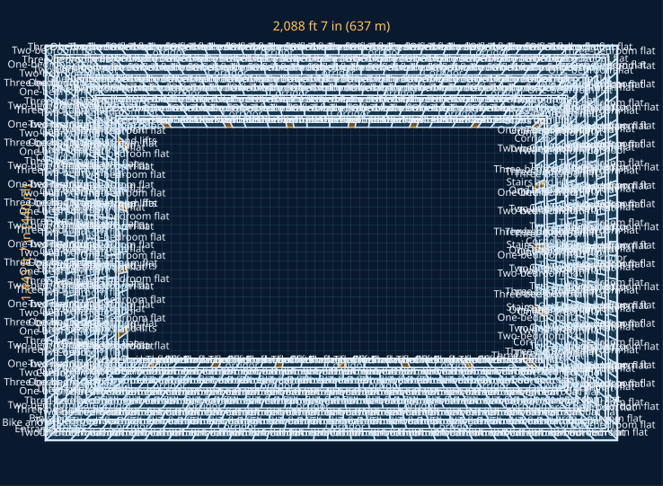
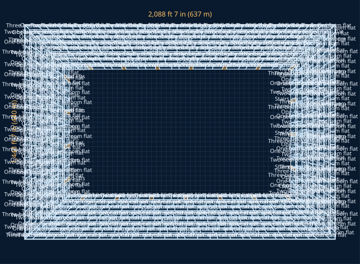

# P6-30 Apartment Block 4: plan

Footprint 2,088 ft 7 in (637 m) × 1,443 ft 7 in (440 m) · structural grid 32 ft 10 in (10 m)

## Levels

| Level | Floor above deck | Height | Floor area |
|---|---|---|---|
| Level 1 · Ground floor | 0 ft (0 mm) | 14 ft 9 in (4,500 mm) | 1,505,047 sq ft (139,823 m²) |
| Level 2 · Flat floor 1 | 14 ft 9 in (4,500 mm) | 10 ft 6 in (3,200 mm) | 1,505,047 sq ft (139,823 m²) |
| Level 3 · Flat floor 2 | 25 ft 3 in (7,700 mm) | 10 ft 6 in (3,200 mm) | 1,505,047 sq ft (139,823 m²) |
| Level 4 · Flat floor 3 | 35 ft 9 in (11 m) | 10 ft 6 in (3,200 mm) | 1,505,047 sq ft (139,823 m²) |
| Level 5 · Flat floor 4 | 46 ft 3 in (14 m) | 10 ft 6 in (3,200 mm) | 1,505,047 sq ft (139,823 m²) |
| Level 6 · Flat floor 5 | 56 ft 9 in (17 m) | 10 ft 6 in (3,200 mm) | 1,505,047 sq ft (139,823 m²) |
| Level 7 · Flat floor 6 | 67 ft 3 in (20 m) | 10 ft 6 in (3,200 mm) | 1,505,047 sq ft (139,823 m²) |

## Elements

| ID | Designation | Type | Name | Level(s) | Size / length | Area | Status |
|---|---|---|---|---|---|---|---|
| E001 | D5F6P6B6A3L1R1 | zone | Corridor | L1 | 9 ft 10 in (3,000 mm) × 400 ft 7 in (122 m) | 3,875 sq ft (360 m²) | proposed |
| E002 | D5F6P6B6A3L1R2 | zone | Corridor | L1 | 9 ft 10 in (3,000 mm) × 396 ft 4 in (121 m) | 3,875 sq ft (360 m²) | proposed |
| E003 | D5F6P6B6A3L1R3 | zone | Corridor | L1 | 9 ft 10 in (3,000 mm) × 398 ft (121 m) | 3,875 sq ft (360 m²) | proposed |
| E004 | D5F6P6B6A3L1R4 | zone | Corridor | L1 | 214 ft 11 in (66 m) × 196 ft 2 in (60 m) | 3,875 sq ft (360 m²) | proposed |
| E005 | D5F6P6B6A3L1R5 | zone | Corridor | L1 | 399 ft 7 in (122 m) × 9 ft 10 in (3,000 mm) | 3,875 sq ft (360 m²) | proposed |
| E006 | D5F6P6B6A3L1R6 | zone | Corridor | L1 | 395 ft 8 in (121 m) × 9 ft 10 in (3,000 mm) | 3,873 sq ft (360 m²) | proposed |
| E007 | D5F6P6B6A3L1R7 | zone | Corridor | L1 | 395 ft 8 in (121 m) × 9 ft 10 in (3,000 mm) | 3,875 sq ft (360 m²) | proposed |
| E008 | D5F6P6B6A3L1R8 | zone | Corridor | L1 | 399 ft 3 in (122 m) × 9 ft 10 in (3,000 mm) | 3,875 sq ft (360 m²) | proposed |
| E009 | D5F6P6B6A3L1R9 | zone | Corridor | L1 | 241 ft 10 in (74 m) × 169 ft 3 in (52 m) | 3,875 sq ft (360 m²) | proposed |
| E010 | D5F6P6B6A3L1R10 | zone | Corridor | L1 | 9 ft 10 in (3,000 mm) × 398 ft 4 in (121 m) | 3,875 sq ft (360 m²) | proposed |
| E011 | D5F6P6B6A3L1R11 | zone | Corridor | L1 | 9 ft 10 in (3,000 mm) × 396 ft 4 in (121 m) | 3,875 sq ft (360 m²) | proposed |
| E012 | D5F6P6B6A3L1R12 | zone | Corridor | L1 | 9 ft 10 in (3,000 mm) × 400 ft 3 in (122 m) | 3,875 sq ft (360 m²) | proposed |
| E013 | D5F6P6B6A3L1R13 | zone | Corridor | L1 | 374 ft 8 in (114 m) × 36 ft 9 in (11 m) | 3,875 sq ft (360 m²) | proposed |
| E014 | D5F6P6B6A3L1R14 | zone | Corridor | L1 | 398 ft (121 m) × 9 ft 10 in (3,000 mm) | 3,875 sq ft (360 m²) | proposed |
| E015 | D5F6P6B6A3L1R15 | zone | Corridor | L1 | 395 ft 4 in (120 m) × 9 ft 10 in (3,000 mm) | 3,873 sq ft (360 m²) | proposed |
| E016 | D5F6P6B6A3L1R16 | zone | Corridor | L1 | 397 ft (121 m) × 9 ft 10 in (3,000 mm) | 3,875 sq ft (360 m²) | proposed |
| E017 | D5F6P6B6A3L1R17 | zone | Corridor | L1 | 400 ft 11 in (122 m) × 9 ft 10 in (3,000 mm) | 3,875 sq ft (360 m²) | proposed |
| E018 | D5F6P6B6A3L1R18 | zone | Corridor | L1 | 82 ft (25 m) × 9 ft 10 in (3,000 mm) | 714 sq ft (66 m²) | proposed |
| E019 | D5F6P6B6A3L1R19 | zone | Corridor | L1 | 9 ft 10 in (3,000 mm) × 400 ft 3 in (122 m) | 3,873 sq ft (360 m²) | proposed |
| E020 | D5F6P6B6A3L1R20 | zone | Corridor | L1 | 9 ft 10 in (3,000 mm) × 397 ft (121 m) | 3,875 sq ft (360 m²) | proposed |
| E021 | D5F6P6B6A3L1R21 | zone | Corridor | L1 | 9 ft 10 in (3,000 mm) × 399 ft 11 in (122 m) | 3,877 sq ft (360 m²) | proposed |
| E022 | D5F6P6B6A3L1R22 | zone | Corridor | L1 | 363 ft 2 in (111 m) × 47 ft 7 in (14 m) | 3,872 sq ft (360 m²) | proposed |
| E023 | D5F6P6B6A3L1R23 | zone | Corridor | L1 | 397 ft 8 in (121 m) × 9 ft 10 in (3,000 mm) | 3,875 sq ft (360 m²) | proposed |
| E024 | D5F6P6B6A3L1R24 | zone | Corridor | L1 | 395 ft 8 in (121 m) × 9 ft 10 in (3,000 mm) | 3,875 sq ft (360 m²) | proposed |
| E025 | D5F6P6B6A3L1R25 | zone | Corridor | L1 | 398 ft (121 m) × 9 ft 10 in (3,000 mm) | 3,875 sq ft (360 m²) | proposed |
| E026 | D5F6P6B6A3L1R26 | zone | Corridor | L1 | 335 ft 11 in (102 m) × 75 ft 2 in (23 m) | 3,873 sq ft (360 m²) | proposed |
| E027 | D5F6P6B6A3L1R27 | zone | Corridor | L1 | 9 ft 10 in (3,000 mm) × 399 ft 3 in (122 m) | 3,875 sq ft (360 m²) | proposed |
| E028 | D5F6P6B6A3L1R28 | zone | Corridor | L1 | 9 ft 10 in (3,000 mm) × 396 ft 8 in (121 m) | 3,873 sq ft (360 m²) | proposed |
| E029 | D5F6P6B6A3L1R29 | zone | Corridor | L1 | 37 ft 1 in (11 m) × 373 ft (114 m) | 3,873 sq ft (360 m²) | proposed |
| E030 | D5F6P6B6A3L1R30 | zone | Corridor | L1 | 401 ft 3 in (122 m) × 9 ft 10 in (3,000 mm) | 3,875 sq ft (360 m²) | proposed |
| E031 | D5F6P6B6A3L1R31 | zone | Corridor | L1 | 397 ft 4 in (121 m) × 9 ft 10 in (3,000 mm) | 3,877 sq ft (360 m²) | proposed |
| E032 | D5F6P6B6A3L1R32 | zone | Corridor | L1 | 395 ft 8 in (121 m) × 9 ft 10 in (3,000 mm) | 3,873 sq ft (360 m²) | proposed |
| E033 | D5F6P6B6A3L1R33 | zone | Corridor | L1 | 398 ft 7 in (122 m) × 9 ft 10 in (3,000 mm) | 3,875 sq ft (360 m²) | proposed |
| E034 | D5F6P6B6A3L1R34 | zone | Corridor | L1 | 270 ft 4 in (82 m) × 9 ft 10 in (3,000 mm) | 2,578 sq ft (240 m²) | proposed |
| E035 | D5F6P6B6A3L1R35 | zone | Corridor | L1 | 9 ft 10 in (3,000 mm) × 399 ft 11 in (122 m) | 3,875 sq ft (360 m²) | proposed |
| E036 | D5F6P6B6A3L1R36 | zone | Corridor | L1 | 9 ft 10 in (3,000 mm) × 397 ft 8 in (121 m) | 3,877 sq ft (360 m²) | proposed |
| E037 | D5F6P6B6A3L1R37 | zone | Corridor | L1 | 120 ft 5 in (37 m) × 290 ft (88 m) | 3,877 sq ft (360 m²) | proposed |
| E038 | D5F6P6B6A3L1R38 | zone | Corridor | L1 | 399 ft 11 in (122 m) × 9 ft 10 in (3,000 mm) | 3,875 sq ft (360 m²) | proposed |
| E039 | D5F6P6B6A3L1R39 | zone | Corridor | L1 | 396 ft (121 m) × 9 ft 10 in (3,000 mm) | 3,877 sq ft (360 m²) | proposed |
| E040 | D5F6P6B6A3L1R40 | zone | Corridor | L1 | 396 ft 4 in (121 m) × 9 ft 10 in (3,000 mm) | 3,875 sq ft (360 m²) | proposed |
| E041 | D5F6P6B6A3L1R41 | zone | Corridor | L1 | 400 ft 11 in (122 m) × 9 ft 10 in (3,000 mm) | 3,875 sq ft (360 m²) | proposed |
| E042 | D5F6P6B6A3L1R42 | zone | Corridor | L1 | 38 ft 9 in (12 m) × 371 ft 5 in (113 m) | 3,877 sq ft (360 m²) | proposed |
| E043 | D5F6P6B6A3L1R43 | zone | Corridor | L1 | 9 ft 10 in (3,000 mm) × 397 ft 4 in (121 m) | 3,875 sq ft (360 m²) | proposed |
| E044 | D5F6P6B6A3L1R44 | zone | Corridor | L1 | 91 ft 10 in (28 m) × 318 ft 7 in (97 m) | 3,880 sq ft (360 m²) | proposed |
| E045 | D5F6P6B6A3L1R45 | zone | Corridor | L1 | 400 ft 3 in (122 m) × 9 ft 10 in (3,000 mm) | 3,873 sq ft (360 m²) | proposed |
| E046 | D5F6P6B6A3L1R46 | zone | Corridor | L1 | 396 ft (121 m) × 9 ft 10 in (3,000 mm) | 3,875 sq ft (360 m²) | proposed |
| E047 | D5F6P6B6A3L1R47 | zone | Corridor | L1 | 396 ft (121 m) × 9 ft 10 in (3,000 mm) | 3,875 sq ft (360 m²) | proposed |
| E048 | D5F6P6B6A3L1R48 | zone | Corridor | L1 | 400 ft 7 in (122 m) × 9 ft 10 in (3,000 mm) | 3,875 sq ft (360 m²) | proposed |
| E049 | D5F6P6B6A3L1R49 | zone | Corridor | L1 | 67 ft 7 in (21 m) × 9 ft 10 in (3,000 mm) | 572 sq ft (53 m²) | proposed |
| E050 | D5F6P6B6A3L1R50 | zone | Corridor | L1 | 9 ft 10 in (3,000 mm) × 399 ft 3 in (122 m) | 3,875 sq ft (360 m²) | proposed |
| E051 | D5F6P6B6A3L1R51 | zone | Corridor | L1 | 9 ft 10 in (3,000 mm) × 398 ft (121 m) | 3,877 sq ft (360 m²) | proposed |
| E052 | D5F6P6B6A3L1R52 | zone | Corridor | L1 | 269 ft (82 m) × 141 ft 5 in (43 m) | 3,877 sq ft (360 m²) | proposed |
| E053 | D5F6P6B6A3L1R53 | zone | Corridor | L1 | 397 ft 8 in (121 m) × 9 ft 10 in (3,000 mm) | 3,873 sq ft (360 m²) | proposed |
| E054 | D5F6P6B6A3L1R54 | zone | Corridor | L1 | 396 ft 4 in (121 m) × 9 ft 10 in (3,000 mm) | 3,877 sq ft (360 m²) | proposed |
| E055 | D5F6P6B6A3L1R55 | zone | Corridor | L1 | 399 ft 3 in (122 m) × 9 ft 10 in (3,000 mm) | 3,873 sq ft (360 m²) | proposed |
| E056 | D5F6P6B6A3L1R56 | zone | Corridor | L1 | 132 ft 10 in (40 m) × 276 ft 11 in (84 m) | 3,877 sq ft (360 m²) | proposed |
| E057 | D5F6P6B6A3L1R57 | zone | Corridor | L1 | 9 ft 10 in (3,000 mm) × 398 ft (121 m) | 3,875 sq ft (360 m²) | proposed |
| E058 | D5F6P6B6A3L1R58 | zone | Corridor | L1 | 146 ft (44 m) × 264 ft 1 in (80 m) | 3,877 sq ft (360 m²) | proposed |
| E059 | D5F6P6B6A3L1R59 | zone | Corridor | L1 | 399 ft 3 in (122 m) × 9 ft 10 in (3,000 mm) | 3,875 sq ft (360 m²) | proposed |
| E060 | D5F6P6B6A3L1R60 | zone | Corridor | L1 | 396 ft (121 m) × 9 ft 10 in (3,000 mm) | 3,875 sq ft (360 m²) | proposed |
| E061 | D5F6P6B6A3L1R61 | zone | Corridor | L1 | 398 ft (121 m) × 9 ft 10 in (3,000 mm) | 3,875 sq ft (360 m²) | proposed |
| E062 | D5F6P6B6A3L1R62 | zone | Corridor | L1 | 255 ft 11 in (78 m) × 9 ft 10 in (3,000 mm) | 2,436 sq ft (226 m²) | proposed |
| E063 | D5F6P6B6A3L1R63, D5F6P6B6A3L2R1, D5F6P6B6A3L3R1, D5F6P6B6A3L4R1, D5F6P6B6A3L5R1, D5F6P6B6A3L6R1, D5F6P6B6A3L7R1 | core | Stairs and lifts | L1, L2, L3, L4, L5, L6, L7 | 32 ft 6 in (9,900 mm) × 50 ft 2 in (15 m) | 853 sq ft (79 m²) | proposed |
| E064 | D5F6P6B6A3L1R64, D5F6P6B6A3L2R2, D5F6P6B6A3L3R2, D5F6P6B6A3L4R2, D5F6P6B6A3L5R2, D5F6P6B6A3L6R2, D5F6P6B6A3L7R2 | core | Stairs and lifts | L1, L2, L3, L4, L5, L6, L7 | 32 ft 6 in (9,900 mm) × 33 ft 6 in (10 m) | 853 sq ft (79 m²) | proposed |
| E065 | D5F6P6B6A3L1R65, D5F6P6B6A3L2R3, D5F6P6B6A3L3R3, D5F6P6B6A3L4R3, D5F6P6B6A3L5R3, D5F6P6B6A3L6R3, D5F6P6B6A3L7R3 | core | Stairs and lifts | L1, L2, L3, L4, L5, L6, L7 | 32 ft 6 in (9,900 mm) × 36 ft 1 in (11 m) | 853 sq ft (79 m²) | proposed |
| E066 | D5F6P6B6A3L1R66, D5F6P6B6A3L2R4, D5F6P6B6A3L3R4, D5F6P6B6A3L4R4, D5F6P6B6A3L5R4, D5F6P6B6A3L6R4, D5F6P6B6A3L7R4 | core | Stairs and lifts | L1, L2, L3, L4, L5, L6, L7 | 32 ft 6 in (9,900 mm) × 53 ft 2 in (16 m) | 853 sq ft (79 m²) | proposed |
| E067 | D5F6P6B6A3L1R67, D5F6P6B6A3L2R5, D5F6P6B6A3L3R5, D5F6P6B6A3L4R5, D5F6P6B6A3L5R5, D5F6P6B6A3L6R5, D5F6P6B6A3L7R5 | core | Stairs and lifts | L1, L2, L3, L4, L5, L6, L7 | 52 ft 6 in (16 m) × 32 ft 6 in (9,900 mm) | 858 sq ft (80 m²) | proposed |
| E068 | D5F6P6B6A3L1R68, D5F6P6B6A3L2R6, D5F6P6B6A3L3R6, D5F6P6B6A3L4R6, D5F6P6B6A3L5R6, D5F6P6B6A3L6R6, D5F6P6B6A3L7R6 | core | Stairs and lifts | L1, L2, L3, L4, L5, L6, L7 | 42 ft 8 in (13 m) × 32 ft 6 in (9,900 mm) | 853 sq ft (79 m²) | proposed |
| E069 | D5F6P6B6A3L1R69, D5F6P6B6A3L2R7, D5F6P6B6A3L3R7, D5F6P6B6A3L4R7, D5F6P6B6A3L5R7, D5F6P6B6A3L6R7, D5F6P6B6A3L7R7 | core | Stairs and lifts | L1, L2, L3, L4, L5, L6, L7 | 32 ft 10 in (10 m) × 32 ft 6 in (9,900 mm) | 853 sq ft (79 m²) | proposed |
| E070 | D5F6P6B6A3L1R70, D5F6P6B6A3L2R8, D5F6P6B6A3L3R8, D5F6P6B6A3L4R8, D5F6P6B6A3L5R8, D5F6P6B6A3L6R8, D5F6P6B6A3L7R8 | core | Stairs and lifts | L1, L2, L3, L4, L5, L6, L7 | 29 ft 6 in (9,000 mm) × 32 ft 6 in (9,900 mm) | 853 sq ft (79 m²) | proposed |
| E071 | D5F6P6B6A3L1R71, D5F6P6B6A3L2R9, D5F6P6B6A3L3R9, D5F6P6B6A3L4R9, D5F6P6B6A3L5R9, D5F6P6B6A3L6R9, D5F6P6B6A3L7R9 | core | Stairs and lifts | L1, L2, L3, L4, L5, L6, L7 | 39 ft 4 in (12 m) × 32 ft 6 in (9,900 mm) | 858 sq ft (80 m²) | proposed |
| E072 | D5F6P6B6A3L1R72, D5F6P6B6A3L2R10, D5F6P6B6A3L3R10, D5F6P6B6A3L4R10, D5F6P6B6A3L5R10, D5F6P6B6A3L6R10, D5F6P6B6A3L7R10 | core | Stairs and lifts | L1, L2, L3, L4, L5, L6, L7 | 48 ft 11 in (15 m) × 32 ft 6 in (9,900 mm) | 853 sq ft (79 m²) | proposed |
| E073 | D5F6P6B6A3L1R73, D5F6P6B6A3L2R11, D5F6P6B6A3L3R11, D5F6P6B6A3L4R11, D5F6P6B6A3L5R11, D5F6P6B6A3L6R11, D5F6P6B6A3L7R11 | core | Stairs and lifts | L1, L2, L3, L4, L5, L6, L7 | 45 ft 3 in (14 m) × 45 ft 3 in (14 m) | 858 sq ft (80 m²) | proposed |
| E074 | D5F6P6B6A3L1R74, D5F6P6B6A3L2R12, D5F6P6B6A3L3R12, D5F6P6B6A3L4R12, D5F6P6B6A3L5R12, D5F6P6B6A3L6R12, D5F6P6B6A3L7R12 | core | Stairs and lifts | L1, L2, L3, L4, L5, L6, L7 | 32 ft 6 in (9,900 mm) × 41 ft 8 in (13 m) | 853 sq ft (79 m²) | proposed |
| E075 | D5F6P6B6A3L1R75, D5F6P6B6A3L2R13, D5F6P6B6A3L3R13, D5F6P6B6A3L4R13, D5F6P6B6A3L5R13, D5F6P6B6A3L6R13, D5F6P6B6A3L7R13 | core | Stairs and lifts | L1, L2, L3, L4, L5, L6, L7 | 32 ft 6 in (9,900 mm) × 27 ft 7 in (8,400 mm) | 853 sq ft (79 m²) | proposed |
| E076 | D5F6P6B6A3L1R76, D5F6P6B6A3L2R14, D5F6P6B6A3L3R14, D5F6P6B6A3L4R14, D5F6P6B6A3L5R14, D5F6P6B6A3L6R14, D5F6P6B6A3L7R14 | core | Stairs and lifts | L1, L2, L3, L4, L5, L6, L7 | 32 ft 6 in (9,900 mm) × 44 ft 3 in (14 m) | 853 sq ft (79 m²) | proposed |
| E077 | D5F6P6B6A3L1R77, D5F6P6B6A3L2R15, D5F6P6B6A3L3R15, D5F6P6B6A3L4R15, D5F6P6B6A3L5R15, D5F6P6B6A3L6R15, D5F6P6B6A3L7R15 | core | Stairs and lifts | L1, L2, L3, L4, L5, L6, L7 | 57 ft 5 in (18 m) × 32 ft 6 in (9,900 mm) | 858 sq ft (80 m²) | proposed |
| E078 | D5F6P6B6A3L1R78, D5F6P6B6A3L2R16, D5F6P6B6A3L3R16, D5F6P6B6A3L4R16, D5F6P6B6A3L5R16, D5F6P6B6A3L6R16, D5F6P6B6A3L7R16 | core | Stairs and lifts | L1, L2, L3, L4, L5, L6, L7 | 47 ft 7 in (14 m) × 32 ft 6 in (9,900 mm) | 858 sq ft (80 m²) | proposed |
| E079 | D5F6P6B6A3L1R79, D5F6P6B6A3L2R17, D5F6P6B6A3L3R17, D5F6P6B6A3L4R17, D5F6P6B6A3L5R17, D5F6P6B6A3L6R17, D5F6P6B6A3L7R17 | core | Stairs and lifts | L1, L2, L3, L4, L5, L6, L7 | 37 ft 9 in (12 m) × 32 ft 6 in (9,900 mm) | 853 sq ft (79 m²) | proposed |
| E080 | D5F6P6B6A3L1R80, D5F6P6B6A3L2R18, D5F6P6B6A3L3R18, D5F6P6B6A3L4R18, D5F6P6B6A3L5R18, D5F6P6B6A3L6R18, D5F6P6B6A3L7R18 | core | Stairs and lifts | L1, L2, L3, L4, L5, L6, L7 | 27 ft 11 in (8,500 mm) × 32 ft 6 in (9,900 mm) | 853 sq ft (79 m²) | proposed |
| E081 | D5F6P6B6A3L1R81, D5F6P6B6A3L2R19, D5F6P6B6A3L3R19, D5F6P6B6A3L4R19, D5F6P6B6A3L5R19, D5F6P6B6A3L6R19, D5F6P6B6A3L7R19 | core | Stairs and lifts | L1, L2, L3, L4, L5, L6, L7 | 34 ft 5 in (11 m) × 32 ft 6 in (9,900 mm) | 853 sq ft (79 m²) | proposed |
| E082 | D5F6P6B6A3L1R82, D5F6P6B6A3L2R20, D5F6P6B6A3L3R20, D5F6P6B6A3L4R20, D5F6P6B6A3L5R20, D5F6P6B6A3L6R20, D5F6P6B6A3L7R20 | core | Stairs and lifts | L1, L2, L3, L4, L5, L6, L7 | 44 ft 3 in (14 m) × 32 ft 6 in (9,900 mm) | 858 sq ft (80 m²) | proposed |
| E083 | D5F6P6B6A3L1R83, D5F6P6B6A3L2R21, D5F6P6B6A3L3R21, D5F6P6B6A3L4R21, D5F6P6B6A3L5R21, D5F6P6B6A3L6R21, D5F6P6B6A3L7R21 | core | Stairs and lifts | L1, L2, L3, L4, L5, L6, L7 | 53 ft 10 in (16 m) × 32 ft 6 in (9,900 mm) | 853 sq ft (79 m²) | proposed |
| E084 | D5F6P6B6A3L1R84 | room | Entrance lobby | L1 | 32 ft 6 in (9,900 mm) × 58 ft 5 in (18 m) | 863 sq ft (80 m²) | proposed |
| E085 | D5F6P6B6A3L1R85 | room | Bike and pram store | L1 | 32 ft 6 in (9,900 mm) × 50 ft 6 in (15 m) | 645 sq ft (60 m²) | proposed |
| E086 | D5F6P6B6A3L1R86 | room | Bin store | L1 | 32 ft 6 in (9,900 mm) × 41 ft 4 in (13 m) | 368 sq ft (34 m²) | proposed |
| E087 | D5F6P6B6A3L1R87 | room | Two-bedroom flat | L1 | 32 ft 6 in (9,900 mm) × 112 ft 6 in (34 m) | 2,749 sq ft (255 m²) | proposed |
| E088 | D5F6P6B6A3L1R88 | room | Three-bedroom flat | L1 | 32 ft 6 in (9,900 mm) × 108 ft 7 in (33 m) | 2,749 sq ft (255 m²) | proposed |
| E089 | D5F6P6B6A3L1R89 | room | One-bedroom flat | L1 | 32 ft 6 in (9,900 mm) × 70 ft 6 in (22 m) | 1,614 sq ft (150 m²) | proposed |
| E090 | D5F6P6B6A3L1R90 | room | Two-bedroom flat | L1 | 32 ft 6 in (9,900 mm) × 102 ft 4 in (31 m) | 2,749 sq ft (255 m²) | proposed |
| E091 | D5F6P6B6A3L1R91 | room | Three-bedroom flat | L1 | 32 ft 6 in (9,900 mm) × 98 ft 5 in (30 m) | 2,749 sq ft (255 m²) | proposed |
| E092 | D5F6P6B6A3L1R92 | room | One-bedroom flat | L1 | 32 ft 6 in (9,900 mm) × 60 ft 4 in (18 m) | 1,614 sq ft (150 m²) | proposed |
| E093 | D5F6P6B6A3L1R93 | room | Two-bedroom flat | L1 | 32 ft 6 in (9,900 mm) × 92 ft 2 in (28 m) | 2,749 sq ft (255 m²) | proposed |
| E094 | D5F6P6B6A3L1R94 | room | Three-bedroom flat | L1 | 32 ft 6 in (9,900 mm) × 88 ft 3 in (27 m) | 2,744 sq ft (255 m²) | proposed |
| E095 | D5F6P6B6A3L1R95 | room | One-bedroom flat | L1 | 32 ft 6 in (9,900 mm) × 51 ft 2 in (16 m) | 1,620 sq ft (150 m²) | proposed |
| E096 | D5F6P6B6A3L1R96 | room | Two-bedroom flat | L1 | 32 ft 6 in (9,900 mm) × 86 ft 11 in (26 m) | 2,744 sq ft (255 m²) | proposed |
| E097 | D5F6P6B6A3L1R97 | room | Three-bedroom flat | L1 | 32 ft 6 in (9,900 mm) × 90 ft 11 in (28 m) | 2,749 sq ft (255 m²) | proposed |
| E098 | D5F6P6B6A3L1R98 | room | One-bedroom flat | L1 | 32 ft 6 in (9,900 mm) × 59 ft 1 in (18 m) | 1,614 sq ft (150 m²) | proposed |
| E099 | D5F6P6B6A3L1R99 | room | Two-bedroom flat | L1 | 32 ft 6 in (9,900 mm) × 97 ft 1 in (30 m) | 2,749 sq ft (255 m²) | proposed |
| E100 | D5F6P6B6A3L1R100 | room | Three-bedroom flat | L1 | 32 ft 6 in (9,900 mm) × 101 ft 1 in (31 m) | 2,749 sq ft (255 m²) | proposed |
| E101 | D5F6P6B6A3L1R101 | room | One-bedroom flat | L1 | 32 ft 6 in (9,900 mm) × 69 ft 3 in (21 m) | 1,614 sq ft (150 m²) | proposed |
| E102 | D5F6P6B6A3L1R102 | room | Two-bedroom flat | L1 | 32 ft 6 in (9,900 mm) × 107 ft 3 in (33 m) | 2,749 sq ft (255 m²) | proposed |
| E103 | D5F6P6B6A3L1R103 | room | Three-bedroom flat | L1 | 32 ft 6 in (9,900 mm) × 111 ft 3 in (34 m) | 2,749 sq ft (255 m²) | proposed |
| E104 | D5F6P6B6A3L1R104 | room | One-bedroom flat | L1 | 32 ft 6 in (9,900 mm) × 79 ft 5 in (24 m) | 1,620 sq ft (150 m²) | proposed |
| E105 | D5F6P6B6A3L1R105 | room | Two-bedroom flat | L1 | 76 ft 9 in (23 m) × 70 ft 10 in (22 m) | 2,744 sq ft (255 m²) | proposed |
| E106 | D5F6P6B6A3L1R106 | room | Three-bedroom flat | L1 | 114 ft 2 in (35 m) × 32 ft 6 in (9,900 mm) | 2,749 sq ft (255 m²) | proposed |
| E107 | D5F6P6B6A3L1R107 | room | One-bedroom flat | L1 | 77 ft 1 in (24 m) × 32 ft 6 in (9,900 mm) | 1,614 sq ft (150 m²) | proposed |
| E108 | D5F6P6B6A3L1R108 | room | Two-bedroom flat | L1 | 109 ft 11 in (33 m) × 32 ft 6 in (9,900 mm) | 2,749 sq ft (255 m²) | proposed |
| E109 | D5F6P6B6A3L1R109 | room | Three-bedroom flat | L1 | 107 ft 3 in (33 m) × 32 ft 6 in (9,900 mm) | 2,749 sq ft (255 m²) | proposed |
| E110 | D5F6P6B6A3L1R110 | room | One-bedroom flat | L1 | 70 ft 3 in (21 m) × 32 ft 6 in (9,900 mm) | 1,614 sq ft (150 m²) | proposed |
| E111 | D5F6P6B6A3L1R111 | room | Two-bedroom flat | L1 | 103 ft (31 m) × 32 ft 6 in (9,900 mm) | 2,749 sq ft (255 m²) | proposed |
| E112 | D5F6P6B6A3L1R112 | room | Three-bedroom flat | L1 | 100 ft 5 in (31 m) × 32 ft 6 in (9,900 mm) | 2,749 sq ft (255 m²) | proposed |
| E113 | D5F6P6B6A3L1R113 | room | One-bedroom flat | L1 | 63 ft 4 in (19 m) × 32 ft 6 in (9,900 mm) | 1,614 sq ft (150 m²) | proposed |
| E114 | D5F6P6B6A3L1R114 | room | Two-bedroom flat | L1 | 96 ft 2 in (29 m) × 32 ft 6 in (9,900 mm) | 2,749 sq ft (255 m²) | proposed |
| E115 | D5F6P6B6A3L1R115 | room | Three-bedroom flat | L1 | 93 ft 6 in (28 m) × 32 ft 6 in (9,900 mm) | 2,744 sq ft (255 m²) | proposed |
| E116 | D5F6P6B6A3L1R116 | room | One-bedroom flat | L1 | 56 ft 9 in (17 m) × 32 ft 6 in (9,900 mm) | 1,620 sq ft (150 m²) | proposed |
| E117 | D5F6P6B6A3L1R117 | room | Two-bedroom flat | L1 | 89 ft 3 in (27 m) × 32 ft 6 in (9,900 mm) | 2,744 sq ft (255 m²) | proposed |
| E118 | D5F6P6B6A3L1R118 | room | Three-bedroom flat | L1 | 86 ft 11 in (26 m) × 32 ft 6 in (9,900 mm) | 2,749 sq ft (255 m²) | proposed |
| E119 | D5F6P6B6A3L1R119 | room | One-bedroom flat | L1 | 50 ft 10 in (16 m) × 32 ft 6 in (9,900 mm) | 1,620 sq ft (150 m²) | proposed |
| E120 | D5F6P6B6A3L1R120 | room | Two-bedroom flat | L1 | 86 ft 7 in (26 m) × 32 ft 6 in (9,900 mm) | 2,744 sq ft (255 m²) | proposed |
| E121 | D5F6P6B6A3L1R121 | room | Three-bedroom flat | L1 | 89 ft 3 in (27 m) × 32 ft 6 in (9,900 mm) | 2,744 sq ft (255 m²) | proposed |
| E122 | D5F6P6B6A3L1R122 | room | One-bedroom flat | L1 | 56 ft 9 in (17 m) × 32 ft 6 in (9,900 mm) | 1,620 sq ft (150 m²) | proposed |
| E123 | D5F6P6B6A3L1R123 | room | Two-bedroom flat | L1 | 93 ft 6 in (28 m) × 32 ft 6 in (9,900 mm) | 2,749 sq ft (255 m²) | proposed |
| E124 | D5F6P6B6A3L1R124 | room | Three-bedroom flat | L1 | 96 ft 2 in (29 m) × 32 ft 6 in (9,900 mm) | 2,744 sq ft (255 m²) | proposed |
| E125 | D5F6P6B6A3L1R125 | room | One-bedroom flat | L1 | 63 ft 8 in (19 m) × 32 ft 6 in (9,900 mm) | 1,620 sq ft (150 m²) | proposed |
| E126 | D5F6P6B6A3L1R126 | room | Two-bedroom flat | L1 | 100 ft 5 in (31 m) × 32 ft 6 in (9,900 mm) | 2,744 sq ft (255 m²) | proposed |
| E127 | D5F6P6B6A3L1R127 | room | Three-bedroom flat | L1 | 103 ft 4 in (32 m) × 32 ft 6 in (9,900 mm) | 2,749 sq ft (255 m²) | proposed |
| E128 | D5F6P6B6A3L1R128 | room | One-bedroom flat | L1 | 70 ft 6 in (22 m) × 32 ft 6 in (9,900 mm) | 1,620 sq ft (150 m²) | proposed |
| E129 | D5F6P6B6A3L1R129 | room | Two-bedroom flat | L1 | 107 ft 3 in (33 m) × 32 ft 6 in (9,900 mm) | 2,744 sq ft (255 m²) | proposed |
| E130 | D5F6P6B6A3L1R130 | room | Three-bedroom flat | L1 | 110 ft 3 in (34 m) × 32 ft 6 in (9,900 mm) | 2,749 sq ft (255 m²) | proposed |
| E131 | D5F6P6B6A3L1R131 | room | One-bedroom flat | L1 | 77 ft 5 in (24 m) × 32 ft 6 in (9,900 mm) | 1,614 sq ft (150 m²) | proposed |
| E132 | D5F6P6B6A3L1R132 | room | Two-bedroom flat | L1 | 114 ft 6 in (35 m) × 32 ft 6 in (9,900 mm) | 2,749 sq ft (255 m²) | proposed |
| E133 | D5F6P6B6A3L1R133 | room | Three-bedroom flat | L1 | 72 ft 2 in (22 m) × 75 ft 9 in (23 m) | 2,749 sq ft (255 m²) | proposed |
| E134 | D5F6P6B6A3L1R134 | room | One-bedroom flat | L1 | 32 ft 6 in (9,900 mm) × 79 ft 1 in (24 m) | 1,614 sq ft (150 m²) | proposed |
| E135 | D5F6P6B6A3L1R135 | room | Two-bedroom flat | L1 | 32 ft 6 in (9,900 mm) × 110 ft 11 in (34 m) | 2,749 sq ft (255 m²) | proposed |
| E136 | D5F6P6B6A3L1R136 | room | Three-bedroom flat | L1 | 32 ft 6 in (9,900 mm) × 106 ft 11 in (33 m) | 2,749 sq ft (255 m²) | proposed |
| E137 | D5F6P6B6A3L1R137 | room | One-bedroom flat | L1 | 32 ft 6 in (9,900 mm) × 68 ft 11 in (21 m) | 1,614 sq ft (150 m²) | proposed |
| E138 | D5F6P6B6A3L1R138 | room | Two-bedroom flat | L1 | 32 ft 6 in (9,900 mm) × 100 ft 9 in (31 m) | 2,749 sq ft (255 m²) | proposed |
| E139 | D5F6P6B6A3L1R139 | room | Three-bedroom flat | L1 | 32 ft 6 in (9,900 mm) × 96 ft 9 in (30 m) | 2,749 sq ft (255 m²) | proposed |
| E140 | D5F6P6B6A3L1R140 | room | One-bedroom flat | L1 | 32 ft 6 in (9,900 mm) × 58 ft 9 in (18 m) | 1,614 sq ft (150 m²) | proposed |
| E141 | D5F6P6B6A3L1R141 | room | Two-bedroom flat | L1 | 32 ft 6 in (9,900 mm) × 90 ft 7 in (28 m) | 2,749 sq ft (255 m²) | proposed |
| E142 | D5F6P6B6A3L1R142 | room | Three-bedroom flat | L1 | 32 ft 6 in (9,900 mm) × 86 ft 7 in (26 m) | 2,744 sq ft (255 m²) | proposed |
| E143 | D5F6P6B6A3L1R143 | room | One-bedroom flat | L1 | 32 ft 6 in (9,900 mm) × 51 ft 2 in (16 m) | 1,620 sq ft (150 m²) | proposed |
| E144 | D5F6P6B6A3L1R144 | room | Two-bedroom flat | L1 | 32 ft 6 in (9,900 mm) × 88 ft 7 in (27 m) | 2,744 sq ft (255 m²) | proposed |
| E145 | D5F6P6B6A3L1R145 | room | Three-bedroom flat | L1 | 32 ft 6 in (9,900 mm) × 92 ft 6 in (28 m) | 2,749 sq ft (255 m²) | proposed |
| E146 | D5F6P6B6A3L1R146 | room | One-bedroom flat | L1 | 32 ft 6 in (9,900 mm) × 60 ft 8 in (18 m) | 1,614 sq ft (150 m²) | proposed |
| E147 | D5F6P6B6A3L1R147 | room | Two-bedroom flat | L1 | 32 ft 6 in (9,900 mm) × 98 ft 9 in (30 m) | 2,749 sq ft (255 m²) | proposed |
| E148 | D5F6P6B6A3L1R148 | room | Three-bedroom flat | L1 | 32 ft 6 in (9,900 mm) × 102 ft 8 in (31 m) | 2,749 sq ft (255 m²) | proposed |
| E149 | D5F6P6B6A3L1R149 | room | One-bedroom flat | L1 | 32 ft 6 in (9,900 mm) × 70 ft 10 in (22 m) | 1,614 sq ft (150 m²) | proposed |
| E150 | D5F6P6B6A3L1R150 | room | Two-bedroom flat | L1 | 32 ft 6 in (9,900 mm) × 108 ft 11 in (33 m) | 2,749 sq ft (255 m²) | proposed |
| E151 | D5F6P6B6A3L1R151 | room | Three-bedroom flat | L1 | 32 ft 6 in (9,900 mm) × 112 ft 10 in (34 m) | 2,749 sq ft (255 m²) | proposed |
| E152 | D5F6P6B6A3L1R152 | room | One-bedroom flat | L1 | 32 ft 6 in (9,900 mm) × 81 ft (25 m) | 1,620 sq ft (150 m²) | proposed |
| E153 | D5F6P6B6A3L1R153 | room | Two-bedroom flat | L1 | 112 ft 6 in (34 m) × 35 ft 5 in (11 m) | 2,744 sq ft (255 m²) | proposed |
| E154 | D5F6P6B6A3L1R154 | room | Three-bedroom flat | L1 | 113 ft 2 in (34 m) × 32 ft 6 in (9,900 mm) | 2,749 sq ft (255 m²) | proposed |
| E155 | D5F6P6B6A3L1R155 | room | One-bedroom flat | L1 | 76 ft 1 in (23 m) × 32 ft 6 in (9,900 mm) | 1,614 sq ft (150 m²) | proposed |
| E156 | D5F6P6B6A3L1R156 | room | Two-bedroom flat | L1 | 108 ft 11 in (33 m) × 32 ft 6 in (9,900 mm) | 2,749 sq ft (255 m²) | proposed |
| E157 | D5F6P6B6A3L1R157 | room | Three-bedroom flat | L1 | 106 ft 4 in (32 m) × 32 ft 6 in (9,900 mm) | 2,749 sq ft (255 m²) | proposed |
| E158 | D5F6P6B6A3L1R158 | room | One-bedroom flat | L1 | 69 ft 3 in (21 m) × 32 ft 6 in (9,900 mm) | 1,614 sq ft (150 m²) | proposed |
| E159 | D5F6P6B6A3L1R159 | room | Two-bedroom flat | L1 | 102 ft (31 m) × 32 ft 6 in (9,900 mm) | 2,749 sq ft (255 m²) | proposed |
| E160 | D5F6P6B6A3L1R160 | room | Three-bedroom flat | L1 | 99 ft 5 in (30 m) × 32 ft 6 in (9,900 mm) | 2,749 sq ft (255 m²) | proposed |
| E161 | D5F6P6B6A3L1R161 | room | One-bedroom flat | L1 | 62 ft 4 in (19 m) × 32 ft 6 in (9,900 mm) | 1,614 sq ft (150 m²) | proposed |
| E162 | D5F6P6B6A3L1R162 | room | Two-bedroom flat | L1 | 95 ft 2 in (29 m) × 32 ft 6 in (9,900 mm) | 2,749 sq ft (255 m²) | proposed |
| E163 | D5F6P6B6A3L1R163 | room | Three-bedroom flat | L1 | 92 ft 6 in (28 m) × 32 ft 6 in (9,900 mm) | 2,749 sq ft (255 m²) | proposed |
| E164 | D5F6P6B6A3L1R164 | room | One-bedroom flat | L1 | 55 ft 5 in (17 m) × 32 ft 6 in (9,900 mm) | 1,614 sq ft (150 m²) | proposed |
| E165 | D5F6P6B6A3L1R165 | room | Two-bedroom flat | L1 | 88 ft 3 in (27 m) × 32 ft 6 in (9,900 mm) | 2,749 sq ft (255 m²) | proposed |
| E166 | D5F6P6B6A3L1R166 | room | Three-bedroom flat | L1 | 85 ft 11 in (26 m) × 32 ft 6 in (9,900 mm) | 2,744 sq ft (255 m²) | proposed |
| E167 | D5F6P6B6A3L1R167 | room | One-bedroom flat | L1 | 51 ft 2 in (16 m) × 32 ft 6 in (9,900 mm) | 1,620 sq ft (150 m²) | proposed |
| E168 | D5F6P6B6A3L1R168 | room | Two-bedroom flat | L1 | 87 ft 11 in (27 m) × 32 ft 6 in (9,900 mm) | 2,749 sq ft (255 m²) | proposed |
| E169 | D5F6P6B6A3L1R169 | room | Three-bedroom flat | L1 | 90 ft 7 in (28 m) × 32 ft 6 in (9,900 mm) | 2,744 sq ft (255 m²) | proposed |
| E170 | D5F6P6B6A3L1R170 | room | One-bedroom flat | L1 | 58 ft 1 in (18 m) × 32 ft 6 in (9,900 mm) | 1,620 sq ft (150 m²) | proposed |
| E171 | D5F6P6B6A3L1R171 | room | Two-bedroom flat | L1 | 94 ft 10 in (29 m) × 32 ft 6 in (9,900 mm) | 2,744 sq ft (255 m²) | proposed |
| E172 | D5F6P6B6A3L1R172 | room | Three-bedroom flat | L1 | 97 ft 9 in (30 m) × 32 ft 6 in (9,900 mm) | 2,749 sq ft (255 m²) | proposed |
| E173 | D5F6P6B6A3L1R173 | room | One-bedroom flat | L1 | 65 ft (20 m) × 32 ft 6 in (9,900 mm) | 1,614 sq ft (150 m²) | proposed |
| E174 | D5F6P6B6A3L1R174 | room | Two-bedroom flat | L1 | 102 ft (31 m) × 32 ft 6 in (9,900 mm) | 2,749 sq ft (255 m²) | proposed |
| E175 | D5F6P6B6A3L1R175 | room | Three-bedroom flat | L1 | 104 ft 8 in (32 m) × 32 ft 6 in (9,900 mm) | 2,749 sq ft (255 m²) | proposed |
| E176 | D5F6P6B6A3L1R176 | room | One-bedroom flat | L1 | 71 ft 10 in (22 m) × 32 ft 6 in (9,900 mm) | 1,614 sq ft (150 m²) | proposed |
| E177 | D5F6P6B6A3L1R177 | room | Two-bedroom flat | L1 | 108 ft 11 in (33 m) × 32 ft 6 in (9,900 mm) | 2,749 sq ft (255 m²) | proposed |
| E178 | D5F6P6B6A3L1R178 | room | Three-bedroom flat | L1 | 111 ft 7 in (34 m) × 32 ft 6 in (9,900 mm) | 2,749 sq ft (255 m²) | proposed |
| E179 | D5F6P6B6A3L1R179 | room | One-bedroom flat | L1 | 78 ft 9 in (24 m) × 32 ft 6 in (9,900 mm) | 1,614 sq ft (150 m²) | proposed |
| E180 | D5F6P6B6A3L1R180 | room | Two-bedroom flat | L1 | 119 ft 9 in (36 m) × 32 ft 6 in (9,900 mm) | 2,877 sq ft (267 m²) | proposed |
| E181 | D5F6P6B6A3L1R181 | room | Three-bedroom flat | L1 | 32 ft 6 in (9,900 mm) × 114 ft 10 in (35 m) | 2,744 sq ft (255 m²) | proposed |
| E182 | D5F6P6B6A3L1R182 | room | One-bedroom flat | L1 | 32 ft 6 in (9,900 mm) × 76 ft 9 in (23 m) | 1,614 sq ft (150 m²) | proposed |
| E183 | D5F6P6B6A3L1R183 | room | Two-bedroom flat | L1 | 32 ft 6 in (9,900 mm) × 108 ft 7 in (33 m) | 2,755 sq ft (256 m²) | proposed |
| E184 | D5F6P6B6A3L1R184 | room | Three-bedroom flat | L1 | 32 ft 6 in (9,900 mm) × 104 ft (32 m) | 2,744 sq ft (255 m²) | proposed |
| E185 | D5F6P6B6A3L1R185 | room | One-bedroom flat | L1 | 32 ft 6 in (9,900 mm) × 65 ft 11 in (20 m) | 1,614 sq ft (150 m²) | proposed |
| E186 | D5F6P6B6A3L1R186 | room | Two-bedroom flat | L1 | 32 ft 6 in (9,900 mm) × 97 ft 9 in (30 m) | 2,749 sq ft (255 m²) | proposed |
| E187 | D5F6P6B6A3L1R187 | room | Three-bedroom flat | L1 | 32 ft 6 in (9,900 mm) × 93 ft 10 in (29 m) | 2,755 sq ft (256 m²) | proposed |
| E188 | D5F6P6B6A3L1R188 | room | One-bedroom flat | L1 | 32 ft 6 in (9,900 mm) × 55 ft 5 in (17 m) | 1,614 sq ft (150 m²) | proposed |
| E189 | D5F6P6B6A3L1R189 | room | Two-bedroom flat | L1 | 32 ft 6 in (9,900 mm) × 86 ft 11 in (26 m) | 2,744 sq ft (255 m²) | proposed |
| E190 | D5F6P6B6A3L1R190 | room | Three-bedroom flat | L1 | 32 ft 6 in (9,900 mm) × 86 ft 7 in (26 m) | 2,749 sq ft (255 m²) | proposed |
| E191 | D5F6P6B6A3L1R191 | room | One-bedroom flat | L1 | 32 ft 6 in (9,900 mm) × 54 ft 9 in (17 m) | 1,620 sq ft (150 m²) | proposed |
| E192 | D5F6P6B6A3L1R192 | room | Two-bedroom flat | L1 | 32 ft 6 in (9,900 mm) × 92 ft 10 in (28 m) | 2,744 sq ft (255 m²) | proposed |
| E193 | D5F6P6B6A3L1R193 | room | Three-bedroom flat | L1 | 32 ft 6 in (9,900 mm) × 97 ft 1 in (30 m) | 2,749 sq ft (255 m²) | proposed |
| E194 | D5F6P6B6A3L1R194 | room | One-bedroom flat | L1 | 32 ft 6 in (9,900 mm) × 65 ft 3 in (20 m) | 1,614 sq ft (150 m²) | proposed |
| E195 | D5F6P6B6A3L1R195 | room | Two-bedroom flat | L1 | 32 ft 6 in (9,900 mm) × 103 ft 8 in (32 m) | 2,749 sq ft (255 m²) | proposed |
| E196 | D5F6P6B6A3L1R196 | room | Three-bedroom flat | L1 | 32 ft 6 in (9,900 mm) × 107 ft 11 in (33 m) | 2,749 sq ft (255 m²) | proposed |
| E197 | D5F6P6B6A3L1R197 | room | One-bedroom flat | L1 | 32 ft 6 in (9,900 mm) × 76 ft 1 in (23 m) | 1,614 sq ft (150 m²) | proposed |
| E198 | D5F6P6B6A3L1R198 | room | Two-bedroom flat | L1 | 32 ft 6 in (9,900 mm) × 114 ft 2 in (35 m) | 2,744 sq ft (255 m²) | proposed |
| E199 | D5F6P6B6A3L1R199 | room | Three-bedroom flat | L1 | 103 ft (31 m) × 44 ft 11 in (14 m) | 2,749 sq ft (255 m²) | proposed |
| E200 | D5F6P6B6A3L1R200 | room | One-bedroom flat | L1 | 78 ft 9 in (24 m) × 32 ft 6 in (9,900 mm) | 1,614 sq ft (150 m²) | proposed |
| E201 | D5F6P6B6A3L1R201 | room | Two-bedroom flat | L1 | 111 ft 7 in (34 m) × 32 ft 6 in (9,900 mm) | 2,749 sq ft (255 m²) | proposed |
| E202 | D5F6P6B6A3L1R202 | room | Three-bedroom flat | L1 | 108 ft 11 in (33 m) × 32 ft 6 in (9,900 mm) | 2,749 sq ft (255 m²) | proposed |
| E203 | D5F6P6B6A3L1R203 | room | One-bedroom flat | L1 | 71 ft 10 in (22 m) × 32 ft 6 in (9,900 mm) | 1,614 sq ft (150 m²) | proposed |
| E204 | D5F6P6B6A3L1R204 | room | Two-bedroom flat | L1 | 104 ft 8 in (32 m) × 32 ft 6 in (9,900 mm) | 2,749 sq ft (255 m²) | proposed |
| E205 | D5F6P6B6A3L1R205 | room | Three-bedroom flat | L1 | 101 ft 8 in (31 m) × 32 ft 6 in (9,900 mm) | 2,744 sq ft (255 m²) | proposed |
| E206 | D5F6P6B6A3L1R206 | room | One-bedroom flat | L1 | 64 ft 8 in (20 m) × 32 ft 6 in (9,900 mm) | 1,620 sq ft (150 m²) | proposed |
| E207 | D5F6P6B6A3L1R207 | room | Two-bedroom flat | L1 | 97 ft 1 in (30 m) × 32 ft 6 in (9,900 mm) | 2,749 sq ft (255 m²) | proposed |
| E208 | D5F6P6B6A3L1R208 | room | Three-bedroom flat | L1 | 94 ft 6 in (29 m) × 32 ft 6 in (9,900 mm) | 2,749 sq ft (255 m²) | proposed |
| E209 | D5F6P6B6A3L1R209 | room | One-bedroom flat | L1 | 57 ft 5 in (18 m) × 32 ft 6 in (9,900 mm) | 1,614 sq ft (150 m²) | proposed |
| E210 | D5F6P6B6A3L1R210 | room | Two-bedroom flat | L1 | 89 ft 11 in (27 m) × 32 ft 6 in (9,900 mm) | 2,744 sq ft (255 m²) | proposed |
| E211 | D5F6P6B6A3L1R211 | room | Three-bedroom flat | L1 | 87 ft 3 in (27 m) × 32 ft 6 in (9,900 mm) | 2,749 sq ft (255 m²) | proposed |
| E212 | D5F6P6B6A3L1R212 | room | One-bedroom flat | L1 | 50 ft 6 in (15 m) × 32 ft 6 in (9,900 mm) | 1,614 sq ft (150 m²) | proposed |
| E213 | D5F6P6B6A3L1R213 | room | Two-bedroom flat | L1 | 86 ft 3 in (26 m) × 32 ft 6 in (9,900 mm) | 2,749 sq ft (255 m²) | proposed |
| E214 | D5F6P6B6A3L1R214 | room | Three-bedroom flat | L1 | 89 ft 3 in (27 m) × 32 ft 6 in (9,900 mm) | 2,749 sq ft (255 m²) | proposed |
| E215 | D5F6P6B6A3L1R215 | room | One-bedroom flat | L1 | 56 ft 9 in (17 m) × 32 ft 6 in (9,900 mm) | 1,620 sq ft (150 m²) | proposed |
| E216 | D5F6P6B6A3L1R216 | room | Two-bedroom flat | L1 | 93 ft 6 in (28 m) × 32 ft 6 in (9,900 mm) | 2,744 sq ft (255 m²) | proposed |
| E217 | D5F6P6B6A3L1R217 | room | Three-bedroom flat | L1 | 96 ft 5 in (29 m) × 32 ft 6 in (9,900 mm) | 2,749 sq ft (255 m²) | proposed |
| E218 | D5F6P6B6A3L1R218 | room | One-bedroom flat | L1 | 63 ft 8 in (19 m) × 32 ft 6 in (9,900 mm) | 1,614 sq ft (150 m²) | proposed |
| E219 | D5F6P6B6A3L1R219 | room | Two-bedroom flat | L1 | 100 ft 9 in (31 m) × 32 ft 6 in (9,900 mm) | 2,749 sq ft (255 m²) | proposed |
| E220 | D5F6P6B6A3L1R220 | room | Three-bedroom flat | L1 | 103 ft 4 in (32 m) × 32 ft 6 in (9,900 mm) | 2,744 sq ft (255 m²) | proposed |
| E221 | D5F6P6B6A3L1R221 | room | One-bedroom flat | L1 | 71 ft 2 in (22 m) × 32 ft 6 in (9,900 mm) | 1,625 sq ft (151 m²) | proposed |
| E222 | D5F6P6B6A3L1R222 | room | Two-bedroom flat | L1 | 107 ft 11 in (33 m) × 32 ft 6 in (9,900 mm) | 2,744 sq ft (255 m²) | proposed |
| E223 | D5F6P6B6A3L1R223 | room | Three-bedroom flat | L1 | 110 ft 11 in (34 m) × 32 ft 6 in (9,900 mm) | 2,749 sq ft (255 m²) | proposed |
| E224 | D5F6P6B6A3L1R224 | room | One-bedroom flat | L1 | 78 ft 1 in (24 m) × 32 ft 6 in (9,900 mm) | 1,614 sq ft (150 m²) | proposed |
| E225 | D5F6P6B6A3L1R225 | room | Two-bedroom flat | L1 | 115 ft 2 in (35 m) × 32 ft 6 in (9,900 mm) | 2,749 sq ft (255 m²) | proposed |
| E226 | D5F6P6B6A3L1R226 | room | Three-bedroom flat | L1 | 45 ft 7 in (14 m) × 101 ft 8 in (31 m) | 2,744 sq ft (255 m²) | proposed |
| E227 | D5F6P6B6A3L1R227 | room | One-bedroom flat | L1 | 32 ft 6 in (9,900 mm) × 77 ft 5 in (24 m) | 1,614 sq ft (150 m²) | proposed |
| E228 | D5F6P6B6A3L1R228 | room | Two-bedroom flat | L1 | 32 ft 6 in (9,900 mm) × 109 ft 3 in (33 m) | 2,749 sq ft (255 m²) | proposed |
| E229 | D5F6P6B6A3L1R229 | room | Three-bedroom flat | L1 | 32 ft 6 in (9,900 mm) × 105 ft (32 m) | 2,744 sq ft (255 m²) | proposed |
| E230 | D5F6P6B6A3L1R230 | room | One-bedroom flat | L1 | 32 ft 6 in (9,900 mm) × 66 ft 11 in (20 m) | 1,620 sq ft (150 m²) | proposed |
| E231 | D5F6P6B6A3L1R231 | room | Two-bedroom flat | L1 | 32 ft 6 in (9,900 mm) × 98 ft 5 in (30 m) | 2,749 sq ft (255 m²) | proposed |
| E232 | D5F6P6B6A3L1R232 | room | Three-bedroom flat | L1 | 32 ft 6 in (9,900 mm) × 94 ft 2 in (29 m) | 2,744 sq ft (255 m²) | proposed |
| E233 | D5F6P6B6A3L1R233 | room | One-bedroom flat | L1 | 32 ft 6 in (9,900 mm) × 56 ft 1 in (17 m) | 1,620 sq ft (150 m²) | proposed |
| E234 | D5F6P6B6A3L1R234 | room | Two-bedroom flat | L1 | 32 ft 6 in (9,900 mm) × 87 ft 7 in (27 m) | 2,749 sq ft (255 m²) | proposed |
| E235 | D5F6P6B6A3L1R235 | room | Three-bedroom flat | L1 | 32 ft 6 in (9,900 mm) × 86 ft 7 in (26 m) | 2,744 sq ft (255 m²) | proposed |
| E236 | D5F6P6B6A3L1R236 | room | One-bedroom flat | L1 | 32 ft 6 in (9,900 mm) × 54 ft 2 in (16 m) | 1,614 sq ft (150 m²) | proposed |
| E237 | D5F6P6B6A3L1R237 | room | Two-bedroom flat | L1 | 32 ft 6 in (9,900 mm) × 92 ft 6 in (28 m) | 2,755 sq ft (256 m²) | proposed |
| E238 | D5F6P6B6A3L1R238 | room | Three-bedroom flat | L1 | 32 ft 6 in (9,900 mm) × 96 ft 5 in (29 m) | 2,744 sq ft (255 m²) | proposed |
| E239 | D5F6P6B6A3L1R239 | room | One-bedroom flat | L1 | 32 ft 6 in (9,900 mm) × 65 ft (20 m) | 1,614 sq ft (150 m²) | proposed |
| E240 | D5F6P6B6A3L1R240 | room | Two-bedroom flat | L1 | 32 ft 6 in (9,900 mm) × 103 ft (31 m) | 2,749 sq ft (255 m²) | proposed |
| E241 | D5F6P6B6A3L1R241 | room | Three-bedroom flat | L1 | 32 ft 6 in (9,900 mm) × 106 ft 11 in (33 m) | 2,749 sq ft (255 m²) | proposed |
| E242 | D5F6P6B6A3L1R242 | room | One-bedroom flat | L1 | 32 ft 6 in (9,900 mm) × 75 ft 6 in (23 m) | 1,620 sq ft (150 m²) | proposed |
| E243 | D5F6P6B6A3L1R243 | room | Two-bedroom flat | L1 | 32 ft 6 in (9,900 mm) × 113 ft 6 in (35 m) | 2,744 sq ft (255 m²) | proposed |
| E244 | D5F6P6B6A3L1R244 | room | Three-bedroom flat | L1 | 89 ft 11 in (27 m) × 58 ft 1 in (18 m) | 2,749 sq ft (255 m²) | proposed |
| E245 | D5F6P6B6A3L1R245 | room | One-bedroom flat | L1 | 79 ft 5 in (24 m) × 32 ft 6 in (9,900 mm) | 1,614 sq ft (150 m²) | proposed |
| E246 | D5F6P6B6A3L1R246 | room | Two-bedroom flat | L1 | 111 ft 11 in (34 m) × 32 ft 6 in (9,900 mm) | 2,744 sq ft (255 m²) | proposed |
| E247 | D5F6P6B6A3L1R247 | room | Three-bedroom flat | L1 | 109 ft 3 in (33 m) × 32 ft 6 in (9,900 mm) | 2,749 sq ft (255 m²) | proposed |
| E248 | D5F6P6B6A3L1R248 | room | One-bedroom flat | L1 | 72 ft 2 in (22 m) × 32 ft 6 in (9,900 mm) | 1,614 sq ft (150 m²) | proposed |
| E249 | D5F6P6B6A3L1R249 | room | Two-bedroom flat | L1 | 105 ft (32 m) × 32 ft 6 in (9,900 mm) | 2,749 sq ft (255 m²) | proposed |
| E250 | D5F6P6B6A3L1R250 | room | Three-bedroom flat | L1 | 102 ft 4 in (31 m) × 32 ft 6 in (9,900 mm) | 2,749 sq ft (255 m²) | proposed |
| E251 | D5F6P6B6A3L1R251 | room | One-bedroom flat | L1 | 65 ft 3 in (20 m) × 32 ft 6 in (9,900 mm) | 1,620 sq ft (150 m²) | proposed |
| E252 | D5F6P6B6A3L1R252 | room | Two-bedroom flat | L1 | 97 ft 5 in (30 m) × 32 ft 6 in (9,900 mm) | 2,744 sq ft (255 m²) | proposed |
| E253 | D5F6P6B6A3L1R253 | room | Three-bedroom flat | L1 | 94 ft 10 in (29 m) × 32 ft 6 in (9,900 mm) | 2,749 sq ft (255 m²) | proposed |
| E254 | D5F6P6B6A3L1R254 | room | One-bedroom flat | L1 | 57 ft 9 in (18 m) × 32 ft 6 in (9,900 mm) | 1,614 sq ft (150 m²) | proposed |
| E255 | D5F6P6B6A3L1R255 | room | Two-bedroom flat | L1 | 90 ft 7 in (28 m) × 32 ft 6 in (9,900 mm) | 2,749 sq ft (255 m²) | proposed |
| E256 | D5F6P6B6A3L1R256 | room | Three-bedroom flat | L1 | 87 ft 7 in (27 m) × 32 ft 6 in (9,900 mm) | 2,744 sq ft (255 m²) | proposed |
| E257 | D5F6P6B6A3L1R257 | room | One-bedroom flat | L1 | 50 ft 10 in (16 m) × 32 ft 6 in (9,900 mm) | 1,620 sq ft (150 m²) | proposed |
| E258 | D5F6P6B6A3L1R258 | room | Two-bedroom flat | L1 | 86 ft 3 in (26 m) × 32 ft 6 in (9,900 mm) | 2,749 sq ft (255 m²) | proposed |
| E259 | D5F6P6B6A3L1R259 | room | Three-bedroom flat | L1 | 88 ft 11 in (27 m) × 32 ft 6 in (9,900 mm) | 2,749 sq ft (255 m²) | proposed |
| E260 | D5F6P6B6A3L1R260 | room | One-bedroom flat | L1 | 56 ft 1 in (17 m) × 32 ft 6 in (9,900 mm) | 1,614 sq ft (150 m²) | proposed |
| E261 | D5F6P6B6A3L1R261 | room | Two-bedroom flat | L1 | 93 ft 2 in (28 m) × 32 ft 6 in (9,900 mm) | 2,749 sq ft (255 m²) | proposed |
| E262 | D5F6P6B6A3L1R262 | room | Three-bedroom flat | L1 | 95 ft 10 in (29 m) × 32 ft 6 in (9,900 mm) | 2,744 sq ft (255 m²) | proposed |
| E263 | D5F6P6B6A3L1R263 | room | One-bedroom flat | L1 | 63 ft 4 in (19 m) × 32 ft 6 in (9,900 mm) | 1,614 sq ft (150 m²) | proposed |
| E264 | D5F6P6B6A3L1R264 | room | Two-bedroom flat | L1 | 100 ft 5 in (31 m) × 32 ft 6 in (9,900 mm) | 2,749 sq ft (255 m²) | proposed |
| E265 | D5F6P6B6A3L1R265 | room | Three-bedroom flat | L1 | 103 ft (31 m) × 32 ft 6 in (9,900 mm) | 2,749 sq ft (255 m²) | proposed |
| E266 | D5F6P6B6A3L1R266 | room | One-bedroom flat | L1 | 70 ft 6 in (22 m) × 32 ft 6 in (9,900 mm) | 1,620 sq ft (150 m²) | proposed |
| E267 | D5F6P6B6A3L1R267 | room | Two-bedroom flat | L1 | 107 ft 7 in (33 m) × 32 ft 6 in (9,900 mm) | 2,749 sq ft (255 m²) | proposed |
| E268 | D5F6P6B6A3L1R268 | room | Three-bedroom flat | L1 | 110 ft 3 in (34 m) × 32 ft 6 in (9,900 mm) | 2,744 sq ft (255 m²) | proposed |
| E269 | D5F6P6B6A3L1R269 | room | One-bedroom flat | L1 | 77 ft 9 in (24 m) × 32 ft 6 in (9,900 mm) | 1,614 sq ft (150 m²) | proposed |
| E270 | D5F6P6B6A3L1R270 | room | Two-bedroom flat | L1 | 142 ft 5 in (43 m) × 32 ft 6 in (9,900 mm) | 3,628 sq ft (337 m²) | proposed |
| E271 | D5F6P6B6A3L1R271 | room | Three-bedroom flat | L1 | 32 ft 6 in (9,900 mm) × 114 ft 10 in (35 m) | 2,744 sq ft (255 m²) | proposed |
| E272 | D5F6P6B6A3L1R272 | room | One-bedroom flat | L1 | 32 ft 6 in (9,900 mm) × 76 ft 9 in (23 m) | 1,620 sq ft (150 m²) | proposed |
| E273 | D5F6P6B6A3L1R273 | room | Two-bedroom flat | L1 | 32 ft 6 in (9,900 mm) × 107 ft 11 in (33 m) | 2,744 sq ft (255 m²) | proposed |
| E274 | D5F6P6B6A3L1R274 | room | Three-bedroom flat | L1 | 32 ft 6 in (9,900 mm) × 103 ft 8 in (32 m) | 2,749 sq ft (255 m²) | proposed |
| E275 | D5F6P6B6A3L1R275 | room | One-bedroom flat | L1 | 32 ft 6 in (9,900 mm) × 65 ft 3 in (20 m) | 1,614 sq ft (150 m²) | proposed |
| E276 | D5F6P6B6A3L1R276 | room | Two-bedroom flat | L1 | 32 ft 6 in (9,900 mm) × 96 ft 9 in (30 m) | 2,749 sq ft (255 m²) | proposed |
| E277 | D5F6P6B6A3L1R277 | room | Three-bedroom flat | L1 | 32 ft 6 in (9,900 mm) × 92 ft 2 in (28 m) | 2,744 sq ft (255 m²) | proposed |
| E278 | D5F6P6B6A3L1R278 | room | One-bedroom flat | L1 | 32 ft 6 in (9,900 mm) × 54 ft 2 in (16 m) | 1,620 sq ft (150 m²) | proposed |
| E279 | D5F6P6B6A3L1R279 | room | Two-bedroom flat | L1 | 32 ft 6 in (9,900 mm) × 86 ft 11 in (26 m) | 2,749 sq ft (255 m²) | proposed |
| E280 | D5F6P6B6A3L1R280 | room | Three-bedroom flat | L1 | 32 ft 6 in (9,900 mm) × 88 ft 3 in (27 m) | 2,749 sq ft (255 m²) | proposed |
| E281 | D5F6P6B6A3L1R281 | room | One-bedroom flat | L1 | 32 ft 6 in (9,900 mm) × 56 ft 9 in (17 m) | 1,614 sq ft (150 m²) | proposed |
| E282 | D5F6P6B6A3L1R282 | room | Two-bedroom flat | L1 | 32 ft 6 in (9,900 mm) × 95 ft 2 in (29 m) | 2,749 sq ft (255 m²) | proposed |
| E283 | D5F6P6B6A3L1R283 | room | Three-bedroom flat | L1 | 32 ft 6 in (9,900 mm) × 99 ft 5 in (30 m) | 2,749 sq ft (255 m²) | proposed |
| E284 | D5F6P6B6A3L1R284 | room | One-bedroom flat | L1 | 32 ft 6 in (9,900 mm) × 67 ft 11 in (21 m) | 1,614 sq ft (150 m²) | proposed |
| E285 | D5F6P6B6A3L1R285 | room | Two-bedroom flat | L1 | 32 ft 6 in (9,900 mm) × 106 ft 4 in (32 m) | 2,749 sq ft (255 m²) | proposed |
| E286 | D5F6P6B6A3L1R286 | room | Three-bedroom flat | L1 | 32 ft 6 in (9,900 mm) × 110 ft 7 in (34 m) | 2,744 sq ft (255 m²) | proposed |
| E287 | D5F6P6B6A3L1R287 | room | One-bedroom flat | L1 | 32 ft 6 in (9,900 mm) × 79 ft 5 in (24 m) | 1,620 sq ft (150 m²) | proposed |
| E288 | D5F6P6B6A3L1R288 | room | Two-bedroom flat | L1 | 83 ft 8 in (25 m) × 64 ft (19 m) | 2,739 sq ft (254 m²) | proposed |
| E289 | D5F6P6B6A3L1R289 | room | Three-bedroom flat | L1 | 113 ft 10 in (35 m) × 32 ft 6 in (9,900 mm) | 2,749 sq ft (255 m²) | proposed |
| E290 | D5F6P6B6A3L1R290 | room | One-bedroom flat | L1 | 76 ft 9 in (23 m) × 32 ft 6 in (9,900 mm) | 1,620 sq ft (150 m²) | proposed |
| E291 | D5F6P6B6A3L1R291 | room | Two-bedroom flat | L1 | 109 ft 3 in (33 m) × 32 ft 6 in (9,900 mm) | 2,744 sq ft (255 m²) | proposed |
| E292 | D5F6P6B6A3L1R292 | room | Three-bedroom flat | L1 | 106 ft 4 in (32 m) × 32 ft 6 in (9,900 mm) | 2,749 sq ft (255 m²) | proposed |
| E293 | D5F6P6B6A3L1R293 | room | One-bedroom flat | L1 | 69 ft 3 in (21 m) × 32 ft 6 in (9,900 mm) | 1,620 sq ft (150 m²) | proposed |
| E294 | D5F6P6B6A3L1R294 | room | Two-bedroom flat | L1 | 101 ft 8 in (31 m) × 32 ft 6 in (9,900 mm) | 2,744 sq ft (255 m²) | proposed |
| E295 | D5F6P6B6A3L1R295 | room | Three-bedroom flat | L1 | 99 ft 1 in (30 m) × 32 ft 6 in (9,900 mm) | 2,749 sq ft (255 m²) | proposed |
| E296 | D5F6P6B6A3L1R296 | room | One-bedroom flat | L1 | 62 ft (19 m) × 32 ft 6 in (9,900 mm) | 1,620 sq ft (150 m²) | proposed |
| E297 | D5F6P6B6A3L1R297 | room | Two-bedroom flat | L1 | 94 ft 2 in (29 m) × 32 ft 6 in (9,900 mm) | 2,744 sq ft (255 m²) | proposed |
| E298 | D5F6P6B6A3L1R298 | room | Three-bedroom flat | L1 | 91 ft 6 in (28 m) × 32 ft 6 in (9,900 mm) | 2,749 sq ft (255 m²) | proposed |
| E299 | D5F6P6B6A3L1R299 | room | One-bedroom flat | L1 | 54 ft 6 in (17 m) × 32 ft 6 in (9,900 mm) | 1,614 sq ft (150 m²) | proposed |
| E300 | D5F6P6B6A3L1R300 | room | Two-bedroom flat | L1 | 86 ft 11 in (26 m) × 32 ft 6 in (9,900 mm) | 2,749 sq ft (255 m²) | proposed |
| E301 | D5F6P6B6A3L1R301 | room | Three-bedroom flat | L1 | 85 ft 11 in (26 m) × 32 ft 6 in (9,900 mm) | 2,749 sq ft (255 m²) | proposed |
| E302 | D5F6P6B6A3L1R302 | room | One-bedroom flat | L1 | 52 ft 6 in (16 m) × 32 ft 6 in (9,900 mm) | 1,614 sq ft (150 m²) | proposed |
| E303 | D5F6P6B6A3L1R303 | room | Two-bedroom flat | L1 | 89 ft 7 in (27 m) × 32 ft 6 in (9,900 mm) | 2,744 sq ft (255 m²) | proposed |
| E304 | D5F6P6B6A3L1R304 | room | Three-bedroom flat | L1 | 92 ft 10 in (28 m) × 32 ft 6 in (9,900 mm) | 2,755 sq ft (256 m²) | proposed |
| E305 | D5F6P6B6A3L1R305 | room | One-bedroom flat | L1 | 60 ft (18 m) × 32 ft 6 in (9,900 mm) | 1,614 sq ft (150 m²) | proposed |
| E306 | D5F6P6B6A3L1R306 | room | Two-bedroom flat | L1 | 97 ft 1 in (30 m) × 32 ft 6 in (9,900 mm) | 2,744 sq ft (255 m²) | proposed |
| E307 | D5F6P6B6A3L1R307 | room | Three-bedroom flat | L1 | 100 ft 1 in (30 m) × 32 ft 6 in (9,900 mm) | 2,749 sq ft (255 m²) | proposed |
| E308 | D5F6P6B6A3L1R308 | room | One-bedroom flat | L1 | 67 ft 7 in (21 m) × 32 ft 6 in (9,900 mm) | 1,620 sq ft (150 m²) | proposed |
| E309 | D5F6P6B6A3L1R309 | room | Two-bedroom flat | L1 | 104 ft 8 in (32 m) × 32 ft 6 in (9,900 mm) | 2,744 sq ft (255 m²) | proposed |
| E310 | D5F6P6B6A3L1R310 | room | Three-bedroom flat | L1 | 107 ft 7 in (33 m) × 32 ft 6 in (9,900 mm) | 2,749 sq ft (255 m²) | proposed |
| E311 | D5F6P6B6A3L1R311 | room | One-bedroom flat | L1 | 74 ft 10 in (23 m) × 32 ft 6 in (9,900 mm) | 1,614 sq ft (150 m²) | proposed |
| E312 | D5F6P6B6A3L1R312 | room | Two-bedroom flat | L1 | 112 ft 2 in (34 m) × 32 ft 6 in (9,900 mm) | 2,749 sq ft (255 m²) | proposed |
| E313 | D5F6P6B6A3L1R313 | room | Three-bedroom flat | L1 | 115 ft 2 in (35 m) × 32 ft 6 in (9,900 mm) | 2,749 sq ft (255 m²) | proposed |
| E314 | D5F6P6B6A3L1R314 | room | One-bedroom flat | L1 | 50 ft 2 in (15 m) × 63 ft 4 in (19 m) | 1,614 sq ft (150 m²) | proposed |
| E315 | D5F6P6B6A3L1R315 | room | Two-bedroom flat | L1 | 32 ft 6 in (9,900 mm) × 113 ft 2 in (34 m) | 2,744 sq ft (255 m²) | proposed |
| E316 | D5F6P6B6A3L1R316 | room | Three-bedroom flat | L1 | 32 ft 6 in (9,900 mm) × 108 ft 11 in (33 m) | 2,749 sq ft (255 m²) | proposed |
| E317 | D5F6P6B6A3L1R317 | room | One-bedroom flat | L1 | 32 ft 6 in (9,900 mm) × 70 ft 6 in (22 m) | 1,614 sq ft (150 m²) | proposed |
| E318 | D5F6P6B6A3L1R318 | room | Two-bedroom flat | L1 | 32 ft 6 in (9,900 mm) × 102 ft (31 m) | 2,749 sq ft (255 m²) | proposed |
| E319 | D5F6P6B6A3L1R319 | room | Three-bedroom flat | L1 | 32 ft 6 in (9,900 mm) × 97 ft 5 in (30 m) | 2,744 sq ft (255 m²) | proposed |
| E320 | D5F6P6B6A3L1R320 | room | One-bedroom flat | L1 | 32 ft 6 in (9,900 mm) × 59 ft 5 in (18 m) | 1,620 sq ft (150 m²) | proposed |
| E321 | D5F6P6B6A3L1R321 | room | Two-bedroom flat | L1 | 32 ft 6 in (9,900 mm) × 90 ft 7 in (28 m) | 2,744 sq ft (255 m²) | proposed |
| E322 | D5F6P6B6A3L1R322 | room | Three-bedroom flat | L1 | 32 ft 6 in (9,900 mm) × 86 ft 11 in (26 m) | 2,755 sq ft (256 m²) | proposed |
| E323 | D5F6P6B6A3L1R323 | room | One-bedroom flat | L1 | 32 ft 6 in (9,900 mm) × 51 ft 2 in (16 m) | 1,609 sq ft (149 m²) | proposed |
| E324 | D5F6P6B6A3L1R324 | room | Two-bedroom flat | L1 | 32 ft 6 in (9,900 mm) × 89 ft 11 in (27 m) | 2,755 sq ft (256 m²) | proposed |
| E325 | D5F6P6B6A3L1R325 | room | Three-bedroom flat | L1 | 32 ft 6 in (9,900 mm) × 93 ft 10 in (29 m) | 2,744 sq ft (255 m²) | proposed |
| E326 | D5F6P6B6A3L1R326 | room | One-bedroom flat | L1 | 32 ft 6 in (9,900 mm) × 62 ft 8 in (19 m) | 1,620 sq ft (150 m²) | proposed |
| E327 | D5F6P6B6A3L1R327 | room | Two-bedroom flat | L1 | 32 ft 6 in (9,900 mm) × 100 ft 9 in (31 m) | 2,744 sq ft (255 m²) | proposed |
| E328 | D5F6P6B6A3L1R328 | room | Three-bedroom flat | L1 | 32 ft 6 in (9,900 mm) × 105 ft 4 in (32 m) | 2,749 sq ft (255 m²) | proposed |
| E329 | D5F6P6B6A3L1R329 | room | One-bedroom flat | L1 | 32 ft 6 in (9,900 mm) × 74 ft 2 in (23 m) | 1,620 sq ft (150 m²) | proposed |
| E330 | D5F6P6B6A3L1R330 | room | Two-bedroom flat | L1 | 32 ft 6 in (9,900 mm) × 112 ft 2 in (34 m) | 2,744 sq ft (255 m²) | proposed |
| E331 | D5F6P6B6A3L1R331 | room | Three-bedroom flat | L1 | 65 ft 11 in (20 m) × 81 ft 8 in (25 m) | 2,744 sq ft (255 m²) | proposed |
| E332 | D5F6P6B6A3L1R332 | room | One-bedroom flat | L1 | 80 ft 5 in (24 m) × 32 ft 6 in (9,900 mm) | 1,614 sq ft (150 m²) | proposed |
| E333 | D5F6P6B6A3L1R333 | room | Two-bedroom flat | L1 | 112 ft 10 in (34 m) × 32 ft 6 in (9,900 mm) | 2,749 sq ft (255 m²) | proposed |
| E334 | D5F6P6B6A3L1R334 | room | Three-bedroom flat | L1 | 109 ft 11 in (34 m) × 32 ft 6 in (9,900 mm) | 2,749 sq ft (255 m²) | proposed |
| E335 | D5F6P6B6A3L1R335 | room | One-bedroom flat | L1 | 72 ft 10 in (22 m) × 32 ft 6 in (9,900 mm) | 1,614 sq ft (150 m²) | proposed |
| E336 | D5F6P6B6A3L1R336 | room | Two-bedroom flat | L1 | 105 ft 4 in (32 m) × 32 ft 6 in (9,900 mm) | 2,749 sq ft (255 m²) | proposed |
| E337 | D5F6P6B6A3L1R337 | room | Three-bedroom flat | L1 | 102 ft 4 in (31 m) × 32 ft 6 in (9,900 mm) | 2,749 sq ft (255 m²) | proposed |
| E338 | D5F6P6B6A3L1R338 | room | One-bedroom flat | L1 | 65 ft 3 in (20 m) × 32 ft 6 in (9,900 mm) | 1,614 sq ft (150 m²) | proposed |
| E339 | D5F6P6B6A3L1R339 | room | Two-bedroom flat | L1 | 97 ft 9 in (30 m) × 32 ft 6 in (9,900 mm) | 2,744 sq ft (255 m²) | proposed |
| E340 | D5F6P6B6A3L1R340 | room | Three-bedroom flat | L1 | 95 ft 2 in (29 m) × 32 ft 6 in (9,900 mm) | 2,755 sq ft (256 m²) | proposed |
| E341 | D5F6P6B6A3L1R341 | room | One-bedroom flat | L1 | 57 ft 9 in (18 m) × 32 ft 6 in (9,900 mm) | 1,614 sq ft (150 m²) | proposed |
| E342 | D5F6P6B6A3L1R342 | room | Two-bedroom flat | L1 | 90 ft 3 in (28 m) × 32 ft 6 in (9,900 mm) | 2,744 sq ft (255 m²) | proposed |
| E343 | D5F6P6B6A3L1R343 | room | Three-bedroom flat | L1 | 87 ft 7 in (27 m) × 32 ft 6 in (9,900 mm) | 2,749 sq ft (255 m²) | proposed |
| E344 | D5F6P6B6A3L1R344 | room | One-bedroom flat | L1 | 50 ft 10 in (16 m) × 32 ft 6 in (9,900 mm) | 1,620 sq ft (150 m²) | proposed |
| E345 | D5F6P6B6A3L1R345 | room | Two-bedroom flat | L1 | 86 ft 3 in (26 m) × 32 ft 6 in (9,900 mm) | 2,744 sq ft (255 m²) | proposed |
| E346 | D5F6P6B6A3L1R346 | room | Three-bedroom flat | L1 | 89 ft 3 in (27 m) × 32 ft 6 in (9,900 mm) | 2,749 sq ft (255 m²) | proposed |
| E347 | D5F6P6B6A3L1R347 | room | One-bedroom flat | L1 | 56 ft 5 in (17 m) × 32 ft 6 in (9,900 mm) | 1,614 sq ft (150 m²) | proposed |
| E348 | D5F6P6B6A3L1R348 | room | Two-bedroom flat | L1 | 93 ft 10 in (29 m) × 32 ft 6 in (9,900 mm) | 2,755 sq ft (256 m²) | proposed |
| E349 | D5F6P6B6A3L1R349 | room | Three-bedroom flat | L1 | 96 ft 5 in (29 m) × 32 ft 6 in (9,900 mm) | 2,744 sq ft (255 m²) | proposed |
| E350 | D5F6P6B6A3L1R350 | room | One-bedroom flat | L1 | 64 ft (20 m) × 32 ft 6 in (9,900 mm) | 1,614 sq ft (150 m²) | proposed |
| E351 | D5F6P6B6A3L1R351 | room | Two-bedroom flat | L1 | 101 ft 1 in (31 m) × 32 ft 6 in (9,900 mm) | 2,749 sq ft (255 m²) | proposed |
| E352 | D5F6P6B6A3L1R352 | room | Three-bedroom flat | L1 | 104 ft (32 m) × 32 ft 6 in (9,900 mm) | 2,749 sq ft (255 m²) | proposed |
| E353 | D5F6P6B6A3L1R353 | room | One-bedroom flat | L1 | 71 ft 6 in (22 m) × 32 ft 6 in (9,900 mm) | 1,614 sq ft (150 m²) | proposed |
| E354 | D5F6P6B6A3L1R354 | room | Two-bedroom flat | L1 | 108 ft 7 in (33 m) × 32 ft 6 in (9,900 mm) | 2,749 sq ft (255 m²) | proposed |
| E355 | D5F6P6B6A3L1R355 | room | Three-bedroom flat | L1 | 111 ft 3 in (34 m) × 32 ft 6 in (9,900 mm) | 2,744 sq ft (255 m²) | proposed |
| E356 | D5F6P6B6A3L1R356 | room | One-bedroom flat | L1 | 79 ft 1 in (24 m) × 32 ft 6 in (9,900 mm) | 1,620 sq ft (150 m²) | proposed |
| E357 | D5F6P6B6A3L1R357 | room | Two-bedroom flat | L1 | 102 ft 4 in (31 m) × 32 ft 6 in (9,900 mm) | 2,307 sq ft (214 m²) | proposed |
| E358 | D5F6P6B6A3L1R358 | room | Three-bedroom flat | L1 | 32 ft 6 in (9,900 mm) × 114 ft 6 in (35 m) | 2,744 sq ft (255 m²) | proposed |
| E359 | D5F6P6B6A3L1R359 | room | One-bedroom flat | L1 | 32 ft 6 in (9,900 mm) × 76 ft 1 in (23 m) | 1,620 sq ft (150 m²) | proposed |
| E360 | D5F6P6B6A3L1R360 | room | Two-bedroom flat | L1 | 32 ft 6 in (9,900 mm) × 107 ft 3 in (33 m) | 2,744 sq ft (255 m²) | proposed |
| E361 | D5F6P6B6A3L1R361 | room | Three-bedroom flat | L1 | 32 ft 6 in (9,900 mm) × 102 ft 8 in (31 m) | 2,744 sq ft (255 m²) | proposed |
| E362 | D5F6P6B6A3L1R362 | room | One-bedroom flat | L1 | 32 ft 6 in (9,900 mm) × 64 ft 4 in (20 m) | 1,620 sq ft (150 m²) | proposed |
| E363 | D5F6P6B6A3L1R363 | room | Two-bedroom flat | L1 | 32 ft 6 in (9,900 mm) × 95 ft 6 in (29 m) | 2,749 sq ft (255 m²) | proposed |
| E364 | D5F6P6B6A3L1R364 | room | Three-bedroom flat | L1 | 32 ft 6 in (9,900 mm) × 90 ft 7 in (28 m) | 2,744 sq ft (255 m²) | proposed |
| E365 | D5F6P6B6A3L1R365 | room | One-bedroom flat | L1 | 32 ft 6 in (9,900 mm) × 52 ft 2 in (16 m) | 1,620 sq ft (150 m²) | proposed |
| E366 | D5F6P6B6A3L1R366 | room | Two-bedroom flat | L1 | 32 ft 6 in (9,900 mm) × 86 ft 11 in (26 m) | 2,749 sq ft (255 m²) | proposed |
| E367 | D5F6P6B6A3L1R367 | room | Three-bedroom flat | L1 | 32 ft 6 in (9,900 mm) × 90 ft 7 in (28 m) | 2,744 sq ft (255 m²) | proposed |
| E368 | D5F6P6B6A3L1R368 | room | One-bedroom flat | L1 | 32 ft 6 in (9,900 mm) × 59 ft 9 in (18 m) | 1,620 sq ft (150 m²) | proposed |
| E369 | D5F6P6B6A3L1R369 | room | Two-bedroom flat | L1 | 32 ft 6 in (9,900 mm) × 98 ft 1 in (30 m) | 2,749 sq ft (255 m²) | proposed |
| E370 | D5F6P6B6A3L1R370 | room | Three-bedroom flat | L1 | 32 ft 6 in (9,900 mm) × 102 ft 8 in (31 m) | 2,744 sq ft (255 m²) | proposed |
| E371 | D5F6P6B6A3L1R371 | room | One-bedroom flat | L1 | 32 ft 6 in (9,900 mm) × 71 ft 10 in (22 m) | 1,620 sq ft (150 m²) | proposed |
| E372 | D5F6P6B6A3L1R372 | room | Two-bedroom flat | L1 | 32 ft 6 in (9,900 mm) × 110 ft 3 in (34 m) | 2,749 sq ft (255 m²) | proposed |
| E373 | D5F6P6B6A3L1R373 | room | Three-bedroom flat | L1 | 34 ft 9 in (11 m) × 112 ft 2 in (34 m) | 2,739 sq ft (254 m²) | proposed |
| E374 | D5F6P6B6A3L1R374 | room | One-bedroom flat | L1 | 81 ft 4 in (25 m) × 32 ft 6 in (9,900 mm) | 1,614 sq ft (150 m²) | proposed |
| E375 | D5F6P6B6A3L1R375 | room | Two-bedroom flat | L1 | 113 ft 10 in (35 m) × 32 ft 6 in (9,900 mm) | 2,749 sq ft (255 m²) | proposed |
| E376 | D5F6P6B6A3L1R376 | room | Three-bedroom flat | L1 | 110 ft 7 in (34 m) × 32 ft 6 in (9,900 mm) | 2,744 sq ft (255 m²) | proposed |
| E377 | D5F6P6B6A3L1R377 | room | One-bedroom flat | L1 | 73 ft 6 in (22 m) × 32 ft 6 in (9,900 mm) | 1,620 sq ft (150 m²) | proposed |
| E378 | D5F6P6B6A3L1R378 | room | Two-bedroom flat | L1 | 105 ft 8 in (32 m) × 32 ft 6 in (9,900 mm) | 2,744 sq ft (255 m²) | proposed |
| E379 | D5F6P6B6A3L1R379 | room | Three-bedroom flat | L1 | 103 ft (31 m) × 32 ft 6 in (9,900 mm) | 2,755 sq ft (256 m²) | proposed |
| E380 | D5F6P6B6A3L1R380 | room | One-bedroom flat | L1 | 65 ft 7 in (20 m) × 32 ft 6 in (9,900 mm) | 1,614 sq ft (150 m²) | proposed |
| E381 | D5F6P6B6A3L1R381 | room | Two-bedroom flat | L1 | 98 ft 1 in (30 m) × 32 ft 6 in (9,900 mm) | 2,744 sq ft (255 m²) | proposed |
| E382 | D5F6P6B6A3L1R382 | room | Three-bedroom flat | L1 | 95 ft 2 in (29 m) × 32 ft 6 in (9,900 mm) | 2,749 sq ft (255 m²) | proposed |
| E383 | D5F6P6B6A3L1R383 | room | One-bedroom flat | L1 | 57 ft 9 in (18 m) × 32 ft 6 in (9,900 mm) | 1,614 sq ft (150 m²) | proposed |
| E384 | D5F6P6B6A3L1R384 | room | Two-bedroom flat | L1 | 90 ft 7 in (28 m) × 32 ft 6 in (9,900 mm) | 2,755 sq ft (256 m²) | proposed |
| E385 | D5F6P6B6A3L1R385 | room | Three-bedroom flat | L1 | 87 ft 3 in (27 m) × 32 ft 6 in (9,900 mm) | 2,744 sq ft (255 m²) | proposed |
| E386 | D5F6P6B6A3L1R386 | room | One-bedroom flat | L1 | 50 ft 10 in (16 m) × 32 ft 6 in (9,900 mm) | 1,620 sq ft (150 m²) | proposed |
| E387 | D5F6P6B6A3L1R387 | room | Two-bedroom flat | L1 | 86 ft 7 in (26 m) × 32 ft 6 in (9,900 mm) | 2,744 sq ft (255 m²) | proposed |
| E388 | D5F6P6B6A3L1R388 | room | Three-bedroom flat | L1 | 89 ft 11 in (27 m) × 32 ft 6 in (9,900 mm) | 2,749 sq ft (255 m²) | proposed |
| E389 | D5F6P6B6A3L1R389 | room | One-bedroom flat | L1 | 57 ft 5 in (18 m) × 32 ft 6 in (9,900 mm) | 1,614 sq ft (150 m²) | proposed |
| E390 | D5F6P6B6A3L1R390 | room | Two-bedroom flat | L1 | 94 ft 6 in (29 m) × 32 ft 6 in (9,900 mm) | 2,749 sq ft (255 m²) | proposed |
| E391 | D5F6P6B6A3L1R391 | room | Three-bedroom flat | L1 | 97 ft 5 in (30 m) × 32 ft 6 in (9,900 mm) | 2,749 sq ft (255 m²) | proposed |
| E392 | D5F6P6B6A3L1R392 | room | One-bedroom flat | L1 | 65 ft (20 m) × 32 ft 6 in (9,900 mm) | 1,614 sq ft (150 m²) | proposed |
| E393 | D5F6P6B6A3L1R393 | room | Two-bedroom flat | L1 | 102 ft 4 in (31 m) × 32 ft 6 in (9,900 mm) | 2,749 sq ft (255 m²) | proposed |
| E394 | D5F6P6B6A3L1R394 | room | Three-bedroom flat | L1 | 105 ft 4 in (32 m) × 32 ft 6 in (9,900 mm) | 2,744 sq ft (255 m²) | proposed |
| E395 | D5F6P6B6A3L1R395 | room | One-bedroom flat | L1 | 73 ft 2 in (22 m) × 32 ft 6 in (9,900 mm) | 1,620 sq ft (150 m²) | proposed |
| E396 | D5F6P6B6A3L1R396 | room | Two-bedroom flat | L1 | 110 ft 3 in (34 m) × 32 ft 6 in (9,900 mm) | 2,749 sq ft (255 m²) | proposed |
| E397 | D5F6P6B6A3L1R397 | room | Three-bedroom flat | L1 | 112 ft 10 in (34 m) × 32 ft 6 in (9,900 mm) | 2,744 sq ft (255 m²) | proposed |
| E398 | D5F6P6B6A3L1R398 | room | One-bedroom flat | L1 | 80 ft 9 in (25 m) × 32 ft 6 in (9,900 mm) | 1,620 sq ft (150 m²) | proposed |
| E399 | D5F6P6B6A3L1R399 | room | Two-bedroom flat | L1 | 50 ft 2 in (15 m) × 96 ft 9 in (30 m) | 2,739 sq ft (254 m²) | proposed |
| E400 | D5F6P6B6A3L1R400 | room | Three-bedroom flat | L1 | 32 ft 6 in (9,900 mm) × 110 ft 11 in (34 m) | 2,749 sq ft (255 m²) | proposed |
| E401 | D5F6P6B6A3L1R401 | room | One-bedroom flat | L1 | 32 ft 6 in (9,900 mm) × 72 ft 6 in (22 m) | 1,614 sq ft (150 m²) | proposed |
| E402 | D5F6P6B6A3L1R402 | room | Two-bedroom flat | L1 | 32 ft 6 in (9,900 mm) × 103 ft 8 in (32 m) | 2,744 sq ft (255 m²) | proposed |
| E403 | D5F6P6B6A3L1R403 | room | Three-bedroom flat | L1 | 32 ft 6 in (9,900 mm) × 99 ft 1 in (30 m) | 2,749 sq ft (255 m²) | proposed |
| E404 | D5F6P6B6A3L1R404 | room | One-bedroom flat | L1 | 32 ft 6 in (9,900 mm) × 60 ft 8 in (18 m) | 1,620 sq ft (150 m²) | proposed |
| E405 | D5F6P6B6A3L1R405 | room | Two-bedroom flat | L1 | 32 ft 6 in (9,900 mm) × 91 ft 6 in (28 m) | 2,744 sq ft (255 m²) | proposed |
| E406 | D5F6P6B6A3L1R406 | room | Three-bedroom flat | L1 | 32 ft 6 in (9,900 mm) × 86 ft 11 in (26 m) | 2,749 sq ft (255 m²) | proposed |
| E407 | D5F6P6B6A3L1R407 | room | One-bedroom flat | L1 | 32 ft 6 in (9,900 mm) × 51 ft 2 in (16 m) | 1,620 sq ft (150 m²) | proposed |
| E408 | D5F6P6B6A3L1R408 | room | Two-bedroom flat | L1 | 32 ft 6 in (9,900 mm) × 89 ft 7 in (27 m) | 2,744 sq ft (255 m²) | proposed |
| E409 | D5F6P6B6A3L1R409 | room | Three-bedroom flat | L1 | 32 ft 6 in (9,900 mm) × 94 ft 6 in (29 m) | 2,749 sq ft (255 m²) | proposed |
| E410 | D5F6P6B6A3L1R410 | room | One-bedroom flat | L1 | 32 ft 6 in (9,900 mm) × 63 ft 4 in (19 m) | 1,620 sq ft (150 m²) | proposed |
| E411 | D5F6P6B6A3L1R411 | room | Two-bedroom flat | L1 | 32 ft 6 in (9,900 mm) × 101 ft 8 in (31 m) | 2,744 sq ft (255 m²) | proposed |
| E412 | D5F6P6B6A3L1R412 | room | Three-bedroom flat | L1 | 32 ft 6 in (9,900 mm) × 106 ft 8 in (32 m) | 2,749 sq ft (255 m²) | proposed |
| E413 | D5F6P6B6A3L1R413 | room | One-bedroom flat | L1 | 32 ft 6 in (9,900 mm) × 75 ft 6 in (23 m) | 1,620 sq ft (150 m²) | proposed |
| E414 | D5F6P6B6A3L1R414 | room | Two-bedroom flat | L1 | 32 ft 6 in (9,900 mm) × 113 ft 10 in (35 m) | 2,744 sq ft (255 m²) | proposed |
| E415 | D5F6P6B6A3L1R415 | room | Three-bedroom flat | L1 | 99 ft 9 in (30 m) × 47 ft 11 in (15 m) | 2,739 sq ft (254 m²) | proposed |
| E416 | D5F6P6B6A3L1R416 | room | One-bedroom flat | L1 | 78 ft 9 in (24 m) × 32 ft 6 in (9,900 mm) | 1,614 sq ft (150 m²) | proposed |
| E417 | D5F6P6B6A3L1R417 | room | Two-bedroom flat | L1 | 111 ft 7 in (34 m) × 32 ft 6 in (9,900 mm) | 2,755 sq ft (256 m²) | proposed |
| E418 | D5F6P6B6A3L1R418 | room | Three-bedroom flat | L1 | 108 ft 3 in (33 m) × 32 ft 6 in (9,900 mm) | 2,744 sq ft (255 m²) | proposed |
| E419 | D5F6P6B6A3L1R419 | room | One-bedroom flat | L1 | 71 ft 2 in (22 m) × 32 ft 6 in (9,900 mm) | 1,620 sq ft (150 m²) | proposed |
| E420 | D5F6P6B6A3L1R420 | room | Two-bedroom flat | L1 | 103 ft 4 in (32 m) × 32 ft 6 in (9,900 mm) | 2,744 sq ft (255 m²) | proposed |
| E421 | D5F6P6B6A3L1R421 | room | Three-bedroom flat | L1 | 100 ft 5 in (31 m) × 32 ft 6 in (9,900 mm) | 2,749 sq ft (255 m²) | proposed |
| E422 | D5F6P6B6A3L1R422 | room | One-bedroom flat | L1 | 63 ft (19 m) × 32 ft 6 in (9,900 mm) | 1,614 sq ft (150 m²) | proposed |
| E423 | D5F6P6B6A3L1R423 | room | Two-bedroom flat | L1 | 95 ft 10 in (29 m) × 32 ft 6 in (9,900 mm) | 2,749 sq ft (255 m²) | proposed |
| E424 | D5F6P6B6A3L1R424 | room | Three-bedroom flat | L1 | 92 ft 10 in (28 m) × 32 ft 6 in (9,900 mm) | 2,749 sq ft (255 m²) | proposed |
| E425 | D5F6P6B6A3L1R425 | room | One-bedroom flat | L1 | 55 ft 5 in (17 m) × 32 ft 6 in (9,900 mm) | 1,614 sq ft (150 m²) | proposed |
| E426 | D5F6P6B6A3L1R426 | room | Two-bedroom flat | L1 | 87 ft 11 in (27 m) × 32 ft 6 in (9,900 mm) | 2,749 sq ft (255 m²) | proposed |
| E427 | D5F6P6B6A3L1R427 | room | Three-bedroom flat | L1 | 85 ft 11 in (26 m) × 32 ft 6 in (9,900 mm) | 2,749 sq ft (255 m²) | proposed |
| E428 | D5F6P6B6A3L1R428 | room | One-bedroom flat | L1 | 51 ft 10 in (16 m) × 32 ft 6 in (9,900 mm) | 1,620 sq ft (150 m²) | proposed |
| E429 | D5F6P6B6A3L1R429 | room | Two-bedroom flat | L1 | 88 ft 11 in (27 m) × 32 ft 6 in (9,900 mm) | 2,744 sq ft (255 m²) | proposed |
| E430 | D5F6P6B6A3L1R430 | room | Three-bedroom flat | L1 | 92 ft 2 in (28 m) × 32 ft 6 in (9,900 mm) | 2,749 sq ft (255 m²) | proposed |
| E431 | D5F6P6B6A3L1R431 | room | One-bedroom flat | L1 | 59 ft 9 in (18 m) × 32 ft 6 in (9,900 mm) | 1,614 sq ft (150 m²) | proposed |
| E432 | D5F6P6B6A3L1R432 | room | Two-bedroom flat | L1 | 96 ft 9 in (30 m) × 32 ft 6 in (9,900 mm) | 2,744 sq ft (255 m²) | proposed |
| E433 | D5F6P6B6A3L1R433 | room | Three-bedroom flat | L1 | 100 ft 1 in (30 m) × 32 ft 6 in (9,900 mm) | 2,755 sq ft (256 m²) | proposed |
| E434 | D5F6P6B6A3L1R434 | room | One-bedroom flat | L1 | 67 ft 3 in (20 m) × 32 ft 6 in (9,900 mm) | 1,614 sq ft (150 m²) | proposed |
| E435 | D5F6P6B6A3L1R435 | room | Two-bedroom flat | L1 | 104 ft 8 in (32 m) × 32 ft 6 in (9,900 mm) | 2,749 sq ft (255 m²) | proposed |
| E436 | D5F6P6B6A3L1R436 | room | Three-bedroom flat | L1 | 107 ft 7 in (33 m) × 32 ft 6 in (9,900 mm) | 2,744 sq ft (255 m²) | proposed |
| E437 | D5F6P6B6A3L1R437 | room | One-bedroom flat | L1 | 75 ft 6 in (23 m) × 32 ft 6 in (9,900 mm) | 1,620 sq ft (150 m²) | proposed |
| E438 | D5F6P6B6A3L1R438 | room | Two-bedroom flat | L1 | 112 ft 6 in (34 m) × 32 ft 6 in (9,900 mm) | 2,744 sq ft (255 m²) | proposed |
| E439 | D5F6P6B6A3L1R439 | room | Three-bedroom flat | L1 | 115 ft 6 in (35 m) × 32 ft 6 in (9,900 mm) | 2,749 sq ft (255 m²) | proposed |
| E440 | D5F6P6B6A3L1R440 | room | One-bedroom flat | L1 | 32 ft 2 in (9,800 mm) × 80 ft 9 in (25 m) | 1,603 sq ft (149 m²) | proposed |
| E441 | D5F6P6B6A3L1R441 | room | Two-bedroom flat | L1 | 32 ft 2 in (9,800 mm) × 111 ft 7 in (34 m) | 2,716 sq ft (252 m²) | proposed |
| E442 | D5F6P6B6A3L1R442 | room | Three-bedroom flat | L1 | 32 ft 2 in (9,800 mm) × 106 ft 8 in (32 m) | 2,716 sq ft (252 m²) | proposed |
| E443 | D5F6P6B6A3L1R443 | room | One-bedroom flat | L1 | 32 ft 2 in (9,800 mm) × 68 ft 3 in (21 m) | 1,609 sq ft (149 m²) | proposed |
| E444 | D5F6P6B6A3L1R444 | room | Two-bedroom flat | L1 | 32 ft 2 in (9,800 mm) × 98 ft 9 in (30 m) | 2,716 sq ft (252 m²) | proposed |
| E445 | D5F6P6B6A3L1R445 | room | Three-bedroom flat | L1 | 32 ft 2 in (9,800 mm) × 93 ft 10 in (29 m) | 2,716 sq ft (252 m²) | proposed |
| E446 | D5F6P6B6A3L1R446 | room | One-bedroom flat | L1 | 32 ft 2 in (9,800 mm) × 55 ft 5 in (17 m) | 1,603 sq ft (149 m²) | proposed |
| E447 | D5F6P6B6A3L1R447 | room | Two-bedroom flat | L1 | 32 ft 2 in (9,800 mm) × 87 ft 3 in (27 m) | 2,722 sq ft (253 m²) | proposed |
| E448 | D5F6P6B6A3L1R448 | room | Three-bedroom flat | L1 | 32 ft 2 in (9,800 mm) × 87 ft 11 in (27 m) | 2,716 sq ft (252 m²) | proposed |
| E449 | D5F6P6B6A3L1R449 | room | One-bedroom flat | L1 | 32 ft 2 in (9,800 mm) × 57 ft 1 in (17 m) | 1,603 sq ft (149 m²) | proposed |
| E450 | D5F6P6B6A3L1R450 | room | Two-bedroom flat | L1 | 32 ft 2 in (9,800 mm) × 95 ft 10 in (29 m) | 2,722 sq ft (253 m²) | proposed |
| E451 | D5F6P6B6A3L1R451 | room | Three-bedroom flat | L1 | 32 ft 2 in (9,800 mm) × 100 ft 9 in (31 m) | 2,716 sq ft (252 m²) | proposed |
| E452 | D5F6P6B6A3L1R452 | room | One-bedroom flat | L1 | 32 ft 2 in (9,800 mm) × 69 ft 11 in (21 m) | 1,603 sq ft (149 m²) | proposed |
| E453 | D5F6P6B6A3L1R453 | room | Two-bedroom flat | L1 | 32 ft 2 in (9,800 mm) × 108 ft 7 in (33 m) | 2,722 sq ft (253 m²) | proposed |
| E454 | D5F6P6B6A3L1R454 | room | Three-bedroom flat | L1 | 32 ft 2 in (9,800 mm) × 113 ft 6 in (35 m) | 2,716 sq ft (252 m²) | proposed |
| E455 | D5F6P6B6A3L1R455 | room | One-bedroom flat | L1 | 64 ft (19 m) × 49 ft 3 in (15 m) | 1,598 sq ft (148 m²) | proposed |
| E456 | D5F6P6B6A3L1R456 | room | Two-bedroom flat | L1 | 114 ft 6 in (35 m) × 32 ft 2 in (9,800 mm) | 2,727 sq ft (253 m²) | proposed |
| E457 | D5F6P6B6A3L1R457 | room | Three-bedroom flat | L1 | 111 ft 3 in (34 m) × 32 ft 2 in (9,800 mm) | 2,716 sq ft (252 m²) | proposed |
| E458 | D5F6P6B6A3L1R458 | room | One-bedroom flat | L1 | 74 ft 2 in (23 m) × 32 ft 2 in (9,800 mm) | 1,603 sq ft (149 m²) | proposed |
| E459 | D5F6P6B6A3L1R459 | room | Two-bedroom flat | L1 | 106 ft 4 in (32 m) × 32 ft 2 in (9,800 mm) | 2,722 sq ft (253 m²) | proposed |
| E460 | D5F6P6B6A3L1R460 | room | Three-bedroom flat | L1 | 103 ft (31 m) × 32 ft 2 in (9,800 mm) | 2,716 sq ft (252 m²) | proposed |
| E461 | D5F6P6B6A3L1R461 | room | One-bedroom flat | L1 | 65 ft 11 in (20 m) × 32 ft 2 in (9,800 mm) | 1,603 sq ft (149 m²) | proposed |
| E462 | D5F6P6B6A3L1R462 | room | Two-bedroom flat | L1 | 98 ft 1 in (30 m) × 32 ft 2 in (9,800 mm) | 2,716 sq ft (252 m²) | proposed |
| E463 | D5F6P6B6A3L1R463 | room | Three-bedroom flat | L1 | 95 ft 2 in (29 m) × 32 ft 2 in (9,800 mm) | 2,722 sq ft (253 m²) | proposed |
| E464 | D5F6P6B6A3L1R464 | room | One-bedroom flat | L1 | 57 ft 9 in (18 m) × 32 ft 2 in (9,800 mm) | 1,598 sq ft (148 m²) | proposed |
| E465 | D5F6P6B6A3L1R465 | room | Two-bedroom flat | L1 | 90 ft 3 in (28 m) × 32 ft 2 in (9,800 mm) | 2,722 sq ft (253 m²) | proposed |
| E466 | D5F6P6B6A3L1R466 | room | Three-bedroom flat | L1 | 86 ft 11 in (26 m) × 32 ft 2 in (9,800 mm) | 2,722 sq ft (253 m²) | proposed |
| E467 | D5F6P6B6A3L1R467 | room | One-bedroom flat | L1 | 50 ft 6 in (15 m) × 32 ft 2 in (9,800 mm) | 1,598 sq ft (148 m²) | proposed |
| E468 | D5F6P6B6A3L1R468 | room | Two-bedroom flat | L1 | 87 ft 3 in (27 m) × 32 ft 2 in (9,800 mm) | 2,722 sq ft (253 m²) | proposed |
| E469 | D5F6P6B6A3L1R469 | room | Three-bedroom flat | L1 | 90 ft 3 in (28 m) × 32 ft 2 in (9,800 mm) | 2,716 sq ft (252 m²) | proposed |
| E470 | D5F6P6B6A3L1R470 | room | One-bedroom flat | L1 | 58 ft 1 in (18 m) × 32 ft 2 in (9,800 mm) | 1,603 sq ft (149 m²) | proposed |
| E471 | D5F6P6B6A3L1R471 | room | Two-bedroom flat | L1 | 95 ft 6 in (29 m) × 32 ft 2 in (9,800 mm) | 2,722 sq ft (253 m²) | proposed |
| E472 | D5F6P6B6A3L1R472 | room | Three-bedroom flat | L1 | 98 ft 5 in (30 m) × 32 ft 2 in (9,800 mm) | 2,716 sq ft (252 m²) | proposed |
| E473 | D5F6P6B6A3L1R473 | room | One-bedroom flat | L1 | 66 ft 3 in (20 m) × 32 ft 2 in (9,800 mm) | 1,603 sq ft (149 m²) | proposed |
| E474 | D5F6P6B6A3L1R474 | room | Two-bedroom flat | L1 | 103 ft 4 in (32 m) × 32 ft 2 in (9,800 mm) | 2,716 sq ft (252 m²) | proposed |
| E475 | D5F6P6B6A3L1R475 | room | Three-bedroom flat | L1 | 106 ft 8 in (32 m) × 32 ft 2 in (9,800 mm) | 2,722 sq ft (253 m²) | proposed |
| E476 | D5F6P6B6A3L1R476 | room | One-bedroom flat | L1 | 74 ft 2 in (23 m) × 32 ft 2 in (9,800 mm) | 1,598 sq ft (148 m²) | proposed |
| E477 | D5F6P6B6A3L1R477 | room | Two-bedroom flat | L1 | 111 ft 7 in (34 m) × 32 ft 2 in (9,800 mm) | 2,722 sq ft (253 m²) | proposed |
| E478 | D5F6P6B6A3L1R478 | room | Three-bedroom flat | L1 | 114 ft 10 in (35 m) × 32 ft 2 in (9,800 mm) | 2,722 sq ft (253 m²) | proposed |
| E479 | D5F6P6B6A3L1R479 | room | One-bedroom flat | L1 | 54 ft 9 in (17 m) × 58 ft 5 in (18 m) | 1,598 sq ft (148 m²) | proposed |
| E480 | D5F6P6B6A3L1R480 | room | Two-bedroom flat | L1 | 32 ft 2 in (9,800 mm) × 113 ft 2 in (34 m) | 2,727 sq ft (253 m²) | proposed |
| E481 | D5F6P6B6A3L1R481 | room | Three-bedroom flat | L1 | 32 ft 2 in (9,800 mm) × 107 ft 11 in (33 m) | 2,716 sq ft (252 m²) | proposed |
| E482 | D5F6P6B6A3L1R482 | room | One-bedroom flat | L1 | 32 ft 2 in (9,800 mm) × 69 ft 3 in (21 m) | 1,598 sq ft (148 m²) | proposed |
| E483 | D5F6P6B6A3L1R483 | room | Two-bedroom flat | L1 | 32 ft 2 in (9,800 mm) × 100 ft 5 in (31 m) | 2,722 sq ft (253 m²) | proposed |
| E484 | D5F6P6B6A3L1R484 | room | Three-bedroom flat | L1 | 32 ft 2 in (9,800 mm) × 95 ft 6 in (29 m) | 2,722 sq ft (253 m²) | proposed |
| E485 | D5F6P6B6A3L1R485 | room | One-bedroom flat | L1 | 32 ft 2 in (9,800 mm) × 56 ft 5 in (17 m) | 1,598 sq ft (148 m²) | proposed |
| E486 | D5F6P6B6A3L1R486 | room | Two-bedroom flat | L1 | 32 ft 2 in (9,800 mm) × 87 ft 3 in (27 m) | 2,716 sq ft (252 m²) | proposed |
| E487 | D5F6P6B6A3L1R487 | room | Three-bedroom flat | L1 | 32 ft 2 in (9,800 mm) × 87 ft 3 in (27 m) | 2,727 sq ft (253 m²) | proposed |
| E488 | D5F6P6B6A3L1R488 | room | One-bedroom flat | L1 | 32 ft 2 in (9,800 mm) × 55 ft 9 in (17 m) | 1,598 sq ft (148 m²) | proposed |
| E489 | D5F6P6B6A3L1R489 | room | Two-bedroom flat | L1 | 32 ft 2 in (9,800 mm) × 94 ft 6 in (29 m) | 2,716 sq ft (252 m²) | proposed |
| E490 | D5F6P6B6A3L1R490 | room | Three-bedroom flat | L1 | 32 ft 2 in (9,800 mm) × 99 ft 9 in (30 m) | 2,727 sq ft (253 m²) | proposed |
| E491 | D5F6P6B6A3L1R491 | room | One-bedroom flat | L1 | 32 ft 2 in (9,800 mm) × 68 ft 7 in (21 m) | 1,598 sq ft (148 m²) | proposed |
| E492 | D5F6P6B6A3L1R492 | room | Two-bedroom flat | L1 | 32 ft 2 in (9,800 mm) × 107 ft 3 in (33 m) | 2,716 sq ft (252 m²) | proposed |
| E493 | D5F6P6B6A3L1R493 | room | Three-bedroom flat | L1 | 32 ft 2 in (9,800 mm) × 112 ft 2 in (34 m) | 2,722 sq ft (253 m²) | proposed |
| E494 | D5F6P6B6A3L1R494 | room | One-bedroom flat | L1 | 41 ft 8 in (13 m) × 71 ft 2 in (22 m) | 1,598 sq ft (148 m²) | proposed |
| E495 | D5F6P6B6A3L1R495 | room | Two-bedroom flat | L1 | 115 ft 2 in (35 m) × 32 ft 2 in (9,800 mm) | 2,722 sq ft (253 m²) | proposed |
| E496 | D5F6P6B6A3L1R496 | room | Three-bedroom flat | L1 | 111 ft 11 in (34 m) × 32 ft 2 in (9,800 mm) | 2,722 sq ft (253 m²) | proposed |
| E497 | D5F6P6B6A3L1R497 | room | One-bedroom flat | L1 | 74 ft 6 in (23 m) × 32 ft 2 in (9,800 mm) | 1,598 sq ft (148 m²) | proposed |
| E498 | D5F6P6B6A3L1R498 | room | Two-bedroom flat | L1 | 106 ft 11 in (33 m) × 32 ft 2 in (9,800 mm) | 2,722 sq ft (253 m²) | proposed |
| E499 | D5F6P6B6A3L1R499 | room | Three-bedroom flat | L1 | 104 ft (32 m) × 32 ft 2 in (9,800 mm) | 2,722 sq ft (253 m²) | proposed |
| E500 | D5F6P6B6A3L1R500 | room | One-bedroom flat | L1 | 66 ft 7 in (20 m) × 32 ft 2 in (9,800 mm) | 1,598 sq ft (148 m²) | proposed |
| E501 | D5F6P6B6A3L1R501 | room | Two-bedroom flat | L1 | 99 ft 1 in (30 m) × 32 ft 2 in (9,800 mm) | 2,727 sq ft (253 m²) | proposed |
| E502 | D5F6P6B6A3L1R502 | room | Three-bedroom flat | L1 | 95 ft 10 in (29 m) × 32 ft 2 in (9,800 mm) | 2,716 sq ft (252 m²) | proposed |
| E503 | D5F6P6B6A3L1R503 | room | One-bedroom flat | L1 | 58 ft 9 in (18 m) × 32 ft 2 in (9,800 mm) | 1,603 sq ft (149 m²) | proposed |
| E504 | D5F6P6B6A3L1R504 | room | Two-bedroom flat | L1 | 90 ft 11 in (28 m) × 32 ft 2 in (9,800 mm) | 2,716 sq ft (252 m²) | proposed |
| E505 | D5F6P6B6A3L1R505 | room | Three-bedroom flat | L1 | 87 ft 11 in (27 m) × 32 ft 2 in (9,800 mm) | 2,722 sq ft (253 m²) | proposed |
| E506 | D5F6P6B6A3L1R506 | room | One-bedroom flat | L1 | 50 ft 6 in (15 m) × 32 ft 2 in (9,800 mm) | 1,598 sq ft (148 m²) | proposed |
| E507 | D5F6P6B6A3L1R507 | room | Two-bedroom flat | L1 | 86 ft 3 in (26 m) × 32 ft 2 in (9,800 mm) | 2,722 sq ft (253 m²) | proposed |
| E508 | D5F6P6B6A3L1R508 | room | Three-bedroom flat | L1 | 89 ft 7 in (27 m) × 32 ft 2 in (9,800 mm) | 2,722 sq ft (253 m²) | proposed |
| E509 | D5F6P6B6A3L1R509 | room | One-bedroom flat | L1 | 57 ft 1 in (17 m) × 32 ft 2 in (9,800 mm) | 1,598 sq ft (148 m²) | proposed |
| E510 | D5F6P6B6A3L1R510 | room | Two-bedroom flat | L1 | 94 ft 6 in (29 m) × 32 ft 2 in (9,800 mm) | 2,722 sq ft (253 m²) | proposed |
| E511 | D5F6P6B6A3L1R511 | room | Three-bedroom flat | L1 | 97 ft 5 in (30 m) × 32 ft 2 in (9,800 mm) | 2,716 sq ft (252 m²) | proposed |
| E512 | D5F6P6B6A3L1R512 | room | One-bedroom flat | L1 | 65 ft 3 in (20 m) × 32 ft 2 in (9,800 mm) | 1,603 sq ft (149 m²) | proposed |
| E513 | D5F6P6B6A3L1R513 | room | Two-bedroom flat | L1 | 102 ft 8 in (31 m) × 32 ft 2 in (9,800 mm) | 2,722 sq ft (253 m²) | proposed |
| E514 | D5F6P6B6A3L1R514 | room | Three-bedroom flat | L1 | 105 ft 8 in (32 m) × 32 ft 2 in (9,800 mm) | 2,716 sq ft (252 m²) | proposed |
| E515 | D5F6P6B6A3L1R515 | room | One-bedroom flat | L1 | 73 ft 6 in (22 m) × 32 ft 2 in (9,800 mm) | 1,603 sq ft (149 m²) | proposed |
| E516 | D5F6P6B6A3L1R516 | room | Two-bedroom flat | L1 | 110 ft 7 in (34 m) × 32 ft 2 in (9,800 mm) | 2,716 sq ft (252 m²) | proposed |
| E517 | D5F6P6B6A3L1R517 | room | Three-bedroom flat | L1 | 113 ft 10 in (35 m) × 32 ft 2 in (9,800 mm) | 2,722 sq ft (253 m²) | proposed |
| E518 | D5F6P6B6A3L1R518 | room | One-bedroom flat | L1 | 77 ft 1 in (23 m) × 32 ft 2 in (9,800 mm) | 1,466 sq ft (136 m²) | proposed |
| E519 | D5F6P6B6A3L1R519 | room | Two-bedroom flat | L1 | 32 ft 6 in (9,900 mm) × 114 ft 6 in (35 m) | 2,749 sq ft (255 m²) | proposed |
| E520 | D5F6P6B6A3L1R520 | room | Three-bedroom flat | L1 | 32 ft 6 in (9,900 mm) × 109 ft 3 in (33 m) | 2,749 sq ft (255 m²) | proposed |
| E521 | D5F6P6B6A3L1R521 | room | One-bedroom flat | L1 | 32 ft 6 in (9,900 mm) × 70 ft 3 in (21 m) | 1,620 sq ft (150 m²) | proposed |
| E522 | D5F6P6B6A3L1R522 | room | Two-bedroom flat | L1 | 32 ft 6 in (9,900 mm) × 100 ft 5 in (31 m) | 2,744 sq ft (255 m²) | proposed |
| E523 | D5F6P6B6A3L1R523 | room | Three-bedroom flat | L1 | 32 ft 6 in (9,900 mm) × 95 ft 2 in (29 m) | 2,749 sq ft (255 m²) | proposed |
| E524 | D5F6P6B6A3L1R524 | room | One-bedroom flat | L1 | 32 ft 6 in (9,900 mm) × 56 ft 1 in (17 m) | 1,614 sq ft (150 m²) | proposed |
| E525 | D5F6P6B6A3L1R525 | room | Two-bedroom flat | L1 | 32 ft 6 in (9,900 mm) × 87 ft 3 in (27 m) | 2,749 sq ft (255 m²) | proposed |
| E526 | D5F6P6B6A3L1R526 | room | Three-bedroom flat | L1 | 32 ft 6 in (9,900 mm) × 87 ft 7 in (27 m) | 2,744 sq ft (255 m²) | proposed |
| E527 | D5F6P6B6A3L1R527 | room | One-bedroom flat | L1 | 32 ft 6 in (9,900 mm) × 57 ft 5 in (18 m) | 1,620 sq ft (150 m²) | proposed |
| E528 | D5F6P6B6A3L1R528 | room | Two-bedroom flat | L1 | 32 ft 6 in (9,900 mm) × 96 ft 5 in (29 m) | 2,749 sq ft (255 m²) | proposed |
| E529 | D5F6P6B6A3L1R529 | room | Three-bedroom flat | L1 | 32 ft 6 in (9,900 mm) × 101 ft 8 in (31 m) | 2,749 sq ft (255 m²) | proposed |
| E530 | D5F6P6B6A3L1R530 | room | One-bedroom flat | L1 | 32 ft 6 in (9,900 mm) × 70 ft 10 in (22 m) | 1,614 sq ft (150 m²) | proposed |
| E531 | D5F6P6B6A3L1R531 | room | Two-bedroom flat | L1 | 32 ft 6 in (9,900 mm) × 109 ft 11 in (34 m) | 2,744 sq ft (255 m²) | proposed |
| E532 | D5F6P6B6A3L1R532 | room | Three-bedroom flat | L1 | 49 ft 6 in (15 m) × 97 ft 9 in (30 m) | 2,760 sq ft (256 m²) | proposed |
| E533 | D5F6P6B6A3L1R533 | room | One-bedroom flat | L1 | 80 ft 5 in (25 m) × 32 ft 6 in (9,900 mm) | 1,614 sq ft (150 m²) | proposed |
| E534 | D5F6P6B6A3L1R534 | room | Two-bedroom flat | L1 | 112 ft 10 in (34 m) × 32 ft 6 in (9,900 mm) | 2,749 sq ft (255 m²) | proposed |
| E535 | D5F6P6B6A3L1R535 | room | Three-bedroom flat | L1 | 109 ft 7 in (33 m) × 32 ft 6 in (9,900 mm) | 2,749 sq ft (255 m²) | proposed |
| E536 | D5F6P6B6A3L1R536 | room | One-bedroom flat | L1 | 72 ft 2 in (22 m) × 32 ft 6 in (9,900 mm) | 1,620 sq ft (150 m²) | proposed |
| E537 | D5F6P6B6A3L1R537 | room | Two-bedroom flat | L1 | 104 ft 4 in (32 m) × 32 ft 6 in (9,900 mm) | 2,749 sq ft (255 m²) | proposed |
| E538 | D5F6P6B6A3L1R538 | room | Three-bedroom flat | L1 | 100 ft 9 in (31 m) × 32 ft 6 in (9,900 mm) | 2,739 sq ft (254 m²) | proposed |
| E539 | D5F6P6B6A3L1R539 | room | One-bedroom flat | L1 | 63 ft 8 in (19 m) × 32 ft 6 in (9,900 mm) | 1,620 sq ft (150 m²) | proposed |
| E540 | D5F6P6B6A3L1R540 | room | Two-bedroom flat | L1 | 95 ft 10 in (29 m) × 32 ft 6 in (9,900 mm) | 2,749 sq ft (255 m²) | proposed |
| E541 | D5F6P6B6A3L1R541 | room | Three-bedroom flat | L1 | 92 ft 6 in (28 m) × 32 ft 6 in (9,900 mm) | 2,749 sq ft (255 m²) | proposed |
| E542 | D5F6P6B6A3L1R542 | room | One-bedroom flat | L1 | 55 ft 1 in (17 m) × 32 ft 6 in (9,900 mm) | 1,614 sq ft (150 m²) | proposed |
| E543 | D5F6P6B6A3L1R543 | room | Two-bedroom flat | L1 | 87 ft 7 in (27 m) × 32 ft 6 in (9,900 mm) | 2,749 sq ft (255 m²) | proposed |
| E544 | D5F6P6B6A3L1R544 | room | Three-bedroom flat | L1 | 86 ft 3 in (26 m) × 32 ft 6 in (9,900 mm) | 2,744 sq ft (255 m²) | proposed |
| E545 | D5F6P6B6A3L1R545 | room | One-bedroom flat | L1 | 53 ft 2 in (16 m) × 32 ft 6 in (9,900 mm) | 1,620 sq ft (150 m²) | proposed |
| E546 | D5F6P6B6A3L1R546 | room | Two-bedroom flat | L1 | 90 ft 7 in (28 m) × 32 ft 6 in (9,900 mm) | 2,749 sq ft (255 m²) | proposed |
| E547 | D5F6P6B6A3L1R547 | room | Three-bedroom flat | L1 | 93 ft 10 in (29 m) × 32 ft 6 in (9,900 mm) | 2,749 sq ft (255 m²) | proposed |
| E548 | D5F6P6B6A3L1R548 | room | One-bedroom flat | L1 | 61 ft 4 in (19 m) × 32 ft 6 in (9,900 mm) | 1,614 sq ft (150 m²) | proposed |
| E549 | D5F6P6B6A3L1R549 | room | Two-bedroom flat | L1 | 98 ft 9 in (30 m) × 32 ft 6 in (9,900 mm) | 2,749 sq ft (255 m²) | proposed |
| E550 | D5F6P6B6A3L1R550 | room | Three-bedroom flat | L1 | 102 ft (31 m) × 32 ft 6 in (9,900 mm) | 2,744 sq ft (255 m²) | proposed |
| E551 | D5F6P6B6A3L1R551 | room | One-bedroom flat | L1 | 70 ft 3 in (21 m) × 32 ft 6 in (9,900 mm) | 1,620 sq ft (150 m²) | proposed |
| E552 | D5F6P6B6A3L1R552 | room | Two-bedroom flat | L1 | 107 ft 3 in (33 m) × 32 ft 6 in (9,900 mm) | 2,744 sq ft (255 m²) | proposed |
| E553 | D5F6P6B6A3L1R553 | room | Three-bedroom flat | L1 | 110 ft 7 in (34 m) × 32 ft 6 in (9,900 mm) | 2,749 sq ft (255 m²) | proposed |
| E554 | D5F6P6B6A3L1R554 | room | One-bedroom flat | L1 | 78 ft 5 in (24 m) × 32 ft 6 in (9,900 mm) | 1,620 sq ft (150 m²) | proposed |
| E555 | D5F6P6B6A3L1R555 | room | Two-bedroom flat | L1 | 103 ft 8 in (32 m) × 44 ft 3 in (14 m) | 2,755 sq ft (256 m²) | proposed |
| E556 | D5F6P6B6A3L1R556 | room | Three-bedroom flat | L1 | 32 ft 6 in (9,900 mm) × 113 ft 6 in (35 m) | 2,744 sq ft (255 m²) | proposed |
| E557 | D5F6P6B6A3L1R557 | room | One-bedroom flat | L1 | 32 ft 6 in (9,900 mm) × 74 ft 6 in (23 m) | 1,620 sq ft (150 m²) | proposed |
| E558 | D5F6P6B6A3L1R558 | room | Two-bedroom flat | L1 | 32 ft 6 in (9,900 mm) × 105 ft (32 m) | 2,749 sq ft (255 m²) | proposed |
| E559 | D5F6P6B6A3L1R559 | room | Three-bedroom flat | L1 | 32 ft 6 in (9,900 mm) × 99 ft 9 in (30 m) | 2,749 sq ft (255 m²) | proposed |
| E560 | D5F6P6B6A3L1R560 | room | One-bedroom flat | L1 | 32 ft 6 in (9,900 mm) × 60 ft 8 in (18 m) | 1,614 sq ft (150 m²) | proposed |
| E561 | D5F6P6B6A3L1R561 | room | Two-bedroom flat | L1 | 32 ft 6 in (9,900 mm) × 91 ft 2 in (28 m) | 2,744 sq ft (255 m²) | proposed |
| E562 | D5F6P6B6A3L1R562 | room | Three-bedroom flat | L1 | 32 ft 6 in (9,900 mm) × 87 ft 3 in (27 m) | 2,749 sq ft (255 m²) | proposed |
| E563 | D5F6P6B6A3L1R563 | room | One-bedroom flat | L1 | 32 ft 6 in (9,900 mm) × 52 ft 10 in (16 m) | 1,620 sq ft (150 m²) | proposed |
| E564 | D5F6P6B6A3L1R564 | room | Two-bedroom flat | L1 | 32 ft 6 in (9,900 mm) × 91 ft 10 in (28 m) | 2,749 sq ft (255 m²) | proposed |
| E565 | D5F6P6B6A3L1R565 | room | Three-bedroom flat | L1 | 32 ft 6 in (9,900 mm) × 97 ft 1 in (30 m) | 2,744 sq ft (255 m²) | proposed |
| E566 | D5F6P6B6A3L1R566 | room | One-bedroom flat | L1 | 32 ft 6 in (9,900 mm) × 66 ft 7 in (20 m) | 1,614 sq ft (150 m²) | proposed |
| E567 | D5F6P6B6A3L1R567 | room | Two-bedroom flat | L1 | 32 ft 6 in (9,900 mm) × 105 ft 8 in (32 m) | 2,749 sq ft (255 m²) | proposed |
| E568 | D5F6P6B6A3L1R568 | room | Three-bedroom flat | L1 | 32 ft 6 in (9,900 mm) × 110 ft 11 in (34 m) | 2,749 sq ft (255 m²) | proposed |
| E569 | D5F6P6B6A3L1R569 | room | One-bedroom flat | L1 | 32 ft 6 in (9,900 mm) × 80 ft 5 in (24 m) | 1,620 sq ft (150 m²) | proposed |
| E570 | D5F6P6B6A3L1R570 | room | Two-bedroom flat | L1 | 110 ft 3 in (34 m) × 37 ft 9 in (12 m) | 2,749 sq ft (255 m²) | proposed |
| E571 | D5F6P6B6A3L1R571 | room | Three-bedroom flat | L1 | 112 ft 6 in (34 m) × 32 ft 6 in (9,900 mm) | 2,749 sq ft (255 m²) | proposed |
| E572 | D5F6P6B6A3L1R572 | room | One-bedroom flat | L1 | 75 ft 2 in (23 m) × 32 ft 6 in (9,900 mm) | 1,620 sq ft (150 m²) | proposed |
| E573 | D5F6P6B6A3L1R573 | room | Two-bedroom flat | L1 | 107 ft 3 in (33 m) × 32 ft 6 in (9,900 mm) | 2,749 sq ft (255 m²) | proposed |
| E574 | D5F6P6B6A3L1R574 | room | Three-bedroom flat | L1 | 103 ft 8 in (32 m) × 32 ft 6 in (9,900 mm) | 2,744 sq ft (255 m²) | proposed |
| E575 | D5F6P6B6A3L1R575 | room | One-bedroom flat | L1 | 66 ft 3 in (20 m) × 32 ft 6 in (9,900 mm) | 1,614 sq ft (150 m²) | proposed |
| E576 | D5F6P6B6A3L1R576 | room | Two-bedroom flat | L1 | 98 ft 9 in (30 m) × 32 ft 6 in (9,900 mm) | 2,749 sq ft (255 m²) | proposed |
| E577 | D5F6P6B6A3L1R577 | room | Three-bedroom flat | L1 | 95 ft 6 in (29 m) × 32 ft 6 in (9,900 mm) | 2,749 sq ft (255 m²) | proposed |
| E578 | D5F6P6B6A3L1R578 | room | One-bedroom flat | L1 | 58 ft 1 in (18 m) × 32 ft 6 in (9,900 mm) | 1,620 sq ft (150 m²) | proposed |
| E579 | D5F6P6B6A3L1R579 | room | Two-bedroom flat | L1 | 89 ft 11 in (27 m) × 32 ft 6 in (9,900 mm) | 2,744 sq ft (255 m²) | proposed |
| E580 | D5F6P6B6A3L1R580 | room | Three-bedroom flat | L1 | 86 ft 7 in (26 m) × 32 ft 6 in (9,900 mm) | 2,744 sq ft (255 m²) | proposed |
| E581 | D5F6P6B6A3L1R581 | room | One-bedroom flat | L1 | 50 ft 10 in (16 m) × 32 ft 6 in (9,900 mm) | 1,620 sq ft (150 m²) | proposed |
| E582 | D5F6P6B6A3L1R582 | room | Two-bedroom flat | L1 | 87 ft 7 in (27 m) × 32 ft 6 in (9,900 mm) | 2,749 sq ft (255 m²) | proposed |
| E583 | D5F6P6B6A3L1R583 | room | Three-bedroom flat | L1 | 90 ft 11 in (28 m) × 32 ft 6 in (9,900 mm) | 2,749 sq ft (255 m²) | proposed |
| E584 | D5F6P6B6A3L1R584 | room | One-bedroom flat | L1 | 58 ft 5 in (18 m) × 32 ft 6 in (9,900 mm) | 1,614 sq ft (150 m²) | proposed |
| E585 | D5F6P6B6A3L1R585 | room | Two-bedroom flat | L1 | 95 ft 10 in (29 m) × 32 ft 6 in (9,900 mm) | 2,744 sq ft (255 m²) | proposed |
| E586 | D5F6P6B6A3L1R586 | room | Three-bedroom flat | L1 | 99 ft 5 in (30 m) × 32 ft 6 in (9,900 mm) | 2,749 sq ft (255 m²) | proposed |
| E587 | D5F6P6B6A3L1R587 | room | One-bedroom flat | L1 | 67 ft 3 in (20 m) × 32 ft 6 in (9,900 mm) | 1,620 sq ft (150 m²) | proposed |
| E588 | D5F6P6B6A3L1R588 | room | Two-bedroom flat | L1 | 104 ft 8 in (32 m) × 32 ft 6 in (9,900 mm) | 2,749 sq ft (255 m²) | proposed |
| E589 | D5F6P6B6A3L1R589 | room | Three-bedroom flat | L1 | 107 ft 11 in (33 m) × 32 ft 6 in (9,900 mm) | 2,749 sq ft (255 m²) | proposed |
| E590 | D5F6P6B6A3L1R590 | room | One-bedroom flat | L1 | 75 ft 6 in (23 m) × 32 ft 6 in (9,900 mm) | 1,614 sq ft (150 m²) | proposed |
| E591 | D5F6P6B6A3L1R591 | room | Two-bedroom flat | L1 | 112 ft 10 in (34 m) × 32 ft 6 in (9,900 mm) | 2,744 sq ft (255 m²) | proposed |
| E592 | D5F6P6B6A3L1R592 | room | Three-bedroom flat | L1 | 92 ft 2 in (28 m) × 32 ft 6 in (9,900 mm) | 1,977 sq ft (184 m²) | proposed |
| E593 | D5F6P6B6A3L1R593 | room | One-bedroom flat | L1 | 32 ft 6 in (9,900 mm) × 80 ft 9 in (25 m) | 1,620 sq ft (150 m²) | proposed |
| E594 | D5F6P6B6A3L1R594 | room | Two-bedroom flat | L1 | 32 ft 6 in (9,900 mm) × 110 ft 11 in (34 m) | 2,749 sq ft (255 m²) | proposed |
| E595 | D5F6P6B6A3L1R595 | room | Three-bedroom flat | L1 | 32 ft 6 in (9,900 mm) × 105 ft (32 m) | 2,744 sq ft (255 m²) | proposed |
| E596 | D5F6P6B6A3L1R596 | room | One-bedroom flat | L1 | 32 ft 6 in (9,900 mm) × 65 ft 11 in (20 m) | 1,620 sq ft (150 m²) | proposed |
| E597 | D5F6P6B6A3L1R597 | room | Two-bedroom flat | L1 | 32 ft 6 in (9,900 mm) × 96 ft 2 in (29 m) | 2,749 sq ft (255 m²) | proposed |
| E598 | D5F6P6B6A3L1R598 | room | Three-bedroom flat | L1 | 32 ft 6 in (9,900 mm) × 90 ft 3 in (28 m) | 2,744 sq ft (255 m²) | proposed |
| E599 | D5F6P6B6A3L1R599 | room | One-bedroom flat | L1 | 32 ft 6 in (9,900 mm) × 51 ft 6 in (16 m) | 1,620 sq ft (150 m²) | proposed |
| E600 | D5F6P6B6A3L1R600 | room | Two-bedroom flat | L1 | 32 ft 6 in (9,900 mm) × 87 ft 11 in (27 m) | 2,749 sq ft (255 m²) | proposed |
| E601 | D5F6P6B6A3L1R601 | room | Three-bedroom flat | L1 | 32 ft 6 in (9,900 mm) × 93 ft 6 in (28 m) | 2,744 sq ft (255 m²) | proposed |
| E602 | D5F6P6B6A3L1R602 | room | One-bedroom flat | L1 | 32 ft 6 in (9,900 mm) × 63 ft 4 in (19 m) | 1,620 sq ft (150 m²) | proposed |
| E603 | D5F6P6B6A3L1R603 | room | Two-bedroom flat | L1 | 32 ft 6 in (9,900 mm) × 102 ft 4 in (31 m) | 2,744 sq ft (255 m²) | proposed |
| E604 | D5F6P6B6A3L1R604 | room | Three-bedroom flat | L1 | 32 ft 6 in (9,900 mm) × 108 ft 3 in (33 m) | 2,749 sq ft (255 m²) | proposed |
| E605 | D5F6P6B6A3L1R605 | room | One-bedroom flat | L1 | 32 ft 6 in (9,900 mm) × 78 ft 1 in (24 m) | 1,620 sq ft (150 m²) | proposed |
| E606 | D5F6P6B6A3L1R606 | room | Two-bedroom flat | L1 | 79 ft 1 in (24 m) × 68 ft 3 in (21 m) | 2,749 sq ft (255 m²) | proposed |
| E607 | D5F6P6B6A3L1R607 | room | Three-bedroom flat | L1 | 113 ft 6 in (35 m) × 32 ft 6 in (9,900 mm) | 2,749 sq ft (255 m²) | proposed |
| E608 | D5F6P6B6A3L1R608 | room | One-bedroom flat | L1 | 75 ft 9 in (23 m) × 32 ft 6 in (9,900 mm) | 1,614 sq ft (150 m²) | proposed |
| E609 | D5F6P6B6A3L1R609 | room | Two-bedroom flat | L1 | 107 ft 11 in (33 m) × 32 ft 6 in (9,900 mm) | 2,749 sq ft (255 m²) | proposed |
| E610 | D5F6P6B6A3L1R610 | room | Three-bedroom flat | L1 | 104 ft 8 in (32 m) × 32 ft 6 in (9,900 mm) | 2,749 sq ft (255 m²) | proposed |
| E611 | D5F6P6B6A3L1R611 | room | One-bedroom flat | L1 | 66 ft 11 in (20 m) × 32 ft 6 in (9,900 mm) | 1,614 sq ft (150 m²) | proposed |
| E612 | D5F6P6B6A3L1R612 | room | Two-bedroom flat | L1 | 99 ft 1 in (30 m) × 32 ft 6 in (9,900 mm) | 2,749 sq ft (255 m²) | proposed |
| E613 | D5F6P6B6A3L1R613 | room | Three-bedroom flat | L1 | 95 ft 10 in (29 m) × 32 ft 6 in (9,900 mm) | 2,749 sq ft (255 m²) | proposed |
| E614 | D5F6P6B6A3L1R614 | room | One-bedroom flat | L1 | 58 ft 1 in (18 m) × 32 ft 6 in (9,900 mm) | 1,614 sq ft (150 m²) | proposed |
| E615 | D5F6P6B6A3L1R615 | room | Two-bedroom flat | L1 | 90 ft 3 in (28 m) × 32 ft 6 in (9,900 mm) | 2,749 sq ft (255 m²) | proposed |
| E616 | D5F6P6B6A3L1R616 | room | Three-bedroom flat | L1 | 86 ft 11 in (26 m) × 32 ft 6 in (9,900 mm) | 2,749 sq ft (255 m²) | proposed |
| E617 | D5F6P6B6A3L1R617 | room | One-bedroom flat | L1 | 50 ft 10 in (16 m) × 32 ft 6 in (9,900 mm) | 1,614 sq ft (150 m²) | proposed |
| E618 | D5F6P6B6A3L1R618 | room | Two-bedroom flat | L1 | 87 ft 11 in (27 m) × 32 ft 6 in (9,900 mm) | 2,749 sq ft (255 m²) | proposed |
| E619 | D5F6P6B6A3L1R619 | room | Three-bedroom flat | L1 | 91 ft 2 in (28 m) × 32 ft 6 in (9,900 mm) | 2,749 sq ft (255 m²) | proposed |
| E620 | D5F6P6B6A3L1R620 | room | One-bedroom flat | L1 | 58 ft 9 in (18 m) × 32 ft 6 in (9,900 mm) | 1,609 sq ft (149 m²) | proposed |
| E621 | D5F6P6B6A3L1R621 | room | Two-bedroom flat | L1 | 96 ft 9 in (30 m) × 32 ft 6 in (9,900 mm) | 2,755 sq ft (256 m²) | proposed |
| E622 | D5F6P6B6A3L1R622 | room | Three-bedroom flat | L1 | 100 ft 1 in (30 m) × 32 ft 6 in (9,900 mm) | 2,749 sq ft (255 m²) | proposed |
| E623 | D5F6P6B6A3L1R623 | room | One-bedroom flat | L1 | 67 ft 7 in (21 m) × 32 ft 6 in (9,900 mm) | 1,609 sq ft (149 m²) | proposed |
| E624 | D5F6P6B6A3L1R624 | room | Two-bedroom flat | L1 | 105 ft 4 in (32 m) × 32 ft 6 in (9,900 mm) | 2,749 sq ft (255 m²) | proposed |
| E625 | D5F6P6B6A3L1R625 | room | Three-bedroom flat | L1 | 108 ft 7 in (33 m) × 32 ft 6 in (9,900 mm) | 2,744 sq ft (255 m²) | proposed |
| E626 | D5F6P6B6A3L1R626 | room | One-bedroom flat | L1 | 76 ft 9 in (23 m) × 32 ft 6 in (9,900 mm) | 1,620 sq ft (150 m²) | proposed |
| E627 | D5F6P6B6A3L1R627 | room | Two-bedroom flat | L1 | 114 ft 2 in (35 m) × 32 ft 6 in (9,900 mm) | 2,749 sq ft (255 m²) | proposed |
| E628 | D5F6P6B6A3L1R628 | room | Three-bedroom flat | L1 | 59 ft 5 in (18 m) × 87 ft 11 in (27 m) | 2,755 sq ft (256 m²) | proposed |
| E629 | D5F6P6B6A3L1R629 | room | One-bedroom flat | L1 | 32 ft 6 in (9,900 mm) × 76 ft 9 in (23 m) | 1,614 sq ft (150 m²) | proposed |
| E630 | D5F6P6B6A3L1R630 | room | Two-bedroom flat | L1 | 32 ft 6 in (9,900 mm) × 106 ft 11 in (33 m) | 2,749 sq ft (255 m²) | proposed |
| E631 | D5F6P6B6A3L1R631 | room | Three-bedroom flat | L1 | 32 ft 6 in (9,900 mm) × 101 ft 1 in (31 m) | 2,744 sq ft (255 m²) | proposed |
| E632 | D5F6P6B6A3L1R632 | room | One-bedroom flat | L1 | 32 ft 6 in (9,900 mm) × 62 ft (19 m) | 1,620 sq ft (150 m²) | proposed |
| E633 | D5F6P6B6A3L1R633 | room | Two-bedroom flat | L1 | 32 ft 6 in (9,900 mm) × 92 ft 2 in (28 m) | 2,749 sq ft (255 m²) | proposed |
| E634 | D5F6P6B6A3L1R634 | room | Three-bedroom flat | L1 | 32 ft 6 in (9,900 mm) × 87 ft 3 in (27 m) | 2,744 sq ft (255 m²) | proposed |
| E635 | D5F6P6B6A3L1R635 | room | One-bedroom flat | L1 | 32 ft 6 in (9,900 mm) × 52 ft 6 in (16 m) | 1,620 sq ft (150 m²) | proposed |
| E636 | D5F6P6B6A3L1R636 | room | Two-bedroom flat | L1 | 32 ft 6 in (9,900 mm) × 91 ft 10 in (28 m) | 2,749 sq ft (255 m²) | proposed |
| E637 | D5F6P6B6A3L1R637 | room | Three-bedroom flat | L1 | 32 ft 6 in (9,900 mm) × 97 ft 5 in (30 m) | 2,744 sq ft (255 m²) | proposed |
| E638 | D5F6P6B6A3L1R638 | room | One-bedroom flat | L1 | 32 ft 6 in (9,900 mm) × 67 ft 3 in (20 m) | 1,620 sq ft (150 m²) | proposed |
| E639 | D5F6P6B6A3L1R639 | room | Two-bedroom flat | L1 | 32 ft 6 in (9,900 mm) × 106 ft 4 in (32 m) | 2,744 sq ft (255 m²) | proposed |
| E640 | D5F6P6B6A3L1R640 | room | Three-bedroom flat | L1 | 32 ft 6 in (9,900 mm) × 112 ft 2 in (34 m) | 2,749 sq ft (255 m²) | proposed |
| E641 | D5F6P6B6A3L1R641 | room | One-bedroom flat | L1 | 52 ft 2 in (16 m) × 61 ft 4 in (19 m) | 1,625 sq ft (151 m²) | proposed |
| E642 | D5F6P6B6A3L1R642 | room | Two-bedroom flat | L1 | 114 ft 6 in (35 m) × 32 ft 6 in (9,900 mm) | 2,749 sq ft (255 m²) | proposed |
| E643 | D5F6P6B6A3L1R643 | room | Three-bedroom flat | L1 | 110 ft 11 in (34 m) × 32 ft 6 in (9,900 mm) | 2,744 sq ft (255 m²) | proposed |
| E644 | D5F6P6B6A3L1R644 | room | One-bedroom flat | L1 | 73 ft 6 in (22 m) × 32 ft 6 in (9,900 mm) | 1,620 sq ft (150 m²) | proposed |
| E645 | D5F6P6B6A3L1R645 | room | Two-bedroom flat | L1 | 105 ft 8 in (32 m) × 32 ft 6 in (9,900 mm) | 2,749 sq ft (255 m²) | proposed |
| E646 | D5F6P6B6A3L1R646 | room | Three-bedroom flat | L1 | 102 ft (31 m) × 32 ft 6 in (9,900 mm) | 2,744 sq ft (255 m²) | proposed |
| E647 | D5F6P6B6A3L1R647 | room | One-bedroom flat | L1 | 64 ft 8 in (20 m) × 32 ft 6 in (9,900 mm) | 1,614 sq ft (150 m²) | proposed |
| E648 | D5F6P6B6A3L1R648 | room | Two-bedroom flat | L1 | 97 ft 1 in (30 m) × 32 ft 6 in (9,900 mm) | 2,755 sq ft (256 m²) | proposed |
| E649 | D5F6P6B6A3L1R649 | room | Three-bedroom flat | L1 | 93 ft 2 in (28 m) × 32 ft 6 in (9,900 mm) | 2,744 sq ft (255 m²) | proposed |
| E650 | D5F6P6B6A3L1R650 | room | One-bedroom flat | L1 | 55 ft 9 in (17 m) × 32 ft 6 in (9,900 mm) | 1,614 sq ft (150 m²) | proposed |
| E651 | D5F6P6B6A3L1R651 | room | Two-bedroom flat | L1 | 88 ft 3 in (27 m) × 32 ft 6 in (9,900 mm) | 2,749 sq ft (255 m²) | proposed |
| E652 | D5F6P6B6A3L1R652 | room | Three-bedroom flat | L1 | 86 ft 3 in (26 m) × 32 ft 6 in (9,900 mm) | 2,744 sq ft (255 m²) | proposed |
| E653 | D5F6P6B6A3L1R653 | room | One-bedroom flat | L1 | 52 ft 6 in (16 m) × 32 ft 6 in (9,900 mm) | 1,620 sq ft (150 m²) | proposed |
| E654 | D5F6P6B6A3L1R654 | room | Two-bedroom flat | L1 | 89 ft 11 in (27 m) × 32 ft 6 in (9,900 mm) | 2,749 sq ft (255 m²) | proposed |
| E655 | D5F6P6B6A3L1R655 | room | Three-bedroom flat | L1 | 93 ft 2 in (28 m) × 32 ft 6 in (9,900 mm) | 2,744 sq ft (255 m²) | proposed |
| E656 | D5F6P6B6A3L1R656 | room | One-bedroom flat | L1 | 61 ft 4 in (19 m) × 32 ft 6 in (9,900 mm) | 1,620 sq ft (150 m²) | proposed |
| E657 | D5F6P6B6A3L1R657 | room | Two-bedroom flat | L1 | 98 ft 9 in (30 m) × 32 ft 6 in (9,900 mm) | 2,749 sq ft (255 m²) | proposed |
| E658 | D5F6P6B6A3L1R658 | room | Three-bedroom flat | L1 | 102 ft (31 m) × 32 ft 6 in (9,900 mm) | 2,744 sq ft (255 m²) | proposed |
| E659 | D5F6P6B6A3L1R659 | room | One-bedroom flat | L1 | 70 ft 3 in (21 m) × 32 ft 6 in (9,900 mm) | 1,620 sq ft (150 m²) | proposed |
| E660 | D5F6P6B6A3L1R660 | room | Two-bedroom flat | L1 | 107 ft 7 in (33 m) × 32 ft 6 in (9,900 mm) | 2,744 sq ft (255 m²) | proposed |
| E661 | D5F6P6B6A3L1R661 | room | Three-bedroom flat | L1 | 111 ft 3 in (34 m) × 32 ft 6 in (9,900 mm) | 2,749 sq ft (255 m²) | proposed |
| E662 | D5F6P6B6A3L1R662 | room | One-bedroom flat | L1 | 79 ft 1 in (24 m) × 32 ft 6 in (9,900 mm) | 1,620 sq ft (150 m²) | proposed |
| E663 | D5F6P6B6A3L1R663 | room | Two-bedroom flat | L1 | 86 ft 3 in (26 m) × 32 ft 6 in (9,900 mm) | 1,785 sq ft (166 m²) | proposed |
| E664 | D5F6P6B6A3L1R664 | room | Three-bedroom flat | L1 | 32 ft 6 in (9,900 mm) × 129 ft 11 in (40 m) | 3,287 sq ft (305 m²) | proposed |
| E665 | D5F6P6B6A3L1R665 | room | One-bedroom flat | L1 | 32 ft 6 in (9,900 mm) × 70 ft 10 in (22 m) | 1,614 sq ft (150 m²) | proposed |
| E666 | D5F6P6B6A3L1R666 | room | Two-bedroom flat | L1 | 32 ft 6 in (9,900 mm) × 101 ft 1 in (31 m) | 2,755 sq ft (256 m²) | proposed |
| E667 | D5F6P6B6A3L1R667 | room | Three-bedroom flat | L1 | 32 ft 6 in (9,900 mm) × 78 ft 9 in (24 m) | 2,211 sq ft (205 m²) | proposed |
| E668 | D5F6P6B6A3L1R668 | room | One-bedroom flat | L1 | 32 ft 6 in (9,900 mm) × 54 ft 2 in (16 m) | 1,614 sq ft (150 m²) | proposed |
| E669 | D5F6P6B6A3L1R669 | room | Two-bedroom flat | L1 | 32 ft 6 in (9,900 mm) × 87 ft 11 in (27 m) | 2,749 sq ft (255 m²) | proposed |
| E670 | D5F6P6B6A3L1R670 | room | Three-bedroom flat | L1 | 32 ft 6 in (9,900 mm) × 74 ft 6 in (23 m) | 2,211 sq ft (205 m²) | proposed |
| E671 | D5F6P6B6A3L1R671 | room | One-bedroom flat | L1 | 32 ft 6 in (9,900 mm) × 62 ft 4 in (19 m) | 1,614 sq ft (150 m²) | proposed |
| E672 | D5F6P6B6A3L1R672 | room | Two-bedroom flat | L1 | 32 ft 6 in (9,900 mm) × 102 ft (31 m) | 2,744 sq ft (255 m²) | proposed |
| E673 | D5F6P6B6A3L1R673 | room | Three-bedroom flat | L1 | 32 ft 6 in (9,900 mm) × 91 ft 6 in (28 m) | 2,217 sq ft (206 m²) | proposed |
| E674 | D5F6P6B6A3L1R674 | room | One-bedroom flat | L1 | 32 ft 6 in (9,900 mm) × 79 ft 5 in (24 m) | 1,614 sq ft (150 m²) | proposed |
| E675 | D5F6P6B6A3L1R675 | room | Two-bedroom flat | L1 | 100 ft 9 in (31 m) × 46 ft 11 in (14 m) | 2,749 sq ft (255 m²) | proposed |
| E676 | D5F6P6B6A3L1R676 | room | Three-bedroom flat | L1 | 96 ft 2 in (29 m) × 32 ft 6 in (9,900 mm) | 2,211 sq ft (205 m²) | proposed |
| E677 | D5F6P6B6A3L1R677 | room | One-bedroom flat | L1 | 74 ft 2 in (23 m) × 32 ft 6 in (9,900 mm) | 1,614 sq ft (150 m²) | proposed |
| E678 | D5F6P6B6A3L1R678 | room | Two-bedroom flat | L1 | 106 ft (32 m) × 32 ft 6 in (9,900 mm) | 2,744 sq ft (255 m²) | proposed |
| E679 | D5F6P6B6A3L1R679 | room | Three-bedroom flat | L1 | 86 ft 7 in (26 m) × 32 ft 6 in (9,900 mm) | 2,217 sq ft (206 m²) | proposed |
| E680 | D5F6P6B6A3L1R680 | room | One-bedroom flat | L1 | 64 ft 4 in (20 m) × 32 ft 6 in (9,900 mm) | 1,614 sq ft (150 m²) | proposed |
| E681 | D5F6P6B6A3L1R681 | room | Two-bedroom flat | L1 | 96 ft 5 in (29 m) × 32 ft 6 in (9,900 mm) | 2,749 sq ft (255 m²) | proposed |
| E682 | D5F6P6B6A3L1R682 | room | Three-bedroom flat | L1 | 76 ft 9 in (23 m) × 32 ft 6 in (9,900 mm) | 2,211 sq ft (205 m²) | proposed |
| E683 | D5F6P6B6A3L1R683 | room | One-bedroom flat | L1 | 54 ft 9 in (17 m) × 32 ft 6 in (9,900 mm) | 1,620 sq ft (150 m²) | proposed |
| E684 | D5F6P6B6A3L1R684 | room | Two-bedroom flat | L1 | 86 ft 7 in (26 m) × 32 ft 6 in (9,900 mm) | 2,744 sq ft (255 m²) | proposed |
| E685 | D5F6P6B6A3L1R685 | room | Three-bedroom flat | L1 | 69 ft 7 in (21 m) × 32 ft 6 in (9,900 mm) | 2,211 sq ft (205 m²) | proposed |
| E686 | D5F6P6B6A3L1R686 | room | One-bedroom flat | L1 | 54 ft 9 in (17 m) × 32 ft 6 in (9,900 mm) | 1,620 sq ft (150 m²) | proposed |
| E687 | D5F6P6B6A3L1R687 | room | Two-bedroom flat | L1 | 92 ft 2 in (28 m) × 32 ft 6 in (9,900 mm) | 2,744 sq ft (255 m²) | proposed |
| E688 | D5F6P6B6A3L1R688 | room | Three-bedroom flat | L1 | 79 ft 1 in (24 m) × 32 ft 6 in (9,900 mm) | 2,211 sq ft (205 m²) | proposed |
| E689 | D5F6P6B6A3L1R689 | room | One-bedroom flat | L1 | 64 ft 4 in (20 m) × 32 ft 6 in (9,900 mm) | 1,614 sq ft (150 m²) | proposed |
| E690 | D5F6P6B6A3L1R690 | room | Two-bedroom flat | L1 | 102 ft (31 m) × 32 ft 6 in (9,900 mm) | 2,744 sq ft (255 m²) | proposed |
| E691 | D5F6P6B6A3L1R691 | room | Three-bedroom flat | L1 | 88 ft 11 in (27 m) × 32 ft 6 in (9,900 mm) | 2,217 sq ft (206 m²) | proposed |
| E692 | D5F6P6B6A3L1R692 | room | One-bedroom flat | L1 | 74 ft 2 in (23 m) × 32 ft 6 in (9,900 mm) | 1,614 sq ft (150 m²) | proposed |
| E693 | D5F6P6B6A3L1R693 | room | Two-bedroom flat | L1 | 111 ft 11 in (34 m) × 32 ft 6 in (9,900 mm) | 2,749 sq ft (255 m²) | proposed |
| E694 | D5F6P6B6A3L1R694 | room | Three-bedroom flat | L1 | 98 ft 5 in (30 m) × 32 ft 6 in (9,900 mm) | 2,211 sq ft (205 m²) | proposed |
| E695 | D5F6P6B6A3L1R695 | room | One-bedroom flat | L1 | 32 ft 6 in (9,900 mm) × 79 ft 5 in (24 m) | 1,614 sq ft (150 m²) | proposed |
| E696 | D5F6P6B6A3L1R696 | room | Two-bedroom flat | L1 | 32 ft 6 in (9,900 mm) × 109 ft 3 in (33 m) | 2,744 sq ft (255 m²) | proposed |
| E697 | D5F6P6B6A3L1R697 | room | Three-bedroom flat | L1 | 32 ft 6 in (9,900 mm) × 87 ft 3 in (27 m) | 2,217 sq ft (206 m²) | proposed |
| E698 | D5F6P6B6A3L1R698 | room | One-bedroom flat | L1 | 32 ft 6 in (9,900 mm) × 62 ft 4 in (19 m) | 1,614 sq ft (150 m²) | proposed |
| E699 | D5F6P6B6A3L1R699 | room | Two-bedroom flat | L1 | 32 ft 6 in (9,900 mm) × 92 ft 2 in (28 m) | 2,744 sq ft (255 m²) | proposed |
| E700 | D5F6P6B6A3L1R700 | room | Three-bedroom flat | L1 | 32 ft 6 in (9,900 mm) × 70 ft 6 in (22 m) | 2,211 sq ft (205 m²) | proposed |
| E701 | D5F6P6B6A3L1R701 | room | One-bedroom flat | L1 | 32 ft 6 in (9,900 mm) × 54 ft 2 in (16 m) | 1,620 sq ft (150 m²) | proposed |
| E702 | D5F6P6B6A3L1R702 | room | Two-bedroom flat | L1 | 32 ft 6 in (9,900 mm) × 93 ft 10 in (29 m) | 2,749 sq ft (255 m²) | proposed |
| E703 | D5F6P6B6A3L1R703 | room | Three-bedroom flat | L1 | 32 ft 6 in (9,900 mm) × 82 ft 8 in (25 m) | 2,211 sq ft (205 m²) | proposed |
| E704 | D5F6P6B6A3L1R704 | room | One-bedroom flat | L1 | 32 ft 6 in (9,900 mm) × 70 ft 6 in (22 m) | 1,614 sq ft (150 m²) | proposed |
| E705 | D5F6P6B6A3L1R705 | room | Two-bedroom flat | L1 | 32 ft 6 in (9,900 mm) × 110 ft 7 in (34 m) | 2,749 sq ft (255 m²) | proposed |
| E706 | D5F6P6B6A3L1R706 | room | Three-bedroom flat | L1 | 55 ft 5 in (17 m) × 75 ft 6 in (23 m) | 2,211 sq ft (205 m²) | proposed |
| E707 | D5F6P6B6A3L1R707 | room | One-bedroom flat | L1 | 79 ft 1 in (24 m) × 32 ft 6 in (9,900 mm) | 1,614 sq ft (150 m²) | proposed |
| E708 | D5F6P6B6A3L1R708 | room | Two-bedroom flat | L1 | 110 ft 11 in (34 m) × 32 ft 6 in (9,900 mm) | 2,744 sq ft (255 m²) | proposed |
| E709 | D5F6P6B6A3L1R709 | room | Three-bedroom flat | L1 | 91 ft 2 in (28 m) × 32 ft 6 in (9,900 mm) | 2,211 sq ft (205 m²) | proposed |
| E710 | D5F6P6B6A3L1R710 | room | One-bedroom flat | L1 | 69 ft 3 in (21 m) × 32 ft 6 in (9,900 mm) | 1,614 sq ft (150 m²) | proposed |
| E711 | D5F6P6B6A3L1R711 | room | Two-bedroom flat | L1 | 101 ft 5 in (31 m) × 32 ft 6 in (9,900 mm) | 2,749 sq ft (255 m²) | proposed |
| E712 | D5F6P6B6A3L1R712 | room | Three-bedroom flat | L1 | 81 ft 8 in (25 m) × 32 ft 6 in (9,900 mm) | 2,211 sq ft (205 m²) | proposed |
| E713 | D5F6P6B6A3L1R713 | room | One-bedroom flat | L1 | 59 ft 5 in (18 m) × 32 ft 6 in (9,900 mm) | 1,614 sq ft (150 m²) | proposed |
| E714 | D5F6P6B6A3L1R714 | room | Two-bedroom flat | L1 | 91 ft 6 in (28 m) × 32 ft 6 in (9,900 mm) | 2,749 sq ft (255 m²) | proposed |
| E715 | D5F6P6B6A3L1R715 | room | Three-bedroom flat | L1 | 71 ft 10 in (22 m) × 32 ft 6 in (9,900 mm) | 2,211 sq ft (205 m²) | proposed |
| E716 | D5F6P6B6A3L1R716 | room | One-bedroom flat | L1 | 50 ft 10 in (16 m) × 32 ft 6 in (9,900 mm) | 1,620 sq ft (150 m²) | proposed |
| E717 | D5F6P6B6A3L1R717 | room | Two-bedroom flat | L1 | 87 ft 3 in (27 m) × 32 ft 6 in (9,900 mm) | 2,744 sq ft (255 m²) | proposed |
| E718 | D5F6P6B6A3L1R718 | room | Three-bedroom flat | L1 | 74 ft 2 in (23 m) × 32 ft 6 in (9,900 mm) | 2,211 sq ft (205 m²) | proposed |
| E719 | D5F6P6B6A3L1R719 | room | One-bedroom flat | L1 | 59 ft 9 in (18 m) × 32 ft 6 in (9,900 mm) | 1,620 sq ft (150 m²) | proposed |
| E720 | D5F6P6B6A3L1R720 | room | Two-bedroom flat | L1 | 97 ft 1 in (30 m) × 32 ft 6 in (9,900 mm) | 2,744 sq ft (255 m²) | proposed |
| E721 | D5F6P6B6A3L1R721 | room | Three-bedroom flat | L1 | 84 ft (26 m) × 32 ft 6 in (9,900 mm) | 2,211 sq ft (205 m²) | proposed |
| E722 | D5F6P6B6A3L1R722 | room | One-bedroom flat | L1 | 69 ft 3 in (21 m) × 32 ft 6 in (9,900 mm) | 1,614 sq ft (150 m²) | proposed |
| E723 | D5F6P6B6A3L1R723 | room | Two-bedroom flat | L1 | 106 ft 11 in (33 m) × 32 ft 6 in (9,900 mm) | 2,749 sq ft (255 m²) | proposed |
| E724 | D5F6P6B6A3L1R724 | room | Three-bedroom flat | L1 | 93 ft 6 in (28 m) × 32 ft 6 in (9,900 mm) | 2,211 sq ft (205 m²) | proposed |
| E725 | D5F6P6B6A3L1R725 | room | One-bedroom flat | L1 | 79 ft 1 in (24 m) × 32 ft 6 in (9,900 mm) | 1,614 sq ft (150 m²) | proposed |
| E726 | D5F6P6B6A3L1R726 | room | Two-bedroom flat | L1 | 83 ft (25 m) × 32 ft 6 in (9,900 mm) | 1,673 sq ft (155 m²) | proposed |
| E727 | D5F6P6B6A3L2R22, D5F6P6B6A3L3R22, D5F6P6B6A3L4R22, D5F6P6B6A3L5R22, D5F6P6B6A3L6R22, D5F6P6B6A3L7R22 | zone | Corridor | L2, L3, L4, L5, L6, L7 | 9 ft 10 in (3,000 mm) × 400 ft 7 in (122 m) | 3,875 sq ft (360 m²) | proposed |
| E728 | D5F6P6B6A3L2R23, D5F6P6B6A3L3R23, D5F6P6B6A3L4R23, D5F6P6B6A3L5R23, D5F6P6B6A3L6R23, D5F6P6B6A3L7R23 | zone | Corridor | L2, L3, L4, L5, L6, L7 | 9 ft 10 in (3,000 mm) × 396 ft 4 in (121 m) | 3,875 sq ft (360 m²) | proposed |
| E729 | D5F6P6B6A3L2R24, D5F6P6B6A3L3R24, D5F6P6B6A3L4R24, D5F6P6B6A3L5R24, D5F6P6B6A3L6R24, D5F6P6B6A3L7R24 | zone | Corridor | L2, L3, L4, L5, L6, L7 | 9 ft 10 in (3,000 mm) × 398 ft (121 m) | 3,875 sq ft (360 m²) | proposed |
| E730 | D5F6P6B6A3L2R25, D5F6P6B6A3L3R25, D5F6P6B6A3L4R25, D5F6P6B6A3L5R25, D5F6P6B6A3L6R25, D5F6P6B6A3L7R25 | zone | Corridor | L2, L3, L4, L5, L6, L7 | 214 ft 11 in (66 m) × 196 ft 2 in (60 m) | 3,875 sq ft (360 m²) | proposed |
| E731 | D5F6P6B6A3L2R26, D5F6P6B6A3L3R26, D5F6P6B6A3L4R26, D5F6P6B6A3L5R26, D5F6P6B6A3L6R26, D5F6P6B6A3L7R26 | zone | Corridor | L2, L3, L4, L5, L6, L7 | 399 ft 7 in (122 m) × 9 ft 10 in (3,000 mm) | 3,875 sq ft (360 m²) | proposed |
| E732 | D5F6P6B6A3L2R27, D5F6P6B6A3L3R27, D5F6P6B6A3L4R27, D5F6P6B6A3L5R27, D5F6P6B6A3L6R27, D5F6P6B6A3L7R27 | zone | Corridor | L2, L3, L4, L5, L6, L7 | 395 ft 8 in (121 m) × 9 ft 10 in (3,000 mm) | 3,873 sq ft (360 m²) | proposed |
| E733 | D5F6P6B6A3L2R28, D5F6P6B6A3L3R28, D5F6P6B6A3L4R28, D5F6P6B6A3L5R28, D5F6P6B6A3L6R28, D5F6P6B6A3L7R28 | zone | Corridor | L2, L3, L4, L5, L6, L7 | 395 ft 8 in (121 m) × 9 ft 10 in (3,000 mm) | 3,875 sq ft (360 m²) | proposed |
| E734 | D5F6P6B6A3L2R29, D5F6P6B6A3L3R29, D5F6P6B6A3L4R29, D5F6P6B6A3L5R29, D5F6P6B6A3L6R29, D5F6P6B6A3L7R29 | zone | Corridor | L2, L3, L4, L5, L6, L7 | 399 ft 3 in (122 m) × 9 ft 10 in (3,000 mm) | 3,875 sq ft (360 m²) | proposed |
| E735 | D5F6P6B6A3L2R30, D5F6P6B6A3L3R30, D5F6P6B6A3L4R30, D5F6P6B6A3L5R30, D5F6P6B6A3L6R30, D5F6P6B6A3L7R30 | zone | Corridor | L2, L3, L4, L5, L6, L7 | 241 ft 10 in (74 m) × 169 ft 3 in (52 m) | 3,875 sq ft (360 m²) | proposed |
| E736 | D5F6P6B6A3L2R31, D5F6P6B6A3L3R31, D5F6P6B6A3L4R31, D5F6P6B6A3L5R31, D5F6P6B6A3L6R31, D5F6P6B6A3L7R31 | zone | Corridor | L2, L3, L4, L5, L6, L7 | 9 ft 10 in (3,000 mm) × 398 ft 4 in (121 m) | 3,875 sq ft (360 m²) | proposed |
| E737 | D5F6P6B6A3L2R32, D5F6P6B6A3L3R32, D5F6P6B6A3L4R32, D5F6P6B6A3L5R32, D5F6P6B6A3L6R32, D5F6P6B6A3L7R32 | zone | Corridor | L2, L3, L4, L5, L6, L7 | 9 ft 10 in (3,000 mm) × 396 ft 4 in (121 m) | 3,875 sq ft (360 m²) | proposed |
| E738 | D5F6P6B6A3L2R33, D5F6P6B6A3L3R33, D5F6P6B6A3L4R33, D5F6P6B6A3L5R33, D5F6P6B6A3L6R33, D5F6P6B6A3L7R33 | zone | Corridor | L2, L3, L4, L5, L6, L7 | 9 ft 10 in (3,000 mm) × 400 ft 3 in (122 m) | 3,875 sq ft (360 m²) | proposed |
| E739 | D5F6P6B6A3L2R34, D5F6P6B6A3L3R34, D5F6P6B6A3L4R34, D5F6P6B6A3L5R34, D5F6P6B6A3L6R34, D5F6P6B6A3L7R34 | zone | Corridor | L2, L3, L4, L5, L6, L7 | 374 ft 8 in (114 m) × 36 ft 9 in (11 m) | 3,875 sq ft (360 m²) | proposed |
| E740 | D5F6P6B6A3L2R35, D5F6P6B6A3L3R35, D5F6P6B6A3L4R35, D5F6P6B6A3L5R35, D5F6P6B6A3L6R35, D5F6P6B6A3L7R35 | zone | Corridor | L2, L3, L4, L5, L6, L7 | 398 ft (121 m) × 9 ft 10 in (3,000 mm) | 3,875 sq ft (360 m²) | proposed |
| E741 | D5F6P6B6A3L2R36, D5F6P6B6A3L3R36, D5F6P6B6A3L4R36, D5F6P6B6A3L5R36, D5F6P6B6A3L6R36, D5F6P6B6A3L7R36 | zone | Corridor | L2, L3, L4, L5, L6, L7 | 395 ft 4 in (120 m) × 9 ft 10 in (3,000 mm) | 3,873 sq ft (360 m²) | proposed |
| E742 | D5F6P6B6A3L2R37, D5F6P6B6A3L3R37, D5F6P6B6A3L4R37, D5F6P6B6A3L5R37, D5F6P6B6A3L6R37, D5F6P6B6A3L7R37 | zone | Corridor | L2, L3, L4, L5, L6, L7 | 397 ft (121 m) × 9 ft 10 in (3,000 mm) | 3,875 sq ft (360 m²) | proposed |
| E743 | D5F6P6B6A3L2R38, D5F6P6B6A3L3R38, D5F6P6B6A3L4R38, D5F6P6B6A3L5R38, D5F6P6B6A3L6R38, D5F6P6B6A3L7R38 | zone | Corridor | L2, L3, L4, L5, L6, L7 | 400 ft 11 in (122 m) × 9 ft 10 in (3,000 mm) | 3,875 sq ft (360 m²) | proposed |
| E744 | D5F6P6B6A3L2R39, D5F6P6B6A3L3R39, D5F6P6B6A3L4R39, D5F6P6B6A3L5R39, D5F6P6B6A3L6R39, D5F6P6B6A3L7R39 | zone | Corridor | L2, L3, L4, L5, L6, L7 | 82 ft (25 m) × 9 ft 10 in (3,000 mm) | 714 sq ft (66 m²) | proposed |
| E745 | D5F6P6B6A3L2R40, D5F6P6B6A3L3R40, D5F6P6B6A3L4R40, D5F6P6B6A3L5R40, D5F6P6B6A3L6R40, D5F6P6B6A3L7R40 | zone | Corridor | L2, L3, L4, L5, L6, L7 | 9 ft 10 in (3,000 mm) × 400 ft 3 in (122 m) | 3,873 sq ft (360 m²) | proposed |
| E746 | D5F6P6B6A3L2R41, D5F6P6B6A3L3R41, D5F6P6B6A3L4R41, D5F6P6B6A3L5R41, D5F6P6B6A3L6R41, D5F6P6B6A3L7R41 | zone | Corridor | L2, L3, L4, L5, L6, L7 | 9 ft 10 in (3,000 mm) × 397 ft (121 m) | 3,875 sq ft (360 m²) | proposed |
| E747 | D5F6P6B6A3L2R42, D5F6P6B6A3L3R42, D5F6P6B6A3L4R42, D5F6P6B6A3L5R42, D5F6P6B6A3L6R42, D5F6P6B6A3L7R42 | zone | Corridor | L2, L3, L4, L5, L6, L7 | 9 ft 10 in (3,000 mm) × 399 ft 11 in (122 m) | 3,877 sq ft (360 m²) | proposed |
| E748 | D5F6P6B6A3L2R43, D5F6P6B6A3L3R43, D5F6P6B6A3L4R43, D5F6P6B6A3L5R43, D5F6P6B6A3L6R43, D5F6P6B6A3L7R43 | zone | Corridor | L2, L3, L4, L5, L6, L7 | 363 ft 2 in (111 m) × 47 ft 7 in (14 m) | 3,872 sq ft (360 m²) | proposed |
| E749 | D5F6P6B6A3L2R44, D5F6P6B6A3L3R44, D5F6P6B6A3L4R44, D5F6P6B6A3L5R44, D5F6P6B6A3L6R44, D5F6P6B6A3L7R44 | zone | Corridor | L2, L3, L4, L5, L6, L7 | 397 ft 8 in (121 m) × 9 ft 10 in (3,000 mm) | 3,875 sq ft (360 m²) | proposed |
| E750 | D5F6P6B6A3L2R45, D5F6P6B6A3L3R45, D5F6P6B6A3L4R45, D5F6P6B6A3L5R45, D5F6P6B6A3L6R45, D5F6P6B6A3L7R45 | zone | Corridor | L2, L3, L4, L5, L6, L7 | 395 ft 8 in (121 m) × 9 ft 10 in (3,000 mm) | 3,875 sq ft (360 m²) | proposed |
| E751 | D5F6P6B6A3L2R46, D5F6P6B6A3L3R46, D5F6P6B6A3L4R46, D5F6P6B6A3L5R46, D5F6P6B6A3L6R46, D5F6P6B6A3L7R46 | zone | Corridor | L2, L3, L4, L5, L6, L7 | 398 ft (121 m) × 9 ft 10 in (3,000 mm) | 3,875 sq ft (360 m²) | proposed |
| E752 | D5F6P6B6A3L2R47, D5F6P6B6A3L3R47, D5F6P6B6A3L4R47, D5F6P6B6A3L5R47, D5F6P6B6A3L6R47, D5F6P6B6A3L7R47 | zone | Corridor | L2, L3, L4, L5, L6, L7 | 335 ft 11 in (102 m) × 75 ft 2 in (23 m) | 3,873 sq ft (360 m²) | proposed |
| E753 | D5F6P6B6A3L2R48, D5F6P6B6A3L3R48, D5F6P6B6A3L4R48, D5F6P6B6A3L5R48, D5F6P6B6A3L6R48, D5F6P6B6A3L7R48 | zone | Corridor | L2, L3, L4, L5, L6, L7 | 9 ft 10 in (3,000 mm) × 399 ft 3 in (122 m) | 3,875 sq ft (360 m²) | proposed |
| E754 | D5F6P6B6A3L2R49, D5F6P6B6A3L3R49, D5F6P6B6A3L4R49, D5F6P6B6A3L5R49, D5F6P6B6A3L6R49, D5F6P6B6A3L7R49 | zone | Corridor | L2, L3, L4, L5, L6, L7 | 9 ft 10 in (3,000 mm) × 396 ft 8 in (121 m) | 3,873 sq ft (360 m²) | proposed |
| E755 | D5F6P6B6A3L2R50, D5F6P6B6A3L3R50, D5F6P6B6A3L4R50, D5F6P6B6A3L5R50, D5F6P6B6A3L6R50, D5F6P6B6A3L7R50 | zone | Corridor | L2, L3, L4, L5, L6, L7 | 37 ft 1 in (11 m) × 373 ft (114 m) | 3,873 sq ft (360 m²) | proposed |
| E756 | D5F6P6B6A3L2R51, D5F6P6B6A3L3R51, D5F6P6B6A3L4R51, D5F6P6B6A3L5R51, D5F6P6B6A3L6R51, D5F6P6B6A3L7R51 | zone | Corridor | L2, L3, L4, L5, L6, L7 | 401 ft 3 in (122 m) × 9 ft 10 in (3,000 mm) | 3,875 sq ft (360 m²) | proposed |
| E757 | D5F6P6B6A3L2R52, D5F6P6B6A3L3R52, D5F6P6B6A3L4R52, D5F6P6B6A3L5R52, D5F6P6B6A3L6R52, D5F6P6B6A3L7R52 | zone | Corridor | L2, L3, L4, L5, L6, L7 | 397 ft 4 in (121 m) × 9 ft 10 in (3,000 mm) | 3,877 sq ft (360 m²) | proposed |
| E758 | D5F6P6B6A3L2R53, D5F6P6B6A3L3R53, D5F6P6B6A3L4R53, D5F6P6B6A3L5R53, D5F6P6B6A3L6R53, D5F6P6B6A3L7R53 | zone | Corridor | L2, L3, L4, L5, L6, L7 | 395 ft 8 in (121 m) × 9 ft 10 in (3,000 mm) | 3,873 sq ft (360 m²) | proposed |
| E759 | D5F6P6B6A3L2R54, D5F6P6B6A3L3R54, D5F6P6B6A3L4R54, D5F6P6B6A3L5R54, D5F6P6B6A3L6R54, D5F6P6B6A3L7R54 | zone | Corridor | L2, L3, L4, L5, L6, L7 | 398 ft 7 in (122 m) × 9 ft 10 in (3,000 mm) | 3,875 sq ft (360 m²) | proposed |
| E760 | D5F6P6B6A3L2R55, D5F6P6B6A3L3R55, D5F6P6B6A3L4R55, D5F6P6B6A3L5R55, D5F6P6B6A3L6R55, D5F6P6B6A3L7R55 | zone | Corridor | L2, L3, L4, L5, L6, L7 | 270 ft 4 in (82 m) × 9 ft 10 in (3,000 mm) | 2,578 sq ft (240 m²) | proposed |
| E761 | D5F6P6B6A3L2R56, D5F6P6B6A3L3R56, D5F6P6B6A3L4R56, D5F6P6B6A3L5R56, D5F6P6B6A3L6R56, D5F6P6B6A3L7R56 | zone | Corridor | L2, L3, L4, L5, L6, L7 | 9 ft 10 in (3,000 mm) × 399 ft 11 in (122 m) | 3,875 sq ft (360 m²) | proposed |
| E762 | D5F6P6B6A3L2R57, D5F6P6B6A3L3R57, D5F6P6B6A3L4R57, D5F6P6B6A3L5R57, D5F6P6B6A3L6R57, D5F6P6B6A3L7R57 | zone | Corridor | L2, L3, L4, L5, L6, L7 | 9 ft 10 in (3,000 mm) × 397 ft 8 in (121 m) | 3,877 sq ft (360 m²) | proposed |
| E763 | D5F6P6B6A3L2R58, D5F6P6B6A3L3R58, D5F6P6B6A3L4R58, D5F6P6B6A3L5R58, D5F6P6B6A3L6R58, D5F6P6B6A3L7R58 | zone | Corridor | L2, L3, L4, L5, L6, L7 | 120 ft 5 in (37 m) × 290 ft (88 m) | 3,877 sq ft (360 m²) | proposed |
| E764 | D5F6P6B6A3L2R59, D5F6P6B6A3L3R59, D5F6P6B6A3L4R59, D5F6P6B6A3L5R59, D5F6P6B6A3L6R59, D5F6P6B6A3L7R59 | zone | Corridor | L2, L3, L4, L5, L6, L7 | 399 ft 11 in (122 m) × 9 ft 10 in (3,000 mm) | 3,875 sq ft (360 m²) | proposed |
| E765 | D5F6P6B6A3L2R60, D5F6P6B6A3L3R60, D5F6P6B6A3L4R60, D5F6P6B6A3L5R60, D5F6P6B6A3L6R60, D5F6P6B6A3L7R60 | zone | Corridor | L2, L3, L4, L5, L6, L7 | 396 ft (121 m) × 9 ft 10 in (3,000 mm) | 3,877 sq ft (360 m²) | proposed |
| E766 | D5F6P6B6A3L2R61, D5F6P6B6A3L3R61, D5F6P6B6A3L4R61, D5F6P6B6A3L5R61, D5F6P6B6A3L6R61, D5F6P6B6A3L7R61 | zone | Corridor | L2, L3, L4, L5, L6, L7 | 396 ft 4 in (121 m) × 9 ft 10 in (3,000 mm) | 3,875 sq ft (360 m²) | proposed |
| E767 | D5F6P6B6A3L2R62, D5F6P6B6A3L3R62, D5F6P6B6A3L4R62, D5F6P6B6A3L5R62, D5F6P6B6A3L6R62, D5F6P6B6A3L7R62 | zone | Corridor | L2, L3, L4, L5, L6, L7 | 400 ft 11 in (122 m) × 9 ft 10 in (3,000 mm) | 3,875 sq ft (360 m²) | proposed |
| E768 | D5F6P6B6A3L2R63, D5F6P6B6A3L3R63, D5F6P6B6A3L4R63, D5F6P6B6A3L5R63, D5F6P6B6A3L6R63, D5F6P6B6A3L7R63 | zone | Corridor | L2, L3, L4, L5, L6, L7 | 38 ft 9 in (12 m) × 371 ft 5 in (113 m) | 3,877 sq ft (360 m²) | proposed |
| E769 | D5F6P6B6A3L2R64, D5F6P6B6A3L3R64, D5F6P6B6A3L4R64, D5F6P6B6A3L5R64, D5F6P6B6A3L6R64, D5F6P6B6A3L7R64 | zone | Corridor | L2, L3, L4, L5, L6, L7 | 9 ft 10 in (3,000 mm) × 397 ft 4 in (121 m) | 3,875 sq ft (360 m²) | proposed |
| E770 | D5F6P6B6A3L2R65, D5F6P6B6A3L3R65, D5F6P6B6A3L4R65, D5F6P6B6A3L5R65, D5F6P6B6A3L6R65, D5F6P6B6A3L7R65 | zone | Corridor | L2, L3, L4, L5, L6, L7 | 91 ft 10 in (28 m) × 318 ft 7 in (97 m) | 3,880 sq ft (360 m²) | proposed |
| E771 | D5F6P6B6A3L2R66, D5F6P6B6A3L3R66, D5F6P6B6A3L4R66, D5F6P6B6A3L5R66, D5F6P6B6A3L6R66, D5F6P6B6A3L7R66 | zone | Corridor | L2, L3, L4, L5, L6, L7 | 400 ft 3 in (122 m) × 9 ft 10 in (3,000 mm) | 3,873 sq ft (360 m²) | proposed |
| E772 | D5F6P6B6A3L2R67, D5F6P6B6A3L3R67, D5F6P6B6A3L4R67, D5F6P6B6A3L5R67, D5F6P6B6A3L6R67, D5F6P6B6A3L7R67 | zone | Corridor | L2, L3, L4, L5, L6, L7 | 396 ft (121 m) × 9 ft 10 in (3,000 mm) | 3,875 sq ft (360 m²) | proposed |
| E773 | D5F6P6B6A3L2R68, D5F6P6B6A3L3R68, D5F6P6B6A3L4R68, D5F6P6B6A3L5R68, D5F6P6B6A3L6R68, D5F6P6B6A3L7R68 | zone | Corridor | L2, L3, L4, L5, L6, L7 | 396 ft (121 m) × 9 ft 10 in (3,000 mm) | 3,875 sq ft (360 m²) | proposed |
| E774 | D5F6P6B6A3L2R69, D5F6P6B6A3L3R69, D5F6P6B6A3L4R69, D5F6P6B6A3L5R69, D5F6P6B6A3L6R69, D5F6P6B6A3L7R69 | zone | Corridor | L2, L3, L4, L5, L6, L7 | 400 ft 7 in (122 m) × 9 ft 10 in (3,000 mm) | 3,875 sq ft (360 m²) | proposed |
| E775 | D5F6P6B6A3L2R70, D5F6P6B6A3L3R70, D5F6P6B6A3L4R70, D5F6P6B6A3L5R70, D5F6P6B6A3L6R70, D5F6P6B6A3L7R70 | zone | Corridor | L2, L3, L4, L5, L6, L7 | 67 ft 7 in (21 m) × 9 ft 10 in (3,000 mm) | 572 sq ft (53 m²) | proposed |
| E776 | D5F6P6B6A3L2R71, D5F6P6B6A3L3R71, D5F6P6B6A3L4R71, D5F6P6B6A3L5R71, D5F6P6B6A3L6R71, D5F6P6B6A3L7R71 | zone | Corridor | L2, L3, L4, L5, L6, L7 | 9 ft 10 in (3,000 mm) × 399 ft 3 in (122 m) | 3,875 sq ft (360 m²) | proposed |
| E777 | D5F6P6B6A3L2R72, D5F6P6B6A3L3R72, D5F6P6B6A3L4R72, D5F6P6B6A3L5R72, D5F6P6B6A3L6R72, D5F6P6B6A3L7R72 | zone | Corridor | L2, L3, L4, L5, L6, L7 | 9 ft 10 in (3,000 mm) × 398 ft (121 m) | 3,877 sq ft (360 m²) | proposed |
| E778 | D5F6P6B6A3L2R73, D5F6P6B6A3L3R73, D5F6P6B6A3L4R73, D5F6P6B6A3L5R73, D5F6P6B6A3L6R73, D5F6P6B6A3L7R73 | zone | Corridor | L2, L3, L4, L5, L6, L7 | 269 ft (82 m) × 141 ft 5 in (43 m) | 3,877 sq ft (360 m²) | proposed |
| E779 | D5F6P6B6A3L2R74, D5F6P6B6A3L3R74, D5F6P6B6A3L4R74, D5F6P6B6A3L5R74, D5F6P6B6A3L6R74, D5F6P6B6A3L7R74 | zone | Corridor | L2, L3, L4, L5, L6, L7 | 397 ft 8 in (121 m) × 9 ft 10 in (3,000 mm) | 3,873 sq ft (360 m²) | proposed |
| E780 | D5F6P6B6A3L2R75, D5F6P6B6A3L3R75, D5F6P6B6A3L4R75, D5F6P6B6A3L5R75, D5F6P6B6A3L6R75, D5F6P6B6A3L7R75 | zone | Corridor | L2, L3, L4, L5, L6, L7 | 396 ft 4 in (121 m) × 9 ft 10 in (3,000 mm) | 3,877 sq ft (360 m²) | proposed |
| E781 | D5F6P6B6A3L2R76, D5F6P6B6A3L3R76, D5F6P6B6A3L4R76, D5F6P6B6A3L5R76, D5F6P6B6A3L6R76, D5F6P6B6A3L7R76 | zone | Corridor | L2, L3, L4, L5, L6, L7 | 399 ft 3 in (122 m) × 9 ft 10 in (3,000 mm) | 3,873 sq ft (360 m²) | proposed |
| E782 | D5F6P6B6A3L2R77, D5F6P6B6A3L3R77, D5F6P6B6A3L4R77, D5F6P6B6A3L5R77, D5F6P6B6A3L6R77, D5F6P6B6A3L7R77 | zone | Corridor | L2, L3, L4, L5, L6, L7 | 132 ft 10 in (40 m) × 276 ft 11 in (84 m) | 3,877 sq ft (360 m²) | proposed |
| E783 | D5F6P6B6A3L2R78, D5F6P6B6A3L3R78, D5F6P6B6A3L4R78, D5F6P6B6A3L5R78, D5F6P6B6A3L6R78, D5F6P6B6A3L7R78 | zone | Corridor | L2, L3, L4, L5, L6, L7 | 9 ft 10 in (3,000 mm) × 398 ft (121 m) | 3,875 sq ft (360 m²) | proposed |
| E784 | D5F6P6B6A3L2R79, D5F6P6B6A3L3R79, D5F6P6B6A3L4R79, D5F6P6B6A3L5R79, D5F6P6B6A3L6R79, D5F6P6B6A3L7R79 | zone | Corridor | L2, L3, L4, L5, L6, L7 | 146 ft (44 m) × 264 ft 1 in (80 m) | 3,877 sq ft (360 m²) | proposed |
| E785 | D5F6P6B6A3L2R80, D5F6P6B6A3L3R80, D5F6P6B6A3L4R80, D5F6P6B6A3L5R80, D5F6P6B6A3L6R80, D5F6P6B6A3L7R80 | zone | Corridor | L2, L3, L4, L5, L6, L7 | 399 ft 3 in (122 m) × 9 ft 10 in (3,000 mm) | 3,875 sq ft (360 m²) | proposed |
| E786 | D5F6P6B6A3L2R81, D5F6P6B6A3L3R81, D5F6P6B6A3L4R81, D5F6P6B6A3L5R81, D5F6P6B6A3L6R81, D5F6P6B6A3L7R81 | zone | Corridor | L2, L3, L4, L5, L6, L7 | 396 ft (121 m) × 9 ft 10 in (3,000 mm) | 3,875 sq ft (360 m²) | proposed |
| E787 | D5F6P6B6A3L2R82, D5F6P6B6A3L3R82, D5F6P6B6A3L4R82, D5F6P6B6A3L5R82, D5F6P6B6A3L6R82, D5F6P6B6A3L7R82 | zone | Corridor | L2, L3, L4, L5, L6, L7 | 398 ft (121 m) × 9 ft 10 in (3,000 mm) | 3,875 sq ft (360 m²) | proposed |
| E788 | D5F6P6B6A3L2R83, D5F6P6B6A3L3R83, D5F6P6B6A3L4R83, D5F6P6B6A3L5R83, D5F6P6B6A3L6R83, D5F6P6B6A3L7R83 | zone | Corridor | L2, L3, L4, L5, L6, L7 | 255 ft 11 in (78 m) × 9 ft 10 in (3,000 mm) | 2,436 sq ft (226 m²) | proposed |
| E789 | D5F6P6B6A3L2R84, D5F6P6B6A3L3R84, D5F6P6B6A3L4R84, D5F6P6B6A3L5R84, D5F6P6B6A3L6R84, D5F6P6B6A3L7R84 | room | Cleaners' room | L2, L3, L4, L5, L6, L7 | 32 ft 6 in (9,900 mm) × 43 ft 8 in (13 m) | 368 sq ft (34 m²) | proposed |
| E790 | D5F6P6B6A3L2R85, D5F6P6B6A3L3R85, D5F6P6B6A3L4R85, D5F6P6B6A3L5R85, D5F6P6B6A3L6R85, D5F6P6B6A3L7R85 | room | Two-bedroom flat | L2, L3, L4, L5, L6, L7 | 32 ft 6 in (9,900 mm) × 114 ft 10 in (35 m) | 2,749 sq ft (255 m²) | proposed |
| E791 | D5F6P6B6A3L2R86, D5F6P6B6A3L3R86, D5F6P6B6A3L4R86, D5F6P6B6A3L5R86, D5F6P6B6A3L6R86, D5F6P6B6A3L7R86 | room | Three-bedroom flat | L2, L3, L4, L5, L6, L7 | 32 ft 6 in (9,900 mm) × 110 ft 11 in (34 m) | 2,749 sq ft (255 m²) | proposed |
| E792 | D5F6P6B6A3L2R87, D5F6P6B6A3L3R87, D5F6P6B6A3L4R87, D5F6P6B6A3L5R87, D5F6P6B6A3L6R87, D5F6P6B6A3L7R87 | room | One-bedroom flat | L2, L3, L4, L5, L6, L7 | 32 ft 6 in (9,900 mm) × 72 ft 10 in (22 m) | 1,614 sq ft (150 m²) | proposed |
| E793 | D5F6P6B6A3L2R88, D5F6P6B6A3L3R88, D5F6P6B6A3L4R88, D5F6P6B6A3L5R88, D5F6P6B6A3L6R88, D5F6P6B6A3L7R88 | room | Two-bedroom flat | L2, L3, L4, L5, L6, L7 | 32 ft 6 in (9,900 mm) × 104 ft 8 in (32 m) | 2,749 sq ft (255 m²) | proposed |
| E794 | D5F6P6B6A3L2R89, D5F6P6B6A3L3R89, D5F6P6B6A3L4R89, D5F6P6B6A3L5R89, D5F6P6B6A3L6R89, D5F6P6B6A3L7R89 | room | Three-bedroom flat | L2, L3, L4, L5, L6, L7 | 32 ft 6 in (9,900 mm) × 100 ft 9 in (31 m) | 2,749 sq ft (255 m²) | proposed |
| E795 | D5F6P6B6A3L2R90, D5F6P6B6A3L3R90, D5F6P6B6A3L4R90, D5F6P6B6A3L5R90, D5F6P6B6A3L6R90, D5F6P6B6A3L7R90 | room | One-bedroom flat | L2, L3, L4, L5, L6, L7 | 32 ft 6 in (9,900 mm) × 62 ft 8 in (19 m) | 1,614 sq ft (150 m²) | proposed |
| E796 | D5F6P6B6A3L2R91, D5F6P6B6A3L3R91, D5F6P6B6A3L4R91, D5F6P6B6A3L5R91, D5F6P6B6A3L6R91, D5F6P6B6A3L7R91 | room | Two-bedroom flat | L2, L3, L4, L5, L6, L7 | 32 ft 6 in (9,900 mm) × 94 ft 6 in (29 m) | 2,749 sq ft (255 m²) | proposed |
| E797 | D5F6P6B6A3L2R92, D5F6P6B6A3L3R92, D5F6P6B6A3L4R92, D5F6P6B6A3L5R92, D5F6P6B6A3L6R92, D5F6P6B6A3L7R92 | room | Three-bedroom flat | L2, L3, L4, L5, L6, L7 | 32 ft 6 in (9,900 mm) × 90 ft 7 in (28 m) | 2,749 sq ft (255 m²) | proposed |
| E798 | D5F6P6B6A3L2R93, D5F6P6B6A3L3R93, D5F6P6B6A3L4R93, D5F6P6B6A3L5R93, D5F6P6B6A3L6R93, D5F6P6B6A3L7R93 | room | One-bedroom flat | L2, L3, L4, L5, L6, L7 | 32 ft 6 in (9,900 mm) × 52 ft 6 in (16 m) | 1,614 sq ft (150 m²) | proposed |
| E799 | D5F6P6B6A3L2R94, D5F6P6B6A3L3R94, D5F6P6B6A3L4R94, D5F6P6B6A3L5R94, D5F6P6B6A3L6R94, D5F6P6B6A3L7R94 | room | Two-bedroom flat | L2, L3, L4, L5, L6, L7 | 32 ft 6 in (9,900 mm) × 86 ft 7 in (26 m) | 2,749 sq ft (255 m²) | proposed |
| E800 | D5F6P6B6A3L2R95, D5F6P6B6A3L3R95, D5F6P6B6A3L4R95, D5F6P6B6A3L5R95, D5F6P6B6A3L6R95, D5F6P6B6A3L7R95 | room | Three-bedroom flat | L2, L3, L4, L5, L6, L7 | 32 ft 6 in (9,900 mm) × 88 ft 7 in (27 m) | 2,744 sq ft (255 m²) | proposed |
| E801 | D5F6P6B6A3L2R96, D5F6P6B6A3L3R96, D5F6P6B6A3L4R96, D5F6P6B6A3L5R96, D5F6P6B6A3L6R96, D5F6P6B6A3L7R96 | room | One-bedroom flat | L2, L3, L4, L5, L6, L7 | 32 ft 6 in (9,900 mm) × 56 ft 9 in (17 m) | 1,614 sq ft (150 m²) | proposed |
| E802 | D5F6P6B6A3L2R97, D5F6P6B6A3L3R97, D5F6P6B6A3L4R97, D5F6P6B6A3L5R97, D5F6P6B6A3L6R97, D5F6P6B6A3L7R97 | room | Two-bedroom flat | L2, L3, L4, L5, L6, L7 | 32 ft 6 in (9,900 mm) × 94 ft 10 in (29 m) | 2,749 sq ft (255 m²) | proposed |
| E803 | D5F6P6B6A3L2R98, D5F6P6B6A3L3R98, D5F6P6B6A3L4R98, D5F6P6B6A3L5R98, D5F6P6B6A3L6R98, D5F6P6B6A3L7R98 | room | Three-bedroom flat | L2, L3, L4, L5, L6, L7 | 32 ft 6 in (9,900 mm) × 98 ft 9 in (30 m) | 2,749 sq ft (255 m²) | proposed |
| E804 | D5F6P6B6A3L2R99, D5F6P6B6A3L3R99, D5F6P6B6A3L4R99, D5F6P6B6A3L5R99, D5F6P6B6A3L6R99, D5F6P6B6A3L7R99 | room | One-bedroom flat | L2, L3, L4, L5, L6, L7 | 32 ft 6 in (9,900 mm) × 66 ft 11 in (20 m) | 1,614 sq ft (150 m²) | proposed |
| E805 | D5F6P6B6A3L2R100, D5F6P6B6A3L3R100, D5F6P6B6A3L4R100, D5F6P6B6A3L5R100, D5F6P6B6A3L6R100, D5F6P6B6A3L7R100 | room | Two-bedroom flat | L2, L3, L4, L5, L6, L7 | 32 ft 6 in (9,900 mm) × 105 ft (32 m) | 2,749 sq ft (255 m²) | proposed |
| E806 | D5F6P6B6A3L2R101, D5F6P6B6A3L3R101, D5F6P6B6A3L4R101, D5F6P6B6A3L5R101, D5F6P6B6A3L6R101, D5F6P6B6A3L7R101 | room | Three-bedroom flat | L2, L3, L4, L5, L6, L7 | 32 ft 6 in (9,900 mm) × 108 ft 11 in (33 m) | 2,749 sq ft (255 m²) | proposed |
| E807 | D5F6P6B6A3L2R102, D5F6P6B6A3L3R102, D5F6P6B6A3L4R102, D5F6P6B6A3L5R102, D5F6P6B6A3L6R102, D5F6P6B6A3L7R102 | room | One-bedroom flat | L2, L3, L4, L5, L6, L7 | 32 ft 6 in (9,900 mm) × 77 ft 1 in (23 m) | 1,614 sq ft (150 m²) | proposed |
| E808 | D5F6P6B6A3L2R103, D5F6P6B6A3L3R103, D5F6P6B6A3L4R103, D5F6P6B6A3L5R103, D5F6P6B6A3L6R103, D5F6P6B6A3L7R103 | room | Two-bedroom flat | L2, L3, L4, L5, L6, L7 | 32 ft 6 in (9,900 mm) × 115 ft 2 in (35 m) | 2,749 sq ft (255 m²) | proposed |
| E809 | D5F6P6B6A3L2R104, D5F6P6B6A3L3R104, D5F6P6B6A3L4R104, D5F6P6B6A3L5R104, D5F6P6B6A3L6R104, D5F6P6B6A3L7R104 | room | Three-bedroom flat | L2, L3, L4, L5, L6, L7 | 114 ft 6 in (35 m) × 33 ft 10 in (10 m) | 2,749 sq ft (255 m²) | proposed |
| E810 | D5F6P6B6A3L2R105, D5F6P6B6A3L3R105, D5F6P6B6A3L4R105, D5F6P6B6A3L5R105, D5F6P6B6A3L6R105, D5F6P6B6A3L7R105 | room | One-bedroom flat | L2, L3, L4, L5, L6, L7 | 78 ft 9 in (24 m) × 32 ft 6 in (9,900 mm) | 1,614 sq ft (150 m²) | proposed |
| E811 | D5F6P6B6A3L2R106, D5F6P6B6A3L3R106, D5F6P6B6A3L4R106, D5F6P6B6A3L5R106, D5F6P6B6A3L6R106, D5F6P6B6A3L7R106 | room | Two-bedroom flat | L2, L3, L4, L5, L6, L7 | 111 ft 7 in (34 m) × 32 ft 6 in (9,900 mm) | 2,749 sq ft (255 m²) | proposed |
| E812 | D5F6P6B6A3L2R107, D5F6P6B6A3L3R107, D5F6P6B6A3L4R107, D5F6P6B6A3L5R107, D5F6P6B6A3L6R107, D5F6P6B6A3L7R107 | room | Three-bedroom flat | L2, L3, L4, L5, L6, L7 | 108 ft 11 in (33 m) × 32 ft 6 in (9,900 mm) | 2,749 sq ft (255 m²) | proposed |
| E813 | D5F6P6B6A3L2R108, D5F6P6B6A3L3R108, D5F6P6B6A3L4R108, D5F6P6B6A3L5R108, D5F6P6B6A3L6R108, D5F6P6B6A3L7R108 | room | One-bedroom flat | L2, L3, L4, L5, L6, L7 | 71 ft 10 in (22 m) × 32 ft 6 in (9,900 mm) | 1,614 sq ft (150 m²) | proposed |
| E814 | D5F6P6B6A3L2R109, D5F6P6B6A3L3R109, D5F6P6B6A3L4R109, D5F6P6B6A3L5R109, D5F6P6B6A3L6R109, D5F6P6B6A3L7R109 | room | Two-bedroom flat | L2, L3, L4, L5, L6, L7 | 104 ft 8 in (32 m) × 32 ft 6 in (9,900 mm) | 2,749 sq ft (255 m²) | proposed |
| E815 | D5F6P6B6A3L2R110, D5F6P6B6A3L3R110, D5F6P6B6A3L4R110, D5F6P6B6A3L5R110, D5F6P6B6A3L6R110, D5F6P6B6A3L7R110 | room | Three-bedroom flat | L2, L3, L4, L5, L6, L7 | 101 ft 8 in (31 m) × 32 ft 6 in (9,900 mm) | 2,744 sq ft (255 m²) | proposed |
| E816 | D5F6P6B6A3L2R111, D5F6P6B6A3L3R111, D5F6P6B6A3L4R111, D5F6P6B6A3L5R111, D5F6P6B6A3L6R111, D5F6P6B6A3L7R111 | room | One-bedroom flat | L2, L3, L4, L5, L6, L7 | 65 ft (20 m) × 32 ft 6 in (9,900 mm) | 1,620 sq ft (150 m²) | proposed |
| E817 | D5F6P6B6A3L2R112, D5F6P6B6A3L3R112, D5F6P6B6A3L4R112, D5F6P6B6A3L5R112, D5F6P6B6A3L6R112, D5F6P6B6A3L7R112 | room | Two-bedroom flat | L2, L3, L4, L5, L6, L7 | 97 ft 9 in (30 m) × 32 ft 6 in (9,900 mm) | 2,749 sq ft (255 m²) | proposed |
| E818 | D5F6P6B6A3L2R113, D5F6P6B6A3L3R113, D5F6P6B6A3L4R113, D5F6P6B6A3L5R113, D5F6P6B6A3L6R113, D5F6P6B6A3L7R113 | room | Three-bedroom flat | L2, L3, L4, L5, L6, L7 | 94 ft 10 in (29 m) × 32 ft 6 in (9,900 mm) | 2,744 sq ft (255 m²) | proposed |
| E819 | D5F6P6B6A3L2R114, D5F6P6B6A3L3R114, D5F6P6B6A3L4R114, D5F6P6B6A3L5R114, D5F6P6B6A3L6R114, D5F6P6B6A3L7R114 | room | One-bedroom flat | L2, L3, L4, L5, L6, L7 | 58 ft 1 in (18 m) × 32 ft 6 in (9,900 mm) | 1,620 sq ft (150 m²) | proposed |
| E820 | D5F6P6B6A3L2R115, D5F6P6B6A3L3R115, D5F6P6B6A3L4R115, D5F6P6B6A3L5R115, D5F6P6B6A3L6R115, D5F6P6B6A3L7R115 | room | Two-bedroom flat | L2, L3, L4, L5, L6, L7 | 90 ft 7 in (28 m) × 32 ft 6 in (9,900 mm) | 2,744 sq ft (255 m²) | proposed |
| E821 | D5F6P6B6A3L2R116, D5F6P6B6A3L3R116, D5F6P6B6A3L4R116, D5F6P6B6A3L5R116, D5F6P6B6A3L6R116, D5F6P6B6A3L7R116 | room | Three-bedroom flat | L2, L3, L4, L5, L6, L7 | 87 ft 11 in (27 m) × 32 ft 6 in (9,900 mm) | 2,749 sq ft (255 m²) | proposed |
| E822 | D5F6P6B6A3L2R117, D5F6P6B6A3L3R117, D5F6P6B6A3L4R117, D5F6P6B6A3L5R117, D5F6P6B6A3L6R117, D5F6P6B6A3L7R117 | room | One-bedroom flat | L2, L3, L4, L5, L6, L7 | 51 ft 2 in (16 m) × 32 ft 6 in (9,900 mm) | 1,620 sq ft (150 m²) | proposed |
| E823 | D5F6P6B6A3L2R118, D5F6P6B6A3L3R118, D5F6P6B6A3L4R118, D5F6P6B6A3L5R118, D5F6P6B6A3L6R118, D5F6P6B6A3L7R118 | room | Two-bedroom flat | L2, L3, L4, L5, L6, L7 | 85 ft 11 in (26 m) × 32 ft 6 in (9,900 mm) | 2,744 sq ft (255 m²) | proposed |
| E824 | D5F6P6B6A3L2R119, D5F6P6B6A3L3R119, D5F6P6B6A3L4R119, D5F6P6B6A3L5R119, D5F6P6B6A3L6R119, D5F6P6B6A3L7R119 | room | Three-bedroom flat | L2, L3, L4, L5, L6, L7 | 88 ft 3 in (27 m) × 32 ft 6 in (9,900 mm) | 2,749 sq ft (255 m²) | proposed |
| E825 | D5F6P6B6A3L2R120, D5F6P6B6A3L3R120, D5F6P6B6A3L4R120, D5F6P6B6A3L5R120, D5F6P6B6A3L6R120, D5F6P6B6A3L7R120 | room | One-bedroom flat | L2, L3, L4, L5, L6, L7 | 55 ft 5 in (17 m) × 32 ft 6 in (9,900 mm) | 1,614 sq ft (150 m²) | proposed |
| E826 | D5F6P6B6A3L2R121, D5F6P6B6A3L3R121, D5F6P6B6A3L4R121, D5F6P6B6A3L5R121, D5F6P6B6A3L6R121, D5F6P6B6A3L7R121 | room | Two-bedroom flat | L2, L3, L4, L5, L6, L7 | 92 ft 6 in (28 m) × 32 ft 6 in (9,900 mm) | 2,749 sq ft (255 m²) | proposed |
| E827 | D5F6P6B6A3L2R122, D5F6P6B6A3L3R122, D5F6P6B6A3L4R122, D5F6P6B6A3L5R122, D5F6P6B6A3L6R122, D5F6P6B6A3L7R122 | room | Three-bedroom flat | L2, L3, L4, L5, L6, L7 | 95 ft 2 in (29 m) × 32 ft 6 in (9,900 mm) | 2,749 sq ft (255 m²) | proposed |
| E828 | D5F6P6B6A3L2R123, D5F6P6B6A3L3R123, D5F6P6B6A3L4R123, D5F6P6B6A3L5R123, D5F6P6B6A3L6R123, D5F6P6B6A3L7R123 | room | One-bedroom flat | L2, L3, L4, L5, L6, L7 | 62 ft 4 in (19 m) × 32 ft 6 in (9,900 mm) | 1,614 sq ft (150 m²) | proposed |
| E829 | D5F6P6B6A3L2R124, D5F6P6B6A3L3R124, D5F6P6B6A3L4R124, D5F6P6B6A3L5R124, D5F6P6B6A3L6R124, D5F6P6B6A3L7R124 | room | Two-bedroom flat | L2, L3, L4, L5, L6, L7 | 99 ft 5 in (30 m) × 32 ft 6 in (9,900 mm) | 2,749 sq ft (255 m²) | proposed |
| E830 | D5F6P6B6A3L2R125, D5F6P6B6A3L3R125, D5F6P6B6A3L4R125, D5F6P6B6A3L5R125, D5F6P6B6A3L6R125, D5F6P6B6A3L7R125 | room | Three-bedroom flat | L2, L3, L4, L5, L6, L7 | 101 ft 8 in (31 m) × 32 ft 6 in (9,900 mm) | 2,744 sq ft (255 m²) | proposed |
| E831 | D5F6P6B6A3L2R126, D5F6P6B6A3L3R126, D5F6P6B6A3L4R126, D5F6P6B6A3L5R126, D5F6P6B6A3L6R126, D5F6P6B6A3L7R126 | room | One-bedroom flat | L2, L3, L4, L5, L6, L7 | 69 ft 3 in (21 m) × 32 ft 6 in (9,900 mm) | 1,620 sq ft (150 m²) | proposed |
| E832 | D5F6P6B6A3L2R127, D5F6P6B6A3L3R127, D5F6P6B6A3L4R127, D5F6P6B6A3L5R127, D5F6P6B6A3L6R127, D5F6P6B6A3L7R127 | room | Two-bedroom flat | L2, L3, L4, L5, L6, L7 | 106 ft (32 m) × 32 ft 6 in (9,900 mm) | 2,744 sq ft (255 m²) | proposed |
| E833 | D5F6P6B6A3L2R128, D5F6P6B6A3L3R128, D5F6P6B6A3L4R128, D5F6P6B6A3L5R128, D5F6P6B6A3L6R128, D5F6P6B6A3L7R128 | room | Three-bedroom flat | L2, L3, L4, L5, L6, L7 | 108 ft 7 in (33 m) × 32 ft 6 in (9,900 mm) | 2,749 sq ft (255 m²) | proposed |
| E834 | D5F6P6B6A3L2R129, D5F6P6B6A3L3R129, D5F6P6B6A3L4R129, D5F6P6B6A3L5R129, D5F6P6B6A3L6R129, D5F6P6B6A3L7R129 | room | One-bedroom flat | L2, L3, L4, L5, L6, L7 | 76 ft 1 in (23 m) × 32 ft 6 in (9,900 mm) | 1,620 sq ft (150 m²) | proposed |
| E835 | D5F6P6B6A3L2R130, D5F6P6B6A3L3R130, D5F6P6B6A3L4R130, D5F6P6B6A3L5R130, D5F6P6B6A3L6R130, D5F6P6B6A3L7R130 | room | Two-bedroom flat | L2, L3, L4, L5, L6, L7 | 112 ft 10 in (34 m) × 32 ft 6 in (9,900 mm) | 2,744 sq ft (255 m²) | proposed |
| E836 | D5F6P6B6A3L2R131, D5F6P6B6A3L3R131, D5F6P6B6A3L4R131, D5F6P6B6A3L5R131, D5F6P6B6A3L6R131, D5F6P6B6A3L7R131 | room | Three-bedroom flat | L2, L3, L4, L5, L6, L7 | 115 ft 6 in (35 m) × 32 ft 6 in (9,900 mm) | 2,749 sq ft (255 m²) | proposed |
| E837 | D5F6P6B6A3L2R132, D5F6P6B6A3L3R132, D5F6P6B6A3L4R132, D5F6P6B6A3L5R132, D5F6P6B6A3L6R132, D5F6P6B6A3L7R132 | room | One-bedroom flat | L2, L3, L4, L5, L6, L7 | 34 ft 5 in (10 m) × 79 ft 1 in (24 m) | 1,620 sq ft (150 m²) | proposed |
| E838 | D5F6P6B6A3L2R133, D5F6P6B6A3L3R133, D5F6P6B6A3L4R133, D5F6P6B6A3L5R133, D5F6P6B6A3L6R133, D5F6P6B6A3L7R133 | room | Two-bedroom flat | L2, L3, L4, L5, L6, L7 | 32 ft 6 in (9,900 mm) × 112 ft 10 in (34 m) | 2,744 sq ft (255 m²) | proposed |
| E839 | D5F6P6B6A3L2R134, D5F6P6B6A3L3R134, D5F6P6B6A3L4R134, D5F6P6B6A3L5R134, D5F6P6B6A3L6R134, D5F6P6B6A3L7R134 | room | Three-bedroom flat | L2, L3, L4, L5, L6, L7 | 32 ft 6 in (9,900 mm) × 109 ft 3 in (33 m) | 2,749 sq ft (255 m²) | proposed |
| E840 | D5F6P6B6A3L2R135, D5F6P6B6A3L3R135, D5F6P6B6A3L4R135, D5F6P6B6A3L5R135, D5F6P6B6A3L6R135, D5F6P6B6A3L7R135 | room | One-bedroom flat | L2, L3, L4, L5, L6, L7 | 32 ft 6 in (9,900 mm) × 71 ft 2 in (22 m) | 1,614 sq ft (150 m²) | proposed |
| E841 | D5F6P6B6A3L2R136, D5F6P6B6A3L3R136, D5F6P6B6A3L4R136, D5F6P6B6A3L5R136, D5F6P6B6A3L6R136, D5F6P6B6A3L7R136 | room | Two-bedroom flat | L2, L3, L4, L5, L6, L7 | 32 ft 6 in (9,900 mm) × 103 ft (31 m) | 2,749 sq ft (255 m²) | proposed |
| E842 | D5F6P6B6A3L2R137, D5F6P6B6A3L3R137, D5F6P6B6A3L4R137, D5F6P6B6A3L5R137, D5F6P6B6A3L6R137, D5F6P6B6A3L7R137 | room | Three-bedroom flat | L2, L3, L4, L5, L6, L7 | 32 ft 6 in (9,900 mm) × 99 ft 1 in (30 m) | 2,749 sq ft (255 m²) | proposed |
| E843 | D5F6P6B6A3L2R138, D5F6P6B6A3L3R138, D5F6P6B6A3L4R138, D5F6P6B6A3L5R138, D5F6P6B6A3L6R138, D5F6P6B6A3L7R138 | room | One-bedroom flat | L2, L3, L4, L5, L6, L7 | 32 ft 6 in (9,900 mm) × 61 ft (19 m) | 1,614 sq ft (150 m²) | proposed |
| E844 | D5F6P6B6A3L2R139, D5F6P6B6A3L3R139, D5F6P6B6A3L4R139, D5F6P6B6A3L5R139, D5F6P6B6A3L6R139, D5F6P6B6A3L7R139 | room | Two-bedroom flat | L2, L3, L4, L5, L6, L7 | 32 ft 6 in (9,900 mm) × 92 ft 10 in (28 m) | 2,749 sq ft (255 m²) | proposed |
| E845 | D5F6P6B6A3L2R140, D5F6P6B6A3L3R140, D5F6P6B6A3L4R140, D5F6P6B6A3L5R140, D5F6P6B6A3L6R140, D5F6P6B6A3L7R140 | room | Three-bedroom flat | L2, L3, L4, L5, L6, L7 | 32 ft 6 in (9,900 mm) × 88 ft 11 in (27 m) | 2,749 sq ft (255 m²) | proposed |
| E846 | D5F6P6B6A3L2R141, D5F6P6B6A3L3R141, D5F6P6B6A3L4R141, D5F6P6B6A3L5R141, D5F6P6B6A3L6R141, D5F6P6B6A3L7R141 | room | One-bedroom flat | L2, L3, L4, L5, L6, L7 | 32 ft 6 in (9,900 mm) × 50 ft 10 in (16 m) | 1,614 sq ft (150 m²) | proposed |
| E847 | D5F6P6B6A3L2R142, D5F6P6B6A3L3R142, D5F6P6B6A3L4R142, D5F6P6B6A3L5R142, D5F6P6B6A3L6R142, D5F6P6B6A3L7R142 | room | Two-bedroom flat | L2, L3, L4, L5, L6, L7 | 32 ft 6 in (9,900 mm) × 86 ft 7 in (26 m) | 2,749 sq ft (255 m²) | proposed |
| E848 | D5F6P6B6A3L2R143, D5F6P6B6A3L3R143, D5F6P6B6A3L4R143, D5F6P6B6A3L5R143, D5F6P6B6A3L6R143, D5F6P6B6A3L7R143 | room | Three-bedroom flat | L2, L3, L4, L5, L6, L7 | 32 ft 6 in (9,900 mm) × 90 ft 3 in (27 m) | 2,744 sq ft (255 m²) | proposed |
| E849 | D5F6P6B6A3L2R144, D5F6P6B6A3L3R144, D5F6P6B6A3L4R144, D5F6P6B6A3L5R144, D5F6P6B6A3L6R144, D5F6P6B6A3L7R144 | room | One-bedroom flat | L2, L3, L4, L5, L6, L7 | 32 ft 6 in (9,900 mm) × 58 ft 9 in (18 m) | 1,620 sq ft (150 m²) | proposed |
| E850 | D5F6P6B6A3L2R145, D5F6P6B6A3L3R145, D5F6P6B6A3L4R145, D5F6P6B6A3L5R145, D5F6P6B6A3L6R145, D5F6P6B6A3L7R145 | room | Two-bedroom flat | L2, L3, L4, L5, L6, L7 | 32 ft 6 in (9,900 mm) × 96 ft 5 in (29 m) | 2,744 sq ft (255 m²) | proposed |
| E851 | D5F6P6B6A3L2R146, D5F6P6B6A3L3R146, D5F6P6B6A3L4R146, D5F6P6B6A3L5R146, D5F6P6B6A3L6R146, D5F6P6B6A3L7R146 | room | Three-bedroom flat | L2, L3, L4, L5, L6, L7 | 32 ft 6 in (9,900 mm) × 100 ft 5 in (31 m) | 2,749 sq ft (255 m²) | proposed |
| E852 | D5F6P6B6A3L2R147, D5F6P6B6A3L3R147, D5F6P6B6A3L4R147, D5F6P6B6A3L5R147, D5F6P6B6A3L6R147, D5F6P6B6A3L7R147 | room | One-bedroom flat | L2, L3, L4, L5, L6, L7 | 32 ft 6 in (9,900 mm) × 68 ft 7 in (21 m) | 1,614 sq ft (150 m²) | proposed |
| E853 | D5F6P6B6A3L2R148, D5F6P6B6A3L3R148, D5F6P6B6A3L4R148, D5F6P6B6A3L5R148, D5F6P6B6A3L6R148, D5F6P6B6A3L7R148 | room | Two-bedroom flat | L2, L3, L4, L5, L6, L7 | 32 ft 6 in (9,900 mm) × 106 ft 8 in (32 m) | 2,749 sq ft (255 m²) | proposed |
| E854 | D5F6P6B6A3L2R149, D5F6P6B6A3L3R149, D5F6P6B6A3L4R149, D5F6P6B6A3L5R149, D5F6P6B6A3L6R149, D5F6P6B6A3L7R149 | room | Three-bedroom flat | L2, L3, L4, L5, L6, L7 | 32 ft 6 in (9,900 mm) × 110 ft 7 in (34 m) | 2,749 sq ft (255 m²) | proposed |
| E855 | D5F6P6B6A3L2R150, D5F6P6B6A3L3R150, D5F6P6B6A3L4R150, D5F6P6B6A3L5R150, D5F6P6B6A3L6R150, D5F6P6B6A3L7R150 | room | One-bedroom flat | L2, L3, L4, L5, L6, L7 | 32 ft 6 in (9,900 mm) × 78 ft 9 in (24 m) | 1,614 sq ft (150 m²) | proposed |
| E856 | D5F6P6B6A3L2R151, D5F6P6B6A3L3R151, D5F6P6B6A3L4R151, D5F6P6B6A3L5R151, D5F6P6B6A3L6R151, D5F6P6B6A3L7R151 | room | Two-bedroom flat | L2, L3, L4, L5, L6, L7 | 66 ft 11 in (20 m) × 81 ft (25 m) | 2,749 sq ft (255 m²) | proposed |
| E857 | D5F6P6B6A3L2R152, D5F6P6B6A3L3R152, D5F6P6B6A3L4R152, D5F6P6B6A3L5R152, D5F6P6B6A3L6R152, D5F6P6B6A3L7R152 | room | Three-bedroom flat | L2, L3, L4, L5, L6, L7 | 114 ft 6 in (35 m) × 32 ft 6 in (9,900 mm) | 2,744 sq ft (255 m²) | proposed |
| E858 | D5F6P6B6A3L2R153, D5F6P6B6A3L3R153, D5F6P6B6A3L4R153, D5F6P6B6A3L5R153, D5F6P6B6A3L6R153, D5F6P6B6A3L7R153 | room | One-bedroom flat | L2, L3, L4, L5, L6, L7 | 77 ft 9 in (24 m) × 32 ft 6 in (9,900 mm) | 1,620 sq ft (150 m²) | proposed |
| E859 | D5F6P6B6A3L2R154, D5F6P6B6A3L3R154, D5F6P6B6A3L4R154, D5F6P6B6A3L5R154, D5F6P6B6A3L6R154, D5F6P6B6A3L7R154 | room | Two-bedroom flat | L2, L3, L4, L5, L6, L7 | 110 ft 7 in (34 m) × 32 ft 6 in (9,900 mm) | 2,749 sq ft (255 m²) | proposed |
| E860 | D5F6P6B6A3L2R155, D5F6P6B6A3L3R155, D5F6P6B6A3L4R155, D5F6P6B6A3L5R155, D5F6P6B6A3L6R155, D5F6P6B6A3L7R155 | room | Three-bedroom flat | L2, L3, L4, L5, L6, L7 | 107 ft 7 in (33 m) × 32 ft 6 in (9,900 mm) | 2,744 sq ft (255 m²) | proposed |
| E861 | D5F6P6B6A3L2R156, D5F6P6B6A3L3R156, D5F6P6B6A3L4R156, D5F6P6B6A3L5R156, D5F6P6B6A3L6R156, D5F6P6B6A3L7R156 | room | One-bedroom flat | L2, L3, L4, L5, L6, L7 | 70 ft 10 in (22 m) × 32 ft 6 in (9,900 mm) | 1,620 sq ft (150 m²) | proposed |
| E862 | D5F6P6B6A3L2R157, D5F6P6B6A3L3R157, D5F6P6B6A3L4R157, D5F6P6B6A3L5R157, D5F6P6B6A3L6R157, D5F6P6B6A3L7R157 | room | Two-bedroom flat | L2, L3, L4, L5, L6, L7 | 103 ft 4 in (32 m) × 32 ft 6 in (9,900 mm) | 2,744 sq ft (255 m²) | proposed |
| E863 | D5F6P6B6A3L2R158, D5F6P6B6A3L3R158, D5F6P6B6A3L4R158, D5F6P6B6A3L5R158, D5F6P6B6A3L6R158, D5F6P6B6A3L7R158 | room | Three-bedroom flat | L2, L3, L4, L5, L6, L7 | 100 ft 9 in (31 m) × 32 ft 6 in (9,900 mm) | 2,749 sq ft (255 m²) | proposed |
| E864 | D5F6P6B6A3L2R159, D5F6P6B6A3L3R159, D5F6P6B6A3L4R159, D5F6P6B6A3L5R159, D5F6P6B6A3L6R159, D5F6P6B6A3L7R159 | room | One-bedroom flat | L2, L3, L4, L5, L6, L7 | 64 ft (20 m) × 32 ft 6 in (9,900 mm) | 1,620 sq ft (150 m²) | proposed |
| E865 | D5F6P6B6A3L2R160, D5F6P6B6A3L3R160, D5F6P6B6A3L4R160, D5F6P6B6A3L5R160, D5F6P6B6A3L6R160, D5F6P6B6A3L7R160 | room | Two-bedroom flat | L2, L3, L4, L5, L6, L7 | 96 ft 5 in (29 m) × 32 ft 6 in (9,900 mm) | 2,744 sq ft (255 m²) | proposed |
| E866 | D5F6P6B6A3L2R161, D5F6P6B6A3L3R161, D5F6P6B6A3L4R161, D5F6P6B6A3L5R161, D5F6P6B6A3L6R161, D5F6P6B6A3L7R161 | room | Three-bedroom flat | L2, L3, L4, L5, L6, L7 | 93 ft 10 in (29 m) × 32 ft 6 in (9,900 mm) | 2,749 sq ft (255 m²) | proposed |
| E867 | D5F6P6B6A3L2R162, D5F6P6B6A3L3R162, D5F6P6B6A3L4R162, D5F6P6B6A3L5R162, D5F6P6B6A3L6R162, D5F6P6B6A3L7R162 | room | One-bedroom flat | L2, L3, L4, L5, L6, L7 | 56 ft 9 in (17 m) × 32 ft 6 in (9,900 mm) | 1,614 sq ft (150 m²) | proposed |
| E868 | D5F6P6B6A3L2R163, D5F6P6B6A3L3R163, D5F6P6B6A3L4R163, D5F6P6B6A3L5R163, D5F6P6B6A3L6R163, D5F6P6B6A3L7R163 | room | Two-bedroom flat | L2, L3, L4, L5, L6, L7 | 89 ft 7 in (27 m) × 32 ft 6 in (9,900 mm) | 2,749 sq ft (255 m²) | proposed |
| E869 | D5F6P6B6A3L2R164, D5F6P6B6A3L3R164, D5F6P6B6A3L4R164, D5F6P6B6A3L5R164, D5F6P6B6A3L6R164, D5F6P6B6A3L7R164 | room | Three-bedroom flat | L2, L3, L4, L5, L6, L7 | 86 ft 11 in (26 m) × 32 ft 6 in (9,900 mm) | 2,749 sq ft (255 m²) | proposed |
| E870 | D5F6P6B6A3L2R165, D5F6P6B6A3L3R165, D5F6P6B6A3L4R165, D5F6P6B6A3L5R165, D5F6P6B6A3L6R165, D5F6P6B6A3L7R165 | room | One-bedroom flat | L2, L3, L4, L5, L6, L7 | 50 ft 6 in (15 m) × 32 ft 6 in (9,900 mm) | 1,614 sq ft (150 m²) | proposed |
| E871 | D5F6P6B6A3L2R166, D5F6P6B6A3L3R166, D5F6P6B6A3L4R166, D5F6P6B6A3L5R166, D5F6P6B6A3L6R166, D5F6P6B6A3L7R166 | room | Two-bedroom flat | L2, L3, L4, L5, L6, L7 | 86 ft 7 in (26 m) × 32 ft 6 in (9,900 mm) | 2,749 sq ft (255 m²) | proposed |
| E872 | D5F6P6B6A3L2R167, D5F6P6B6A3L3R167, D5F6P6B6A3L4R167, D5F6P6B6A3L5R167, D5F6P6B6A3L6R167, D5F6P6B6A3L7R167 | room | Three-bedroom flat | L2, L3, L4, L5, L6, L7 | 89 ft 3 in (27 m) × 32 ft 6 in (9,900 mm) | 2,749 sq ft (255 m²) | proposed |
| E873 | D5F6P6B6A3L2R168, D5F6P6B6A3L3R168, D5F6P6B6A3L4R168, D5F6P6B6A3L5R168, D5F6P6B6A3L6R168, D5F6P6B6A3L7R168 | room | One-bedroom flat | L2, L3, L4, L5, L6, L7 | 56 ft 5 in (17 m) × 32 ft 6 in (9,900 mm) | 1,614 sq ft (150 m²) | proposed |
| E874 | D5F6P6B6A3L2R169, D5F6P6B6A3L3R169, D5F6P6B6A3L4R169, D5F6P6B6A3L5R169, D5F6P6B6A3L6R169, D5F6P6B6A3L7R169 | room | Two-bedroom flat | L2, L3, L4, L5, L6, L7 | 93 ft 6 in (28 m) × 32 ft 6 in (9,900 mm) | 2,749 sq ft (255 m²) | proposed |
| E875 | D5F6P6B6A3L2R170, D5F6P6B6A3L3R170, D5F6P6B6A3L4R170, D5F6P6B6A3L5R170, D5F6P6B6A3L6R170, D5F6P6B6A3L7R170 | room | Three-bedroom flat | L2, L3, L4, L5, L6, L7 | 96 ft 2 in (29 m) × 32 ft 6 in (9,900 mm) | 2,749 sq ft (255 m²) | proposed |
| E876 | D5F6P6B6A3L2R171, D5F6P6B6A3L3R171, D5F6P6B6A3L4R171, D5F6P6B6A3L5R171, D5F6P6B6A3L6R171, D5F6P6B6A3L7R171 | room | One-bedroom flat | L2, L3, L4, L5, L6, L7 | 63 ft 4 in (19 m) × 32 ft 6 in (9,900 mm) | 1,614 sq ft (150 m²) | proposed |
| E877 | D5F6P6B6A3L2R172, D5F6P6B6A3L3R172, D5F6P6B6A3L4R172, D5F6P6B6A3L5R172, D5F6P6B6A3L6R172, D5F6P6B6A3L7R172 | room | Two-bedroom flat | L2, L3, L4, L5, L6, L7 | 100 ft 5 in (31 m) × 32 ft 6 in (9,900 mm) | 2,749 sq ft (255 m²) | proposed |
| E878 | D5F6P6B6A3L2R173, D5F6P6B6A3L3R173, D5F6P6B6A3L4R173, D5F6P6B6A3L5R173, D5F6P6B6A3L6R173, D5F6P6B6A3L7R173 | room | Three-bedroom flat | L2, L3, L4, L5, L6, L7 | 103 ft (31 m) × 32 ft 6 in (9,900 mm) | 2,749 sq ft (255 m²) | proposed |
| E879 | D5F6P6B6A3L2R174, D5F6P6B6A3L3R174, D5F6P6B6A3L4R174, D5F6P6B6A3L5R174, D5F6P6B6A3L6R174, D5F6P6B6A3L7R174 | room | One-bedroom flat | L2, L3, L4, L5, L6, L7 | 70 ft 3 in (21 m) × 32 ft 6 in (9,900 mm) | 1,614 sq ft (150 m²) | proposed |
| E880 | D5F6P6B6A3L2R175, D5F6P6B6A3L3R175, D5F6P6B6A3L4R175, D5F6P6B6A3L5R175, D5F6P6B6A3L6R175, D5F6P6B6A3L7R175 | room | Two-bedroom flat | L2, L3, L4, L5, L6, L7 | 107 ft 3 in (33 m) × 32 ft 6 in (9,900 mm) | 2,749 sq ft (255 m²) | proposed |
| E881 | D5F6P6B6A3L2R176, D5F6P6B6A3L3R176, D5F6P6B6A3L4R176, D5F6P6B6A3L5R176, D5F6P6B6A3L6R176, D5F6P6B6A3L7R176 | room | Three-bedroom flat | L2, L3, L4, L5, L6, L7 | 109 ft 11 in (34 m) × 32 ft 6 in (9,900 mm) | 2,749 sq ft (255 m²) | proposed |
| E882 | D5F6P6B6A3L2R177, D5F6P6B6A3L3R177, D5F6P6B6A3L4R177, D5F6P6B6A3L5R177, D5F6P6B6A3L6R177, D5F6P6B6A3L7R177 | room | One-bedroom flat | L2, L3, L4, L5, L6, L7 | 77 ft 1 in (24 m) × 32 ft 6 in (9,900 mm) | 1,614 sq ft (150 m²) | proposed |
| E883 | D5F6P6B6A3L2R178, D5F6P6B6A3L3R178, D5F6P6B6A3L4R178, D5F6P6B6A3L5R178, D5F6P6B6A3L6R178, D5F6P6B6A3L7R178 | room | Two-bedroom flat | L2, L3, L4, L5, L6, L7 | 114 ft 2 in (35 m) × 32 ft 6 in (9,900 mm) | 2,749 sq ft (255 m²) | proposed |
| E884 | D5F6P6B6A3L2R179, D5F6P6B6A3L3R179, D5F6P6B6A3L4R179, D5F6P6B6A3L5R179, D5F6P6B6A3L6R179, D5F6P6B6A3L7R179 | room | Three-bedroom flat | L2, L3, L4, L5, L6, L7 | 82 ft (25 m) × 32 ft 6 in (9,900 mm) | 1,636 sq ft (152 m²) | proposed |
| E885 | D5F6P6B6A3L2R180, D5F6P6B6A3L3R180, D5F6P6B6A3L4R180, D5F6P6B6A3L5R180, D5F6P6B6A3L6R180, D5F6P6B6A3L7R180 | room | One-bedroom flat | L2, L3, L4, L5, L6, L7 | 32 ft 6 in (9,900 mm) × 81 ft (25 m) | 1,614 sq ft (150 m²) | proposed |
| E886 | D5F6P6B6A3L2R181, D5F6P6B6A3L3R181, D5F6P6B6A3L4R181, D5F6P6B6A3L5R181, D5F6P6B6A3L6R181, D5F6P6B6A3L7R181 | room | Two-bedroom flat | L2, L3, L4, L5, L6, L7 | 32 ft 6 in (9,900 mm) × 112 ft 6 in (34 m) | 2,744 sq ft (255 m²) | proposed |
| E887 | D5F6P6B6A3L2R182, D5F6P6B6A3L3R182, D5F6P6B6A3L4R182, D5F6P6B6A3L5R182, D5F6P6B6A3L6R182, D5F6P6B6A3L7R182 | room | Three-bedroom flat | L2, L3, L4, L5, L6, L7 | 32 ft 6 in (9,900 mm) × 108 ft 7 in (33 m) | 2,755 sq ft (256 m²) | proposed |
| E888 | D5F6P6B6A3L2R183, D5F6P6B6A3L3R183, D5F6P6B6A3L4R183, D5F6P6B6A3L5R183, D5F6P6B6A3L6R183, D5F6P6B6A3L7R183 | room | One-bedroom flat | L2, L3, L4, L5, L6, L7 | 32 ft 6 in (9,900 mm) × 70 ft 3 in (21 m) | 1,614 sq ft (150 m²) | proposed |
| E889 | D5F6P6B6A3L2R184, D5F6P6B6A3L3R184, D5F6P6B6A3L4R184, D5F6P6B6A3L5R184, D5F6P6B6A3L6R184, D5F6P6B6A3L7R184 | room | Two-bedroom flat | L2, L3, L4, L5, L6, L7 | 32 ft 6 in (9,900 mm) × 101 ft 8 in (31 m) | 2,744 sq ft (255 m²) | proposed |
| E890 | D5F6P6B6A3L2R185, D5F6P6B6A3L3R185, D5F6P6B6A3L4R185, D5F6P6B6A3L5R185, D5F6P6B6A3L6R185, D5F6P6B6A3L7R185 | room | Three-bedroom flat | L2, L3, L4, L5, L6, L7 | 32 ft 6 in (9,900 mm) × 97 ft 9 in (30 m) | 2,749 sq ft (255 m²) | proposed |
| E891 | D5F6P6B6A3L2R186, D5F6P6B6A3L3R186, D5F6P6B6A3L4R186, D5F6P6B6A3L5R186, D5F6P6B6A3L6R186, D5F6P6B6A3L7R186 | room | One-bedroom flat | L2, L3, L4, L5, L6, L7 | 32 ft 6 in (9,900 mm) × 59 ft 9 in (18 m) | 1,620 sq ft (150 m²) | proposed |
| E892 | D5F6P6B6A3L2R187, D5F6P6B6A3L3R187, D5F6P6B6A3L4R187, D5F6P6B6A3L5R187, D5F6P6B6A3L6R187, D5F6P6B6A3L7R187 | room | Two-bedroom flat | L2, L3, L4, L5, L6, L7 | 32 ft 6 in (9,900 mm) × 91 ft 2 in (28 m) | 2,749 sq ft (255 m²) | proposed |
| E893 | D5F6P6B6A3L2R188, D5F6P6B6A3L3R188, D5F6P6B6A3L4R188, D5F6P6B6A3L5R188, D5F6P6B6A3L6R188, D5F6P6B6A3L7R188 | room | Three-bedroom flat | L2, L3, L4, L5, L6, L7 | 32 ft 6 in (9,900 mm) × 86 ft 11 in (26 m) | 2,744 sq ft (255 m²) | proposed |
| E894 | D5F6P6B6A3L2R189, D5F6P6B6A3L3R189, D5F6P6B6A3L4R189, D5F6P6B6A3L5R189, D5F6P6B6A3L6R189, D5F6P6B6A3L7R189 | room | One-bedroom flat | L2, L3, L4, L5, L6, L7 | 32 ft 6 in (9,900 mm) × 51 ft 2 in (16 m) | 1,620 sq ft (150 m²) | proposed |
| E895 | D5F6P6B6A3L2R190, D5F6P6B6A3L3R190, D5F6P6B6A3L4R190, D5F6P6B6A3L5R190, D5F6P6B6A3L6R190, D5F6P6B6A3L7R190 | room | Two-bedroom flat | L2, L3, L4, L5, L6, L7 | 32 ft 6 in (9,900 mm) × 88 ft 11 in (27 m) | 2,749 sq ft (255 m²) | proposed |
| E896 | D5F6P6B6A3L2R191, D5F6P6B6A3L3R191, D5F6P6B6A3L4R191, D5F6P6B6A3L5R191, D5F6P6B6A3L6R191, D5F6P6B6A3L7R191 | room | Three-bedroom flat | L2, L3, L4, L5, L6, L7 | 32 ft 6 in (9,900 mm) × 92 ft 10 in (28 m) | 2,744 sq ft (255 m²) | proposed |
| E897 | D5F6P6B6A3L2R192, D5F6P6B6A3L3R192, D5F6P6B6A3L4R192, D5F6P6B6A3L5R192, D5F6P6B6A3L6R192, D5F6P6B6A3L7R192 | room | One-bedroom flat | L2, L3, L4, L5, L6, L7 | 32 ft 6 in (9,900 mm) × 61 ft 4 in (19 m) | 1,614 sq ft (150 m²) | proposed |
| E898 | D5F6P6B6A3L2R193, D5F6P6B6A3L3R193, D5F6P6B6A3L4R193, D5F6P6B6A3L5R193, D5F6P6B6A3L6R193, D5F6P6B6A3L7R193 | room | Two-bedroom flat | L2, L3, L4, L5, L6, L7 | 32 ft 6 in (9,900 mm) × 99 ft 5 in (30 m) | 2,749 sq ft (255 m²) | proposed |
| E899 | D5F6P6B6A3L2R194, D5F6P6B6A3L3R194, D5F6P6B6A3L4R194, D5F6P6B6A3L5R194, D5F6P6B6A3L6R194, D5F6P6B6A3L7R194 | room | Three-bedroom flat | L2, L3, L4, L5, L6, L7 | 32 ft 6 in (9,900 mm) × 103 ft 8 in (32 m) | 2,749 sq ft (255 m²) | proposed |
| E900 | D5F6P6B6A3L2R195, D5F6P6B6A3L3R195, D5F6P6B6A3L4R195, D5F6P6B6A3L5R195, D5F6P6B6A3L6R195, D5F6P6B6A3L7R195 | room | One-bedroom flat | L2, L3, L4, L5, L6, L7 | 32 ft 6 in (9,900 mm) × 72 ft 2 in (22 m) | 1,614 sq ft (150 m²) | proposed |
| E901 | D5F6P6B6A3L2R196, D5F6P6B6A3L3R196, D5F6P6B6A3L4R196, D5F6P6B6A3L5R196, D5F6P6B6A3L6R196, D5F6P6B6A3L7R196 | room | Two-bedroom flat | L2, L3, L4, L5, L6, L7 | 32 ft 6 in (9,900 mm) × 110 ft 3 in (34 m) | 2,749 sq ft (255 m²) | proposed |
| E902 | D5F6P6B6A3L2R197, D5F6P6B6A3L3R197, D5F6P6B6A3L4R197, D5F6P6B6A3L5R197, D5F6P6B6A3L6R197, D5F6P6B6A3L7R197 | room | Three-bedroom flat | L2, L3, L4, L5, L6, L7 | 32 ft 6 in (9,900 mm) × 114 ft 2 in (35 m) | 2,744 sq ft (255 m²) | proposed |
| E903 | D5F6P6B6A3L2R198, D5F6P6B6A3L3R198, D5F6P6B6A3L4R198, D5F6P6B6A3L5R198, D5F6P6B6A3L6R198, D5F6P6B6A3L7R198 | room | One-bedroom flat | L2, L3, L4, L5, L6, L7 | 68 ft 11 in (21 m) × 44 ft 11 in (14 m) | 1,620 sq ft (150 m²) | proposed |
| E904 | D5F6P6B6A3L2R199, D5F6P6B6A3L3R199, D5F6P6B6A3L4R199, D5F6P6B6A3L5R199, D5F6P6B6A3L6R199, D5F6P6B6A3L7R199 | room | Two-bedroom flat | L2, L3, L4, L5, L6, L7 | 114 ft 2 in (35 m) × 32 ft 6 in (9,900 mm) | 2,744 sq ft (255 m²) | proposed |
| E905 | D5F6P6B6A3L2R200, D5F6P6B6A3L3R200, D5F6P6B6A3L4R200, D5F6P6B6A3L5R200, D5F6P6B6A3L6R200, D5F6P6B6A3L7R200 | room | Three-bedroom flat | L2, L3, L4, L5, L6, L7 | 111 ft 7 in (34 m) × 32 ft 6 in (9,900 mm) | 2,749 sq ft (255 m²) | proposed |
| E906 | D5F6P6B6A3L2R201, D5F6P6B6A3L3R201, D5F6P6B6A3L4R201, D5F6P6B6A3L5R201, D5F6P6B6A3L6R201, D5F6P6B6A3L7R201 | room | One-bedroom flat | L2, L3, L4, L5, L6, L7 | 74 ft 6 in (23 m) × 32 ft 6 in (9,900 mm) | 1,614 sq ft (150 m²) | proposed |
| E907 | D5F6P6B6A3L2R202, D5F6P6B6A3L3R202, D5F6P6B6A3L4R202, D5F6P6B6A3L5R202, D5F6P6B6A3L6R202, D5F6P6B6A3L7R202 | room | Two-bedroom flat | L2, L3, L4, L5, L6, L7 | 107 ft 3 in (33 m) × 32 ft 6 in (9,900 mm) | 2,749 sq ft (255 m²) | proposed |
| E908 | D5F6P6B6A3L2R203, D5F6P6B6A3L3R203, D5F6P6B6A3L4R203, D5F6P6B6A3L5R203, D5F6P6B6A3L6R203, D5F6P6B6A3L7R203 | room | Three-bedroom flat | L2, L3, L4, L5, L6, L7 | 104 ft 8 in (32 m) × 32 ft 6 in (9,900 mm) | 2,749 sq ft (255 m²) | proposed |
| E909 | D5F6P6B6A3L2R204, D5F6P6B6A3L3R204, D5F6P6B6A3L4R204, D5F6P6B6A3L5R204, D5F6P6B6A3L6R204, D5F6P6B6A3L7R204 | room | One-bedroom flat | L2, L3, L4, L5, L6, L7 | 67 ft 7 in (21 m) × 32 ft 6 in (9,900 mm) | 1,614 sq ft (150 m²) | proposed |
| E910 | D5F6P6B6A3L2R205, D5F6P6B6A3L3R205, D5F6P6B6A3L4R205, D5F6P6B6A3L5R205, D5F6P6B6A3L6R205, D5F6P6B6A3L7R205 | room | Two-bedroom flat | L2, L3, L4, L5, L6, L7 | 100 ft 1 in (30 m) × 32 ft 6 in (9,900 mm) | 2,749 sq ft (255 m²) | proposed |
| E911 | D5F6P6B6A3L2R206, D5F6P6B6A3L3R206, D5F6P6B6A3L4R206, D5F6P6B6A3L5R206, D5F6P6B6A3L6R206, D5F6P6B6A3L7R206 | room | Three-bedroom flat | L2, L3, L4, L5, L6, L7 | 97 ft 1 in (30 m) × 32 ft 6 in (9,900 mm) | 2,749 sq ft (255 m²) | proposed |
| E912 | D5F6P6B6A3L2R207, D5F6P6B6A3L3R207, D5F6P6B6A3L4R207, D5F6P6B6A3L5R207, D5F6P6B6A3L6R207, D5F6P6B6A3L7R207 | room | One-bedroom flat | L2, L3, L4, L5, L6, L7 | 60 ft (18 m) × 32 ft 6 in (9,900 mm) | 1,614 sq ft (150 m²) | proposed |
| E913 | D5F6P6B6A3L2R208, D5F6P6B6A3L3R208, D5F6P6B6A3L4R208, D5F6P6B6A3L5R208, D5F6P6B6A3L6R208, D5F6P6B6A3L7R208 | room | Two-bedroom flat | L2, L3, L4, L5, L6, L7 | 92 ft 10 in (28 m) × 32 ft 6 in (9,900 mm) | 2,749 sq ft (255 m²) | proposed |
| E914 | D5F6P6B6A3L2R209, D5F6P6B6A3L3R209, D5F6P6B6A3L4R209, D5F6P6B6A3L5R209, D5F6P6B6A3L6R209, D5F6P6B6A3L7R209 | room | Three-bedroom flat | L2, L3, L4, L5, L6, L7 | 89 ft 11 in (27 m) × 32 ft 6 in (9,900 mm) | 2,744 sq ft (255 m²) | proposed |
| E915 | D5F6P6B6A3L2R210, D5F6P6B6A3L3R210, D5F6P6B6A3L4R210, D5F6P6B6A3L5R210, D5F6P6B6A3L6R210, D5F6P6B6A3L7R210 | room | One-bedroom flat | L2, L3, L4, L5, L6, L7 | 53 ft 2 in (16 m) × 32 ft 6 in (9,900 mm) | 1,620 sq ft (150 m²) | proposed |
| E916 | D5F6P6B6A3L2R211, D5F6P6B6A3L3R211, D5F6P6B6A3L4R211, D5F6P6B6A3L5R211, D5F6P6B6A3L6R211, D5F6P6B6A3L7R211 | room | Two-bedroom flat | L2, L3, L4, L5, L6, L7 | 85 ft 11 in (26 m) × 32 ft 6 in (9,900 mm) | 2,744 sq ft (255 m²) | proposed |
| E917 | D5F6P6B6A3L2R212, D5F6P6B6A3L3R212, D5F6P6B6A3L4R212, D5F6P6B6A3L5R212, D5F6P6B6A3L6R212, D5F6P6B6A3L7R212 | room | Three-bedroom flat | L2, L3, L4, L5, L6, L7 | 86 ft 3 in (26 m) × 32 ft 6 in (9,900 mm) | 2,749 sq ft (255 m²) | proposed |
| E918 | D5F6P6B6A3L2R213, D5F6P6B6A3L3R213, D5F6P6B6A3L4R213, D5F6P6B6A3L5R213, D5F6P6B6A3L6R213, D5F6P6B6A3L7R213 | room | One-bedroom flat | L2, L3, L4, L5, L6, L7 | 53 ft 10 in (16 m) × 32 ft 6 in (9,900 mm) | 1,620 sq ft (150 m²) | proposed |
| E919 | D5F6P6B6A3L2R214, D5F6P6B6A3L3R214, D5F6P6B6A3L4R214, D5F6P6B6A3L5R214, D5F6P6B6A3L6R214, D5F6P6B6A3L7R214 | room | Two-bedroom flat | L2, L3, L4, L5, L6, L7 | 90 ft 11 in (28 m) × 32 ft 6 in (9,900 mm) | 2,749 sq ft (255 m²) | proposed |
| E920 | D5F6P6B6A3L2R215, D5F6P6B6A3L3R215, D5F6P6B6A3L4R215, D5F6P6B6A3L5R215, D5F6P6B6A3L6R215, D5F6P6B6A3L7R215 | room | Three-bedroom flat | L2, L3, L4, L5, L6, L7 | 93 ft 6 in (28 m) × 32 ft 6 in (9,900 mm) | 2,744 sq ft (255 m²) | proposed |
| E921 | D5F6P6B6A3L2R216, D5F6P6B6A3L3R216, D5F6P6B6A3L4R216, D5F6P6B6A3L5R216, D5F6P6B6A3L6R216, D5F6P6B6A3L7R216 | room | One-bedroom flat | L2, L3, L4, L5, L6, L7 | 61 ft (19 m) × 32 ft 6 in (9,900 mm) | 1,614 sq ft (150 m²) | proposed |
| E922 | D5F6P6B6A3L2R217, D5F6P6B6A3L3R217, D5F6P6B6A3L4R217, D5F6P6B6A3L5R217, D5F6P6B6A3L6R217, D5F6P6B6A3L7R217 | room | Two-bedroom flat | L2, L3, L4, L5, L6, L7 | 98 ft 1 in (30 m) × 32 ft 6 in (9,900 mm) | 2,749 sq ft (255 m²) | proposed |
| E923 | D5F6P6B6A3L2R218, D5F6P6B6A3L3R218, D5F6P6B6A3L4R218, D5F6P6B6A3L5R218, D5F6P6B6A3L6R218, D5F6P6B6A3L7R218 | room | Three-bedroom flat | L2, L3, L4, L5, L6, L7 | 100 ft 9 in (31 m) × 32 ft 6 in (9,900 mm) | 2,749 sq ft (255 m²) | proposed |
| E924 | D5F6P6B6A3L2R219, D5F6P6B6A3L3R219, D5F6P6B6A3L4R219, D5F6P6B6A3L5R219, D5F6P6B6A3L6R219, D5F6P6B6A3L7R219 | room | One-bedroom flat | L2, L3, L4, L5, L6, L7 | 67 ft 11 in (21 m) × 32 ft 6 in (9,900 mm) | 1,614 sq ft (150 m²) | proposed |
| E925 | D5F6P6B6A3L2R220, D5F6P6B6A3L3R220, D5F6P6B6A3L4R220, D5F6P6B6A3L5R220, D5F6P6B6A3L6R220, D5F6P6B6A3L7R220 | room | Two-bedroom flat | L2, L3, L4, L5, L6, L7 | 105 ft 4 in (32 m) × 32 ft 6 in (9,900 mm) | 2,755 sq ft (256 m²) | proposed |
| E926 | D5F6P6B6A3L2R221, D5F6P6B6A3L3R221, D5F6P6B6A3L4R221, D5F6P6B6A3L5R221, D5F6P6B6A3L6R221, D5F6P6B6A3L7R221 | room | Three-bedroom flat | L2, L3, L4, L5, L6, L7 | 107 ft 11 in (33 m) × 32 ft 6 in (9,900 mm) | 2,744 sq ft (255 m²) | proposed |
| E927 | D5F6P6B6A3L2R222, D5F6P6B6A3L3R222, D5F6P6B6A3L4R222, D5F6P6B6A3L5R222, D5F6P6B6A3L6R222, D5F6P6B6A3L7R222 | room | One-bedroom flat | L2, L3, L4, L5, L6, L7 | 75 ft 6 in (23 m) × 32 ft 6 in (9,900 mm) | 1,614 sq ft (150 m²) | proposed |
| E928 | D5F6P6B6A3L2R223, D5F6P6B6A3L3R223, D5F6P6B6A3L4R223, D5F6P6B6A3L5R223, D5F6P6B6A3L6R223, D5F6P6B6A3L7R223 | room | Two-bedroom flat | L2, L3, L4, L5, L6, L7 | 112 ft 6 in (34 m) × 32 ft 6 in (9,900 mm) | 2,749 sq ft (255 m²) | proposed |
| E929 | D5F6P6B6A3L2R224, D5F6P6B6A3L3R224, D5F6P6B6A3L4R224, D5F6P6B6A3L5R224, D5F6P6B6A3L6R224, D5F6P6B6A3L7R224 | room | Three-bedroom flat | L2, L3, L4, L5, L6, L7 | 115 ft 2 in (35 m) × 32 ft 6 in (9,900 mm) | 2,749 sq ft (255 m²) | proposed |
| E930 | D5F6P6B6A3L2R225, D5F6P6B6A3L3R225, D5F6P6B6A3L4R225, D5F6P6B6A3L5R225, D5F6P6B6A3L6R225, D5F6P6B6A3L7R225 | room | One-bedroom flat | L2, L3, L4, L5, L6, L7 | 45 ft 7 in (14 m) × 67 ft 7 in (21 m) | 1,609 sq ft (149 m²) | proposed |
| E931 | D5F6P6B6A3L2R226, D5F6P6B6A3L3R226, D5F6P6B6A3L4R226, D5F6P6B6A3L5R226, D5F6P6B6A3L6R226, D5F6P6B6A3L7R226 | room | Two-bedroom flat | L2, L3, L4, L5, L6, L7 | 32 ft 6 in (9,900 mm) × 113 ft 2 in (34 m) | 2,749 sq ft (255 m²) | proposed |
| E932 | D5F6P6B6A3L2R227, D5F6P6B6A3L3R227, D5F6P6B6A3L4R227, D5F6P6B6A3L5R227, D5F6P6B6A3L6R227, D5F6P6B6A3L7R227 | room | Three-bedroom flat | L2, L3, L4, L5, L6, L7 | 32 ft 6 in (9,900 mm) × 109 ft 3 in (33 m) | 2,749 sq ft (255 m²) | proposed |
| E933 | D5F6P6B6A3L2R228, D5F6P6B6A3L3R228, D5F6P6B6A3L4R228, D5F6P6B6A3L5R228, D5F6P6B6A3L6R228, D5F6P6B6A3L7R228 | room | One-bedroom flat | L2, L3, L4, L5, L6, L7 | 32 ft 6 in (9,900 mm) × 71 ft 2 in (22 m) | 1,620 sq ft (150 m²) | proposed |
| E934 | D5F6P6B6A3L2R229, D5F6P6B6A3L3R229, D5F6P6B6A3L4R229, D5F6P6B6A3L5R229, D5F6P6B6A3L6R229, D5F6P6B6A3L7R229 | room | Two-bedroom flat | L2, L3, L4, L5, L6, L7 | 32 ft 6 in (9,900 mm) × 102 ft 4 in (31 m) | 2,744 sq ft (255 m²) | proposed |
| E935 | D5F6P6B6A3L2R230, D5F6P6B6A3L3R230, D5F6P6B6A3L4R230, D5F6P6B6A3L5R230, D5F6P6B6A3L6R230, D5F6P6B6A3L7R230 | room | Three-bedroom flat | L2, L3, L4, L5, L6, L7 | 32 ft 6 in (9,900 mm) × 98 ft 5 in (30 m) | 2,749 sq ft (255 m²) | proposed |
| E936 | D5F6P6B6A3L2R231, D5F6P6B6A3L3R231, D5F6P6B6A3L4R231, D5F6P6B6A3L5R231, D5F6P6B6A3L6R231, D5F6P6B6A3L7R231 | room | One-bedroom flat | L2, L3, L4, L5, L6, L7 | 32 ft 6 in (9,900 mm) × 60 ft 4 in (18 m) | 1,614 sq ft (150 m²) | proposed |
| E937 | D5F6P6B6A3L2R232, D5F6P6B6A3L3R232, D5F6P6B6A3L4R232, D5F6P6B6A3L5R232, D5F6P6B6A3L6R232, D5F6P6B6A3L7R232 | room | Two-bedroom flat | L2, L3, L4, L5, L6, L7 | 32 ft 6 in (9,900 mm) × 91 ft 10 in (28 m) | 2,749 sq ft (255 m²) | proposed |
| E938 | D5F6P6B6A3L2R233, D5F6P6B6A3L3R233, D5F6P6B6A3L4R233, D5F6P6B6A3L5R233, D5F6P6B6A3L6R233, D5F6P6B6A3L7R233 | room | Three-bedroom flat | L2, L3, L4, L5, L6, L7 | 32 ft 6 in (9,900 mm) × 87 ft 7 in (27 m) | 2,749 sq ft (255 m²) | proposed |
| E939 | D5F6P6B6A3L2R234, D5F6P6B6A3L3R234, D5F6P6B6A3L4R234, D5F6P6B6A3L5R234, D5F6P6B6A3L6R234, D5F6P6B6A3L7R234 | room | One-bedroom flat | L2, L3, L4, L5, L6, L7 | 32 ft 6 in (9,900 mm) × 50 ft 10 in (16 m) | 1,614 sq ft (150 m²) | proposed |
| E940 | D5F6P6B6A3L2R235, D5F6P6B6A3L3R235, D5F6P6B6A3L4R235, D5F6P6B6A3L5R235, D5F6P6B6A3L6R235, D5F6P6B6A3L7R235 | room | Two-bedroom flat | L2, L3, L4, L5, L6, L7 | 32 ft 6 in (9,900 mm) × 87 ft 11 in (27 m) | 2,744 sq ft (255 m²) | proposed |
| E941 | D5F6P6B6A3L2R236, D5F6P6B6A3L3R236, D5F6P6B6A3L4R236, D5F6P6B6A3L5R236, D5F6P6B6A3L6R236, D5F6P6B6A3L7R236 | room | Three-bedroom flat | L2, L3, L4, L5, L6, L7 | 32 ft 6 in (9,900 mm) × 92 ft 6 in (28 m) | 2,755 sq ft (256 m²) | proposed |
| E942 | D5F6P6B6A3L2R237, D5F6P6B6A3L3R237, D5F6P6B6A3L4R237, D5F6P6B6A3L5R237, D5F6P6B6A3L6R237, D5F6P6B6A3L7R237 | room | One-bedroom flat | L2, L3, L4, L5, L6, L7 | 32 ft 6 in (9,900 mm) × 60 ft 8 in (18 m) | 1,614 sq ft (150 m²) | proposed |
| E943 | D5F6P6B6A3L2R238, D5F6P6B6A3L3R238, D5F6P6B6A3L4R238, D5F6P6B6A3L5R238, D5F6P6B6A3L6R238, D5F6P6B6A3L7R238 | room | Two-bedroom flat | L2, L3, L4, L5, L6, L7 | 32 ft 6 in (9,900 mm) × 98 ft 9 in (30 m) | 2,744 sq ft (255 m²) | proposed |
| E944 | D5F6P6B6A3L2R239, D5F6P6B6A3L3R239, D5F6P6B6A3L4R239, D5F6P6B6A3L5R239, D5F6P6B6A3L6R239, D5F6P6B6A3L7R239 | room | Three-bedroom flat | L2, L3, L4, L5, L6, L7 | 32 ft 6 in (9,900 mm) × 103 ft (31 m) | 2,749 sq ft (255 m²) | proposed |
| E945 | D5F6P6B6A3L2R240, D5F6P6B6A3L3R240, D5F6P6B6A3L4R240, D5F6P6B6A3L5R240, D5F6P6B6A3L6R240, D5F6P6B6A3L7R240 | room | One-bedroom flat | L2, L3, L4, L5, L6, L7 | 32 ft 6 in (9,900 mm) × 71 ft 6 in (22 m) | 1,620 sq ft (150 m²) | proposed |
| E946 | D5F6P6B6A3L2R241, D5F6P6B6A3L3R241, D5F6P6B6A3L4R241, D5F6P6B6A3L5R241, D5F6P6B6A3L6R241, D5F6P6B6A3L7R241 | room | Two-bedroom flat | L2, L3, L4, L5, L6, L7 | 32 ft 6 in (9,900 mm) × 109 ft 7 in (33 m) | 2,749 sq ft (255 m²) | proposed |
| E947 | D5F6P6B6A3L2R242, D5F6P6B6A3L3R242, D5F6P6B6A3L4R242, D5F6P6B6A3L5R242, D5F6P6B6A3L6R242, D5F6P6B6A3L7R242 | room | Three-bedroom flat | L2, L3, L4, L5, L6, L7 | 32 ft 6 in (9,900 mm) × 113 ft 6 in (35 m) | 2,744 sq ft (255 m²) | proposed |
| E948 | D5F6P6B6A3L2R243, D5F6P6B6A3L3R243, D5F6P6B6A3L4R243, D5F6P6B6A3L5R243, D5F6P6B6A3L6R243, D5F6P6B6A3L7R243 | room | One-bedroom flat | L2, L3, L4, L5, L6, L7 | 55 ft 5 in (17 m) × 58 ft 1 in (18 m) | 1,614 sq ft (150 m²) | proposed |
| E949 | D5F6P6B6A3L2R244, D5F6P6B6A3L3R244, D5F6P6B6A3L4R244, D5F6P6B6A3L5R244, D5F6P6B6A3L6R244, D5F6P6B6A3L7R244 | room | Two-bedroom flat | L2, L3, L4, L5, L6, L7 | 114 ft 10 in (35 m) × 32 ft 6 in (9,900 mm) | 2,749 sq ft (255 m²) | proposed |
| E950 | D5F6P6B6A3L2R245, D5F6P6B6A3L3R245, D5F6P6B6A3L4R245, D5F6P6B6A3L5R245, D5F6P6B6A3L6R245, D5F6P6B6A3L7R245 | room | Three-bedroom flat | L2, L3, L4, L5, L6, L7 | 111 ft 11 in (34 m) × 32 ft 6 in (9,900 mm) | 2,744 sq ft (255 m²) | proposed |
| E951 | D5F6P6B6A3L2R246, D5F6P6B6A3L3R246, D5F6P6B6A3L4R246, D5F6P6B6A3L5R246, D5F6P6B6A3L6R246, D5F6P6B6A3L7R246 | room | One-bedroom flat | L2, L3, L4, L5, L6, L7 | 75 ft 2 in (23 m) × 32 ft 6 in (9,900 mm) | 1,620 sq ft (150 m²) | proposed |
| E952 | D5F6P6B6A3L2R247, D5F6P6B6A3L3R247, D5F6P6B6A3L4R247, D5F6P6B6A3L5R247, D5F6P6B6A3L6R247, D5F6P6B6A3L7R247 | room | Two-bedroom flat | L2, L3, L4, L5, L6, L7 | 107 ft 7 in (33 m) × 32 ft 6 in (9,900 mm) | 2,744 sq ft (255 m²) | proposed |
| E953 | D5F6P6B6A3L2R248, D5F6P6B6A3L3R248, D5F6P6B6A3L4R248, D5F6P6B6A3L5R248, D5F6P6B6A3L6R248, D5F6P6B6A3L7R248 | room | Three-bedroom flat | L2, L3, L4, L5, L6, L7 | 105 ft (32 m) × 32 ft 6 in (9,900 mm) | 2,749 sq ft (255 m²) | proposed |
| E954 | D5F6P6B6A3L2R249, D5F6P6B6A3L3R249, D5F6P6B6A3L4R249, D5F6P6B6A3L5R249, D5F6P6B6A3L6R249, D5F6P6B6A3L7R249 | room | One-bedroom flat | L2, L3, L4, L5, L6, L7 | 67 ft 11 in (21 m) × 32 ft 6 in (9,900 mm) | 1,614 sq ft (150 m²) | proposed |
| E955 | D5F6P6B6A3L2R250, D5F6P6B6A3L3R250, D5F6P6B6A3L4R250, D5F6P6B6A3L5R250, D5F6P6B6A3L6R250, D5F6P6B6A3L7R250 | room | Two-bedroom flat | L2, L3, L4, L5, L6, L7 | 100 ft 9 in (31 m) × 32 ft 6 in (9,900 mm) | 2,755 sq ft (256 m²) | proposed |
| E956 | D5F6P6B6A3L2R251, D5F6P6B6A3L3R251, D5F6P6B6A3L4R251, D5F6P6B6A3L5R251, D5F6P6B6A3L6R251, D5F6P6B6A3L7R251 | room | Three-bedroom flat | L2, L3, L4, L5, L6, L7 | 97 ft 5 in (30 m) × 32 ft 6 in (9,900 mm) | 2,744 sq ft (255 m²) | proposed |
| E957 | D5F6P6B6A3L2R252, D5F6P6B6A3L3R252, D5F6P6B6A3L4R252, D5F6P6B6A3L5R252, D5F6P6B6A3L6R252, D5F6P6B6A3L7R252 | room | One-bedroom flat | L2, L3, L4, L5, L6, L7 | 60 ft 8 in (18 m) × 32 ft 6 in (9,900 mm) | 1,620 sq ft (150 m²) | proposed |
| E958 | D5F6P6B6A3L2R253, D5F6P6B6A3L3R253, D5F6P6B6A3L4R253, D5F6P6B6A3L5R253, D5F6P6B6A3L6R253, D5F6P6B6A3L7R253 | room | Two-bedroom flat | L2, L3, L4, L5, L6, L7 | 93 ft 2 in (28 m) × 32 ft 6 in (9,900 mm) | 2,744 sq ft (255 m²) | proposed |
| E959 | D5F6P6B6A3L2R254, D5F6P6B6A3L3R254, D5F6P6B6A3L4R254, D5F6P6B6A3L5R254, D5F6P6B6A3L6R254, D5F6P6B6A3L7R254 | room | Three-bedroom flat | L2, L3, L4, L5, L6, L7 | 90 ft 7 in (28 m) × 32 ft 6 in (9,900 mm) | 2,749 sq ft (255 m²) | proposed |
| E960 | D5F6P6B6A3L2R255, D5F6P6B6A3L3R255, D5F6P6B6A3L4R255, D5F6P6B6A3L5R255, D5F6P6B6A3L6R255, D5F6P6B6A3L7R255 | room | One-bedroom flat | L2, L3, L4, L5, L6, L7 | 53 ft 6 in (16 m) × 32 ft 6 in (9,900 mm) | 1,614 sq ft (150 m²) | proposed |
| E961 | D5F6P6B6A3L2R256, D5F6P6B6A3L3R256, D5F6P6B6A3L4R256, D5F6P6B6A3L5R256, D5F6P6B6A3L6R256, D5F6P6B6A3L7R256 | room | Two-bedroom flat | L2, L3, L4, L5, L6, L7 | 86 ft 3 in (26 m) × 32 ft 6 in (9,900 mm) | 2,749 sq ft (255 m²) | proposed |
| E962 | D5F6P6B6A3L2R257, D5F6P6B6A3L3R257, D5F6P6B6A3L4R257, D5F6P6B6A3L5R257, D5F6P6B6A3L6R257, D5F6P6B6A3L7R257 | room | Three-bedroom flat | L2, L3, L4, L5, L6, L7 | 86 ft 3 in (26 m) × 32 ft 6 in (9,900 mm) | 2,749 sq ft (255 m²) | proposed |
| E963 | D5F6P6B6A3L2R258, D5F6P6B6A3L3R258, D5F6P6B6A3L4R258, D5F6P6B6A3L5R258, D5F6P6B6A3L6R258, D5F6P6B6A3L7R258 | room | One-bedroom flat | L2, L3, L4, L5, L6, L7 | 53 ft 6 in (16 m) × 32 ft 6 in (9,900 mm) | 1,614 sq ft (150 m²) | proposed |
| E964 | D5F6P6B6A3L2R259, D5F6P6B6A3L3R259, D5F6P6B6A3L4R259, D5F6P6B6A3L5R259, D5F6P6B6A3L6R259, D5F6P6B6A3L7R259 | room | Two-bedroom flat | L2, L3, L4, L5, L6, L7 | 90 ft 7 in (28 m) × 32 ft 6 in (9,900 mm) | 2,749 sq ft (255 m²) | proposed |
| E965 | D5F6P6B6A3L2R260, D5F6P6B6A3L3R260, D5F6P6B6A3L4R260, D5F6P6B6A3L5R260, D5F6P6B6A3L6R260, D5F6P6B6A3L7R260 | room | Three-bedroom flat | L2, L3, L4, L5, L6, L7 | 93 ft 2 in (28 m) × 32 ft 6 in (9,900 mm) | 2,749 sq ft (255 m²) | proposed |
| E966 | D5F6P6B6A3L2R261, D5F6P6B6A3L3R261, D5F6P6B6A3L4R261, D5F6P6B6A3L5R261, D5F6P6B6A3L6R261, D5F6P6B6A3L7R261 | room | One-bedroom flat | L2, L3, L4, L5, L6, L7 | 60 ft 4 in (18 m) × 32 ft 6 in (9,900 mm) | 1,614 sq ft (150 m²) | proposed |
| E967 | D5F6P6B6A3L2R262, D5F6P6B6A3L3R262, D5F6P6B6A3L4R262, D5F6P6B6A3L5R262, D5F6P6B6A3L6R262, D5F6P6B6A3L7R262 | room | Two-bedroom flat | L2, L3, L4, L5, L6, L7 | 97 ft 5 in (30 m) × 32 ft 6 in (9,900 mm) | 2,744 sq ft (255 m²) | proposed |
| E968 | D5F6P6B6A3L2R263, D5F6P6B6A3L3R263, D5F6P6B6A3L4R263, D5F6P6B6A3L5R263, D5F6P6B6A3L6R263, D5F6P6B6A3L7R263 | room | Three-bedroom flat | L2, L3, L4, L5, L6, L7 | 100 ft 5 in (31 m) × 32 ft 6 in (9,900 mm) | 2,749 sq ft (255 m²) | proposed |
| E969 | D5F6P6B6A3L2R264, D5F6P6B6A3L3R264, D5F6P6B6A3L4R264, D5F6P6B6A3L5R264, D5F6P6B6A3L6R264, D5F6P6B6A3L7R264 | room | One-bedroom flat | L2, L3, L4, L5, L6, L7 | 67 ft 11 in (21 m) × 32 ft 6 in (9,900 mm) | 1,620 sq ft (150 m²) | proposed |
| E970 | D5F6P6B6A3L2R265, D5F6P6B6A3L3R265, D5F6P6B6A3L4R265, D5F6P6B6A3L5R265, D5F6P6B6A3L6R265, D5F6P6B6A3L7R265 | room | Two-bedroom flat | L2, L3, L4, L5, L6, L7 | 105 ft (32 m) × 32 ft 6 in (9,900 mm) | 2,749 sq ft (255 m²) | proposed |
| E971 | D5F6P6B6A3L2R266, D5F6P6B6A3L3R266, D5F6P6B6A3L4R266, D5F6P6B6A3L5R266, D5F6P6B6A3L6R266, D5F6P6B6A3L7R266 | room | Three-bedroom flat | L2, L3, L4, L5, L6, L7 | 107 ft 7 in (33 m) × 32 ft 6 in (9,900 mm) | 2,749 sq ft (255 m²) | proposed |
| E972 | D5F6P6B6A3L2R267, D5F6P6B6A3L3R267, D5F6P6B6A3L4R267, D5F6P6B6A3L5R267, D5F6P6B6A3L6R267, D5F6P6B6A3L7R267 | room | One-bedroom flat | L2, L3, L4, L5, L6, L7 | 74 ft 10 in (23 m) × 32 ft 6 in (9,900 mm) | 1,614 sq ft (150 m²) | proposed |
| E973 | D5F6P6B6A3L2R268, D5F6P6B6A3L3R268, D5F6P6B6A3L4R268, D5F6P6B6A3L5R268, D5F6P6B6A3L6R268, D5F6P6B6A3L7R268 | room | Two-bedroom flat | L2, L3, L4, L5, L6, L7 | 111 ft 11 in (34 m) × 32 ft 6 in (9,900 mm) | 2,744 sq ft (255 m²) | proposed |
| E974 | D5F6P6B6A3L2R269, D5F6P6B6A3L3R269, D5F6P6B6A3L4R269, D5F6P6B6A3L5R269, D5F6P6B6A3L6R269, D5F6P6B6A3L7R269 | room | Three-bedroom flat | L2, L3, L4, L5, L6, L7 | 114 ft 10 in (35 m) × 32 ft 6 in (9,900 mm) | 2,749 sq ft (255 m²) | proposed |
| E975 | D5F6P6B6A3L2R270, D5F6P6B6A3L3R270, D5F6P6B6A3L4R270, D5F6P6B6A3L5R270, D5F6P6B6A3L6R270, D5F6P6B6A3L7R270 | room | One-bedroom flat | L2, L3, L4, L5, L6, L7 | 59 ft 1 in (18 m) × 32 ft 6 in (9,900 mm) | 879 sq ft (82 m²) | proposed |
| E976 | D5F6P6B6A3L2R271, D5F6P6B6A3L3R271, D5F6P6B6A3L4R271, D5F6P6B6A3L5R271, D5F6P6B6A3L6R271, D5F6P6B6A3L7R271 | room | Two-bedroom flat | L2, L3, L4, L5, L6, L7 | 32 ft 6 in (9,900 mm) × 114 ft 10 in (35 m) | 2,744 sq ft (255 m²) | proposed |
| E977 | D5F6P6B6A3L2R272, D5F6P6B6A3L3R272, D5F6P6B6A3L4R272, D5F6P6B6A3L5R272, D5F6P6B6A3L6R272, D5F6P6B6A3L7R272 | room | Three-bedroom flat | L2, L3, L4, L5, L6, L7 | 32 ft 6 in (9,900 mm) × 110 ft 7 in (34 m) | 2,749 sq ft (255 m²) | proposed |
| E978 | D5F6P6B6A3L2R273, D5F6P6B6A3L3R273, D5F6P6B6A3L4R273, D5F6P6B6A3L5R273, D5F6P6B6A3L6R273, D5F6P6B6A3L7R273 | room | One-bedroom flat | L2, L3, L4, L5, L6, L7 | 32 ft 6 in (9,900 mm) × 72 ft 2 in (22 m) | 1,614 sq ft (150 m²) | proposed |
| E979 | D5F6P6B6A3L2R274, D5F6P6B6A3L3R274, D5F6P6B6A3L4R274, D5F6P6B6A3L5R274, D5F6P6B6A3L6R274, D5F6P6B6A3L7R274 | room | Two-bedroom flat | L2, L3, L4, L5, L6, L7 | 32 ft 6 in (9,900 mm) × 103 ft 8 in (32 m) | 2,749 sq ft (255 m²) | proposed |
| E980 | D5F6P6B6A3L2R275, D5F6P6B6A3L3R275, D5F6P6B6A3L4R275, D5F6P6B6A3L5R275, D5F6P6B6A3L6R275, D5F6P6B6A3L7R275 | room | Three-bedroom flat | L2, L3, L4, L5, L6, L7 | 32 ft 6 in (9,900 mm) × 99 ft 1 in (30 m) | 2,744 sq ft (255 m²) | proposed |
| E981 | D5F6P6B6A3L2R276, D5F6P6B6A3L3R276, D5F6P6B6A3L4R276, D5F6P6B6A3L5R276, D5F6P6B6A3L6R276, D5F6P6B6A3L7R276 | room | One-bedroom flat | L2, L3, L4, L5, L6, L7 | 32 ft 6 in (9,900 mm) × 61 ft (19 m) | 1,620 sq ft (150 m²) | proposed |
| E982 | D5F6P6B6A3L2R277, D5F6P6B6A3L3R277, D5F6P6B6A3L4R277, D5F6P6B6A3L5R277, D5F6P6B6A3L6R277, D5F6P6B6A3L7R277 | room | Two-bedroom flat | L2, L3, L4, L5, L6, L7 | 32 ft 6 in (9,900 mm) × 92 ft 2 in (28 m) | 2,744 sq ft (255 m²) | proposed |
| E983 | D5F6P6B6A3L2R278, D5F6P6B6A3L3R278, D5F6P6B6A3L4R278, D5F6P6B6A3L5R278, D5F6P6B6A3L6R278, D5F6P6B6A3L7R278 | room | Three-bedroom flat | L2, L3, L4, L5, L6, L7 | 32 ft 6 in (9,900 mm) × 88 ft 3 in (27 m) | 2,755 sq ft (256 m²) | proposed |
| E984 | D5F6P6B6A3L2R279, D5F6P6B6A3L3R279, D5F6P6B6A3L4R279, D5F6P6B6A3L5R279, D5F6P6B6A3L6R279, D5F6P6B6A3L7R279 | room | One-bedroom flat | L2, L3, L4, L5, L6, L7 | 32 ft 6 in (9,900 mm) × 51 ft 2 in (16 m) | 1,614 sq ft (150 m²) | proposed |
| E985 | D5F6P6B6A3L2R280, D5F6P6B6A3L3R280, D5F6P6B6A3L4R280, D5F6P6B6A3L5R280, D5F6P6B6A3L6R280, D5F6P6B6A3L7R280 | room | Two-bedroom flat | L2, L3, L4, L5, L6, L7 | 32 ft 6 in (9,900 mm) × 88 ft 3 in (27 m) | 2,749 sq ft (255 m²) | proposed |
| E986 | D5F6P6B6A3L2R281, D5F6P6B6A3L3R281, D5F6P6B6A3L4R281, D5F6P6B6A3L5R281, D5F6P6B6A3L6R281, D5F6P6B6A3L7R281 | room | Three-bedroom flat | L2, L3, L4, L5, L6, L7 | 32 ft 6 in (9,900 mm) × 92 ft 6 in (28 m) | 2,749 sq ft (255 m²) | proposed |
| E987 | D5F6P6B6A3L2R282, D5F6P6B6A3L3R282, D5F6P6B6A3L4R282, D5F6P6B6A3L5R282, D5F6P6B6A3L6R282, D5F6P6B6A3L7R282 | room | One-bedroom flat | L2, L3, L4, L5, L6, L7 | 32 ft 6 in (9,900 mm) × 61 ft (19 m) | 1,614 sq ft (150 m²) | proposed |
| E988 | D5F6P6B6A3L2R283, D5F6P6B6A3L3R283, D5F6P6B6A3L4R283, D5F6P6B6A3L5R283, D5F6P6B6A3L6R283, D5F6P6B6A3L7R283 | room | Two-bedroom flat | L2, L3, L4, L5, L6, L7 | 32 ft 6 in (9,900 mm) × 99 ft 5 in (30 m) | 2,749 sq ft (255 m²) | proposed |
| E989 | D5F6P6B6A3L2R284, D5F6P6B6A3L3R284, D5F6P6B6A3L4R284, D5F6P6B6A3L5R284, D5F6P6B6A3L6R284, D5F6P6B6A3L7R284 | room | Three-bedroom flat | L2, L3, L4, L5, L6, L7 | 32 ft 6 in (9,900 mm) × 103 ft 8 in (32 m) | 2,744 sq ft (255 m²) | proposed |
| E990 | D5F6P6B6A3L2R285, D5F6P6B6A3L3R285, D5F6P6B6A3L4R285, D5F6P6B6A3L5R285, D5F6P6B6A3L6R285, D5F6P6B6A3L7R285 | room | One-bedroom flat | L2, L3, L4, L5, L6, L7 | 32 ft 6 in (9,900 mm) × 72 ft 6 in (22 m) | 1,620 sq ft (150 m²) | proposed |
| E991 | D5F6P6B6A3L2R286, D5F6P6B6A3L3R286, D5F6P6B6A3L4R286, D5F6P6B6A3L5R286, D5F6P6B6A3L6R286, D5F6P6B6A3L7R286 | room | Two-bedroom flat | L2, L3, L4, L5, L6, L7 | 32 ft 6 in (9,900 mm) × 110 ft 7 in (34 m) | 2,744 sq ft (255 m²) | proposed |
| E992 | D5F6P6B6A3L2R287, D5F6P6B6A3L3R287, D5F6P6B6A3L4R287, D5F6P6B6A3L5R287, D5F6P6B6A3L6R287, D5F6P6B6A3L7R287 | room | Three-bedroom flat | L2, L3, L4, L5, L6, L7 | 34 ft 9 in (11 m) × 112 ft 6 in (34 m) | 2,744 sq ft (255 m²) | proposed |
| E993 | D5F6P6B6A3L2R288, D5F6P6B6A3L3R288, D5F6P6B6A3L4R288, D5F6P6B6A3L5R288, D5F6P6B6A3L6R288, D5F6P6B6A3L7R288 | room | One-bedroom flat | L2, L3, L4, L5, L6, L7 | 81 ft 4 in (25 m) × 32 ft 6 in (9,900 mm) | 1,614 sq ft (150 m²) | proposed |
| E994 | D5F6P6B6A3L2R289, D5F6P6B6A3L3R289, D5F6P6B6A3L4R289, D5F6P6B6A3L5R289, D5F6P6B6A3L6R289, D5F6P6B6A3L7R289 | room | Two-bedroom flat | L2, L3, L4, L5, L6, L7 | 113 ft 10 in (35 m) × 32 ft 6 in (9,900 mm) | 2,749 sq ft (255 m²) | proposed |
| E995 | D5F6P6B6A3L2R290, D5F6P6B6A3L3R290, D5F6P6B6A3L4R290, D5F6P6B6A3L5R290, D5F6P6B6A3L6R290, D5F6P6B6A3L7R290 | room | Three-bedroom flat | L2, L3, L4, L5, L6, L7 | 110 ft 11 in (34 m) × 32 ft 6 in (9,900 mm) | 2,749 sq ft (255 m²) | proposed |
| E996 | D5F6P6B6A3L2R291, D5F6P6B6A3L3R291, D5F6P6B6A3L4R291, D5F6P6B6A3L5R291, D5F6P6B6A3L6R291, D5F6P6B6A3L7R291 | room | One-bedroom flat | L2, L3, L4, L5, L6, L7 | 73 ft 10 in (22 m) × 32 ft 6 in (9,900 mm) | 1,614 sq ft (150 m²) | proposed |
| E997 | D5F6P6B6A3L2R292, D5F6P6B6A3L3R292, D5F6P6B6A3L4R292, D5F6P6B6A3L5R292, D5F6P6B6A3L6R292, D5F6P6B6A3L7R292 | room | Two-bedroom flat | L2, L3, L4, L5, L6, L7 | 106 ft 4 in (32 m) × 32 ft 6 in (9,900 mm) | 2,749 sq ft (255 m²) | proposed |
| E998 | D5F6P6B6A3L2R293, D5F6P6B6A3L3R293, D5F6P6B6A3L4R293, D5F6P6B6A3L5R293, D5F6P6B6A3L6R293, D5F6P6B6A3L7R293 | room | Three-bedroom flat | L2, L3, L4, L5, L6, L7 | 103 ft 4 in (32 m) × 32 ft 6 in (9,900 mm) | 2,749 sq ft (255 m²) | proposed |
| E999 | D5F6P6B6A3L2R294, D5F6P6B6A3L3R294, D5F6P6B6A3L4R294, D5F6P6B6A3L5R294, D5F6P6B6A3L6R294, D5F6P6B6A3L7R294 | room | One-bedroom flat | L2, L3, L4, L5, L6, L7 | 66 ft 3 in (20 m) × 32 ft 6 in (9,900 mm) | 1,614 sq ft (150 m²) | proposed |
| E1000 | D5F6P6B6A3L2R295, D5F6P6B6A3L3R295, D5F6P6B6A3L4R295, D5F6P6B6A3L5R295, D5F6P6B6A3L6R295, D5F6P6B6A3L7R295 | room | Two-bedroom flat | L2, L3, L4, L5, L6, L7 | 99 ft 1 in (30 m) × 32 ft 6 in (9,900 mm) | 2,749 sq ft (255 m²) | proposed |
| E1001 | D5F6P6B6A3L2R296, D5F6P6B6A3L3R296, D5F6P6B6A3L4R296, D5F6P6B6A3L5R296, D5F6P6B6A3L6R296, D5F6P6B6A3L7R296 | room | Three-bedroom flat | L2, L3, L4, L5, L6, L7 | 96 ft 2 in (29 m) × 32 ft 6 in (9,900 mm) | 2,749 sq ft (255 m²) | proposed |
| E1002 | D5F6P6B6A3L2R297, D5F6P6B6A3L3R297, D5F6P6B6A3L4R297, D5F6P6B6A3L5R297, D5F6P6B6A3L6R297, D5F6P6B6A3L7R297 | room | One-bedroom flat | L2, L3, L4, L5, L6, L7 | 58 ft 9 in (18 m) × 32 ft 6 in (9,900 mm) | 1,614 sq ft (150 m²) | proposed |
| E1003 | D5F6P6B6A3L2R298, D5F6P6B6A3L3R298, D5F6P6B6A3L4R298, D5F6P6B6A3L5R298, D5F6P6B6A3L6R298, D5F6P6B6A3L7R298 | room | Two-bedroom flat | L2, L3, L4, L5, L6, L7 | 91 ft 6 in (28 m) × 32 ft 6 in (9,900 mm) | 2,749 sq ft (255 m²) | proposed |
| E1004 | D5F6P6B6A3L2R299, D5F6P6B6A3L3R299, D5F6P6B6A3L4R299, D5F6P6B6A3L5R299, D5F6P6B6A3L6R299, D5F6P6B6A3L7R299 | room | Three-bedroom flat | L2, L3, L4, L5, L6, L7 | 88 ft 7 in (27 m) × 32 ft 6 in (9,900 mm) | 2,744 sq ft (255 m²) | proposed |
| E1005 | D5F6P6B6A3L2R300, D5F6P6B6A3L3R300, D5F6P6B6A3L4R300, D5F6P6B6A3L5R300, D5F6P6B6A3L6R300, D5F6P6B6A3L7R300 | room | One-bedroom flat | L2, L3, L4, L5, L6, L7 | 51 ft 6 in (16 m) × 32 ft 6 in (9,900 mm) | 1,620 sq ft (150 m²) | proposed |
| E1006 | D5F6P6B6A3L2R301, D5F6P6B6A3L3R301, D5F6P6B6A3L4R301, D5F6P6B6A3L5R301, D5F6P6B6A3L6R301, D5F6P6B6A3L7R301 | room | Two-bedroom flat | L2, L3, L4, L5, L6, L7 | 85 ft 11 in (26 m) × 32 ft 6 in (9,900 mm) | 2,749 sq ft (255 m²) | proposed |
| E1007 | D5F6P6B6A3L2R302, D5F6P6B6A3L3R302, D5F6P6B6A3L4R302, D5F6P6B6A3L5R302, D5F6P6B6A3L6R302, D5F6P6B6A3L7R302 | room | Three-bedroom flat | L2, L3, L4, L5, L6, L7 | 87 ft 11 in (27 m) × 32 ft 6 in (9,900 mm) | 2,744 sq ft (255 m²) | proposed |
| E1008 | D5F6P6B6A3L2R303, D5F6P6B6A3L3R303, D5F6P6B6A3L4R303, D5F6P6B6A3L5R303, D5F6P6B6A3L6R303, D5F6P6B6A3L7R303 | room | One-bedroom flat | L2, L3, L4, L5, L6, L7 | 55 ft 5 in (17 m) × 32 ft 6 in (9,900 mm) | 1,614 sq ft (150 m²) | proposed |
| E1009 | D5F6P6B6A3L2R304, D5F6P6B6A3L3R304, D5F6P6B6A3L4R304, D5F6P6B6A3L5R304, D5F6P6B6A3L6R304, D5F6P6B6A3L7R304 | room | Two-bedroom flat | L2, L3, L4, L5, L6, L7 | 92 ft 10 in (28 m) × 32 ft 6 in (9,900 mm) | 2,755 sq ft (256 m²) | proposed |
| E1010 | D5F6P6B6A3L2R305, D5F6P6B6A3L3R305, D5F6P6B6A3L4R305, D5F6P6B6A3L5R305, D5F6P6B6A3L6R305, D5F6P6B6A3L7R305 | room | Three-bedroom flat | L2, L3, L4, L5, L6, L7 | 95 ft 6 in (29 m) × 32 ft 6 in (9,900 mm) | 2,744 sq ft (255 m²) | proposed |
| E1011 | D5F6P6B6A3L2R306, D5F6P6B6A3L3R306, D5F6P6B6A3L4R306, D5F6P6B6A3L5R306, D5F6P6B6A3L6R306, D5F6P6B6A3L7R306 | room | One-bedroom flat | L2, L3, L4, L5, L6, L7 | 63 ft (19 m) × 32 ft 6 in (9,900 mm) | 1,614 sq ft (150 m²) | proposed |
| E1012 | D5F6P6B6A3L2R307, D5F6P6B6A3L3R307, D5F6P6B6A3L4R307, D5F6P6B6A3L5R307, D5F6P6B6A3L6R307, D5F6P6B6A3L7R307 | room | Two-bedroom flat | L2, L3, L4, L5, L6, L7 | 100 ft 1 in (30 m) × 32 ft 6 in (9,900 mm) | 2,749 sq ft (255 m²) | proposed |
| E1013 | D5F6P6B6A3L2R308, D5F6P6B6A3L3R308, D5F6P6B6A3L4R308, D5F6P6B6A3L5R308, D5F6P6B6A3L6R308, D5F6P6B6A3L7R308 | room | Three-bedroom flat | L2, L3, L4, L5, L6, L7 | 103 ft (31 m) × 32 ft 6 in (9,900 mm) | 2,749 sq ft (255 m²) | proposed |
| E1014 | D5F6P6B6A3L2R309, D5F6P6B6A3L3R309, D5F6P6B6A3L4R309, D5F6P6B6A3L5R309, D5F6P6B6A3L6R309, D5F6P6B6A3L7R309 | room | One-bedroom flat | L2, L3, L4, L5, L6, L7 | 70 ft 6 in (22 m) × 32 ft 6 in (9,900 mm) | 1,614 sq ft (150 m²) | proposed |
| E1015 | D5F6P6B6A3L2R310, D5F6P6B6A3L3R310, D5F6P6B6A3L4R310, D5F6P6B6A3L5R310, D5F6P6B6A3L6R310, D5F6P6B6A3L7R310 | room | Two-bedroom flat | L2, L3, L4, L5, L6, L7 | 107 ft 7 in (33 m) × 32 ft 6 in (9,900 mm) | 2,749 sq ft (255 m²) | proposed |
| E1016 | D5F6P6B6A3L2R311, D5F6P6B6A3L3R311, D5F6P6B6A3L4R311, D5F6P6B6A3L5R311, D5F6P6B6A3L6R311, D5F6P6B6A3L7R311 | room | Three-bedroom flat | L2, L3, L4, L5, L6, L7 | 110 ft 3 in (34 m) × 32 ft 6 in (9,900 mm) | 2,744 sq ft (255 m²) | proposed |
| E1017 | D5F6P6B6A3L2R312, D5F6P6B6A3L3R312, D5F6P6B6A3L4R312, D5F6P6B6A3L5R312, D5F6P6B6A3L6R312, D5F6P6B6A3L7R312 | room | One-bedroom flat | L2, L3, L4, L5, L6, L7 | 78 ft 1 in (24 m) × 32 ft 6 in (9,900 mm) | 1,620 sq ft (150 m²) | proposed |
| E1018 | D5F6P6B6A3L2R313, D5F6P6B6A3L3R313, D5F6P6B6A3L4R313, D5F6P6B6A3L5R313, D5F6P6B6A3L6R313, D5F6P6B6A3L7R313 | room | Two-bedroom flat | L2, L3, L4, L5, L6, L7 | 115 ft 2 in (35 m) × 32 ft 6 in (9,900 mm) | 2,749 sq ft (255 m²) | proposed |
| E1019 | D5F6P6B6A3L2R314, D5F6P6B6A3L3R314, D5F6P6B6A3L4R314, D5F6P6B6A3L5R314, D5F6P6B6A3L6R314, D5F6P6B6A3L7R314 | room | Three-bedroom flat | L2, L3, L4, L5, L6, L7 | 50 ft 2 in (15 m) × 97 ft 1 in (30 m) | 2,744 sq ft (255 m²) | proposed |
| E1020 | D5F6P6B6A3L2R315, D5F6P6B6A3L3R315, D5F6P6B6A3L4R315, D5F6P6B6A3L5R315, D5F6P6B6A3L6R315, D5F6P6B6A3L7R315 | room | One-bedroom flat | L2, L3, L4, L5, L6, L7 | 32 ft 6 in (9,900 mm) × 77 ft 5 in (24 m) | 1,614 sq ft (150 m²) | proposed |
| E1021 | D5F6P6B6A3L2R316, D5F6P6B6A3L3R316, D5F6P6B6A3L4R316, D5F6P6B6A3L5R316, D5F6P6B6A3L6R316, D5F6P6B6A3L7R316 | room | Two-bedroom flat | L2, L3, L4, L5, L6, L7 | 32 ft 6 in (9,900 mm) × 108 ft 11 in (33 m) | 2,749 sq ft (255 m²) | proposed |
| E1022 | D5F6P6B6A3L2R317, D5F6P6B6A3L3R317, D5F6P6B6A3L4R317, D5F6P6B6A3L5R317, D5F6P6B6A3L6R317, D5F6P6B6A3L7R317 | room | Three-bedroom flat | L2, L3, L4, L5, L6, L7 | 32 ft 6 in (9,900 mm) × 104 ft 4 in (32 m) | 2,744 sq ft (255 m²) | proposed |
| E1023 | D5F6P6B6A3L2R318, D5F6P6B6A3L3R318, D5F6P6B6A3L4R318, D5F6P6B6A3L5R318, D5F6P6B6A3L6R318, D5F6P6B6A3L7R318 | room | One-bedroom flat | L2, L3, L4, L5, L6, L7 | 32 ft 6 in (9,900 mm) × 66 ft 3 in (20 m) | 1,620 sq ft (150 m²) | proposed |
| E1024 | D5F6P6B6A3L2R319, D5F6P6B6A3L3R319, D5F6P6B6A3L4R319, D5F6P6B6A3L5R319, D5F6P6B6A3L6R319, D5F6P6B6A3L7R319 | room | Two-bedroom flat | L2, L3, L4, L5, L6, L7 | 32 ft 6 in (9,900 mm) × 97 ft 5 in (30 m) | 2,744 sq ft (255 m²) | proposed |
| E1025 | D5F6P6B6A3L2R320, D5F6P6B6A3L3R320, D5F6P6B6A3L4R320, D5F6P6B6A3L5R320, D5F6P6B6A3L6R320, D5F6P6B6A3L7R320 | room | Three-bedroom flat | L2, L3, L4, L5, L6, L7 | 32 ft 6 in (9,900 mm) × 93 ft 6 in (28 m) | 2,755 sq ft (256 m²) | proposed |
| E1026 | D5F6P6B6A3L2R321, D5F6P6B6A3L3R321, D5F6P6B6A3L4R321, D5F6P6B6A3L5R321, D5F6P6B6A3L6R321, D5F6P6B6A3L7R321 | room | One-bedroom flat | L2, L3, L4, L5, L6, L7 | 32 ft 6 in (9,900 mm) × 54 ft 9 in (17 m) | 1,609 sq ft (149 m²) | proposed |
| E1027 | D5F6P6B6A3L2R322, D5F6P6B6A3L3R322, D5F6P6B6A3L4R322, D5F6P6B6A3L5R322, D5F6P6B6A3L6R322, D5F6P6B6A3L7R322 | room | Two-bedroom flat | L2, L3, L4, L5, L6, L7 | 32 ft 6 in (9,900 mm) × 86 ft 11 in (26 m) | 2,755 sq ft (256 m²) | proposed |
| E1028 | D5F6P6B6A3L2R323, D5F6P6B6A3L3R323, D5F6P6B6A3L4R323, D5F6P6B6A3L5R323, D5F6P6B6A3L6R323, D5F6P6B6A3L7R323 | room | Three-bedroom flat | L2, L3, L4, L5, L6, L7 | 32 ft 6 in (9,900 mm) × 86 ft 11 in (26 m) | 2,744 sq ft (255 m²) | proposed |
| E1029 | D5F6P6B6A3L2R324, D5F6P6B6A3L3R324, D5F6P6B6A3L4R324, D5F6P6B6A3L5R324, D5F6P6B6A3L6R324, D5F6P6B6A3L7R324 | room | One-bedroom flat | L2, L3, L4, L5, L6, L7 | 32 ft 6 in (9,900 mm) × 55 ft 9 in (17 m) | 1,620 sq ft (150 m²) | proposed |
| E1030 | D5F6P6B6A3L2R325, D5F6P6B6A3L3R325, D5F6P6B6A3L4R325, D5F6P6B6A3L5R325, D5F6P6B6A3L6R325, D5F6P6B6A3L7R325 | room | Two-bedroom flat | L2, L3, L4, L5, L6, L7 | 32 ft 6 in (9,900 mm) × 93 ft 10 in (29 m) | 2,744 sq ft (255 m²) | proposed |
| E1031 | D5F6P6B6A3L2R326, D5F6P6B6A3L3R326, D5F6P6B6A3L4R326, D5F6P6B6A3L5R326, D5F6P6B6A3L6R326, D5F6P6B6A3L7R326 | room | Three-bedroom flat | L2, L3, L4, L5, L6, L7 | 32 ft 6 in (9,900 mm) × 98 ft 5 in (30 m) | 2,749 sq ft (255 m²) | proposed |
| E1032 | D5F6P6B6A3L2R327, D5F6P6B6A3L3R327, D5F6P6B6A3L4R327, D5F6P6B6A3L5R327, D5F6P6B6A3L6R327, D5F6P6B6A3L7R327 | room | One-bedroom flat | L2, L3, L4, L5, L6, L7 | 32 ft 6 in (9,900 mm) × 66 ft 11 in (20 m) | 1,614 sq ft (150 m²) | proposed |
| E1033 | D5F6P6B6A3L2R328, D5F6P6B6A3L3R328, D5F6P6B6A3L4R328, D5F6P6B6A3L5R328, D5F6P6B6A3L6R328, D5F6P6B6A3L7R328 | room | Two-bedroom flat | L2, L3, L4, L5, L6, L7 | 32 ft 6 in (9,900 mm) × 105 ft 4 in (32 m) | 2,749 sq ft (255 m²) | proposed |
| E1034 | D5F6P6B6A3L2R329, D5F6P6B6A3L3R329, D5F6P6B6A3L4R329, D5F6P6B6A3L5R329, D5F6P6B6A3L6R329, D5F6P6B6A3L7R329 | room | Three-bedroom flat | L2, L3, L4, L5, L6, L7 | 32 ft 6 in (9,900 mm) × 109 ft 7 in (33 m) | 2,744 sq ft (255 m²) | proposed |
| E1035 | D5F6P6B6A3L2R330, D5F6P6B6A3L3R330, D5F6P6B6A3L4R330, D5F6P6B6A3L5R330, D5F6P6B6A3L6R330, D5F6P6B6A3L7R330 | room | One-bedroom flat | L2, L3, L4, L5, L6, L7 | 32 ft 6 in (9,900 mm) × 78 ft 5 in (24 m) | 1,620 sq ft (150 m²) | proposed |
| E1036 | D5F6P6B6A3L2R331, D5F6P6B6A3L3R331, D5F6P6B6A3L4R331, D5F6P6B6A3L5R331, D5F6P6B6A3L6R331, D5F6P6B6A3L7R331 | room | Two-bedroom flat | L2, L3, L4, L5, L6, L7 | 65 ft 11 in (20 m) × 81 ft 8 in (25 m) | 2,744 sq ft (255 m²) | proposed |
| E1037 | D5F6P6B6A3L2R332, D5F6P6B6A3L3R332, D5F6P6B6A3L4R332, D5F6P6B6A3L5R332, D5F6P6B6A3L6R332, D5F6P6B6A3L7R332 | room | Three-bedroom flat | L2, L3, L4, L5, L6, L7 | 114 ft 6 in (35 m) × 32 ft 6 in (9,900 mm) | 2,744 sq ft (255 m²) | proposed |
| E1038 | D5F6P6B6A3L2R333, D5F6P6B6A3L3R333, D5F6P6B6A3L4R333, D5F6P6B6A3L5R333, D5F6P6B6A3L6R333, D5F6P6B6A3L7R333 | room | One-bedroom flat | L2, L3, L4, L5, L6, L7 | 77 ft 5 in (24 m) × 32 ft 6 in (9,900 mm) | 1,620 sq ft (150 m²) | proposed |
| E1039 | D5F6P6B6A3L2R334, D5F6P6B6A3L3R334, D5F6P6B6A3L4R334, D5F6P6B6A3L5R334, D5F6P6B6A3L6R334, D5F6P6B6A3L7R334 | room | Two-bedroom flat | L2, L3, L4, L5, L6, L7 | 109 ft 11 in (34 m) × 32 ft 6 in (9,900 mm) | 2,749 sq ft (255 m²) | proposed |
| E1040 | D5F6P6B6A3L2R335, D5F6P6B6A3L3R335, D5F6P6B6A3L4R335, D5F6P6B6A3L5R335, D5F6P6B6A3L6R335, D5F6P6B6A3L7R335 | room | Three-bedroom flat | L2, L3, L4, L5, L6, L7 | 106 ft 11 in (33 m) × 32 ft 6 in (9,900 mm) | 2,744 sq ft (255 m²) | proposed |
| E1041 | D5F6P6B6A3L2R336, D5F6P6B6A3L3R336, D5F6P6B6A3L4R336, D5F6P6B6A3L5R336, D5F6P6B6A3L6R336, D5F6P6B6A3L7R336 | room | One-bedroom flat | L2, L3, L4, L5, L6, L7 | 69 ft 11 in (21 m) × 32 ft 6 in (9,900 mm) | 1,620 sq ft (150 m²) | proposed |
| E1042 | D5F6P6B6A3L2R337, D5F6P6B6A3L3R337, D5F6P6B6A3L4R337, D5F6P6B6A3L5R337, D5F6P6B6A3L6R337, D5F6P6B6A3L7R337 | room | Two-bedroom flat | L2, L3, L4, L5, L6, L7 | 102 ft 4 in (31 m) × 32 ft 6 in (9,900 mm) | 2,749 sq ft (255 m²) | proposed |
| E1043 | D5F6P6B6A3L2R338, D5F6P6B6A3L3R338, D5F6P6B6A3L4R338, D5F6P6B6A3L5R338, D5F6P6B6A3L6R338, D5F6P6B6A3L7R338 | room | Three-bedroom flat | L2, L3, L4, L5, L6, L7 | 99 ft 5 in (30 m) × 32 ft 6 in (9,900 mm) | 2,744 sq ft (255 m²) | proposed |
| E1044 | D5F6P6B6A3L2R339, D5F6P6B6A3L3R339, D5F6P6B6A3L4R339, D5F6P6B6A3L5R339, D5F6P6B6A3L6R339, D5F6P6B6A3L7R339 | room | One-bedroom flat | L2, L3, L4, L5, L6, L7 | 62 ft 4 in (19 m) × 32 ft 6 in (9,900 mm) | 1,614 sq ft (150 m²) | proposed |
| E1045 | D5F6P6B6A3L2R340, D5F6P6B6A3L3R340, D5F6P6B6A3L4R340, D5F6P6B6A3L5R340, D5F6P6B6A3L6R340, D5F6P6B6A3L7R340 | room | Two-bedroom flat | L2, L3, L4, L5, L6, L7 | 95 ft 2 in (29 m) × 32 ft 6 in (9,900 mm) | 2,755 sq ft (256 m²) | proposed |
| E1046 | D5F6P6B6A3L2R341, D5F6P6B6A3L3R341, D5F6P6B6A3L4R341, D5F6P6B6A3L5R341, D5F6P6B6A3L6R341, D5F6P6B6A3L7R341 | room | Three-bedroom flat | L2, L3, L4, L5, L6, L7 | 91 ft 10 in (28 m) × 32 ft 6 in (9,900 mm) | 2,744 sq ft (255 m²) | proposed |
| E1047 | D5F6P6B6A3L2R342, D5F6P6B6A3L3R342, D5F6P6B6A3L4R342, D5F6P6B6A3L5R342, D5F6P6B6A3L6R342, D5F6P6B6A3L7R342 | room | One-bedroom flat | L2, L3, L4, L5, L6, L7 | 54 ft 9 in (17 m) × 32 ft 6 in (9,900 mm) | 1,614 sq ft (150 m²) | proposed |
| E1048 | D5F6P6B6A3L2R343, D5F6P6B6A3L3R343, D5F6P6B6A3L4R343, D5F6P6B6A3L5R343, D5F6P6B6A3L6R343, D5F6P6B6A3L7R343 | room | Two-bedroom flat | L2, L3, L4, L5, L6, L7 | 87 ft 7 in (27 m) × 32 ft 6 in (9,900 mm) | 2,749 sq ft (255 m²) | proposed |
| E1049 | D5F6P6B6A3L2R344, D5F6P6B6A3L3R344, D5F6P6B6A3L4R344, D5F6P6B6A3L5R344, D5F6P6B6A3L6R344, D5F6P6B6A3L7R344 | room | Three-bedroom flat | L2, L3, L4, L5, L6, L7 | 86 ft 3 in (26 m) × 32 ft 6 in (9,900 mm) | 2,749 sq ft (255 m²) | proposed |
| E1050 | D5F6P6B6A3L2R345, D5F6P6B6A3L3R345, D5F6P6B6A3L4R345, D5F6P6B6A3L5R345, D5F6P6B6A3L6R345, D5F6P6B6A3L7R345 | room | One-bedroom flat | L2, L3, L4, L5, L6, L7 | 52 ft 2 in (16 m) × 32 ft 6 in (9,900 mm) | 1,614 sq ft (150 m²) | proposed |
| E1051 | D5F6P6B6A3L2R346, D5F6P6B6A3L3R346, D5F6P6B6A3L4R346, D5F6P6B6A3L5R346, D5F6P6B6A3L6R346, D5F6P6B6A3L7R346 | room | Two-bedroom flat | L2, L3, L4, L5, L6, L7 | 89 ft 3 in (27 m) × 32 ft 6 in (9,900 mm) | 2,749 sq ft (255 m²) | proposed |
| E1052 | D5F6P6B6A3L2R347, D5F6P6B6A3L3R347, D5F6P6B6A3L4R347, D5F6P6B6A3L5R347, D5F6P6B6A3L6R347, D5F6P6B6A3L7R347 | room | Three-bedroom flat | L2, L3, L4, L5, L6, L7 | 91 ft 10 in (28 m) × 32 ft 6 in (9,900 mm) | 2,744 sq ft (255 m²) | proposed |
| E1053 | D5F6P6B6A3L2R348, D5F6P6B6A3L3R348, D5F6P6B6A3L4R348, D5F6P6B6A3L5R348, D5F6P6B6A3L6R348, D5F6P6B6A3L7R348 | room | One-bedroom flat | L2, L3, L4, L5, L6, L7 | 59 ft 9 in (18 m) × 32 ft 6 in (9,900 mm) | 1,625 sq ft (151 m²) | proposed |
| E1054 | D5F6P6B6A3L2R349, D5F6P6B6A3L3R349, D5F6P6B6A3L4R349, D5F6P6B6A3L5R349, D5F6P6B6A3L6R349, D5F6P6B6A3L7R349 | room | Two-bedroom flat | L2, L3, L4, L5, L6, L7 | 96 ft 5 in (29 m) × 32 ft 6 in (9,900 mm) | 2,744 sq ft (255 m²) | proposed |
| E1055 | D5F6P6B6A3L2R350, D5F6P6B6A3L3R350, D5F6P6B6A3L4R350, D5F6P6B6A3L5R350, D5F6P6B6A3L6R350, D5F6P6B6A3L7R350 | room | Three-bedroom flat | L2, L3, L4, L5, L6, L7 | 99 ft 5 in (30 m) × 32 ft 6 in (9,900 mm) | 2,744 sq ft (255 m²) | proposed |
| E1056 | D5F6P6B6A3L2R351, D5F6P6B6A3L3R351, D5F6P6B6A3L4R351, D5F6P6B6A3L5R351, D5F6P6B6A3L6R351, D5F6P6B6A3L7R351 | room | One-bedroom flat | L2, L3, L4, L5, L6, L7 | 66 ft 11 in (20 m) × 32 ft 6 in (9,900 mm) | 1,620 sq ft (150 m²) | proposed |
| E1057 | D5F6P6B6A3L2R352, D5F6P6B6A3L3R352, D5F6P6B6A3L4R352, D5F6P6B6A3L5R352, D5F6P6B6A3L6R352, D5F6P6B6A3L7R352 | room | Two-bedroom flat | L2, L3, L4, L5, L6, L7 | 104 ft (32 m) × 32 ft 6 in (9,900 mm) | 2,749 sq ft (255 m²) | proposed |
| E1058 | D5F6P6B6A3L2R353, D5F6P6B6A3L3R353, D5F6P6B6A3L4R353, D5F6P6B6A3L5R353, D5F6P6B6A3L6R353, D5F6P6B6A3L7R353 | room | Three-bedroom flat | L2, L3, L4, L5, L6, L7 | 106 ft 11 in (33 m) × 32 ft 6 in (9,900 mm) | 2,749 sq ft (255 m²) | proposed |
| E1059 | D5F6P6B6A3L2R354, D5F6P6B6A3L3R354, D5F6P6B6A3L4R354, D5F6P6B6A3L5R354, D5F6P6B6A3L6R354, D5F6P6B6A3L7R354 | room | One-bedroom flat | L2, L3, L4, L5, L6, L7 | 74 ft 2 in (23 m) × 32 ft 6 in (9,900 mm) | 1,614 sq ft (150 m²) | proposed |
| E1060 | D5F6P6B6A3L2R355, D5F6P6B6A3L3R355, D5F6P6B6A3L4R355, D5F6P6B6A3L5R355, D5F6P6B6A3L6R355, D5F6P6B6A3L7R355 | room | Two-bedroom flat | L2, L3, L4, L5, L6, L7 | 111 ft 3 in (34 m) × 32 ft 6 in (9,900 mm) | 2,744 sq ft (255 m²) | proposed |
| E1061 | D5F6P6B6A3L2R356, D5F6P6B6A3L3R356, D5F6P6B6A3L4R356, D5F6P6B6A3L5R356, D5F6P6B6A3L6R356, D5F6P6B6A3L7R356 | room | Three-bedroom flat | L2, L3, L4, L5, L6, L7 | 114 ft 6 in (35 m) × 32 ft 6 in (9,900 mm) | 2,755 sq ft (256 m²) | proposed |
| E1062 | D5F6P6B6A3L2R357, D5F6P6B6A3L3R357, D5F6P6B6A3L4R357, D5F6P6B6A3L5R357, D5F6P6B6A3L6R357, D5F6P6B6A3L7R357 | room | One-bedroom flat | L2, L3, L4, L5, L6, L7 | 67 ft 11 in (21 m) × 32 ft 6 in (9,900 mm) | 1,172 sq ft (109 m²) | proposed |
| E1063 | D5F6P6B6A3L2R358, D5F6P6B6A3L3R358, D5F6P6B6A3L4R358, D5F6P6B6A3L5R358, D5F6P6B6A3L6R358, D5F6P6B6A3L7R358 | room | Two-bedroom flat | L2, L3, L4, L5, L6, L7 | 32 ft 6 in (9,900 mm) × 114 ft 6 in (35 m) | 2,744 sq ft (255 m²) | proposed |
| E1064 | D5F6P6B6A3L2R359, D5F6P6B6A3L3R359, D5F6P6B6A3L4R359, D5F6P6B6A3L5R359, D5F6P6B6A3L6R359, D5F6P6B6A3L7R359 | room | Three-bedroom flat | L2, L3, L4, L5, L6, L7 | 32 ft 6 in (9,900 mm) × 109 ft 11 in (34 m) | 2,749 sq ft (255 m²) | proposed |
| E1065 | D5F6P6B6A3L2R360, D5F6P6B6A3L3R360, D5F6P6B6A3L4R360, D5F6P6B6A3L5R360, D5F6P6B6A3L6R360, D5F6P6B6A3L7R360 | room | One-bedroom flat | L2, L3, L4, L5, L6, L7 | 32 ft 6 in (9,900 mm) × 71 ft 6 in (22 m) | 1,614 sq ft (150 m²) | proposed |
| E1066 | D5F6P6B6A3L2R361, D5F6P6B6A3L3R361, D5F6P6B6A3L4R361, D5F6P6B6A3L5R361, D5F6P6B6A3L6R361, D5F6P6B6A3L7R361 | room | Two-bedroom flat | L2, L3, L4, L5, L6, L7 | 32 ft 6 in (9,900 mm) × 102 ft 8 in (31 m) | 2,744 sq ft (255 m²) | proposed |
| E1067 | D5F6P6B6A3L2R362, D5F6P6B6A3L3R362, D5F6P6B6A3L4R362, D5F6P6B6A3L5R362, D5F6P6B6A3L6R362, D5F6P6B6A3L7R362 | room | Three-bedroom flat | L2, L3, L4, L5, L6, L7 | 32 ft 6 in (9,900 mm) × 98 ft 1 in (30 m) | 2,749 sq ft (255 m²) | proposed |
| E1068 | D5F6P6B6A3L2R363, D5F6P6B6A3L3R363, D5F6P6B6A3L4R363, D5F6P6B6A3L5R363, D5F6P6B6A3L6R363, D5F6P6B6A3L7R363 | room | One-bedroom flat | L2, L3, L4, L5, L6, L7 | 32 ft 6 in (9,900 mm) × 59 ft 9 in (18 m) | 1,620 sq ft (150 m²) | proposed |
| E1069 | D5F6P6B6A3L2R364, D5F6P6B6A3L3R364, D5F6P6B6A3L4R364, D5F6P6B6A3L5R364, D5F6P6B6A3L6R364, D5F6P6B6A3L7R364 | room | Two-bedroom flat | L2, L3, L4, L5, L6, L7 | 32 ft 6 in (9,900 mm) × 90 ft 7 in (28 m) | 2,744 sq ft (255 m²) | proposed |
| E1070 | D5F6P6B6A3L2R365, D5F6P6B6A3L3R365, D5F6P6B6A3L4R365, D5F6P6B6A3L5R365, D5F6P6B6A3L6R365, D5F6P6B6A3L7R365 | room | Three-bedroom flat | L2, L3, L4, L5, L6, L7 | 32 ft 6 in (9,900 mm) × 86 ft 11 in (26 m) | 2,749 sq ft (255 m²) | proposed |
| E1071 | D5F6P6B6A3L2R366, D5F6P6B6A3L3R366, D5F6P6B6A3L4R366, D5F6P6B6A3L5R366, D5F6P6B6A3L6R366, D5F6P6B6A3L7R366 | room | One-bedroom flat | L2, L3, L4, L5, L6, L7 | 32 ft 6 in (9,900 mm) × 52 ft 2 in (16 m) | 1,620 sq ft (150 m²) | proposed |
| E1072 | D5F6P6B6A3L2R367, D5F6P6B6A3L3R367, D5F6P6B6A3L4R367, D5F6P6B6A3L5R367, D5F6P6B6A3L6R367, D5F6P6B6A3L7R367 | room | Two-bedroom flat | L2, L3, L4, L5, L6, L7 | 32 ft 6 in (9,900 mm) × 90 ft 7 in (28 m) | 2,744 sq ft (255 m²) | proposed |
| E1073 | D5F6P6B6A3L2R368, D5F6P6B6A3L3R368, D5F6P6B6A3L4R368, D5F6P6B6A3L5R368, D5F6P6B6A3L6R368, D5F6P6B6A3L7R368 | room | Three-bedroom flat | L2, L3, L4, L5, L6, L7 | 32 ft 6 in (9,900 mm) × 95 ft 6 in (29 m) | 2,749 sq ft (255 m²) | proposed |
| E1074 | D5F6P6B6A3L2R369, D5F6P6B6A3L3R369, D5F6P6B6A3L4R369, D5F6P6B6A3L5R369, D5F6P6B6A3L6R369, D5F6P6B6A3L7R369 | room | One-bedroom flat | L2, L3, L4, L5, L6, L7 | 32 ft 6 in (9,900 mm) × 64 ft 4 in (20 m) | 1,620 sq ft (150 m²) | proposed |
| E1075 | D5F6P6B6A3L2R370, D5F6P6B6A3L3R370, D5F6P6B6A3L4R370, D5F6P6B6A3L5R370, D5F6P6B6A3L6R370, D5F6P6B6A3L7R370 | room | Two-bedroom flat | L2, L3, L4, L5, L6, L7 | 32 ft 6 in (9,900 mm) × 102 ft 8 in (31 m) | 2,744 sq ft (255 m²) | proposed |
| E1076 | D5F6P6B6A3L2R371, D5F6P6B6A3L3R371, D5F6P6B6A3L4R371, D5F6P6B6A3L5R371, D5F6P6B6A3L6R371, D5F6P6B6A3L7R371 | room | Three-bedroom flat | L2, L3, L4, L5, L6, L7 | 32 ft 6 in (9,900 mm) × 107 ft 7 in (33 m) | 2,749 sq ft (255 m²) | proposed |
| E1077 | D5F6P6B6A3L2R372, D5F6P6B6A3L3R372, D5F6P6B6A3L4R372, D5F6P6B6A3L5R372, D5F6P6B6A3L6R372, D5F6P6B6A3L7R372 | room | One-bedroom flat | L2, L3, L4, L5, L6, L7 | 32 ft 6 in (9,900 mm) × 76 ft 5 in (23 m) | 1,620 sq ft (150 m²) | proposed |
| E1078 | D5F6P6B6A3L2R373, D5F6P6B6A3L3R373, D5F6P6B6A3L4R373, D5F6P6B6A3L5R373, D5F6P6B6A3L6R373, D5F6P6B6A3L7R373 | room | Two-bedroom flat | L2, L3, L4, L5, L6, L7 | 34 ft 9 in (11 m) × 112 ft 2 in (34 m) | 2,739 sq ft (254 m²) | proposed |
| E1079 | D5F6P6B6A3L2R374, D5F6P6B6A3L3R374, D5F6P6B6A3L4R374, D5F6P6B6A3L5R374, D5F6P6B6A3L6R374, D5F6P6B6A3L7R374 | room | Three-bedroom flat | L2, L3, L4, L5, L6, L7 | 115 ft 6 in (35 m) × 32 ft 6 in (9,900 mm) | 2,744 sq ft (255 m²) | proposed |
| E1080 | D5F6P6B6A3L2R375, D5F6P6B6A3L3R375, D5F6P6B6A3L4R375, D5F6P6B6A3L5R375, D5F6P6B6A3L6R375, D5F6P6B6A3L7R375 | room | One-bedroom flat | L2, L3, L4, L5, L6, L7 | 78 ft 5 in (24 m) × 32 ft 6 in (9,900 mm) | 1,620 sq ft (150 m²) | proposed |
| E1081 | D5F6P6B6A3L2R376, D5F6P6B6A3L3R376, D5F6P6B6A3L4R376, D5F6P6B6A3L5R376, D5F6P6B6A3L6R376, D5F6P6B6A3L7R376 | room | Two-bedroom flat | L2, L3, L4, L5, L6, L7 | 110 ft 7 in (34 m) × 32 ft 6 in (9,900 mm) | 2,744 sq ft (255 m²) | proposed |
| E1082 | D5F6P6B6A3L2R377, D5F6P6B6A3L3R377, D5F6P6B6A3L4R377, D5F6P6B6A3L5R377, D5F6P6B6A3L6R377, D5F6P6B6A3L7R377 | room | Three-bedroom flat | L2, L3, L4, L5, L6, L7 | 107 ft 7 in (33 m) × 32 ft 6 in (9,900 mm) | 2,749 sq ft (255 m²) | proposed |
| E1083 | D5F6P6B6A3L2R378, D5F6P6B6A3L3R378, D5F6P6B6A3L4R378, D5F6P6B6A3L5R378, D5F6P6B6A3L6R378, D5F6P6B6A3L7R378 | room | One-bedroom flat | L2, L3, L4, L5, L6, L7 | 70 ft 3 in (21 m) × 32 ft 6 in (9,900 mm) | 1,614 sq ft (150 m²) | proposed |
| E1084 | D5F6P6B6A3L2R379, D5F6P6B6A3L3R379, D5F6P6B6A3L4R379, D5F6P6B6A3L5R379, D5F6P6B6A3L6R379, D5F6P6B6A3L7R379 | room | Two-bedroom flat | L2, L3, L4, L5, L6, L7 | 103 ft (31 m) × 32 ft 6 in (9,900 mm) | 2,755 sq ft (256 m²) | proposed |
| E1085 | D5F6P6B6A3L2R380, D5F6P6B6A3L3R380, D5F6P6B6A3L4R380, D5F6P6B6A3L5R380, D5F6P6B6A3L6R380, D5F6P6B6A3L7R380 | room | Three-bedroom flat | L2, L3, L4, L5, L6, L7 | 99 ft 9 in (30 m) × 32 ft 6 in (9,900 mm) | 2,744 sq ft (255 m²) | proposed |
| E1086 | D5F6P6B6A3L2R381, D5F6P6B6A3L3R381, D5F6P6B6A3L4R381, D5F6P6B6A3L5R381, D5F6P6B6A3L6R381, D5F6P6B6A3L7R381 | room | One-bedroom flat | L2, L3, L4, L5, L6, L7 | 62 ft 8 in (19 m) × 32 ft 6 in (9,900 mm) | 1,614 sq ft (150 m²) | proposed |
| E1087 | D5F6P6B6A3L2R382, D5F6P6B6A3L3R382, D5F6P6B6A3L4R382, D5F6P6B6A3L5R382, D5F6P6B6A3L6R382, D5F6P6B6A3L7R382 | room | Two-bedroom flat | L2, L3, L4, L5, L6, L7 | 95 ft 2 in (29 m) × 32 ft 6 in (9,900 mm) | 2,749 sq ft (255 m²) | proposed |
| E1088 | D5F6P6B6A3L2R383, D5F6P6B6A3L3R383, D5F6P6B6A3L4R383, D5F6P6B6A3L5R383, D5F6P6B6A3L6R383, D5F6P6B6A3L7R383 | room | Three-bedroom flat | L2, L3, L4, L5, L6, L7 | 92 ft 2 in (28 m) × 32 ft 6 in (9,900 mm) | 2,749 sq ft (255 m²) | proposed |
| E1089 | D5F6P6B6A3L2R384, D5F6P6B6A3L3R384, D5F6P6B6A3L4R384, D5F6P6B6A3L5R384, D5F6P6B6A3L6R384, D5F6P6B6A3L7R384 | room | One-bedroom flat | L2, L3, L4, L5, L6, L7 | 55 ft 1 in (17 m) × 32 ft 6 in (9,900 mm) | 1,620 sq ft (150 m²) | proposed |
| E1090 | D5F6P6B6A3L2R385, D5F6P6B6A3L3R385, D5F6P6B6A3L4R385, D5F6P6B6A3L5R385, D5F6P6B6A3L6R385, D5F6P6B6A3L7R385 | room | Two-bedroom flat | L2, L3, L4, L5, L6, L7 | 87 ft 3 in (27 m) × 32 ft 6 in (9,900 mm) | 2,744 sq ft (255 m²) | proposed |
| E1091 | D5F6P6B6A3L2R386, D5F6P6B6A3L3R386, D5F6P6B6A3L4R386, D5F6P6B6A3L5R386, D5F6P6B6A3L6R386, D5F6P6B6A3L7R386 | room | Three-bedroom flat | L2, L3, L4, L5, L6, L7 | 86 ft 3 in (26 m) × 32 ft 6 in (9,900 mm) | 2,749 sq ft (255 m²) | proposed |
| E1092 | D5F6P6B6A3L2R387, D5F6P6B6A3L3R387, D5F6P6B6A3L4R387, D5F6P6B6A3L5R387, D5F6P6B6A3L6R387, D5F6P6B6A3L7R387 | room | One-bedroom flat | L2, L3, L4, L5, L6, L7 | 52 ft 6 in (16 m) × 32 ft 6 in (9,900 mm) | 1,614 sq ft (150 m²) | proposed |
| E1093 | D5F6P6B6A3L2R388, D5F6P6B6A3L3R388, D5F6P6B6A3L4R388, D5F6P6B6A3L5R388, D5F6P6B6A3L6R388, D5F6P6B6A3L7R388 | room | Two-bedroom flat | L2, L3, L4, L5, L6, L7 | 89 ft 11 in (27 m) × 32 ft 6 in (9,900 mm) | 2,749 sq ft (255 m²) | proposed |
| E1094 | D5F6P6B6A3L2R389, D5F6P6B6A3L3R389, D5F6P6B6A3L4R389, D5F6P6B6A3L5R389, D5F6P6B6A3L6R389, D5F6P6B6A3L7R389 | room | Three-bedroom flat | L2, L3, L4, L5, L6, L7 | 92 ft 10 in (28 m) × 32 ft 6 in (9,900 mm) | 2,749 sq ft (255 m²) | proposed |
| E1095 | D5F6P6B6A3L2R390, D5F6P6B6A3L3R390, D5F6P6B6A3L4R390, D5F6P6B6A3L5R390, D5F6P6B6A3L6R390, D5F6P6B6A3L7R390 | room | One-bedroom flat | L2, L3, L4, L5, L6, L7 | 60 ft (18 m) × 32 ft 6 in (9,900 mm) | 1,614 sq ft (150 m²) | proposed |
| E1096 | D5F6P6B6A3L2R391, D5F6P6B6A3L3R391, D5F6P6B6A3L4R391, D5F6P6B6A3L5R391, D5F6P6B6A3L6R391, D5F6P6B6A3L7R391 | room | Two-bedroom flat | L2, L3, L4, L5, L6, L7 | 97 ft 5 in (30 m) × 32 ft 6 in (9,900 mm) | 2,749 sq ft (255 m²) | proposed |
| E1097 | D5F6P6B6A3L2R392, D5F6P6B6A3L3R392, D5F6P6B6A3L4R392, D5F6P6B6A3L5R392, D5F6P6B6A3L6R392, D5F6P6B6A3L7R392 | room | Three-bedroom flat | L2, L3, L4, L5, L6, L7 | 100 ft 5 in (31 m) × 32 ft 6 in (9,900 mm) | 2,744 sq ft (255 m²) | proposed |
| E1098 | D5F6P6B6A3L2R393, D5F6P6B6A3L3R393, D5F6P6B6A3L4R393, D5F6P6B6A3L5R393, D5F6P6B6A3L6R393, D5F6P6B6A3L7R393 | room | One-bedroom flat | L2, L3, L4, L5, L6, L7 | 68 ft 3 in (21 m) × 32 ft 6 in (9,900 mm) | 1,620 sq ft (150 m²) | proposed |
| E1099 | D5F6P6B6A3L2R394, D5F6P6B6A3L3R394, D5F6P6B6A3L4R394, D5F6P6B6A3L5R394, D5F6P6B6A3L6R394, D5F6P6B6A3L7R394 | room | Two-bedroom flat | L2, L3, L4, L5, L6, L7 | 105 ft 4 in (32 m) × 32 ft 6 in (9,900 mm) | 2,744 sq ft (255 m²) | proposed |
| E1100 | D5F6P6B6A3L2R395, D5F6P6B6A3L3R395, D5F6P6B6A3L4R395, D5F6P6B6A3L5R395, D5F6P6B6A3L6R395, D5F6P6B6A3L7R395 | room | Three-bedroom flat | L2, L3, L4, L5, L6, L7 | 108 ft 7 in (33 m) × 32 ft 6 in (9,900 mm) | 2,755 sq ft (256 m²) | proposed |
| E1101 | D5F6P6B6A3L2R396, D5F6P6B6A3L3R396, D5F6P6B6A3L4R396, D5F6P6B6A3L5R396, D5F6P6B6A3L6R396, D5F6P6B6A3L7R396 | room | One-bedroom flat | L2, L3, L4, L5, L6, L7 | 75 ft 9 in (23 m) × 32 ft 6 in (9,900 mm) | 1,614 sq ft (150 m²) | proposed |
| E1102 | D5F6P6B6A3L2R397, D5F6P6B6A3L3R397, D5F6P6B6A3L4R397, D5F6P6B6A3L5R397, D5F6P6B6A3L6R397, D5F6P6B6A3L7R397 | room | Two-bedroom flat | L2, L3, L4, L5, L6, L7 | 112 ft 10 in (34 m) × 32 ft 6 in (9,900 mm) | 2,744 sq ft (255 m²) | proposed |
| E1103 | D5F6P6B6A3L2R398, D5F6P6B6A3L3R398, D5F6P6B6A3L4R398, D5F6P6B6A3L5R398, D5F6P6B6A3L6R398, D5F6P6B6A3L7R398 | room | Three-bedroom flat | L2, L3, L4, L5, L6, L7 | 99 ft 1 in (30 m) × 48 ft 7 in (15 m) | 2,744 sq ft (255 m²) | proposed |
| E1104 | D5F6P6B6A3L2R399, D5F6P6B6A3L3R399, D5F6P6B6A3L4R399, D5F6P6B6A3L5R399, D5F6P6B6A3L6R399, D5F6P6B6A3L7R399 | room | One-bedroom flat | L2, L3, L4, L5, L6, L7 | 32 ft 6 in (9,900 mm) × 79 ft 9 in (24 m) | 1,614 sq ft (150 m²) | proposed |
| E1105 | D5F6P6B6A3L2R400, D5F6P6B6A3L3R400, D5F6P6B6A3L4R400, D5F6P6B6A3L5R400, D5F6P6B6A3L6R400, D5F6P6B6A3L7R400 | room | Two-bedroom flat | L2, L3, L4, L5, L6, L7 | 32 ft 6 in (9,900 mm) × 110 ft 11 in (34 m) | 2,749 sq ft (255 m²) | proposed |
| E1106 | D5F6P6B6A3L2R401, D5F6P6B6A3L3R401, D5F6P6B6A3L4R401, D5F6P6B6A3L5R401, D5F6P6B6A3L6R401, D5F6P6B6A3L7R401 | room | Three-bedroom flat | L2, L3, L4, L5, L6, L7 | 32 ft 6 in (9,900 mm) × 106 ft 4 in (32 m) | 2,749 sq ft (255 m²) | proposed |
| E1107 | D5F6P6B6A3L2R402, D5F6P6B6A3L3R402, D5F6P6B6A3L4R402, D5F6P6B6A3L5R402, D5F6P6B6A3L6R402, D5F6P6B6A3L7R402 | room | One-bedroom flat | L2, L3, L4, L5, L6, L7 | 32 ft 6 in (9,900 mm) × 67 ft 7 in (21 m) | 1,609 sq ft (149 m²) | proposed |
| E1108 | D5F6P6B6A3L2R403, D5F6P6B6A3L3R403, D5F6P6B6A3L4R403, D5F6P6B6A3L5R403, D5F6P6B6A3L6R403, D5F6P6B6A3L7R403 | room | Two-bedroom flat | L2, L3, L4, L5, L6, L7 | 32 ft 6 in (9,900 mm) × 99 ft 1 in (30 m) | 2,749 sq ft (255 m²) | proposed |
| E1109 | D5F6P6B6A3L2R404, D5F6P6B6A3L3R404, D5F6P6B6A3L4R404, D5F6P6B6A3L5R404, D5F6P6B6A3L6R404, D5F6P6B6A3L7R404 | room | Three-bedroom flat | L2, L3, L4, L5, L6, L7 | 32 ft 6 in (9,900 mm) × 94 ft 6 in (29 m) | 2,749 sq ft (255 m²) | proposed |
| E1110 | D5F6P6B6A3L2R405, D5F6P6B6A3L3R405, D5F6P6B6A3L4R405, D5F6P6B6A3L5R405, D5F6P6B6A3L6R405, D5F6P6B6A3L7R405 | room | One-bedroom flat | L2, L3, L4, L5, L6, L7 | 32 ft 6 in (9,900 mm) × 55 ft 9 in (17 m) | 1,614 sq ft (150 m²) | proposed |
| E1111 | D5F6P6B6A3L2R406, D5F6P6B6A3L3R406, D5F6P6B6A3L4R406, D5F6P6B6A3L5R406, D5F6P6B6A3L6R406, D5F6P6B6A3L7R406 | room | Two-bedroom flat | L2, L3, L4, L5, L6, L7 | 32 ft 6 in (9,900 mm) × 86 ft 11 in (26 m) | 2,749 sq ft (255 m²) | proposed |
| E1112 | D5F6P6B6A3L2R407, D5F6P6B6A3L3R407, D5F6P6B6A3L4R407, D5F6P6B6A3L5R407, D5F6P6B6A3L6R407, D5F6P6B6A3L7R407 | room | Three-bedroom flat | L2, L3, L4, L5, L6, L7 | 32 ft 6 in (9,900 mm) × 86 ft 11 in (26 m) | 2,749 sq ft (255 m²) | proposed |
| E1113 | D5F6P6B6A3L2R408, D5F6P6B6A3L3R408, D5F6P6B6A3L4R408, D5F6P6B6A3L5R408, D5F6P6B6A3L6R408, D5F6P6B6A3L7R408 | room | One-bedroom flat | L2, L3, L4, L5, L6, L7 | 32 ft 6 in (9,900 mm) × 55 ft 9 in (17 m) | 1,614 sq ft (150 m²) | proposed |
| E1114 | D5F6P6B6A3L2R409, D5F6P6B6A3L3R409, D5F6P6B6A3L4R409, D5F6P6B6A3L5R409, D5F6P6B6A3L6R409, D5F6P6B6A3L7R409 | room | Two-bedroom flat | L2, L3, L4, L5, L6, L7 | 32 ft 6 in (9,900 mm) × 94 ft 6 in (29 m) | 2,749 sq ft (255 m²) | proposed |
| E1115 | D5F6P6B6A3L2R410, D5F6P6B6A3L3R410, D5F6P6B6A3L4R410, D5F6P6B6A3L5R410, D5F6P6B6A3L6R410, D5F6P6B6A3L7R410 | room | Three-bedroom flat | L2, L3, L4, L5, L6, L7 | 32 ft 6 in (9,900 mm) × 99 ft 1 in (30 m) | 2,749 sq ft (255 m²) | proposed |
| E1116 | D5F6P6B6A3L2R411, D5F6P6B6A3L3R411, D5F6P6B6A3L4R411, D5F6P6B6A3L5R411, D5F6P6B6A3L6R411, D5F6P6B6A3L7R411 | room | One-bedroom flat | L2, L3, L4, L5, L6, L7 | 32 ft 6 in (9,900 mm) × 67 ft 11 in (21 m) | 1,614 sq ft (150 m²) | proposed |
| E1117 | D5F6P6B6A3L2R412, D5F6P6B6A3L3R412, D5F6P6B6A3L4R412, D5F6P6B6A3L5R412, D5F6P6B6A3L6R412, D5F6P6B6A3L7R412 | room | Two-bedroom flat | L2, L3, L4, L5, L6, L7 | 32 ft 6 in (9,900 mm) × 106 ft 8 in (32 m) | 2,749 sq ft (255 m²) | proposed |
| E1118 | D5F6P6B6A3L2R413, D5F6P6B6A3L3R413, D5F6P6B6A3L4R413, D5F6P6B6A3L5R413, D5F6P6B6A3L6R413, D5F6P6B6A3L7R413 | room | Three-bedroom flat | L2, L3, L4, L5, L6, L7 | 32 ft 6 in (9,900 mm) × 111 ft 3 in (34 m) | 2,749 sq ft (255 m²) | proposed |
| E1119 | D5F6P6B6A3L2R414, D5F6P6B6A3L3R414, D5F6P6B6A3L4R414, D5F6P6B6A3L5R414, D5F6P6B6A3L6R414, D5F6P6B6A3L7R414 | room | One-bedroom flat | L2, L3, L4, L5, L6, L7 | 32 ft 6 in (9,900 mm) × 80 ft 1 in (24 m) | 1,614 sq ft (150 m²) | proposed |
| E1120 | D5F6P6B6A3L2R415, D5F6P6B6A3L3R415, D5F6P6B6A3L4R415, D5F6P6B6A3L5R415, D5F6P6B6A3L6R415, D5F6P6B6A3L7R415 | room | Two-bedroom flat | L2, L3, L4, L5, L6, L7 | 99 ft 9 in (30 m) × 47 ft 11 in (15 m) | 2,739 sq ft (254 m²) | proposed |
| E1121 | D5F6P6B6A3L2R416, D5F6P6B6A3L3R416, D5F6P6B6A3L4R416, D5F6P6B6A3L5R416, D5F6P6B6A3L6R416, D5F6P6B6A3L7R416 | room | Three-bedroom flat | L2, L3, L4, L5, L6, L7 | 113 ft 2 in (34 m) × 32 ft 6 in (9,900 mm) | 2,749 sq ft (255 m²) | proposed |
| E1122 | D5F6P6B6A3L2R417, D5F6P6B6A3L3R417, D5F6P6B6A3L4R417, D5F6P6B6A3L5R417, D5F6P6B6A3L6R417, D5F6P6B6A3L7R417 | room | One-bedroom flat | L2, L3, L4, L5, L6, L7 | 76 ft 1 in (23 m) × 32 ft 6 in (9,900 mm) | 1,620 sq ft (150 m²) | proposed |
| E1123 | D5F6P6B6A3L2R418, D5F6P6B6A3L3R418, D5F6P6B6A3L4R418, D5F6P6B6A3L5R418, D5F6P6B6A3L6R418, D5F6P6B6A3L7R418 | room | Two-bedroom flat | L2, L3, L4, L5, L6, L7 | 108 ft 3 in (33 m) × 32 ft 6 in (9,900 mm) | 2,744 sq ft (255 m²) | proposed |
| E1124 | D5F6P6B6A3L2R419, D5F6P6B6A3L3R419, D5F6P6B6A3L4R419, D5F6P6B6A3L5R419, D5F6P6B6A3L6R419, D5F6P6B6A3L7R419 | room | Three-bedroom flat | L2, L3, L4, L5, L6, L7 | 105 ft 4 in (32 m) × 32 ft 6 in (9,900 mm) | 2,749 sq ft (255 m²) | proposed |
| E1125 | D5F6P6B6A3L2R420, D5F6P6B6A3L3R420, D5F6P6B6A3L4R420, D5F6P6B6A3L5R420, D5F6P6B6A3L6R420, D5F6P6B6A3L7R420 | room | One-bedroom flat | L2, L3, L4, L5, L6, L7 | 67 ft 11 in (21 m) × 32 ft 6 in (9,900 mm) | 1,614 sq ft (150 m²) | proposed |
| E1126 | D5F6P6B6A3L2R421, D5F6P6B6A3L3R421, D5F6P6B6A3L4R421, D5F6P6B6A3L5R421, D5F6P6B6A3L6R421, D5F6P6B6A3L7R421 | room | Two-bedroom flat | L2, L3, L4, L5, L6, L7 | 100 ft 5 in (31 m) × 32 ft 6 in (9,900 mm) | 2,749 sq ft (255 m²) | proposed |
| E1127 | D5F6P6B6A3L2R422, D5F6P6B6A3L3R422, D5F6P6B6A3L4R422, D5F6P6B6A3L5R422, D5F6P6B6A3L6R422, D5F6P6B6A3L7R422 | room | Three-bedroom flat | L2, L3, L4, L5, L6, L7 | 97 ft 5 in (30 m) × 32 ft 6 in (9,900 mm) | 2,749 sq ft (255 m²) | proposed |
| E1128 | D5F6P6B6A3L2R423, D5F6P6B6A3L3R423, D5F6P6B6A3L4R423, D5F6P6B6A3L5R423, D5F6P6B6A3L6R423, D5F6P6B6A3L7R423 | room | One-bedroom flat | L2, L3, L4, L5, L6, L7 | 60 ft 4 in (18 m) × 32 ft 6 in (9,900 mm) | 1,614 sq ft (150 m²) | proposed |
| E1129 | D5F6P6B6A3L2R424, D5F6P6B6A3L3R424, D5F6P6B6A3L4R424, D5F6P6B6A3L5R424, D5F6P6B6A3L6R424, D5F6P6B6A3L7R424 | room | Two-bedroom flat | L2, L3, L4, L5, L6, L7 | 92 ft 10 in (28 m) × 32 ft 6 in (9,900 mm) | 2,749 sq ft (255 m²) | proposed |
| E1130 | D5F6P6B6A3L2R425, D5F6P6B6A3L3R425, D5F6P6B6A3L4R425, D5F6P6B6A3L5R425, D5F6P6B6A3L6R425, D5F6P6B6A3L7R425 | room | Three-bedroom flat | L2, L3, L4, L5, L6, L7 | 89 ft 7 in (27 m) × 32 ft 6 in (9,900 mm) | 2,744 sq ft (255 m²) | proposed |
| E1131 | D5F6P6B6A3L2R426, D5F6P6B6A3L3R426, D5F6P6B6A3L4R426, D5F6P6B6A3L5R426, D5F6P6B6A3L6R426, D5F6P6B6A3L7R426 | room | One-bedroom flat | L2, L3, L4, L5, L6, L7 | 52 ft 6 in (16 m) × 32 ft 6 in (9,900 mm) | 1,620 sq ft (150 m²) | proposed |
| E1132 | D5F6P6B6A3L2R427, D5F6P6B6A3L3R427, D5F6P6B6A3L4R427, D5F6P6B6A3L5R427, D5F6P6B6A3L6R427, D5F6P6B6A3L7R427 | room | Two-bedroom flat | L2, L3, L4, L5, L6, L7 | 85 ft 11 in (26 m) × 32 ft 6 in (9,900 mm) | 2,749 sq ft (255 m²) | proposed |
| E1133 | D5F6P6B6A3L2R428, D5F6P6B6A3L3R428, D5F6P6B6A3L4R428, D5F6P6B6A3L5R428, D5F6P6B6A3L6R428, D5F6P6B6A3L7R428 | room | Three-bedroom flat | L2, L3, L4, L5, L6, L7 | 87 ft 3 in (27 m) × 32 ft 6 in (9,900 mm) | 2,749 sq ft (255 m²) | proposed |
| E1134 | D5F6P6B6A3L2R429, D5F6P6B6A3L3R429, D5F6P6B6A3L4R429, D5F6P6B6A3L5R429, D5F6P6B6A3L6R429, D5F6P6B6A3L7R429 | room | One-bedroom flat | L2, L3, L4, L5, L6, L7 | 54 ft 9 in (17 m) × 32 ft 6 in (9,900 mm) | 1,614 sq ft (150 m²) | proposed |
| E1135 | D5F6P6B6A3L2R430, D5F6P6B6A3L3R430, D5F6P6B6A3L4R430, D5F6P6B6A3L5R430, D5F6P6B6A3L6R430, D5F6P6B6A3L7R430 | room | Two-bedroom flat | L2, L3, L4, L5, L6, L7 | 92 ft 2 in (28 m) × 32 ft 6 in (9,900 mm) | 2,749 sq ft (255 m²) | proposed |
| E1136 | D5F6P6B6A3L2R431, D5F6P6B6A3L3R431, D5F6P6B6A3L4R431, D5F6P6B6A3L5R431, D5F6P6B6A3L6R431, D5F6P6B6A3L7R431 | room | Three-bedroom flat | L2, L3, L4, L5, L6, L7 | 95 ft 2 in (29 m) × 32 ft 6 in (9,900 mm) | 2,744 sq ft (255 m²) | proposed |
| E1137 | D5F6P6B6A3L2R432, D5F6P6B6A3L3R432, D5F6P6B6A3L4R432, D5F6P6B6A3L5R432, D5F6P6B6A3L6R432, D5F6P6B6A3L7R432 | room | One-bedroom flat | L2, L3, L4, L5, L6, L7 | 62 ft 8 in (19 m) × 32 ft 6 in (9,900 mm) | 1,614 sq ft (150 m²) | proposed |
| E1138 | D5F6P6B6A3L2R433, D5F6P6B6A3L3R433, D5F6P6B6A3L4R433, D5F6P6B6A3L5R433, D5F6P6B6A3L6R433, D5F6P6B6A3L7R433 | room | Two-bedroom flat | L2, L3, L4, L5, L6, L7 | 100 ft 1 in (30 m) × 32 ft 6 in (9,900 mm) | 2,755 sq ft (256 m²) | proposed |
| E1139 | D5F6P6B6A3L2R434, D5F6P6B6A3L3R434, D5F6P6B6A3L4R434, D5F6P6B6A3L5R434, D5F6P6B6A3L6R434, D5F6P6B6A3L7R434 | room | Three-bedroom flat | L2, L3, L4, L5, L6, L7 | 102 ft 8 in (31 m) × 32 ft 6 in (9,900 mm) | 2,744 sq ft (255 m²) | proposed |
| E1140 | D5F6P6B6A3L2R435, D5F6P6B6A3L3R435, D5F6P6B6A3L4R435, D5F6P6B6A3L5R435, D5F6P6B6A3L6R435, D5F6P6B6A3L7R435 | room | One-bedroom flat | L2, L3, L4, L5, L6, L7 | 70 ft 6 in (22 m) × 32 ft 6 in (9,900 mm) | 1,620 sq ft (150 m²) | proposed |
| E1141 | D5F6P6B6A3L2R436, D5F6P6B6A3L3R436, D5F6P6B6A3L4R436, D5F6P6B6A3L5R436, D5F6P6B6A3L6R436, D5F6P6B6A3L7R436 | room | Two-bedroom flat | L2, L3, L4, L5, L6, L7 | 107 ft 7 in (33 m) × 32 ft 6 in (9,900 mm) | 2,744 sq ft (255 m²) | proposed |
| E1142 | D5F6P6B6A3L2R437, D5F6P6B6A3L3R437, D5F6P6B6A3L4R437, D5F6P6B6A3L5R437, D5F6P6B6A3L6R437, D5F6P6B6A3L7R437 | room | Three-bedroom flat | L2, L3, L4, L5, L6, L7 | 110 ft 11 in (34 m) × 32 ft 6 in (9,900 mm) | 2,749 sq ft (255 m²) | proposed |
| E1143 | D5F6P6B6A3L2R438, D5F6P6B6A3L3R438, D5F6P6B6A3L4R438, D5F6P6B6A3L5R438, D5F6P6B6A3L6R438, D5F6P6B6A3L7R438 | room | One-bedroom flat | L2, L3, L4, L5, L6, L7 | 78 ft 5 in (24 m) × 32 ft 6 in (9,900 mm) | 1,614 sq ft (150 m²) | proposed |
| E1144 | D5F6P6B6A3L2R439, D5F6P6B6A3L3R439, D5F6P6B6A3L4R439, D5F6P6B6A3L5R439, D5F6P6B6A3L6R439, D5F6P6B6A3L7R439 | room | Two-bedroom flat | L2, L3, L4, L5, L6, L7 | 115 ft 6 in (35 m) × 32 ft 6 in (9,900 mm) | 2,749 sq ft (255 m²) | proposed |
| E1145 | D5F6P6B6A3L2R440, D5F6P6B6A3L3R440, D5F6P6B6A3L4R440, D5F6P6B6A3L5R440, D5F6P6B6A3L6R440, D5F6P6B6A3L7R440 | room | Three-bedroom flat | L2, L3, L4, L5, L6, L7 | 32 ft 2 in (9,800 mm) × 114 ft 6 in (35 m) | 2,722 sq ft (253 m²) | proposed |
| E1146 | D5F6P6B6A3L2R441, D5F6P6B6A3L3R441, D5F6P6B6A3L4R441, D5F6P6B6A3L5R441, D5F6P6B6A3L6R441, D5F6P6B6A3L7R441 | room | One-bedroom flat | L2, L3, L4, L5, L6, L7 | 32 ft 2 in (9,800 mm) × 75 ft 9 in (23 m) | 1,598 sq ft (148 m²) | proposed |
| E1147 | D5F6P6B6A3L2R442, D5F6P6B6A3L3R442, D5F6P6B6A3L4R442, D5F6P6B6A3L5R442, D5F6P6B6A3L6R442, D5F6P6B6A3L7R442 | room | Two-bedroom flat | L2, L3, L4, L5, L6, L7 | 32 ft 2 in (9,800 mm) × 106 ft 8 in (32 m) | 2,716 sq ft (252 m²) | proposed |
| E1148 | D5F6P6B6A3L2R443, D5F6P6B6A3L3R443, D5F6P6B6A3L4R443, D5F6P6B6A3L5R443, D5F6P6B6A3L6R443, D5F6P6B6A3L7R443 | room | Three-bedroom flat | L2, L3, L4, L5, L6, L7 | 32 ft 2 in (9,800 mm) × 102 ft (31 m) | 2,727 sq ft (253 m²) | proposed |
| E1149 | D5F6P6B6A3L2R444, D5F6P6B6A3L3R444, D5F6P6B6A3L4R444, D5F6P6B6A3L5R444, D5F6P6B6A3L6R444, D5F6P6B6A3L7R444 | room | One-bedroom flat | L2, L3, L4, L5, L6, L7 | 32 ft 2 in (9,800 mm) × 63 ft (19 m) | 1,598 sq ft (148 m²) | proposed |
| E1150 | D5F6P6B6A3L2R445, D5F6P6B6A3L3R445, D5F6P6B6A3L4R445, D5F6P6B6A3L5R445, D5F6P6B6A3L6R445, D5F6P6B6A3L7R445 | room | Two-bedroom flat | L2, L3, L4, L5, L6, L7 | 32 ft 2 in (9,800 mm) × 93 ft 10 in (29 m) | 2,716 sq ft (252 m²) | proposed |
| E1151 | D5F6P6B6A3L2R446, D5F6P6B6A3L3R446, D5F6P6B6A3L4R446, D5F6P6B6A3L5R446, D5F6P6B6A3L6R446, D5F6P6B6A3L7R446 | room | Three-bedroom flat | L2, L3, L4, L5, L6, L7 | 32 ft 2 in (9,800 mm) × 89 ft 3 in (27 m) | 2,727 sq ft (253 m²) | proposed |
| E1152 | D5F6P6B6A3L2R447, D5F6P6B6A3L3R447, D5F6P6B6A3L4R447, D5F6P6B6A3L5R447, D5F6P6B6A3L6R447, D5F6P6B6A3L7R447 | room | One-bedroom flat | L2, L3, L4, L5, L6, L7 | 32 ft 2 in (9,800 mm) × 51 ft 2 in (16 m) | 1,598 sq ft (148 m²) | proposed |
| E1153 | D5F6P6B6A3L2R448, D5F6P6B6A3L3R448, D5F6P6B6A3L4R448, D5F6P6B6A3L5R448, D5F6P6B6A3L6R448, D5F6P6B6A3L7R448 | room | Two-bedroom flat | L2, L3, L4, L5, L6, L7 | 32 ft 2 in (9,800 mm) × 87 ft 11 in (27 m) | 2,716 sq ft (252 m²) | proposed |
| E1154 | D5F6P6B6A3L2R449, D5F6P6B6A3L3R449, D5F6P6B6A3L4R449, D5F6P6B6A3L5R449, D5F6P6B6A3L6R449, D5F6P6B6A3L7R449 | room | Three-bedroom flat | L2, L3, L4, L5, L6, L7 | 32 ft 2 in (9,800 mm) × 93 ft 2 in (28 m) | 2,727 sq ft (253 m²) | proposed |
| E1155 | D5F6P6B6A3L2R450, D5F6P6B6A3L3R450, D5F6P6B6A3L4R450, D5F6P6B6A3L5R450, D5F6P6B6A3L6R450, D5F6P6B6A3L7R450 | room | One-bedroom flat | L2, L3, L4, L5, L6, L7 | 32 ft 2 in (9,800 mm) × 62 ft (19 m) | 1,598 sq ft (148 m²) | proposed |
| E1156 | D5F6P6B6A3L2R451, D5F6P6B6A3L3R451, D5F6P6B6A3L4R451, D5F6P6B6A3L5R451, D5F6P6B6A3L6R451, D5F6P6B6A3L7R451 | room | Two-bedroom flat | L2, L3, L4, L5, L6, L7 | 32 ft 2 in (9,800 mm) × 100 ft 9 in (31 m) | 2,716 sq ft (252 m²) | proposed |
| E1157 | D5F6P6B6A3L2R452, D5F6P6B6A3L3R452, D5F6P6B6A3L4R452, D5F6P6B6A3L5R452, D5F6P6B6A3L6R452, D5F6P6B6A3L7R452 | room | Three-bedroom flat | L2, L3, L4, L5, L6, L7 | 32 ft 2 in (9,800 mm) × 106 ft (32 m) | 2,727 sq ft (253 m²) | proposed |
| E1158 | D5F6P6B6A3L2R453, D5F6P6B6A3L3R453, D5F6P6B6A3L4R453, D5F6P6B6A3L5R453, D5F6P6B6A3L6R453, D5F6P6B6A3L7R453 | room | One-bedroom flat | L2, L3, L4, L5, L6, L7 | 32 ft 2 in (9,800 mm) × 74 ft 10 in (23 m) | 1,598 sq ft (148 m²) | proposed |
| E1159 | D5F6P6B6A3L2R454, D5F6P6B6A3L3R454, D5F6P6B6A3L4R454, D5F6P6B6A3L5R454, D5F6P6B6A3L6R454, D5F6P6B6A3L7R454 | room | Two-bedroom flat | L2, L3, L4, L5, L6, L7 | 32 ft 2 in (9,800 mm) × 113 ft 6 in (35 m) | 2,716 sq ft (252 m²) | proposed |
| E1160 | D5F6P6B6A3L2R455, D5F6P6B6A3L3R455, D5F6P6B6A3L4R455, D5F6P6B6A3L5R455, D5F6P6B6A3L6R455, D5F6P6B6A3L7R455 | room | Three-bedroom flat | L2, L3, L4, L5, L6, L7 | 98 ft 5 in (30 m) × 49 ft 3 in (15 m) | 2,722 sq ft (253 m²) | proposed |
| E1161 | D5F6P6B6A3L2R456, D5F6P6B6A3L3R456, D5F6P6B6A3L4R456, D5F6P6B6A3L5R456, D5F6P6B6A3L6R456, D5F6P6B6A3L7R456 | room | One-bedroom flat | L2, L3, L4, L5, L6, L7 | 79 ft 1 in (24 m) × 32 ft 2 in (9,800 mm) | 1,603 sq ft (149 m²) | proposed |
| E1162 | D5F6P6B6A3L2R457, D5F6P6B6A3L3R457, D5F6P6B6A3L4R457, D5F6P6B6A3L5R457, D5F6P6B6A3L6R457, D5F6P6B6A3L7R457 | room | Two-bedroom flat | L2, L3, L4, L5, L6, L7 | 111 ft 3 in (34 m) × 32 ft 2 in (9,800 mm) | 2,716 sq ft (252 m²) | proposed |
| E1163 | D5F6P6B6A3L2R458, D5F6P6B6A3L3R458, D5F6P6B6A3L4R458, D5F6P6B6A3L5R458, D5F6P6B6A3L6R458, D5F6P6B6A3L7R458 | room | Three-bedroom flat | L2, L3, L4, L5, L6, L7 | 108 ft 3 in (33 m) × 32 ft 2 in (9,800 mm) | 2,722 sq ft (253 m²) | proposed |
| E1164 | D5F6P6B6A3L2R459, D5F6P6B6A3L3R459, D5F6P6B6A3L4R459, D5F6P6B6A3L5R459, D5F6P6B6A3L6R459, D5F6P6B6A3L7R459 | room | One-bedroom flat | L2, L3, L4, L5, L6, L7 | 70 ft 10 in (22 m) × 32 ft 2 in (9,800 mm) | 1,603 sq ft (149 m²) | proposed |
| E1165 | D5F6P6B6A3L2R460, D5F6P6B6A3L3R460, D5F6P6B6A3L4R460, D5F6P6B6A3L5R460, D5F6P6B6A3L6R460, D5F6P6B6A3L7R460 | room | Two-bedroom flat | L2, L3, L4, L5, L6, L7 | 103 ft (31 m) × 32 ft 2 in (9,800 mm) | 2,716 sq ft (252 m²) | proposed |
| E1166 | D5F6P6B6A3L2R461, D5F6P6B6A3L3R461, D5F6P6B6A3L4R461, D5F6P6B6A3L5R461, D5F6P6B6A3L6R461, D5F6P6B6A3L7R461 | room | Three-bedroom flat | L2, L3, L4, L5, L6, L7 | 100 ft 1 in (30 m) × 32 ft 2 in (9,800 mm) | 2,722 sq ft (253 m²) | proposed |
| E1167 | D5F6P6B6A3L2R462, D5F6P6B6A3L3R462, D5F6P6B6A3L4R462, D5F6P6B6A3L5R462, D5F6P6B6A3L6R462, D5F6P6B6A3L7R462 | room | One-bedroom flat | L2, L3, L4, L5, L6, L7 | 62 ft 8 in (19 m) × 32 ft 2 in (9,800 mm) | 1,598 sq ft (148 m²) | proposed |
| E1168 | D5F6P6B6A3L2R463, D5F6P6B6A3L3R463, D5F6P6B6A3L4R463, D5F6P6B6A3L5R463, D5F6P6B6A3L6R463, D5F6P6B6A3L7R463 | room | Two-bedroom flat | L2, L3, L4, L5, L6, L7 | 95 ft 2 in (29 m) × 32 ft 2 in (9,800 mm) | 2,722 sq ft (253 m²) | proposed |
| E1169 | D5F6P6B6A3L2R464, D5F6P6B6A3L3R464, D5F6P6B6A3L4R464, D5F6P6B6A3L5R464, D5F6P6B6A3L6R464, D5F6P6B6A3L7R464 | room | Three-bedroom flat | L2, L3, L4, L5, L6, L7 | 91 ft 10 in (28 m) × 32 ft 2 in (9,800 mm) | 2,722 sq ft (253 m²) | proposed |
| E1170 | D5F6P6B6A3L2R465, D5F6P6B6A3L3R465, D5F6P6B6A3L4R465, D5F6P6B6A3L5R465, D5F6P6B6A3L6R465, D5F6P6B6A3L7R465 | room | One-bedroom flat | L2, L3, L4, L5, L6, L7 | 54 ft 6 in (17 m) × 32 ft 2 in (9,800 mm) | 1,598 sq ft (148 m²) | proposed |
| E1171 | D5F6P6B6A3L2R466, D5F6P6B6A3L3R466, D5F6P6B6A3L4R466, D5F6P6B6A3L5R466, D5F6P6B6A3L6R466, D5F6P6B6A3L7R466 | room | Two-bedroom flat | L2, L3, L4, L5, L6, L7 | 86 ft 11 in (26 m) × 32 ft 2 in (9,800 mm) | 2,722 sq ft (253 m²) | proposed |
| E1172 | D5F6P6B6A3L2R467, D5F6P6B6A3L3R467, D5F6P6B6A3L4R467, D5F6P6B6A3L5R467, D5F6P6B6A3L6R467, D5F6P6B6A3L7R467 | room | Three-bedroom flat | L2, L3, L4, L5, L6, L7 | 85 ft 11 in (26 m) × 32 ft 2 in (9,800 mm) | 2,716 sq ft (252 m²) | proposed |
| E1173 | D5F6P6B6A3L2R468, D5F6P6B6A3L3R468, D5F6P6B6A3L4R468, D5F6P6B6A3L5R468, D5F6P6B6A3L6R468, D5F6P6B6A3L7R468 | room | One-bedroom flat | L2, L3, L4, L5, L6, L7 | 53 ft 2 in (16 m) × 32 ft 2 in (9,800 mm) | 1,603 sq ft (149 m²) | proposed |
| E1174 | D5F6P6B6A3L2R469, D5F6P6B6A3L3R469, D5F6P6B6A3L4R469, D5F6P6B6A3L5R469, D5F6P6B6A3L6R469, D5F6P6B6A3L7R469 | room | Two-bedroom flat | L2, L3, L4, L5, L6, L7 | 90 ft 3 in (28 m) × 32 ft 2 in (9,800 mm) | 2,716 sq ft (252 m²) | proposed |
| E1175 | D5F6P6B6A3L2R470, D5F6P6B6A3L3R470, D5F6P6B6A3L4R470, D5F6P6B6A3L5R470, D5F6P6B6A3L6R470, D5F6P6B6A3L7R470 | room | Three-bedroom flat | L2, L3, L4, L5, L6, L7 | 93 ft 6 in (28 m) × 32 ft 2 in (9,800 mm) | 2,722 sq ft (253 m²) | proposed |
| E1176 | D5F6P6B6A3L2R471, D5F6P6B6A3L3R471, D5F6P6B6A3L4R471, D5F6P6B6A3L5R471, D5F6P6B6A3L6R471, D5F6P6B6A3L7R471 | room | One-bedroom flat | L2, L3, L4, L5, L6, L7 | 61 ft 4 in (19 m) × 32 ft 2 in (9,800 mm) | 1,603 sq ft (149 m²) | proposed |
| E1177 | D5F6P6B6A3L2R472, D5F6P6B6A3L3R472, D5F6P6B6A3L4R472, D5F6P6B6A3L5R472, D5F6P6B6A3L6R472, D5F6P6B6A3L7R472 | room | Two-bedroom flat | L2, L3, L4, L5, L6, L7 | 98 ft 5 in (30 m) × 32 ft 2 in (9,800 mm) | 2,716 sq ft (252 m²) | proposed |
| E1178 | D5F6P6B6A3L2R473, D5F6P6B6A3L3R473, D5F6P6B6A3L4R473, D5F6P6B6A3L5R473, D5F6P6B6A3L6R473, D5F6P6B6A3L7R473 | room | Three-bedroom flat | L2, L3, L4, L5, L6, L7 | 101 ft 8 in (31 m) × 32 ft 2 in (9,800 mm) | 2,722 sq ft (253 m²) | proposed |
| E1179 | D5F6P6B6A3L2R474, D5F6P6B6A3L3R474, D5F6P6B6A3L4R474, D5F6P6B6A3L5R474, D5F6P6B6A3L6R474, D5F6P6B6A3L7R474 | room | One-bedroom flat | L2, L3, L4, L5, L6, L7 | 69 ft 3 in (21 m) × 32 ft 2 in (9,800 mm) | 1,598 sq ft (148 m²) | proposed |
| E1180 | D5F6P6B6A3L2R475, D5F6P6B6A3L3R475, D5F6P6B6A3L4R475, D5F6P6B6A3L5R475, D5F6P6B6A3L6R475, D5F6P6B6A3L7R475 | room | Two-bedroom flat | L2, L3, L4, L5, L6, L7 | 106 ft 8 in (32 m) × 32 ft 2 in (9,800 mm) | 2,722 sq ft (253 m²) | proposed |
| E1181 | D5F6P6B6A3L2R476, D5F6P6B6A3L3R476, D5F6P6B6A3L4R476, D5F6P6B6A3L5R476, D5F6P6B6A3L6R476, D5F6P6B6A3L7R476 | room | Three-bedroom flat | L2, L3, L4, L5, L6, L7 | 109 ft 11 in (33 m) × 32 ft 2 in (9,800 mm) | 2,722 sq ft (253 m²) | proposed |
| E1182 | D5F6P6B6A3L2R477, D5F6P6B6A3L3R477, D5F6P6B6A3L4R477, D5F6P6B6A3L5R477, D5F6P6B6A3L6R477, D5F6P6B6A3L7R477 | room | One-bedroom flat | L2, L3, L4, L5, L6, L7 | 77 ft 5 in (24 m) × 32 ft 2 in (9,800 mm) | 1,598 sq ft (148 m²) | proposed |
| E1183 | D5F6P6B6A3L2R478, D5F6P6B6A3L3R478, D5F6P6B6A3L4R478, D5F6P6B6A3L5R478, D5F6P6B6A3L6R478, D5F6P6B6A3L7R478 | room | Two-bedroom flat | L2, L3, L4, L5, L6, L7 | 114 ft 10 in (35 m) × 32 ft 2 in (9,800 mm) | 2,722 sq ft (253 m²) | proposed |
| E1184 | D5F6P6B6A3L2R479, D5F6P6B6A3L3R479, D5F6P6B6A3L4R479, D5F6P6B6A3L5R479, D5F6P6B6A3L6R479, D5F6P6B6A3L7R479 | room | Three-bedroom flat | L2, L3, L4, L5, L6, L7 | 54 ft 9 in (17 m) × 92 ft 2 in (28 m) | 2,716 sq ft (252 m²) | proposed |
| E1185 | D5F6P6B6A3L2R480, D5F6P6B6A3L3R480, D5F6P6B6A3L4R480, D5F6P6B6A3L5R480, D5F6P6B6A3L6R480, D5F6P6B6A3L7R480 | room | One-bedroom flat | L2, L3, L4, L5, L6, L7 | 32 ft 2 in (9,800 mm) × 77 ft 5 in (24 m) | 1,609 sq ft (149 m²) | proposed |
| E1186 | D5F6P6B6A3L2R481, D5F6P6B6A3L3R481, D5F6P6B6A3L4R481, D5F6P6B6A3L5R481, D5F6P6B6A3L6R481, D5F6P6B6A3L7R481 | room | Two-bedroom flat | L2, L3, L4, L5, L6, L7 | 32 ft 2 in (9,800 mm) × 107 ft 11 in (33 m) | 2,716 sq ft (252 m²) | proposed |
| E1187 | D5F6P6B6A3L2R482, D5F6P6B6A3L3R482, D5F6P6B6A3L4R482, D5F6P6B6A3L5R482, D5F6P6B6A3L6R482, D5F6P6B6A3L7R482 | room | Three-bedroom flat | L2, L3, L4, L5, L6, L7 | 32 ft 2 in (9,800 mm) × 103 ft (31 m) | 2,716 sq ft (252 m²) | proposed |
| E1188 | D5F6P6B6A3L2R483, D5F6P6B6A3L3R483, D5F6P6B6A3L4R483, D5F6P6B6A3L5R483, D5F6P6B6A3L6R483, D5F6P6B6A3L7R483 | room | One-bedroom flat | L2, L3, L4, L5, L6, L7 | 32 ft 2 in (9,800 mm) × 64 ft 8 in (20 m) | 1,603 sq ft (149 m²) | proposed |
| E1189 | D5F6P6B6A3L2R484, D5F6P6B6A3L3R484, D5F6P6B6A3L4R484, D5F6P6B6A3L5R484, D5F6P6B6A3L6R484, D5F6P6B6A3L7R484 | room | Two-bedroom flat | L2, L3, L4, L5, L6, L7 | 32 ft 2 in (9,800 mm) × 95 ft 6 in (29 m) | 2,722 sq ft (253 m²) | proposed |
| E1190 | D5F6P6B6A3L2R485, D5F6P6B6A3L3R485, D5F6P6B6A3L4R485, D5F6P6B6A3L5R485, D5F6P6B6A3L6R485, D5F6P6B6A3L7R485 | room | Three-bedroom flat | L2, L3, L4, L5, L6, L7 | 32 ft 2 in (9,800 mm) × 90 ft 3 in (28 m) | 2,716 sq ft (252 m²) | proposed |
| E1191 | D5F6P6B6A3L2R486, D5F6P6B6A3L3R486, D5F6P6B6A3L4R486, D5F6P6B6A3L5R486, D5F6P6B6A3L6R486, D5F6P6B6A3L7R486 | room | One-bedroom flat | L2, L3, L4, L5, L6, L7 | 32 ft 2 in (9,800 mm) × 51 ft 6 in (16 m) | 1,598 sq ft (148 m²) | proposed |
| E1192 | D5F6P6B6A3L2R487, D5F6P6B6A3L3R487, D5F6P6B6A3L4R487, D5F6P6B6A3L5R487, D5F6P6B6A3L6R487, D5F6P6B6A3L7R487 | room | Two-bedroom flat | L2, L3, L4, L5, L6, L7 | 32 ft 2 in (9,800 mm) × 87 ft 3 in (27 m) | 2,727 sq ft (253 m²) | proposed |
| E1193 | D5F6P6B6A3L2R488, D5F6P6B6A3L3R488, D5F6P6B6A3L4R488, D5F6P6B6A3L5R488, D5F6P6B6A3L6R488, D5F6P6B6A3L7R488 | room | Three-bedroom flat | L2, L3, L4, L5, L6, L7 | 32 ft 2 in (9,800 mm) × 91 ft 6 in (28 m) | 2,716 sq ft (252 m²) | proposed |
| E1194 | D5F6P6B6A3L2R489, D5F6P6B6A3L3R489, D5F6P6B6A3L4R489, D5F6P6B6A3L5R489, D5F6P6B6A3L6R489, D5F6P6B6A3L7R489 | room | One-bedroom flat | L2, L3, L4, L5, L6, L7 | 32 ft 2 in (9,800 mm) × 60 ft 8 in (18 m) | 1,598 sq ft (148 m²) | proposed |
| E1195 | D5F6P6B6A3L2R490, D5F6P6B6A3L3R490, D5F6P6B6A3L4R490, D5F6P6B6A3L5R490, D5F6P6B6A3L6R490, D5F6P6B6A3L7R490 | room | Two-bedroom flat | L2, L3, L4, L5, L6, L7 | 32 ft 2 in (9,800 mm) × 99 ft 9 in (30 m) | 2,727 sq ft (253 m²) | proposed |
| E1196 | D5F6P6B6A3L2R491, D5F6P6B6A3L3R491, D5F6P6B6A3L4R491, D5F6P6B6A3L5R491, D5F6P6B6A3L6R491, D5F6P6B6A3L7R491 | room | Three-bedroom flat | L2, L3, L4, L5, L6, L7 | 32 ft 2 in (9,800 mm) × 104 ft 4 in (32 m) | 2,716 sq ft (252 m²) | proposed |
| E1197 | D5F6P6B6A3L2R492, D5F6P6B6A3L3R492, D5F6P6B6A3L4R492, D5F6P6B6A3L5R492, D5F6P6B6A3L6R492, D5F6P6B6A3L7R492 | room | One-bedroom flat | L2, L3, L4, L5, L6, L7 | 32 ft 2 in (9,800 mm) × 73 ft 6 in (22 m) | 1,598 sq ft (148 m²) | proposed |
| E1198 | D5F6P6B6A3L2R493, D5F6P6B6A3L3R493, D5F6P6B6A3L4R493, D5F6P6B6A3L5R493, D5F6P6B6A3L6R493, D5F6P6B6A3L7R493 | room | Two-bedroom flat | L2, L3, L4, L5, L6, L7 | 32 ft 2 in (9,800 mm) × 112 ft 2 in (34 m) | 2,722 sq ft (253 m²) | proposed |
| E1199 | D5F6P6B6A3L2R494, D5F6P6B6A3L3R494, D5F6P6B6A3L4R494, D5F6P6B6A3L5R494, D5F6P6B6A3L6R494, D5F6P6B6A3L7R494 | room | Three-bedroom flat | L2, L3, L4, L5, L6, L7 | 75 ft 9 in (23 m) × 71 ft 2 in (22 m) | 2,722 sq ft (253 m²) | proposed |
| E1200 | D5F6P6B6A3L2R495, D5F6P6B6A3L3R495, D5F6P6B6A3L4R495, D5F6P6B6A3L5R495, D5F6P6B6A3L6R495, D5F6P6B6A3L7R495 | room | One-bedroom flat | L2, L3, L4, L5, L6, L7 | 79 ft 5 in (24 m) × 32 ft 2 in (9,800 mm) | 1,598 sq ft (148 m²) | proposed |
| E1201 | D5F6P6B6A3L2R496, D5F6P6B6A3L3R496, D5F6P6B6A3L4R496, D5F6P6B6A3L5R496, D5F6P6B6A3L6R496, D5F6P6B6A3L7R496 | room | Two-bedroom flat | L2, L3, L4, L5, L6, L7 | 111 ft 11 in (34 m) × 32 ft 2 in (9,800 mm) | 2,722 sq ft (253 m²) | proposed |
| E1202 | D5F6P6B6A3L2R497, D5F6P6B6A3L3R497, D5F6P6B6A3L4R497, D5F6P6B6A3L5R497, D5F6P6B6A3L6R497, D5F6P6B6A3L7R497 | room | Three-bedroom flat | L2, L3, L4, L5, L6, L7 | 108 ft 11 in (33 m) × 32 ft 2 in (9,800 mm) | 2,722 sq ft (253 m²) | proposed |
| E1203 | D5F6P6B6A3L2R498, D5F6P6B6A3L3R498, D5F6P6B6A3L4R498, D5F6P6B6A3L5R498, D5F6P6B6A3L6R498, D5F6P6B6A3L7R498 | room | One-bedroom flat | L2, L3, L4, L5, L6, L7 | 71 ft 6 in (22 m) × 32 ft 2 in (9,800 mm) | 1,598 sq ft (148 m²) | proposed |
| E1204 | D5F6P6B6A3L2R499, D5F6P6B6A3L3R499, D5F6P6B6A3L4R499, D5F6P6B6A3L5R499, D5F6P6B6A3L6R499, D5F6P6B6A3L7R499 | room | Two-bedroom flat | L2, L3, L4, L5, L6, L7 | 104 ft (32 m) × 32 ft 2 in (9,800 mm) | 2,722 sq ft (253 m²) | proposed |
| E1205 | D5F6P6B6A3L2R500, D5F6P6B6A3L3R500, D5F6P6B6A3L4R500, D5F6P6B6A3L5R500, D5F6P6B6A3L6R500, D5F6P6B6A3L7R500 | room | Three-bedroom flat | L2, L3, L4, L5, L6, L7 | 101 ft 1 in (31 m) × 32 ft 2 in (9,800 mm) | 2,722 sq ft (253 m²) | proposed |
| E1206 | D5F6P6B6A3L2R501, D5F6P6B6A3L3R501, D5F6P6B6A3L4R501, D5F6P6B6A3L5R501, D5F6P6B6A3L6R501, D5F6P6B6A3L7R501 | room | One-bedroom flat | L2, L3, L4, L5, L6, L7 | 63 ft 8 in (19 m) × 32 ft 2 in (9,800 mm) | 1,603 sq ft (149 m²) | proposed |
| E1207 | D5F6P6B6A3L2R502, D5F6P6B6A3L3R502, D5F6P6B6A3L4R502, D5F6P6B6A3L5R502, D5F6P6B6A3L6R502, D5F6P6B6A3L7R502 | room | Two-bedroom flat | L2, L3, L4, L5, L6, L7 | 95 ft 10 in (29 m) × 32 ft 2 in (9,800 mm) | 2,716 sq ft (252 m²) | proposed |
| E1208 | D5F6P6B6A3L2R503, D5F6P6B6A3L3R503, D5F6P6B6A3L4R503, D5F6P6B6A3L5R503, D5F6P6B6A3L6R503, D5F6P6B6A3L7R503 | room | Three-bedroom flat | L2, L3, L4, L5, L6, L7 | 92 ft 10 in (28 m) × 32 ft 2 in (9,800 mm) | 2,722 sq ft (253 m²) | proposed |
| E1209 | D5F6P6B6A3L2R504, D5F6P6B6A3L3R504, D5F6P6B6A3L4R504, D5F6P6B6A3L5R504, D5F6P6B6A3L6R504, D5F6P6B6A3L7R504 | room | One-bedroom flat | L2, L3, L4, L5, L6, L7 | 55 ft 5 in (17 m) × 32 ft 2 in (9,800 mm) | 1,598 sq ft (148 m²) | proposed |
| E1210 | D5F6P6B6A3L2R505, D5F6P6B6A3L3R505, D5F6P6B6A3L4R505, D5F6P6B6A3L5R505, D5F6P6B6A3L6R505, D5F6P6B6A3L7R505 | room | Two-bedroom flat | L2, L3, L4, L5, L6, L7 | 87 ft 11 in (27 m) × 32 ft 2 in (9,800 mm) | 2,722 sq ft (253 m²) | proposed |
| E1211 | D5F6P6B6A3L2R506, D5F6P6B6A3L3R506, D5F6P6B6A3L4R506, D5F6P6B6A3L5R506, D5F6P6B6A3L6R506, D5F6P6B6A3L7R506 | room | Three-bedroom flat | L2, L3, L4, L5, L6, L7 | 86 ft 3 in (26 m) × 32 ft 2 in (9,800 mm) | 2,722 sq ft (253 m²) | proposed |
| E1212 | D5F6P6B6A3L2R507, D5F6P6B6A3L3R507, D5F6P6B6A3L4R507, D5F6P6B6A3L5R507, D5F6P6B6A3L6R507, D5F6P6B6A3L7R507 | room | One-bedroom flat | L2, L3, L4, L5, L6, L7 | 52 ft 2 in (16 m) × 32 ft 2 in (9,800 mm) | 1,598 sq ft (148 m²) | proposed |
| E1213 | D5F6P6B6A3L2R508, D5F6P6B6A3L3R508, D5F6P6B6A3L4R508, D5F6P6B6A3L5R508, D5F6P6B6A3L6R508, D5F6P6B6A3L7R508 | room | Two-bedroom flat | L2, L3, L4, L5, L6, L7 | 89 ft 7 in (27 m) × 32 ft 2 in (9,800 mm) | 2,722 sq ft (253 m²) | proposed |
| E1214 | D5F6P6B6A3L2R509, D5F6P6B6A3L3R509, D5F6P6B6A3L4R509, D5F6P6B6A3L5R509, D5F6P6B6A3L6R509, D5F6P6B6A3L7R509 | room | Three-bedroom flat | L2, L3, L4, L5, L6, L7 | 92 ft 6 in (28 m) × 32 ft 2 in (9,800 mm) | 2,716 sq ft (252 m²) | proposed |
| E1215 | D5F6P6B6A3L2R510, D5F6P6B6A3L3R510, D5F6P6B6A3L4R510, D5F6P6B6A3L5R510, D5F6P6B6A3L6R510, D5F6P6B6A3L7R510 | room | One-bedroom flat | L2, L3, L4, L5, L6, L7 | 60 ft 4 in (18 m) × 32 ft 2 in (9,800 mm) | 1,603 sq ft (149 m²) | proposed |
| E1216 | D5F6P6B6A3L2R511, D5F6P6B6A3L3R511, D5F6P6B6A3L4R511, D5F6P6B6A3L5R511, D5F6P6B6A3L6R511, D5F6P6B6A3L7R511 | room | Two-bedroom flat | L2, L3, L4, L5, L6, L7 | 97 ft 5 in (30 m) × 32 ft 2 in (9,800 mm) | 2,716 sq ft (252 m²) | proposed |
| E1217 | D5F6P6B6A3L2R512, D5F6P6B6A3L3R512, D5F6P6B6A3L4R512, D5F6P6B6A3L5R512, D5F6P6B6A3L6R512, D5F6P6B6A3L7R512 | room | Three-bedroom flat | L2, L3, L4, L5, L6, L7 | 100 ft 9 in (31 m) × 32 ft 2 in (9,800 mm) | 2,722 sq ft (253 m²) | proposed |
| E1218 | D5F6P6B6A3L2R513, D5F6P6B6A3L3R513, D5F6P6B6A3L4R513, D5F6P6B6A3L5R513, D5F6P6B6A3L6R513, D5F6P6B6A3L7R513 | room | One-bedroom flat | L2, L3, L4, L5, L6, L7 | 68 ft 7 in (21 m) × 32 ft 2 in (9,800 mm) | 1,603 sq ft (149 m²) | proposed |
| E1219 | D5F6P6B6A3L2R514, D5F6P6B6A3L3R514, D5F6P6B6A3L4R514, D5F6P6B6A3L5R514, D5F6P6B6A3L6R514, D5F6P6B6A3L7R514 | room | Two-bedroom flat | L2, L3, L4, L5, L6, L7 | 105 ft 8 in (32 m) × 32 ft 2 in (9,800 mm) | 2,716 sq ft (252 m²) | proposed |
| E1220 | D5F6P6B6A3L2R515, D5F6P6B6A3L3R515, D5F6P6B6A3L4R515, D5F6P6B6A3L5R515, D5F6P6B6A3L6R515, D5F6P6B6A3L7R515 | room | Three-bedroom flat | L2, L3, L4, L5, L6, L7 | 108 ft 11 in (33 m) × 32 ft 2 in (9,800 mm) | 2,722 sq ft (253 m²) | proposed |
| E1221 | D5F6P6B6A3L2R516, D5F6P6B6A3L3R516, D5F6P6B6A3L4R516, D5F6P6B6A3L5R516, D5F6P6B6A3L6R516, D5F6P6B6A3L7R516 | room | One-bedroom flat | L2, L3, L4, L5, L6, L7 | 76 ft 5 in (23 m) × 32 ft 2 in (9,800 mm) | 1,598 sq ft (148 m²) | proposed |
| E1222 | D5F6P6B6A3L2R517, D5F6P6B6A3L3R517, D5F6P6B6A3L4R517, D5F6P6B6A3L5R517, D5F6P6B6A3L6R517, D5F6P6B6A3L7R517 | room | Two-bedroom flat | L2, L3, L4, L5, L6, L7 | 113 ft 10 in (35 m) × 32 ft 2 in (9,800 mm) | 2,722 sq ft (253 m²) | proposed |
| E1223 | D5F6P6B6A3L2R518, D5F6P6B6A3L3R518, D5F6P6B6A3L4R518, D5F6P6B6A3L5R518, D5F6P6B6A3L6R518, D5F6P6B6A3L7R518 | room | Three-bedroom flat | L2, L3, L4, L5, L6, L7 | 77 ft 1 in (23 m) × 32 ft 2 in (9,800 mm) | 1,466 sq ft (136 m²) | proposed |
| E1224 | D5F6P6B6A3L2R519, D5F6P6B6A3L3R519, D5F6P6B6A3L4R519, D5F6P6B6A3L5R519, D5F6P6B6A3L6R519, D5F6P6B6A3L7R519 | room | One-bedroom flat | L2, L3, L4, L5, L6, L7 | 32 ft 6 in (9,900 mm) × 80 ft 9 in (25 m) | 1,620 sq ft (150 m²) | proposed |
| E1225 | D5F6P6B6A3L2R520, D5F6P6B6A3L3R520, D5F6P6B6A3L4R520, D5F6P6B6A3L5R520, D5F6P6B6A3L6R520, D5F6P6B6A3L7R520 | room | Two-bedroom flat | L2, L3, L4, L5, L6, L7 | 32 ft 6 in (9,900 mm) × 111 ft 3 in (34 m) | 2,749 sq ft (255 m²) | proposed |
| E1226 | D5F6P6B6A3L2R521, D5F6P6B6A3L3R521, D5F6P6B6A3L4R521, D5F6P6B6A3L5R521, D5F6P6B6A3L6R521, D5F6P6B6A3L7R521 | room | Three-bedroom flat | L2, L3, L4, L5, L6, L7 | 32 ft 6 in (9,900 mm) × 106 ft (32 m) | 2,749 sq ft (255 m²) | proposed |
| E1227 | D5F6P6B6A3L2R522, D5F6P6B6A3L3R522, D5F6P6B6A3L4R522, D5F6P6B6A3L5R522, D5F6P6B6A3L6R522, D5F6P6B6A3L7R522 | room | One-bedroom flat | L2, L3, L4, L5, L6, L7 | 32 ft 6 in (9,900 mm) × 66 ft 11 in (20 m) | 1,614 sq ft (150 m²) | proposed |
| E1228 | D5F6P6B6A3L2R523, D5F6P6B6A3L3R523, D5F6P6B6A3L4R523, D5F6P6B6A3L5R523, D5F6P6B6A3L6R523, D5F6P6B6A3L7R523 | room | Two-bedroom flat | L2, L3, L4, L5, L6, L7 | 32 ft 6 in (9,900 mm) × 97 ft 5 in (30 m) | 2,744 sq ft (255 m²) | proposed |
| E1229 | D5F6P6B6A3L2R524, D5F6P6B6A3L3R524, D5F6P6B6A3L4R524, D5F6P6B6A3L5R524, D5F6P6B6A3L6R524, D5F6P6B6A3L7R524 | room | Three-bedroom flat | L2, L3, L4, L5, L6, L7 | 32 ft 6 in (9,900 mm) × 92 ft 2 in (28 m) | 2,749 sq ft (255 m²) | proposed |
| E1230 | D5F6P6B6A3L2R525, D5F6P6B6A3L3R525, D5F6P6B6A3L4R525, D5F6P6B6A3L5R525, D5F6P6B6A3L6R525, D5F6P6B6A3L7R525 | room | One-bedroom flat | L2, L3, L4, L5, L6, L7 | 32 ft 6 in (9,900 mm) × 53 ft 2 in (16 m) | 1,620 sq ft (150 m²) | proposed |
| E1231 | D5F6P6B6A3L2R526, D5F6P6B6A3L3R526, D5F6P6B6A3L4R526, D5F6P6B6A3L5R526, D5F6P6B6A3L6R526, D5F6P6B6A3L7R526 | room | Two-bedroom flat | L2, L3, L4, L5, L6, L7 | 32 ft 6 in (9,900 mm) × 87 ft 3 in (27 m) | 2,749 sq ft (255 m²) | proposed |
| E1232 | D5F6P6B6A3L2R527, D5F6P6B6A3L3R527, D5F6P6B6A3L4R527, D5F6P6B6A3L5R527, D5F6P6B6A3L6R527, D5F6P6B6A3L7R527 | room | Three-bedroom flat | L2, L3, L4, L5, L6, L7 | 32 ft 6 in (9,900 mm) × 90 ft 11 in (28 m) | 2,744 sq ft (255 m²) | proposed |
| E1233 | D5F6P6B6A3L2R528, D5F6P6B6A3L3R528, D5F6P6B6A3L4R528, D5F6P6B6A3L5R528, D5F6P6B6A3L6R528, D5F6P6B6A3L7R528 | room | One-bedroom flat | L2, L3, L4, L5, L6, L7 | 32 ft 6 in (9,900 mm) × 60 ft 4 in (18 m) | 1,614 sq ft (150 m²) | proposed |
| E1234 | D5F6P6B6A3L2R529, D5F6P6B6A3L3R529, D5F6P6B6A3L4R529, D5F6P6B6A3L5R529, D5F6P6B6A3L6R529, D5F6P6B6A3L7R529 | room | Two-bedroom flat | L2, L3, L4, L5, L6, L7 | 32 ft 6 in (9,900 mm) × 99 ft 5 in (30 m) | 2,749 sq ft (255 m²) | proposed |
| E1235 | D5F6P6B6A3L2R530, D5F6P6B6A3L3R530, D5F6P6B6A3L4R530, D5F6P6B6A3L5R530, D5F6P6B6A3L6R530, D5F6P6B6A3L7R530 | room | Three-bedroom flat | L2, L3, L4, L5, L6, L7 | 32 ft 6 in (9,900 mm) × 104 ft 8 in (32 m) | 2,749 sq ft (255 m²) | proposed |
| E1236 | D5F6P6B6A3L2R531, D5F6P6B6A3L3R531, D5F6P6B6A3L4R531, D5F6P6B6A3L5R531, D5F6P6B6A3L6R531, D5F6P6B6A3L7R531 | room | One-bedroom flat | L2, L3, L4, L5, L6, L7 | 32 ft 6 in (9,900 mm) × 74 ft 2 in (23 m) | 1,620 sq ft (150 m²) | proposed |
| E1237 | D5F6P6B6A3L2R532, D5F6P6B6A3L3R532, D5F6P6B6A3L4R532, D5F6P6B6A3L5R532, D5F6P6B6A3L6R532, D5F6P6B6A3L7R532 | room | Two-bedroom flat | L2, L3, L4, L5, L6, L7 | 32 ft 6 in (9,900 mm) × 113 ft 2 in (35 m) | 2,744 sq ft (255 m²) | proposed |
| E1238 | D5F6P6B6A3L2R533, D5F6P6B6A3L3R533, D5F6P6B6A3L4R533, D5F6P6B6A3L5R533, D5F6P6B6A3L6R533, D5F6P6B6A3L7R533 | room | Three-bedroom flat | L2, L3, L4, L5, L6, L7 | 98 ft 5 in (30 m) × 49 ft 6 in (15 m) | 2,755 sq ft (256 m²) | proposed |
| E1239 | D5F6P6B6A3L2R534, D5F6P6B6A3L3R534, D5F6P6B6A3L4R534, D5F6P6B6A3L5R534, D5F6P6B6A3L6R534, D5F6P6B6A3L7R534 | room | One-bedroom flat | L2, L3, L4, L5, L6, L7 | 78 ft 9 in (24 m) × 32 ft 6 in (9,900 mm) | 1,620 sq ft (150 m²) | proposed |
| E1240 | D5F6P6B6A3L2R535, D5F6P6B6A3L3R535, D5F6P6B6A3L4R535, D5F6P6B6A3L5R535, D5F6P6B6A3L6R535, D5F6P6B6A3L7R535 | room | Two-bedroom flat | L2, L3, L4, L5, L6, L7 | 110 ft 11 in (34 m) × 32 ft 6 in (9,900 mm) | 2,749 sq ft (255 m²) | proposed |
| E1241 | D5F6P6B6A3L2R536, D5F6P6B6A3L3R536, D5F6P6B6A3L4R536, D5F6P6B6A3L5R536, D5F6P6B6A3L6R536, D5F6P6B6A3L7R536 | room | Three-bedroom flat | L2, L3, L4, L5, L6, L7 | 107 ft 7 in (33 m) × 32 ft 6 in (9,900 mm) | 2,749 sq ft (255 m²) | proposed |
| E1242 | D5F6P6B6A3L2R537, D5F6P6B6A3L3R537, D5F6P6B6A3L4R537, D5F6P6B6A3L5R537, D5F6P6B6A3L6R537, D5F6P6B6A3L7R537 | room | One-bedroom flat | L2, L3, L4, L5, L6, L7 | 69 ft 11 in (21 m) × 32 ft 6 in (9,900 mm) | 1,609 sq ft (149 m²) | proposed |
| E1243 | D5F6P6B6A3L2R538, D5F6P6B6A3L3R538, D5F6P6B6A3L4R538, D5F6P6B6A3L5R538, D5F6P6B6A3L6R538, D5F6P6B6A3L7R538 | room | Two-bedroom flat | L2, L3, L4, L5, L6, L7 | 102 ft 4 in (31 m) × 32 ft 6 in (9,900 mm) | 2,749 sq ft (255 m²) | proposed |
| E1244 | D5F6P6B6A3L2R539, D5F6P6B6A3L3R539, D5F6P6B6A3L4R539, D5F6P6B6A3L5R539, D5F6P6B6A3L6R539, D5F6P6B6A3L7R539 | room | Three-bedroom flat | L2, L3, L4, L5, L6, L7 | 99 ft 1 in (30 m) × 32 ft 6 in (9,900 mm) | 2,749 sq ft (255 m²) | proposed |
| E1245 | D5F6P6B6A3L2R540, D5F6P6B6A3L3R540, D5F6P6B6A3L4R540, D5F6P6B6A3L5R540, D5F6P6B6A3L6R540, D5F6P6B6A3L7R540 | room | One-bedroom flat | L2, L3, L4, L5, L6, L7 | 61 ft 8 in (19 m) × 32 ft 6 in (9,900 mm) | 1,620 sq ft (150 m²) | proposed |
| E1246 | D5F6P6B6A3L2R541, D5F6P6B6A3L3R541, D5F6P6B6A3L4R541, D5F6P6B6A3L5R541, D5F6P6B6A3L6R541, D5F6P6B6A3L7R541 | room | Two-bedroom flat | L2, L3, L4, L5, L6, L7 | 93 ft 10 in (29 m) × 32 ft 6 in (9,900 mm) | 2,749 sq ft (255 m²) | proposed |
| E1247 | D5F6P6B6A3L2R542, D5F6P6B6A3L3R542, D5F6P6B6A3L4R542, D5F6P6B6A3L5R542, D5F6P6B6A3L6R542, D5F6P6B6A3L7R542 | room | Three-bedroom flat | L2, L3, L4, L5, L6, L7 | 90 ft 7 in (28 m) × 32 ft 6 in (9,900 mm) | 2,744 sq ft (255 m²) | proposed |
| E1248 | D5F6P6B6A3L2R543, D5F6P6B6A3L3R543, D5F6P6B6A3L4R543, D5F6P6B6A3L5R543, D5F6P6B6A3L6R543, D5F6P6B6A3L7R543 | room | One-bedroom flat | L2, L3, L4, L5, L6, L7 | 53 ft 2 in (16 m) × 32 ft 6 in (9,900 mm) | 1,614 sq ft (150 m²) | proposed |
| E1249 | D5F6P6B6A3L2R544, D5F6P6B6A3L3R544, D5F6P6B6A3L4R544, D5F6P6B6A3L5R544, D5F6P6B6A3L6R544, D5F6P6B6A3L7R544 | room | Two-bedroom flat | L2, L3, L4, L5, L6, L7 | 86 ft 3 in (26 m) × 32 ft 6 in (9,900 mm) | 2,749 sq ft (255 m²) | proposed |
| E1250 | D5F6P6B6A3L2R545, D5F6P6B6A3L3R545, D5F6P6B6A3L4R545, D5F6P6B6A3L5R545, D5F6P6B6A3L6R545, D5F6P6B6A3L7R545 | room | Three-bedroom flat | L2, L3, L4, L5, L6, L7 | 87 ft 3 in (27 m) × 32 ft 6 in (9,900 mm) | 2,749 sq ft (255 m²) | proposed |
| E1251 | D5F6P6B6A3L2R546, D5F6P6B6A3L3R546, D5F6P6B6A3L4R546, D5F6P6B6A3L5R546, D5F6P6B6A3L6R546, D5F6P6B6A3L7R546 | room | One-bedroom flat | L2, L3, L4, L5, L6, L7 | 54 ft 9 in (17 m) × 32 ft 6 in (9,900 mm) | 1,614 sq ft (150 m²) | proposed |
| E1252 | D5F6P6B6A3L2R547, D5F6P6B6A3L3R547, D5F6P6B6A3L4R547, D5F6P6B6A3L5R547, D5F6P6B6A3L6R547, D5F6P6B6A3L7R547 | room | Two-bedroom flat | L2, L3, L4, L5, L6, L7 | 92 ft 2 in (28 m) × 32 ft 6 in (9,900 mm) | 2,749 sq ft (255 m²) | proposed |
| E1253 | D5F6P6B6A3L2R548, D5F6P6B6A3L3R548, D5F6P6B6A3L4R548, D5F6P6B6A3L5R548, D5F6P6B6A3L6R548, D5F6P6B6A3L7R548 | room | Three-bedroom flat | L2, L3, L4, L5, L6, L7 | 95 ft 6 in (29 m) × 32 ft 6 in (9,900 mm) | 2,749 sq ft (255 m²) | proposed |
| E1254 | D5F6P6B6A3L2R549, D5F6P6B6A3L3R549, D5F6P6B6A3L4R549, D5F6P6B6A3L5R549, D5F6P6B6A3L6R549, D5F6P6B6A3L7R549 | room | One-bedroom flat | L2, L3, L4, L5, L6, L7 | 63 ft 4 in (19 m) × 32 ft 6 in (9,900 mm) | 1,614 sq ft (150 m²) | proposed |
| E1255 | D5F6P6B6A3L2R550, D5F6P6B6A3L3R550, D5F6P6B6A3L4R550, D5F6P6B6A3L5R550, D5F6P6B6A3L6R550, D5F6P6B6A3L7R550 | room | Two-bedroom flat | L2, L3, L4, L5, L6, L7 | 101 ft 1 in (31 m) × 32 ft 6 in (9,900 mm) | 2,749 sq ft (255 m²) | proposed |
| E1256 | D5F6P6B6A3L2R551, D5F6P6B6A3L3R551, D5F6P6B6A3L4R551, D5F6P6B6A3L5R551, D5F6P6B6A3L6R551, D5F6P6B6A3L7R551 | room | Three-bedroom flat | L2, L3, L4, L5, L6, L7 | 104 ft 4 in (32 m) × 32 ft 6 in (9,900 mm) | 2,749 sq ft (255 m²) | proposed |
| E1257 | D5F6P6B6A3L2R552, D5F6P6B6A3L3R552, D5F6P6B6A3L4R552, D5F6P6B6A3L5R552, D5F6P6B6A3L6R552, D5F6P6B6A3L7R552 | room | One-bedroom flat | L2, L3, L4, L5, L6, L7 | 71 ft 10 in (22 m) × 32 ft 6 in (9,900 mm) | 1,614 sq ft (150 m²) | proposed |
| E1258 | D5F6P6B6A3L2R553, D5F6P6B6A3L3R553, D5F6P6B6A3L4R553, D5F6P6B6A3L5R553, D5F6P6B6A3L6R553, D5F6P6B6A3L7R553 | room | Two-bedroom flat | L2, L3, L4, L5, L6, L7 | 109 ft 3 in (33 m) × 32 ft 6 in (9,900 mm) | 2,749 sq ft (255 m²) | proposed |
| E1259 | D5F6P6B6A3L2R554, D5F6P6B6A3L3R554, D5F6P6B6A3L4R554, D5F6P6B6A3L5R554, D5F6P6B6A3L6R554, D5F6P6B6A3L7R554 | room | Three-bedroom flat | L2, L3, L4, L5, L6, L7 | 112 ft 6 in (34 m) × 32 ft 6 in (9,900 mm) | 2,749 sq ft (255 m²) | proposed |
| E1260 | D5F6P6B6A3L2R555, D5F6P6B6A3L3R555, D5F6P6B6A3L4R555, D5F6P6B6A3L5R555, D5F6P6B6A3L6R555, D5F6P6B6A3L7R555 | room | One-bedroom flat | L2, L3, L4, L5, L6, L7 | 80 ft 5 in (24 m) × 32 ft 6 in (9,900 mm) | 1,614 sq ft (150 m²) | proposed |
| E1261 | D5F6P6B6A3L2R556, D5F6P6B6A3L3R556, D5F6P6B6A3L4R556, D5F6P6B6A3L5R556, D5F6P6B6A3L6R556, D5F6P6B6A3L7R556 | room | Two-bedroom flat | L2, L3, L4, L5, L6, L7 | 55 ft 1 in (17 m) × 92 ft 6 in (28 m) | 2,760 sq ft (256 m²) | proposed |
| E1262 | D5F6P6B6A3L2R557, D5F6P6B6A3L3R557, D5F6P6B6A3L4R557, D5F6P6B6A3L5R557, D5F6P6B6A3L6R557, D5F6P6B6A3L7R557 | room | Three-bedroom flat | L2, L3, L4, L5, L6, L7 | 32 ft 6 in (9,900 mm) × 110 ft 3 in (34 m) | 2,744 sq ft (255 m²) | proposed |
| E1263 | D5F6P6B6A3L2R558, D5F6P6B6A3L3R558, D5F6P6B6A3L4R558, D5F6P6B6A3L5R558, D5F6P6B6A3L6R558, D5F6P6B6A3L7R558 | room | One-bedroom flat | L2, L3, L4, L5, L6, L7 | 32 ft 6 in (9,900 mm) × 71 ft 2 in (22 m) | 1,614 sq ft (150 m²) | proposed |
| E1264 | D5F6P6B6A3L2R559, D5F6P6B6A3L3R559, D5F6P6B6A3L4R559, D5F6P6B6A3L5R559, D5F6P6B6A3L6R559, D5F6P6B6A3L7R559 | room | Two-bedroom flat | L2, L3, L4, L5, L6, L7 | 32 ft 6 in (9,900 mm) × 102 ft (31 m) | 2,749 sq ft (255 m²) | proposed |
| E1265 | D5F6P6B6A3L2R560, D5F6P6B6A3L3R560, D5F6P6B6A3L4R560, D5F6P6B6A3L5R560, D5F6P6B6A3L6R560, D5F6P6B6A3L7R560 | room | Three-bedroom flat | L2, L3, L4, L5, L6, L7 | 32 ft 6 in (9,900 mm) × 96 ft 9 in (30 m) | 2,749 sq ft (255 m²) | proposed |
| E1266 | D5F6P6B6A3L2R561, D5F6P6B6A3L3R561, D5F6P6B6A3L4R561, D5F6P6B6A3L5R561, D5F6P6B6A3L6R561, D5F6P6B6A3L7R561 | room | One-bedroom flat | L2, L3, L4, L5, L6, L7 | 32 ft 6 in (9,900 mm) × 57 ft 9 in (18 m) | 1,620 sq ft (150 m²) | proposed |
| E1267 | D5F6P6B6A3L2R562, D5F6P6B6A3L3R562, D5F6P6B6A3L4R562, D5F6P6B6A3L5R562, D5F6P6B6A3L6R562, D5F6P6B6A3L7R562 | room | Two-bedroom flat | L2, L3, L4, L5, L6, L7 | 32 ft 6 in (9,900 mm) × 87 ft 11 in (27 m) | 2,744 sq ft (255 m²) | proposed |
| E1268 | D5F6P6B6A3L2R563, D5F6P6B6A3L3R563, D5F6P6B6A3L4R563, D5F6P6B6A3L5R563, D5F6P6B6A3L6R563, D5F6P6B6A3L7R563 | room | Three-bedroom flat | L2, L3, L4, L5, L6, L7 | 32 ft 6 in (9,900 mm) × 87 ft 3 in (27 m) | 2,749 sq ft (255 m²) | proposed |
| E1269 | D5F6P6B6A3L2R564, D5F6P6B6A3L3R564, D5F6P6B6A3L4R564, D5F6P6B6A3L5R564, D5F6P6B6A3L6R564, D5F6P6B6A3L7R564 | room | One-bedroom flat | L2, L3, L4, L5, L6, L7 | 32 ft 6 in (9,900 mm) × 55 ft 9 in (17 m) | 1,614 sq ft (150 m²) | proposed |
| E1270 | D5F6P6B6A3L2R565, D5F6P6B6A3L3R565, D5F6P6B6A3L4R565, D5F6P6B6A3L5R565, D5F6P6B6A3L6R565, D5F6P6B6A3L7R565 | room | Two-bedroom flat | L2, L3, L4, L5, L6, L7 | 32 ft 6 in (9,900 mm) × 94 ft 10 in (29 m) | 2,749 sq ft (255 m²) | proposed |
| E1271 | D5F6P6B6A3L2R566, D5F6P6B6A3L3R566, D5F6P6B6A3L4R566, D5F6P6B6A3L5R566, D5F6P6B6A3L6R566, D5F6P6B6A3L7R566 | room | Three-bedroom flat | L2, L3, L4, L5, L6, L7 | 32 ft 6 in (9,900 mm) × 100 ft 1 in (30 m) | 2,744 sq ft (255 m²) | proposed |
| E1272 | D5F6P6B6A3L2R567, D5F6P6B6A3L3R567, D5F6P6B6A3L4R567, D5F6P6B6A3L5R567, D5F6P6B6A3L6R567, D5F6P6B6A3L7R567 | room | One-bedroom flat | L2, L3, L4, L5, L6, L7 | 32 ft 6 in (9,900 mm) × 69 ft 11 in (21 m) | 1,620 sq ft (150 m²) | proposed |
| E1273 | D5F6P6B6A3L2R568, D5F6P6B6A3L3R568, D5F6P6B6A3L4R568, D5F6P6B6A3L5R568, D5F6P6B6A3L6R568, D5F6P6B6A3L7R568 | room | Two-bedroom flat | L2, L3, L4, L5, L6, L7 | 32 ft 6 in (9,900 mm) × 108 ft 11 in (33 m) | 2,749 sq ft (255 m²) | proposed |
| E1274 | D5F6P6B6A3L2R569, D5F6P6B6A3L3R569, D5F6P6B6A3L4R569, D5F6P6B6A3L5R569, D5F6P6B6A3L6R569, D5F6P6B6A3L7R569 | room | Three-bedroom flat | L2, L3, L4, L5, L6, L7 | 32 ft 6 in (9,900 mm) × 114 ft 2 in (35 m) | 2,749 sq ft (255 m²) | proposed |
| E1275 | D5F6P6B6A3L2R570, D5F6P6B6A3L3R570, D5F6P6B6A3L4R570, D5F6P6B6A3L5R570, D5F6P6B6A3L6R570, D5F6P6B6A3L7R570 | room | One-bedroom flat | L2, L3, L4, L5, L6, L7 | 76 ft 1 in (23 m) × 37 ft 9 in (12 m) | 1,620 sq ft (150 m²) | proposed |
| E1276 | D5F6P6B6A3L2R571, D5F6P6B6A3L3R571, D5F6P6B6A3L4R571, D5F6P6B6A3L5R571, D5F6P6B6A3L6R571, D5F6P6B6A3L7R571 | room | Two-bedroom flat | L2, L3, L4, L5, L6, L7 | 113 ft 10 in (35 m) × 32 ft 6 in (9,900 mm) | 2,749 sq ft (255 m²) | proposed |
| E1277 | D5F6P6B6A3L2R572, D5F6P6B6A3L3R572, D5F6P6B6A3L4R572, D5F6P6B6A3L5R572, D5F6P6B6A3L6R572, D5F6P6B6A3L7R572 | room | Three-bedroom flat | L2, L3, L4, L5, L6, L7 | 110 ft 7 in (34 m) × 32 ft 6 in (9,900 mm) | 2,749 sq ft (255 m²) | proposed |
| E1278 | D5F6P6B6A3L2R573, D5F6P6B6A3L3R573, D5F6P6B6A3L4R573, D5F6P6B6A3L5R573, D5F6P6B6A3L6R573, D5F6P6B6A3L7R573 | room | One-bedroom flat | L2, L3, L4, L5, L6, L7 | 72 ft 10 in (22 m) × 32 ft 6 in (9,900 mm) | 1,614 sq ft (150 m²) | proposed |
| E1279 | D5F6P6B6A3L2R574, D5F6P6B6A3L3R574, D5F6P6B6A3L4R574, D5F6P6B6A3L5R574, D5F6P6B6A3L6R574, D5F6P6B6A3L7R574 | room | Two-bedroom flat | L2, L3, L4, L5, L6, L7 | 105 ft (32 m) × 32 ft 6 in (9,900 mm) | 2,744 sq ft (255 m²) | proposed |
| E1280 | D5F6P6B6A3L2R575, D5F6P6B6A3L3R575, D5F6P6B6A3L4R575, D5F6P6B6A3L5R575, D5F6P6B6A3L6R575, D5F6P6B6A3L7R575 | room | Three-bedroom flat | L2, L3, L4, L5, L6, L7 | 102 ft (31 m) × 32 ft 6 in (9,900 mm) | 2,749 sq ft (255 m²) | proposed |
| E1281 | D5F6P6B6A3L2R576, D5F6P6B6A3L3R576, D5F6P6B6A3L4R576, D5F6P6B6A3L5R576, D5F6P6B6A3L6R576, D5F6P6B6A3L7R576 | room | One-bedroom flat | L2, L3, L4, L5, L6, L7 | 64 ft 8 in (20 m) × 32 ft 6 in (9,900 mm) | 1,620 sq ft (150 m²) | proposed |
| E1282 | D5F6P6B6A3L2R577, D5F6P6B6A3L3R577, D5F6P6B6A3L4R577, D5F6P6B6A3L5R577, D5F6P6B6A3L6R577, D5F6P6B6A3L7R577 | room | Two-bedroom flat | L2, L3, L4, L5, L6, L7 | 96 ft 9 in (30 m) × 32 ft 6 in (9,900 mm) | 2,749 sq ft (255 m²) | proposed |
| E1283 | D5F6P6B6A3L2R578, D5F6P6B6A3L3R578, D5F6P6B6A3L4R578, D5F6P6B6A3L5R578, D5F6P6B6A3L6R578, D5F6P6B6A3L7R578 | room | Three-bedroom flat | L2, L3, L4, L5, L6, L7 | 93 ft 6 in (28 m) × 32 ft 6 in (9,900 mm) | 2,749 sq ft (255 m²) | proposed |
| E1284 | D5F6P6B6A3L2R579, D5F6P6B6A3L3R579, D5F6P6B6A3L4R579, D5F6P6B6A3L5R579, D5F6P6B6A3L6R579, D5F6P6B6A3L7R579 | room | One-bedroom flat | L2, L3, L4, L5, L6, L7 | 55 ft 9 in (17 m) × 32 ft 6 in (9,900 mm) | 1,609 sq ft (149 m²) | proposed |
| E1285 | D5F6P6B6A3L2R580, D5F6P6B6A3L3R580, D5F6P6B6A3L4R580, D5F6P6B6A3L5R580, D5F6P6B6A3L6R580, D5F6P6B6A3L7R580 | room | Two-bedroom flat | L2, L3, L4, L5, L6, L7 | 88 ft 3 in (27 m) × 32 ft 6 in (9,900 mm) | 2,749 sq ft (255 m²) | proposed |
| E1286 | D5F6P6B6A3L2R581, D5F6P6B6A3L3R581, D5F6P6B6A3L4R581, D5F6P6B6A3L5R581, D5F6P6B6A3L6R581, D5F6P6B6A3L7R581 | room | Three-bedroom flat | L2, L3, L4, L5, L6, L7 | 86 ft 3 in (26 m) × 32 ft 6 in (9,900 mm) | 2,749 sq ft (255 m²) | proposed |
| E1287 | D5F6P6B6A3L2R582, D5F6P6B6A3L3R582, D5F6P6B6A3L4R582, D5F6P6B6A3L5R582, D5F6P6B6A3L6R582, D5F6P6B6A3L7R582 | room | One-bedroom flat | L2, L3, L4, L5, L6, L7 | 52 ft 2 in (16 m) × 32 ft 6 in (9,900 mm) | 1,620 sq ft (150 m²) | proposed |
| E1288 | D5F6P6B6A3L2R583, D5F6P6B6A3L3R583, D5F6P6B6A3L4R583, D5F6P6B6A3L5R583, D5F6P6B6A3L6R583, D5F6P6B6A3L7R583 | room | Two-bedroom flat | L2, L3, L4, L5, L6, L7 | 89 ft 7 in (27 m) × 32 ft 6 in (9,900 mm) | 2,749 sq ft (255 m²) | proposed |
| E1289 | D5F6P6B6A3L2R584, D5F6P6B6A3L3R584, D5F6P6B6A3L4R584, D5F6P6B6A3L5R584, D5F6P6B6A3L6R584, D5F6P6B6A3L7R584 | room | Three-bedroom flat | L2, L3, L4, L5, L6, L7 | 92 ft 6 in (28 m) × 32 ft 6 in (9,900 mm) | 2,744 sq ft (255 m²) | proposed |
| E1290 | D5F6P6B6A3L2R585, D5F6P6B6A3L3R585, D5F6P6B6A3L4R585, D5F6P6B6A3L5R585, D5F6P6B6A3L6R585, D5F6P6B6A3L7R585 | room | One-bedroom flat | L2, L3, L4, L5, L6, L7 | 60 ft 4 in (18 m) × 32 ft 6 in (9,900 mm) | 1,614 sq ft (150 m²) | proposed |
| E1291 | D5F6P6B6A3L2R586, D5F6P6B6A3L3R586, D5F6P6B6A3L4R586, D5F6P6B6A3L5R586, D5F6P6B6A3L6R586, D5F6P6B6A3L7R586 | room | Two-bedroom flat | L2, L3, L4, L5, L6, L7 | 98 ft 1 in (30 m) × 32 ft 6 in (9,900 mm) | 2,749 sq ft (255 m²) | proposed |
| E1292 | D5F6P6B6A3L2R587, D5F6P6B6A3L3R587, D5F6P6B6A3L4R587, D5F6P6B6A3L5R587, D5F6P6B6A3L6R587, D5F6P6B6A3L7R587 | room | Three-bedroom flat | L2, L3, L4, L5, L6, L7 | 101 ft 5 in (31 m) × 32 ft 6 in (9,900 mm) | 2,749 sq ft (255 m²) | proposed |
| E1293 | D5F6P6B6A3L2R588, D5F6P6B6A3L3R588, D5F6P6B6A3L4R588, D5F6P6B6A3L5R588, D5F6P6B6A3L6R588, D5F6P6B6A3L7R588 | room | One-bedroom flat | L2, L3, L4, L5, L6, L7 | 68 ft 11 in (21 m) × 32 ft 6 in (9,900 mm) | 1,614 sq ft (150 m²) | proposed |
| E1294 | D5F6P6B6A3L2R589, D5F6P6B6A3L3R589, D5F6P6B6A3L4R589, D5F6P6B6A3L5R589, D5F6P6B6A3L6R589, D5F6P6B6A3L7R589 | room | Two-bedroom flat | L2, L3, L4, L5, L6, L7 | 106 ft 4 in (32 m) × 32 ft 6 in (9,900 mm) | 2,749 sq ft (255 m²) | proposed |
| E1295 | D5F6P6B6A3L2R590, D5F6P6B6A3L3R590, D5F6P6B6A3L4R590, D5F6P6B6A3L5R590, D5F6P6B6A3L6R590, D5F6P6B6A3L7R590 | room | Three-bedroom flat | L2, L3, L4, L5, L6, L7 | 109 ft 7 in (33 m) × 32 ft 6 in (9,900 mm) | 2,749 sq ft (255 m²) | proposed |
| E1296 | D5F6P6B6A3L2R591, D5F6P6B6A3L3R591, D5F6P6B6A3L4R591, D5F6P6B6A3L5R591, D5F6P6B6A3L6R591, D5F6P6B6A3L7R591 | room | One-bedroom flat | L2, L3, L4, L5, L6, L7 | 77 ft 5 in (24 m) × 32 ft 6 in (9,900 mm) | 1,614 sq ft (150 m²) | proposed |
| E1297 | D5F6P6B6A3L2R592, D5F6P6B6A3L3R592, D5F6P6B6A3L4R592, D5F6P6B6A3L5R592, D5F6P6B6A3L6R592, D5F6P6B6A3L7R592 | room | Two-bedroom flat | L2, L3, L4, L5, L6, L7 | 126 ft 4 in (39 m) × 32 ft 6 in (9,900 mm) | 3,106 sq ft (289 m²) | proposed |
| E1298 | D5F6P6B6A3L2R593, D5F6P6B6A3L3R593, D5F6P6B6A3L4R593, D5F6P6B6A3L5R593, D5F6P6B6A3L6R593, D5F6P6B6A3L7R593 | room | Three-bedroom flat | L2, L3, L4, L5, L6, L7 | 32 ft 6 in (9,900 mm) × 114 ft 2 in (35 m) | 2,749 sq ft (255 m²) | proposed |
| E1299 | D5F6P6B6A3L2R594, D5F6P6B6A3L3R594, D5F6P6B6A3L4R594, D5F6P6B6A3L5R594, D5F6P6B6A3L6R594, D5F6P6B6A3L7R594 | room | One-bedroom flat | L2, L3, L4, L5, L6, L7 | 32 ft 6 in (9,900 mm) × 74 ft 10 in (23 m) | 1,620 sq ft (150 m²) | proposed |
| E1300 | D5F6P6B6A3L2R595, D5F6P6B6A3L3R595, D5F6P6B6A3L4R595, D5F6P6B6A3L5R595, D5F6P6B6A3L6R595, D5F6P6B6A3L7R595 | room | Two-bedroom flat | L2, L3, L4, L5, L6, L7 | 32 ft 6 in (9,900 mm) × 105 ft (32 m) | 2,744 sq ft (255 m²) | proposed |
| E1301 | D5F6P6B6A3L2R596, D5F6P6B6A3L3R596, D5F6P6B6A3L4R596, D5F6P6B6A3L5R596, D5F6P6B6A3L6R596, D5F6P6B6A3L7R596 | room | Three-bedroom flat | L2, L3, L4, L5, L6, L7 | 32 ft 6 in (9,900 mm) × 99 ft 5 in (30 m) | 2,749 sq ft (255 m²) | proposed |
| E1302 | D5F6P6B6A3L2R597, D5F6P6B6A3L3R597, D5F6P6B6A3L4R597, D5F6P6B6A3L5R597, D5F6P6B6A3L6R597, D5F6P6B6A3L7R597 | room | One-bedroom flat | L2, L3, L4, L5, L6, L7 | 32 ft 6 in (9,900 mm) × 60 ft (18 m) | 1,620 sq ft (150 m²) | proposed |
| E1303 | D5F6P6B6A3L2R598, D5F6P6B6A3L3R598, D5F6P6B6A3L4R598, D5F6P6B6A3L5R598, D5F6P6B6A3L6R598, D5F6P6B6A3L7R598 | room | Two-bedroom flat | L2, L3, L4, L5, L6, L7 | 32 ft 6 in (9,900 mm) × 90 ft 3 in (28 m) | 2,744 sq ft (255 m²) | proposed |
| E1304 | D5F6P6B6A3L2R599, D5F6P6B6A3L3R599, D5F6P6B6A3L4R599, D5F6P6B6A3L5R599, D5F6P6B6A3L6R599, D5F6P6B6A3L7R599 | room | Three-bedroom flat | L2, L3, L4, L5, L6, L7 | 32 ft 6 in (9,900 mm) × 87 ft 7 in (27 m) | 2,749 sq ft (255 m²) | proposed |
| E1305 | D5F6P6B6A3L2R600, D5F6P6B6A3L3R600, D5F6P6B6A3L4R600, D5F6P6B6A3L5R600, D5F6P6B6A3L6R600, D5F6P6B6A3L7R600 | room | One-bedroom flat | L2, L3, L4, L5, L6, L7 | 32 ft 6 in (9,900 mm) × 54 ft 6 in (17 m) | 1,620 sq ft (150 m²) | proposed |
| E1306 | D5F6P6B6A3L2R601, D5F6P6B6A3L3R601, D5F6P6B6A3L4R601, D5F6P6B6A3L5R601, D5F6P6B6A3L6R601, D5F6P6B6A3L7R601 | room | Two-bedroom flat | L2, L3, L4, L5, L6, L7 | 32 ft 6 in (9,900 mm) × 93 ft 6 in (28 m) | 2,744 sq ft (255 m²) | proposed |
| E1307 | D5F6P6B6A3L2R602, D5F6P6B6A3L3R602, D5F6P6B6A3L4R602, D5F6P6B6A3L5R602, D5F6P6B6A3L6R602, D5F6P6B6A3L7R602 | room | Three-bedroom flat | L2, L3, L4, L5, L6, L7 | 32 ft 6 in (9,900 mm) × 99 ft 5 in (30 m) | 2,749 sq ft (255 m²) | proposed |
| E1308 | D5F6P6B6A3L2R603, D5F6P6B6A3L3R603, D5F6P6B6A3L4R603, D5F6P6B6A3L5R603, D5F6P6B6A3L6R603, D5F6P6B6A3L7R603 | room | One-bedroom flat | L2, L3, L4, L5, L6, L7 | 32 ft 6 in (9,900 mm) × 68 ft 11 in (21 m) | 1,614 sq ft (150 m²) | proposed |
| E1309 | D5F6P6B6A3L2R604, D5F6P6B6A3L3R604, D5F6P6B6A3L4R604, D5F6P6B6A3L5R604, D5F6P6B6A3L6R604, D5F6P6B6A3L7R604 | room | Two-bedroom flat | L2, L3, L4, L5, L6, L7 | 32 ft 6 in (9,900 mm) × 108 ft 3 in (33 m) | 2,749 sq ft (255 m²) | proposed |
| E1310 | D5F6P6B6A3L2R605, D5F6P6B6A3L3R605, D5F6P6B6A3L4R605, D5F6P6B6A3L5R605, D5F6P6B6A3L6R605, D5F6P6B6A3L7R605 | room | Three-bedroom flat | L2, L3, L4, L5, L6, L7 | 32 ft 6 in (9,900 mm) × 114 ft 2 in (35 m) | 2,749 sq ft (255 m²) | proposed |
| E1311 | D5F6P6B6A3L2R606, D5F6P6B6A3L3R606, D5F6P6B6A3L4R606, D5F6P6B6A3L5R606, D5F6P6B6A3L6R606, D5F6P6B6A3L7R606 | room | One-bedroom flat | L2, L3, L4, L5, L6, L7 | 79 ft 1 in (24 m) × 34 ft 9 in (11 m) | 1,620 sq ft (150 m²) | proposed |
| E1312 | D5F6P6B6A3L2R607, D5F6P6B6A3L3R607, D5F6P6B6A3L4R607, D5F6P6B6A3L5R607, D5F6P6B6A3L6R607, D5F6P6B6A3L7R607 | room | Two-bedroom flat | L2, L3, L4, L5, L6, L7 | 113 ft 6 in (35 m) × 32 ft 6 in (9,900 mm) | 2,749 sq ft (255 m²) | proposed |
| E1313 | D5F6P6B6A3L2R608, D5F6P6B6A3L3R608, D5F6P6B6A3L4R608, D5F6P6B6A3L5R608, D5F6P6B6A3L6R608, D5F6P6B6A3L7R608 | room | Three-bedroom flat | L2, L3, L4, L5, L6, L7 | 109 ft 11 in (34 m) × 32 ft 6 in (9,900 mm) | 2,744 sq ft (255 m²) | proposed |
| E1314 | D5F6P6B6A3L2R609, D5F6P6B6A3L3R609, D5F6P6B6A3L4R609, D5F6P6B6A3L5R609, D5F6P6B6A3L6R609, D5F6P6B6A3L7R609 | room | One-bedroom flat | L2, L3, L4, L5, L6, L7 | 72 ft 6 in (22 m) × 32 ft 6 in (9,900 mm) | 1,620 sq ft (150 m²) | proposed |
| E1315 | D5F6P6B6A3L2R610, D5F6P6B6A3L3R610, D5F6P6B6A3L4R610, D5F6P6B6A3L5R610, D5F6P6B6A3L6R610, D5F6P6B6A3L7R610 | room | Two-bedroom flat | L2, L3, L4, L5, L6, L7 | 104 ft 8 in (32 m) × 32 ft 6 in (9,900 mm) | 2,749 sq ft (255 m²) | proposed |
| E1316 | D5F6P6B6A3L2R611, D5F6P6B6A3L3R611, D5F6P6B6A3L4R611, D5F6P6B6A3L5R611, D5F6P6B6A3L6R611, D5F6P6B6A3L7R611 | room | Three-bedroom flat | L2, L3, L4, L5, L6, L7 | 101 ft 1 in (31 m) × 32 ft 6 in (9,900 mm) | 2,744 sq ft (255 m²) | proposed |
| E1317 | D5F6P6B6A3L2R612, D5F6P6B6A3L3R612, D5F6P6B6A3L4R612, D5F6P6B6A3L5R612, D5F6P6B6A3L6R612, D5F6P6B6A3L7R612 | room | One-bedroom flat | L2, L3, L4, L5, L6, L7 | 63 ft 8 in (19 m) × 32 ft 6 in (9,900 mm) | 1,620 sq ft (150 m²) | proposed |
| E1318 | D5F6P6B6A3L2R613, D5F6P6B6A3L3R613, D5F6P6B6A3L4R613, D5F6P6B6A3L5R613, D5F6P6B6A3L6R613, D5F6P6B6A3L7R613 | room | Two-bedroom flat | L2, L3, L4, L5, L6, L7 | 95 ft 10 in (29 m) × 32 ft 6 in (9,900 mm) | 2,749 sq ft (255 m²) | proposed |
| E1319 | D5F6P6B6A3L2R614, D5F6P6B6A3L3R614, D5F6P6B6A3L4R614, D5F6P6B6A3L5R614, D5F6P6B6A3L6R614, D5F6P6B6A3L7R614 | room | Three-bedroom flat | L2, L3, L4, L5, L6, L7 | 92 ft 2 in (28 m) × 32 ft 6 in (9,900 mm) | 2,744 sq ft (255 m²) | proposed |
| E1320 | D5F6P6B6A3L2R615, D5F6P6B6A3L3R615, D5F6P6B6A3L4R615, D5F6P6B6A3L5R615, D5F6P6B6A3L6R615, D5F6P6B6A3L7R615 | room | One-bedroom flat | L2, L3, L4, L5, L6, L7 | 54 ft 9 in (17 m) × 32 ft 6 in (9,900 mm) | 1,620 sq ft (150 m²) | proposed |
| E1321 | D5F6P6B6A3L2R616, D5F6P6B6A3L3R616, D5F6P6B6A3L4R616, D5F6P6B6A3L5R616, D5F6P6B6A3L6R616, D5F6P6B6A3L7R616 | room | Two-bedroom flat | L2, L3, L4, L5, L6, L7 | 86 ft 11 in (26 m) × 32 ft 6 in (9,900 mm) | 2,749 sq ft (255 m²) | proposed |
| E1322 | D5F6P6B6A3L2R617, D5F6P6B6A3L3R617, D5F6P6B6A3L4R617, D5F6P6B6A3L5R617, D5F6P6B6A3L6R617, D5F6P6B6A3L7R617 | room | Three-bedroom flat | L2, L3, L4, L5, L6, L7 | 86 ft 3 in (26 m) × 32 ft 6 in (9,900 mm) | 2,744 sq ft (255 m²) | proposed |
| E1323 | D5F6P6B6A3L2R618, D5F6P6B6A3L3R618, D5F6P6B6A3L4R618, D5F6P6B6A3L5R618, D5F6P6B6A3L6R618, D5F6P6B6A3L7R618 | room | One-bedroom flat | L2, L3, L4, L5, L6, L7 | 53 ft 10 in (16 m) × 32 ft 6 in (9,900 mm) | 1,620 sq ft (150 m²) | proposed |
| E1324 | D5F6P6B6A3L2R619, D5F6P6B6A3L3R619, D5F6P6B6A3L4R619, D5F6P6B6A3L5R619, D5F6P6B6A3L6R619, D5F6P6B6A3L7R619 | room | Two-bedroom flat | L2, L3, L4, L5, L6, L7 | 91 ft 2 in (28 m) × 32 ft 6 in (9,900 mm) | 2,749 sq ft (255 m²) | proposed |
| E1325 | D5F6P6B6A3L2R620, D5F6P6B6A3L3R620, D5F6P6B6A3L4R620, D5F6P6B6A3L5R620, D5F6P6B6A3L6R620, D5F6P6B6A3L7R620 | room | Three-bedroom flat | L2, L3, L4, L5, L6, L7 | 94 ft 6 in (29 m) × 32 ft 6 in (9,900 mm) | 2,744 sq ft (255 m²) | proposed |
| E1326 | D5F6P6B6A3L2R621, D5F6P6B6A3L3R621, D5F6P6B6A3L4R621, D5F6P6B6A3L5R621, D5F6P6B6A3L6R621, D5F6P6B6A3L7R621 | room | One-bedroom flat | L2, L3, L4, L5, L6, L7 | 62 ft 8 in (19 m) × 32 ft 6 in (9,900 mm) | 1,620 sq ft (150 m²) | proposed |
| E1327 | D5F6P6B6A3L2R622, D5F6P6B6A3L3R622, D5F6P6B6A3L4R622, D5F6P6B6A3L5R622, D5F6P6B6A3L6R622, D5F6P6B6A3L7R622 | room | Two-bedroom flat | L2, L3, L4, L5, L6, L7 | 100 ft 1 in (30 m) × 32 ft 6 in (9,900 mm) | 2,749 sq ft (255 m²) | proposed |
| E1328 | D5F6P6B6A3L2R623, D5F6P6B6A3L3R623, D5F6P6B6A3L4R623, D5F6P6B6A3L5R623, D5F6P6B6A3L6R623, D5F6P6B6A3L7R623 | room | Three-bedroom flat | L2, L3, L4, L5, L6, L7 | 103 ft 4 in (32 m) × 32 ft 6 in (9,900 mm) | 2,744 sq ft (255 m²) | proposed |
| E1329 | D5F6P6B6A3L2R624, D5F6P6B6A3L3R624, D5F6P6B6A3L4R624, D5F6P6B6A3L5R624, D5F6P6B6A3L6R624, D5F6P6B6A3L7R624 | room | One-bedroom flat | L2, L3, L4, L5, L6, L7 | 71 ft 2 in (22 m) × 32 ft 6 in (9,900 mm) | 1,614 sq ft (150 m²) | proposed |
| E1330 | D5F6P6B6A3L2R625, D5F6P6B6A3L3R625, D5F6P6B6A3L4R625, D5F6P6B6A3L5R625, D5F6P6B6A3L6R625, D5F6P6B6A3L7R625 | room | Two-bedroom flat | L2, L3, L4, L5, L6, L7 | 108 ft 7 in (33 m) × 32 ft 6 in (9,900 mm) | 2,744 sq ft (255 m²) | proposed |
| E1331 | D5F6P6B6A3L2R626, D5F6P6B6A3L3R626, D5F6P6B6A3L4R626, D5F6P6B6A3L5R626, D5F6P6B6A3L6R626, D5F6P6B6A3L7R626 | room | Three-bedroom flat | L2, L3, L4, L5, L6, L7 | 112 ft 6 in (34 m) × 32 ft 6 in (9,900 mm) | 2,755 sq ft (256 m²) | proposed |
| E1332 | D5F6P6B6A3L2R627, D5F6P6B6A3L3R627, D5F6P6B6A3L4R627, D5F6P6B6A3L5R627, D5F6P6B6A3L6R627, D5F6P6B6A3L7R627 | room | One-bedroom flat | L2, L3, L4, L5, L6, L7 | 80 ft 1 in (24 m) × 32 ft 6 in (9,900 mm) | 1,614 sq ft (150 m²) | proposed |
| E1333 | D5F6P6B6A3L2R628, D5F6P6B6A3L3R628, D5F6P6B6A3L4R628, D5F6P6B6A3L5R628, D5F6P6B6A3L6R628, D5F6P6B6A3L7R628 | room | Two-bedroom flat | L2, L3, L4, L5, L6, L7 | 59 ft 5 in (18 m) × 87 ft 11 in (27 m) | 2,755 sq ft (256 m²) | proposed |
| E1334 | D5F6P6B6A3L2R629, D5F6P6B6A3L3R629, D5F6P6B6A3L4R629, D5F6P6B6A3L5R629, D5F6P6B6A3L6R629, D5F6P6B6A3L7R629 | room | Three-bedroom flat | L2, L3, L4, L5, L6, L7 | 32 ft 6 in (9,900 mm) × 110 ft 7 in (34 m) | 2,749 sq ft (255 m²) | proposed |
| E1335 | D5F6P6B6A3L2R630, D5F6P6B6A3L3R630, D5F6P6B6A3L4R630, D5F6P6B6A3L5R630, D5F6P6B6A3L6R630, D5F6P6B6A3L7R630 | room | One-bedroom flat | L2, L3, L4, L5, L6, L7 | 32 ft 6 in (9,900 mm) × 70 ft 10 in (22 m) | 1,614 sq ft (150 m²) | proposed |
| E1336 | D5F6P6B6A3L2R631, D5F6P6B6A3L3R631, D5F6P6B6A3L4R631, D5F6P6B6A3L5R631, D5F6P6B6A3L6R631, D5F6P6B6A3L7R631 | room | Two-bedroom flat | L2, L3, L4, L5, L6, L7 | 32 ft 6 in (9,900 mm) × 101 ft 1 in (31 m) | 2,744 sq ft (255 m²) | proposed |
| E1337 | D5F6P6B6A3L2R632, D5F6P6B6A3L3R632, D5F6P6B6A3L4R632, D5F6P6B6A3L5R632, D5F6P6B6A3L6R632, D5F6P6B6A3L7R632 | room | Three-bedroom flat | L2, L3, L4, L5, L6, L7 | 32 ft 6 in (9,900 mm) × 95 ft 10 in (29 m) | 2,755 sq ft (256 m²) | proposed |
| E1338 | D5F6P6B6A3L2R633, D5F6P6B6A3L3R633, D5F6P6B6A3L4R633, D5F6P6B6A3L5R633, D5F6P6B6A3L6R633, D5F6P6B6A3L7R633 | room | One-bedroom flat | L2, L3, L4, L5, L6, L7 | 32 ft 6 in (9,900 mm) × 56 ft 1 in (17 m) | 1,614 sq ft (150 m²) | proposed |
| E1339 | D5F6P6B6A3L2R634, D5F6P6B6A3L3R634, D5F6P6B6A3L4R634, D5F6P6B6A3L5R634, D5F6P6B6A3L6R634, D5F6P6B6A3L7R634 | room | Two-bedroom flat | L2, L3, L4, L5, L6, L7 | 32 ft 6 in (9,900 mm) × 87 ft 3 in (27 m) | 2,744 sq ft (255 m²) | proposed |
| E1340 | D5F6P6B6A3L2R635, D5F6P6B6A3L3R635, D5F6P6B6A3L4R635, D5F6P6B6A3L5R635, D5F6P6B6A3L6R635, D5F6P6B6A3L7R635 | room | Three-bedroom flat | L2, L3, L4, L5, L6, L7 | 32 ft 6 in (9,900 mm) × 88 ft 7 in (27 m) | 2,755 sq ft (256 m²) | proposed |
| E1341 | D5F6P6B6A3L2R636, D5F6P6B6A3L3R636, D5F6P6B6A3L4R636, D5F6P6B6A3L5R636, D5F6P6B6A3L6R636, D5F6P6B6A3L7R636 | room | One-bedroom flat | L2, L3, L4, L5, L6, L7 | 32 ft 6 in (9,900 mm) × 58 ft 1 in (18 m) | 1,614 sq ft (150 m²) | proposed |
| E1342 | D5F6P6B6A3L2R637, D5F6P6B6A3L3R637, D5F6P6B6A3L4R637, D5F6P6B6A3L5R637, D5F6P6B6A3L6R637, D5F6P6B6A3L7R637 | room | Two-bedroom flat | L2, L3, L4, L5, L6, L7 | 32 ft 6 in (9,900 mm) × 97 ft 5 in (30 m) | 2,744 sq ft (255 m²) | proposed |
| E1343 | D5F6P6B6A3L2R638, D5F6P6B6A3L3R638, D5F6P6B6A3L4R638, D5F6P6B6A3L5R638, D5F6P6B6A3L6R638, D5F6P6B6A3L7R638 | room | Three-bedroom flat | L2, L3, L4, L5, L6, L7 | 32 ft 6 in (9,900 mm) × 103 ft 4 in (32 m) | 2,749 sq ft (255 m²) | proposed |
| E1344 | D5F6P6B6A3L2R639, D5F6P6B6A3L3R639, D5F6P6B6A3L4R639, D5F6P6B6A3L5R639, D5F6P6B6A3L6R639, D5F6P6B6A3L7R639 | room | One-bedroom flat | L2, L3, L4, L5, L6, L7 | 32 ft 6 in (9,900 mm) × 72 ft 10 in (22 m) | 1,614 sq ft (150 m²) | proposed |
| E1345 | D5F6P6B6A3L2R640, D5F6P6B6A3L3R640, D5F6P6B6A3L4R640, D5F6P6B6A3L5R640, D5F6P6B6A3L6R640, D5F6P6B6A3L7R640 | room | Two-bedroom flat | L2, L3, L4, L5, L6, L7 | 32 ft 6 in (9,900 mm) × 112 ft 2 in (34 m) | 2,749 sq ft (255 m²) | proposed |
| E1346 | D5F6P6B6A3L2R641, D5F6P6B6A3L3R641, D5F6P6B6A3L4R641, D5F6P6B6A3L5R641, D5F6P6B6A3L6R641, D5F6P6B6A3L7R641 | room | Three-bedroom flat | L2, L3, L4, L5, L6, L7 | 86 ft 3 in (26 m) × 61 ft 4 in (19 m) | 2,755 sq ft (256 m²) | proposed |
| E1347 | D5F6P6B6A3L2R642, D5F6P6B6A3L3R642, D5F6P6B6A3L4R642, D5F6P6B6A3L5R642, D5F6P6B6A3L6R642, D5F6P6B6A3L7R642 | room | One-bedroom flat | L2, L3, L4, L5, L6, L7 | 79 ft 1 in (24 m) × 32 ft 6 in (9,900 mm) | 1,620 sq ft (150 m²) | proposed |
| E1348 | D5F6P6B6A3L2R643, D5F6P6B6A3L3R643, D5F6P6B6A3L4R643, D5F6P6B6A3L5R643, D5F6P6B6A3L6R643, D5F6P6B6A3L7R643 | room | Two-bedroom flat | L2, L3, L4, L5, L6, L7 | 110 ft 11 in (34 m) × 32 ft 6 in (9,900 mm) | 2,744 sq ft (255 m²) | proposed |
| E1349 | D5F6P6B6A3L2R644, D5F6P6B6A3L3R644, D5F6P6B6A3L4R644, D5F6P6B6A3L5R644, D5F6P6B6A3L6R644, D5F6P6B6A3L7R644 | room | Three-bedroom flat | L2, L3, L4, L5, L6, L7 | 107 ft 7 in (33 m) × 32 ft 6 in (9,900 mm) | 2,749 sq ft (255 m²) | proposed |
| E1350 | D5F6P6B6A3L2R645, D5F6P6B6A3L3R645, D5F6P6B6A3L4R645, D5F6P6B6A3L5R645, D5F6P6B6A3L6R645, D5F6P6B6A3L7R645 | room | One-bedroom flat | L2, L3, L4, L5, L6, L7 | 70 ft 3 in (21 m) × 32 ft 6 in (9,900 mm) | 1,620 sq ft (150 m²) | proposed |
| E1351 | D5F6P6B6A3L2R646, D5F6P6B6A3L3R646, D5F6P6B6A3L4R646, D5F6P6B6A3L5R646, D5F6P6B6A3L6R646, D5F6P6B6A3L7R646 | room | Two-bedroom flat | L2, L3, L4, L5, L6, L7 | 102 ft (31 m) × 32 ft 6 in (9,900 mm) | 2,744 sq ft (255 m²) | proposed |
| E1352 | D5F6P6B6A3L2R647, D5F6P6B6A3L3R647, D5F6P6B6A3L4R647, D5F6P6B6A3L5R647, D5F6P6B6A3L6R647, D5F6P6B6A3L7R647 | room | Three-bedroom flat | L2, L3, L4, L5, L6, L7 | 98 ft 9 in (30 m) × 32 ft 6 in (9,900 mm) | 2,749 sq ft (255 m²) | proposed |
| E1353 | D5F6P6B6A3L2R648, D5F6P6B6A3L3R648, D5F6P6B6A3L4R648, D5F6P6B6A3L5R648, D5F6P6B6A3L6R648, D5F6P6B6A3L7R648 | room | One-bedroom flat | L2, L3, L4, L5, L6, L7 | 61 ft 4 in (19 m) × 32 ft 6 in (9,900 mm) | 1,620 sq ft (150 m²) | proposed |
| E1354 | D5F6P6B6A3L2R649, D5F6P6B6A3L3R649, D5F6P6B6A3L4R649, D5F6P6B6A3L5R649, D5F6P6B6A3L6R649, D5F6P6B6A3L7R649 | room | Two-bedroom flat | L2, L3, L4, L5, L6, L7 | 93 ft 2 in (28 m) × 32 ft 6 in (9,900 mm) | 2,744 sq ft (255 m²) | proposed |
| E1355 | D5F6P6B6A3L2R650, D5F6P6B6A3L3R650, D5F6P6B6A3L4R650, D5F6P6B6A3L5R650, D5F6P6B6A3L6R650, D5F6P6B6A3L7R650 | room | Three-bedroom flat | L2, L3, L4, L5, L6, L7 | 89 ft 11 in (27 m) × 32 ft 6 in (9,900 mm) | 2,749 sq ft (255 m²) | proposed |
| E1356 | D5F6P6B6A3L2R651, D5F6P6B6A3L3R651, D5F6P6B6A3L4R651, D5F6P6B6A3L5R651, D5F6P6B6A3L6R651, D5F6P6B6A3L7R651 | room | One-bedroom flat | L2, L3, L4, L5, L6, L7 | 52 ft 6 in (16 m) × 32 ft 6 in (9,900 mm) | 1,614 sq ft (150 m²) | proposed |
| E1357 | D5F6P6B6A3L2R652, D5F6P6B6A3L3R652, D5F6P6B6A3L4R652, D5F6P6B6A3L5R652, D5F6P6B6A3L6R652, D5F6P6B6A3L7R652 | room | Two-bedroom flat | L2, L3, L4, L5, L6, L7 | 86 ft 3 in (26 m) × 32 ft 6 in (9,900 mm) | 2,744 sq ft (255 m²) | proposed |
| E1358 | D5F6P6B6A3L2R653, D5F6P6B6A3L3R653, D5F6P6B6A3L4R653, D5F6P6B6A3L5R653, D5F6P6B6A3L6R653, D5F6P6B6A3L7R653 | room | Three-bedroom flat | L2, L3, L4, L5, L6, L7 | 88 ft 3 in (27 m) × 32 ft 6 in (9,900 mm) | 2,755 sq ft (256 m²) | proposed |
| E1359 | D5F6P6B6A3L2R654, D5F6P6B6A3L3R654, D5F6P6B6A3L4R654, D5F6P6B6A3L5R654, D5F6P6B6A3L6R654, D5F6P6B6A3L7R654 | room | One-bedroom flat | L2, L3, L4, L5, L6, L7 | 55 ft 9 in (17 m) × 32 ft 6 in (9,900 mm) | 1,614 sq ft (150 m²) | proposed |
| E1360 | D5F6P6B6A3L2R655, D5F6P6B6A3L3R655, D5F6P6B6A3L4R655, D5F6P6B6A3L5R655, D5F6P6B6A3L6R655, D5F6P6B6A3L7R655 | room | Two-bedroom flat | L2, L3, L4, L5, L6, L7 | 93 ft 2 in (28 m) × 32 ft 6 in (9,900 mm) | 2,744 sq ft (255 m²) | proposed |
| E1361 | D5F6P6B6A3L2R656, D5F6P6B6A3L3R656, D5F6P6B6A3L4R656, D5F6P6B6A3L5R656, D5F6P6B6A3L6R656, D5F6P6B6A3L7R656 | room | Three-bedroom flat | L2, L3, L4, L5, L6, L7 | 96 ft 9 in (30 m) × 32 ft 6 in (9,900 mm) | 2,749 sq ft (255 m²) | proposed |
| E1362 | D5F6P6B6A3L2R657, D5F6P6B6A3L3R657, D5F6P6B6A3L4R657, D5F6P6B6A3L5R657, D5F6P6B6A3L6R657, D5F6P6B6A3L7R657 | room | One-bedroom flat | L2, L3, L4, L5, L6, L7 | 64 ft 8 in (20 m) × 32 ft 6 in (9,900 mm) | 1,620 sq ft (150 m²) | proposed |
| E1363 | D5F6P6B6A3L2R658, D5F6P6B6A3L3R658, D5F6P6B6A3L4R658, D5F6P6B6A3L5R658, D5F6P6B6A3L6R658, D5F6P6B6A3L7R658 | room | Two-bedroom flat | L2, L3, L4, L5, L6, L7 | 102 ft (31 m) × 32 ft 6 in (9,900 mm) | 2,744 sq ft (255 m²) | proposed |
| E1364 | D5F6P6B6A3L2R659, D5F6P6B6A3L3R659, D5F6P6B6A3L4R659, D5F6P6B6A3L5R659, D5F6P6B6A3L6R659, D5F6P6B6A3L7R659 | room | Three-bedroom flat | L2, L3, L4, L5, L6, L7 | 105 ft 8 in (32 m) × 32 ft 6 in (9,900 mm) | 2,749 sq ft (255 m²) | proposed |
| E1365 | D5F6P6B6A3L2R660, D5F6P6B6A3L3R660, D5F6P6B6A3L4R660, D5F6P6B6A3L5R660, D5F6P6B6A3L6R660, D5F6P6B6A3L7R660 | room | One-bedroom flat | L2, L3, L4, L5, L6, L7 | 73 ft 6 in (22 m) × 32 ft 6 in (9,900 mm) | 1,614 sq ft (150 m²) | proposed |
| E1366 | D5F6P6B6A3L2R661, D5F6P6B6A3L3R661, D5F6P6B6A3L4R661, D5F6P6B6A3L5R661, D5F6P6B6A3L6R661, D5F6P6B6A3L7R661 | room | Two-bedroom flat | L2, L3, L4, L5, L6, L7 | 111 ft 3 in (34 m) × 32 ft 6 in (9,900 mm) | 2,749 sq ft (255 m²) | proposed |
| E1367 | D5F6P6B6A3L2R662, D5F6P6B6A3L3R662, D5F6P6B6A3L4R662, D5F6P6B6A3L5R662, D5F6P6B6A3L6R662, D5F6P6B6A3L7R662 | room | Three-bedroom flat | L2, L3, L4, L5, L6, L7 | 135 ft 2 in (41 m) × 32 ft 6 in (9,900 mm) | 3,405 sq ft (316 m²) | proposed |
| E1368 | D5F6P6B6A3L2R663, D5F6P6B6A3L3R663, D5F6P6B6A3L4R663, D5F6P6B6A3L5R663, D5F6P6B6A3L6R663, D5F6P6B6A3L7R663 | room | One-bedroom flat | L2, L3, L4, L5, L6, L7 | 32 ft 6 in (9,900 mm) × 80 ft 5 in (24 m) | 1,620 sq ft (150 m²) | proposed |
| E1369 | D5F6P6B6A3L2R664, D5F6P6B6A3L3R664, D5F6P6B6A3L4R664, D5F6P6B6A3L5R664, D5F6P6B6A3L6R664, D5F6P6B6A3L7R664 | room | Two-bedroom flat | L2, L3, L4, L5, L6, L7 | 32 ft 6 in (9,900 mm) × 78 ft 1 in (24 m) | 1,668 sq ft (155 m²) | proposed |
| E1370 | D5F6P6B6A3L2R665, D5F6P6B6A3L3R665, D5F6P6B6A3L4R665, D5F6P6B6A3L5R665, D5F6P6B6A3L6R665, D5F6P6B6A3L7R665 | room | Three-bedroom flat | L2, L3, L4, L5, L6, L7 | 32 ft 6 in (9,900 mm) × 104 ft 8 in (32 m) | 2,755 sq ft (256 m²) | proposed |
| E1371 | D5F6P6B6A3L2R666, D5F6P6B6A3L3R666, D5F6P6B6A3L4R666, D5F6P6B6A3L5R666, D5F6P6B6A3L6R666, D5F6P6B6A3L7R666 | room | One-bedroom flat | L2, L3, L4, L5, L6, L7 | 32 ft 6 in (9,900 mm) × 64 ft 8 in (20 m) | 1,614 sq ft (150 m²) | proposed |
| E1372 | D5F6P6B6A3L2R667, D5F6P6B6A3L3R667, D5F6P6B6A3L4R667, D5F6P6B6A3L5R667, D5F6P6B6A3L6R667, D5F6P6B6A3L7R667 | room | Two-bedroom flat | L2, L3, L4, L5, L6, L7 | 32 ft 6 in (9,900 mm) × 78 ft 9 in (24 m) | 2,211 sq ft (205 m²) | proposed |
| E1373 | D5F6P6B6A3L2R668, D5F6P6B6A3L3R668, D5F6P6B6A3L4R668, D5F6P6B6A3L5R668, D5F6P6B6A3L6R668, D5F6P6B6A3L7R668 | room | Three-bedroom flat | L2, L3, L4, L5, L6, L7 | 32 ft 6 in (9,900 mm) × 87 ft 7 in (27 m) | 2,744 sq ft (255 m²) | proposed |
| E1374 | D5F6P6B6A3L2R669, D5F6P6B6A3L3R669, D5F6P6B6A3L4R669, D5F6P6B6A3L5R669, D5F6P6B6A3L6R669, D5F6P6B6A3L7R669 | room | One-bedroom flat | L2, L3, L4, L5, L6, L7 | 32 ft 6 in (9,900 mm) × 51 ft 10 in (16 m) | 1,620 sq ft (150 m²) | proposed |
| E1375 | D5F6P6B6A3L2R670, D5F6P6B6A3L3R670, D5F6P6B6A3L4R670, D5F6P6B6A3L5R670, D5F6P6B6A3L6R670, D5F6P6B6A3L7R670 | room | Two-bedroom flat | L2, L3, L4, L5, L6, L7 | 32 ft 6 in (9,900 mm) × 74 ft 6 in (23 m) | 2,211 sq ft (205 m²) | proposed |
| E1376 | D5F6P6B6A3L2R671, D5F6P6B6A3L3R671, D5F6P6B6A3L4R671, D5F6P6B6A3L5R671, D5F6P6B6A3L6R671, D5F6P6B6A3L7R671 | room | Three-bedroom flat | L2, L3, L4, L5, L6, L7 | 32 ft 6 in (9,900 mm) × 98 ft 5 in (30 m) | 2,744 sq ft (255 m²) | proposed |
| E1377 | D5F6P6B6A3L2R672, D5F6P6B6A3L3R672, D5F6P6B6A3L4R672, D5F6P6B6A3L5R672, D5F6P6B6A3L6R672, D5F6P6B6A3L7R672 | room | One-bedroom flat | L2, L3, L4, L5, L6, L7 | 32 ft 6 in (9,900 mm) × 68 ft 7 in (21 m) | 1,614 sq ft (150 m²) | proposed |
| E1378 | D5F6P6B6A3L2R673, D5F6P6B6A3L3R673, D5F6P6B6A3L4R673, D5F6P6B6A3L5R673, D5F6P6B6A3L6R673, D5F6P6B6A3L7R673 | room | Two-bedroom flat | L2, L3, L4, L5, L6, L7 | 32 ft 6 in (9,900 mm) × 91 ft 6 in (28 m) | 2,217 sq ft (206 m²) | proposed |
| E1379 | D5F6P6B6A3L2R674, D5F6P6B6A3L3R674, D5F6P6B6A3L4R674, D5F6P6B6A3L5R674, D5F6P6B6A3L6R674, D5F6P6B6A3L7R674 | room | Three-bedroom flat | L2, L3, L4, L5, L6, L7 | 52 ft 2 in (16 m) × 94 ft 10 in (29 m) | 2,749 sq ft (255 m²) | proposed |
| E1380 | D5F6P6B6A3L2R675, D5F6P6B6A3L3R675, D5F6P6B6A3L4R675, D5F6P6B6A3L5R675, D5F6P6B6A3L6R675, D5F6P6B6A3L7R675 | room | One-bedroom flat | L2, L3, L4, L5, L6, L7 | 80 ft 5 in (24 m) × 32 ft 6 in (9,900 mm) | 1,614 sq ft (150 m²) | proposed |
| E1381 | D5F6P6B6A3L2R676, D5F6P6B6A3L3R676, D5F6P6B6A3L4R676, D5F6P6B6A3L5R676, D5F6P6B6A3L6R676, D5F6P6B6A3L7R676 | room | Two-bedroom flat | L2, L3, L4, L5, L6, L7 | 96 ft 2 in (29 m) × 32 ft 6 in (9,900 mm) | 2,211 sq ft (205 m²) | proposed |
| E1382 | D5F6P6B6A3L2R677, D5F6P6B6A3L3R677, D5F6P6B6A3L4R677, D5F6P6B6A3L5R677, D5F6P6B6A3L6R677, D5F6P6B6A3L7R677 | room | Three-bedroom flat | L2, L3, L4, L5, L6, L7 | 108 ft 3 in (33 m) × 32 ft 6 in (9,900 mm) | 2,744 sq ft (255 m²) | proposed |
| E1383 | D5F6P6B6A3L2R678, D5F6P6B6A3L3R678, D5F6P6B6A3L4R678, D5F6P6B6A3L5R678, D5F6P6B6A3L6R678, D5F6P6B6A3L7R678 | room | One-bedroom flat | L2, L3, L4, L5, L6, L7 | 70 ft 6 in (22 m) × 32 ft 6 in (9,900 mm) | 1,614 sq ft (150 m²) | proposed |
| E1384 | D5F6P6B6A3L2R679, D5F6P6B6A3L3R679, D5F6P6B6A3L4R679, D5F6P6B6A3L5R679, D5F6P6B6A3L6R679, D5F6P6B6A3L7R679 | room | Two-bedroom flat | L2, L3, L4, L5, L6, L7 | 86 ft 7 in (26 m) × 32 ft 6 in (9,900 mm) | 2,217 sq ft (206 m²) | proposed |
| E1385 | D5F6P6B6A3L2R680, D5F6P6B6A3L3R680, D5F6P6B6A3L4R680, D5F6P6B6A3L5R680, D5F6P6B6A3L6R680, D5F6P6B6A3L7R680 | room | Three-bedroom flat | L2, L3, L4, L5, L6, L7 | 98 ft 5 in (30 m) × 32 ft 6 in (9,900 mm) | 2,744 sq ft (255 m²) | proposed |
| E1386 | D5F6P6B6A3L2R681, D5F6P6B6A3L3R681, D5F6P6B6A3L4R681, D5F6P6B6A3L5R681, D5F6P6B6A3L6R681, D5F6P6B6A3L7R681 | room | One-bedroom flat | L2, L3, L4, L5, L6, L7 | 61 ft (19 m) × 32 ft 6 in (9,900 mm) | 1,620 sq ft (150 m²) | proposed |
| E1387 | D5F6P6B6A3L2R682, D5F6P6B6A3L3R682, D5F6P6B6A3L4R682, D5F6P6B6A3L5R682, D5F6P6B6A3L6R682, D5F6P6B6A3L7R682 | room | Two-bedroom flat | L2, L3, L4, L5, L6, L7 | 76 ft 9 in (23 m) × 32 ft 6 in (9,900 mm) | 2,211 sq ft (205 m²) | proposed |
| E1388 | D5F6P6B6A3L2R683, D5F6P6B6A3L3R683, D5F6P6B6A3L4R683, D5F6P6B6A3L5R683, D5F6P6B6A3L6R683, D5F6P6B6A3L7R683 | room | Three-bedroom flat | L2, L3, L4, L5, L6, L7 | 88 ft 7 in (27 m) × 32 ft 6 in (9,900 mm) | 2,744 sq ft (255 m²) | proposed |
| E1389 | D5F6P6B6A3L2R684, D5F6P6B6A3L3R684, D5F6P6B6A3L4R684, D5F6P6B6A3L5R684, D5F6P6B6A3L6R684, D5F6P6B6A3L7R684 | room | One-bedroom flat | L2, L3, L4, L5, L6, L7 | 51 ft 2 in (16 m) × 32 ft 6 in (9,900 mm) | 1,620 sq ft (150 m²) | proposed |
| E1390 | D5F6P6B6A3L2R685, D5F6P6B6A3L3R685, D5F6P6B6A3L4R685, D5F6P6B6A3L5R685, D5F6P6B6A3L6R685, D5F6P6B6A3L7R685 | room | Two-bedroom flat | L2, L3, L4, L5, L6, L7 | 69 ft 7 in (21 m) × 32 ft 6 in (9,900 mm) | 2,211 sq ft (205 m²) | proposed |
| E1391 | D5F6P6B6A3L2R686, D5F6P6B6A3L3R686, D5F6P6B6A3L4R686, D5F6P6B6A3L5R686, D5F6P6B6A3L6R686, D5F6P6B6A3L7R686 | room | Three-bedroom flat | L2, L3, L4, L5, L6, L7 | 90 ft 3 in (28 m) × 32 ft 6 in (9,900 mm) | 2,749 sq ft (255 m²) | proposed |
| E1392 | D5F6P6B6A3L2R687, D5F6P6B6A3L3R687, D5F6P6B6A3L4R687, D5F6P6B6A3L5R687, D5F6P6B6A3L6R687, D5F6P6B6A3L7R687 | room | One-bedroom flat | L2, L3, L4, L5, L6, L7 | 58 ft 1 in (18 m) × 32 ft 6 in (9,900 mm) | 1,614 sq ft (150 m²) | proposed |
| E1393 | D5F6P6B6A3L2R688, D5F6P6B6A3L3R688, D5F6P6B6A3L4R688, D5F6P6B6A3L5R688, D5F6P6B6A3L6R688, D5F6P6B6A3L7R688 | room | Two-bedroom flat | L2, L3, L4, L5, L6, L7 | 79 ft 1 in (24 m) × 32 ft 6 in (9,900 mm) | 2,211 sq ft (205 m²) | proposed |
| E1394 | D5F6P6B6A3L2R689, D5F6P6B6A3L3R689, D5F6P6B6A3L4R689, D5F6P6B6A3L5R689, D5F6P6B6A3L6R689, D5F6P6B6A3L7R689 | room | Three-bedroom flat | L2, L3, L4, L5, L6, L7 | 99 ft 9 in (30 m) × 32 ft 6 in (9,900 mm) | 2,744 sq ft (255 m²) | proposed |
| E1395 | D5F6P6B6A3L2R690, D5F6P6B6A3L3R690, D5F6P6B6A3L4R690, D5F6P6B6A3L5R690, D5F6P6B6A3L6R690, D5F6P6B6A3L7R690 | room | One-bedroom flat | L2, L3, L4, L5, L6, L7 | 67 ft 11 in (21 m) × 32 ft 6 in (9,900 mm) | 1,614 sq ft (150 m²) | proposed |
| E1396 | D5F6P6B6A3L2R691, D5F6P6B6A3L3R691, D5F6P6B6A3L4R691, D5F6P6B6A3L5R691, D5F6P6B6A3L6R691, D5F6P6B6A3L7R691 | room | Two-bedroom flat | L2, L3, L4, L5, L6, L7 | 88 ft 11 in (27 m) × 32 ft 6 in (9,900 mm) | 2,217 sq ft (206 m²) | proposed |
| E1397 | D5F6P6B6A3L2R692, D5F6P6B6A3L3R692, D5F6P6B6A3L4R692, D5F6P6B6A3L5R692, D5F6P6B6A3L6R692, D5F6P6B6A3L7R692 | room | Three-bedroom flat | L2, L3, L4, L5, L6, L7 | 109 ft 7 in (33 m) × 32 ft 6 in (9,900 mm) | 2,744 sq ft (255 m²) | proposed |
| E1398 | D5F6P6B6A3L2R693, D5F6P6B6A3L3R693, D5F6P6B6A3L4R693, D5F6P6B6A3L5R693, D5F6P6B6A3L6R693, D5F6P6B6A3L7R693 | room | One-bedroom flat | L2, L3, L4, L5, L6, L7 | 77 ft 9 in (24 m) × 32 ft 6 in (9,900 mm) | 1,620 sq ft (150 m²) | proposed |
| E1399 | D5F6P6B6A3L2R694, D5F6P6B6A3L3R694, D5F6P6B6A3L4R694, D5F6P6B6A3L5R694, D5F6P6B6A3L6R694, D5F6P6B6A3L7R694 | room | Two-bedroom flat | L2, L3, L4, L5, L6, L7 | 98 ft 5 in (30 m) × 32 ft 6 in (9,900 mm) | 2,211 sq ft (205 m²) | proposed |
| E1400 | D5F6P6B6A3L2R695, D5F6P6B6A3L3R695, D5F6P6B6A3L4R695, D5F6P6B6A3L5R695, D5F6P6B6A3L6R695, D5F6P6B6A3L7R695 | room | Three-bedroom flat | L2, L3, L4, L5, L6, L7 | 32 ft 6 in (9,900 mm) × 112 ft 10 in (34 m) | 2,744 sq ft (255 m²) | proposed |
| E1401 | D5F6P6B6A3L2R696, D5F6P6B6A3L3R696, D5F6P6B6A3L4R696, D5F6P6B6A3L5R696, D5F6P6B6A3L6R696, D5F6P6B6A3L7R696 | room | One-bedroom flat | L2, L3, L4, L5, L6, L7 | 32 ft 6 in (9,900 mm) × 73 ft 2 in (22 m) | 1,614 sq ft (150 m²) | proposed |
| E1402 | D5F6P6B6A3L2R697, D5F6P6B6A3L3R697, D5F6P6B6A3L4R697, D5F6P6B6A3L5R697, D5F6P6B6A3L6R697, D5F6P6B6A3L7R697 | room | Two-bedroom flat | L2, L3, L4, L5, L6, L7 | 32 ft 6 in (9,900 mm) × 87 ft 3 in (27 m) | 2,217 sq ft (206 m²) | proposed |
| E1403 | D5F6P6B6A3L2R698, D5F6P6B6A3L3R698, D5F6P6B6A3L4R698, D5F6P6B6A3L5R698, D5F6P6B6A3L6R698, D5F6P6B6A3L7R698 | room | Three-bedroom flat | L2, L3, L4, L5, L6, L7 | 32 ft 6 in (9,900 mm) × 95 ft 10 in (29 m) | 2,744 sq ft (255 m²) | proposed |
| E1404 | D5F6P6B6A3L2R699, D5F6P6B6A3L3R699, D5F6P6B6A3L4R699, D5F6P6B6A3L5R699, D5F6P6B6A3L6R699, D5F6P6B6A3L7R699 | room | One-bedroom flat | L2, L3, L4, L5, L6, L7 | 32 ft 6 in (9,900 mm) × 56 ft 1 in (17 m) | 1,614 sq ft (150 m²) | proposed |
| E1405 | D5F6P6B6A3L2R700, D5F6P6B6A3L3R700, D5F6P6B6A3L4R700, D5F6P6B6A3L5R700, D5F6P6B6A3L6R700, D5F6P6B6A3L7R700 | room | Two-bedroom flat | L2, L3, L4, L5, L6, L7 | 32 ft 6 in (9,900 mm) × 70 ft 6 in (22 m) | 2,211 sq ft (205 m²) | proposed |
| E1406 | D5F6P6B6A3L2R701, D5F6P6B6A3L3R701, D5F6P6B6A3L4R701, D5F6P6B6A3L5R701, D5F6P6B6A3L6R701, D5F6P6B6A3L7R701 | room | Three-bedroom flat | L2, L3, L4, L5, L6, L7 | 32 ft 6 in (9,900 mm) × 90 ft 3 in (28 m) | 2,755 sq ft (256 m²) | proposed |
| E1407 | D5F6P6B6A3L2R702, D5F6P6B6A3L3R702, D5F6P6B6A3L4R702, D5F6P6B6A3L5R702, D5F6P6B6A3L6R702, D5F6P6B6A3L7R702 | room | One-bedroom flat | L2, L3, L4, L5, L6, L7 | 32 ft 6 in (9,900 mm) × 60 ft (18 m) | 1,614 sq ft (150 m²) | proposed |
| E1408 | D5F6P6B6A3L2R703, D5F6P6B6A3L3R703, D5F6P6B6A3L4R703, D5F6P6B6A3L5R703, D5F6P6B6A3L6R703, D5F6P6B6A3L7R703 | room | Two-bedroom flat | L2, L3, L4, L5, L6, L7 | 32 ft 6 in (9,900 mm) × 82 ft 8 in (25 m) | 2,211 sq ft (205 m²) | proposed |
| E1409 | D5F6P6B6A3L2R704, D5F6P6B6A3L3R704, D5F6P6B6A3L4R704, D5F6P6B6A3L5R704, D5F6P6B6A3L6R704, D5F6P6B6A3L7R704 | room | Three-bedroom flat | L2, L3, L4, L5, L6, L7 | 32 ft 6 in (9,900 mm) × 106 ft 11 in (33 m) | 2,749 sq ft (255 m²) | proposed |
| E1410 | D5F6P6B6A3L2R705, D5F6P6B6A3L3R705, D5F6P6B6A3L4R705, D5F6P6B6A3L5R705, D5F6P6B6A3L6R705, D5F6P6B6A3L7R705 | room | One-bedroom flat | L2, L3, L4, L5, L6, L7 | 32 ft 6 in (9,900 mm) × 77 ft 1 in (24 m) | 1,614 sq ft (150 m²) | proposed |
| E1411 | D5F6P6B6A3L2R706, D5F6P6B6A3L3R706, D5F6P6B6A3L4R706, D5F6P6B6A3L5R706, D5F6P6B6A3L6R706, D5F6P6B6A3L7R706 | room | Two-bedroom flat | L2, L3, L4, L5, L6, L7 | 55 ft 5 in (17 m) × 75 ft 6 in (23 m) | 2,211 sq ft (205 m²) | proposed |
| E1412 | D5F6P6B6A3L2R707, D5F6P6B6A3L3R707, D5F6P6B6A3L4R707, D5F6P6B6A3L5R707, D5F6P6B6A3L6R707, D5F6P6B6A3L7R707 | room | Three-bedroom flat | L2, L3, L4, L5, L6, L7 | 113 ft 2 in (34 m) × 32 ft 6 in (9,900 mm) | 2,744 sq ft (255 m²) | proposed |
| E1413 | D5F6P6B6A3L2R708, D5F6P6B6A3L3R708, D5F6P6B6A3L4R708, D5F6P6B6A3L5R708, D5F6P6B6A3L6R708, D5F6P6B6A3L7R708 | room | One-bedroom flat | L2, L3, L4, L5, L6, L7 | 75 ft 6 in (23 m) × 32 ft 6 in (9,900 mm) | 1,614 sq ft (150 m²) | proposed |
| E1414 | D5F6P6B6A3L2R709, D5F6P6B6A3L3R709, D5F6P6B6A3L4R709, D5F6P6B6A3L5R709, D5F6P6B6A3L6R709, D5F6P6B6A3L7R709 | room | Two-bedroom flat | L2, L3, L4, L5, L6, L7 | 91 ft 2 in (28 m) × 32 ft 6 in (9,900 mm) | 2,211 sq ft (205 m²) | proposed |
| E1415 | D5F6P6B6A3L2R710, D5F6P6B6A3L3R710, D5F6P6B6A3L4R710, D5F6P6B6A3L5R710, D5F6P6B6A3L6R710, D5F6P6B6A3L7R710 | room | Three-bedroom flat | L2, L3, L4, L5, L6, L7 | 103 ft 4 in (32 m) × 32 ft 6 in (9,900 mm) | 2,744 sq ft (255 m²) | proposed |
| E1416 | D5F6P6B6A3L2R711, D5F6P6B6A3L3R711, D5F6P6B6A3L4R711, D5F6P6B6A3L5R711, D5F6P6B6A3L6R711, D5F6P6B6A3L7R711 | room | One-bedroom flat | L2, L3, L4, L5, L6, L7 | 65 ft 11 in (20 m) × 32 ft 6 in (9,900 mm) | 1,620 sq ft (150 m²) | proposed |
| E1417 | D5F6P6B6A3L2R712, D5F6P6B6A3L3R712, D5F6P6B6A3L4R712, D5F6P6B6A3L5R712, D5F6P6B6A3L6R712, D5F6P6B6A3L7R712 | room | Two-bedroom flat | L2, L3, L4, L5, L6, L7 | 81 ft 8 in (25 m) × 32 ft 6 in (9,900 mm) | 2,211 sq ft (205 m²) | proposed |
| E1418 | D5F6P6B6A3L2R713, D5F6P6B6A3L3R713, D5F6P6B6A3L4R713, D5F6P6B6A3L5R713, D5F6P6B6A3L6R713, D5F6P6B6A3L7R713 | room | Three-bedroom flat | L2, L3, L4, L5, L6, L7 | 93 ft 6 in (28 m) × 32 ft 6 in (9,900 mm) | 2,744 sq ft (255 m²) | proposed |
| E1419 | D5F6P6B6A3L2R714, D5F6P6B6A3L3R714, D5F6P6B6A3L4R714, D5F6P6B6A3L5R714, D5F6P6B6A3L6R714, D5F6P6B6A3L7R714 | room | One-bedroom flat | L2, L3, L4, L5, L6, L7 | 56 ft 1 in (17 m) × 32 ft 6 in (9,900 mm) | 1,620 sq ft (150 m²) | proposed |
| E1420 | D5F6P6B6A3L2R715, D5F6P6B6A3L3R715, D5F6P6B6A3L4R715, D5F6P6B6A3L5R715, D5F6P6B6A3L6R715, D5F6P6B6A3L7R715 | room | Two-bedroom flat | L2, L3, L4, L5, L6, L7 | 71 ft 10 in (22 m) × 32 ft 6 in (9,900 mm) | 2,211 sq ft (205 m²) | proposed |
| E1421 | D5F6P6B6A3L2R716, D5F6P6B6A3L3R716, D5F6P6B6A3L4R716, D5F6P6B6A3L5R716, D5F6P6B6A3L6R716, D5F6P6B6A3L7R716 | room | Three-bedroom flat | L2, L3, L4, L5, L6, L7 | 86 ft 3 in (26 m) × 32 ft 6 in (9,900 mm) | 2,749 sq ft (255 m²) | proposed |
| E1422 | D5F6P6B6A3L2R717, D5F6P6B6A3L3R717, D5F6P6B6A3L4R717, D5F6P6B6A3L5R717, D5F6P6B6A3L6R717, D5F6P6B6A3L7R717 | room | One-bedroom flat | L2, L3, L4, L5, L6, L7 | 53 ft 2 in (16 m) × 32 ft 6 in (9,900 mm) | 1,614 sq ft (150 m²) | proposed |
| E1423 | D5F6P6B6A3L2R718, D5F6P6B6A3L3R718, D5F6P6B6A3L4R718, D5F6P6B6A3L5R718, D5F6P6B6A3L6R718, D5F6P6B6A3L7R718 | room | Two-bedroom flat | L2, L3, L4, L5, L6, L7 | 74 ft 2 in (23 m) × 32 ft 6 in (9,900 mm) | 2,211 sq ft (205 m²) | proposed |
| E1424 | D5F6P6B6A3L2R719, D5F6P6B6A3L3R719, D5F6P6B6A3L4R719, D5F6P6B6A3L5R719, D5F6P6B6A3L6R719, D5F6P6B6A3L7R719 | room | Three-bedroom flat | L2, L3, L4, L5, L6, L7 | 95 ft 2 in (29 m) × 32 ft 6 in (9,900 mm) | 2,749 sq ft (255 m²) | proposed |
| E1425 | D5F6P6B6A3L2R720, D5F6P6B6A3L3R720, D5F6P6B6A3L4R720, D5F6P6B6A3L5R720, D5F6P6B6A3L6R720, D5F6P6B6A3L7R720 | room | One-bedroom flat | L2, L3, L4, L5, L6, L7 | 63 ft (19 m) × 32 ft 6 in (9,900 mm) | 1,614 sq ft (150 m²) | proposed |
| E1426 | D5F6P6B6A3L2R721, D5F6P6B6A3L3R721, D5F6P6B6A3L4R721, D5F6P6B6A3L5R721, D5F6P6B6A3L6R721, D5F6P6B6A3L7R721 | room | Two-bedroom flat | L2, L3, L4, L5, L6, L7 | 84 ft (26 m) × 32 ft 6 in (9,900 mm) | 2,211 sq ft (205 m²) | proposed |
| E1427 | D5F6P6B6A3L2R722, D5F6P6B6A3L3R722, D5F6P6B6A3L4R722, D5F6P6B6A3L5R722, D5F6P6B6A3L6R722, D5F6P6B6A3L7R722 | room | Three-bedroom flat | L2, L3, L4, L5, L6, L7 | 104 ft 8 in (32 m) × 32 ft 6 in (9,900 mm) | 2,744 sq ft (255 m²) | proposed |
| E1428 | D5F6P6B6A3L2R723, D5F6P6B6A3L3R723, D5F6P6B6A3L4R723, D5F6P6B6A3L5R723, D5F6P6B6A3L6R723, D5F6P6B6A3L7R723 | room | One-bedroom flat | L2, L3, L4, L5, L6, L7 | 72 ft 10 in (22 m) × 32 ft 6 in (9,900 mm) | 1,620 sq ft (150 m²) | proposed |
| E1429 | D5F6P6B6A3L2R724, D5F6P6B6A3L3R724, D5F6P6B6A3L4R724, D5F6P6B6A3L5R724, D5F6P6B6A3L6R724, D5F6P6B6A3L7R724 | room | Two-bedroom flat | L2, L3, L4, L5, L6, L7 | 93 ft 6 in (28 m) × 32 ft 6 in (9,900 mm) | 2,211 sq ft (205 m²) | proposed |
| E1430 | D5F6P6B6A3L2R725, D5F6P6B6A3L3R725, D5F6P6B6A3L4R725, D5F6P6B6A3L5R725, D5F6P6B6A3L6R725, D5F6P6B6A3L7R725 | room | Three-bedroom flat | L2, L3, L4, L5, L6, L7 | 131 ft 7 in (40 m) × 32 ft 6 in (9,900 mm) | 3,287 sq ft (305 m²) | proposed |

## Drawings

### Level 1 · Ground floor

### Level 2 · Flat floor 1

### Level 3 · Flat floor 2

### Level 4 · Flat floor 3

### Level 5 · Flat floor 4

### Level 6 · Flat floor 5

### Level 7 · Flat floor 6

