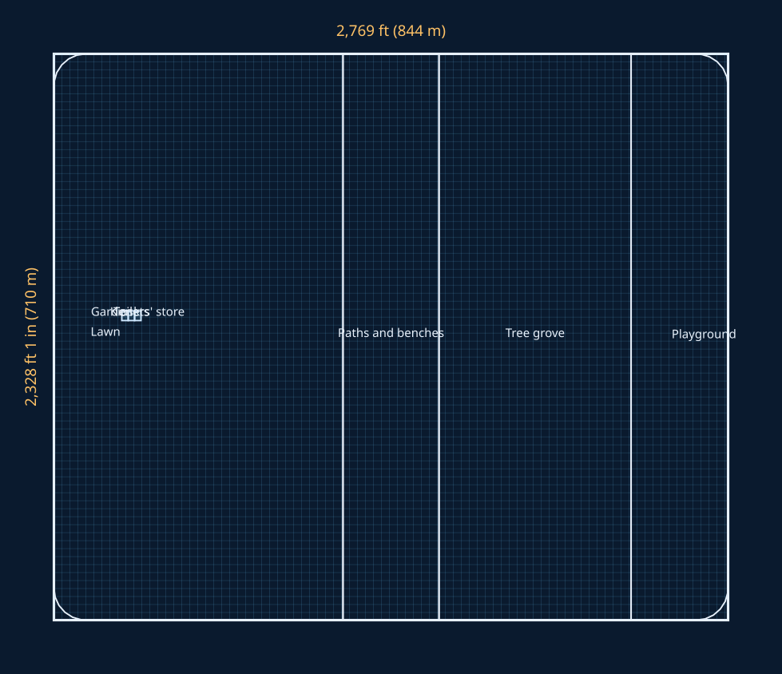

# P6-32 Neighbourhood Park 4: plan

Footprint 2,769 ft (844 m) × 2,328 ft 1 in (710 m) · structural grid 32 ft 10 in (10 m)

## Levels

| Level | Floor above deck | Height | Floor area |
|---|---|---|---|
| Level 1 · Ground | 0 ft (0 mm) | 13 ft 1 in (4,000 mm) | 3,100 sq ft (288 m²) |

## Elements

| ID | Designation | Type | Name | Level(s) | Size / length | Area | Status |
|---|---|---|---|---|---|---|---|
| E001 | D5F6P6B9A3R1 | zone | Lawn | L1 | 1,187 ft 4 in (362 m) × 2,327 ft 5 in (709 m) | 2,753,755 sq ft (255,832 m²) | proposed |
| E002 | D5F6P6B9A3R2 | room | Kiosk | L1 | 26 ft 3 in (8,000 mm) × 39 ft 4 in (12 m) | 1,033 sq ft (96 m²) | proposed |
| E003 | D5F6P6B9A3R3 | room | Toilets | L1 | 26 ft 3 in (8,000 mm) × 39 ft 4 in (12 m) | 1,033 sq ft (96 m²) | proposed |
| E004 | D5F6P6B9A3R4 | room | Gardeners' store | L1 | 26 ft 3 in (8,000 mm) × 39 ft 4 in (12 m) | 1,033 sq ft (96 m²) | proposed |
| E005 | D5F6P6B9A3R5 | zone | Paths and benches | L1 | 394 ft 4 in (120 m) × 2,326 ft 9 in (709 m) | 917,579 sq ft (85,246 m²) | proposed |
| E006 | D5F6P6B9A3R6 | zone | Tree grove | L1 | 789 ft 1 in (240 m) × 2,327 ft 5 in (709 m) | 1,835,921 sq ft (170,563 m²) | proposed |
| E007 | D5F6P6B9A3R7 | zone | Playground | L1 | 398 ft 4 in (121 m) × 2,326 ft 9 in (709 m) | 917,838 sq ft (85,270 m²) | proposed |

## Drawings

### Level 1 · Ground

