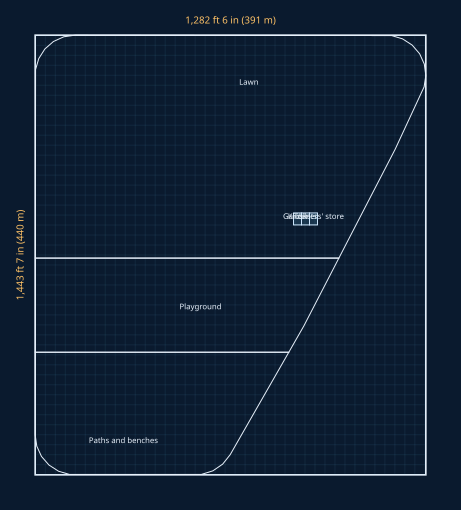

# P6-36 Neighbourhood Park 5: plan

Footprint 1,282 ft 6 in (391 m) × 1,443 ft 7 in (440 m) · structural grid 32 ft 10 in (10 m)

## Levels

| Level | Floor above deck | Height | Floor area |
|---|---|---|---|
| Level 1 · Ground | 0 ft (0 mm) | 13 ft 1 in (4,000 mm) | 3,100 sq ft (288 m²) |

## Elements

| ID | Designation | Type | Name | Level(s) | Size / length | Area | Status |
|---|---|---|---|---|---|---|---|
| E001 | D5F6P6B13A3R1 | zone | Lawn | L1 | 1,281 ft 10 in (391 m) × 731 ft 11 in (223 m) | 849,752 sq ft (78,945 m²) | proposed |
| E002 | D5F6P6B13A3R2 | room | Kiosk | L1 | 26 ft 3 in (8,000 mm) × 39 ft 4 in (12 m) | 1,033 sq ft (96 m²) | proposed |
| E003 | D5F6P6B13A3R3 | room | Toilets | L1 | 26 ft 3 in (8,000 mm) × 39 ft 4 in (12 m) | 1,033 sq ft (96 m²) | proposed |
| E004 | D5F6P6B13A3R4 | room | Gardeners' store | L1 | 26 ft 3 in (8,000 mm) × 39 ft 4 in (12 m) | 1,033 sq ft (96 m²) | proposed |
| E005 | D5F6P6B13A3R5 | zone | Playground | L1 | 996 ft 9 in (304 m) × 309 ft 1 in (94 m) | 283,128 sq ft (26,303 m²) | proposed |
| E006 | D5F6P6B13A3R6 | zone | Paths and benches | L1 | 832 ft 8 in (254 m) × 401 ft 3 in (122 m) | 283,336 sq ft (26,323 m²) | proposed |

## Drawings

### Level 1 · Ground

