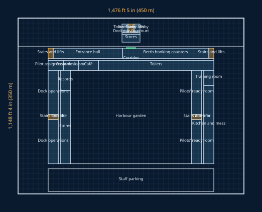
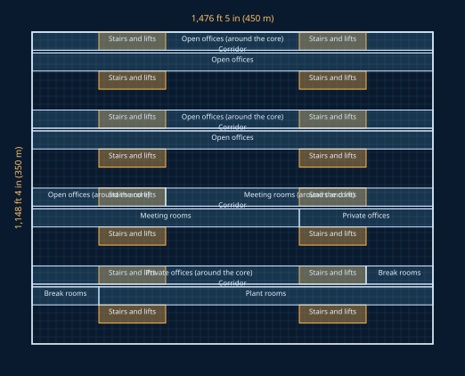
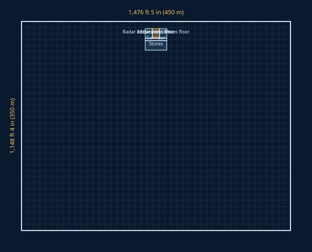
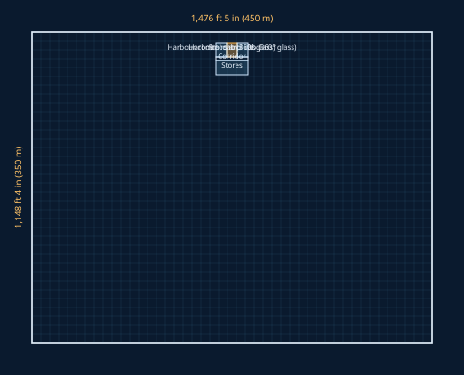

# P1-01 Harbourmaster: plan

Footprint 1,476 ft 5 in (450 m) × 1,148 ft 4 in (350 m) · structural grid 32 ft 10 in (10 m)

## Levels

| Level | Floor above deck | Height | Floor area |
|---|---|---|---|
| Level 1 · Ground floor | 0 ft (0 mm) | 16 ft 5 in (5,000 mm) | 303,973 sq ft (28,240 m²) |
| Level 2 · Level 2 | 16 ft 5 in (5,000 mm) | 13 ft 1 in (4,000 mm) | 303,973 sq ft (28,240 m²) |
| Level 3 · Level 3 | 29 ft 6 in (9,000 mm) | 13 ft 1 in (4,000 mm) | 303,973 sq ft (28,240 m²) |
| Level 4 · Level 4 | 42 ft 8 in (13 m) | 13 ft 1 in (4,000 mm) | 148,111 sq ft (13,760 m²) |
| Level 5 · Tower | 55 ft 9 in (17 m) | 13 ft 1 in (4,000 mm) | 10,333 sq ft (960 m²) |
| Level 6 · Tower | 68 ft 11 in (21 m) | 13 ft 1 in (4,000 mm) | 10,333 sq ft (960 m²) |
| Level 7 · Tower | 82 ft (25 m) | 13 ft 1 in (4,000 mm) | 10,333 sq ft (960 m²) |
| Level 8 · Tower | 95 ft 2 in (29 m) | 13 ft 1 in (4,000 mm) | 10,333 sq ft (960 m²) |
| Level 9 · Tower | 108 ft 3 in (33 m) | 13 ft 1 in (4,000 mm) | 10,333 sq ft (960 m²) |
| Level 10 · Tower | 121 ft 5 in (37 m) | 13 ft 1 in (4,000 mm) | 10,333 sq ft (960 m²) |
| Level 11 · Harbour control cab | 134 ft 6 in (41 m) | 19 ft 8 in (6,000 mm) | 10,333 sq ft (960 m²) |

## Elements

| ID | Designation | Type | Name | Level(s) | Size / length | Area | Status |
|---|---|---|---|---|---|---|---|
| E001 | D5F3P1B4A1L1R1 | zone | Dockside forecourt | L1 | 1,476 ft 5 in (450 m) × 183 ft 9 in (56 m) | 271,251 sq ft (25,200 m²) | proposed |
| E002 | D5F3P1B4A1L1R2, D5F3P1B4A1L2R1, D5F3P1B4A1L3R1, D5F3P1B4A1L4R1, D5F3P1B4A1L5R1, D5F3P1B4A1L6R1, D5F3P1B4A1L7R1, D5F3P1B4A1L8R1, D5F3P1B4A1L9R1, D5F3P1B4A1L10R1, D5F3P1B4A1L11R1 | core | Stairs and lifts | L1, L2, L3, L4, L5, L6, L7, L8, L9, L10, L11 | 39 ft 4 in (12 m) × 52 ft 6 in (16 m) | 2,067 sq ft (192 m²) | proposed |
| E003 | D5F3P1B4A1L1R3, D5F3P1B4A1L2R2, D5F3P1B4A1L3R2, D5F3P1B4A1L4R2 | zone | Corridor | L1, L2, L3, L4 | 118 ft 1 in (36 m) × 13 ft 1 in (4,000 mm) | 1,550 sq ft (144 m²) | proposed |
| E004 | D5F3P1B4A1L1R4, D5F3P1B4A1L2R3, D5F3P1B4A1L3R3, D5F3P1B4A1L4R3 | room | Tower lobby | L1, L2, L3, L4 | 39 ft 4 in (12 m) × 52 ft 6 in (16 m) | 2,067 sq ft (192 m²) | proposed |
| E005 | D5F3P1B4A1L1R5, D5F3P1B4A1L2R4, D5F3P1B4A1L3R4, D5F3P1B4A1L4R4 | room | Tower lobby | L1, L2, L3, L4 | 39 ft 4 in (12 m) × 52 ft 6 in (16 m) | 2,067 sq ft (192 m²) | proposed |
| E006 | D5F3P1B4A1L1R6, D5F3P1B4A1L2R5, D5F3P1B4A1L3R5, D5F3P1B4A1L4R5 | room | Stores | L1, L2, L3, L4 | 118 ft 1 in (36 m) × 52 ft 6 in (16 m) | 6,200 sq ft (576 m²) | proposed |
| E007 | D5F3P1B4A1L5R2, D5F3P1B4A1L6R2, D5F3P1B4A1L7R2, D5F3P1B4A1L8R2, D5F3P1B4A1L9R2, D5F3P1B4A1L10R2 | zone | Corridor | L5, L6, L7, L8, L9, L10 | 118 ft 1 in (36 m) × 13 ft 1 in (4,000 mm) | 1,550 sq ft (144 m²) | proposed |
| E008 | D5F3P1B4A1L5R3, D5F3P1B4A1L6R3, D5F3P1B4A1L7R3, D5F3P1B4A1L8R3, D5F3P1B4A1L9R3, D5F3P1B4A1L10R3 | room | Radar and comms floor | L5, L6, L7, L8, L9, L10 | 39 ft 4 in (12 m) × 52 ft 6 in (16 m) | 2,067 sq ft (192 m²) | proposed |
| E009 | D5F3P1B4A1L5R4, D5F3P1B4A1L6R4, D5F3P1B4A1L7R4, D5F3P1B4A1L8R4, D5F3P1B4A1L9R4, D5F3P1B4A1L10R4 | room | Radar and comms floor | L5, L6, L7, L8, L9, L10 | 39 ft 4 in (12 m) × 52 ft 6 in (16 m) | 2,067 sq ft (192 m²) | proposed |
| E010 | D5F3P1B4A1L5R5, D5F3P1B4A1L6R5, D5F3P1B4A1L7R5, D5F3P1B4A1L8R5, D5F3P1B4A1L9R5, D5F3P1B4A1L10R5 | room | Stores | L5, L6, L7, L8, L9, L10 | 118 ft 1 in (36 m) × 52 ft 6 in (16 m) | 6,200 sq ft (576 m²) | proposed |
| E011 | D5F3P1B4A1L11R2 | zone | Corridor | L11 | 118 ft 1 in (36 m) × 13 ft 1 in (4,000 mm) | 1,550 sq ft (144 m²) | proposed |
| E012 | D5F3P1B4A1L11R3 | room | Harbour control cab (360° glass) | L11 | 39 ft 4 in (12 m) × 52 ft 6 in (16 m) | 2,067 sq ft (192 m²) | proposed |
| E013 | D5F3P1B4A1L11R4 | room | Harbour control cab (360° glass) | L11 | 39 ft 4 in (12 m) × 52 ft 6 in (16 m) | 2,067 sq ft (192 m²) | proposed |
| E014 | D5F3P1B4A1L11R5 | room | Stores | L11 | 118 ft 1 in (36 m) × 52 ft 6 in (16 m) | 6,200 sq ft (576 m²) | proposed |
| E015 | D5F3P1B4A1L1R7, D5F3P1B4A1L2R6, D5F3P1B4A1L3R6, D5F3P1B4A1L4R6 | core | Stairs and lifts | L1, L2, L3, L4 | 32 ft 10 in (10 m) × 65 ft 7 in (20 m) | 2,153 sq ft (200 m²) | proposed |
| E016 | D5F3P1B4A1L1R8, D5F3P1B4A1L2R7, D5F3P1B4A1L3R7, D5F3P1B4A1L4R7 | core | Stairs and lifts | L1, L2, L3, L4 | 32 ft 10 in (10 m) × 65 ft 7 in (20 m) | 2,153 sq ft (200 m²) | proposed |
| E017 | D5F3P1B4A1L1R9 | zone | Corridor | L1 | 1,082 ft 8 in (330 m) × 13 ft 1 in (4,000 mm) | 14,208 sq ft (1,320 m²) | proposed |
| E018 | D5F3P1B4A1L1R10 | room | Entrance hall | L1 | 452 ft 1 in (138 m) × 65 ft 7 in (20 m) | 29,665 sq ft (2,756 m²) | proposed |
| E019 | D5F3P1B4A1L1R11 | room | Berth booking counters | L1 | 565 ft (172 m) × 65 ft 7 in (20 m) | 37,071 sq ft (3,444 m²) | proposed |
| E020 | D5F3P1B4A1L1R12 | room | Pilot assignment desk | L1 | 98 ft 5 in (30 m) × 65 ft 7 in (20 m) | 6,458 sq ft (600 m²) | proposed |
| E021 | D5F3P1B4A1L1R13 | room | Customs liaison | L1 | 98 ft 5 in (30 m) × 65 ft 7 in (20 m) | 6,458 sq ft (600 m²) | proposed |
| E022 | D5F3P1B4A1L1R14 | room | Café | L1 | 131 ft 3 in (40 m) × 65 ft 7 in (20 m) | 8,611 sq ft (800 m²) | proposed |
| E023 | D5F3P1B4A1L1R15 | room | Toilets | L1 | 754 ft 7 in (230 m) × 65 ft 7 in (20 m) | 49,514 sq ft (4,600 m²) | proposed |
| E024 | D5F3P1B4A1L2R8 | zone | Corridor | L2 | 1,082 ft 8 in (330 m) × 13 ft 1 in (4,000 mm) | 14,208 sq ft (1,320 m²) | proposed |
| E025 | D5F3P1B4A1L2R9 | room | Berth control room | L2 | 1,017 ft 1 in (310 m) × 65 ft 7 in (20 m) | 66,736 sq ft (6,200 m²) | proposed |
| E026 | D5F3P1B4A1L2R10 | room | Traffic planning | L2 | 246 ft 1 in (75 m) × 65 ft 7 in (20 m) | 16,146 sq ft (1,500 m²) | proposed |
| E027 | D5F3P1B4A1L2R11 | room | Duty harbourmaster | L2 | 49 ft 3 in (15 m) × 65 ft 7 in (20 m) | 3,229 sq ft (300 m²) | proposed |
| E028 | D5F3P1B4A1L2R12 | room | Offices | L2 | 787 ft 5 in (240 m) × 65 ft 7 in (20 m) | 51,667 sq ft (4,800 m²) | proposed |
| E029 | D5F3P1B4A1L3R8, D5F3P1B4A1L4R8 | zone | Corridor | L3, L4 | 1,082 ft 8 in (330 m) × 13 ft 1 in (4,000 mm) | 14,208 sq ft (1,320 m²) | proposed |
| E030 | D5F3P1B4A1L3R9, D5F3P1B4A1L4R9 | room | Offices | L3, L4 | 984 ft 3 in (300 m) × 65 ft 7 in (20 m) | 64,583 sq ft (6,000 m²) | proposed |
| E031 | D5F3P1B4A1L3R10, D5F3P1B4A1L4R10 | room | Meeting rooms | L3, L4 | 16 ft 5 in (5,000 mm) × 65 ft 7 in (20 m) | 1,076 sq ft (100 m²) | proposed |
| E032 | D5F3P1B4A1L3R11, D5F3P1B4A1L4R11 | room | Meeting rooms | L3, L4 | 16 ft 5 in (5,000 mm) × 65 ft 7 in (20 m) | 1,076 sq ft (100 m²) | proposed |
| E033 | D5F3P1B4A1L3R12, D5F3P1B4A1L4R12 | room | Meeting rooms | L3, L4 | 541 ft 4 in (165 m) × 65 ft 7 in (20 m) | 35,521 sq ft (3,300 m²) | proposed |
| E034 | D5F3P1B4A1L3R13, D5F3P1B4A1L4R13 | room | Meeting rooms | L3, L4 | 541 ft 4 in (165 m) × 65 ft 7 in (20 m) | 35,521 sq ft (3,300 m²) | proposed |
| E035 | D5F3P1B4A1L1R16, D5F3P1B4A1L2R13, D5F3P1B4A1L3R14 | core | Stairs and lifts | L1, L2, L3 | 65 ft 7 in (20 m) × 32 ft 10 in (10 m) | 2,153 sq ft (200 m²) | proposed |
| E036 | D5F3P1B4A1L1R17 | zone | Corridor | L1 | 13 ft 1 in (4,000 mm) × 610 ft 3 in (186 m) | 8,008 sq ft (744 m²) | proposed |
| E037 | D5F3P1B4A1L1R18 | room | Dock operations | L1 | 65 ft 7 in (20 m) × 288 ft 9 in (88 m) | 18,944 sq ft (1,760 m²) | proposed |
| E038 | D5F3P1B4A1L1R19 | room | Dock operations | L1 | 65 ft 7 in (20 m) × 288 ft 9 in (88 m) | 18,944 sq ft (1,760 m²) | proposed |
| E039 | D5F3P1B4A1L1R20 | room | Records | L1 | 65 ft 7 in (20 m) × 131 ft 3 in (40 m) | 8,611 sq ft (800 m²) | proposed |
| E040 | D5F3P1B4A1L1R21 | room | Stores | L1 | 65 ft 7 in (20 m) × 479 ft (146 m) | 31,431 sq ft (2,920 m²) | proposed |
| E041 | D5F3P1B4A1L2R14, D5F3P1B4A1L3R15 | zone | Corridor | L2, L3 | 13 ft 1 in (4,000 mm) × 610 ft 3 in (186 m) | 8,008 sq ft (744 m²) | proposed |
| E042 | D5F3P1B4A1L2R15, D5F3P1B4A1L3R16 | room | Offices | L2, L3 | 65 ft 7 in (20 m) × 288 ft 9 in (88 m) | 18,944 sq ft (1,760 m²) | proposed |
| E043 | D5F3P1B4A1L2R16, D5F3P1B4A1L3R17 | room | Offices | L2, L3 | 65 ft 7 in (20 m) × 288 ft 9 in (88 m) | 18,944 sq ft (1,760 m²) | proposed |
| E044 | D5F3P1B4A1L2R17, D5F3P1B4A1L3R18 | room | Stores | L2, L3 | 65 ft 7 in (20 m) × 610 ft 3 in (186 m) | 40,042 sq ft (3,720 m²) | proposed |
| E045 | D5F3P1B4A1L1R22, D5F3P1B4A1L2R18, D5F3P1B4A1L3R19 | core | Stairs and lifts | L1, L2, L3 | 65 ft 7 in (20 m) × 32 ft 10 in (10 m) | 2,153 sq ft (200 m²) | proposed |
| E046 | D5F3P1B4A1L1R23 | zone | Corridor | L1 | 13 ft 1 in (4,000 mm) × 610 ft 3 in (186 m) | 8,008 sq ft (744 m²) | proposed |
| E047 | D5F3P1B4A1L1R24 | room | Pilots' ready room | L1 | 65 ft 7 in (20 m) × 288 ft 9 in (88 m) | 18,944 sq ft (1,760 m²) | proposed |
| E048 | D5F3P1B4A1L1R25 | room | Pilots' ready room | L1 | 65 ft 7 in (20 m) × 288 ft 9 in (88 m) | 18,944 sq ft (1,760 m²) | proposed |
| E049 | D5F3P1B4A1L1R26 | room | Training room | L1 | 65 ft 7 in (20 m) × 98 ft 5 in (30 m) | 6,458 sq ft (600 m²) | proposed |
| E050 | D5F3P1B4A1L1R27 | room | Kitchen and mess | L1 | 65 ft 7 in (20 m) × 511 ft 10 in (156 m) | 33,583 sq ft (3,120 m²) | proposed |
| E051 | D5F3P1B4A1L2R19, D5F3P1B4A1L3R20 | zone | Corridor | L2, L3 | 13 ft 1 in (4,000 mm) × 610 ft 3 in (186 m) | 8,008 sq ft (744 m²) | proposed |
| E052 | D5F3P1B4A1L2R20, D5F3P1B4A1L3R21 | room | Offices | L2, L3 | 65 ft 7 in (20 m) × 288 ft 9 in (88 m) | 18,944 sq ft (1,760 m²) | proposed |
| E053 | D5F3P1B4A1L2R21, D5F3P1B4A1L3R22 | room | Offices | L2, L3 | 65 ft 7 in (20 m) × 288 ft 9 in (88 m) | 18,944 sq ft (1,760 m²) | proposed |
| E054 | D5F3P1B4A1L2R22, D5F3P1B4A1L3R23 | room | Stores | L2, L3 | 65 ft 7 in (20 m) × 610 ft 3 in (186 m) | 40,042 sq ft (3,720 m²) | proposed |
| E055 | D5F3P1B4A1L1R28 | zone | Harbour garden | L1 | 794 ft (242 m) × 610 ft 3 in (186 m) | 484,505 sq ft (45,012 m²) | proposed |
| E056 | D5F3P1B4A1L1R29 | zone | Staff parking | L1 | 1,082 ft 8 in (330 m) × 147 ft 8 in (45 m) | 159,844 sq ft (14,850 m²) | proposed |
| E057 |  | door | Main entrance | L1 | 65 ft 7 in (20 m), 65 ft 7 in (20 m) wide | — | proposed |

## Drawings

### Level 1 · Ground floor

### Level 2 · Level 2

### Level 3 · Level 3

### Level 4 · Level 4

### Level 5 · Tower

### Level 6 · Tower

### Level 7 · Tower

### Level 8 · Tower

### Level 9 · Tower

### Level 10 · Tower

### Level 11 · Harbour control cab

