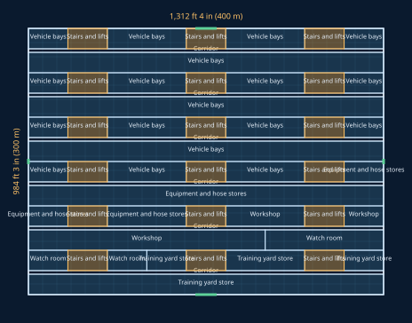

# P1-02 Bow Docks Fire Station: plan

Footprint 1,312 ft 4 in (400 m) × 984 ft 3 in (300 m) · structural grid 52 ft 6 in (16 m)

## Levels

| Level | Floor above deck | Height | Floor area |
|---|---|---|---|
| Level 1 · Ground floor | 0 ft (0 mm) | 19 ft 8 in (6,000 mm) | 990,181 sq ft (91,991 m²) |
| Level 2 · Upper floor | 19 ft 8 in (6,000 mm) | 19 ft 8 in (6,000 mm) | 1,188,336 sq ft (110,400 m²) |

## Elements

| ID | Designation | Type | Name | Level(s) | Size / length | Area | Status |
|---|---|---|---|---|---|---|---|
| L1-001 | D5F3P1B4A2L1R1 | zone | Corridor | L1 | 1,312 ft 4 in (400 m) × 13 ft 1 in (4,000 mm) | 17,222 sq ft (1,600 m²) | proposed |
| L1-002 | D5F3P1B4A2L1R2 | zone | Corridor | L1 | 1,312 ft 4 in (400 m) × 13 ft 1 in (4,000 mm) | 17,222 sq ft (1,600 m²) | proposed |
| L1-003 | D5F3P1B4A2L1R3 | zone | Corridor | L1 | 1,312 ft 4 in (400 m) × 13 ft 1 in (4,000 mm) | 17,222 sq ft (1,600 m²) | proposed |
| L1-004 | D5F3P1B4A2L1R4 | zone | Corridor | L1 | 1,312 ft 4 in (400 m) × 13 ft 1 in (4,000 mm) | 17,222 sq ft (1,600 m²) | proposed |
| L1-005 | D5F3P1B4A2L1R5 | zone | Corridor | L1 | 1,312 ft 4 in (400 m) × 13 ft 1 in (4,000 mm) | 17,222 sq ft (1,600 m²) | proposed |
| L1-006 | D5F3P1B4A2L1R6 | zone | Corridor | L1 | 1,312 ft 4 in (400 m) × 13 ft 1 in (4,000 mm) | 17,222 sq ft (1,600 m²) | proposed |
| L1-007 | D5F3P1B4A2L1R7 | room | Vehicle bays | L1 | 145 ft 8 in (44 m) × 75 ft 6 in (23 m) | 10,992 sq ft (1,021 m²) | proposed |
| L1-008 | D5F3P1B4A2L1R8 | room | Vehicle bays | L1 | 291 ft 8 in (89 m) × 75 ft 6 in (23 m) | 22,009 sq ft (2,045 m²) | proposed |
| L1-009 | D5F3P1B4A2L1R9 | room | Vehicle bays | L1 | 291 ft 8 in (89 m) × 75 ft 6 in (23 m) | 22,009 sq ft (2,045 m²) | proposed |
| L1-010 | D5F3P1B4A2L1R10 | room | Vehicle bays | L1 | 145 ft 8 in (44 m) × 75 ft 6 in (23 m) | 10,992 sq ft (1,021 m²) | proposed |
| L1-011 | D5F3P1B4A2L1R11 | room | Vehicle bays | L1 | 1,312 ft 4 in (400 m) × 75 ft 6 in (23 m) | 99,028 sq ft (9,200 m²) | proposed |
| L1-012 | D5F3P1B4A2L1R12 | room | Vehicle bays | L1 | 145 ft 8 in (44 m) × 75 ft 6 in (23 m) | 10,992 sq ft (1,021 m²) | proposed |
| L1-013 | D5F3P1B4A2L1R13 | room | Vehicle bays | L1 | 291 ft 8 in (89 m) × 75 ft 6 in (23 m) | 22,009 sq ft (2,045 m²) | proposed |
| L1-014 | D5F3P1B4A2L1R14 | room | Vehicle bays | L1 | 291 ft 8 in (89 m) × 75 ft 6 in (23 m) | 22,009 sq ft (2,045 m²) | proposed |
| L1-015 | D5F3P1B4A2L1R15 | room | Vehicle bays | L1 | 145 ft 8 in (44 m) × 75 ft 6 in (23 m) | 10,992 sq ft (1,021 m²) | proposed |
| L1-016 | D5F3P1B4A2L1R16 | room | Vehicle bays | L1 | 1,312 ft 4 in (400 m) × 75 ft 6 in (23 m) | 99,028 sq ft (9,200 m²) | proposed |
| L1-017 | D5F3P1B4A2L1R17 | room | Vehicle bays | L1 | 145 ft 8 in (44 m) × 75 ft 6 in (23 m) | 10,992 sq ft (1,021 m²) | proposed |
| L1-018 | D5F3P1B4A2L1R18 | room | Vehicle bays | L1 | 291 ft 8 in (89 m) × 75 ft 6 in (23 m) | 22,009 sq ft (2,045 m²) | proposed |
| L1-019 | D5F3P1B4A2L1R19 | room | Vehicle bays | L1 | 291 ft 8 in (89 m) × 75 ft 6 in (23 m) | 22,009 sq ft (2,045 m²) | proposed |
| L1-020 | D5F3P1B4A2L1R20 | room | Vehicle bays | L1 | 145 ft 8 in (44 m) × 75 ft 6 in (23 m) | 10,992 sq ft (1,021 m²) | proposed |
| L1-021 | D5F3P1B4A2L1R21 | room | Vehicle bays | L1 | 1,312 ft 4 in (400 m) × 75 ft 6 in (23 m) | 99,028 sq ft (9,200 m²) | proposed |
| L1-022 | D5F3P1B4A2L1R22 | room | Vehicle bays | L1 | 145 ft 8 in (44 m) × 75 ft 6 in (23 m) | 10,992 sq ft (1,021 m²) | proposed |
| L1-023 | D5F3P1B4A2L1R23 | room | Vehicle bays | L1 | 291 ft 8 in (89 m) × 75 ft 6 in (23 m) | 22,009 sq ft (2,045 m²) | proposed |
| L1-024 | D5F3P1B4A2L1R24 | room | Vehicle bays | L1 | 291 ft 8 in (89 m) × 75 ft 6 in (23 m) | 22,009 sq ft (2,045 m²) | proposed |
| L1-025 | D5F3P1B4A2L1R25 | room | Equipment and hose stores | L1 | 145 ft 8 in (44 m) × 75 ft 6 in (23 m) | 10,992 sq ft (1,021 m²) | proposed |
| L1-026 | D5F3P1B4A2L1R26 | room | Equipment and hose stores | L1 | 1,312 ft 4 in (400 m) × 75 ft 6 in (23 m) | 99,028 sq ft (9,200 m²) | proposed |
| L1-027 | D5F3P1B4A2L1R27 | room | Equipment and hose stores | L1 | 145 ft 8 in (44 m) × 75 ft 6 in (23 m) | 10,992 sq ft (1,021 m²) | proposed |
| L1-028 | D5F3P1B4A2L1R28 | room | Equipment and hose stores | L1 | 291 ft 8 in (89 m) × 75 ft 6 in (23 m) | 22,009 sq ft (2,045 m²) | proposed |
| L1-029 | D5F3P1B4A2L1R29 | room | Workshop | L1 | 291 ft 8 in (89 m) × 75 ft 6 in (23 m) | 22,009 sq ft (2,045 m²) | proposed |
| L1-030 | D5F3P1B4A2L1R30 | room | Workshop | L1 | 145 ft 8 in (44 m) × 75 ft 6 in (23 m) | 10,992 sq ft (1,021 m²) | proposed |
| L1-031 | D5F3P1B4A2L1R31 | room | Workshop | L1 | 875 ft (267 m) × 75 ft 6 in (23 m) | 66,027 sq ft (6,134 m²) | proposed |
| L1-032 | D5F3P1B4A2L1R32 | room | Watch room | L1 | 437 ft 4 in (133 m) × 75 ft 6 in (23 m) | 33,001 sq ft (3,066 m²) | proposed |
| L1-033 | D5F3P1B4A2L1R33 | room | Watch room | L1 | 145 ft 8 in (44 m) × 75 ft 6 in (23 m) | 10,992 sq ft (1,021 m²) | proposed |
| L1-034 | D5F3P1B4A2L1R34 | room | Watch room | L1 | 145 ft 8 in (44 m) × 75 ft 6 in (23 m) | 10,992 sq ft (1,021 m²) | proposed |
| L1-035 | D5F3P1B4A2L1R35 | room | Training yard store | L1 | 146 ft (44 m) × 75 ft 6 in (23 m) | 11,017 sq ft (1,024 m²) | proposed |
| L1-036 | D5F3P1B4A2L1R36 | room | Training yard store | L1 | 291 ft 8 in (89 m) × 75 ft 6 in (23 m) | 22,009 sq ft (2,045 m²) | proposed |
| L1-037 | D5F3P1B4A2L1R37 | room | Training yard store | L1 | 145 ft 8 in (44 m) × 75 ft 6 in (23 m) | 10,992 sq ft (1,021 m²) | proposed |
| L1-038 | D5F3P1B4A2L1R38 | room | Training yard store | L1 | 1,312 ft 4 in (400 m) × 75 ft 6 in (23 m) | 99,028 sq ft (9,200 m²) | proposed |
| L1-039 | D5F3P1B4A2L1R39, D5F3P1B4A2L2R1 | core | Stairs and lifts | L1, L2 | 146 ft (45 m) × 75 ft 6 in (23 m) | 11,017 sq ft (1,024 m²) | proposed |
| L1-040 | D5F3P1B4A2L1R40, D5F3P1B4A2L2R2 | core | Stairs and lifts | L1, L2 | 145 ft 8 in (44 m) × 75 ft 6 in (23 m) | 10,992 sq ft (1,021 m²) | proposed |
| L1-041 | D5F3P1B4A2L1R41, D5F3P1B4A2L2R3 | core | Stairs and lifts | L1, L2 | 146 ft (44 m) × 75 ft 6 in (23 m) | 11,017 sq ft (1,024 m²) | proposed |
| L1-042 | D5F3P1B4A2L1R42, D5F3P1B4A2L2R4 | core | Stairs and lifts | L1, L2 | 146 ft (45 m) × 75 ft 6 in (23 m) | 11,017 sq ft (1,024 m²) | proposed |
| L1-043 | D5F3P1B4A2L1R43, D5F3P1B4A2L2R5 | core | Stairs and lifts | L1, L2 | 145 ft 8 in (44 m) × 75 ft 6 in (23 m) | 10,992 sq ft (1,021 m²) | proposed |
| L1-044 | D5F3P1B4A2L1R44, D5F3P1B4A2L2R6 | core | Stairs and lifts | L1, L2 | 146 ft (44 m) × 75 ft 6 in (23 m) | 11,017 sq ft (1,024 m²) | proposed |
| L1-045 | D5F3P1B4A2L1R45, D5F3P1B4A2L2R7 | core | Stairs and lifts | L1, L2 | 146 ft (45 m) × 75 ft 6 in (23 m) | 11,017 sq ft (1,024 m²) | proposed |
| L1-046 | D5F3P1B4A2L1R46, D5F3P1B4A2L2R8 | core | Stairs and lifts | L1, L2 | 145 ft 8 in (44 m) × 75 ft 6 in (23 m) | 10,992 sq ft (1,021 m²) | proposed |
| L1-047 | D5F3P1B4A2L1R47, D5F3P1B4A2L2R9 | core | Stairs and lifts | L1, L2 | 146 ft (44 m) × 75 ft 6 in (23 m) | 11,017 sq ft (1,024 m²) | proposed |
| L1-048 | D5F3P1B4A2L1R48, D5F3P1B4A2L2R10 | core | Stairs and lifts | L1, L2 | 146 ft (45 m) × 75 ft 6 in (23 m) | 11,017 sq ft (1,024 m²) | proposed |
| L1-049 | D5F3P1B4A2L1R49, D5F3P1B4A2L2R11 | core | Stairs and lifts | L1, L2 | 145 ft 8 in (44 m) × 75 ft 6 in (23 m) | 10,992 sq ft (1,021 m²) | proposed |
| L1-050 | D5F3P1B4A2L1R50, D5F3P1B4A2L2R12 | core | Stairs and lifts | L1, L2 | 146 ft (44 m) × 75 ft 6 in (23 m) | 11,017 sq ft (1,024 m²) | proposed |
| L1-051 | D5F3P1B4A2L1R51, D5F3P1B4A2L2R13 | core | Stairs and lifts | L1, L2 | 146 ft (45 m) × 75 ft 6 in (23 m) | 11,017 sq ft (1,024 m²) | proposed |
| L1-052 | D5F3P1B4A2L1R52, D5F3P1B4A2L2R14 | core | Stairs and lifts | L1, L2 | 145 ft 8 in (44 m) × 75 ft 6 in (23 m) | 10,992 sq ft (1,021 m²) | proposed |
| L1-053 | D5F3P1B4A2L1R53, D5F3P1B4A2L2R15 | core | Stairs and lifts | L1, L2 | 146 ft (44 m) × 75 ft 6 in (23 m) | 11,017 sq ft (1,024 m²) | proposed |
| L1-054 | D5F3P1B4A2L1R54, D5F3P1B4A2L2R16 | core | Stairs and lifts | L1, L2 | 146 ft (45 m) × 75 ft 6 in (23 m) | 11,017 sq ft (1,024 m²) | proposed |
| L1-055 | D5F3P1B4A2L1R55, D5F3P1B4A2L2R17 | core | Stairs and lifts | L1, L2 | 145 ft 8 in (44 m) × 75 ft 6 in (23 m) | 10,992 sq ft (1,021 m²) | proposed |
| L1-056 | D5F3P1B4A2L1R56, D5F3P1B4A2L2R18 | core | Stairs and lifts | L1, L2 | 146 ft (44 m) × 75 ft 6 in (23 m) | 11,017 sq ft (1,024 m²) | proposed |
| LT-001 | D5F3P1B4A2L2R19 | zone | Corridor | L2 | 1,312 ft 4 in (400 m) × 13 ft 1 in (4,000 mm) | 17,222 sq ft (1,600 m²) | proposed |
| LT-002 | D5F3P1B4A2L2R20 | zone | Corridor | L2 | 1,312 ft 4 in (400 m) × 13 ft 1 in (4,000 mm) | 17,222 sq ft (1,600 m²) | proposed |
| LT-003 | D5F3P1B4A2L2R21 | zone | Corridor | L2 | 1,312 ft 4 in (400 m) × 13 ft 1 in (4,000 mm) | 17,222 sq ft (1,600 m²) | proposed |
| LT-004 | D5F3P1B4A2L2R22 | zone | Corridor | L2 | 1,312 ft 4 in (400 m) × 13 ft 1 in (4,000 mm) | 17,222 sq ft (1,600 m²) | proposed |
| LT-005 | D5F3P1B4A2L2R23 | zone | Corridor | L2 | 1,312 ft 4 in (400 m) × 13 ft 1 in (4,000 mm) | 17,222 sq ft (1,600 m²) | proposed |
| LT-006 | D5F3P1B4A2L2R24 | zone | Corridor | L2 | 1,312 ft 4 in (400 m) × 13 ft 1 in (4,000 mm) | 17,222 sq ft (1,600 m²) | proposed |
| LT-007 | D5F3P1B4A2L2R25 | room | Crew bunk rooms (around the core) | L2 | 1,312 ft 4 in (400 m) × 75 ft 6 in (23 m) | 99,028 sq ft (9,200 m²) | proposed |
| LT-008 | D5F3P1B4A2L2R26 | room | Crew bunk rooms | L2 | 1,312 ft 4 in (400 m) × 75 ft 6 in (23 m) | 99,028 sq ft (9,200 m²) | proposed |
| LT-009 | D5F3P1B4A2L2R27 | room | Crew bunk rooms (around the core) | L2 | 1,312 ft 4 in (400 m) × 75 ft 6 in (23 m) | 99,028 sq ft (9,200 m²) | proposed |
| LT-010 | D5F3P1B4A2L2R28 | room | Crew bunk rooms | L2 | 1,312 ft 4 in (400 m) × 75 ft 6 in (23 m) | 99,028 sq ft (9,200 m²) | proposed |
| LT-011 | D5F3P1B4A2L2R29 | room | Crew bunk rooms (around the core) | L2 | 291 ft 8 in (89 m) × 75 ft 6 in (23 m) | 22,009 sq ft (2,045 m²) | proposed |
| LT-012 | D5F3P1B4A2L2R30 | room | Kitchen and mess (around the core) | L2 | 1,020 ft 8 in (311 m) × 75 ft 6 in (23 m) | 77,019 sq ft (7,155 m²) | proposed |
| LT-013 | D5F3P1B4A2L2R31 | room | Kitchen and mess | L2 | 1,312 ft 4 in (400 m) × 75 ft 6 in (23 m) | 99,028 sq ft (9,200 m²) | proposed |
| LT-014 | D5F3P1B4A2L2R32 | room | Gym (around the core) | L2 | 1,312 ft 4 in (400 m) × 75 ft 6 in (23 m) | 99,028 sq ft (9,200 m²) | proposed |
| LT-015 | D5F3P1B4A2L2R33 | room | Gym | L2 | 291 ft 8 in (89 m) × 75 ft 6 in (23 m) | 22,009 sq ft (2,045 m²) | proposed |
| LT-016 | D5F3P1B4A2L2R34 | room | Offices | L2 | 1,020 ft 8 in (311 m) × 75 ft 6 in (23 m) | 77,019 sq ft (7,155 m²) | proposed |
| LT-017 | D5F3P1B4A2L2R35 | room | Offices (around the core) | L2 | 1,312 ft 4 in (400 m) × 75 ft 6 in (23 m) | 99,028 sq ft (9,200 m²) | proposed |
| LT-018 | D5F3P1B4A2L2R36 | room | Offices | L2 | 729 ft (222 m) × 75 ft 6 in (23 m) | 55,010 sq ft (5,111 m²) | proposed |
| LT-019 | D5F3P1B4A2L2R37 | room | Training rooms | L2 | 583 ft 4 in (178 m) × 75 ft 6 in (23 m) | 44,018 sq ft (4,089 m²) | proposed |
| LT-020 | D5F3P1B4A2L2R38 | room | Training rooms (around the core) | L2 | 1,312 ft 4 in (400 m) × 75 ft 6 in (23 m) | 99,028 sq ft (9,200 m²) | proposed |
| LT-021 | D5F3P1B4A2L2R39 | room | Training rooms | L2 | 1,312 ft 4 in (400 m) × 75 ft 6 in (23 m) | 99,028 sq ft (9,200 m²) | proposed |
| D-78 |  | door | Main entrance | L1 | 78 ft 9 in (24 m), 78 ft 9 in (24 m) wide | — | proposed |
| D-79 |  | door | Second entrance | L1 | 78 ft 9 in (24 m), 78 ft 9 in (24 m) wide | — | proposed |
| D-80 |  | door | Side door | L1 | 19 ft 8 in (6,000 mm), 19 ft 8 in (6,000 mm) wide | — | proposed |
| D-81 |  | door | Side door | L1 | 19 ft 8 in (6,000 mm), 19 ft 8 in (6,000 mm) wide | — | proposed |

## Drawings

### Level 1 · Ground floor

### Level 2 · Upper floor

