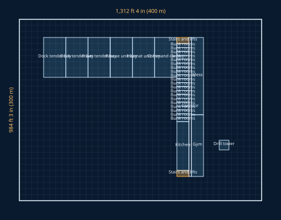
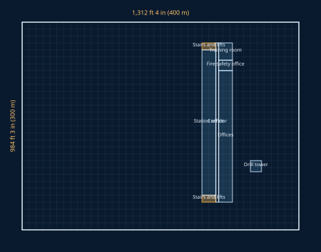
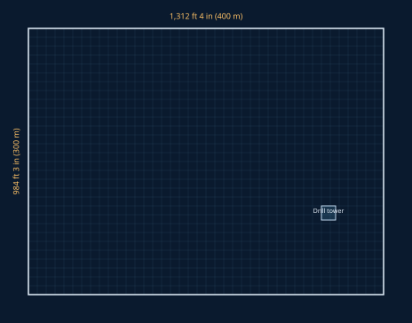

# P1-02 Bow Docks Fire Station: plan

Footprint 1,312 ft 4 in (400 m) × 984 ft 3 in (300 m) · structural grid 32 ft 10 in (10 m)

## Levels

| Level | Floor above deck | Height | Floor area |
|---|---|---|---|
| Level 1 · Ground floor | 0 ft (0 mm) | 14 ft 9 in (4,500 mm) | 253,770 sq ft (23,576 m²) |
| Level 2 · Level 2 | 14 ft 9 in (4,500 mm) | 14 ft 9 in (4,500 mm) | 253,770 sq ft (23,576 m²) |
| Level 3 · Level 3 | 29 ft 6 in (9,000 mm) | 14 ft 9 in (4,500 mm) | 97,478 sq ft (9,056 m²) |
| Level 4 · Drill tower top | 44 ft 3 in (14 m) | 19 ft 8 in (6,000 mm) | 2,756 sq ft (256 m²) |

## Elements

| ID | Designation | Type | Name | Level(s) | Size / length | Area | Status |
|---|---|---|---|---|---|---|---|
| E001 | D5F3P1B4A2L1R1 | zone | Dockside apron | L1 | 1,312 ft 4 in (400 m) × 98 ft 5 in (30 m) | 129,167 sq ft (12,000 m²) | proposed |
| E002 | D5F3P1B4A2L1R2, D5F3P1B4A2L2R1 | room | Dock tender bay | L1, L2 | 120 ft 5 in (37 m) × 216 ft 6 in (66 m) | 26,072 sq ft (2,422 m²) | proposed |
| E003 | D5F3P1B4A2L1R3, D5F3P1B4A2L2R2 | room | Dock tender bay | L1, L2 | 120 ft 1 in (37 m) × 216 ft 6 in (66 m) | 26,001 sq ft (2,416 m²) | proposed |
| E004 | D5F3P1B4A2L1R4, D5F3P1B4A2L2R3 | room | Foam tender bay | L1, L2 | 120 ft 5 in (37 m) × 216 ft 6 in (66 m) | 26,072 sq ft (2,422 m²) | proposed |
| E005 | D5F3P1B4A2L1R5, D5F3P1B4A2L2R4 | room | Rescue unit bay | L1, L2 | 120 ft 5 in (37 m) × 216 ft 6 in (66 m) | 26,072 sq ft (2,422 m²) | proposed |
| E006 | D5F3P1B4A2L1R6, D5F3P1B4A2L2R5 | room | Hazmat unit bay | L1, L2 | 120 ft 1 in (37 m) × 216 ft 6 in (66 m) | 26,001 sq ft (2,416 m²) | proposed |
| E007 | D5F3P1B4A2L1R7, D5F3P1B4A2L2R6 | room | Command car bay | L1, L2 | 120 ft 5 in (37 m) × 216 ft 6 in (66 m) | 26,072 sq ft (2,422 m²) | proposed |
| E008 | D5F3P1B4A2L1R8, D5F3P1B4A2L2R7, D5F3P1B4A2L3R1 | core | Stairs and lifts | L1, L2, L3 | 65 ft 7 in (20 m) × 32 ft 10 in (10 m) | 2,153 sq ft (200 m²) | proposed |
| E009 | D5F3P1B4A2L1R9, D5F3P1B4A2L2R8, D5F3P1B4A2L3R2 | core | Stairs and lifts | L1, L2, L3 | 65 ft 7 in (20 m) × 32 ft 10 in (10 m) | 2,153 sq ft (200 m²) | proposed |
| E010 | D5F3P1B4A2L1R10 | zone | Corridor | L1 | 13 ft 1 in (4,000 mm) × 754 ft 7 in (230 m) | 9,903 sq ft (920 m²) | proposed |
| E011 | D5F3P1B4A2L1R11 | room | Watch room | L1 | 65 ft 7 in (20 m) × 106 ft (32 m) | 6,953 sq ft (646 m²) | proposed |
| E012 | D5F3P1B4A2L1R12 | room | Breathing apparatus room | L1 | 65 ft 7 in (20 m) × 159 ft 1 in (48 m) | 10,441 sq ft (970 m²) | proposed |
| E013 | D5F3P1B4A2L1R13 | room | Foam concentrate store | L1 | 65 ft 7 in (20 m) × 423 ft 11 in (129 m) | 27,814 sq ft (2,584 m²) | proposed |
| E014 | D5F3P1B4A2L1R14 | room | Decontamination | L1 | 65 ft 7 in (20 m) × 49 ft 3 in (15 m) | 3,229 sq ft (300 m²) | proposed |
| E015 | D5F3P1B4A2L1R15 | room | Hose and dive store | L1 | 65 ft 7 in (20 m) × 147 ft 8 in (45 m) | 9,688 sq ft (900 m²) | proposed |
| E016 | D5F3P1B4A2L1R16 | room | Workshop | L1 | 65 ft 7 in (20 m) × 557 ft 9 in (170 m) | 36,597 sq ft (3,400 m²) | proposed |
| E017 | D5F3P1B4A2L2R9 | zone | Corridor | L2 | 13 ft 1 in (4,000 mm) × 754 ft 7 in (230 m) | 9,903 sq ft (920 m²) | proposed |
| E018 | D5F3P1B4A2L2R10 | room | Bunk rooms | L2 | 65 ft 7 in (20 m) × 21 ft 4 in (6,500 mm) | 1,399 sq ft (130 m²) | proposed |
| E019 | D5F3P1B4A2L2R11 | room | Bunk rooms | L2 | 65 ft 7 in (20 m) × 21 ft (6,400 mm) | 1,378 sq ft (128 m²) | proposed |
| E020 | D5F3P1B4A2L2R12 | room | Bunk rooms | L2 | 65 ft 7 in (20 m) × 21 ft 4 in (6,500 mm) | 1,399 sq ft (130 m²) | proposed |
| E021 | D5F3P1B4A2L2R13 | room | Bunk rooms | L2 | 65 ft 7 in (20 m) × 21 ft (6,400 mm) | 1,378 sq ft (128 m²) | proposed |
| E022 | D5F3P1B4A2L2R14 | room | Bunk rooms | L2 | 65 ft 7 in (20 m) × 21 ft 4 in (6,500 mm) | 1,399 sq ft (130 m²) | proposed |
| E023 | D5F3P1B4A2L2R15 | room | Bunk rooms | L2 | 65 ft 7 in (20 m) × 21 ft 4 in (6,500 mm) | 1,399 sq ft (130 m²) | proposed |
| E024 | D5F3P1B4A2L2R16 | room | Bunk rooms | L2 | 65 ft 7 in (20 m) × 21 ft (6,400 mm) | 1,378 sq ft (128 m²) | proposed |
| E025 | D5F3P1B4A2L2R17 | room | Bunk rooms | L2 | 65 ft 7 in (20 m) × 21 ft 4 in (6,500 mm) | 1,399 sq ft (130 m²) | proposed |
| E026 | D5F3P1B4A2L2R18 | room | Bunk rooms | L2 | 65 ft 7 in (20 m) × 21 ft 4 in (6,500 mm) | 1,399 sq ft (130 m²) | proposed |
| E027 | D5F3P1B4A2L2R19 | room | Bunk rooms | L2 | 65 ft 7 in (20 m) × 21 ft (6,400 mm) | 1,378 sq ft (128 m²) | proposed |
| E028 | D5F3P1B4A2L2R20 | room | Bunk rooms | L2 | 65 ft 7 in (20 m) × 21 ft 4 in (6,500 mm) | 1,399 sq ft (130 m²) | proposed |
| E029 | D5F3P1B4A2L2R21 | room | Bunk rooms | L2 | 65 ft 7 in (20 m) × 21 ft (6,400 mm) | 1,378 sq ft (128 m²) | proposed |
| E030 | D5F3P1B4A2L2R22 | room | Bunk rooms | L2 | 65 ft 7 in (20 m) × 21 ft 4 in (6,500 mm) | 1,399 sq ft (130 m²) | proposed |
| E031 | D5F3P1B4A2L2R23 | room | Bunk rooms | L2 | 65 ft 7 in (20 m) × 21 ft 4 in (6,500 mm) | 1,399 sq ft (130 m²) | proposed |
| E032 | D5F3P1B4A2L2R24 | room | Bunk rooms | L2 | 65 ft 7 in (20 m) × 21 ft (6,400 mm) | 1,378 sq ft (128 m²) | proposed |
| E033 | D5F3P1B4A2L2R25 | room | Bunk rooms | L2 | 65 ft 7 in (20 m) × 21 ft 4 in (6,500 mm) | 1,399 sq ft (130 m²) | proposed |
| E034 | D5F3P1B4A2L2R26 | room | Bunk rooms | L2 | 65 ft 7 in (20 m) × 21 ft (6,400 mm) | 1,378 sq ft (128 m²) | proposed |
| E035 | D5F3P1B4A2L2R27 | room | Bunk rooms | L2 | 65 ft 7 in (20 m) × 21 ft 4 in (6,500 mm) | 1,399 sq ft (130 m²) | proposed |
| E036 | D5F3P1B4A2L2R28 | room | Bunk rooms | L2 | 65 ft 7 in (20 m) × 21 ft 4 in (6,500 mm) | 1,399 sq ft (130 m²) | proposed |
| E037 | D5F3P1B4A2L2R29 | room | Bunk rooms | L2 | 65 ft 7 in (20 m) × 21 ft (6,400 mm) | 1,378 sq ft (128 m²) | proposed |
| E038 | D5F3P1B4A2L2R30 | room | Kitchen | L2 | 65 ft 7 in (20 m) × 265 ft 1 in (81 m) | 17,394 sq ft (1,616 m²) | proposed |
| E039 | D5F3P1B4A2L2R31 | room | Mess | L2 | 65 ft 7 in (20 m) × 419 ft 3 in (128 m) | 27,513 sq ft (2,556 m²) | proposed |
| E040 | D5F3P1B4A2L2R32 | room | Gym | L2 | 65 ft 7 in (20 m) × 335 ft 4 in (102 m) | 22,001 sq ft (2,044 m²) | proposed |
| E041 | D5F3P1B4A2L3R3 | zone | Corridor | L3 | 13 ft 1 in (4,000 mm) × 754 ft 7 in (230 m) | 9,903 sq ft (920 m²) | proposed |
| E042 | D5F3P1B4A2L3R4 | room | Station office | L3 | 65 ft 7 in (20 m) × 689 ft (210 m) | 45,208 sq ft (4,200 m²) | proposed |
| E043 | D5F3P1B4A2L3R5 | room | Training room | L3 | 65 ft 7 in (20 m) × 82 ft (25 m) | 5,382 sq ft (500 m²) | proposed |
| E044 | D5F3P1B4A2L3R6 | room | Fire safety office | L3 | 65 ft 7 in (20 m) × 49 ft 3 in (15 m) | 3,229 sq ft (300 m²) | proposed |
| E045 | D5F3P1B4A2L3R7 | room | Offices | L3 | 65 ft 7 in (20 m) × 623 ft 4 in (190 m) | 40,903 sq ft (3,800 m²) | proposed |
| E046 | D5F3P1B4A2L1R17, D5F3P1B4A2L2R33, D5F3P1B4A2L3R8, D5F3P1B4A2L4R1 | room | Drill tower | L1, L2, L3, L4 | 52 ft 6 in (16 m) × 52 ft 6 in (16 m) | 2,756 sq ft (256 m²) | proposed |
| E047 | D5F3P1B4A2L1R18 | zone | Drill yard | L1 | 689 ft (210 m) × 557 ft 9 in (170 m) | 384,272 sq ft (35,700 m²) | proposed |
| E048 |  | door | Appliance doors | L1 | 721 ft 9 in (220 m), 721 ft 9 in (220 m) wide | — | proposed |

## Drawings

### Level 1 · Ground floor

### Level 2 · Level 2

### Level 3 · Level 3

### Level 4 · Drill tower top

