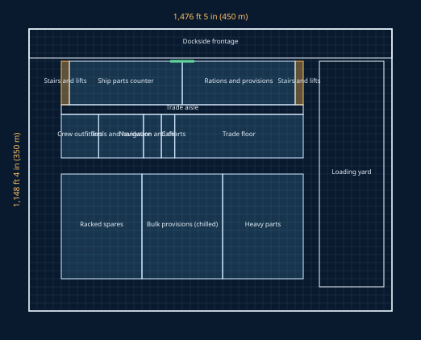
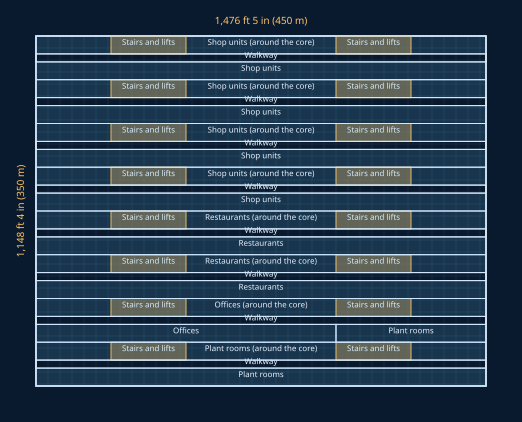

# P1-03 Bow Docks Chandlery: plan

Footprint 1,476 ft 5 in (450 m) × 1,148 ft 4 in (350 m) · structural grid 32 ft 10 in (10 m)

## Levels

| Level | Floor above deck | Height | Floor area |
|---|---|---|---|
| Level 1 · Trade floor | 0 ft (0 mm) | 19 ft 8 in (6,000 mm) | 756,918 sq ft (70,320 m²) |
| Level 2 · Mezzanine | 19 ft 8 in (6,000 mm) | 16 ft 5 in (5,000 mm) | 756,918 sq ft (70,320 m²) |

## Elements

| ID | Designation | Type | Name | Level(s) | Size / length | Area | Status |
|---|---|---|---|---|---|---|---|
| E001 | D5F3P1B5A1L1R1 | zone | Dockside frontage | L1 | 1,476 ft 5 in (450 m) × 118 ft 1 in (36 m) | 174,375 sq ft (16,200 m²) | proposed |
| E002 | D5F3P1B5A1L1R2, D5F3P1B5A1L2R1 | core | Stairs and lifts | L1, L2 | 32 ft 10 in (10 m) × 177 ft 2 in (54 m) | 5,813 sq ft (540 m²) | proposed |
| E003 | D5F3P1B5A1L1R3, D5F3P1B5A1L2R2 | core | Stairs and lifts | L1, L2 | 32 ft 10 in (10 m) × 177 ft 2 in (54 m) | 5,813 sq ft (540 m²) | proposed |
| E004 | D5F3P1B5A1L1R4 | zone | Trade aisle | L1 | 984 ft 3 in (300 m) × 39 ft 4 in (12 m) | 38,750 sq ft (3,600 m²) | proposed |
| E005 | D5F3P1B5A1L1R5 | room | Ship parts counter | L1 | 459 ft 4 in (140 m) × 177 ft 2 in (54 m) | 81,375 sq ft (7,560 m²) | proposed |
| E006 | D5F3P1B5A1L1R6 | room | Rations and provisions | L1 | 459 ft 4 in (140 m) × 177 ft 2 in (54 m) | 81,375 sq ft (7,560 m²) | proposed |
| E007 | D5F3P1B5A1L1R7 | room | Crew outfitters | L1 | 151 ft 11 in (46 m) × 177 ft 2 in (54 m) | 26,912 sq ft (2,500 m²) | proposed |
| E008 | D5F3P1B5A1L1R8 | room | Tools and hardware | L1 | 182 ft 5 in (56 m) × 177 ft 2 in (54 m) | 32,318 sq ft (3,002 m²) | proposed |
| E009 | D5F3P1B5A1L1R9 | room | Navigation and charts | L1 | 72 ft 10 in (22 m) × 177 ft 2 in (54 m) | 12,904 sq ft (1,199 m²) | proposed |
| E010 | D5F3P1B5A1L1R10 | room | Café | L1 | 54 ft 6 in (17 m) × 177 ft 2 in (54 m) | 9,649 sq ft (896 m²) | proposed |
| E011 | D5F3P1B5A1L1R11 | room | Trade floor | L1 | 522 ft 8 in (159 m) × 177 ft 2 in (54 m) | 92,593 sq ft (8,602 m²) | proposed |
| E012 | D5F3P1B5A1L2R3 | zone | Trade aisle | L2 | 984 ft 3 in (300 m) × 39 ft 4 in (12 m) | 38,750 sq ft (3,600 m²) | proposed |
| E013 | D5F3P1B5A1L2R4 | room | Account desks | L2 | 918 ft 8 in (280 m) × 177 ft 2 in (54 m) | 162,750 sq ft (15,120 m²) | proposed |
| E014 | D5F3P1B5A1L2R5 | room | Order office | L2 | 72 ft 10 in (22 m) × 177 ft 2 in (54 m) | 12,904 sq ft (1,199 m²) | proposed |
| E015 | D5F3P1B5A1L2R6 | room | Staff room | L2 | 24 ft 3 in (7,400 mm) × 177 ft 2 in (54 m) | 4,301 sq ft (400 m²) | proposed |
| E016 | D5F3P1B5A1L2R7 | room | Offices | L2 | 887 ft 2 in (270 m) × 177 ft 2 in (54 m) | 157,170 sq ft (14,602 m²) | proposed |
| E017 | D5F3P1B5A1L1R12, D5F3P1B5A1L2R8 | room | Racked spares | L1, L2 | 328 ft 1 in (100 m) × 426 ft 6 in (130 m) | 139,931 sq ft (13,000 m²) | proposed |
| E018 | D5F3P1B5A1L1R13, D5F3P1B5A1L2R9 | room | Bulk provisions (chilled) | L1, L2 | 328 ft 1 in (100 m) × 426 ft 6 in (130 m) | 139,931 sq ft (13,000 m²) | proposed |
| E019 | D5F3P1B5A1L1R14, D5F3P1B5A1L2R10 | room | Heavy parts | L1, L2 | 328 ft 1 in (100 m) × 426 ft 6 in (130 m) | 139,931 sq ft (13,000 m²) | proposed |
| E020 | D5F3P1B5A1L1R15 | zone | Loading yard | L1 | 262 ft 6 in (80 m) × 918 ft 8 in (280 m) | 241,112 sq ft (22,400 m²) | proposed |
| E021 |  | door | Trade entrance | L1 | 98 ft 5 in (30 m), 98 ft 5 in (30 m) wide | — | proposed |

## Drawings

### Level 1 · Trade floor

### Level 2 · Mezzanine

