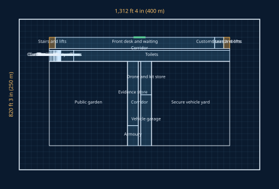
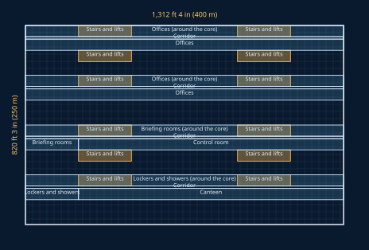

# P1-04 Bow Docks Police Post: plan

Footprint 1,312 ft 4 in (400 m) × 820 ft 3 in (250 m) · structural grid 32 ft 10 in (10 m)

## Levels

| Level | Floor above deck | Height | Floor area |
|---|---|---|---|
| Level 1 · Ground floor | 0 ft (0 mm) | 13 ft 9 in (4,200 mm) | 169,747 sq ft (15,770 m²) |
| Level 2 · Upper floor | 13 ft 9 in (4,200 mm) | 13 ft 9 in (4,200 mm) | 115,497 sq ft (10,730 m²) |

## Elements

| ID | Designation | Type | Name | Level(s) | Size / length | Area | Status |
|---|---|---|---|---|---|---|---|
| E001 | D5F3P1B5A2L1R1, D5F3P1B5A2L2R1 | core | Stairs and lifts | L1, L2 | 32 ft 10 in (10 m) × 60 ft 8 in (18 m) | 1,991 sq ft (185 m²) | proposed |
| E002 | D5F3P1B5A2L1R2, D5F3P1B5A2L2R2 | core | Stairs and lifts | L1, L2 | 32 ft 10 in (10 m) × 60 ft 8 in (18 m) | 1,991 sq ft (185 m²) | proposed |
| E003 | D5F3P1B5A2L1R3 | zone | Corridor | L1 | 984 ft 3 in (300 m) × 9 ft 10 in (3,000 mm) | 9,688 sq ft (900 m²) | proposed |
| E004 | D5F3P1B5A2L1R4 | room | Front desk and waiting | L1 | 869 ft 1 in (265 m) × 60 ft 8 in (18 m) | 52,750 sq ft (4,901 m²) | proposed |
| E005 | D5F3P1B5A2L1R5 | room | Customs search rooms | L1 | 49 ft 6 in (15 m) × 60 ft 8 in (18 m) | 3,007 sq ft (279 m²) | proposed |
| E006 | D5F3P1B5A2L1R6 | room | Customs search rooms | L1 | 7 ft 3 in (2,200 mm) × 60 ft 8 in (18 m) | 438 sq ft (41 m²) | proposed |
| E007 | D5F3P1B5A2L1R7 | room | Customs search rooms | L1 | 6 ft 11 in (2,100 mm) × 60 ft 8 in (18 m) | 418 sq ft (39 m²) | proposed |
| E008 | D5F3P1B5A2L1R8 | room | Customs search rooms | L1 | 7 ft 3 in (2,200 mm) × 60 ft 8 in (18 m) | 438 sq ft (41 m²) | proposed |
| E009 | D5F3P1B5A2L1R9 | room | Interview rooms | L1 | 5 ft 3 in (1,600 mm) × 60 ft 8 in (18 m) | 319 sq ft (30 m²) | proposed |
| E010 | D5F3P1B5A2L1R10 | room | Interview rooms | L1 | 5 ft 3 in (1,600 mm) × 60 ft 8 in (18 m) | 319 sq ft (30 m²) | proposed |
| E011 | D5F3P1B5A2L1R11 | room | Interview rooms | L1 | 5 ft 7 in (1,700 mm) × 60 ft 8 in (18 m) | 339 sq ft (31 m²) | proposed |
| E012 | D5F3P1B5A2L1R12 | room | Interview rooms | L1 | 5 ft 3 in (1,600 mm) × 60 ft 8 in (18 m) | 319 sq ft (30 m²) | proposed |
| E013 | D5F3P1B5A2L1R13 | room | Detained crew rooms | L1 | 2 ft 4 in (700 mm) × 60 ft 8 in (18 m) | 139 sq ft (13 m²) | proposed |
| E014 | D5F3P1B5A2L1R14 | room | Detained crew rooms | L1 | 2 ft 7 in (800 mm) × 60 ft 8 in (18 m) | 159 sq ft (15 m²) | proposed |
| E015 | D5F3P1B5A2L1R15 | room | Detained crew rooms | L1 | 2 ft 4 in (700 mm) × 60 ft 8 in (18 m) | 139 sq ft (13 m²) | proposed |
| E016 | D5F3P1B5A2L1R16 | room | Detained crew rooms | L1 | 2 ft 7 in (800 mm) × 60 ft 8 in (18 m) | 159 sq ft (15 m²) | proposed |
| E017 | D5F3P1B5A2L1R17 | room | Detained crew rooms | L1 | 2 ft 7 in (800 mm) × 60 ft 8 in (18 m) | 159 sq ft (15 m²) | proposed |
| E018 | D5F3P1B5A2L1R18 | room | Detained crew rooms | L1 | 2 ft 4 in (700 mm) × 60 ft 8 in (18 m) | 139 sq ft (13 m²) | proposed |
| E019 | D5F3P1B5A2L1R19 | room | Detained crew rooms | L1 | 2 ft 7 in (800 mm) × 60 ft 8 in (18 m) | 159 sq ft (15 m²) | proposed |
| E020 | D5F3P1B5A2L1R20 | room | Detained crew rooms | L1 | 2 ft 4 in (700 mm) × 60 ft 8 in (18 m) | 139 sq ft (13 m²) | proposed |
| E021 | D5F3P1B5A2L1R21 | room | Duty office | L1 | 70 ft 10 in (22 m) × 60 ft 8 in (18 m) | 4,301 sq ft (400 m²) | proposed |
| E022 | D5F3P1B5A2L1R22 | room | Toilets | L1 | 851 ft 1 in (259 m) × 60 ft 8 in (18 m) | 51,655 sq ft (4,799 m²) | proposed |
| E023 | D5F3P1B5A2L2R3 | zone | Corridor | L2 | 984 ft 3 in (300 m) × 9 ft 10 in (3,000 mm) | 9,688 sq ft (900 m²) | proposed |
| E024 | D5F3P1B5A2L2R4 | room | Dock security control | L2 | 918 ft 8 in (280 m) × 60 ft 8 in (18 m) | 55,757 sq ft (5,180 m²) | proposed |
| E025 | D5F3P1B5A2L2R5 | room | Open office | L2 | 532 ft 2 in (162 m) × 60 ft 8 in (18 m) | 32,299 sq ft (3,001 m²) | proposed |
| E026 | D5F3P1B5A2L2R6 | room | Briefing room | L2 | 53 ft 2 in (16 m) × 60 ft 8 in (18 m) | 3,226 sq ft (300 m²) | proposed |
| E027 | D5F3P1B5A2L2R7 | room | Lockers and showers | L2 | 106 ft 4 in (32 m) × 60 ft 8 in (18 m) | 6,452 sq ft (599 m²) | proposed |
| E028 | D5F3P1B5A2L2R8 | room | Canteen | L2 | 292 ft 8 in (89 m) × 60 ft 8 in (18 m) | 17,763 sq ft (1,650 m²) | proposed |
| E029 | D5F3P1B5A2L1R23 | zone | Corridor | L1 | 13 ft 1 in (4,000 mm) × 459 ft 4 in (140 m) | 6,028 sq ft (560 m²) | proposed |
| E030 | D5F3P1B5A2L1R24 | room | Evidence store | L1 | 59 ft 1 in (18 m) × 350 ft 1 in (107 m) | 20,673 sq ft (1,921 m²) | proposed |
| E031 | D5F3P1B5A2L1R25 | room | Armoury | L1 | 59 ft 1 in (18 m) × 109 ft 3 in (33 m) | 6,452 sq ft (599 m²) | proposed |
| E032 | D5F3P1B5A2L1R26 | room | Drone and kit store | L1 | 59 ft 1 in (18 m) × 182 ft 5 in (56 m) | 10,773 sq ft (1,001 m²) | proposed |
| E033 | D5F3P1B5A2L1R27 | room | Vehicle garage | L1 | 59 ft 1 in (18 m) × 276 ft 11 in (84 m) | 16,353 sq ft (1,519 m²) | proposed |
| E034 | D5F3P1B5A2L1R28 | zone | Secure vehicle yard | L1 | 426 ft 6 in (130 m) × 459 ft 4 in (140 m) | 195,903 sq ft (18,200 m²) | proposed |
| E035 | D5F3P1B5A2L1R29 | zone | Public garden | L1 | 426 ft 6 in (130 m) × 459 ft 4 in (140 m) | 195,903 sq ft (18,200 m²) | proposed |
| E036 |  | door | Public entrance | L1 | 65 ft 7 in (20 m), 65 ft 7 in (20 m) wide | — | proposed |

## Drawings

### Level 1 · Ground floor

### Level 2 · Upper floor

