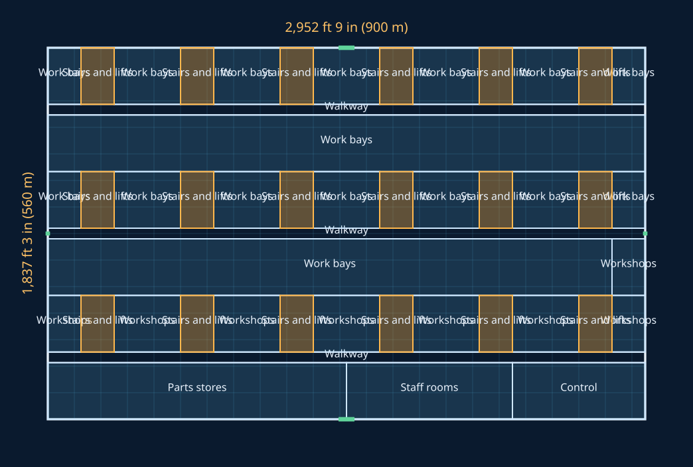
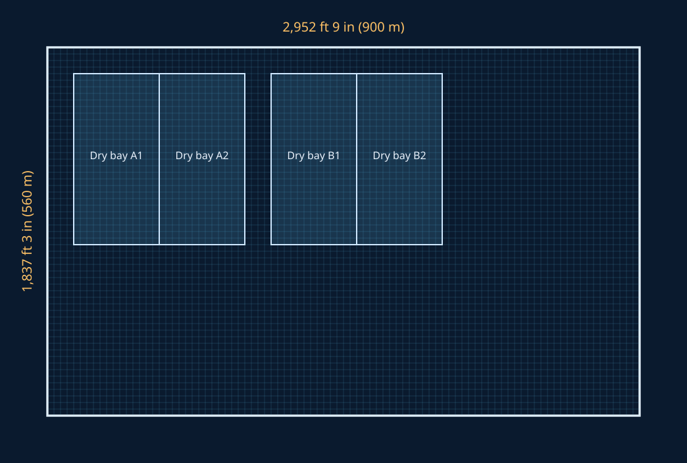

# P1-05 Repair Yard: plan

Footprint 2,952 ft 9 in (900 m) × 1,837 ft 3 in (560 m) · structural grid 32 ft 10 in (10 m)

## Levels

| Level | Floor above deck | Height | Floor area |
|---|---|---|---|
| Level 1 · Ground floor | 0 ft (0 mm) | 19 ft 8 in (6,000 mm) | 1,854,891 sq ft (172,325 m²) |
| Level 2 · Level 2 | 19 ft 8 in (6,000 mm) | 19 ft 8 in (6,000 mm) | 1,854,891 sq ft (172,325 m²) |
| Level 3 · Shed upper | 39 ft 4 in (12 m) | 19 ft 8 in (6,000 mm) | 1,455,281 sq ft (135,200 m²) |
| Level 4 · Shed upper | 59 ft 1 in (18 m) | 19 ft 8 in (6,000 mm) | 1,455,281 sq ft (135,200 m²) |
| Level 5 · Shed roof space | 78 ft 9 in (24 m) | 19 ft 8 in (6,000 mm) | 1,455,281 sq ft (135,200 m²) |

## Elements

| ID | Designation | Type | Name | Level(s) | Size / length | Area | Status |
|---|---|---|---|---|---|---|---|
| E001 | D5F3P1B5A3L1R1 | zone | Transporter lane (to the berths) | L1 | 2,952 ft 9 in (900 m) × 118 ft 1 in (36 m) | 348,751 sq ft (32,400 m²) | proposed |
| E002 | D5F3P1B5A3L1R2, D5F3P1B5A3L2R1, D5F3P1B5A3L3R1, D5F3P1B5A3L4R1, D5F3P1B5A3L5R1 | room | Dry bay A1 | L1, L2, L3, L4, L5 | 426 ft 6 in (130 m) × 853 ft (260 m) | 363,820 sq ft (33,800 m²) | proposed |
| E003 | D5F3P1B5A3L1R3, D5F3P1B5A3L2R2, D5F3P1B5A3L3R2, D5F3P1B5A3L4R2, D5F3P1B5A3L5R2 | room | Dry bay A2 | L1, L2, L3, L4, L5 | 426 ft 6 in (130 m) × 853 ft (260 m) | 363,820 sq ft (33,800 m²) | proposed |
| E004 | D5F3P1B5A3L1R4, D5F3P1B5A3L2R3, D5F3P1B5A3L3R3, D5F3P1B5A3L4R3, D5F3P1B5A3L5R3 | room | Dry bay B1 | L1, L2, L3, L4, L5 | 426 ft 6 in (130 m) × 853 ft (260 m) | 363,820 sq ft (33,800 m²) | proposed |
| E005 | D5F3P1B5A3L1R5, D5F3P1B5A3L2R4, D5F3P1B5A3L3R4, D5F3P1B5A3L4R4, D5F3P1B5A3L5R4 | room | Dry bay B2 | L1, L2, L3, L4, L5 | 426 ft 6 in (130 m) × 853 ft (260 m) | 363,820 sq ft (33,800 m²) | proposed |
| E006 | D5F3P1B5A3L1R6 | zone | Open repair cradles | L1 | 787 ft 5 in (240 m) × 853 ft (260 m) | 671,668 sq ft (62,400 m²) | proposed |
| E007 | D5F3P1B5A3L1R7, D5F3P1B5A3L2R5 | core | Stairs and lifts | L1, L2 | 32 ft 10 in (10 m) × 73 ft 10 in (22 m) | 2,422 sq ft (225 m²) | proposed |
| E008 | D5F3P1B5A3L1R8, D5F3P1B5A3L2R6 | core | Stairs and lifts | L1, L2 | 32 ft 10 in (10 m) × 73 ft 10 in (22 m) | 2,422 sq ft (225 m²) | proposed |
| E009 | D5F3P1B5A3L1R9, D5F3P1B5A3L2R7 | core | Stairs and lifts | L1, L2 | 32 ft 10 in (10 m) × 73 ft 10 in (22 m) | 2,422 sq ft (225 m²) | proposed |
| E010 | D5F3P1B5A3L1R10 | zone | Corridor | L1 | 2,755 ft 11 in (840 m) × 16 ft 5 in (5,000 mm) | 45,208 sq ft (4,200 m²) | proposed |
| E011 | D5F3P1B5A3L1R11 | room | Machine shop | L1 | 1,328 ft 9 in (405 m) × 73 ft 10 in (22 m) | 98,086 sq ft (9,112 m²) | proposed |
| E012 | D5F3P1B5A3L1R12 | room | Machine shop | L1 | 190 ft (58 m) × 73 ft 10 in (22 m) | 14,023 sq ft (1,303 m²) | proposed |
| E013 | D5F3P1B5A3L1R13 | room | Welding shop | L1 | 1,138 ft 9 in (347 m) × 73 ft 10 in (22 m) | 84,063 sq ft (7,810 m²) | proposed |
| E014 | D5F3P1B5A3L1R14 | room | Hull plating shop | L1 | 583 ft 4 in (178 m) × 73 ft 10 in (22 m) | 43,061 sq ft (4,000 m²) | proposed |
| E015 | D5F3P1B5A3L1R15 | room | Electrical shop | L1 | 364 ft 6 in (111 m) × 73 ft 10 in (22 m) | 26,907 sq ft (2,500 m²) | proposed |
| E016 | D5F3P1B5A3L1R16 | room | Pipe shop | L1 | 291 ft 8 in (89 m) × 73 ft 10 in (22 m) | 21,531 sq ft (2,000 m²) | proposed |
| E017 | D5F3P1B5A3L1R17 | room | Tool store | L1 | 174 ft 10 in (53 m) × 73 ft 10 in (22 m) | 12,909 sq ft (1,199 m²) | proposed |
| E018 | D5F3P1B5A3L1R18 | room | Locker rooms | L1 | 116 ft 10 in (36 m) × 73 ft 10 in (22 m) | 8,622 sq ft (801 m²) | proposed |
| E019 | D5F3P1B5A3L1R19 | room | Locker rooms | L1 | 116 ft 6 in (36 m) × 73 ft 10 in (22 m) | 8,598 sq ft (799 m²) | proposed |
| E020 | D5F3P1B5A3L1R20 | room | Stores | L1 | 1,108 ft 3 in (338 m) × 73 ft 10 in (22 m) | 81,811 sq ft (7,600 m²) | proposed |
| E021 | D5F3P1B5A3L2R8 | zone | Corridor | L2 | 2,755 ft 11 in (840 m) × 16 ft 5 in (5,000 mm) | 45,208 sq ft (4,200 m²) | proposed |
| E022 | D5F3P1B5A3L2R9 | room | Canteen | L2 | 1,328 ft 9 in (405 m) × 73 ft 10 in (22 m) | 98,086 sq ft (9,112 m²) | proposed |
| E023 | D5F3P1B5A3L2R10 | room | Canteen | L2 | 1,328 ft 9 in (405 m) × 73 ft 10 in (22 m) | 98,086 sq ft (9,112 m²) | proposed |
| E024 | D5F3P1B5A3L2R11 | room | Planning and estimates | L2 | 364 ft 6 in (111 m) × 73 ft 10 in (22 m) | 26,907 sq ft (2,500 m²) | proposed |
| E025 | D5F3P1B5A3L2R12 | room | Training room | L2 | 87 ft 7 in (27 m) × 73 ft 10 in (22 m) | 6,466 sq ft (601 m²) | proposed |
| E026 | D5F3P1B5A3L2R13 | room | Offices | L2 | 2,303 ft 10 in (702 m) × 73 ft 10 in (22 m) | 170,064 sq ft (15,800 m²) | proposed |
| E027 | D5F3P1B5A3L1R21 | zone | Road-side parking | L1 | 2,755 ft 11 in (840 m) × 426 ft 6 in (130 m) | 1,175,419 sq ft (109,200 m²) | proposed |
| E028 |  | door | Shed A door | L1 | 787 ft 5 in (240 m), 787 ft 5 in (240 m) wide | — | proposed |
| E029 |  | door | Shed B door | L1 | 787 ft 5 in (240 m), 787 ft 5 in (240 m) wide | — | proposed |

## Drawings

### Level 1 · Ground floor

### Level 2 · Level 2

### Level 3 · Shed upper

### Level 4 · Shed upper

### Level 5 · Shed roof space

