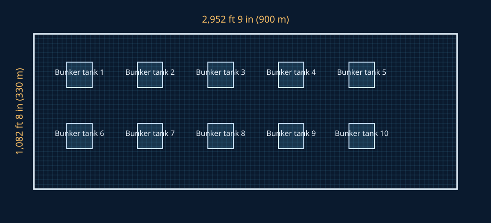

# P1-06 Bow Docks Fuel Depot: plan

Footprint 2,952 ft 9 in (900 m) × 1,082 ft 8 in (330 m) · structural grid 32 ft 10 in (10 m)

## Levels

| Level | Floor above deck | Height | Floor area |
|---|---|---|---|
| Level 1 · Ground | 0 ft (0 mm) | 29 ft 6 in (9,000 mm) | 416,994 sq ft (38,740 m²) |
| Level 2 · Tank tops | 29 ft 6 in (9,000 mm) | 29 ft 6 in (9,000 mm) | 313,876 sq ft (29,160 m²) |

## Elements

| ID | Designation | Type | Name | Level(s) | Size / length | Area | Status |
|---|---|---|---|---|---|---|---|
| E001 | D5F3P1B4A3L1R1 | zone | Bunker manifold (lines to the berths) | L1 | 2,952 ft 9 in (900 m) × 98 ft 5 in (30 m) | 290,626 sq ft (27,000 m²) | proposed |
| E002 | D5F3P1B4A3L1R2 | zone | Spill wall | L1 | 2,493 ft 5 in (760 m) × 820 ft 3 in (250 m) | 2,045,143 sq ft (190,000 m²) | proposed |
| E003 | D5F3P1B4A3L1R3, D5F3P1B4A3L2R1 | room | Bunker tank 1 | L1, L2 | 177 ft 2 in (54 m) × 177 ft 2 in (54 m) | 31,388 sq ft (2,916 m²) | proposed |
| E004 | D5F3P1B4A3L1R4, D5F3P1B4A3L2R2 | room | Bunker tank 2 | L1, L2 | 177 ft 2 in (54 m) × 177 ft 2 in (54 m) | 31,388 sq ft (2,916 m²) | proposed |
| E005 | D5F3P1B4A3L1R5, D5F3P1B4A3L2R3 | room | Bunker tank 3 | L1, L2 | 177 ft 2 in (54 m) × 177 ft 2 in (54 m) | 31,388 sq ft (2,916 m²) | proposed |
| E006 | D5F3P1B4A3L1R6, D5F3P1B4A3L2R4 | room | Bunker tank 4 | L1, L2 | 177 ft 2 in (54 m) × 177 ft 2 in (54 m) | 31,388 sq ft (2,916 m²) | proposed |
| E007 | D5F3P1B4A3L1R7, D5F3P1B4A3L2R5 | room | Bunker tank 5 | L1, L2 | 177 ft 2 in (54 m) × 177 ft 2 in (54 m) | 31,388 sq ft (2,916 m²) | proposed |
| E008 | D5F3P1B4A3L1R8, D5F3P1B4A3L2R6 | room | Bunker tank 6 | L1, L2 | 177 ft 2 in (54 m) × 177 ft 2 in (54 m) | 31,388 sq ft (2,916 m²) | proposed |
| E009 | D5F3P1B4A3L1R9, D5F3P1B4A3L2R7 | room | Bunker tank 7 | L1, L2 | 177 ft 2 in (54 m) × 177 ft 2 in (54 m) | 31,388 sq ft (2,916 m²) | proposed |
| E010 | D5F3P1B4A3L1R10, D5F3P1B4A3L2R8 | room | Bunker tank 8 | L1, L2 | 177 ft 2 in (54 m) × 177 ft 2 in (54 m) | 31,388 sq ft (2,916 m²) | proposed |
| E011 | D5F3P1B4A3L1R11, D5F3P1B4A3L2R9 | room | Bunker tank 9 | L1, L2 | 177 ft 2 in (54 m) × 177 ft 2 in (54 m) | 31,388 sq ft (2,916 m²) | proposed |
| E012 | D5F3P1B4A3L1R12, D5F3P1B4A3L2R10 | room | Bunker tank 10 | L1, L2 | 177 ft 2 in (54 m) × 177 ft 2 in (54 m) | 31,388 sq ft (2,916 m²) | proposed |
| E013 | D5F3P1B4A3L1R13 | zone | Corridor | L1 | 13 ft 1 in (4,000 mm) × 360 ft 11 in (110 m) | 4,736 sq ft (440 m²) | proposed |
| E014 | D5F3P1B4A3L1R14 | room | Bunker pumps | L1 | 91 ft 10 in (28 m) × 360 ft 11 in (110 m) | 33,153 sq ft (3,080 m²) | proposed |
| E015 | D5F3P1B4A3L1R15 | room | Filter room | L1 | 91 ft 10 in (28 m) × 140 ft 9 in (43 m) | 12,930 sq ft (1,201 m²) | proposed |
| E016 | D5F3P1B4A3L1R16 | room | Switch room | L1 | 91 ft 10 in (28 m) × 220 ft 2 in (67 m) | 20,223 sq ft (1,879 m²) | proposed |
| E017 | D5F3P1B4A3L1R17 | zone | Corridor | L1 | 196 ft 10 in (60 m) × 9 ft 10 in (3,000 mm) | 1,938 sq ft (180 m²) | proposed |
| E018 | D5F3P1B4A3L1R18 | room | Control room | L1 | 196 ft 10 in (60 m) × 93 ft 6 in (28 m) | 18,406 sq ft (1,710 m²) | proposed |
| E019 | D5F3P1B4A3L1R19 | room | Fuel quality lab | L1 | 57 ft 5 in (18 m) × 93 ft 6 in (28 m) | 5,369 sq ft (499 m²) | proposed |
| E020 | D5F3P1B4A3L1R20 | room | Crew room | L1 | 139 ft 5 in (42 m) × 93 ft 6 in (28 m) | 13,038 sq ft (1,211 m²) | proposed |
| E021 | D5F3P1B4A3L1R21 | zone | Truck bay | L1 | 229 ft 8 in (70 m) × 278 ft 10 in (85 m) | 64,045 sq ft (5,950 m²) | proposed |

## Drawings

### Level 1 · Ground

### Level 2 · Tank tops

