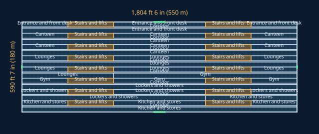
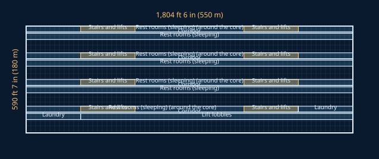

# P1-07 Pilot Lounge: plan

Footprint 1,804 ft 6 in (550 m) × 590 ft 7 in (180 m) · structural grid 26 ft 3 in (8,000 mm)

## Levels

| Level | Floor above deck | Height | Floor area |
|---|---|---|---|
| Level 1 · Ground floor | 0 ft (0 mm) | 19 ft 8 in (6,000 mm) | 794,204 sq ft (73,784 m²) |
| Level 2 · Upper floor | 19 ft 8 in (6,000 mm) | 11 ft 10 in (3,600 mm) | 475,980 sq ft (44,220 m²) |
| Level 3 · Upper floor | 31 ft 6 in (9,600 mm) | 11 ft 10 in (3,600 mm) | 475,980 sq ft (44,220 m²) |
| Level 4 · Upper floor | 43 ft 4 in (13 m) | 11 ft 10 in (3,600 mm) | 475,980 sq ft (44,220 m²) |

## Elements

| ID | Designation | Type | Name | Level(s) | Size / length | Area | Status |
|---|---|---|---|---|---|---|---|
| L1-001 | D5F3P1B4A4L1R1 | zone | Corridor | L1 | 1,804 ft 6 in (550 m) × 7 ft 10 in (2,400 mm) | 14,208 sq ft (1,320 m²) | proposed |
| L1-002 | D5F3P1B4A4L1R2 | zone | Corridor | L1 | 1,804 ft 6 in (550 m) × 7 ft 10 in (2,400 mm) | 14,208 sq ft (1,320 m²) | proposed |
| L1-003 | D5F3P1B4A4L1R3 | zone | Corridor | L1 | 1,804 ft 6 in (550 m) × 7 ft 10 in (2,400 mm) | 14,208 sq ft (1,320 m²) | proposed |
| L1-004 | D5F3P1B4A4L1R4 | zone | Corridor | L1 | 1,804 ft 6 in (550 m) × 7 ft 10 in (2,400 mm) | 14,208 sq ft (1,320 m²) | proposed |
| L1-005 | D5F3P1B4A4L1R5 | zone | Corridor | L1 | 1,804 ft 6 in (550 m) × 7 ft 10 in (2,400 mm) | 14,208 sq ft (1,320 m²) | proposed |
| L1-006 | D5F3P1B4A4L1R6 | zone | Corridor | L1 | 1,804 ft 6 in (550 m) × 7 ft 10 in (2,400 mm) | 14,208 sq ft (1,320 m²) | proposed |
| L1-007 | D5F3P1B4A4L1R7 | zone | Corridor | L1 | 1,804 ft 6 in (550 m) × 7 ft 10 in (2,400 mm) | 14,208 sq ft (1,320 m²) | proposed |
| L1-008 | D5F3P1B4A4L1R8 | zone | Corridor | L1 | 1,804 ft 6 in (550 m) × 7 ft 10 in (2,400 mm) | 14,208 sq ft (1,320 m²) | proposed |
| L1-009 | D5F3P1B4A4L1R9 | room | Entrance and front desk | L1 | 300 ft 10 in (92 m) × 32 ft 10 in (10 m) | 9,871 sq ft (917 m²) | proposed |
| L1-010 | D5F3P1B4A4L1R10 | room | Entrance and front desk | L1 | 601 ft 8 in (183 m) × 32 ft 10 in (10 m) | 19,741 sq ft (1,834 m²) | proposed |
| L1-011 | D5F3P1B4A4L1R11 | room | Entrance and front desk | L1 | 300 ft 10 in (92 m) × 32 ft 10 in (10 m) | 9,871 sq ft (917 m²) | proposed |
| L1-012 | D5F3P1B4A4L1R12 | room | Entrance and front desk | L1 | 1,804 ft 6 in (550 m) × 33 ft 2 in (10 m) | 59,794 sq ft (5,555 m²) | proposed |
| L1-013 | D5F3P1B4A4L1R13 | room | Canteen | L1 | 300 ft 10 in (92 m) × 32 ft 10 in (10 m) | 9,871 sq ft (917 m²) | proposed |
| L1-014 | D5F3P1B4A4L1R14 | room | Canteen | L1 | 601 ft 8 in (183 m) × 32 ft 10 in (10 m) | 19,741 sq ft (1,834 m²) | proposed |
| L1-015 | D5F3P1B4A4L1R15 | room | Canteen | L1 | 300 ft 10 in (92 m) × 32 ft 10 in (10 m) | 9,871 sq ft (917 m²) | proposed |
| L1-016 | D5F3P1B4A4L1R16 | room | Canteen | L1 | 1,804 ft 6 in (550 m) × 33 ft 2 in (10 m) | 59,794 sq ft (5,555 m²) | proposed |
| L1-017 | D5F3P1B4A4L1R17 | room | Canteen | L1 | 300 ft 10 in (92 m) × 32 ft 10 in (10 m) | 9,871 sq ft (917 m²) | proposed |
| L1-018 | D5F3P1B4A4L1R18 | room | Canteen | L1 | 601 ft 8 in (183 m) × 32 ft 10 in (10 m) | 19,741 sq ft (1,834 m²) | proposed |
| L1-019 | D5F3P1B4A4L1R19 | room | Canteen | L1 | 300 ft 10 in (92 m) × 32 ft 10 in (10 m) | 9,871 sq ft (917 m²) | proposed |
| L1-020 | D5F3P1B4A4L1R20 | room | Canteen | L1 | 1,804 ft 6 in (550 m) × 33 ft 2 in (10 m) | 59,794 sq ft (5,555 m²) | proposed |
| L1-021 | D5F3P1B4A4L1R21 | room | Lounges | L1 | 300 ft 10 in (92 m) × 32 ft 10 in (10 m) | 9,871 sq ft (917 m²) | proposed |
| L1-022 | D5F3P1B4A4L1R22 | room | Lounges | L1 | 601 ft 8 in (183 m) × 32 ft 10 in (10 m) | 19,741 sq ft (1,834 m²) | proposed |
| L1-023 | D5F3P1B4A4L1R23 | room | Lounges | L1 | 300 ft 10 in (92 m) × 32 ft 10 in (10 m) | 9,871 sq ft (917 m²) | proposed |
| L1-024 | D5F3P1B4A4L1R24 | room | Lounges | L1 | 1,804 ft 6 in (550 m) × 33 ft 2 in (10 m) | 59,794 sq ft (5,555 m²) | proposed |
| L1-025 | D5F3P1B4A4L1R25 | room | Lounges | L1 | 300 ft 10 in (92 m) × 32 ft 10 in (10 m) | 9,871 sq ft (917 m²) | proposed |
| L1-026 | D5F3P1B4A4L1R26 | room | Lounges | L1 | 601 ft 8 in (183 m) × 32 ft 10 in (10 m) | 19,741 sq ft (1,834 m²) | proposed |
| L1-027 | D5F3P1B4A4L1R27 | room | Lounges | L1 | 300 ft 10 in (92 m) × 32 ft 10 in (10 m) | 9,871 sq ft (917 m²) | proposed |
| L1-028 | D5F3P1B4A4L1R28 | room | Lounges | L1 | 601 ft 5 in (183 m) × 33 ft 2 in (10 m) | 19,928 sq ft (1,851 m²) | proposed |
| L1-029 | D5F3P1B4A4L1R29 | room | Gym | L1 | 1,203 ft 1 in (367 m) × 33 ft 2 in (10 m) | 39,866 sq ft (3,704 m²) | proposed |
| L1-030 | D5F3P1B4A4L1R30 | room | Gym | L1 | 300 ft 10 in (92 m) × 32 ft 10 in (10 m) | 9,871 sq ft (917 m²) | proposed |
| L1-031 | D5F3P1B4A4L1R31 | room | Gym | L1 | 601 ft 8 in (183 m) × 32 ft 10 in (10 m) | 19,741 sq ft (1,834 m²) | proposed |
| L1-032 | D5F3P1B4A4L1R32 | room | Gym | L1 | 300 ft 10 in (92 m) × 32 ft 10 in (10 m) | 9,871 sq ft (917 m²) | proposed |
| L1-033 | D5F3P1B4A4L1R33 | room | Lockers and showers | L1 | 1,804 ft 6 in (550 m) × 33 ft 2 in (10 m) | 59,794 sq ft (5,555 m²) | proposed |
| L1-034 | D5F3P1B4A4L1R34 | room | Lockers and showers | L1 | 300 ft 10 in (92 m) × 32 ft 10 in (10 m) | 9,871 sq ft (917 m²) | proposed |
| L1-035 | D5F3P1B4A4L1R35 | room | Lockers and showers | L1 | 601 ft 8 in (183 m) × 32 ft 10 in (10 m) | 19,741 sq ft (1,834 m²) | proposed |
| L1-036 | D5F3P1B4A4L1R36 | room | Lockers and showers | L1 | 300 ft 10 in (92 m) × 32 ft 10 in (10 m) | 9,871 sq ft (917 m²) | proposed |
| L1-037 | D5F3P1B4A4L1R37 | room | Lockers and showers | L1 | 1,203 ft 1 in (367 m) × 33 ft 2 in (10 m) | 39,866 sq ft (3,704 m²) | proposed |
| L1-038 | D5F3P1B4A4L1R38 | room | Kitchen and stores | L1 | 601 ft 5 in (183 m) × 33 ft 2 in (10 m) | 19,928 sq ft (1,851 m²) | proposed |
| L1-039 | D5F3P1B4A4L1R39 | room | Kitchen and stores | L1 | 300 ft 10 in (92 m) × 32 ft 10 in (10 m) | 9,871 sq ft (917 m²) | proposed |
| L1-040 | D5F3P1B4A4L1R40 | room | Kitchen and stores | L1 | 601 ft 8 in (183 m) × 32 ft 10 in (10 m) | 19,741 sq ft (1,834 m²) | proposed |
| L1-041 | D5F3P1B4A4L1R41 | room | Kitchen and stores | L1 | 300 ft 10 in (92 m) × 32 ft 10 in (10 m) | 9,871 sq ft (917 m²) | proposed |
| L1-042 | D5F3P1B4A4L1R42 | room | Kitchen and stores | L1 | 1,804 ft 6 in (550 m) × 33 ft 2 in (10 m) | 59,794 sq ft (5,555 m²) | proposed |
| L1-043 | D5F3P1B4A4L1R43, D5F3P1B4A4L2R1, D5F3P1B4A4L3R1, D5F3P1B4A4L4R1 | core | Stairs and lifts | L1, L2, L3, L4 | 300 ft 6 in (92 m) × 32 ft 10 in (10 m) | 9,860 sq ft (916 m²) | proposed |
| L1-044 | D5F3P1B4A4L1R44, D5F3P1B4A4L2R2, D5F3P1B4A4L3R2, D5F3P1B4A4L4R2 | core | Stairs and lifts | L1, L2, L3, L4 | 300 ft 6 in (92 m) × 32 ft 10 in (10 m) | 9,860 sq ft (916 m²) | proposed |
| L1-045 | D5F3P1B4A4L1R45 | core | Stairs and lifts | L1 | 300 ft 6 in (92 m) × 32 ft 10 in (10 m) | 9,860 sq ft (916 m²) | proposed |
| L1-046 | D5F3P1B4A4L1R46 | core | Stairs and lifts | L1 | 300 ft 6 in (92 m) × 32 ft 10 in (10 m) | 9,860 sq ft (916 m²) | proposed |
| L1-047 | D5F3P1B4A4L1R47, D5F3P1B4A4L2R3, D5F3P1B4A4L3R3, D5F3P1B4A4L4R3 | core | Stairs and lifts | L1, L2, L3, L4 | 300 ft 6 in (92 m) × 32 ft 10 in (10 m) | 9,860 sq ft (916 m²) | proposed |
| L1-048 | D5F3P1B4A4L1R48, D5F3P1B4A4L2R4, D5F3P1B4A4L3R4, D5F3P1B4A4L4R4 | core | Stairs and lifts | L1, L2, L3, L4 | 300 ft 6 in (92 m) × 32 ft 10 in (10 m) | 9,860 sq ft (916 m²) | proposed |
| L1-049 | D5F3P1B4A4L1R49 | core | Stairs and lifts | L1 | 300 ft 6 in (92 m) × 32 ft 10 in (10 m) | 9,860 sq ft (916 m²) | proposed |
| L1-050 | D5F3P1B4A4L1R50 | core | Stairs and lifts | L1 | 300 ft 6 in (92 m) × 32 ft 10 in (10 m) | 9,860 sq ft (916 m²) | proposed |
| L1-051 | D5F3P1B4A4L1R51, D5F3P1B4A4L2R5, D5F3P1B4A4L3R5, D5F3P1B4A4L4R5 | core | Stairs and lifts | L1, L2, L3, L4 | 300 ft 6 in (92 m) × 32 ft 10 in (10 m) | 9,860 sq ft (916 m²) | proposed |
| L1-052 | D5F3P1B4A4L1R52, D5F3P1B4A4L2R6, D5F3P1B4A4L3R6, D5F3P1B4A4L4R6 | core | Stairs and lifts | L1, L2, L3, L4 | 300 ft 6 in (92 m) × 32 ft 10 in (10 m) | 9,860 sq ft (916 m²) | proposed |
| L1-053 | D5F3P1B4A4L1R53 | core | Stairs and lifts | L1 | 300 ft 6 in (92 m) × 32 ft 10 in (10 m) | 9,860 sq ft (916 m²) | proposed |
| L1-054 | D5F3P1B4A4L1R54 | core | Stairs and lifts | L1 | 300 ft 6 in (92 m) × 32 ft 10 in (10 m) | 9,860 sq ft (916 m²) | proposed |
| L1-055 | D5F3P1B4A4L1R55, D5F3P1B4A4L2R7, D5F3P1B4A4L3R7, D5F3P1B4A4L4R7 | core | Stairs and lifts | L1, L2, L3, L4 | 300 ft 6 in (92 m) × 32 ft 10 in (10 m) | 9,860 sq ft (916 m²) | proposed |
| L1-056 | D5F3P1B4A4L1R56, D5F3P1B4A4L2R8, D5F3P1B4A4L3R8, D5F3P1B4A4L4R8 | core | Stairs and lifts | L1, L2, L3, L4 | 300 ft 6 in (92 m) × 32 ft 10 in (10 m) | 9,860 sq ft (916 m²) | proposed |
| L1-057 | D5F3P1B4A4L1R57 | core | Stairs and lifts | L1 | 300 ft 6 in (92 m) × 32 ft 10 in (10 m) | 9,860 sq ft (916 m²) | proposed |
| L1-058 | D5F3P1B4A4L1R58 | core | Stairs and lifts | L1 | 300 ft 6 in (92 m) × 32 ft 10 in (10 m) | 9,860 sq ft (916 m²) | proposed |
| LT-001 | D5F3P1B4A4L2R9, D5F3P1B4A4L3R9, D5F3P1B4A4L4R9 | zone | Corridor | L2, L3, L4 | 1,804 ft 6 in (550 m) × 7 ft 10 in (2,400 mm) | 14,208 sq ft (1,320 m²) | proposed |
| LT-002 | D5F3P1B4A4L2R10, D5F3P1B4A4L3R10, D5F3P1B4A4L4R10 | zone | Corridor | L2, L3, L4 | 1,804 ft 6 in (550 m) × 7 ft 10 in (2,400 mm) | 14,208 sq ft (1,320 m²) | proposed |
| LT-003 | D5F3P1B4A4L2R11, D5F3P1B4A4L3R11, D5F3P1B4A4L4R11 | zone | Corridor | L2, L3, L4 | 1,804 ft 6 in (550 m) × 7 ft 10 in (2,400 mm) | 14,208 sq ft (1,320 m²) | proposed |
| LT-004 | D5F3P1B4A4L2R12, D5F3P1B4A4L3R12, D5F3P1B4A4L4R12 | zone | Corridor | L2, L3, L4 | 1,804 ft 6 in (550 m) × 7 ft 10 in (2,400 mm) | 14,208 sq ft (1,320 m²) | proposed |
| LT-005 | D5F3P1B4A4L2R13, D5F3P1B4A4L3R13, D5F3P1B4A4L4R13 | room | Rest rooms (sleeping) (around the core) | L2, L3, L4 | 1,804 ft 6 in (550 m) × 32 ft 10 in (10 m) | 59,202 sq ft (5,500 m²) | proposed |
| LT-006 | D5F3P1B4A4L2R14, D5F3P1B4A4L3R14, D5F3P1B4A4L4R14 | room | Rest rooms (sleeping) | L2, L3, L4 | 1,804 ft 6 in (550 m) × 33 ft 2 in (10 m) | 59,794 sq ft (5,555 m²) | proposed |
| LT-007 | D5F3P1B4A4L2R15, D5F3P1B4A4L3R15, D5F3P1B4A4L4R15 | room | Rest rooms (sleeping) (around the core) | L2, L3, L4 | 1,804 ft 6 in (550 m) × 32 ft 10 in (10 m) | 59,202 sq ft (5,500 m²) | proposed |
| LT-008 | D5F3P1B4A4L2R16, D5F3P1B4A4L3R16, D5F3P1B4A4L4R16 | room | Rest rooms (sleeping) | L2, L3, L4 | 1,804 ft 6 in (550 m) × 33 ft 2 in (10 m) | 59,794 sq ft (5,555 m²) | proposed |
| LT-009 | D5F3P1B4A4L2R17, D5F3P1B4A4L3R17, D5F3P1B4A4L4R17 | room | Rest rooms (sleeping) (around the core) | L2, L3, L4 | 1,804 ft 6 in (550 m) × 32 ft 10 in (10 m) | 59,202 sq ft (5,500 m²) | proposed |
| LT-010 | D5F3P1B4A4L2R18, D5F3P1B4A4L3R18, D5F3P1B4A4L4R18 | room | Rest rooms (sleeping) | L2, L3, L4 | 1,804 ft 6 in (550 m) × 33 ft 2 in (10 m) | 59,794 sq ft (5,555 m²) | proposed |
| LT-011 | D5F3P1B4A4L2R19, D5F3P1B4A4L3R19, D5F3P1B4A4L4R19 | room | Rest rooms (sleeping) (around the core) | L2, L3, L4 | 1,503 ft 7 in (458 m) × 32 ft 10 in (10 m) | 49,331 sq ft (4,583 m²) | proposed |
| LT-012 | D5F3P1B4A4L2R20, D5F3P1B4A4L3R20, D5F3P1B4A4L4R20 | room | Laundry | L2, L3, L4 | 300 ft 10 in (92 m) × 32 ft 10 in (10 m) | 9,871 sq ft (917 m²) | proposed |
| LT-013 | D5F3P1B4A4L2R21, D5F3P1B4A4L3R21, D5F3P1B4A4L4R21 | room | Laundry | L2, L3, L4 | 300 ft 10 in (92 m) × 33 ft 2 in (10 m) | 9,969 sq ft (926 m²) | proposed |
| LT-014 | D5F3P1B4A4L2R22, D5F3P1B4A4L3R22, D5F3P1B4A4L4R22 | room | Lift lobbies | L2, L3, L4 | 1,503 ft 7 in (458 m) × 33 ft 2 in (10 m) | 49,824 sq ft (4,629 m²) | proposed |
| D-73 |  | door | Main entrance | L1 | 78 ft 9 in (24 m), 78 ft 9 in (24 m) wide | — | proposed |
| D-74 |  | door | Second entrance | L1 | 78 ft 9 in (24 m), 78 ft 9 in (24 m) wide | — | proposed |
| D-75 |  | door | Side door | L1 | 19 ft 8 in (6,000 mm), 19 ft 8 in (6,000 mm) wide | — | proposed |
| D-76 |  | door | Side door | L1 | 19 ft 8 in (6,000 mm), 19 ft 8 in (6,000 mm) wide | — | proposed |

## Drawings

### Level 1 · Ground floor

### Level 2 · Upper floor

### Level 3 · Upper floor

### Level 4 · Upper floor

